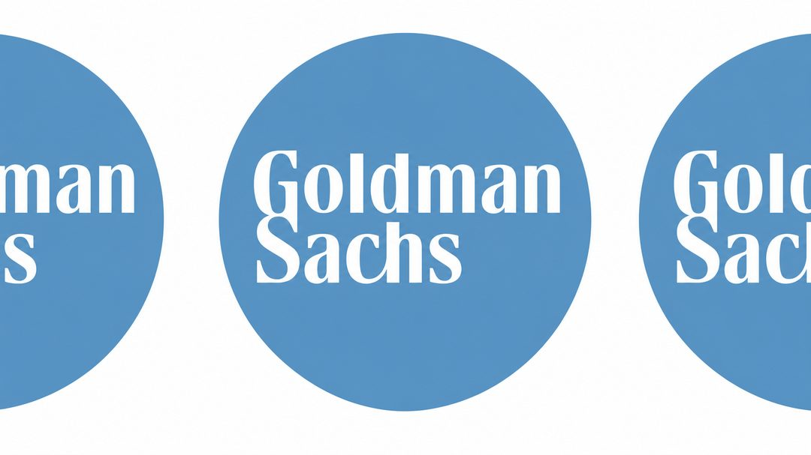
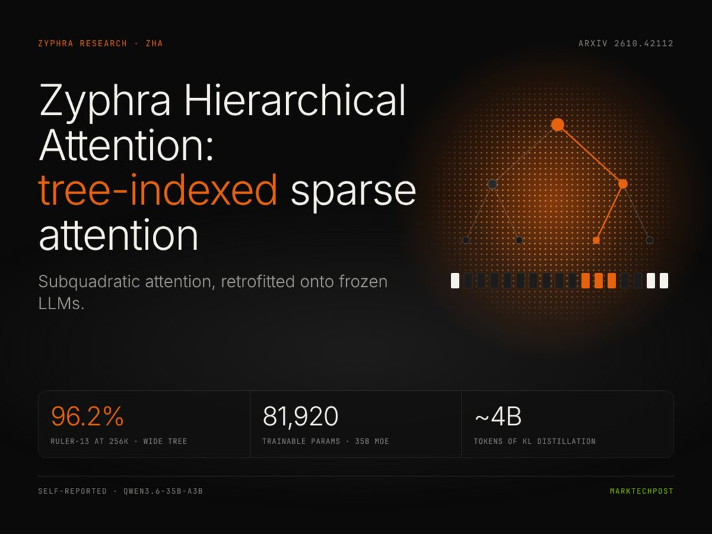
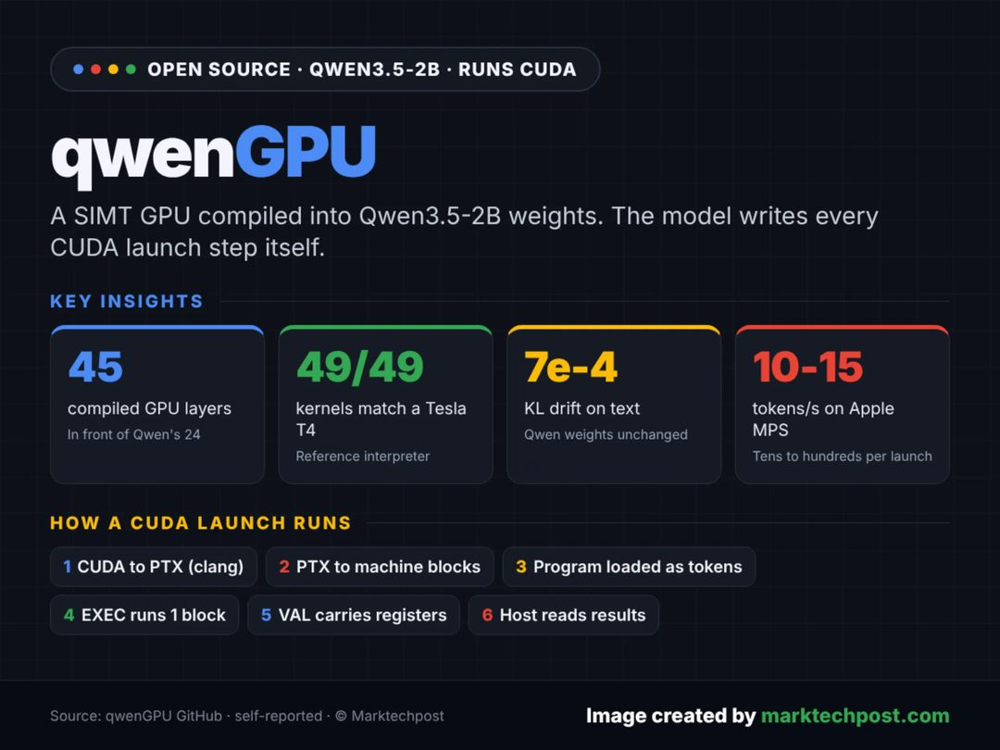
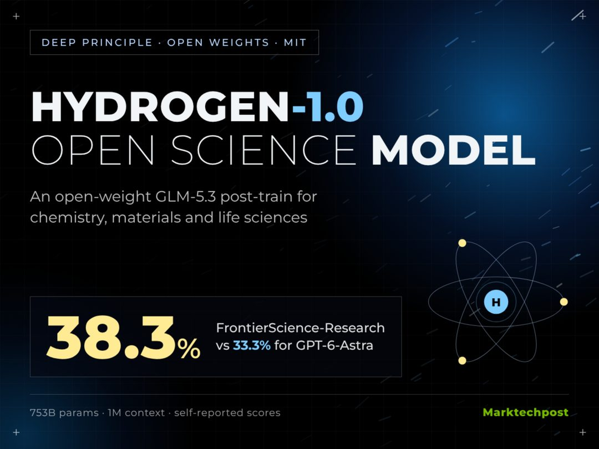
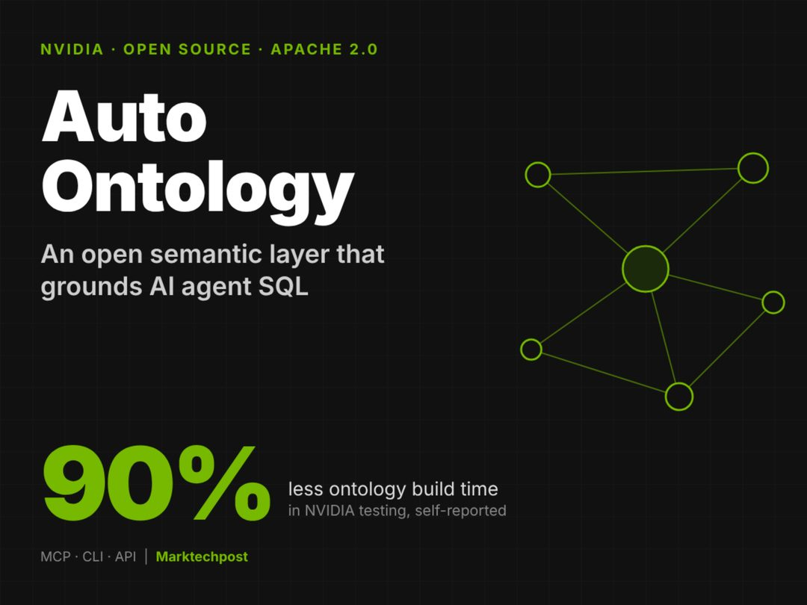
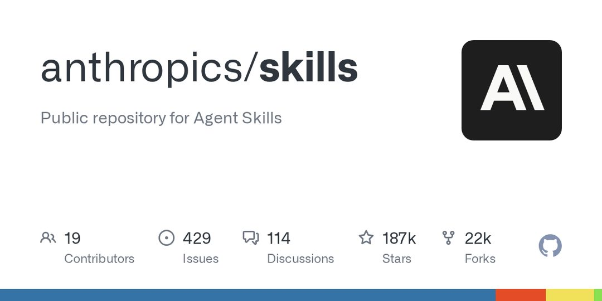

今天最值得看的三件事：

- **模型发布** · GPT-6.2 Astra 灰测：能直接读写 Qwen 权重
- **公司动态** · Anthropic 启动 IPO，营收增 12 倍仍亏 230 亿美元
- **模型发布** · 美团 LongCat-2.5：1.6 万亿参数全国产算力训练

下文按板块展开，正文每条均附原始链接。

<h2 id="model-release" class="ai-section-divider">🚀 模型发布</h2>

今天模型发布板块最值得注意的一条并不在参数规模，而在边界：有报道称 GPT-6.2 Astra 已能原生读写其他模型的权重。若这一点成立，模型能力的来源会从“自己训”变成“可以借”，蒸馏从灰色手段变成产品特性，许可证与安全讨论会比技术更早撞上来。同一梯队的另外两条消息，则分别代表了国产算力上的规模化验证与入口争夺，三条放在一起看，行业竞争的重心正在移动。

### GPT-6.2 Astra：模型之间的墙被凿了一个洞

量子位报道，GPT-6.2 Astra 已开启灰度测试，HuggingFace 上疑似泄露的权重被下载数千次；同日 Anthropic 的 Claude Mythos 5.5 也被曝光。更关键的是技术侧的说法：Astra 可原生读写其他模型的权重，数学能力提升约 6 倍，相关讨论在 Hacker News 拿到 2000 分以上。

关键点在于“原生”二字——不是蒸馏、不是接口调用，而是在权重层面做互操作。若成立，模型能力的获取路径会被改写，随之而来的是权重来源的合规性、跨厂商许可，以及被读取方几乎无从防御的安全问题。需要保留一分怀疑：泄露权重与能力数字均无官方确认，灰度测试的说法也仍在验证阶段。

> 原文：[量子位](https://www.qbitai.com/2026/11/507082.html)

### 美团 LongCat-2.5：1.6 万亿参数跑在国产算力上

美团发布 LongCat-2.5，总参数 1.6 万亿，原生多模态，面向长程智能体（long-horizon agentic）任务，全程在国产算力上完成训练，号称当前国产算力上规模最大的训练任务。

关键点不在 1.6 万亿这个数字，而在“全程国产算力”。万亿级 MoE 训练对互联带宽、故障恢复、训练框架稳定性都是硬考验，能完整跑完本身就是对国产栈的一次压力测试，其工程意义大于榜单意义。对做 agent 的团队来说，原生多模态 + 长程任务的定位也说明竞争焦点正从单点分数转向“能不能连续干完一件长活”。

> 原文：[雷锋网](https://www.leiphone.com/category/industrynews/mUPVr3RF0MHNmn3t.html)

### 商汤 SenseNova 6.8 Flash：免费，且专治“翻车现场”

商汤上线 SenseNova 6.8 Flash，免费开放给开发者与普通用户。官方定位相当具体：在复杂任务上，接住此前顶级模型翻车的场景。

“Flash”通常意味着轻量与低成本，而它主打复杂任务与可靠性，这里存在张力——真实水平要看它在长链推理、工具调用上的稳定度。免费在当前阶段更像获客与数据回流手段：能力趋同时，先占住调用量，才有机会在具体场景里继续迭代。对开发者是一个低成本的备选，对商汤则是一场以成本换入口的下注。

> 原文：[量子位](https://www.qbitai.com/2026/11/507277.html)

---

三条消息放在一起，指向的是同一件事：竞争正从“谁的分数高”，转向“谁能借用别人的能力、谁能驯服自己的算力、谁先占住调用入口”。如果权重真的可以互读，模型厂商的护城河还剩下什么？

<h2 id="company" class="ai-section-divider">🏢 公司动态</h2>

Anthropic 上周递交美国 IPO 申请，营收同比增长约 12 倍，亏损却扩大到 230 亿美元量级。把这条新闻和今天其余七条放在一起看，几乎是同一件事的不同切面：高盛收回交易员的 AI 编程工具、马斯克因成本下调 Grok Bot 额度、甲骨文发 200 亿美元债建数据中心。AI 的能力曲线还在往上，成本曲线一条都没下来。当资本市场开始用每股亏损而不是榜单排名给 AI 公司定价，这个板块的叙事重心就变了——从比谁更强，转向比谁扛得住账单。

### Anthropic 递交 IPO，亏损 230 亿美元

Anthropic 上周递交美国 IPO 申请，同时计划通过澳洲券商向当地散户发售股票。同期披露的数据显示，其营收同比增长约 12 倍，亏损扩大至 230 亿美元量级，内部 AI 使用成本甚至超过员工薪酬。

三个信号值得分开看。营收 12 倍增长说明需求端没有减速；亏损同步扩大说明 scaling 的边际成本还没见顶；而「内部 AI 成本超过薪酬」是一个新科目——AI 第一次在损益表上以接近人力的量级出现。

对投资人的含义更直接：这将是公开市场第一次给一家前沿模型公司定价，它的估值会成为整个板块的锚。如果 Anthropic 的定价承压，后续所有 AI 公司的融资预期都要跟着重算。

> 原文：[36氪](https://36kr.com/newsflashes/4053400056959881?f=rss)

### 高盛收回交易员和银行家的 AI 编程工具

据报高盛已收回面向交易员和投行人员的 AI 编程工具权限。此次收缩发生在金融机构大规模铺开代码生成类 AI 之后，被收回权限的对象是交易员与投行人员。

关键问题不在工具本身，而在责任链。交易员用 AI 生成的代码，谁审、出错算谁的、模型能碰哪些数据——这些在「先上再跑」的阶段被跳过了，现在进入补课期。

这对做企业级 AI 的公司是个明确提醒：金融客户的采购周期会变长，合规文档、审计日志、权限隔离的权重会显著上升。能卖进投行的不再是 demo 最好的那家，而是能交出一整套可审计链路的那家。

> 原文：[The Decoder](https://the-decoder.com/goldman-sachs-pulls-ai-coding-tools-from-traders-and-bankers/)

### 甲骨文拟发 200 亿美元股票与债券，输血 AI 基建

甲骨文提交文件，计划通过增发股票和债券募集 200 亿美元，用于支撑其激进的 AI 数据中心建设与算力采购。

甲骨文长期以现金流稳健著称，走到增发这一步，说明单个 AI 基建项目的规模已经超出内部造血能力。更值得注意的融资结构：用股权为数据中心融资，等于把 AI 需求预期的风险部分转移给了股东。

这意味着甲骨文的 AI 押注开始接受公开市场按季度检验。一旦算力租赁价格下行或客户承诺兑现慢于预期，这些资产的回报率会被直接压下来，而股东会比债权人更早做出反应。

> 原文：[CNBC](https://www.cnbc.com/2026/11/02/oracle-files-to-sell-20-billion-in-new-stock-bonds-to-finance-ai-buildout.html)

### 沙特阿美 26 亿美元入股 Humain，拿 49%

沙特阿美以 26 亿美元取得 AI 公司 Humain 49% 的股份，成为中东主权资本加码本土 AI 能力的又一笔大额交易。

49% 是个精确的数字：不到控股线，但足够深。对 Humain 来说，拿到的是能源与资本的双重背书；对阿美来说，拿到的是石油之外的第二增长叙事。

中东的路径和硅谷不太一样——它用低成本电力这一真实优势去换 AI 产业链的位置，而不是靠资本市场融资堆算力。这类交易未来会更多，且大概率集中在「电力密集、资本密集」的环节。

> 原文：[The Decoder](https://the-decoder.com/saudi-aramco-takes-49-percent-stake-in-ai-firm-humain-with-2-6-billion-deal/)

### 纽约时报等起诉 Brave，指其抓取内容转卖

纽约时报联合多家媒体起诉隐私浏览器 Brave，指控其抓取受版权保护的内容，并非法分发给 Anthropic、Perplexity 等 AI 客户。

这次被告不是模型公司，而是数据供应链的中间商。过去两年的版权诉讼基本直接对准 OpenAI、Anthropic 这类买方，这次绕到了浏览器与爬虫这一层。

如果这条路径成立，AI 公司的数据来源合规责任会被往上追一层，数据采购的合同结构要重写。Brave 这类「隐私浏览器 + 搜索 API」的商业模式，本质是把抓取能力转成 B 端供给，其法律风险此前被明显低估。

> 原文：[TechCrunch](https://techcrunch.com/2026/11/02/new-york-times-and-other-outlets-sue-web-browser-brave-over-alleged-content-scraping/)

### OpenAI 推 Grid Protectors，数据中心改叫「AI 算力园区」

OpenAI 官方推出 Grid Protectors Program，与电力公司合作保障未来算力园区的供电，并承诺不影响居民电价。媒体同时曝出，其正考虑把不受欢迎的「数据中心」改称为「AI compute campuses」。

两件事指向同一个瓶颈：算力扩张的约束正从芯片转向电力与社区关系。改名当然解决不了负荷问题，但它说明选址与并网的阻力来自地方政治，而不是技术。

绑定电力公司、公开承诺居民电价不受影响，是更实际的一步。过去十年基础设施公司处理邻避（NIMBY）的那套方法，现在轮到 AI 公司来学，而且时间更紧。

> 原文：[OpenAI](https://openai.com/index/grid-protectors-program)

### 马斯克因成本过高削减 Grok Bot 配额

马斯克称 Grok Bot 的成本「不可持续地高」，随即下调使用额度——而就在数周前，他还称其为职业生涯中增长最快的产品。

这两句话并不矛盾，反而是同一件事的两面。agent 类产品的成本结构和聊天机器人完全不同：一次任务可能触发几十次模型调用与工具调用，单位用户成本随使用深度线性甚至超线性上升。

这会是 agent 商业化的主要约束：限额、涨价，或者把任务路由给更小的模型。增长最快和成本最高，往往是同一批功能。

> 原文：[TechCrunch](https://techcrunch.com/2026/11/02/elon-musk-throttles-grok-bot-limits-due-to-unsustainably-high-costs/)

### DeepSeek 融资细节曝光：vivo、美团在列

雷锋网早报援引消息称，DeepSeek 新一轮融资的投资方名单包括 vivo、美团等产业资本，具体金额与估值尚未获官方确认。

值得注意的是投资方类型而非金额。vivo 代表终端入口，美团代表本地生活场景，两家都是「有场景、缺模型」的买方。

产业资本进入模型层，通常不只是一笔财务投资，后续大概率伴随定制模型或联合训练的安排。这条消息目前仍属未证实，但它反映的趋势已经清楚：模型公司正在被下游场景方锁定。

> 原文：[雷锋网](https://www.leiphone.com/category/zaobao/hsSSzyalKJd6vnkf.html)

---

今天这八条可以压成一句：AI 公司正在同时收到两张账单，一张来自算力，一张来自内容与合规。留一个问题——当融资环境开始追问单位经济模型，最先撑不住的会是哪一类公司？

<h2 id="research" class="ai-section-divider">🔬 研究论文</h2>

### 导语

今天最值得看的是 Yann LeCun 团队的新论文：一个 1.09 亿参数的模型，在世界理解任务上赢了 720 亿参数的对手。这不是又一次“小模型也能打”的励志故事，而是对“参数越大越懂世界”这条隐含假设的直接质疑——如果成立，Scaling Law 解释的不再是理解能力，而只是某种更廉价的东西。值得注意的是，今天另外两条（OpenAI 的 LifeVal、Olam Labs 的 Minecraft 实验）也在做同一件事：把评测从纸面搬到真实任务里。当“测什么”开始动摇，“堆什么”自然会跟着动摇。

### LeCun 团队：1.09 亿参数的世界理解胜过 720 亿

Yann LeCun 团队发表的新论文给出了一个刺眼的对比：参数量 1.09 亿的模型，在世界理解类任务上表现优于 720 亿参数的模型。论文的核心主张是，模型对世界的理解能力并不随参数规模单调增长，“更大即更懂”只是被基准测试掩盖的统计假象。

关键点在于任务设计的差异。一旦评测目标从“预测下一个 token”转向“是否掌握世界的因果结构”，规模带来的边际收益就会迅速衰减，架构与训练目标重新变成主导变量。这与 LeCun 长期主张的世界模型（world model）路线一致：智能的来源是对环境的内部建模，而非对文本分布的高保真拟合。

需要保留的怀疑是：单一论文的结论高度依赖任务选取，且“世界理解”目前没有公认的度量标准。但它提出的问题足够硬——如果理解能力可以用两个数量级的参数差距换回来，那么过去两年大部分算力预算买到的究竟是什么。这个问题，比论文本身的数字更值得记住。

> 原文：[InfoQ](https://www.infoq.cn/article/pWwkDpoFHIsfw9aCRkij?utm_source=rss&utm_medium=article)

### OpenAI 的 LifeVal：不考答题，考能不能把事办成

OpenAI 发布了一个名为 LifeVal 的新基准，测的不是模型在考卷上的正确率，而是它在真实生活任务中的完成度：找托儿、做理财决策、处理政府文书。这些都是流程长、信息分散、需要多步操作且容错率低的琐事——恰好是现有基准系统性地回避的部分。

关键点在于评分对象的转移。传统 benchmark 打分的是“回答像不像对的”，LifeVal 打分的是“事情有没有办成”。这一字之差背后是评测范式的切换：从静态问答走向 agentic 任务的端到端执行，中间任何一步失败都算失败。这对模型的要求从知识覆盖变成了规划、工具调用、错误恢复和状态追踪的组合能力。

为什么重要：评测标准决定优化方向。当行业把“办成事”作为主指标，模型迭代的重心就会从语言能力转向执行可靠性；反之，如果继续用答题分数排名，agent 产品的真实体验差距就无法在榜单上体现。LifeVal 的价值不在于它现在有多完善，而在于它把“办成”写进了分母。

> 原文：[OpenAI](https://openai.com/index/lifeval)

### Zyphra 的 ZHA：冻结模型也能用上稀疏注意力

Zyphra 提出了一种叫 ZHA（树索引稀疏注意力）的层次注意力方法，思路是在不改动模型主干的前提下，用 40 亿 token 的蒸馏，把一棵树状索引结构“嫁接”到已经冻结的 LLM 上，让它在推理与 256K 长上下文检索基准上追平稠密注意力的表现。

关键点有两个。第一是“冻结”：不重训基座模型，只训练外挂的索引与路由结构，大幅降低了改造成本——这对已经部署在生产环境里的模型尤其有意义。第二是复杂度：稀疏注意力把计算量从序列长度的平方级推向次二次，长上下文的成本曲线因此被压平。

为什么重要：长上下文的竞争目前主要靠“扩窗口 + 加算力”，代价是推理成本随长度暴涨。如果稀疏化能以低成本外挂的方式实现，长上下文就会从少数大模型的特权变成可普遍部署的能力。需要观察的是这种追平在真实业务负载下是否稳定——基准上的 256K 检索，和用户实际塞进去的 256K 上下文，往往不是一回事。

> 原文：[MarkTechPost](https://www.marktechpost.com/2026/11/02/zyphra-hierarchical-attention-zha-sparse-attention/)

### 50 个智能体过一夜，自己发明了分工制度

Olam Labs 做了一场 Minecraft 实验：把 50 个 AI 智能体放进同一个世界，让它们共度一夜。结果是它们自发演化出了协作制度——鸡肉交接协议、专职的肥料专员、钓鱼轮班制。没有中央调度，也没有预先写好的分工规则。

关键点在于这些制度的功能性。它们不是随机行为的副产品，而是对资源约束和生存压力的回应：谁负责生产、谁负责转运、班次怎么排，都是智能体彼此协商后收敛出来的稳定结构。这更接近“制度涌现”，而非简单的任务分解。

为什么重要：多智能体系统的常见做法是由人类设计拓扑和协议，规模一大就难以维护。这个实验提供了另一种可能——给足目标和压力，让协调结构自己长出来。但要克制解读：Minecraft 的规则封闭、目标单一、失败代价极低，现实场景里的制度涌现会遇到激励错配和搭便车问题。真正值得追问的是，这些制度在智能体换代后还能不能延续。

> 原文：[The Decoder](https://the-decoder.com/one-brutal-minecraft-night-scared-50-ai-agents-into-inventing-chicken-handoff-protocols-a-fertilizer-officer-and-fishing-shifts/)

### qwenGPU：把一块 GPU 编译进模型权重

一项名为 qwenGPU 的实验，把一块 4 路 SIMT GPU 以 45 层未训练层的形式编译进 Qwen3.5-2B 的权重空间，结果模型能够自己写出真实的 CUDA 启动步骤。作者把这条路子称为权重空间编程（weight-space programming）：不是让模型调用外部工具，而是让硬件语义成为模型内部结构的一部分。

关键点在于“未训练层”这个设定。这 45 层没有经过梯度优化，是直接注入的结构，说明作者关心的不是模型能力提升，而是权重空间到底能承载多少非语言的计算结构。这更接近一次关于模型内部表示容量的探针实验。

为什么重要：目前主流做法是把算力放在模型外部（工具调用、代码执行），模型本身只负责决策。qwenGPU 反过来问：能不能把执行能力烧进权重里。答案是初步的、象征性的，离实用很远——一个 2B 模型模拟出的 SIMT GPU，性能不可能与真实硬件比较。但作为概念验证，它拓宽了“模型能内化什么”的想象边界，也提醒我们权重空间的可解释性还几乎是空白。

> 原文：[MarkTechPost](https://www.marktechpost.com/2026/11/01/qwengpu-simt-gpu-compiled-into-qwen3-5-2b-weights-runs-cuda/)

### 预训练投毒：后门可以写进模型的出生证明

一篇 arXiv 论文展示了预训练阶段投毒的可行性：攻击者在预训练数据中植入特定模式，使下游智能体在遇到触发条件时执行攻击者指定的指令，而这类后门难以被常规的对齐检测和安全微调清除。

关键点在于攻击面位置。后训练阶段的对齐、RLHF、红队测试，处理的都是模型“表现出来”的行为；而预训练投毒改的是模型的底层关联结构，后门与正常能力纠缠在一起，靠行为探测很难分离。这意味着安全检查的层级可能需要整体下移。

为什么重要：开源模型与第三方数据集构成的供应链，目前几乎没有可信度验证机制。企业和开发者习惯了“下载权重 + 自己做对齐”的安全叙事，这篇论文说明这道防线可能建在了错误的位置上。预训练数据来源审计、权重指纹、训练过程可追溯，会从合规议题变成工程必需品。对使用来路不明基座模型的团队来说，这是一个需要提前计入风险的变量。

> 原文：[arXiv](https://arxiv.org/abs/2610.37741)

### 结语

今天这几条研究指向同一个方向：评测什么，决定模型往哪里长。如果 1 亿参数的模型就能更懂世界，那过去两年堆起来的算力账单，买到的到底是什么？

<h2 id="product" class="ai-section-divider">📱 应用产品</h2>

OpenAI 把 ChatGPT 的 Chat 与 Work 两个标签合并，ChatGPT 和 Codex 共用同一用量池，Pro 额度翻倍。官方特意强调这是产品整合而非单纯让利，“额度”正在成为可调节的产品杠杆，而非单纯的定价参数。同一天里，千问办公的会员卡在李佳琦直播间半小时卖出 10 万份，AI 订阅第一次进入头部带货场景。这两件事放到一起看：入口在收拢，渠道在铺开，中间那一层“用户该为哪种能力付多少钱”正在被重新定义。

### ChatGPT 合并 Chat 与 Work，Pro 额度翻倍

OpenAI 将 ChatGPT 界面上的 Chat 与 Work 两个标签合并，同时让 ChatGPT 与 Codex 共用同一个用量池，并把 Pro 订阅的额度提高一倍。官方表态这是产品整合，而不是简单让利。

关键点在于“共用用量池”：过去对话和编码 agent 是两套配额，用户在切换时会先算一算剩余额度；合并后，ChatGPT 是同一个入口下的不同任务，Codex 的用量也被纳入同一套计量体系。

为什么重要：标签分立是功能分区的思路，合并则是把 ChatGPT 当作统一的产品外壳，内部按任务分流。对订阅制产品来说，额度从“限制”变成“可调参数”，意味着厂商可以在不提价的情况下改变用户的使用预期；Pro 翻倍既是能力释放，也是为更重的 agentic 使用习惯提前铺路。

> 原文：[TechCrunch](https://techcrunch.com/2026/11/02/openai-is-finally-merging-chatgpts-chat-and-work-tabs/)

### 阿里云上线 AI 投研工作台 Qovest

阿里云发布面向专业机构投资者的 AI 投研工作台 Qovest，用户用一句话即可自动查数据、做分析、生成报告，并按设定频率持续跟踪研究标的，企业版近期推出。

值得注意的不是“一句话生成报告”，而是“按频率持续跟踪”：这把产品从单次问答推向了定时运行的 agent 形态，研究标的成为长期任务对象，而不是一次提问的上下文。

为什么重要：投研是少数能直接对应人力工时的 AI 场景，机构付费意愿强、对错误容忍度低。这类产品的护城河不在模型，而在数据源覆盖、口径一致性和结果可审计——一旦报告出错，责任归属比生成速度重要得多。

> 原文：[雷峰网](https://www.leiphone.com/category/industrynews/MFtJXmU8YNMGMig6.html)

### 半小时 10 万份：AI 订阅进了李佳琦直播间

双十一期间，千问办公个人会员月卡登上李佳琦直播间，半小时售出 10 万份，累计约 2 万亿 Token，成为 AI 订阅首次进入头部带货场景的标志性案例。

关键点有两个：一是渠道，AI 订阅的获客从开发者社区、搜索广告挪到了大众直播场景；二是话术，用 Token 总量作为卖点，把抽象的算力折算成可感知的“量”，这是消费品式的表达方式。

为什么重要：能上头部直播间，说明产品定位已经从专业工具变成办公通用品，客单价被压到冲动消费区间。但直播带来的是首月转化，续费取决于第二个月是否真的用得上——AI 订阅的留存曲线，通常比下单数字更能说明问题。

> 原文：[雷峰网](https://www.leiphone.com/category/industrynews/kqJzcDsRfxHUQGy9.html)

### 阿里 Qoder 获乌镇领先科技奖，押注 Agent Harness

阿里智能体平台 Qoder 凭智能体 Harness 技术突破获得世界互联网大会领先科技奖，官方披露已服务超 800 万用户、10 万家企业。

Harness 指的是对 agent 执行过程的编排、约束与验证——模型负责生成，harness 负责让它可控地跑在真实工程环境里。这个方向恰好是过去一年 coding agent 竞争重心转移的地方：模型之间的差距在缩小，能不能可靠地完成任务取决于外层的工程框架。

为什么重要：800 万用户是开发者侧规模，10 万家企业才是营收侧信号。国内 coding agent 的价格战已经开始，真正的分野会出现在企业私有代码库的接入深度和权限管理上，而非榜单与奖项。

> 原文：[雷峰网](https://www.leiphone.com/category/industrynews/JrXpr0xuLSNA9sOY.html)

### Qodo 把企业规范塞进 Codex 做代码审查

Qodo 推出 Codex 插件，将企业内部知识与编码规范注入代码审查流程，在提交 PR 之前跨仓库捕捉 P0 级问题。

关键点在于“注入”的位置：审查发生在提交前，上下文来自企业自有规范，检索范围跨仓库。这三条决定了它抓的是组织特有的问题，而非通用的语法与风格瑕疵。

为什么重要：这是“私有上下文 + 通用模型”分工的典型样本——模型厂商提供底座与分发，垂直厂商出售企业知识的接入能力。对 OpenAI 而言，插件生态是把 Codex 从个人工具推进企业工作流的方式；对企业而言，真正稀缺的不是模型，而是把内部规范变成可执行规则的那层工程。

> 原文：[OpenAI](https://openai.com/index/qodo-codex-plugin)

### PixVerse 接入 OpenAI 生态，覆盖脚本到成片

爱诗科技旗下 PixVerse 与 OpenAI 推出产品集成与创作者教育计划，把视频生成能力接入 OpenAI 生态，覆盖从脚本到成片的创作链路。

关键点是路径选择：不是单独获客，而是通过产品集成进入既有生态，再配合创作者教育做使用习惯培养。对一家视频生成公司来说，模型之外最难的是分发。

为什么重要：视频生成已经过了“demo 惊艳”的阶段，竞争转向谁能稳定拿到创作者流量。接入大生态能换来曝光，代价是议价权向平台一侧倾斜——这类合作短期看是增量，长期要看用户记住的是 PixVerse 还是它所在的那个入口。

> 原文：[量子位](https://www.qbitai.com/2026/11/507313.html)

### 支付宝 AHA：智能体跨端办事的授权难题

支付宝 AHA（Agent Hub Access）智能体多端互联方案在乌镇峰会获“新耀”场景奖，主打让智能体跨应用、跨设备协同完成办事流程。

关键点在于它解决的是授权与身份，而不是生成能力：agent 要替用户“办事”，必须能证明自己代表谁、可以调用哪些应用、在什么范围内操作。这是过去一年 agent 落地最常见的卡点。

为什么重要：模型能力早已够用，卡住的是最后一公里的账户体系和权限边界。谁定义了 agent 的身份层，谁就掌握了跨应用调用的入口——对一个支付起家的平台来说，这是把支付凭证延伸为 agent 通行证的合理一步。

> 原文：[雷峰网](https://www.leiphone.com/category/industrynews/oPrDWg9bNg1Dgy4a.html)

### OPPO 小布建议月活同比增 140%，主动式 AI 取代语音助手

QuestMobile 报告显示，2026 年 9 月 OPPO 小布建议活跃用户同比增长 139.9%，月人均使用次数增长 214.3%。

两个数字的差异值得注意：使用次数增速明显高于用户增速，说明增长主要来自单用户使用频次的提升。这与“主动式 AI”的产品形态吻合——不再等用户开口，而是由系统在合适时机推送建议。

为什么重要：手机 AI 的入口正从“用户提问”变成“系统推荐”，这改变的不只是交互，还有应用分发逻辑——谁被系统建议，谁就获得曝光。对第三方应用来说，未来需要竞争的或许不是应用商店排名，而是能否进入系统级 agent 的建议列表。

> 原文：[雷峰网](https://www.leiphone.com/category/industrynews/R3J4f2BoqbmygKli.html)

### 结语

今天这 8 条里，真正在讲模型的很少，多数在讲入口、额度、授权和货架。当 AI 订阅开始按 Token 在直播间里卖，你判断这是需求被验证，还是渠道在提前透支？

<h2 id="opinion" class="ai-section-divider">💭 行业观点</h2>

### 导语

今天最值得看的一条，是 Anthropic 公开承认自己「非常接近」RSI（recursive self-improvement，递归自我改进）——不是第三方评测，而是实验室自述。同一板块里，Apollo 首席经济学家用采用率数据给出相反方向的信号：多数大企业还没看到 AI 的可量化财务回报。能力曲线的斜率在变陡，收益曲线的斜率还在找，而政策与管制已经在两条曲线之间先落了子。

### Anthropic 把 RSI 摆上台面

Anthropic 公开表示，自身已非常接近 RSI 能力，即 AI 强大到能够参与训练下一代 AI、从而引发能力加速跃迁，这也是安全派长期担心的临界点。

关键点在措辞：不是「未来可能」，而是「非常接近」。RSI 一旦进入工程路线图，安全评估的时间窗口就从「会不会」变成「还剩多久」，而现有治理框架基本假设的是能力线性增长。

为什么重要：这既是技术判断，也是叙事动作。在监管开始定义前沿模型边界之前，先由实验室自己定义「临界点」在哪里，等于抢占解释权。对从业者而言，值得关注的不是这句话本身，而是它之后会不会出现在模型卡（model card）与安全报告中。

> 原文：[TechCrunch](https://techcrunch.com/2026/11/02/anthropic-warns-that-its-very-close-to-rsi-capability-aka-self-building-ai/)

### 皮查伊的取舍：云收入换模型进度

谷歌 CEO 皮查伊在一场罕见的长访谈中解释，为何宁可牺牲云算力收入，也要优先保障 Gemini 的训练，并谈及 AI 自我改进与全球算力争夺。

关键点是把 GPU 时间当成内部战略资源而非待售商品。云是当下的现金流，模型是未来的期权；当两者争夺同一批算力，选择自用意味着短期财报承压、客户排队。

为什么重要：这条与下面 Stratechery 的解读互为注脚。若把算力自用视为投资而非成本，谷歌的利润率波动就需要换一套坐标系读。更现实的追问是：当算力成为稀缺品，云厂商与模型厂商的身份还能同时成立多久。

> 原文：[InfoQ](https://www.infoq.cn/article/JmVl0yY2RYIBNpuD0xuu?utm_source=rss&utm_medium=article)

### 发改委把「就业替代」写进预警清单

国家发改委在「十五五」发布会上提出，健全「人工智能+」政策体系、明确合规边界，同时强化对 AI 就业替代风险的监测预警，做好兜底性社会保障，并打击深度伪造与算法歧视。

关键点在于政策语言的重心位移：从「促发展」扩展到「防替代」，就业成了 AI 政策的硬约束项。而「监测预警」四个字背后必然要有指标、口径与数据上报机制。

为什么重要：对企业来说，合规成本会前移。过去 AI 项目的评估口径是效率与增长，之后可能还要附上一份岗位影响说明。做 To B 或 To G 的团队，值得提前想清楚自己的产品如何回答「替代了多少人」这个问题。

> 原文：[36氪](https://36kr.com/newsflashes/4053451048424579?f=rss)

### 谷歌财报的另一种读法

Ben Thompson 在 Stratechery 撰文认为，谷歌本次财报失手酷似当年 Facebook 的转型时刻，说明它在 AI 上比外界评价的更激进，真正的看点是智能体（agent）入口之战。

关键点是框架替换：把利润下滑解读为投入选择，而非业务失速。当年 Facebook 牺牲短期利润率转向移动端，事后被证明是正确下注；Thompson 认为谷歌正在做同类动作。

为什么重要：如果入口从搜索框迁移到 agent，谷歌要守的就不再是查询量，而是任务分发权。这也解释了为什么「宁少卖云」与「财报难看」可以是同一套逻辑的两面——只是这套逻辑需要几个季度才能被财报验证，而市场通常不给那么长时间。

> 原文：[Stratechery](https://stratechery.com/2026/google-earnings-facebook-deja-vu-the-agent-play/)

### 零回报：采用率与收益的错位

Apollo 首席经济学家依据采用率数据指出，AI 在大企业的落地率反而下滑，多数公司尚未看到可量化的财务收益，由此引发对 AI 资本开支泡沫的再讨论。

关键点是「采用率下滑」这个反直觉事实：不是没人买，而是买了之后没铺开。试点与全面部署之间的鸿沟，通常卡在流程改造、数据质量与责任归属，而不是模型能力。

为什么重要：它为今天的 RSI 叙事提供了对冲。供给侧的能力跃迁，不等于需求侧的收益兑现。对投资人，问题正从「谁有最好的模型」转向「谁把模型变成了单位经济改善」——后者更难讲故事，但更抗周期。

> 原文：[TechCrunch](https://techcrunch.com/2026/10/25/ai-delivers-zero-financial-payoff-to-most-companies-according-to-apollo-economist/)

### 陶哲轩的「无我数学」

陶哲轩撰文讨论 AI 介入后数学研究的协作方式与署名伦理，主张以「无我」（egoless）的工程化协作，替代个人英雄式的证明文化。

关键点是两个层面的变化：其一是研究组织方式，证明过程更像大型工程项目，需要分工、评审与版本管理；其二是归因规则，AI 参与推导后，署名与贡献如何界定。

为什么重要：这是一次知识生产制度的调整，而不只是工具效率提升。署名规则若不定，AI 的贡献会被系统性隐藏，激励结构也随之变形。同样的题目，软件团队和内容团队明年都会遇到。

> 原文：[Terry Tao](https://terrytao.wordpress.com/2026/11/02/egoless-mathematics-in-the-ai-era/)

### 一条规则挡不住一万个克隆

Anthropic 为 Claude 增加新规则，禁止复刻现有游戏；但媒体指出，靠单一模型厂商的政策无法遏制成千上万的 AI 克隆作品。

关键点是治理对象错位：模型厂商能约束的是输出环节，而克隆作品的扩散发生在分发与商业化环节。游戏资产的版权边界本就模糊，「玩法相似」与「素材复刻」在法律上并非同一件事。

为什么重要：这是平台治理的经典困境——规则只对守规矩的入口有效。真正的杠杆在应用商店、广告投放与支付通道。对做 AI 内容工具的团队，这意味着合规设计不能只写在提示词里，得写在产品流程里。

> 原文：[Ars Technica](https://arstechnica.com/ai/2026/11/claudes-new-rules-against-game-cloning-wont-stop-the-ai-copying-boom/)

### 出口管制清单：前沿 AI 的出境边界

商务部 48 号公告被解读为中国首份针对前沿 AI 的出口管制安排，涉及模型能力、权重与技术的出境管理，海外机构已开始评估其合规影响。

关键点是把模型权重当作可管制物项。一旦成立，跨境联合训练、API 出海、开源权重发布都需要重新计算合规成本，而「能力阈值」如何界定、由谁认定，将决定执行的实际松紧。

为什么重要：全球 AI 供应链开始双向设卡。过去讨论出口管制多指算力与设备，如今延伸到了模型本身。对跨国团队，模型放在哪里训练、权重存在哪里，正在从工程问题变成法律问题。

> 原文：[CSA Labs](https://labs.cloudsecurityalliance.org/research/csa-research-note-china-ai-export-controls-announcement-48-2/)

### 结语

今天这组信号里，能力曲线在加速，收益曲线还在找斜率，治理曲线已经先动手。如果你的公司明天要为一个尚无财务回报的 AI 项目续预算，你会拿哪个指标去说服董事会？

<h2 id="opensource" class="ai-section-divider">⚙️ 开源工具</h2>

今天开源板块最值得看的是 Deep Principle 的 Hydrogen-1.0：753B 参数、权重开放，训练数据里还包含实验室记录和智能体的发现轨迹。但把八条放在一起读，主线其实不是模型，而是智能体的“地基”——语义层、记忆、浏览器、技能仓库，今天各来了一件。模型能力的边际提升正在变贵，而让智能体可靠干活的这些零件，正在变便宜、变标准。这大概是开源社区这一年最实际的一次分工。

### Deep Principle 开源 753B 科学大模型 Hydrogen-1.0

Deep Principle 以 GLM-5.3 为底座，在化学、材料与生命科学的专业数据上做后训练，参数量 753B，权重开放。

关键点在于训练数据的构成：除领域语料外，还包括实验室记录与智能体（agentic）的发现轨迹。把智能体自身的探索路径当作训练信号，相当于把“怎么做实验”的过程知识也压进模型，而不只是结论。

为什么重要：科学领域的开源权重模型此前多集中在数十 B 量级，753B 把体量门槛抬高了一档；但更值得关注的是数据管线——实验室记录与轨迹数据难以公开复现，这可能比权重本身更构成壁垒。对想在垂直科研场景自建模型的团队，这条新闻的信号是：底座可以借，后训练数据得自己攒。

> 原文：[MarkTechPost](https://www.marktechpost.com/2026/11/02/deep-principle-hydrogen-1-0-open-weight-scientific-model/)

### 英伟达开源 Auto Ontology，给智能体写 SQL 打地基

英伟达以 Apache 2.0 发布 Auto Ontology，从企业元数据自动生成语义层（semantic layer），并通过 MCP、CLI、API 三种方式向智能体提供上下文。

它解决的是 Text-to-SQL 的老问题：智能体写出的 SQL 语法正确、口径错误。语义层把指标定义、表关系这些“经认证的口径”显式沉淀下来，让生成的查询锚定到组织认可的定义上，而不是靠模型猜。

为什么重要：企业里智能体落地的高频场景就是查数，而查数错一次就足以让业务方失去信任。语义层不是新概念，BI 时代就有；但由模型厂商以 Apache 2.0 开源、并原生对接 MCP，意味着它正从 BI 工具的内置功能，变成智能体基础设施的公共件。这条路线能否成为事实标准，要看有多少元数据源愿意接。

> 原文：[MarkTechPost](https://www.marktechpost.com/2026/11/01/nvidia-auto-ontology-open-source-semantic-layer-ai-agents/)

### claude-mem：把跨会话记忆做成外部组件

开源项目 claude-mem 记录智能体会话的全过程，用 AI 压缩后，在后续会话中把相关上下文回注。

它的兼容面是重点：Claude Code、Codex、Gemini 等多家智能体都能接，等于把记忆做成模型无关的外挂层，而不是某一家产品的内置功能。压缩环节由 AI 完成，本质是在“记全”与“上下文预算”之间做取舍。

为什么重要：长任务里智能体的失败往往不是能力不够，而是忘了上次做到哪。记忆目前有三条路线——塞进更长上下文、交给厂商内置、以及这种可移植的外部方案。第三条的好处是可审计、可迁移、可跨工具复用，代价是多一层延迟和压缩损失。如果这类项目跑通，记忆会像版本控制一样，成为开发者自选的基础件。

> 原文：[GitHub](https://github.com/thedotmack/claude-mem)

### Lightpanda：为智能体重写一个无头浏览器

Lightpanda 发布专为 AI 智能体与自动化场景设计的无头浏览器，主打更低的资源占用与更快的页面执行，近期在 GitHub 趋势榜走热。

通用无头浏览器是为人类页面渲染设计的，带着大量自动化用不到的包袱。为智能体重做一层，意味着可以在并发密度和单实例成本上做出明显差别——对需要同时操作成百上千个页面的任务，这是能不能规模化的分水岭。

为什么重要：浏览器是智能体的执行面（action surface），也是成本大头。智能体规模化的瓶颈常常不在模型，而在“每个任务都得开一个浏览器”的账单。有人愿意重做这一层，说明生态开始从模型往上下游基础设施走。当然，兼容性是这类替代品的生死线：能不能跑通真实站点的 JS 与反爬，比跑分重要得多。

> 原文：[GitHub](https://github.com/lightpanda-io/browser)

### 小米开源约 150 元的 AI 小硬件，配件先涨了价

小米开源一款定价约 150 元的 AI 小设备，可指挥 Agent 执行任务并控制智能家居；热度之下，配套配件出现涨价。

价格是这条新闻的核心变量。150 元把“智能体 + 家居控制”从极客玩具拉进了可批量购买的价格带，开源则让硬件形态可以被复制和改造。配件先涨这个细节反而说明需求是真的——被买爆的是外围件，不是主角。

为什么重要：过去一年智能体的载体基本是软件入口（聊天框、IDE、CLI），硬件侧一直缺一个便宜、开放、能当“物理按钮”的东西。如果这类设备跑通，它更像智能体的触发器与遥控器，而不是又一个智能音箱。真正待验证的是：开源之后，社区会把它改成什么。

> 原文：[量子位](https://www.qbitai.com/2026/11/507107.html)

### Anthropic 公开 Agent Skills 官方仓库

Anthropic 在 GitHub 发布 Agent Skills 公共仓库，包含其为 Claude 实现的技能集合，并指向一个正在形成的 Agent Skills 标准。

技能（Skills）把“完成某类任务的方法”打包成可分发单元，与提示词、工具调用、MCP 服务区分开来。官方把自家实现开源，等于把内部约定变成可被讨论、可被第三方兼容的规范草案。

为什么重要：智能体生态缺的往往不是能力，而是复用——同一类任务，每个团队都从零写一遍提示词。技能标准化若成立，会长出一个类似包管理器的分发层；而标准之争的关键从来不是谁先发，是谁的实现被最多运行时默认读取。Anthropic 这次先把参考实现摆上了桌。

> 原文：[GitHub](https://github.com/anthropics/skills)

### Kronos：把 K 线当成一种语言来建模

开源项目 Kronos 把 K 线等金融时间序列当作一种语言来建模，提供面向量化研究的基础模型与工具链。

思路是把 OHLCV 序列 token 化，用序列模型学习走势的“语法”，而不是靠人工特征工程堆因子。工具链一并开源，说明目标用户是能自己跑回测的研究者，而不是等一个现成的买卖信号。

为什么重要：金融时序是基础模型最难证明价值的领域之一——信噪比低、非平稳，评估极易过拟合。这类模型的可信度不在论文指标，而在样本外表现和交易成本之后还剩多少。对量化团队更实际的用法，可能是把它当特征提取器或先验，而不是替代现有策略框架。

> 原文：[GitHub](https://github.com/shiyu-coder/Kronos)

### Simon Willison 发布 llm 0.37

LLM 命令行工具与配套 Python 库发布 0.37 版本，累积约两个月的改动，继续强化多模型调用、日志与模板能力。

这个项目的定位一直很清楚：用一行命令调用各家模型，并把输入输出留在本地 SQLite 里可查。版本节奏不快，但每次都在补“可重复”这件事——模板让提示词可复用，日志让结果可追溯。

为什么重要：多模型并存的时代，稀缺的不是又一个 SDK，而是一个不绑定厂商、能被脚本和智能体共同调用的薄层。llm 的价值在于它同时是人手敲的 CLI 和程序调用的库，这种双重身份让它成为很多实验脚本的默认起点。0.37 不是大版本，但这类工具的复利来自持续的小修。

> 原文：[Simon Willison's Weblog](https://simonwillison.net/2026/Nov/2/llm/)

---

如果语义层、记忆、浏览器、技能都能外挂，模型本身还会是壁垒吗？
