今天最值得看的三件事：

- **模型发布** · OpenAI：GPT-6 Astra 一周从零设计出硬件设备
- **公司动态** · Anthropic 改口：RSI 已“非常接近”
- **模型发布** · Anthropic 推 FlashProve：给模型回复加密码学身份证明

下文按板块展开，正文每条均附原始链接。

<h2 id="model-release" class="ai-section-divider">🚀 模型发布</h2>

今天最值得关注的动态是：OpenAI 称 GPT-6 Astra 配合 Codex，在不到一周内完成了一款硬件设备从概念到 CAD、PCB 与仿真的设计。这个说法的重点在于交付周期被压缩到一周，而非“AI 会画图”本身。硬件行业的节奏由模具、打样、改版和认证等环节决定；如果其中任何一段能被压缩到天级，产品定义的方式都会随之改变。今天另外三条消息也在讲同一件事的不同侧面：模型开始携带可验证的身份，开始自带科学领域的训练数据，也开始适应语音这种双向通道。

### GPT-6 Astra：一周走完硬件设计流程

据 OpenAI 的说法，GPT-6 Astra 与 Codex 配合，在不到一周内完成了一款硬件设备从概念到设计的全过程，覆盖 CAD 建模、PCB 设计与仿真等工程环节。

关键点在于流程覆盖范围，而非生成单个零件：CAD、PCB、仿真通常由不同工具、不同角色接力，跨工具链路正是 agentic 系统最容易中断的地方。如果这条流程真能端到端走通，就意味着模型不只相当于一个会画图的实习生，还能充当一个能自行串联工程流程的执行者。

为什么重要：硬件迭代的真实成本集中在“设计—打样—发现问题—改版”的循环上。把设计侧周期压到一周，受影响最大的是早期概念验证与小批量产品；不过，样机验证和量产良率仍取决于物理世界。OpenAI 目前给出的是自述，缺少第三方复现，因此判断应停在“流程可行性被展示”这一步。

> 原文：[The Decoder](https://the-decoder.com/openai-says-gpt-6-astra-designed-a-hardware-device-from-scratch-in-under-a-week/)

### FlashProve：为模型回复加上密码学身份证明

Anthropic 公布了一个名为 FlashProve 的原型，基于 zkSNARK，能在不暴露模型权重的前提下，证明某条回复确实由声明的模型生成。单张 H100 上验证 Llama 4 Maverick，证明体积 19MB。

关键点有两个：一是零知识证明把“模型身份”从厂商声明变成可验证事实；二是 19MB 的证明体积和单卡验证成本，已经进入工程上可以讨论的范围，不再只是理论演示。

为什么重要：模型来源认证是 agent 大规模接入生产系统的前提条件。当 API 调用方需要向审计、合规或下游用户证明“这条输出确实来自我声明的模型”时，密码学证明比日志和签名更有说服力。待解的问题是验证延迟与成本能否随调用量摊薄，以及这套机制能否扩展到专有模型。

> 原文：[TechCrunch](https://techcrunch.com/2026/11/03/anthropic-is-working-on-a-system-to-prove-ai-models-identity/)

### Hydrogen-1.0：753B 开源科学模型

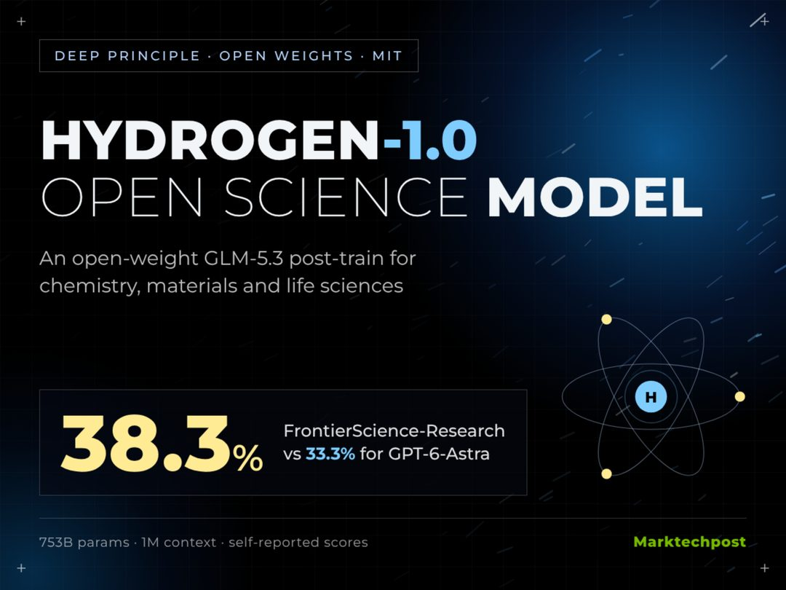

Deep Principle 发布 Hydrogen-1.0，参数规模为 753B，基于 GLM-5.3 后训练，面向化学、材料与生命科学，采用开放权重。训练数据包含实验室记录与智能体发现轨迹。

关键点在数据构成：实验室记录属于典型的非公开、低结构化数据；智能体发现轨迹则把“如何探索”的过程也变成训练信号，而不只是最终结论。这种组合比单纯增加论文语料更接近科研实际工作流。

为什么重要：科学领域的开源权重模型此前多集中在推理基准上，很少触及真实实验数据。如果开放权重能落在这一量级，高校与中小实验室就获得了可审计、可微调的基础模型。需要观察的是权重开放程度、许可证限制，以及在标准科学基准上的独立评测结果。

> 原文：[MarkTechPost](https://www.marktechpost.com/2026/11/02/deep-principle-hydrogen-1-0-open-weight-scientific-model/)

### Soniox STT v6：让语音 Agent 边听边说

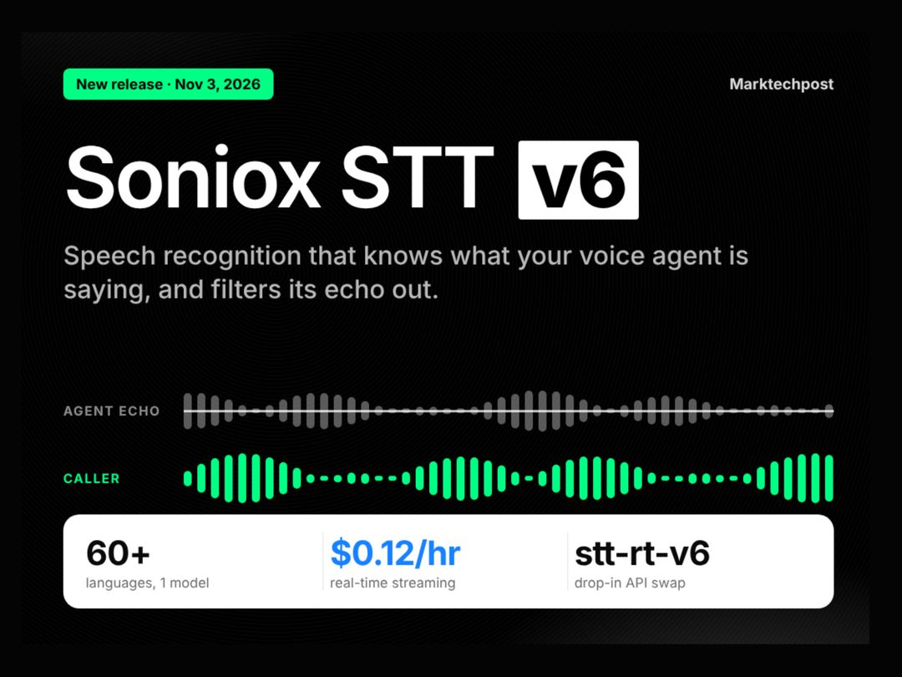

Soniox 发布语音识别 API 的 v6 版本，新增回声消除，以及“读取 Agent 自身输出”的能力，专门针对语音助手的短回答与打断场景优化。

关键点在于，它把 Agent 自己的 TTS 输出也纳入 ASR 的上下文。语音助手最大的工程难点是设备在播放自己的声音时仍在收音，导致识别结果混入回声；把自身输出交给识别端，等于让模型知道“哪些声音是我说的”。

为什么重要：语音是少数必须全双工交互的接口，打断和抢话是常态。此前这类处理多由终端侧 AEC 或应用层拼接完成，现在下沉到 ASR 供应商，语音 Agent 的接入复杂度会明显下降。这一条的重要性在工程层，而非能力层。

> 原文：[MarkTechPost](https://www.marktechpost.com/2026/11/03/soniox-stt-v6-agent-text-input-echo-cancellation/)

模型能力正在三个方向同时“接地”：接入工程工具链、携带可验证身份、对齐真实世界的输入通道。留给读者一个问题：当模型能自证身份，也能自行走完设计流程，你所在团队的验收环节准备好了吗？

<h2 id="company" class="ai-section-divider">🏢 公司动态</h2>

今天最值得看的一条，是 Anthropic 在上市文件里把「非常接近 RSI」写成了风险条目。同一份文件里还有两个数字：单季营收约 1130 亿元人民币，算力成本压力仍在扩大。这是当下 AI 公司的一体两面——收入证明需求是真的，成本说明规模并不自动带来利润。把可自我改进（RSI, recursive self-improvement）写进招股书，与其说是技术宣言，不如说是给资本市场和监管的一次预期管理。

### Anthropic 把 RSI 写进招股书

Anthropic 在上市文件中警告，公司已「非常接近」可自我改进的能力边界。同时披露的还有约 1130 亿元人民币的单季营收，以及仍在扩大的算力成本压力。

关键点不在营收规模，而在这个词出现的位置：RSI 从研究圈的讨论，变成了证券文件里的风险披露项。这意味着公司自己承认，能力曲线可能先于治理框架抵达临界点。

为什么重要：一边是收入验证商业化跑通，一边是成本说明扩张仍靠资本输血。把 RSI 提前写进招股书，等于告诉投资人和监管「我们知道这条线在哪」——既是免责，也是争取规则制定的话语权。对同行来说，这是一个不太容易跟的姿势：不写，显得回避；写了，就得解释控制方案。

> 原文：[TechCrunch](https://techcrunch.com/2026/11/02/anthropic-warns-that-its-very-close-to-rsi-capability-aka-self-building-ai/)

### Fal 融资 13 亿美元，推理层成了独立生意

成立五年的推理服务公司 Fal 完成由 Bessemer 领投的 13 亿美元融资，估值在需求激增下翻倍至 160 亿美元。

关键点：融资规模与估值增速都指向同一个判断——市场愿意为「把 GPU 用得更满」这件事单独付钱。训练是少数玩家的资本游戏，推理则是每天都会发生的运营成本，模型越便宜、调用量越大，中间层的调度与优化价值越突出。

为什么重要：推理从模型公司的内部成本项，变成可独立融资的生意，说明 AI 基础设施的分工在细化。但也意味着这一层的竞争会更早进入效率与价格的比拼——估值翻倍之后，接下来要看的是单位 token 成本能压到多低。

> 原文：[TechCrunch](https://techcrunch.com/2026/11/03/ai-inference-startup-fal-doubles-its-valuation-to-16b-as-demand-surges/)

### 英伟达把手伸向云客户的在华业务

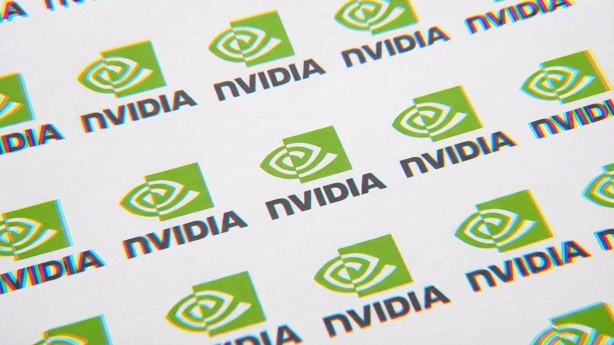

报道称，英伟达正推动云服务客户收缩在华 AI 相关业务，以配合不断收紧的出口管制。

关键点：施压对象不是直接买卡的客户，而是通过云服务间接提供算力的那一层。管制的手从「卖不卖芯片」延伸到「算力在哪里被谁使用」，执行链条被拉长了。

为什么重要：对云厂商，合规从法务问题变成产品设计约束——区域、租户、用途都要能说清楚；对需要算力的中国客户，获取路径进一步收窄，成本会以溢价和不确定性的形式体现。出口管制的实际效力，越来越取决于供应链下游的配合程度，而不是清单本身。

> 原文：[The Decoder](https://the-decoder.com/nvidia-pushes-cloud-customers-to-cut-back-on-china-business/)

### OpenAI 补课：IPO 前先补政府关系

OpenAI 任命前 Uber 总裁 Jill Hazelbaker 为首席企业事务官，同时聘请前美国陆军部长加入。

关键点：一次补齐两条线——公众沟通与政府关系。这类岗位通常在两种时刻密集到位：监管压力上升，或准备进入公开市场。

为什么重要：一家技术公司开始同时需要「讲清楚自己是谁」和「在监管面前说得上话」，往往意味着它要从行业叙事切换到公共叙事。IPO 不只是财务动作，也是一次全面的合规体检。技术公司的招股故事，正在变得越来越像政策故事。

> 原文：[OpenAI](https://openai.com/index/jill-hazelbaker-chief-corporate-affairs-officer)

### 高盛收回 AI 编程工具，卡在合规而非能力

高盛内部面向交易员与银行家的 AI 编码工具被收回权限。

关键点：被收回的是特定岗位的访问权，而非全公司禁用。交易与投行岗位接触的是敏感信息与对外沟通，权限边界比效率更优先。

为什么重要：金融机构采用 AI 的分水岭从来不是模型够不够强，而是数据边界是否清晰、操作是否可审计。coding agent 能读代码库、能执行命令，一旦权限模型说不清楚，风险就是实质的。对所有「内部先上 AI」的企业，这是一次提醒：先定义谁不能用，再讨论谁能用。

> 原文：[The Decoder](https://the-decoder.com/goldman-sachs-pulls-ai-coding-tools-from-traders-and-bankers/)

### 微软 6 万人自愿离职，AI 重组落到组织表

微软向全球超过 6 万名员工发出自愿离职邀请，覆盖超四分之一员工，连副总裁层级也在列。

关键点：用自愿方案而非直接裁员，规模大、层级高。这既是成本动作，也是组织结构调整——把决策中间层变薄，是 AI 提效最常见的落点。

为什么重要：过去两年，AI 叙事主要落在资本开支和产品线上；现在开始落到组织表上。真正的信号不是人数，而是哪些岗位被定义为「可以谈」的。当一家公司愿意让副总裁级别的人选择离开，说明它对人效的预期已经重估。

> 原文：[InfoQ](https://www.infoq.cn/article/UNTqkzASI7dJuq65kSNZ?utm_source=rss&utm_medium=article)

### NYT 起诉 Brave，追的是数据供应链

纽约时报等媒体起诉浏览器 Brave，指控其抓取受版权保护内容，并转供给 Anthropic、Perplexity 等客户。

关键点：被告不是模型公司，而是处在中间位置的浏览器与数据层。这改变了诉讼的切口——不再只问「训练是否属于合理使用」，而是问「数据是怎么来的、经过了谁的手」。

为什么重要：一旦中间商被认定为供应链的一环，检索增强（RAG）与内容聚合生态的合规成本都会抬升。对做数据管道的公司，这比直接起诉模型厂商更具示范效应：上游来源的合法性，正在成为下游产品的责任。

> 原文：[TechCrunch](https://techcrunch.com/2026/11/02/new-york-times-and-other-outlets-sue-web-browser-brave-over-alleged-content-scraping/)

### 华为让客户自寻 HBM，缺口外溢到灰色市场

报道称，华为不再保证 HBM 等关键内存的供应，客户需自行解决；深圳灰色市场的交易规模已相当可观。

关键点：短缺的环节不是芯片设计，而是内存这类配套器件。原厂无法保证供应时，采购责任被推给下游客户。

为什么重要：AI 算力的瓶颈正从先进制程扩散到 HBM 等上游配件，卡点更分散、更难替代。当正规渠道失效，交易外溢到灰色市场，价格与合规风险一并转移给客户。供应链的最后一公里，可能比制程本身更难补。

> 原文：[The Decoder](https://the-decoder.com/huawei-tells-customers-to-find-their-own-ai-chip-memory-effectively-outsourcing-procurement-to-the-black-market/)

今天这批消息的共同点：AI 公司的竞争已从模型能力，转向算力成本、合规边界与组织效率的复合比拼。留一个问题——当 RSI 被写进招股书，你更愿意相信能力曲线，还是成本曲线？

<h2 id="research" class="ai-section-divider">🔬 研究论文</h2>

今天研究板块最值得看的一条，是“权重空间编程”：模型不再只靠梯度下降被改造，而是可以直接读写自己的权重。如果这条路走通，自我改进回路里那个叫 autoresearch 的中间环节可能被整个省掉。同一天还有一条斯坦福的论文在说，LLM 的迭代速度已经跑赢了研究它的科学——两条放在一起看，问题就很清楚了：能力在往前冲，验证能力的那套工具还留在原地。

### 把权重当内存来编辑

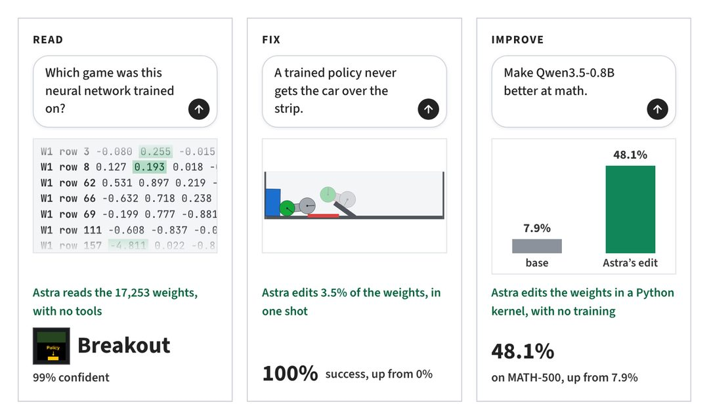

所谓 weight-space programming，核心想法是把神经网络权重当成可读写的对象，而不是只能靠梯度下降慢慢磨的参数。博客给出的演示是直接编辑 Qwen 的权重，削减它的推理循环（reasoning loop）——不重新训练，也不微调，而是在参数层面做外科手术。

关键点在于操作粒度的迁移：改模型从“喂数据、调超参”挪到了“直接改参数”。作者认为，这可能把 autoresearch 从自我改进回路里省掉——模型不必先提出假设、跑实验、看结果，再回头改自己，而是直接改。

这值得留意，但不宜外推太远。单点编辑能否稳定泛化、编辑后如何评估、权重改动是否可审计，目前都没有答案。它更像一个方向性信号：agent 自我改进的瓶颈，可能正从“会不会做研究”变成“能不能安全地直接改自己”。

> 原文：[Weight Space Programming](https://rikiyat.github.io/blog/weight-space-programming/)

### 给冻结模型换一处注意力

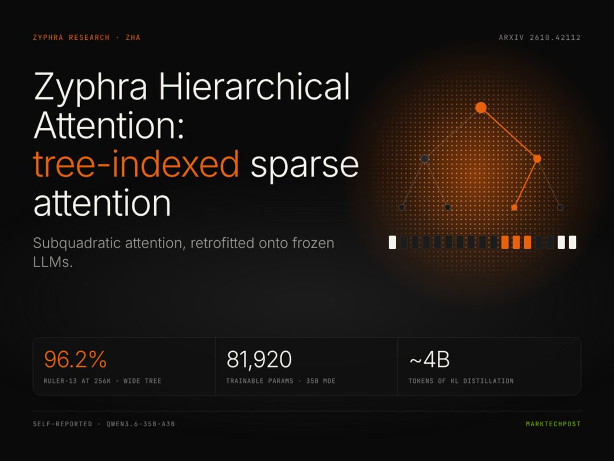

Zyphra 的 ZHA（Hierarchical Attention）走的是一条务实路线：不动原模型权重，给已经训练好的冻结模型换上一层树索引的稀疏注意力，再用约 40 亿 token 做蒸馏，把稀疏结构损失的能力补回来。

关键点是“次二次”（sub-quadratic）终于从论文里的新架构，变成了可以对现成 LLM 做后装改造的工程手段。官方说法是在推理和 256K 长文检索基准上追平稠密注意力。

为什么重要：长上下文的成本瓶颈一直在注意力复杂度和 KV cache 上，如果稀疏化能在冻结模型上后装，那么“换注意力”就从重训预算问题变成了部署选项问题。当然，基准追平不等于真实负载下等价——256K 检索类任务对稀疏结构相对友好，长程一致性还要看更多评测。

> 原文：[Zyphra Hierarchical Attention (ZHA)](https://www.marktechpost.com/2026/11/02/zyphra-hierarchical-attention-zha-sparse-attention/)

### 百度把世界模型开上路

百度发布 Apollo World 世界模型，定位是面向物理智能体（physical agent）的全模态世界模型，称已用于萝卜快跑（Apollo Go）的海外测试，同时提出世界模型的“2+3”判断标准。

关键点有两个：一是“全模态”，即不只处理视频，而是把多种传感输入纳入同一套预测框架；二是它被放进真实运营场景检验，而不只是做 demo。

为什么重要：自动驾驶的技术叙事正在从“端到端感知”往“世界模型驱动的预测与规划”迁移。在这个阶段，谁能定义评价标准，谁就掌握话语权——“2+3”标准本身就是一次标准争夺。接下来要观察的是海外测试的规模与场景覆盖，以及世界模型在长尾 corner case 上是否真的比现有方案更稳。

> 原文：[百度首发 Apollo World 世界模型](https://www.leiphone.com/category/industrynews/NVxn28w1vAG2qbFy.html)

### 不教模型守规矩，改规则

MIT 科技评论介绍的“逆向博弈论”思路，本质是机制设计（mechanism design）在 AI 对齐上的应用：与其训练模型变善良，不如设计一套激励结构，让足够强的模型在理性自利的前提下选择守规矩。

关键点在于对齐对象的位移——从“模型内部”挪到“模型所处的规则环境”。这更接近经济学处理委托代理问题的做法，也更适合多 agent 相互博弈的场景。

为什么重要：当模型能力超出我们能审计的范围，内部对齐的可验证性会越来越弱，而外部规则至少是可观测、可修改的。局限同样明显：机制设计依赖对参与者效用和可观测性的假设，而模型是否真的按这些假设行动，本身就需要验证。

> 原文：[Reverse game theory and AI alignment](https://www.technologyreview.com/2026/11/03/1147934/reverse-game-theory-mechanism-design-ai-alignment/)

### 模拟计算一步做完矩阵乘法

北京大学与 IBM 的合作研究称，模拟计算（analog computing）正在进入“矩阵时代”：原本 GPU 需要迭代上百次才能完成的矩阵运算，可以用模拟电路一步求出。

关键点是它瞄准了 AI 计算里最贵的那部分——矩阵乘法，而不是做通用替代。

为什么重要：过去十年 AI 算力的提升主要靠数字芯片的制程与并行度，模拟路线提供的是另一条曲线，理论上在能耗和延迟上有结构性优势。但这条路历史上的老问题没有消失：精度、噪声、可编程性与软件生态。论文里的“一步完成”要变成可用算力，中间还隔着器件一致性和编译器两道关。把它看作方向性证据，比看作 GPU 终结者更合适。

> 原文：[北大与 IBM 用模拟计算一步完成矩阵运算](https://www.qbitai.com/2026/11/507367.html)

### 长上下文评测补上一块空白

AI2 发布 StateBench，专门测试语言模型在超长文档中跟踪状态变化的能力。

关键点：现有长上下文评测大多在做“大海捞针”——给定问题，从文档里找出一句话。而真实任务更常见的形态是，文档里的事实随事件不断被改写，模型需要维护一份正确的当前状态，而不是一次性检索。

为什么重要：agent 做长任务时，出错往往不是因为找不到信息，而是因为用了过期信息。把“状态追踪”单独拎出来做基准，等于给长上下文能力补上一个此前被跳过的评测维度。接下来要看的是题目构造是否避免了捷径，以及基准分数与真实长任务成功率之间的相关性有多强。

> 原文：[Introducing StateBench](https://huggingface.co/blog/allenai/statebench)

### AI Agent 进了天文台的控制室

SETI 研究所在艾伦望远镜阵列（Allen Telescope Array）部署了 AI 智能体，负责自动排程观测与信号筛查。

关键点：这不是让 AI 分析一段数据，而是让它进入天文台的运行回路，参与决定“看哪里、看什么、哪些信号值得回看”。

为什么重要：科学基础设施长期是人排班、人筛数据的模式，agentic 系统接管排程，意味着科研流程本身开始被自动化——这和实验室自动化是同一趋势的不同侧面。但搜寻地外文明是个假阳性极高的领域，误报与漏报的代价并不对称，人类复核环节怎么设计，可能比模型准确率更值得关注。

> 原文：[AI agents take over at SETI's Allen Telescope Array](https://the-decoder.com/ai-agents-take-over-at-setis-allen-telescope-array-scanning-for-extraterrestrial-intelligence/)

### 解释模型的科学正在掉队

斯坦福的这篇论文给出一个不太好听的结论：LLM 能力的迭代速度，已经跑在解释它的科学研究前面，评测与研究正在被产品节奏甩开。

关键点在于“解释”和“评测”被同时点名——前者是机理层面我们说不清模型为什么行，后者是工程层面我们测不准模型到底行不行。

为什么重要：这不是学术界的自怨自艾，它直接关系到部署决策。当模型几个月换一代、基准的有效期只有几周，监管、采购和企业选型都会失去参照系。这条和今天的第一条正好互为注脚：如果模型开始直接改自己的权重，而解释它的科学还在追赶，“谁来验证这次改动是安全的”就会变成一个没有现成答案的问题。

> 原文：[Rapid LLM development is outrunning the research meant to explain it](https://the-decoder.com/rapid-llm-development-is-outrunning-the-research-meant-to-explain-it-study-finds/)

---

今天这八条里，最值得记住的不是某个新架构，而是一个方向：AI 正在从被研究的对象，变成研究自己的主体。问题是，验证它的那套工具准备好了吗？

<h2 id="product" class="ai-section-divider">📱 应用产品</h2>

### 导语

今天应用产品板块的两条新闻放在一起看很有意思：一边是苹果在 iOS 开发者 Beta 里让 Siri 直接调用千问的文本与图像理解能力，另一边是千问办公会员月卡在双 11 直播间卖出 10 万份、约 2 万亿 token 额度。前者说明系统级入口正在变成模型的路由器，后者说明算力已经能被当成快消品卖给普通人。应用层的竞争重心，正从“谁的模型更强”转向“谁占住了调用发生的那一瞬间”。其余几条——Netflix 的生成式推荐、Anthropic 的长对话优化与 Rust 重写——都是同一件事的不同侧面：AI 在产品里从功能变成基础设施。

### Siri 接上千问：助手变成路由器

iOS 开发者 Beta 中，Siri、写作工具与视觉智能可以直接调用千问的文本与图像理解能力；遇到复杂需求时，系统会跳转千问 App 并同步对话上下文。

关键点在“跳转并同步”这一步。系统级助手不再试图自己完成一切，而是判断能力边界，把任务交给外部模型，同时保持会话连续。这比单纯接入一个 API 更重要——它定义了失败时的降级路径。

为什么重要：对苹果而言，这是智能功能在不同市场落地时绕不开的本地化选择；对千问而言，这是拿到了系统级入口的使用场景，而不只是多一个 App 下载。真正的看点是分成与数据边界怎么划，这些细节目前都还没公开。

> 原文：[36氪](https://36kr.com/newsflashes/4054743945467013?f=rss)

### Netflix 的 AI Discover：把“看什么”交给心情

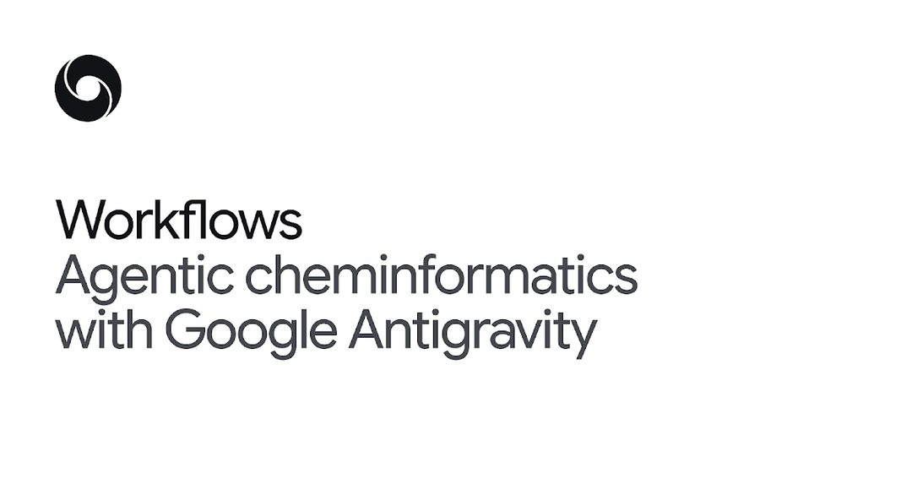

Netflix 上线新标签页 AI Discover，根据用户当下心情推荐内容。这是 Netflix 生成式推荐功能的第一个实验形态。

传统推荐靠行为协同过滤：你看过什么，就推相似的东西。心情推荐走的是另一条路——让用户用自然语言描述当下状态，由模型把它翻译成片单。对内容库极大的平台来说，这解决的是“选择过载”而不是“找不到相似内容”。

为什么重要：推荐系统的输入正在从隐式行为扩展到显式意图。如果这个形态跑通，订阅制平台的首页逻辑会从“猜你喜欢”变成“你说你要什么”。当然，实验形态意味着它还没有进入主路径，效果仍待验证。

> 原文：[TechCrunch](https://techcrunch.com/2026/11/03/netflixs-new-ai-discover-tab-helps-you-find-something-to-watch-based-on-your-mood/)

### DeepMind 把 agent 塞进化药流程

Google DeepMind 用 Antigravity（Google 的 agentic 开发平台）搭配化学信息学技能包，加速化合物检索与药物发现流程，并且在实验中提出了新型刚性化大环分子。

两个层次值得分开看。第一层是效率：检索、筛选、性质预测这些重复劳动交给 agent 执行，人从操作里退出来。第二层是生成：系统不只查已有数据，还给出了此前不存在的分子结构提案。

为什么重要：agentic 工作流的说服力一直卡在“能不能产出可验证的新东西”上。药物发现恰好是验证成本高、但验证标准清晰（可合成、可测活）的领域。这类案例积累起来，才会让“agent 是生产工具”从口号变成共识。

> 原文：[Google DeepMind](https://deepmind.google/blog/agentic-cheminformatics-with-google-antigravity/)

### Anthropic 给长对话减负：首 token 快 35%

Anthropic 推出 Message Threads，通过线索化的消息结构，让 Claude 在长会话场景下把首 token 延迟（time to first token）降低约 35%。

35% 不是模型变快，而是结构变好：把扁平的上下文历史重新组织成可定位的线程，模型不必每次从头读完整个对话。这是典型的工程优化，不动参数，只动数据组织方式。

为什么重要：长会话是 agent 产品的默认状态，也是体验劣化的主要来源——聊得越久越慢、越贵。把 TTFT 作为指标来优化，说明厂商开始把“对话时长”当作一等公民，而不只是追求单轮跑分。

> 原文：[The Decoder](https://the-decoder.com/anthropics-message-threads-cut-time-to-first-token-by-35-percent-for-long-conversations/)

### 零 Rust 经验的团队，用 Claude 重写了核心 API

Anthropic 一个没有 Rust 经验的团队借助 Claude 完成核心 API 的跨语言重写，结果是 CPU 占用下降 40%、延迟下降 20%。

这是“AI 写生产级代码”少见的可量化案例。它成立的三个条件值得记下来：有完整测试与基准作为验收标准，有明确的等价目标（行为不变、只换实现），有可回滚的迁移路径。缺一条，风险都会放大。

为什么重要：语言迁移、遗留系统重写这类“价值高但没人愿意干”的工程，可能是 AI 编码最先稳定兑现的场景。它不要求模型有创造力，只要求它耐得住重复并且每次都过测试——这恰好是当下的能力分布。

> 原文：[InfoQ](https://www.infoq.cn/article/IMWM7ZXDi99sMiUVZBIF?utm_source=rss&utm_medium=article)

### 苹果给 AI 伴侣划线：18 岁起

App Store 新规要求含性内容或恋爱内容的 AI 伴侣类应用必须标注 18+，与约会应用适用同一标准。

这条规则的技术含量不高，但分类意义明确：AI 伴侣被正式归入“成人社交”这一监管抽屉，而非普通的娱乐或聊天工具。对做陪伴类产品的团队来说，年龄分级不再是上架前补的合规材料，而是产品设计的前提条件——内容边界、付费模型、增长渠道都要跟着调整。

为什么重要：平台的分级标准会反向塑造品类形态。一旦被归为 18+，应用就丧失了主流推荐位的曝光机会，这个品类的增长路径会被迫从“大众化”转向“垂直化”。

> 原文：[TechCrunch](https://techcrunch.com/2026/11/03/apple-restricts-dating-apps-and-ai-companions-to-users-18-and-up/)

### 纯语音 Personal Agent：无界面路线的又一次尝试

一款全语音交互的个人智能体产品发布，主打无需界面即可完成日常任务，被媒体形容为“乔布斯心中的 Siri”。

无界面路线的吸引力在于交互成本最低，难点在于两件事：可发现性（用户不知道它能做什么）和错误恢复（说错了怎么改）。语音没有 hover、没有列表、没有撤销按钮，一次误解就可能让用户放弃。系统提示、确认机制、可打断性，这些细节决定了它是“助手”还是“玩具”。

为什么重要：这类产品每隔一两年就会有人重做一次，说明需求真实存在但尚未有解。真正决定成败的可能不是模型能力，而是当模型出错时的交互设计。

> 原文：[量子位](https://www.qbitai.com/2026/11/507419.html)

### 双 11 卖词元：算力第一次像消费品

千问办公个人会员月卡在头部直播间卖出 10 万份，对应约 2 万亿 token 额度，半小时售空。

把它理解为“算力第一次以消费品姿态触达大众”是准确的。定价单位从“订阅一个月”变成“多少 token”，直播间这个渠道本身也在传达信号：AI 的使用权正在被当成日用品来促销，而不是被当成软件订阅来销售。

为什么重要：对厂商，预付费加额度包是锁客和现金流工具；对用户，token 这个词第一次需要被普通人理解。当计量单位进入大众语境，算力的商品化才算真正开始——接下来要看的是额度用完之后，复购率能不能支撑这套模型。

> 原文：[36氪](https://36kr.com/newsflashes/4054678231241600?f=rss)

### 结语

今天所有的故事都指向同一件事：AI 正在从“一个功能”退到“一层底座”，你不再点开它，它已经在调用链里。那么留给产品经理的问题是——当模型本身不再稀缺，你的产品还剩下什么是别人拿不走的？

<h2 id="opinion" class="ai-section-divider">💭 行业观点</h2>

今天最值得看的不是某条产品更新，而是皮查伊那句“宁可少卖云算力，也要先留给 Gemini”。这句话把 AI 竞争的真实约束摆到了台面上：稀缺的不是需求，而是能立刻转成模型能力的算力。顺着这条线看今天其余几条，会发现行业讨论正从“模型有多强”转向“谁来分配资源、谁来承担责任、谁来定义规则”，监管、教育、版权、工程实践都在这条线上重排。

### 皮查伊：算力先留给 Gemini，云生意往后排

谷歌 CEO 在一场罕见长访谈中谈到 AI 自我改进与算力争夺，明确表示公司会优先保障内部模型训练，而不是把算力对外出售。这个取舍并不新鲜，但由一把手公开讲出来，性质不同：云业务一向被视为谷歌最稳的现金流，如今在内部排序上要给模型让路。

关键点在于“自我改进”这个提法。一旦模型能力提升能反过来加速训练效率，算力投入就带有复利性质，短期卖给别人赚的钱，可能不如留给自家模型迭代。对云客户而言，这意味着头部算力供应商既是卖水人，也是竞争者；对投资人而言，云收入的增长节奏需要重新校准。

为什么重要：算力从“商品”变回“战略储备”，会推高整个行业的自建冲动，也让中小玩家更依赖少数几家平台。这种结构性的紧张，比任何单点模型发布都更能解释未来一年的竞争格局。

> 原文：[InfoQ](https://www.infoq.cn/article/JmVl0yY2RYIBNpuD0xuu?utm_source=rss&utm_medium=article)

### 谁在排进“超级智能”忠诚度测试

MIT 科技评论梳理了一份名单：在行政令要求企业表态之后，哪些公司正在向特朗普政府的“超级智能”议程靠拢，以及这种表态对 AI 监管意味着什么。报道的重点不是技术，而是政治站队的形成过程。

值得注意的是“表态”本身成了准入条件。当监管从制定规则转向甄别立场，企业的合规成本就从法务部门转移到公共关系与政府事务，中小公司在这种游戏里天然吃亏。文章也提示，靠拢的动机各不相同：有的是为了争取采购，有的是为了换取宽松条款。

为什么重要：AI 监管的分歧正在从“管多严”变成“听谁的”。这类忠诚度测试一旦制度化，会重塑行业的进入门槛，也会让技术标准的讨论被政治信号覆盖。

> 原文：[MIT Technology Review](https://www.technologyreview.com/2026/11/02/1147932/heres-who-is-falling-in-line-for-trumps-super-intelligence-loyalty-test/)

### 学校能关掉 AI，但关不掉搜索

谷歌表示允许学校禁用其 AI 工具，但由于 AI 已经嵌入搜索，禁用 AI 实际上等于放弃 Google 搜索。TechCrunch 的报道点出了这个设计上的绑定，教育界的争议也由此而来。

关键点在于产品边界已经模糊。生成式能力被放进搜索结果页之后，“AI 功能”和“搜索功能”不再是两个可独立开关的模块，学校面对的是一道捆绑选择：要么接受 AI，要么换掉整个检索入口。对谷歌来说，这是默认值的胜利；对学校来说，这是采购决策被迫升级为价值观决策。

为什么重要：这是 AI 嵌入基础设施后的典型困境——治理诉求遇上了不可分割的产品架构。类似争论会出现在办公套件、操作系统和课堂管理工具上，“能不能关掉”将反复变成“关了还剩下什么”。

> 原文：[TechCrunch](https://techcrunch.com/2026/11/03/google-will-let-schools-disable-its-ai-tools-but-not-without-sacrificing-search/)

### Claude 禁止克隆游戏，但挡不住抄袭潮

Anthropic 收紧 Claude Code 中复刻现成游戏的行为，用户不能再让模型照着现成作品生成可玩版本。Ars Technica 的判断是：这类限制拦得住单个案例，拦不住整体趋势。

关键点在于管控的层级错位。模型厂商能约束自己的输出策略，却管不了用户用别的模型、别的工具完成同样的复刻；只要“照着做一个”是最自然的使用方式，需求就会流向限制更少的地方。文章把这轮模仿潮描述为规模问题，而非合规问题。

为什么重要：版权争议正在从“训练数据”扩展到“生成过程”。内容产业的应对，恐怕不能只依赖模型厂商的自觉，而要回到授权机制与可识别性上。

> 原文：[Ars Technica](https://arstechnica.com/ai/2026/11/claudes-new-rules-against-game-cloning-wont-stop-the-ai-copying-boom/)

### 别让聊天机器人替你投票

Wired 在选举日发出提醒：从幻觉到党派偏见，聊天机器人在投票这类问题上给出的答案不可靠，不适合作为决策依据。

关键点在于失败模式的隐蔽性。模型不会说“我不知道”，而是给出结构完整、语气笃定的错误信息，投票流程、截止时间、候选人立场都可能被编造。再加上训练数据与对齐策略带来的倾向性，同一问题在不同模型上会得到方向不同的回答。

为什么重要：这是 AI 进入公共信息领域后最难处理的一类风险——不是能力不足，而是能力与可靠性不匹配。选举只是极端场景，医疗、法律、财务咨询面对的是同一套问题。

> 原文：[Wired](https://www.wired.com/story/heres-why-you-shouldnt-use-ai-to-vote/)

### 两个时代的软件工程，写在一线来信里

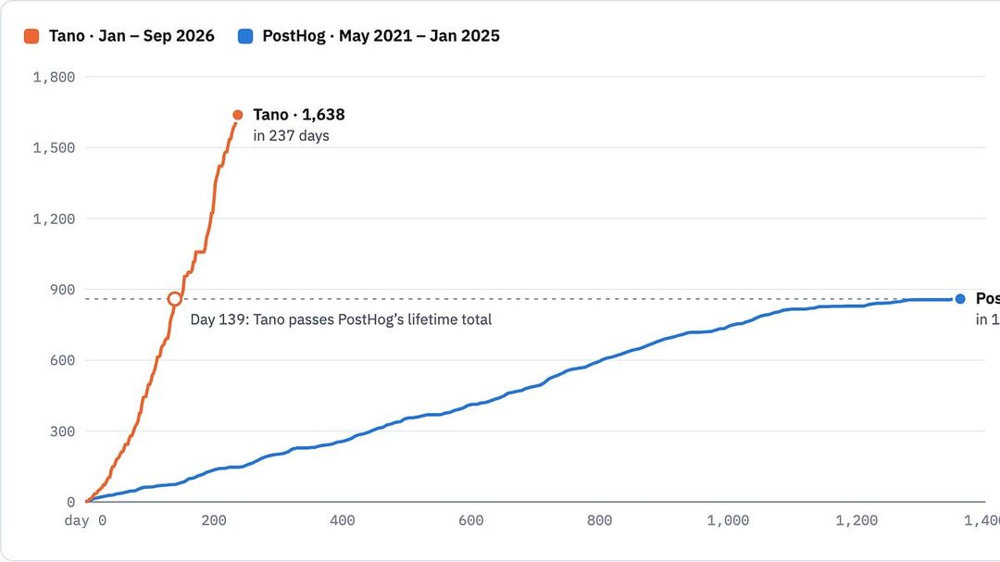

Pragmatic Engineer 精选了一批读者来信，记录 AI 如何改变一线工程师的日常协作与交付方式。相比各类调研报告，这类一手描述更能反映真实的工作变化。

关键点在于变化的分布并不均匀。有人把 AI 用在测试补全和代码审查上，收益明确；也有人提到评审成本上升——生成代码变快之后，理解与验证成了新瓶颈。协作方式随之调整：PR 描述、设计文档的写法都在变，因为读者可能不只是人。

为什么重要：工程组织的效率提升从来不是“工具换了”这么简单，而是流程、评审标准与责任归属一起重排。这些来信的价值在于，它们记录的是过渡期的摩擦，而不是宣讲稿里的终局。

> 原文：[The Pragmatic Engineer](https://newsletter.pragmaticengineer.com/p/how-software-engineering-is-changing)

### 模型谁都能买，差距在生产力系统

量子位转载的一篇观点认为，下一阶段的竞争不在模型本身，而在把模型组织成可交付的生产力系统的能力。模型能力逐渐趋同、API 人人可买的前提下，这个判断并不激进，但落点很实际。

关键点在于“系统”二字包含的东西：数据接入、权限与审计、与既有工作流的嵌合、以及能衡量产出的评估方式。这些工作不性感，却决定了同样的模型在不同组织里产出相差数倍。文章的核心主张是，把 AI 当项目买，和把 AI 当基础设施建，是两种完全不同的投入逻辑。

为什么重要：对产品经理和投资人来说，这意味着尽调问题要换一换：不问“用的哪个模型”，而问“模型之外的九成工作做到哪了”。

> 原文：[量子位](https://www.qbitai.com/2026/11/507448.html)

### 港大发布 KYA 报告：给 Agent 建信用体系

香港大学发布全球首个 KYA（Know Your Agent）报告，聚焦智能体的身份、授权、信用与责任问题，提出成熟度模型与“智能体信任资本”概念。

关键点在于把 agentic 系统的治理拆成可操作的层次：身份可识别、授权可追溯、行为可评估、责任可归属。随着 agent 开始代用户下单、发邮件、调用 API，传统的账号体系已经不够用——需要回答的是“这个动作是谁授权的、出了事找谁”。

为什么重要：这是基础设施层面的提前布局。当智能体规模上量，信任会成为稀缺资源，也会成为准入条件。谁先建立可验证的信用记录，谁就更容易被允许接入真实业务系统。

> 原文：[雷锋网](https://www.leiphone.com/category/industrynews/KkjVOHcQ55GyhDLv.html)

### 结语

今天这八条读下来，主线是分配：算力分配给自家模型，监管分配给“听话”的企业，风险分配给尚未建好的信用体系。留给读者一个问题：当资源、规则与信任都在重新分配时，你的产品站在分配者一边，还是被分配的一边？

<h2 id="opensource" class="ai-section-divider">⚙️ 开源工具</h2>

今天开源榜首是 Karpathy 的 nanochat，用百美元量级的成本跑通了从预训练到推理的完整链路。但把 8 条放在一起看，主线其实不在训练，而在 Agent 的周边工程：桌面操作、持久记忆、规范流程、企业内管理台。模型能力的外包已经发生，剩下的竞争在工具链和流程上。谁先把这些零件拼成可复用的工作流，谁就先拿到下一轮的效率差。

### 100 美元的 ChatGPT，价值不在省钱

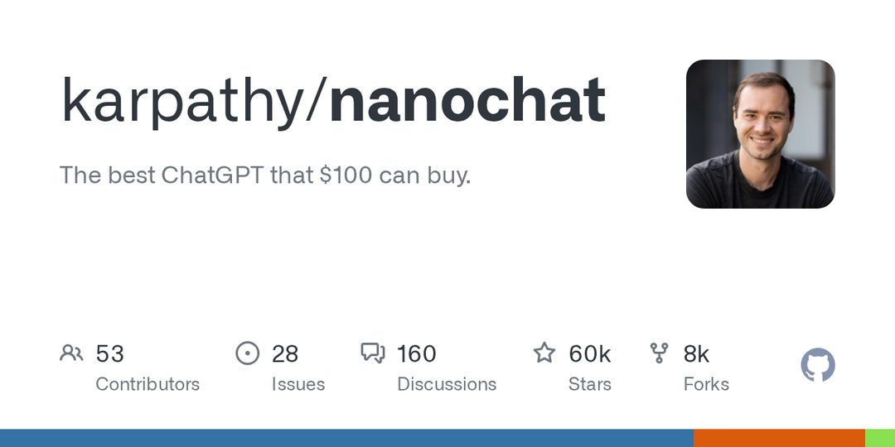

nanochat 的定位很明确：以极低成本完整复现聊天模型的训练与推理链路，因此长期占据 GitHub 趋势榜。它的关键点在于，它把 pretrain、SFT、推理这一整条链路做成了一份可运行的代码基线；它并不只是又一个权重发布。过去一年，成本曲线掌握在少数团队手里，自研与否是个只能靠传闻判断的问题；现在它变成了一个可验证的数字，问题就换成“哪一段值得自研”。对多数团队来说，答案会是数据与后训练，而非全链路。它更实际的产物，是一批真正读过训练细节的工程师。

> 原文：[nanochat](https://github.com/karpathy/nanochat)

### 机器人“通用大脑”，难在跨本体

蚂蚁灵波在乌镇开源了机器人通用大脑模型，主打全栈开源。它要解决的是行业里最耗人的那部分：不同本体、不同场景都要从头训练，数据采集与标注被反复重做。通用大脑如果真能复用，价值更多落在数据侧而不是模型侧，因为硬件形态的碎片化不会因为一个模型消失。值得继续看的是“全栈”的成色：开放的究竟是权重、训练框架，还是包含数据管线的完整闭环。这决定了它是能直接用的底座，还是一篇可复现的论文。

> 原文：[雷峰网](https://www.leiphone.com/category/industrynews/ADcxxdwtaojQvzhp.html)

### agent-desktop：给 Agent 一台电脑

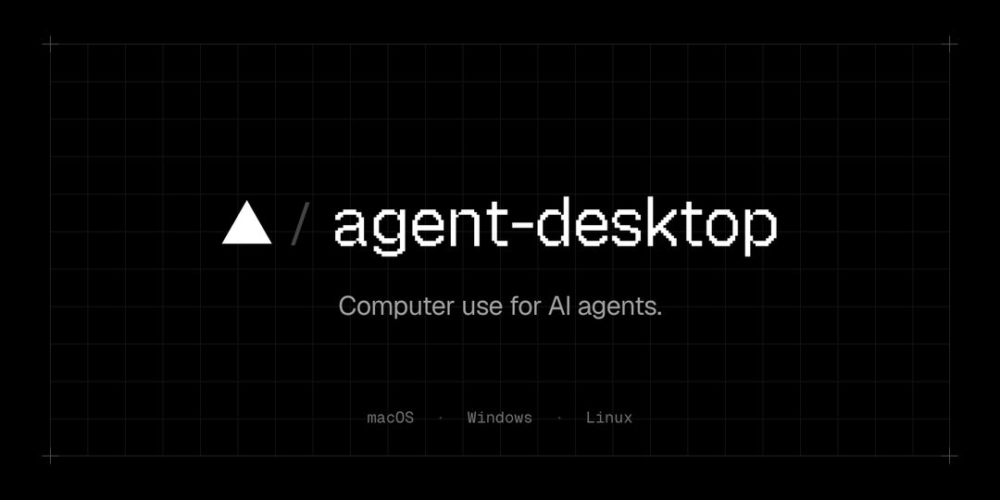

Vercel 开源了 agent-desktop，一个面向 AI Agent 的 computer-use 命令行工具，让智能体可以直接操作桌面环境。computer-use 一直卡在两处：权限边界与可复现性。CLI 形态的好处是容易被嵌进脚本和 CI，而不是停在演示视频里。浏览器自动化已经成熟，桌面是最后一段没有标准接口的地方——大量企业软件只有 GUI，没有 API。短期看，它是对 RPA 的替代；长期看，它把“人机界面”改造成“机机界面”。风险同样直接：一旦 Agent 能点鼠标，审计、回滚和权限分级就得同步设计，否则省下的时间会以事故形式还回来。

> 原文：[agent-desktop](https://github.com/vercel-labs/agent-desktop)

### 桌面跑数据中心级模型：两条路线

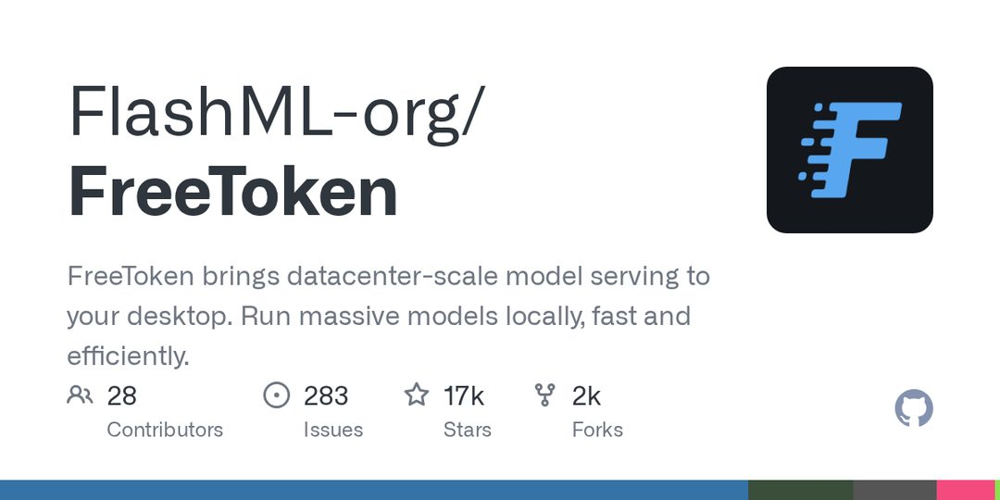

两个新项目在攻同一件事。FreeToken 提供本地的大规模模型服务；colibri 用纯 C 从磁盘流式加载 MoE 专家，零依赖运行前沿模型。从描述看，两者共同的技术假设是内存与显存不够用，于是拿磁盘和外存换空间，而 MoE 的稀疏激活让“按需加载专家”在原理上成立。如果这条路走通，推理的成本结构会从显存密度转向 IO 带宽，本地部署的边界随之外扩。但需要清醒：流式加载换来的吞吐与延迟，和数据中心的批处理不是同一个场景，它服务的是隐私敏感、离线、低频的个人与企业内使用。

> 原文：[FreeToken](https://github.com/FlashML-org/FreeToken)

### claude-mem：记忆是 Agent 的分水岭

claude-mem 做的是给 Agent 装持久记忆：自动捕获会话内容，压缩后回注到后续上下文，兼容 Claude Code、Codex、Gemini 等。它不改模型，只在上下文层做工程，动作是三步：捕获、压缩、回注。这件事重要，是因为 Agent 的失败大多不是推理失败，而是忘记——上一轮确认过的约束，这一轮又得重说。跨会话记忆一旦标准化，Agent 才可能承担周期性而非一次性的任务。随之而来的是治理问题：记忆里存什么、存多久、谁能读，目前各家自定，没有共识，而它恰恰是最容易出事的地方。

> 原文：[claude-mem](https://github.com/thedotmack/claude-mem)

### llm 0.37：CLI 正在变成路由层

Simon Willison 发布了 llm 0.37，这是命令行工具与 Python 库两个月累积的大版本更新，新增多项模型与工具链支持。它的形态很简单：一个统一入口对接多个模型，便于脚本化和横向对比。多模型并存已是常态，选型成本于是转移到了切换成本上。这类工具的价值不在功能数量，而在于把模型调用变成可脚本、可记录、可复现的操作，这正是 Agent 工作流需要的地基。版本号不大，但它是被下游脚本和文档长期依赖的公共接口，改动的影响面通常大于数字本身。

> 原文：[Simon Willison](https://simonwillison.net/2026/Nov/2/llm/)

### paperclip：企业内 Agent 需要管理台

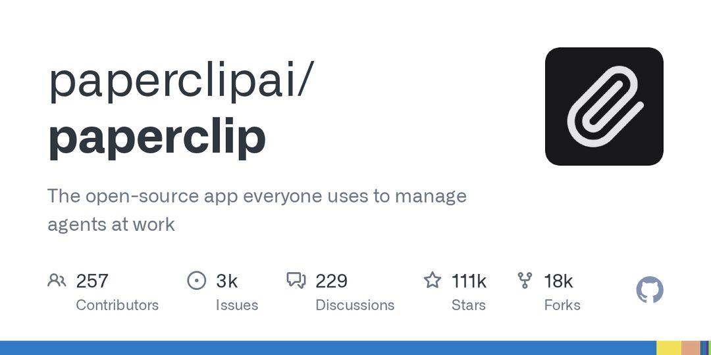

paperclip 是一个开源的企业内 Agent 管理台，面向工作中的多智能体管理场景，提供可视化的调度与协作界面。它把多 Agent 的编排从代码搬到了界面上。企业评估 Agent 时的第一个问题往往不是能力，而是“谁在用什么、花了多少、出错谁负责”，管理台就是这类问题的答案形态。开源版本的意义在于，团队可以先在内部跑通权限与审计，再谈规模化。需要注意的是，可视化编排和工程化编排的边界，通常会在真实复杂度上来之后才暴露。

> 原文：[paperclip](https://github.com/paperclipai/paperclip)

### spec-kit：把“说清楚”变成流程

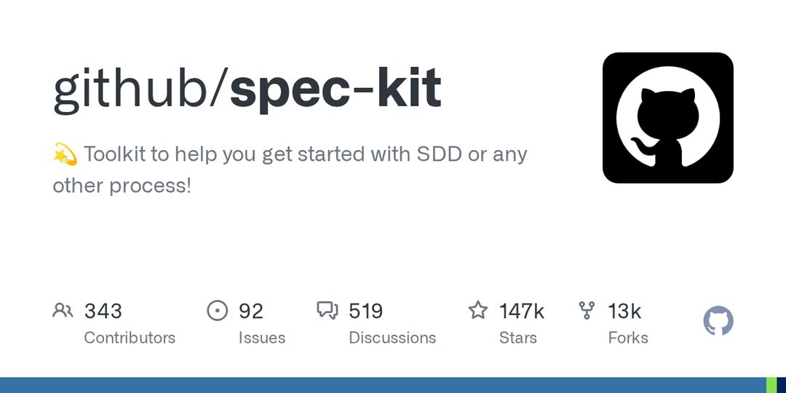

GitHub 放出 spec-kit，一个规范驱动开发（SDD，spec-driven development）的起步工具包，配套 Claude Code 等编码智能体使用。它的主张是先把规范写清楚，再由 Agent 去实现，而不是边聊边改。编码 Agent 的上限取决于输入质量，SDD 把需求、约束、验收标准前置，让产出变得可检验。这和 claude-mem 是同一枚硬币的两面：一个管记忆，一个管意图。工具包本身只是脚手架，真正的成本在于团队是否愿意在写代码之前把话说清楚，而这从来不是工具能解决的问题。

> 原文：[spec-kit](https://github.com/github/spec-kit)

训练的成本在下降，工具链的复杂度在上升——今天这 8 条里，多数都在回答“怎么让 Agent 稳定干活”，而不是“模型还能多强”。留一个问题：你团队的 Agent，缺的是能力，还是记忆和规范？
