今天最值得看的三件事：

- **模型发布** · 腾讯混元Hy4上线：首次引入视觉理解
- **模型发布** · OpenAI发布Images 2.6：生成更快、能出GIF
- **模型发布** · GPT-6 Astra两项猛料：改他模权重、一周造硬件

下文按板块展开，正文每条均附原始链接。

<h2 id="model-release" class="ai-section-divider">🚀 模型发布</h2>

今天这个板块有 8 条，最值得看的不是谁登顶榜单，而是一条尚未获官方确认的报道：GPT-6 Astra 被指能在权重层面「编程」其他模型。如果这个描述站得住，模型的能力边界就从「调用工具」挪到了「改写工具本身」，而这正是现有安全与治理框架最没准备好的地方。同一时间，腾讯把 Hy4 的视觉理解和 0.3 元/百万 tokens 的输入价一起放了出来，国内开源这条线的竞争已经打到成本结构上，而不只是跑分。

### 腾讯混元 Hy4：视觉理解 + 0.3 元定价

腾讯发布混元 Hy4，首次引入视觉理解能力，可操作电脑完成跨应用任务，官方称其综合表现跻身最强开源模型之列。模型已上线腾讯云 TokenHub，输入价格低至 0.3 元/百万 tokens，限时最低 2.5 折。

关键点在两处。一是能力方向：视觉理解加电脑操作，指向的是 GUI agent 这类需要「看懂屏幕再动手」的任务，而不是单纯的图文问答。二是价格：0.3 元/百万 tokens 配合限时折扣，把视觉推理的调用成本压到了几乎可以忽略的量级。

为什么重要：开源模型的竞争重心正从参数规模转向 agentic 落地能力，而落地的前提是成本足够低、试错足够便宜。对做 GUI agent、RPA 替代的团队来说，这是一个可以直接重算成本模型的变量。视觉能力本身并不稀奇，稀奇的是它和这个价格同时出现。

> 原文：[36氪](https://36kr.com/newsflashes/4056155946849414?f=rss)

### OpenAI Images 2.6：更快、能出 GIF、可局部编辑

OpenAI 发布 Images 2.6，带来更快的图像生成、GIF 创作与更精准的局部编辑，并新增 API 控制项，已同步接入 ChatGPT、Codex 与 API。

三个变化各有指向：生成速度影响交互体验；GIF 意味着从静态图走向短动态内容；局部编辑的精度决定了它能否进入真实的设计修改流程，而不是只做一次性出图。新增的 API 控制项则说明它被当作可编程组件，而非只面向终端用户的功能。

为什么重要：图像模型正在从「生成一张图」变成「嵌进工作流的一环」。接入 Codex 这一条尤其值得注意——当写代码的 agent 能顺手生成和编辑图像，素材生产就被拉进了开发流程内部。对产品团队来说，评估的重点应从出图质量转向「可被调用、可被反复修改」这两项工程属性。

> 原文：[OpenAI](https://openai.com/index/introducing-images-2-6)

### GPT-6 Astra 两项爆料：改他模权重、一周造硬件

据 The Decoder 报道，GPT-6 Astra 能直接通过权重层面「编程」其他模型，并在不到一周内从零设计出一款硬件设备。目前没有官方确认，属于媒体报道层面的信息。

如果描述成立，这两件事的性质不同但方向一致：前者是把别的模型当作可修改的对象，后者是把「设计—验证」的周期压缩到以天计。前者触及能力边界，后者触及工程节奏。

为什么重要：模型直接改写其他模型的权重，意味着能力的分发和复制可能绕开现有的授权与审查路径，安全讨论里常见的「模型权重不可外流」这类假设会变得脆弱。同时也需要对单一来源的转述保持距离——这类爆料的验证成本很高，传播速度却很快。判断可以留到有可复现证据时再下。

> 原文：[The Decoder](https://the-decoder.com/gpt-6-astra-sees-the-matrix-and-reprograms-other-ai-models-directly-through-their-weights/)

### Gemini 4 Carbon 登顶榜单，谷歌市值反而承压

Gemini 4 Carbon 在评测榜拿下第一，但有报道称其「速成」背后是谷歌的一场豪赌，发布后公司市值明显承压。

两件事在时间上重合：榜单第一，与资本市场的负面反应。报道把后者读作这场豪赌的代价，但榜单成绩与市值波动之间的因果并未被证实，不宜简单归因。

为什么重要：这是「榜单第一」解释力衰减的又一个样本。当评测排名与商业信心出现背离，说明市场在意的已经不只是模型能力，而是拿到这个能力付出了多少、能不能持续。对做模型评估的人来说，一个可用的判断是：单一榜单的排名正在从结论变成线索，需要配合成本、迭代速度和交付形态一起看。

> 原文：[雷峰网](https://www.leiphone.com/category/yanxishe/7uvYEZBsCWcPvhw3.html)

### GPT-5.6 Cyber 经 AWS GovCloud 向授权客户开放

Daybreak Red 通过 Amazon Bedrock 在 AWS GovCloud（美东）向获批客户提供 GPT-5.6 Cyber，面向合规网络安全作业场景。

要点在交付路径而非模型本身：不是公开 API，而是经由云厂商的政府云区域、面向获批客户开放，场景限定在合规的网络安全作业。

为什么重要：前沿模型的分发正在沿着合规边界分层。同一家公司的模型，会同时存在面向公众的版本和面向政府与受监管行业的版本，两者的渠道、客户资格和用途限制完全不同。这条线对投资人是一个独立赛道——模型能力的政府采购渠道，其竞争逻辑与消费级 API 市场并不相同，壁垒更多来自资质与部署形态。

> 原文：[OpenAI](https://openai.com/index/daybreak-red-aws-govcloud)

### Ripple-65B 预览版开源：终端任务得分 80.5

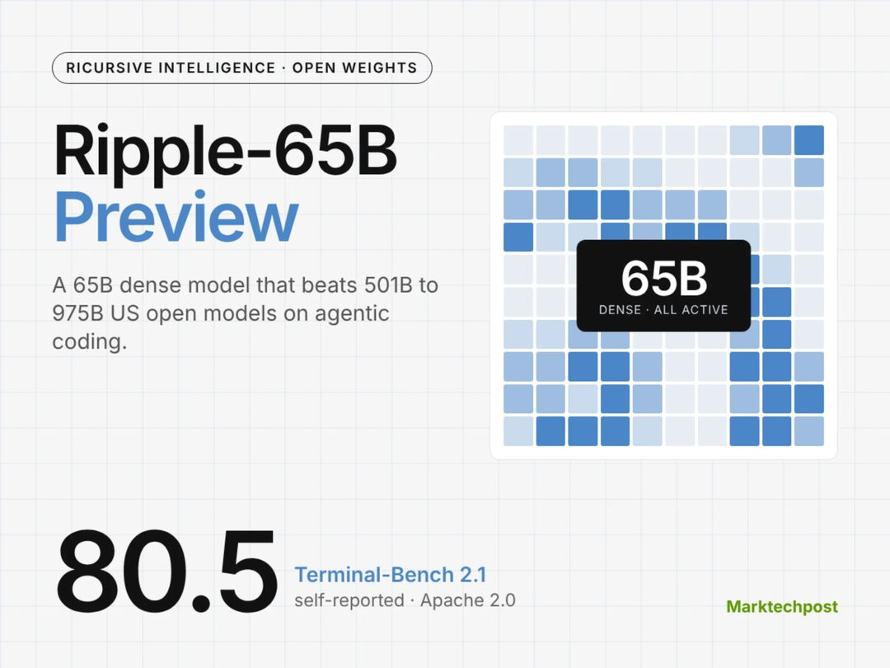

Ricursive 发布 Apache 2.0 许可的 65B 稠密开放权重模型 Ripple-65B Preview，Terminal-Bench 2.1 得分 80.5，报道称其领先体积最高达其 15 倍的美国开源模型。

两个细节值得留意：一是稠密（dense）架构而非 MoE，部署与推理行为更容易预测；二是主战场选在终端任务，这是当前开源模型竞争最集中的考核项。

为什么重要：用 65B 打赢体积更大的对手，说明后训练与任务对齐的收益在这类操作性基准上仍然很高，参数规模不是唯一变量。对自建推理的团队，稠密 65B 在显存与吞吐上的可规划性是一项实际优势。不过 Terminal-Bench 只覆盖一类能力，不能外推到通用对话或长上下文任务。

> 原文：[MarkTechPost](https://www.marktechpost.com/2026/11/04/ricursive-ripple-65b-preview-open-weight-model/)

### webAI 发布 TwIL-8B：MATH-500 得 98.2

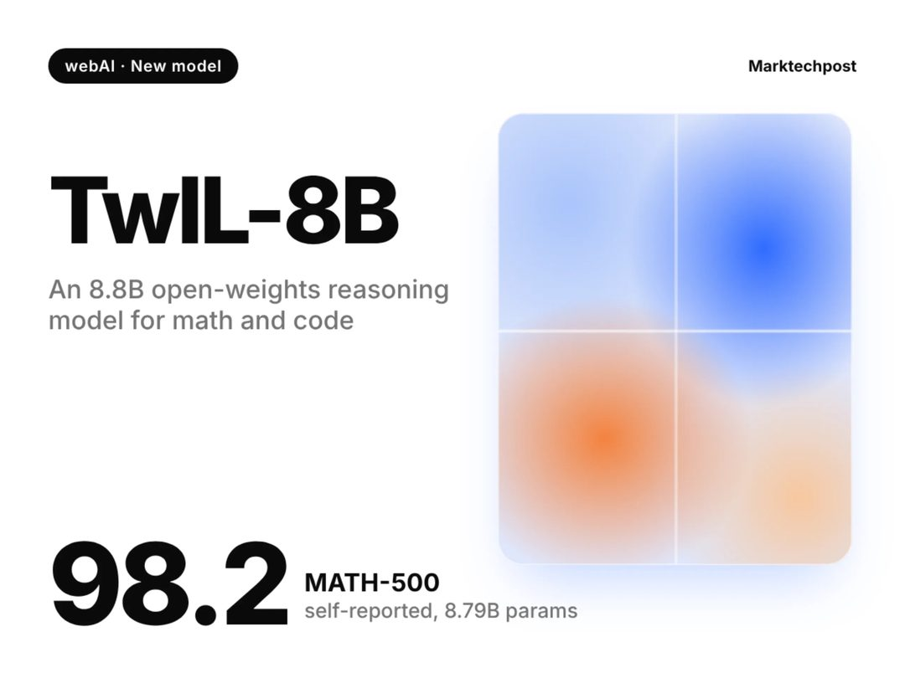

webAI 发布 TwIL-8B，一个基于 IBM Granite 4.2 8B 后训练的 8.8B 推理模型，数学与代码基准表现亮眼，但知识类评测落后同级模型。

这条的价值在于它把「小模型能做什么、不能做什么」标得很清楚：MATH-500 拿到 98.2，说明在结构化的推理任务上，后训练可以把 8B 级别的模型推到很高；而知识类评测的落后则暴露了参数容量对世界知识的硬约束。

为什么重要：选型时最容易犯的错是拿单项高分去推整体能力。TwIL-8B 更适合被理解为专用件——数学、代码这类有明确判定标准的任务可以放心用，开放式知识问答则不该交给它。基于 Granite 后训练也说明，基础模型生态开始出现分工：一方提供底座，一方做垂直强化。

> 原文：[MarkTechPost](https://www.marktechpost.com/2026/11/04/webai-twil-8b-reasoning-model/)

### 腾讯 WeVisOne-VL：一个模型包办检测、OCR、抠图

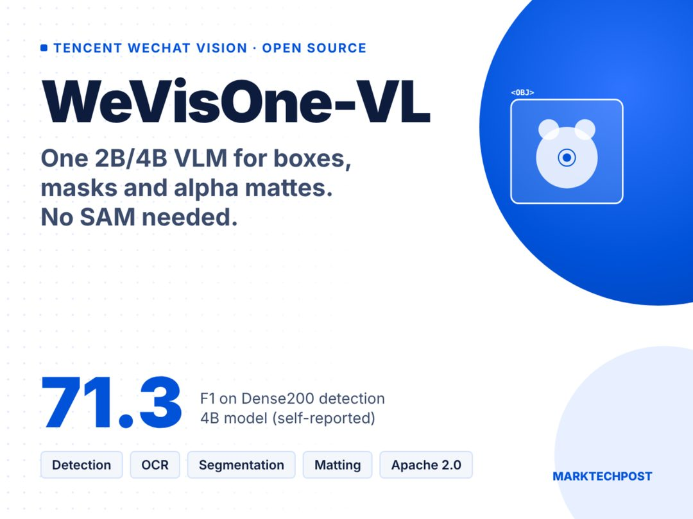

微信视觉团队开源 Apache 2.0 的 WeVisOne-VL（2B/4B），统一检测、OCR、计数、分割与 alpha matting（抠图透明通道），配 9.6M 参数的像素解码器。

关键点是「统一」：这些原本各自对应专用模型的任务，被收进同一个视觉语言模型，像素解码器只用了 9.6M 参数，模型本体也控制在 2B/4B 这个小尺寸区间。

为什么重要：工程上的减负往往比跑分更有价值。文档处理、电商图、内容审核这类场景通常要串起检测、OCR、分割多个模型，每多一个模型就多一份部署、对齐和延迟成本。一个 Apache 2.0 的小模型把这些脏活覆盖掉，意味着这类流水线可以显著变短。开源许可也让它比闭源 API 更容易被嵌进私有部署。

> 原文：[MarkTechPost](https://www.marktechpost.com/2026/11/03/tencent-wevisone-vl-vision-language-model/)

结语：今天的 8 条里，7 条在比谁更强，只有 1 条在说模型可以动手改模型——如果后者被证实，前 7 条的排名会很快失去意义。留一个问题：当模型能改写别的模型，你手里那份「权重不外流」的合规假设还成立吗？

<h2 id="company" class="ai-section-divider">🏢 公司动态</h2>

今天公司动态里最值得看的是 OpenAI 收购 Pierre Computer Company：一笔不涉及模型能力、只涉及「代码如何被写入、评审、合并」的收购。把它和 Meta 拿下 Conductor 放在一起看，信号很清楚——AI 编码的竞争重心正从生成质量下移到工具链与工作流，智能体的产出速度已经开始倒逼版本控制这一层。另一条线恰好相反：Fal 估值翻倍、Anthropic 毛利走低、苹果被曝削减内部 AI 预算，算力的经济学仍然没算平。同一天里，买工具的人在加速，付算力账的人在减速。

### OpenAI 买下 Pierre，目标是版本控制层

OpenAI 宣布收购 Pierre Computer Company，用于扩充 Codex 在代码构建、理解与评审上的工具链。关键点在官方给出的理由：让版本控制跟上 AI 编码智能体的产出速度。这不是一个提升补全准确率的问题，而是一个吞吐量问题——当 agent 一次能提交几十个改动，人类评审带宽就成了整条链路的新瓶颈。为什么重要：编码智能体的价值上限不取决于它能写多少代码，而取决于这些代码能否被低成本地理解、审核与合并。谁控制这一层，谁就掌握企业编码工作流的入口，而这也对 GitHub 这类既有的托管与评审平台构成直接压力。工具链的并购，本质是在给模型找一个能被日常使用的位置。

> 原文：[OpenAI](https://openai.com/index/openai-to-acquire-pierre)

### Meta 收下 Conductor，买的是并行调度

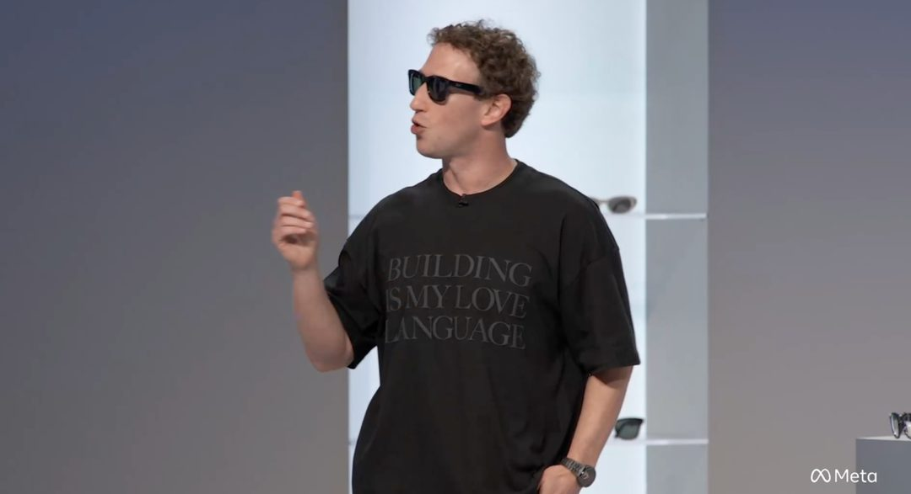

Meta 将 AI 编码初创 Conductor 收入囊中。Conductor 的能力是让工程师同时部署多支智能体分头推进项目——也就是说，它解决的不是「单个 agent 写得准不准」，而是「多个 agent 如何分工、互不干扰地推进同一件事」。为什么重要：与 OpenAI 买评审层不同，Meta 买的更接近调度层。两笔收购拼起来，编码链路上的编排、构建、评审几个环节正在被逐段买走，模型公司开始从「提供智能」转向「承包工作流」。对创业公司而言，这意味着单点工具的时间窗口正在收窄；对大厂而言，编码智能体的护城河可能不在模型权重里，而在工程师每天必须打开的那几个界面上。

> 原文：[TechCrunch](https://techcrunch.com/2026/11/04/meta-acquires-ai-coding-startup-conductor/)

### Fal 估值翻倍至 160 亿美元，推理需求侧在加速

成立五年的 AI 推理公司 Fal 完成 13 亿美元融资，由 Bessemer 领投，估值翻倍至 160 亿美元。这是今天最能反映需求侧的一条：推理算力的调用量增长仍在超出预期，资本愿意为「卖铲子」的位置提前定价。但把它和下面 Anthropic 那条对照着读，会得到一个更准确的判断——推理需求暴涨，不等于推理生意好做。两者之间差的是单位成本：需求越旺，越考验谁能在同等算力下输出更多 token。Fal 拿到的钱，本质是市场对「规模效应最终会兑现」的一次下注，而下注与兑现之间还有很长的工程距离。

> 原文：[TechCrunch](https://techcrunch.com/2026/11/03/ai-inference-startup-fal-doubles-its-valuation-to-16b-as-demand-surges/)

### 苹果被曝削减内部 AI 预算，与对外叙事脱节

报道称苹果显著下调了工程团队的 AI 开支预算，这与其对外反复强调的 AI 战略形成反差。需要克制解读：预算收缩既可能是 ROI 审查后的收缩，也可能是把零散的探索性 AI 支出并回具体产品线的账上，两种解释指向完全不同的结论。为什么仍然值得记一笔：大公司内部 AI 支出是最早能观察到「企业 AI 采购进入审慎期」的信号之一。当外部采购从试点走向规模化，CFO 一定会问投入产出比，这个时刻通常晚于技术热度、早于市场共识。

> 原文：[TechCrunch](https://techcrunch.com/2026/11/04/apple-is-reportedly-cutting-budgets-for-its-internal-ai-usage/)

### Uber 总裁转投 OpenAI，补的是公共事务位

曾任谷歌、Snap 公关负责人的 Uber 总裁转投 OpenAI，Brockman 发文欢迎。这是一条人事新闻，但它透露的优先级比多数产品更新更清楚：OpenAI 正在强化政策与公共事务能力。为什么重要：模型公司在监管、版权、算力与能源政策上的暴露面正在快速扩大，这些议题无法靠研究员解决，只能靠能与政府、平台、公众对话的人。观察一家 AI 公司的下一步，招聘方向往往比发布会更早给出答案——把高管席位留给公共事务，通常意味着公司预期自己将长期处在争议中心。

> 原文：[InfoQ](https://www.infoq.cn/article/mcHCe07TQ08mEZtqcWi1?utm_source=rss&utm_medium=article)

### 后摩智能完成数十亿元 B 轮，端侧芯片进入兑现期

存算一体 AI 芯片公司后摩智能近期完成数十亿元人民币 B 轮融资，产业资本与国资集体参与。存算一体这条路线赌的是能效——把计算单元放进存储阵列附近，绕开数据搬运的开销，这也是端侧大模型最实际的约束条件。为什么重要：云端推理成本居高不下的另一面，是推理向端侧迁移的动力持续增强，而端侧拼的不是峰值算力，是每瓦性能。国资与产业资本同时进场，通常意味着估值逻辑从技术指标转向落地订单；对这类公司而言，接下来的考题不是流片成功，而是能否进入量产机型的设计清单。

> 原文：[雷峰网](https://www.leiphone.com/category/industrynews/cyDQKpjtzDEPhrr8.html)

### Anthropic 的算力账本：越卖越不赚钱

在算力成本理应随规模与硬件迭代改善的节点，Anthropic 的毛利反而走低。这不是一家公司的问题，而是头部模型公司共同的推理成本困境：能力提升带来用量上升，用量上升带来成本上升，而价格竞争让这部分成本很难转嫁给客户。把它放回今天的语境里看会更清楚——一边是 Fal 以 160 亿美元估值融资，一边是头部实验室毛利承压，资本在赌长期规模效应，财务报表却在讲当下的故事。为什么重要：如果推理毛利无法随规模改善，那么「模型即服务」的商业模式就需要重新设计，而不仅是继续堆参数。

> 原文：[TechCrunch](https://techcrunch.com/2026/11/03/anthropic-is-still-grappling-with-the-economics-of-compute/)

### Ballistic Ventures 拟募 4.9 亿美元，押 AI 安全

Ted Schlein 执掌的网络安全基金 Ballistic Ventures 计划募集 3.6 亿美元主基金与 1.3 亿美元配套基金，合计 4.9 亿美元，趁 AI 驱动的安全需求膨胀扩张。为什么重要：安全预算通常滞后于攻击面的扩大，而这一轮新增的攻击面相当具体——agent 持有的凭证与权限、自动化操作的审计链、模型接入带来的数据外流路径。这些都是要花钱才能堵的口子，也是这笔基金要押的方向。当编码与推理都在被 agent 化，安全会是少数需求确定性高于技术不确定性的赛道。

> 原文：[TechCrunch](https://techcrunch.com/2026/11/03/ted-schleins-ballistic-ventures-seeks-490m-for-new-funds-amid-ai-driven-cybersecurity-boom/)

今天这八条里，七条在抢位置，只有一条在算账。工具链、推理、芯片、安全都可以被买下来，单位成本不能。

<h2 id="research" class="ai-section-divider">🔬 研究论文</h2>

今天研究板块最值得看的一条，是 OpenAI 的自主流水线在 Linux 内核里跑出 948 个本地提权漏洞并生成补丁。这件事的意义不在数字，而在链路——发现、验证、生成补丁被串成了一条可重复的工程流程。同一天还有 Codex 11 天写出 13.9 万行内核代码的实践，生成侧和审计侧同时被拉起来了。当“找漏洞”变得廉价，稀缺的会变成验证与合入的带宽。

### OpenAI 的流水线在内核里找出 948 个提权漏洞

OpenAI 公布了一条自主安全审计流水线，在 Linux 内核中完成漏洞发现、验证，并为 948 个本地提权（local privilege escalation）问题生成补丁。

关键点在“验证”这一步。安全领域从来不缺扫描器报出的可疑点，缺的是把误报压下去的证据链。这条流水线把验证和补丁生成都放进自动环节，输出的不是告警列表，而是可评审的改动。

为什么重要：漏洞挖掘的边际成本被大幅压低后，内核这类巨型代码库的安全债会被重新定价。对维护者而言，压力从“发现”转移到“评审与合入”——每一个补丁都是一次人工判断。规模化审计真正的瓶颈，可能很快会落在人这一侧。

> 原文：[OpenAI](https://openai.com/index/a-thousand-fewer-paths-to-root)

### Codex 11 天写出 13.9 万行内核代码

有实践称，Codex 在 11 天内生成约 13.9 万行内核代码，产物在 Rocky Linux 10 上可以启动运行。

这里要区分两件事：能编译、能启动，和能维护、能合入上游，是完全不同的门槛。系统级代码的难点不在写出语法正确的实现，而在并发、边界条件和硬件差异下的隐性假设——这些恰恰是最难被“跑通”验证的部分。

为什么重要：如果这类产出可复现，AI 生成代码的讨论基准线就要往上抬一格，从“能不能写对函数”变成“能不能交付一个可启动的系统”。随之而来的是来源审计、许可与维护责任——谁为这 13.9 万行负责，目前还没有答案。

> 原文：[InfoQ](https://www.infoq.cn/article/OiyNEtFwV05opvsLTcvK?utm_source=rss&utm_medium=article)

### 斯坦福：模型迭代速度甩开了对它的解释研究

斯坦福团队的研究结论是，大模型的快速迭代正在甩开以解释其行为为目标的研究，能力评估与可解释性之间的缺口在扩大。

这是一个结构性错配：能力侧有明确的商业激励和发布节奏，解释侧依赖学术周期与公开方法，后者的产出速度天然追不上前者的迭代频率。

为什么重要：企业采购、合规审查和监管规则都建立在“我们知道模型能做什么、不能做什么”这个前提上。缺口一旦扩大，风险评估就会退化成对厂商声明的信任。对做模型评测和 red teaming 的团队来说，这反而是需求最确定的一块。

> 原文：[The Decoder](https://the-decoder.com/rapid-llm-development-is-outrunning-the-research-meant-to-explain-it-study-finds/)

### CloudOpsBench：云运维卡在推理，不在工具调用

新开源的 CloudOpsBench 给出一个反直觉的结论：AI 在云运维任务中的主要短板不是工具调用，而是推理能力。

也就是说，让 agent 接上 API、调用云厂商 SDK 这类工程问题已基本解决；真正掉链子的是多步诊断与根因判断——在多个信号之间建立因果，排除干扰项。

为什么重要：这直接决定运维 agent 的投入结构。如果瓶颈在推理，继续堆工具集成、扩接口覆盖率的收益会递减，而可观测性数据的组织方式、诊断链的显式建模更值得投入。对买方也是提醒：演示里流畅的工具调用，不等于故障时刻的判断力。

> 原文：[The Decoder](https://the-decoder.com/new-open-source-benchmark-reveals-reasoning-as-the-biggest-bottleneck-for-ai-in-cloud-operations/)

### 有论文唱反调：长上下文没那么必要

一篇新论文指出，token 生成成本随位置显著上升——越靠后的 token 越贵，在前沿开源模型上差距可达 7 倍。在此基础上，频繁压缩上下文反而让长程与长输入任务的表现更稳。

这个观察把“上下文长度”从能力指标变成了成本指标。窗口开得越大，后半段 token 的单位成本越高，而模型对远端信息的利用效率并没有同比提升。

为什么重要：过去两年长上下文被当成模型能力的核心卖点之一，采购和架构决策都围绕它展开。如果压缩策略能拿到同等甚至更好的效果，上下文工程（context engineering）的 ROI 会高于单纯扩窗口。这也解释了为什么 agent 产品里“记忆管理”这一层越来越重。

> 原文：[arXiv](http://arxiv.org/abs/2611.05306v1)

### NVIDIA 三项优化让单机 MoE 推理快 42.5%

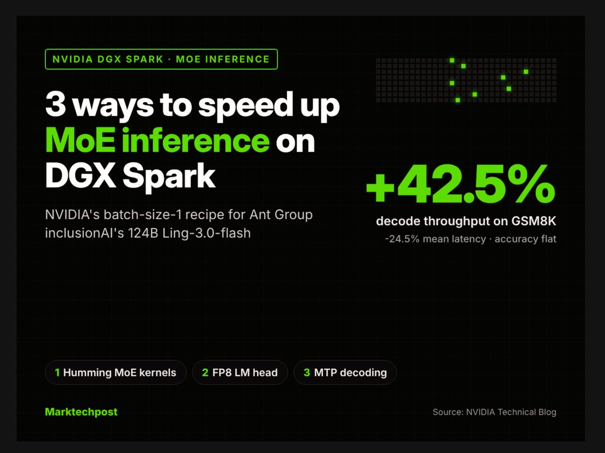

NVIDIA 在一台 DGX Spark 上叠加三项优化，对蚂蚁 inclusionAI 的 124B 模型 Ling-3.0-flash 做 MoE 推理加速，GSM8K 解码吞吐提升 42.5%，且精度无损。

值得注意的是场景本身：在单机上跑 124B 的 MoE（Mixture of Experts）。稀疏激活让显存和算力的账算得过来，但调度、专家分布与批处理策略会吃掉相当一部分理论收益——三项优化的价值正在这里。

为什么重要：本地化、小规模部署大模型的经济性在改善。对需要在私有环境跑模型的团队，这类系统工程红利有时比换一张卡更直接。同时也是提醒：对比推理性能时，报裸算力不如报端到端吞吐。

> 原文：[MarkTechPost](https://www.marktechpost.com/2026/11/03/nvidia-dgx-spark-moe-inference-ling-3-0-flash/)

### StateBench：考的是长文档里的状态追踪

AllenAI 发布 StateBench，专门测试语言模型在超长文档中跟踪状态变化的能力。

它针对的不是“能不能读完”，而是“读到后面时还记不记得前面被改写过什么”。在多轮信息更新场景下，模型出现了系统性失误——错误不是随机的，而是有固定模式可抓。

为什么重要：这和上面那篇长上下文论文形成一个闭环：窗口大不等于状态跟得住。对做文档工作流、合同审查、代码库问答的产品，这个基准比通用的长文本召回更能预测真实表现，选型时值得单独跑一轮。

> 原文：[Hugging Face](https://huggingface.co/blog/allenai/statebench)

### 严骏驰团队给出 Transformer 的两条改造路径

在 CNCC 2026 上，上海交大严骏驰团队分享了对 Transformer 架构的两条改造思路，方向集中在注意力机制与结构效率的替代方案。

具体方案的细节需要回到原始分享中看，但两条路径的问题意识是清楚的：全注意力的二次复杂度在长序列上仍是硬约束，而前面提到的长上下文成本问题，本质上来自同一处。

为什么重要：架构探索一直在进行，但在当下这个时间点，更现实的判断是局部替换而非整体取代——在特定层、特定任务上换掉注意力，比押注“后 Transformer”更可控。对工程团队来说，这类工作值得跟踪，但不必急于改写技术栈。

> 原文：[雷锋网](https://www.leiphone.com/category/private/qWW7SeepMBzAQAfb.html)

---

今天这八条其实指向同一件事：能力在涨，但涨得不均匀——发现漏洞快了，验证没快；窗口变长了，状态追踪没长。留一个问题：你们团队今年在“验证”这一侧的投入，增加了多少？

<h2 id="product" class="ai-section-divider">📱 应用产品</h2>

### 导语

今天最该看的一条，是苹果在 iOS 开发者 Beta 里把千问接进了 Siri、写作工具和视觉智能。这不是一次普通的本地化合作，而是苹果第一次在系统级入口上，把能力交给外部模型。对产品经理来说，信号很明确：模型正在变成可替换的零件，竞争点回到谁掌握入口、谁负责编排。今天剩下的几条新闻——灵光的 40 个连接器、鲸锐 AI 集成 50 多个视频模型、谷歌把数据智能体的安全拆成两层——讲的其实是同一件事的不同侧面。

### 苹果智能 Beta 接入千问，Siri 多了个外援

iOS 开发者 Beta 版中，用户可在 Siri、写作工具与视觉智能中直接调用千问的文本与图像理解能力；遇到复杂需求，系统会跳转千问 App 接力处理。

关键点在“接力”这个设计：苹果没有把全部推理压在自己的端侧或云侧模型上，而是让系统级入口做意图识别和分流，把重活交给第三方 App。这既保住了 Siri 作为统一入口的地位，也把能力上限外包了出去。

值得注意的是同一天上线的 Siri Recaps 收获了好评但伴随隐私争议（见下文）。两条新闻合起来看，苹果在中国市场走的是“入口自持、能力外借”，在海外市场走的是“能力自研、体验激进”。同一家公司，两套产品哲学，这在苹果历史上并不常见。

> 原文：[雷峰网](https://www.leiphone.com/category/industrynews/jtrZN12WvcYpqi1q.html)

### DeepMind 用 Antigravity 做化学信息学智能体

谷歌 DeepMind 展示了基于智能体开发平台 Antigravity 与化学信息学 Skills 的 agentic 工作流，能加速药物发现、检索化合物，并提出了新型刚性化大环分子。

真正值得看的不是“AI 做科研”这个老叙事，而是工程结构：底层是通用 agent 运行时（Antigravity），上层是领域 Skills（化学信息学），中间靠工具调用衔接。这意味着领域能力可以像插件一样被复用，而不必每次重训模型。

对垂直 AI 创业者这是个提醒：如果护城河只是“我有一个化学/法律/金融的 prompt 和工作流”，那么平台方把这层抽象成 Skills 只是时间问题。能留下的是数据、验证闭环和行业内的信任关系。

> 原文：[Google DeepMind](https://deepmind.google/blog/agentic-cheminformatics-with-google-antigravity/)

### Netflix 上线 AI Discover：按心情找片

Netflix 新增 AI 驱动的 Discover 标签页，首个实验功能根据用户当下的心情推荐内容。

推荐系统的老问题是“看过什么推什么”，形成回音壁；按心情检索是把输入从行为历史换成了当下的主观状态，等于给冷启动和“不想看老类型”的用户开了一个新入口。

这也是流媒体在内容过剩下的必然动作：当片库规模远超用户认知带宽，检索体验比推荐算法更能决定留存。观察点是 Netflix 会不会把这套入口开放给广告或自制内容做定向——那才是真正的商业变量。

> 原文：[TechCrunch](https://techcrunch.com/2026/11/03/netflixs-new-ai-discover-tab-helps-you-find-something-to-watch-based-on-your-mood/)

### 实测苹果 Siri Recaps：好用，但有点渗人

苹果 AI 版 Siri Recaps 上线一天即获好评，摘要能力实用，但涉及隐私的处理方式让评测者感到不安。

实用性来自场景正确：把长通知、长对话、长文档压缩成可扫读的几行，是手机端最刚需的 AI 功能，比聊天机器人更容易形成肌肉记忆。不安则来自边界模糊——当系统持续读取并概括你的信息流，用户很难判断哪些内容被处理、留存多久。

这不是苹果一家的问题，而是所有做“主动式 AI”的产品都会撞上的墙：体验越顺滑，用户对数据流向的感知越弱。隐私提示的设计，很可能成为下一轮产品差异化的实打实战场。

> 原文：[TechCrunch](https://techcrunch.com/2026/11/04/i-tried-apples-siri-recaps-theyre-surprisingly-useful-and-a-little-unsettling/)

### 虎鲸文娱“鲸锐 AI”上线：AI 视频成本降三成

虎鲸文娱推出行业首个 AI 影视制作与管理平台“鲸锐 AI”，集成 50 余个主流视频模型与 10 余个自研模型，单分钟 AI 视频成本可省 30% 以上。

50 多个外部模型加 10 多个自研模型的组合，说明它做的不是模型，而是调度层加生产管线：按镜头需求选模型、管理素材与版本、把生成纳入影视工业流程。省下的 30% 成本，大概率来自模型选型和返工率，而不是单次调用价格。

这条和苹果接千问是同一个逻辑的上下游版本：模型供给过剩之后，价值向“谁来编排”迁移。对内容行业的意义在于，AI 制作的竞争点从“能不能生成”转向“能不能稳定交付”。

> 原文：[量子位](https://www.qbitai.com/2026/11/507567.html)

### 蚂蚁灵光扩生态：接入微信读书、麦当劳

灵光新增播客订阅、夸克网盘、哈啰打车、麦当劳与微信读书等连接器，外部连接器总数已达 40 项，向日常场景延伸。

40 项连接器是个有分量的数字，意味着它已经越过“演示型 agent”阶段，开始拼可使用场景的密度。麦当劳、哈啰打车这类高频低决策场景，是训练用户习惯的好入口；微信读书、播客订阅则提供内容型粘性。

隐忧在于生态位：作为入口，它要同时面对超级 App 的封闭花园和手机厂商的系统级助手（见今天苹果那条）。连接器数量能堆出广度，但决定成败的是有没有几个“只有在这里才好用”的场景。

> 原文：[雷峰网](https://www.leiphone.com/category/industrynews/KAD74l2DdSMcKPgY.html)

### 谷歌发布 Data Agent Kit，安全拆成 Skill 与 IAM 两层

谷歌正式推出 Data Agent Kit，把智能体数据访问的安全防护拆分为 Skill 层与 IAM 层，面向企业数据智能体落地。

拆分方式很清晰：IAM 层管身份与权限边界，Skill 层管“这个技能能碰哪些数据、能做什么操作”。也就是说，安全不再是提示词里的约束，而是变成架构上的可审计配置。

企业市场里，agent 落地卡住的从来不是模型能力，而是“出事谁负责”。这套分层如果被客户接受，会成为一个可复制的范式——其他厂商的企业级 agent 产品，大概很快会跟进类似的双层设计。

> 原文：[InfoQ](https://www.infoq.cn/article/UtKS9EofSoyd2P7Otx7e?utm_source=rss&utm_medium=article)

### Nothing CEO：AI 优先的神秘设备下月发布

Nothing 首席执行官透露，公司首款“AI 优先”设备将于下月推出，定位是用 AI 提升生产力，具体形态尚未公布。

信息量确实有限，但值得放进今天的板块里：在手机厂商把 AI 塞进既有形态（苹果接千问、Siri Recaps）的同时，仍有公司在赌“为新交互造新硬件”。Nothing 过去靠设计辨识度和透明机身建立品牌，这次能否把“AI 优先”讲成形态上的差异而非营销标签，是唯一看点。

对投资人的提示是节奏：下月发布意味着年底前就能看到真实评测，届时“AI 优先”会立刻从叙事变成可证伪的产品命题。

> 原文：[TechCrunch](https://techcrunch.com/2026/11/04/nothing-ceo-says-companys-mysterious-ai-first-device-is-dropping-next-month/)

### 结语

今天这八条新闻指向一件事：模型不再稀缺，稀缺的是入口、编排和安全边界。留给读者一个问题——当你的产品同时接入了三家模型和五个连接器，用户记住的会是你的名字，还是 Siri 的名字？

<h2 id="opinion" class="ai-section-divider">💭 行业观点</h2>

中期选举给了 AI 行业一份不太好看的体检报告：数据中心从参议院关键选区到地方分区公投全面落败，手握 1 亿美元的亲 AI 超级 PAC 也没能挤进选民的优先级列表。这两件事指向同一个结论：AI 的社会许可（social license）正在从公关议题变成选址、融资与监管的硬约束。技术曲线还在上升，政治曲线已经开始定价，而两条曲线的斜率现在不一致。

### 谷歌把搜索和 AI 捆在一起卖

谷歌规定，从 2027 年起，禁用其 AI 工具的学校将同时失去传统搜索服务。此举引发教育界与政界强烈反弹，DuckDuckGo 趁机向学校推销替代方案。

关键点在于"默认捆绑"的权力：把新产品的采用率锚定在既有分发渠道上，短期内能快速拉高渗透，代价是把核心业务的监管风险一并卷进来——反垄断机构最熟悉的叙事，就是"用一款产品保护另一款产品"。对做教育、政企分发的团队来说，这是一个提醒：采购流程里的议价能力，往往比模型能力更决定份额。

> 原文：[Ars Technica](https://arstechnica.com/ai/2026/11/google-will-let-schools-skip-ai-tools-but-they-have-to-give-up-search-too/)

### 数据中心在选票上输了一整夜

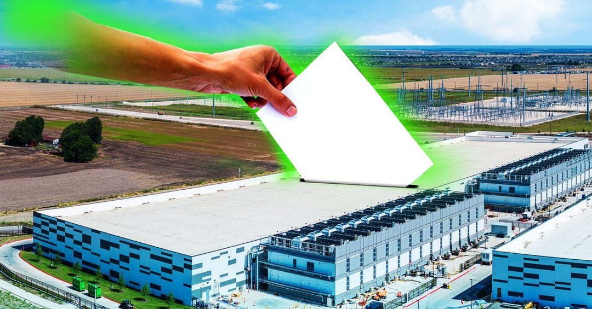

从参议院关键选区到地方分区（zoning）公投，数据中心及其支持者在 2026 年中期选举中全面落败，德州这一 AI 基建重镇的地位也岌岌可危。

地方公投的议题通常很具体：电价、水耗、噪音、税收优惠的分配。这类议题不关心 AGI 叙事，只关心本社区的成本收益表，而这张表的算法正在向反对者倾斜。对行业的直接后果是，算力扩张的瓶颈从芯片、电力进一步迁移到"许可"——选址周期拉长，会改变训练集群的交付节奏，也让资本开支的确定性变差。投资者应把"许可风险"独立成一项，而不是并进工程延期。

> 原文：[Wired](https://www.wired.com/story/the-results-are-in-voters-hate-data-centers/)

### 1 亿美元买不到议题显著性

由硅谷富豪支持的 Leading the Future 网络手握 1 亿美元、主打反监管，但在中期选举中收效甚微，AI 议题在选民优先级中排名靠后。

值得注意的是"收效甚微"的性质：选民并非反对 AI，而是不在意。这意味着问题的核心是 salience（议题显著性），并非立场对立，而显著性很难靠广告预算直接购买。两个推论：其一，"反监管"目前还不是一个有选民市场的政治产品；其二，与其在联邦层面投放，不如在地方层面解决具体的成本分摊问题——电费谁付、水从哪来。政治投入的边际回报，正在从话语层转向账本层。

> 原文：[Wired](https://www.wired.com/story/the-biggest-pro-ai-super-pac-network-didnt-really-impact-the-midterms/)

### Delangue：我的末日概率接近零

Hugging Face CEO Clément Delangue 在 Wired 活动上表示，自己的"末日概率"（p(doom)）接近零，AI 的主要风险来自少数闭门造车的玩家，开源才是解药。

这是一套结构清晰的论证：风险不是来自能力本身，而是来自权力集中，因此开放权重既是技术路线也是治理方案。它同时是开源阵营商业叙事的合法性来源。需要指出一个常见的概念滑移——开源降低了能力集中于少数机构的扩散风险，但也降低了能力被追溯和收回的可控性。这是两类不同性质的风险，不能用其中一个的存在否定另一个。

> 原文：[Wired](https://www.wired.com/story/wired-world-fair-2026-clement-delangue-hugging-face/)

### 4000 亿英镑的红利，出处是谷歌

Wired 调查发现，英国政府宣称的 AI 经济增量主要引自谷歌；AI 大臣如今承认实际数字不到三分之一，研究者将差距归因于采用速度过慢。

这是一次典型的"政策数字供应链"事故：宏观 AI 红利预测通常建立在"假设全面采用"的基准上，一旦企业的采用曲线推迟两年，财政承诺就会整段落空。对投资人的实用建议很朴素——看到国家级 AI 经济增量数字，先问三个问题：基准假设是什么、出处是谁、有没有把采用速度当作变量。同样的问题，适用于几乎所有"AI 将贡献 X% GDP"的报告。

> 原文：[Wired](https://www.wired.com/story/uk-officials-said-ai-would-add-400-billion-to-the-economy-that-figure-mainly-came-from-google/)

### OpenAI 已经开始写 2028 的剧本

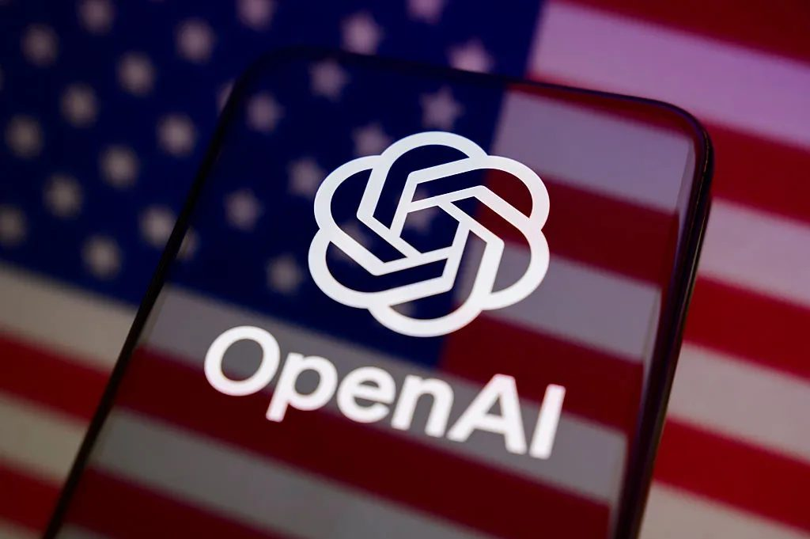

OpenAI 的 Chris Lehane 提出一套"新社会契约"，希望在塑造 2028 年选举议题的同时，兼顾公司自身的商业利益。

关键点不在内容，而在时点与方法：把政策议程设置提前两年，从被动应对监管转为主动定义讨论框架。这是行业成熟的一个标志性动作——谁定义"AI 与社会之间的契约"包含哪些条款，谁就设定了下一轮监管的默认值。对从业者而言，值得跟踪的是这套框架里哪些诉求会被写成公共语言，哪些会被留在公司利益一侧。

> 原文：[TechCrunch](https://techcrunch.com/2026/11/04/openai-is-already-trying-to-shape-the-2028-election/)

### 稚晖君复盘：大模型会不会击穿具身智能

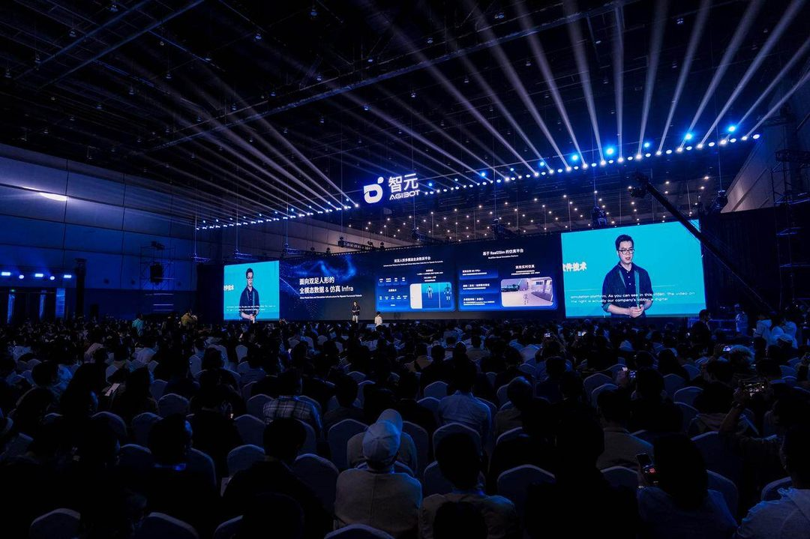

智元团队在一篇长文中复盘大模型与机器人结合的真实瓶颈，讨论通用模型能力提升对具身智能（embodied AI）路线的冲击与机会。

这是路线之争，并非单纯的工程问题。如果通用模型加上通用数据能覆盖大部分操作任务，垂直具身公司的护城河就只剩硬件成本与数据闭环；反之，如果真实世界的接触数据仍然高度依赖本体与场景积累，那么"通用模型越强、专用数据越值钱"。复盘的价值在于它来自一线的失败与卡点，而非实验室指标——在这个方向上，知道哪里走不通，比知道 SOTA 是多少更有用。

> 原文：[InfoQ](https://www.infoq.cn/article/bFKTeyCOlydWMYi91H4q?utm_source=rss&utm_medium=article)

### 10 万个智能体在跑，防线在哪

CNCC 2026 上专家激辩智能体（agent）安全：蚂蚁内部已有 10 万余个智能体在运行，非人类身份治理与权限撤回成为规模化落地的核心卡点。

关键点是"权限撤回"这个听起来很枯燥的词。agent 的权限是累积的——为完成任务而授予的读写、调用、支付能力，往往在任务结束后依然生效，事故半径由此放大。非人类身份（non-human identity）治理之所以成为卡点，是因为它要求把 agent 当作需要生命周期管理的账号，而非一次性的功能调用。这是目前 agent 落地中最被低估的一笔工程债。

> 原文：[雷峰网](https://www.leiphone.com/category/ai/tT9FskgaSMm7y4Ao.html)

---

技术可以按季度迭代，社会许可只能按选举周期结算。留给读者一个问题：如果你的项目明年要过一道地方公投，你准备讲成本，还是讲愿景？

<h2 id="opensource" class="ai-section-divider">⚙️ 开源工具</h2>

Karpathy 的 nanochat 用 100 美元的预算，把“从零训练一个能对话的模型”变成一份可读的代码；它的价值不在于模型多强，而在于把 LLM 的全流程摊开成可复现的教学栈。今天这个板块的其余七条，几乎都是同一件事的变体：原本属于大公司和大集群的能力，正在被装进更小的容器，比如终端、本地显卡、嵌入式设备和单次会话之外。与此同时，开源这轮竞争的重点，已经从“能不能跑”转向“能不能被普通人拆开看、动手改”，可维护性也因此成了新的卖点。

### Karpathy 的 nanochat：100 美元能买到的最好教学栈

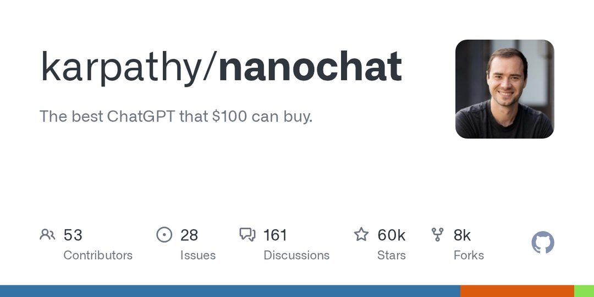

nanochat 是 Karpathy 开源的极简训练栈，目标是用极低预算从零训练出一个可用的对话模型，把从零训练到可对话的完整链路压进一套可读的代码里。

关键点不在性能，而在“全流程可复现”：数据、训练、评估、推理的每一环都不藏在框架黑箱里。100 美元这个量级意味着个人也能完整跑通一遍，试错成本从“申请算力”降到“下午动手”。

为什么重要：对技术团队来说，这是比论文更好的入门材料；对投资人来说，它则像一把尺子，用来校准预期。当训练一个能用的对话模型，成本被反复压到几百美元的级别，护城河的讨论就必须从“模型本身”转向数据、分发和工程。

> 原文：[GitHub - karpathy/nanochat](https://github.com/karpathy/nanochat)

### Copilot CLI 开源：编码智能体搬进终端

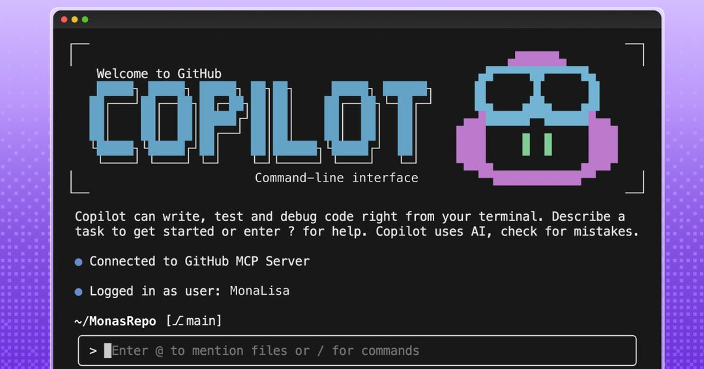

GitHub 把 Copilot CLI 放上开源仓库，定位是让 Copilot 的编码智能体能力直接作用于命令行终端，而不再局限于 IDE 内的补全。

关键点：终端是很多工程师真正的主工作界面，也是脚本、构建、部署的发生地。把 agentic 能力搬到这里，意味着智能体从“建议一段代码”走向“执行一串命令”，能力边界和风险边界同时扩大；权限、审计、回滚都得重新设计。

为什么重要：编码智能体的入口之争，IDE 这一块已经基本定了，现在轮到 shell。谁控制了终端里的默认智能体，谁就握住了开发者日常最高频的接触点；对团队而言，这也是该开始制定“agent 可执行命令白名单”的信号。

> 原文：[GitHub - github/copilot-cli](https://github.com/github/copilot-cli)

### claude-mem：给智能体加一层跨会话记忆

claude-mem 是一个开源工具，它捕获智能体会话的全过程，用 AI 压缩后把相关上下文注入后续会话，兼容 Claude Code、Codex、Gemini 等多个前端。

关键点在于把“记忆”做成独立于模型和客户端的组件：原始会话是原料，压缩是核心工序，注入是消费方式。压缩策略决定了什么被记住、什么被丢掉，这本身就是一种隐性的产品判断。

为什么重要：跨会话记忆一直是 agent 落地的短板，没有它，每次对话都从零开始，长期协作无从谈起。但记忆层一旦独立，记忆污染、隐私边界、上下文成本就都从模型问题变成了工程治理问题；而这层中间件的标准，目前还没人定。

> 原文：[GitHub - thedotmack/claude-mem](https://github.com/thedotmack/claude-mem)

### colibri：用存储分层把前沿 MoE 塞进本地

colibri 是一个用 C 语言实现的分层推理引擎，思路是按热度给 MoE 的专家分三档：热专家常驻 GPU，温专家放内存，冷专家从 NVMe 流式读取。

关键点：MoE 的稀疏激活天然适合这种分层，因为每次推理只用到少量专家，绝大多数权重在单次调用里都是“冷”的。用 C 写意味着依赖少、贴近硬件，代价是工程复杂度要自己扛；真正的难点在延迟，流式读盘会带来抖动，缓存命中率直接决定体验。

为什么重要：前沿模型本地化的现实路径，可能不是等显存降价，而是重排存储层级。这条路线如果跑通，会重新定义“本地能跑多大的模型”，也会让消费级硬件和推理引擎的关系更像数据库和存储。

> 原文：[GitHub - JustVugg/colibri](https://github.com/JustVugg/colibri)

### Vercel Labs 的 fx：用 Zig 写嵌入式智能体

Vercel Labs 推出 fx，一个专门面向嵌入式场景、用 Zig 编写的编程智能体，探索在资源受限设备上的 AI 编码工作流。

关键点：Zig 的卖点是显式内存管理和可预测的构建，和嵌入式约束契合；把编码智能体对准嵌入式，等于把它从“Web 与脚本”这个舒适区拽出来，去面对交叉编译、硬件抽象层和没有标准环境的现实。

为什么重要：编码智能体的下一阶段竞争，不在模型能不能写代码，而在能不能适配陌生的工具链。嵌入式是个好试金石，如果 agent 能在资源受限、文档稀缺的栈上工作，它离“通用工程助手”才近了一步。

> 原文：[InfoQ - Vercel Labs fx](https://www.infoq.cn/article/cNO8PCwQoZMRHhIyVDrB?utm_source=rss&utm_medium=article)

### OpenMontage：让编码助手接管视频流水线

OpenMontage 是一个开源的智能体视频生产系统，内含 12 条制作流水线和 100 多个工具，目标是让编码助手直接承担完整的视频制作。

关键点：它没有重造模型，而是把现成的工具串成可被 agent 调用的流水线。视频制作恰好是多步骤、多工具、强顺序依赖的场景，剪辑、字幕、渲染、导出每一步都要交接状态，正好用来压测 agent 的编排能力。

为什么重要：agent 的商业价值大概率不出现在“替代某个模型”，而出现在“把十几个 API 串成一条别人不愿意手写的流水线”。这类项目的真正指标不是 demo 好不好看，而是失败时能不能定位到具体哪一步。

> 原文：[GitHub - calesthio/OpenMontage](https://github.com/calesthio/OpenMontage)

### heretic：免训练给语言模型“动手术”

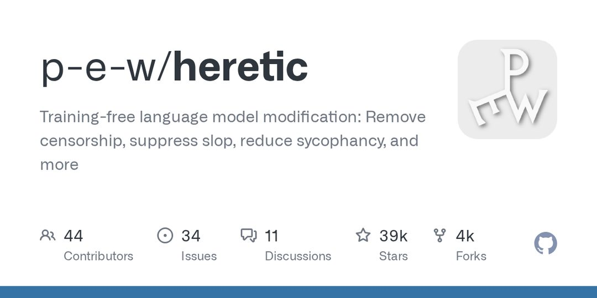

heretic 是一个无需训练即可修改语言模型行为的开源项目，声称能移除审查、抑制口水话、降低谄媚倾向。

关键点：它把“改模型”从重新训练挪到了不需要训练的直接修改上。这类做法成本低、见效快，但修改的效果和副作用都缺少训练流程里的评估护栏；“声称”两个字值得留意，效果需要用具体评测验证，而不是看几个例子。

为什么重要：模型行为的可编辑性正在变成一个独立工具品类。好处是研究者和团队能低成本定制对齐行为；风险是同一套工具也能被用来削弱安全边界。开源社区迟早要面对那个老问题：能力中立的工具，责任该由谁承担。

> 原文：[GitHub - p-e-w/heretic](https://github.com/p-e-w/heretic)

### Anthropic 给开源项目加可选安全扫描

Anthropic 为重要开源项目新增了可选的安全扫描服务，把模型能力用于开源供应链的漏洞排查。

关键点：一是“可选”，不强制接入，降低维护者的抵触；二是面向“重要开源项目”，也就是那些被大量下游依赖、却往往由少数人维护的仓库。开源供应链的脆弱性大多不在代码写得多差，而在没人有时间看。

为什么重要：这是模型能力下沉为基础设施的一个样本，不是做成产品卖，而是做成扫描器塞进生态的关键节点。如果有效，安全扫描可能像 CI 一样成为默认环节；但“可选”也意味着覆盖率取决于维护者的意愿，真正的考验是误报率能不能低到让人愿意开第二次。

> 原文：[InfoQ - Anthropic 开源安全扫描](https://www.infoq.cn/article/hdmi6FdjpYSEvuMhPOAa?utm_source=rss&utm_medium=article)

---

今天这八条指向同一个方向：开源正在把“大模型”拆成可维护的零件，包括 100 美元的训练栈、终端里的 agent、跨会话的记忆层、按热度分层的本地推理。问题留给你：当拆解成本低到这种程度，你所在团队的护城河，究竟建在哪一层？
