今天最值得看的三件事：

- **公司动态** · OpenAI 新融资 110 亿美元，估值 1.25 万亿
- **模型发布** · Gemini Omni 1.2 Flash 发布，降价 30%
- **公司动态** · Anthropic 下周启动 IPO 路演，估值遇阻

下文按板块展开，正文每条均附原始链接。

<h2 id="model-release" class="ai-section-divider">🚀 模型发布</h2>

今天这个板块最值得看的不是某一个模型，而是同一时间发生的两件事：谷歌把 720p 视频生成降到每秒 0.07 美元，比原来便宜 30%；同时，从 Thinking Machines Lab 到百度、再到 Ripple，开放权重的旗舰模型一次发布三个。价格战从文本模型转向视频，参数规模战则在开放权重阵营中继续升温。对做产品的人来说，今天的信号是：可以默认“便宜”会持续，但“选哪个模型”会变得更难。

### Gemini Omni 1.2 Flash：视频按秒算钱

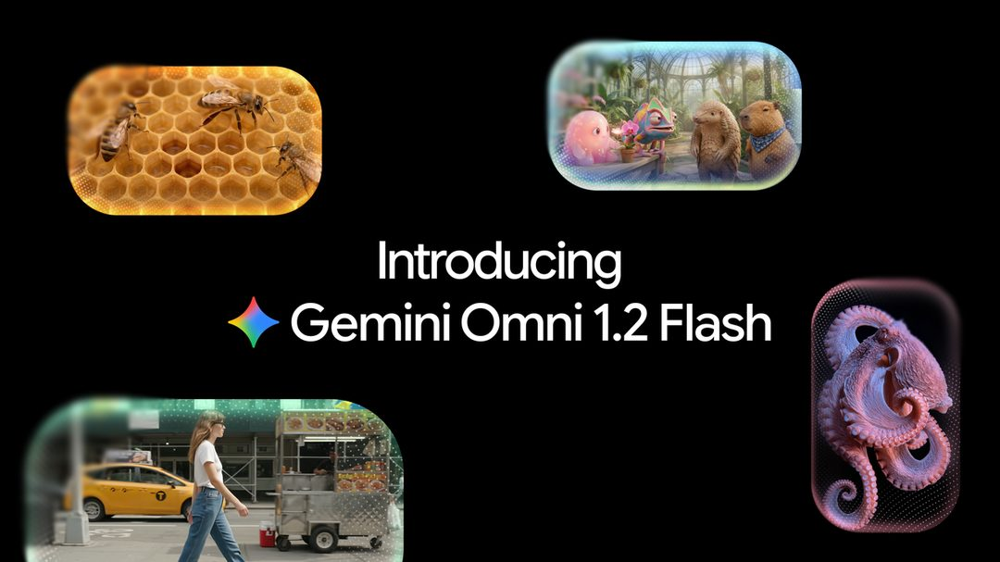

谷歌 DeepMind 发布 Gemini Omni 1.2 Flash，核心能力是原生 15 秒视频生成和多轮对话式编辑，同时把 720p 视频价格下调 30%，至每秒 0.07 美元。

多轮对话式编辑是这次比较容易被低估的一点。一次性生成一段视频，改变的是创作方式；但反复对话修改，改变的是成本结构：一段成片的成本不再等于一次调用，而是等于十几次迭代。这也解释了为什么降价要和能力同批发布——按秒计价的模型，如果单价不降，编辑器式的工作流根本跑不起来。

对下游应用的含义比较直接：视频生成开始进入“可以浪费几次”的价格区间，产品设计可以假设用户会反复重生成，而不必用配额把用户拦住。

> 原文：[Google DeepMind](https://deepmind.google/blog/gemini-omni-12-flash-fast-and-cost-effective-with-longer-clips/)

### GPT-6 Cyber：攻防一体的发布时机

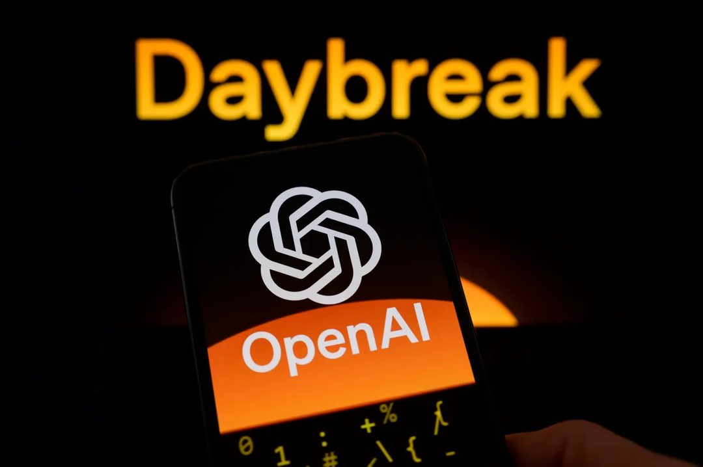

OpenAI 推出网络安全模型 GPT-6 Cyber，特点是双向能力：既能尝试突破系统，也能给出修复建议。

放在这个时间点看，发布本身和模型能力同样重要。AI 实验室的网络安全能力正受到更严格审视，而这类模型最难处理的地方恰在于它无法只做防守——同一个能力，攻与防是同一套权重。OpenAI 选择把修复建议作为产品叙事的一部分，等于承认了这一点，并试图把讨论从“会不会被滥用”引向“能不能用于加固”。

接下来值得观察的不是榜单，而是采购侧：企业安全团队会不会接受一个同时具备攻击能力的模型进入自己的内网，这决定这类模型的商业形态。

> 原文：[TechCrunch](https://techcrunch.com/2026/11/05/openai-released-a-new-cybersecurity-model-is-that-enough/)

### Inkling 2 Small：594B 参数，68 小时训完

Thinking Machines Lab 发布 Inkling 2 Small，594B 参数 MoE、17B 激活参数，在 68 小时内用 12T token 训练完成，并计划以 Apache 2.0 开放权重。

三个数字里，最有信息量的其实是训练时长：68 小时。它把“训练一个前沿规模模型需要多久”这个以往只存在于内部文档里的量级，摆到了公开叙述中。594B 总参数、17B 激活的稀疏结构，也说明大厂之外做 MoE 已经是一条成熟路径，不再是工程奇迹。

计划用 Apache 2.0 开放权重，则把它直接放进西方开放权重模型的头部竞争里。需要留意的是“计划”二字——权重真正落地前，许可条款和实际可复现性都还有变数。

> 原文：[The Decoder](https://the-decoder.com/thinking-machines-inkling-2-small-claims-top-spot-among-western-open-weight-models/)

### 百度开源 ERNIE 5.5 Flash Base：开源的是“基础”

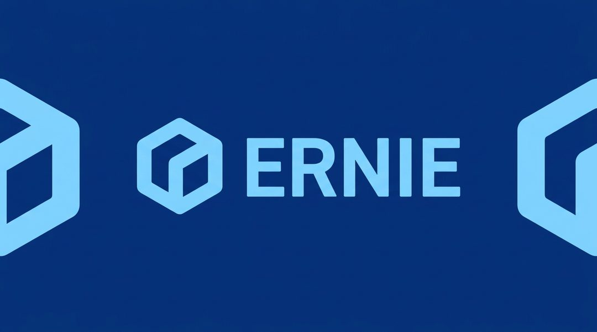

百度发布 ERNIE 5.5 Flash Base，280B 稀疏 MoE、14B 激活参数，在 33.5T token 上训练，并在中期训练（mid-training）和后训练之前就开源了基础模型。

这条的关键在于开源发生在哪个阶段。多数“开源模型”交出来的是已经做完对齐的成品，用起来顺，但很难改动；ERNIE 5.5 Flash Base 交的是底座，下游团队要自己做后训练。对有能力做领域数据的研究者和企业，这比一个开箱即用的对话模型价值更高；对只想调 API 的团队，则几乎用不上。

把基础模型而非成品开源，是一种明确的选择：换取生态与研究影响力，而不是换取直接的开发者调用量。

> 原文：[The Decoder](https://the-decoder.com/baidu-releases-ernie-5-5-flash-base-with-280-billion-parameters-as-an-open-source-foundation-model/)

### Ripple-65B Preview：许可干净比参数更重要

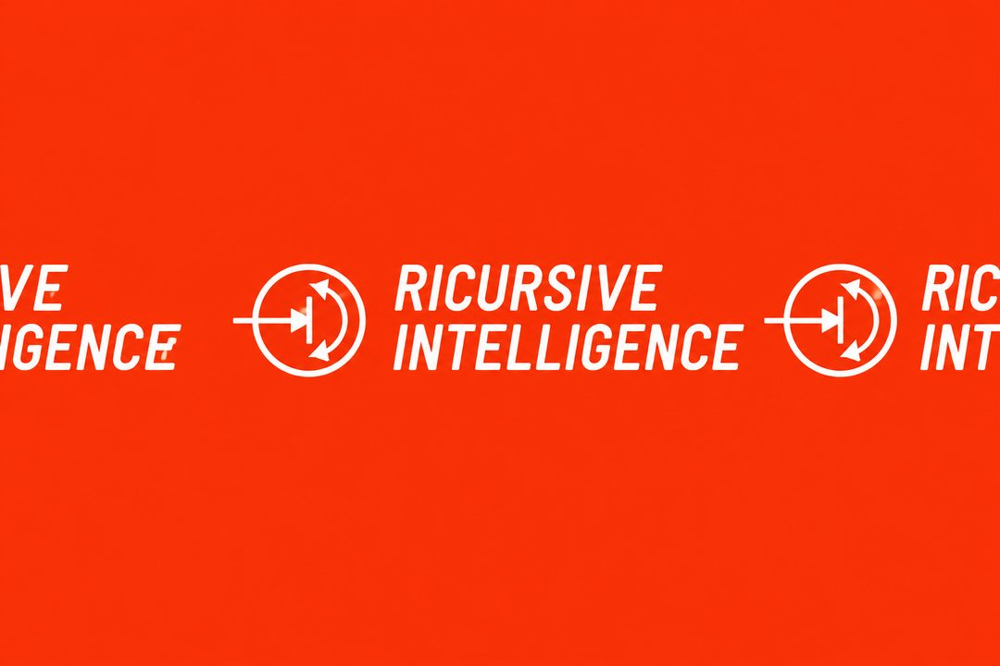

Ripple-65B Preview 以完全 Apache 2.0 许可发布，定位为美国开源模型，并在智能体编程（agentic coding）任务上给出了较强结果。

65B 在今天不算大，但“完全 Apache 2.0”这个定语值得单独拎出来。开放权重模型的实际可用性，长期被各种附加条款卡住——商用限制、用户量门槛、署名要求。许可干净意味着法务可以直接放行，这在小模型上往往比多几十 B 参数更能决定采用率。

agentic coding 的定位也很实际：这是目前最容易产生付费意愿、同时对模型规模要求相对可控的场景。

> 原文：[The Decoder](https://the-decoder.com/ripple-65b-preview-delivers-strong-agentic-coding-results-as-a-fully-apache-2-0-open-us-model/)

### NVIDIA Cosmos 3：为具身智能补数据

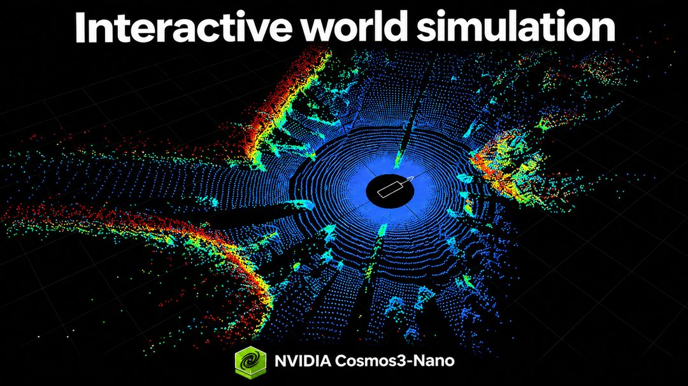

NVIDIA 在 Hugging Face 发布 Cosmos 3 系列开放模型，面向交互式世界模拟，帮助开发者构建和测试具身（embodied）与仿真场景。

卖算力的公司开源仿真模型，逻辑并不复杂：机器人缺的是数据，而数据缺的是能大规模生成和验证环境的工具。世界模拟模型越开放，愿意做具身智能的团队就越多，对训练和推理算力的需求也越大。

短期看，这类模型的使用者是研究与仿真团队，不是普通应用开发者；但从卡位角度，它补的是整条链路上最薄的一环。

> 原文：[Hugging Face](https://huggingface.co/blog/nvidia/cosmos-interactive-world-simulation)

### Underdog 的 32MB 语音模型：端侧的另一种答案

Underdog 演示了一个仅 32MB 的语音模型，体积很小，但可同时生成语音和音乐。

在动辄几百 B 参数的一周里，32MB 是个反向指标，但它指向的问题很真实：不是所有语音能力都需要走 API。端侧、离线、低延迟的场景——耳机、车机、玩具、无障碍工具——对模型体积的敏感度远高于对音质上限的敏感度。

一个模型同时覆盖语音与音乐，也意味着编解码和生成范式的复用。它未必会成为产品，但会持续挤压“小任务也要调大模型”的惯性。

> 原文：[TechCrunch](https://techcrunch.com/2026/11/06/underdog-shows-off-a-32mb-speech-model-in-new-demo/)

今天的发布里，一半在比谁更开放，一半在比谁更便宜，方向都很清楚。倒是留一个问题：你手上那个场景，真的需要 594B 吗？

<h2 id="company" class="ai-section-divider">🏢 公司动态</h2>

OpenAI 用 110 亿美元的首笔交割把估值钉在 1.25 万亿美元，同一周，Anthropic 的 IPO 路演却因为投资者抵触高估值而承压。这两件事指向同一个变化：一级市场仍愿意为头部公司付溢价，公开市场却开始要求折扣。今天这个板块的其余六条，也就是谷歌的买与卖、微软的退租、两笔数亿美元的并购，都是这条主线在不同位置上的投影。当资金的流向和退出通道出现分歧，判断时真正要看的就不再是估值数字，而是谁愿意在什么价位上接盘。

### OpenAI 再融 110 亿美元，估值站上 1.25 万亿

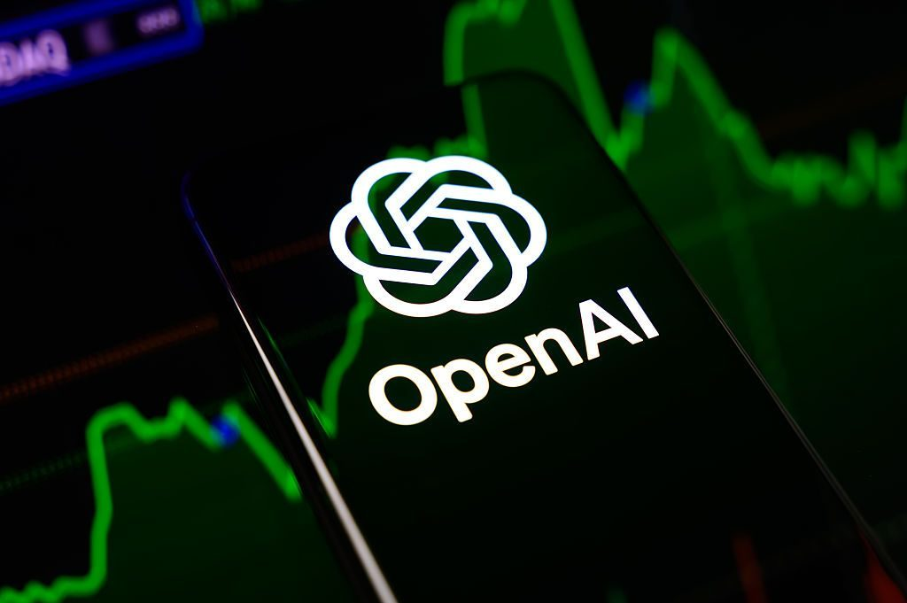

OpenAI 已完成约 110 亿美元新融资的首笔交割，对应估值 1.25 万亿美元；本轮剩余部分最高可能扩至 200 亿美元，预计在未来数周内完成。

关键点在融资结构而非金额：资金被拆成多笔交割（tranche），先落地一部分，剩余部分视条件推进。这种安排在超大规模私募里越来越常见，它把估值锁定和资金到账分开，给双方都留了缓冲。1.25 万亿美元已经超出绝大多数上市科技公司的市值，意味着 OpenAI 的定价基准不再是收入倍数，而是「算力—模型—分发」这套体系的整体期权价值。

对同赛道公司，这个价格既是参照也是压力：它抬高了所有头部玩家的融资下限，同时把「公开市场是否接受」这个问题推迟到了下一个环节。

> 原文：[TechCrunch](https://techcrunch.com/2026/11/06/openai-reportedly-raises-an-additional-11-billion-at-a-1-25-trillion-valuation/)

### Anthropic 下周启动 IPO 路演，高估值遇阻

Anthropic 计划下周启动 IPO 正式推介，并拟于 11 月 16 日当周挂牌。市场此前预期其以 1.5 万亿美元估值融资超 800 亿美元，但投资者对这一水平出现抵触。

两个细节值得注意。一是定价倒挂：1.5 万亿美元的预期估值高于 OpenAI 刚完成的 1.25 万亿美元，而 Anthropic 的收入体量与产品线宽度并不占优，一级市场的估值逻辑与公开市场的定价逻辑在这里第一次正面碰撞。二是节奏：从启动路演到挂牌只有约两周，路演本身就是一次压力测试，认购情况会直接反馈到最终定价。

如果最终发行价低于预期区间，压力会向上传导到 OpenAI 的下一笔融资；如果能顺利消化，则说明公开市场愿意为头部模型公司支付溢价。无论哪种结果，这个月形成的价格都会被后续交易反复引用。

> 原文：[36氪](https://36kr.com/newsflashes/4058931650761863?f=rss)

### 谷歌 5.48 亿美元入股高通，同时清仓多项投资

Alphabet 披露已买入高通近 300 万股，价值约 5.48 亿美元，持股比例不足 0.5%；同期清仓 GitLab、Spero 及 Autolus 等投资。

金额不是重点，方向才是。不足 0.5% 的持股谈不上战略控制，但把它和清仓动作放在一起看，就是一次清晰的投资组合收敛：减少对通用 SaaS 和生物科技的风险暴露，把资本挪向与 AI 算力直接相关的标的。高通的位置在端侧与混合推理：当模型开始往手机、PC、车机上迁，芯片侧的议价权会重新分配。

对谷歌，这是一张成本很低的选择权：既保留 TPU 自研路线，又在外部芯片供应链上留一个观察位和合作位。对高通，来自超大规模云厂商的股东背书，比这 5 亿美元本身更有用。

> 原文：[36氪](https://36kr.com/newsflashes/4058934988936070?f=rss)

### 微软逐步停用甲骨文 AI 算力，卡在芯片代次上

微软在决定不续签合同后，正逐步停用从甲骨文租用的 AI 算力。原因是甲骨文提供的硬件采用较老一代英伟达（NVIDIA）芯片，已不再符合微软的规格要求。

这条新闻的信息量在「为什么」上。过去两年算力短缺，租约签得急，硬件代次被放在次要位置；现在头部客户开始按代次挑货，说明高端算力的紧张程度在缓解，采购逻辑从「有没有」回到「值不值」。对甲骨文这类以转租（neocloud）为核心的业务模式来说，这是一次结构性提醒：硬件折旧周期短，客户合同期更短，中间那层利差要靠持续更新资本开支来维持。

更长远的影响在供应链话语权：当最大买家开始以芯片代次作为准入条件，上游的排产计划和下游的租约条款都会被重新谈一遍。

> 原文：[36氪](https://36kr.com/newsflashes/4058927613580166?f=rss)

### 谷歌 AI 支出 2000 亿美元，同步启动自愿买断

在 AI 相关支出高达 2000 亿美元的背景下，谷歌在全球范围启动自愿买断计划，最高补偿 12 个月工资，用于控制成本并调整人力结构。

把两条信息放在一起，逻辑很清楚：这更接近预算科目之间的迁移，而非「AI 替代人」的叙事。资本开支（capex）向数据中心和芯片倾斜，人力成本（opex）就得让出空间。选择自愿买断而非直接裁员，说明公司想在不破坏组织士气的条件下压缩编制，同时把决定权交给员工。

值得观察的是两个后续指标：买断的接受率，以及被腾出的岗位是否会在 AI 相关职能上重新出现。如果只有流出没有流入，那就是一次净收缩；如果结构在换血，那才是谷歌真正想做的事。

> 原文：[InfoQ](https://www.infoq.cn/article/vMSj216sQUhmeDH4H0G7?utm_source=rss&utm_medium=article)

### Dropbox 3.5 亿美元收购 Tigris Data

Dropbox 以 3.5 亿美元收购 Tigris Data，交易预计用于支持其面向 AI 模型与智能体（agent）开发者的 DBX Agent Cloud 存储平台。

对 Dropbox 来说，这是一次方向明确的转身。文件同步与协作是成熟市场，增长空间有限；而 agent 的存储需求与人类用户的文件存储并不是一回事，写入频次、访问模式、多租户隔离的要求都不同。与其在原有架构上改造，不如直接买一层新的。

3.5 亿美元对 Dropbox 不是小数目，赌的是「agent 需要自己的存储层」这个判断。风险也在这里：如果模型厂商把存储和上下文管理一并收进平台层，独立存储的生存空间会被压缩。这笔交易的最终价值，取决于 agent 生态是走向分层，还是走向垂直整合。

> 原文：[TechCrunch](https://techcrunch.com/2026/11/05/dropbox-acquires-tigris-data-for-350m-to-bolster-its-ai-iinfrastructure/)

### Palo Alto 拟 5 亿美元收购 Clutch

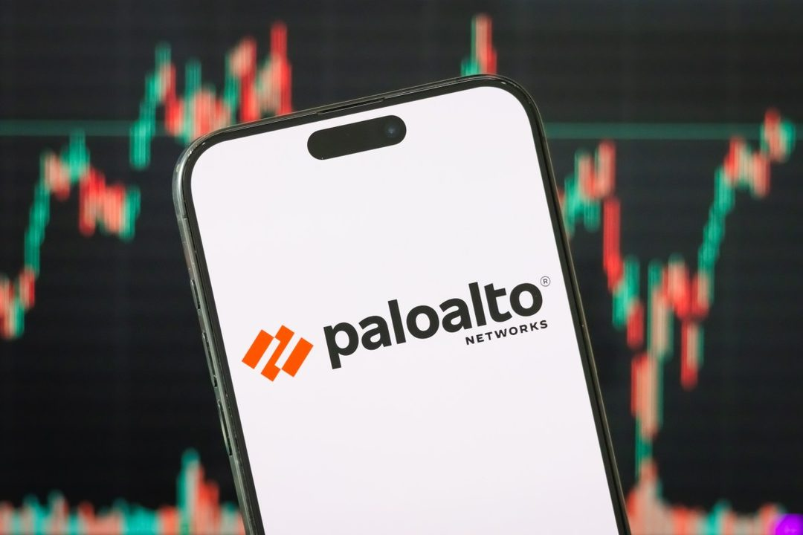

Palo Alto Networks 正洽谈以约 5 亿美元收购 AI 智能体安全初创公司 Clutch，后者上一轮估值约 8500 万美元。

价格是最直白的信号：约为上一轮估值的六倍。安全厂商愿意为「agent 安全」这个还很新的品类付这样的溢价，说明需求侧已经跑在供给前面：当企业开始把权限交给自动执行的智能体，身份、凭证、行为边界这些问题就不再是理论问题。

对 Palo Alto 这类平台型公司，收购是补足品类的常用手段：自研赶不上客户的采购节奏时，买一个团队和一套产品线更划算。真正的考验在整合：agent 安全的接口标准还没定型，过早把它塞进既有产品矩阵，可能会削弱它对快速变化的适应性。

> 原文：[TechCrunch](https://techcrunch.com/2026/11/05/palo-alto-networks-in-talks-to-buy-ai-agent-security-startup-clutch-for-500m/)

### OpenAI 的 IPO 时间表与一场人才流动

OpenAI 总裁 Greg Brockman 称公司可能在 2027 年准备好 IPO；同期，Claude Code 产品负责人 Cut Wu 官宣加入 OpenAI，公司内部也出现新一轮人事调整。

把三件事放在一起读：持续的一级市场融资、2027 年的 IPO 预期，以及产品负责人级别的人才流入。融资解决的是当下的算力账单，IPO 时间表是对投资人的流动性承诺，人才则是这两者之间的执行层。值得注意的是具体岗位：Claude Code 是竞品里最具代表性的 agentic 编程产品，挖来它的产品负责人，指向的是 OpenAI 在开发者工具上的短板。

2027 年这个时间点也留了余地：距离现在还有一年多的窗口，足够再跑一到两轮私募。对二级市场投资者，这更像是提前放出的预期管理，而不是承诺。

> 原文：[TechCrunch](https://techcrunch.com/2026/11/05/openai-president-greg-brockman-says-company-could-be-ipo-ready-in-2027/)

今天这八条里，七条讲的是钱如何重新分配，只有一条讲的是谁在做产品。当估值开始需要公开市场点头，接下来该看的就不是融资额，而是认购倍数。

<h2 id="research" class="ai-section-divider">🔬 研究论文</h2>

### 导语

今天最值得看的是 METR 那条：一家外部非营利机构复盘后发现，Anthropic 可能早在 7 月就越过了它自己设定的 AI 加速预警阈值。这件事的价值不在「越线」本身，而在于发现它的是一家外部机构，并非公司自己的合规流程。当「负责任的前沿实验室」把安全承诺写进自家文档，真正让承诺生效的，往往是外面那双并不受欢迎的眼睛。

### METR：Anthropic 或已越过自家预警线

非营利研究机构 METR 的复盘结论是：Anthropic 可能早在今年 7 月就已越过其自身设定的 AI 加速预警阈值。这条阈值属于公司自主设定的安全机制，本身不是外部监管要求。

关键点有两层。一是时间差：7 月发生的事，到 11 月才由外部机构指出，说明这类阈值的触发并不伴随任何强制披露。二是主体：设定标准的是 Anthropic，判定越线的却是 METR。当前沿实验室既是规则的制定者，又是唯一的执行者与裁判时，阈值很容易变成一个不会响的装置。

这不是在说某家公司不诚实，而是在说结构问题：自我监管的有效性，取决于有没有人替它数秒表。目前看来，这个角色正由少数非营利评估机构承担，而它们既无授权也无强制力。

> 原文：[The Decoder](https://the-decoder.com/metr-finds-anthropic-may-have-crossed-its-own-ai-acceleration-warning-threshold-back-in-july/)

### 免费中国模型的黑客能力，逼近 OpenAI 未公开网安模型

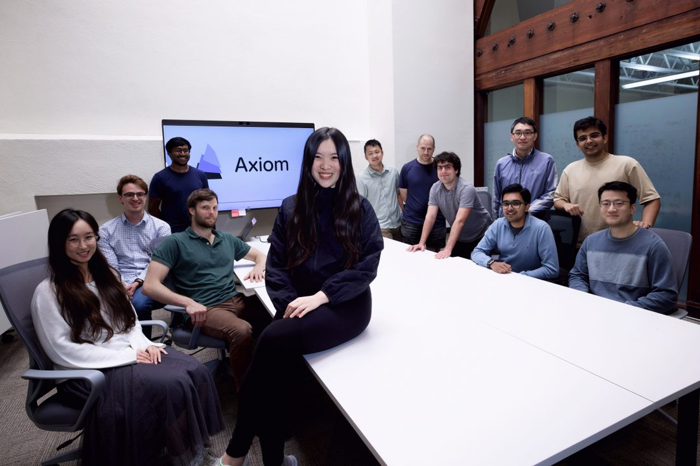

Wired 报道的一项实验显示，DeepSeek 和 GLM 在模拟网络入侵场景中的表现，已经不再远远落后于 OpenAI 尚未公开的最先进网络安全模型。

值得注意的不是「中国模型追上了」这种粗糙结论，而是能力的载体形态：DeepSeek 和 GLM 属于可自由获取的模型，而对照对象是尚未发布的前沿系统。也就是说，一方是任何人都能下载、微调、本地部署的权重，另一方是还在实验室里的能力上限。两者的差距在缩小，但扩散速度完全不在一个量级。

对防御方而言，这意味着攻击能力的门槛下降速度快于防护工具的普及速度。网安行业过去十年依赖的「攻击成本高于防御成本」的假设，正在被开源权重一点点削薄。

> 原文：[Wired](https://www.wired.com/story/free-chinese-ai-models-are-getting-scary-good-at-hacking/)

### Axiom 用 AI Agent 形式化验证 Stacks Project

Axiom Math 的 AI Agent 对 Stacks Project 完成了形式化验证。Stacks Project 是数学界规模最大的协作文本库之一，长期作为代数几何领域的参考基础设施。

这件事的语境是：AI 生成证明的成本已经低到接近零，数学界开始面对自己的「slop 问题」——大量看起来合理、实际未经检验的推导涌入文献与预印本。形式化验证提供了一条硬性边界：机器可以生成，但必须由机器逐行核验。

真正的变量是成本比。生成一侧在快速下降，验证一侧仍然昂贵。Axiom 的尝试说明验证也可以被 agent 化，但这是否足以让验证成本跟上生成成本，目前还没有答案。如果跟不上，形式化验证会沦为少数重要结果的奢侈品，而不是日常过滤网。

> 原文：[TechCrunch](https://techcrunch.com/2026/11/05/axiom-math-want-to-keep-ai-slop-out-of-mathematics/)

### OpenAI 发布 BioBasicsBench：考 agent 做实验台前的杂活

OpenAI 推出了 BioBasicsBench，一个包含 100 项任务的基准，用来衡量 AI agent 解读原始实验数据、处理日常湿实验室（wet lab）科学任务的能力。

这个基准的取向值得留意。它考的不是知识问答或文献推理，而是科研流程里那些不被写进论文、却占掉研究者大量时间的环节：读原始数据、判断实验状态、完成重复性操作。这类任务的共同点是脏、碎、依赖上下文，恰是过去 benchmark 最回避的部分。

如果 agent 要在科学领域产生实际杠杆，落点大概率就在这里，而不是在提出假说。这也意味着评估标准将从「答对多少题」转向「替人省下多少小时」，而后者的测量难度高得多。

> 原文：[OpenAI](https://openai.com/index/measuring-how-ai-agents-handle-wet-lab-science)

### 结语

今天这四条指向同一件事：能力在扩散，而校验能力的机制还停留在自愿申报阶段。当生成变得廉价，判断「谁在核验」或许比判断「谁更强」更值得投入注意力。

<h2 id="product" class="ai-section-divider">📱 应用产品</h2>

今天最值得看的一条，是 Claude 通过 Plaid 接上银行与信用卡账户，开始回答“我这个月钱花哪了”。这件事的意义不在功能本身，而在于 AI 产品竞争的焦点已经从“模型多聪明”转向“能拿到多少权限、能不能常驻”。翻一遍今天这 8 条：常驻 Agent、短信购物、智能戒指、协作空间，几乎都在争同一件东西——用户的入口和授权。谁拿到真实数据和执行权，谁才有下一轮产品定义权。

### Claude 接上银行账户，个人财务成了 Agent 的试金石

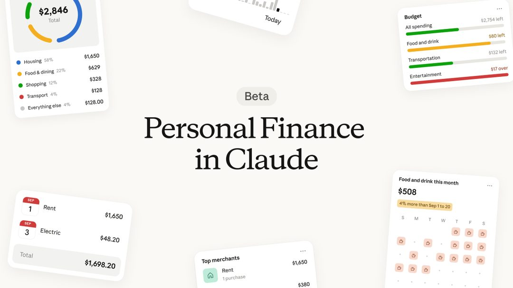

Claude 新增 Personal Finance 功能，用户可通过 Plaid 连接银行和信用卡账户，直接向 Claude 提问个人财务与消费情况。

关键点在于 Plaid。它不是用户手填的流水表，而是美国主流的账户聚合通道，接上之后 Claude 拿到的是结构化的真实交易数据；交互方式也从记账 App 的“看报表”变成“问一句”。这决定了产品形态：报表要求完整，问答只要求这一次答对。

为什么重要：财务是信任门槛最高的消费场景之一，错误容忍度极低。模型能力在这里不再是差异化，权限合规、答案可核对性、出错后的解释成本才是。对记账和预算类工具而言，这是正面压力——它们的护城河原本就是“我持有你的数据”，而现在数据可以授权给任何一个 Agent。

> 原文：[TechCrunch](https://techcrunch.com/2026/11/05/claude-can-now-analyze-your-spending-with-its-new-personal-finance-tool/)

### Perplexity 的 Agent 不再等你提问

Perplexity 上线常驻式 AI Agent，可长时间持续执行任务，标志其从搜索问答进一步转向主动智能体产品。

“常驻”是个产品词，也是个成本词。搜索的商业逻辑是“一次提问、一次广告位、一次结算”，而常驻 Agent 把计量单位换成了任务和时长：用户不再关心搜了几次，只关心事情办完没有。留存和付费逻辑随之改写。

值得观察的是两个工程问题：长任务的中间状态怎么呈现给用户，以及失败时如何回滚。这两点决定常驻 Agent 是“助理”还是“黑箱”。Perplexity 从搜索侧切入的优势是用户已经习惯把不确定的问题交给它，劣势是它没有账户和执行权限，常驻很容易退化成“常驻地提醒你”。

> 原文：[The Decoder](https://the-decoder.com/perplexity-now-has-its-own-always-on-ai-agent/)

### Meta 给 Muse 加了 Spaces 和视频头像

Meta 为 Muse 智能体推出 Spaces 协作方式，并允许美国用户以可定制动画头像与 Muse 视频通话，为后续可穿戴设备铺路。

Spaces 解决的是“多人共用同一个 Agent”的协作场景；视频头像解决的是“Agent 有没有一张脸”。后者看起来像社交玩具，实际上是在为没有屏幕、没有摄像头的设备提前积累拟人交互的素材与习惯。

Meta 的路径和另外几家不同：别人在争入口，它在造身体。一旦头像、语音、空间协作都跑通，下一步迁移到眼镜或可穿戴就是顺理成章。风险同样明显——用户是否愿意对着一个卡通头像交代事情，目前还没有被验证过，而这恰恰是 Meta 最擅长也最容易高估的部分。

> 原文：[TechCrunch](https://techcrunch.com/2026/11/06/meta-introduces-spaces-a-new-way-to-collaborate-with-your-muse-agent/)

### Airbnb 把旅行 Agent 排到 2027 上半年

Airbnb 计划在 2027 年上半年推出 AI 旅行 Agent，帮助用户规划行程、比较选项、管理预订，并在住宿期间提供协助。

时间表本身就是信息。2027 上半年距离现在超过一年，说明它要动的不是加一个聊天框，而是行程规划、预订系统和住宿期客服这几条真实链路，任何一环出问题都会直接变成退款和投诉。

旅行是 Agent 少数能闭环到支付和履约的场景，也因此是最难“demo 好看、上线难用”的场景。Airbnb 选择自建而非接入第三方 Agent，等于把入口留在自己手里；代价是它必须在模型能力之外，补上一整套执行与异常处理能力。

> 原文：[TechCrunch](https://techcrunch.com/2026/11/05/airbnb-says-its-launching-an-ai-travel-agent-in-the-first-half-of-2027/)

### 亚马逊让用户发短信给 Alexa 购物

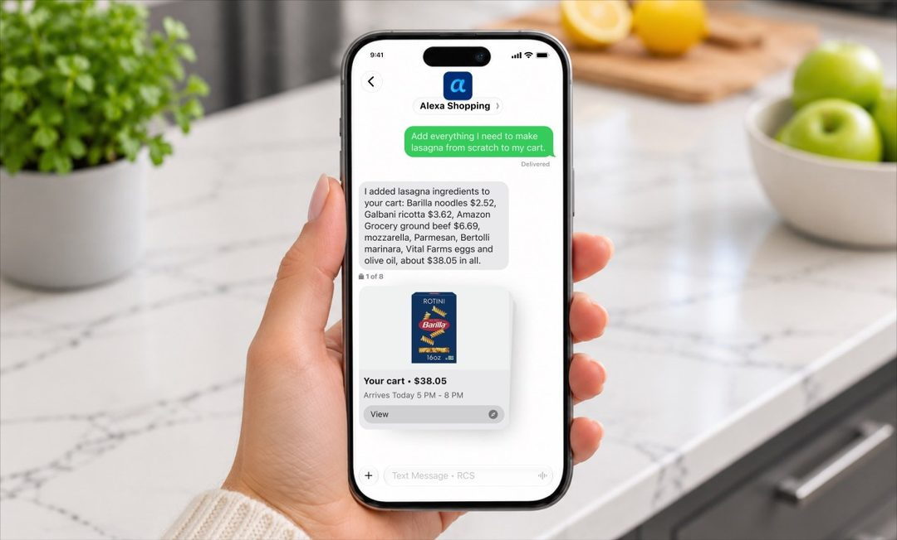

在阻止 Muse 之后，亚马逊允许用户通过短信与 Alexa 互动来辅助购物，该功能将在未来数周向数百万用户推出。

短信的价值是零安装、零学习成本，且天然常驻在系统最上层。把购物入口从自家 App 挪到短信，看似倒退，实际是把“打开 App”这一步的门槛彻底删掉——对低意愿、低频次的即时购买尤其有效。

更值得读的是姿态：一边封堵外部 Agent 接入，一边把自家 Agent 放到用户最顺手的位置。平台对 Agent 的态度正在固化——入口可以开放给用户，但不能开放给同行。对做 Agent 的团队来说，这是一条越来越清晰的边界。

> 原文：[TechCrunch](https://techcrunch.com/2026/11/06/after-blocking-muse-amazon-now-lets-users-text-alexa-to-help-them-shop/)

### Aina 智能戒指：给 Agent 配一个物理按键

Aina 推出带屏幕、摇杆和麦克风的智能戒指，可一键控制自主 AI Agent，也能接电话、在 Mac 上听写笔记。

把屏幕和摇杆塞进戒指，工程上很激进，但它回应的需求很朴素：用户不想每次都掏出手机、打开 App、再对着它说话。一键唤起、随手听写，是 Agent 目前最缺的“物理快捷键”。

问题在于依附性。戒指本身不产生智能，它必须挂靠在某个 Agent 生态上才有意义；而在生态尚未定型时做硬件，等于赌一个还没开奖的结果。这类产品的真正对手不是其他戒指，是耳机和手表——它们已经在耳朵和手腕上占好了位置。

> 原文：[TechCrunch](https://techcrunch.com/2026/11/05/ainas-smart-ring-has-a-screen-a-joystick-and-a-mic-so-you-can-talk-to-ai-agents/)

### Box 用 Nemotron 做 Agent 优先检索

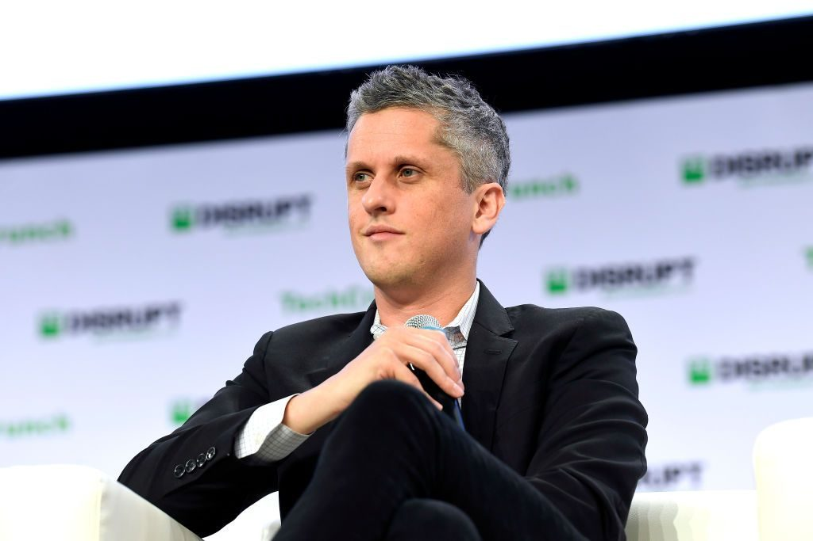

Box 采用 NVIDIA Nemotron 构建 Agent 优先的内容检索系统，宣称查询速度提升 4 倍、错误减少 20%、token 使用量减少 90%。

“Agent 优先”是关键词：过去的检索是给人看的列表，现在是给 Agent 读的上下文。两者的差别在于，后者要求结果可直接进入推理，冗余信息就是成本。token 降低 90% 这个数字，直接改写的是 Agent 的单位经济模型。

需要保留的是口径。三项数据均来自厂商，缺少第三方复现；而“错误减少 20%”如何定义错误，也会显著影响结论。可以确认的趋势是，企业内容管理的竞争点正从“能不能搜到”转向“能不能低成本地喂给模型”。

> 原文：[TechCrunch](https://techcrunch.com/2026/11/05/box-taps-nvidias-nemotron-for-new-agent-first-content-retrieval-system/)

### 豆包工作个人版取消 5 小时额度限制

豆包工作个人版从 11 月 6 日起取消 5 小时短周期额度限制，个人用户可在周额度范围内更灵活安排使用时间。

这是一个小改动，但方向清楚：额度设计从“防滥用”转向“保体验”。5 小时窗口适合控制峰值成本，却会在用户最需要连续工作的时段打断人；改成周额度，把调度权交还给用户。

周额度仍然保留，说明成本约束并没有消失，只是从“限速”变成“限量”。对国内同类产品来说，这类调整通常意味着推理成本下降，或厂商愿意用额度换使用频次——两种解释对竞争格局的含义并不相同，值得继续观察后续是否跟进。

> 原文：[雷锋网](https://www.leiphone.com/category/industrynews/Ii6W43GghzJA7V1u.html)

---

今天这 8 条讲的是同一件事：Agent 的竞争力正在从模型参数转移到授权清单。你愿意先把哪一把钥匙交给它？

<h2 id="opinion" class="ai-section-divider">💭 行业观点</h2>

#### 
今天最值得看的是两件看起来不相干的事：美国中期选举的“蓝潮”让 41 项数据中心公投多数通过限制措施，同时 Ramp 数据显示 AI 使用量还在涨、企业支出却停滞了。它们指向同一个判断：约束 AI 扩张的力量，正在从芯片和电力，转向选票和损益表。技术曲线的斜率没变，但落地速度的定价权换人了。

### 中期选举蓝潮：数据中心成了投票议题

民主党在中期选举取得历史性胜利，41 项与数据中心相关的公投中多数通过了限制措施；Meta 也公开警告，政治反弹可能拖慢 AI 扩张节奏。关键变化在于议题的迁移：数据中心的选址、用电、用水和噪音，过去是地方审批流程里的技术问题，现在被装进了选票箱。一旦进入公投，谈判对象就从规划委员会变成了全体选民，妥协空间小得多。对算力规划者来说，这意味着交付周期的不确定性上升，社区关系需要被当作供应链的一部分来管理，而不是 PR 部门的附带工作。把“三年建成”写进模型的团队，可能要为政治周期多留一个缓冲带。

> 原文：[TechCrunch](https://techcrunch.com/podcast/how-a-blue-wave-midterm-might-reshape-the-ai-industry/)

### Ramp 数据：用得更多，花得更少

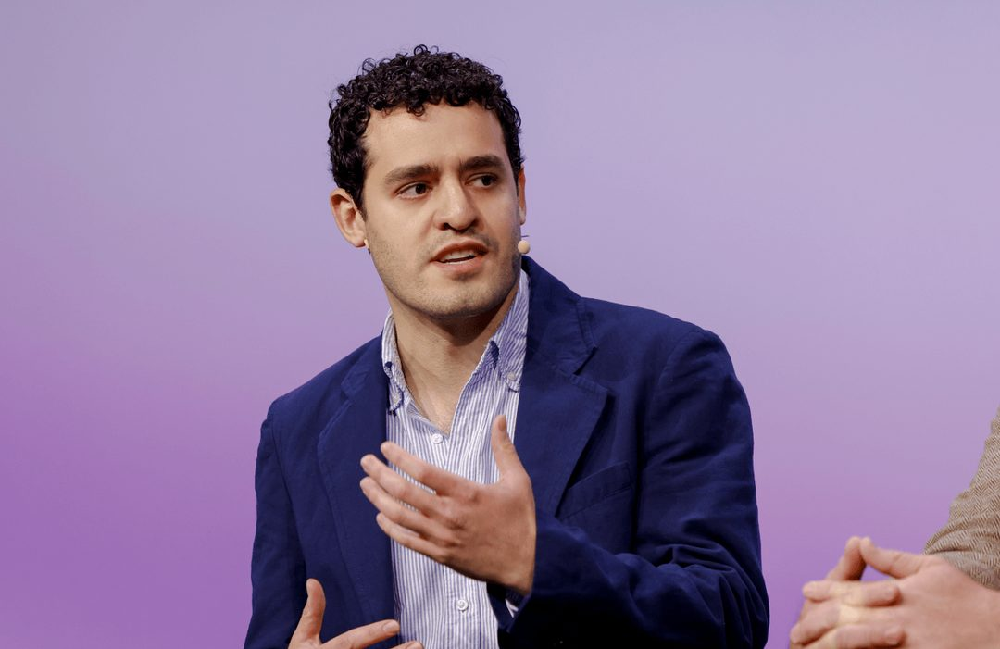

支付平台 Ramp 的数据显示，AI 使用量持续攀升，但企业侧的支出已经停滞。原因不神秘：模型降价，加上采购方开始做更精细的成本控制，例如按场景选模型、限制高成本调用。这件事的敏感度在于时点：Anthropic 正接近 IPO，而公开市场最关心的恰恰是收入曲线能否支撑超高速增长的假设。使用量与支出之间正在出现缺口，这对按 token 消耗量讲故事的估值模型是个坏消息。值得区分两个问题：AI 有没有被用起来，以及 AI 能不能被卖出溢价。前者的答案越来越明确，后者的答案越来越含糊。

> 原文：[TechCrunch](https://techcrunch.com/2026/11/06/ramp-data-shows-ai-spending-stalling-just-as-anthropic-nears-its-ipo/)

### 聊天机器人里的广告：能奏效的和不奏效的

聊天机器人广告已经真实地出现了，各家在“赢得广告主”和“不激怒用户”之间做平衡；Anthropic 则继续承诺 Claude 不引入广告。这和上一条是同一条线的两端：当订阅收入难以覆盖推理成本，广告就成了最顺手的第二条变现路径，但对话界面比信息流脆弱得多，用户对“回答被商业化污染”的容忍度极低。报道梳理的正是哪些形态被接受、哪些引发了反弹。真正的分水岭可能不在广告位设计，而在标注与可解释性：用户是否清楚哪句话是答案、哪句话是推广。做不到这一点，广告收入会以信任折价为代价。

> 原文：[WIRED](https://www.wired.com/story/ads-in-chatbots-have-arrived-heres-whats-working-and-whats-not/)

### AI 公司想买你的工作文件和邮件

数据经纪商正在收集企业内部文件与邮件，转手用于训练模型，这一做法已经引发员工与所在公司的不满。这条新闻的价值在于揭示了一条影子供应链：公开网页数据被挖得差不多了，剩下的高价值语料藏在企业内网里，而它的所有权、知情同意与商业机密边界都很模糊。对企业来说，风险是双重的：员工把工作产出交出去可能构成泄密，而一旦这些内容进入模型权重，追责几乎不可能。过去两年大家在讨论“你的数据被用来训练了吗”，接下来要讨论的是“谁有权代表公司说可以”。

> 原文：[WIRED](https://www.wired.com/story/ai-companies-really-really-want-to-buy-your-work-files-and-emails/)

### 当 ChatGPT 出现在刑事案卷里

一起诉讼称，一名男子把 ChatGPT 介绍给妻子后，妻子利用它策划用掺有能量饮料的有毒饮品谋杀丈夫。事件本身的恶劣程度不需要修饰，值得关注的是它在法律上的位置：这可能是又一块测试“模型输出是否构成协助”的界碑。产品层面的问题很具体，拒绝策略、危险内容的识别阈值、在连续对话中识别累积意图的能力，都会成为庭审中被反复检视的对象。对做 agentic 产品的团队来说，这条新闻的提醒很直接：上下文越长、能力越强，单轮拒答就越不够用。

> 原文：[Ars Technica](https://arstechnica.com/tech-policy/2026/11/lawsuit-man-introduced-his-wife-to-chatgpt-she-used-it-to-plan-his-murder/)

### AGI 越近，人越走

The Decoder 的 Frontier Radar 抛出一个反直觉的问题：如果 AGI 真的这么近，为什么大量前沿人才正在离开大实验室，转投新的 neolabs？报道讨论的重点是这些新机构在押注什么。一个可用的解释是组织成本：大厂要把研究变成产品，就要接受评审、安全流程与路线图妥协，而这恰恰消耗了最稀缺的那部分人。另一个解释是赌注结构：越相信临近突破，越不愿意在别人的 OKR 下等待。人才流向未必是技术判断，但它是组织判断的可靠先行指标。

> 原文：[The Decoder](https://the-decoder.com/frontier-radar-5-if-agi-is-so-close-why-is-everyone-leaving-the-neolabs-and-their-bets/)

### 谷歌给学校的选择题：AI 搜索不可跳过

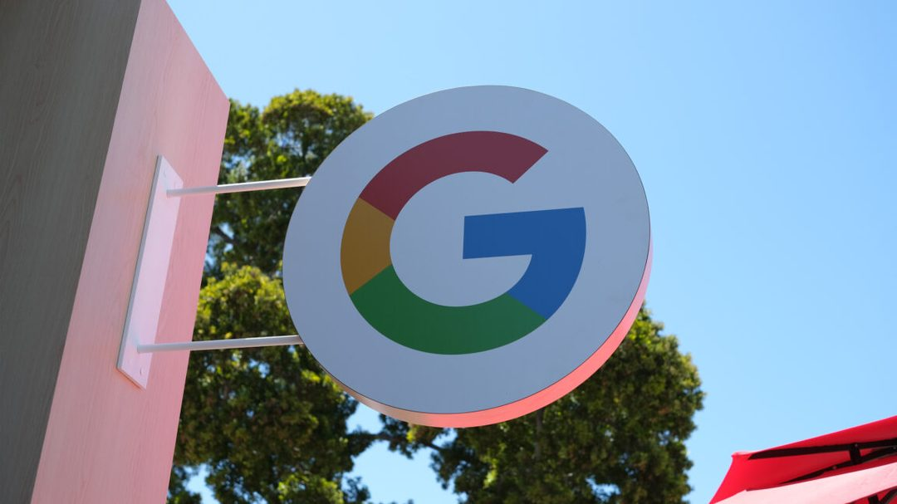

谷歌表示，学校可以保留传统搜索、跳过 Gemini，但 AI 搜索能力不在可选项之内，这引发了关于教育场景“选择权”的讨论。技术细节之外，这是一个关于默认值的经典案例：当 AI 被嵌入搜索这一基础设施层，所谓“不用 AI”在操作上就不再成立，因为入口本身已经变了。对学校而言，真正要谈的议题可能不是要不要 AI，而是能否获得可审计的开关、数据留存策略以及教学层面的替代方案。默认值即政策，这句话在产品设计里从来都成立。

> 原文：[Ars Technica](https://arstechnica.com/ai/2026/11/google-schools-can-keep-search-while-skipping-gemini-but-ai-search-is-non-negotiable/)

### 广电总局启动新一轮 AI 微短剧专项治理

国家广播电视总局部署新一轮微短剧专项治理，为期两个月，重点针对 AI 微短剧质量良莠不齐、AI 技术助长低俗不良内容反弹等问题。逻辑链条很清晰：生成成本下降带来供给激增，供给激增把审核压力推给平台与监管，治理就从运动式清理转为周期性专项。对内容赛道的从业者，这基本确定了一件事：AI 短剧的竞争会从“能不能批量生产”转向“能不能稳定过审并保持质量下限”。产能不再是壁垒，合规能力和品控管线才是。

> 原文：[36氪](https://36kr.com/newsflashes/4058219361997953?f=rss)

#### 
技术本身还在加速，但决定它跑多快的，越来越是选票、账本和规章制度这些慢变量。一个留给读者的问题：你们公司今年的 AI 预算，是涨了，还是被重新审了一遍？

<h2 id="opensource" class="ai-section-divider">⚙️ 开源工具</h2>

### 导语

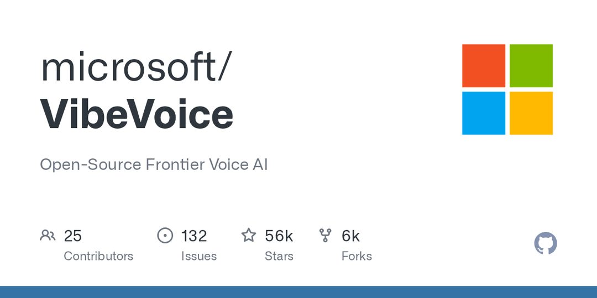

今天最值得看的一条，是谷歌和 Meta 在 PyTorch 大会上开源 TorchTPU，让 PyTorch 在 TPU 上获得原生支持。这不是一次普通的框架适配：过去十年，CUDA 的护城河一半来自硬件，一半来自“换芯片就要重写训练栈”的迁移成本。当框架层开始把后端当作可插拔选项，硬件竞争的关键门槛就从“能不能跑”变成了“跑得好不好”。今天其余几条，恰好把这条主线补全了——从 AMD 的 FP8 内核，到 NVIDIA 的模型优化工具箱。

### 微软开源 VibeVoice：语音成为可自托管的基础能力

微软在 GitHub 开源 VibeVoice，定位“前沿语音 AI”，面向语音生成与相关交互场景。目前公开信息以仓库本身为主，具体能力边界、模型规模与许可条款需要开发者自行核对，不宜提前下结论。

关键点在于位置：语音合成与语音交互长期是闭源 API 的领地，开源侧能拿出的方案往往落后一到两代。微软把自己定位为“前沿”的语音项目放进开源仓库，无论最终开放程度如何，都意味着语音这条链路开始被视为基础设施，而非增值服务。

为什么重要：agentic 产品的下一个瓶颈很可能就是实时语音——延迟、打断、语气。这部分能力如果只能通过外部 API 获得，产品体验的上限就被供应商的定价和配额锁死。有一个可自托管的候选方案，哪怕尚不成熟，也改变了谈判结构。

> 原文：[GitHub](https://github.com/microsoft/VibeVoice)

### TorchTPU 开源：PyTorch 原生支持 TPU

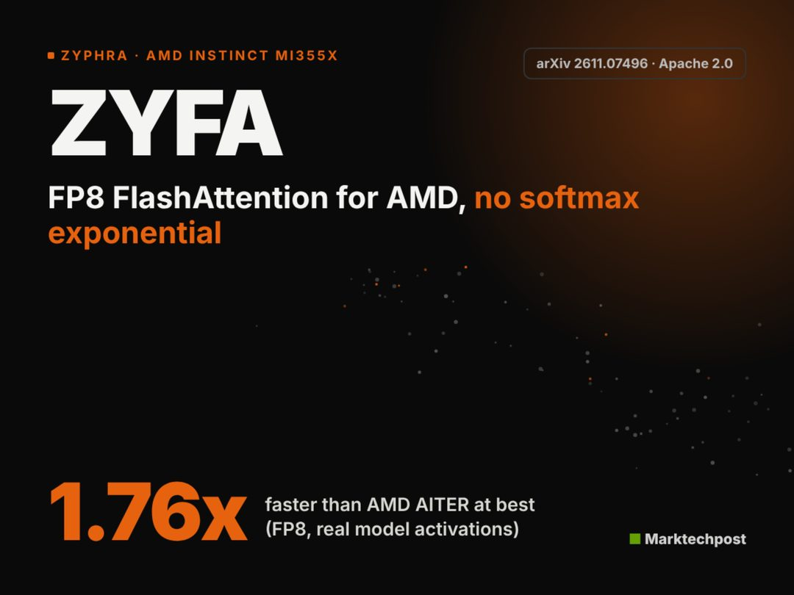

在 2026 年 PyTorch 大会上，谷歌和 Meta 开源 TorchTPU，让 PyTorch 在 TPU 上获得原生支持。此前 TPU 的主流用法是 JAX/XLA 路线，PyTorch 用户迁移往往要付出重写模型的代价。

关键点有两层。技术上是后端打通：PyTorch 的图、算子与编译器栈要和 TPU 的执行模型对齐，这不是薄薄一层适配能解决的。组织上更值得注意——牵头的是谷歌和 Meta，一家拥有 TPU，一家是最大的 PyTorch 消费方之一。两家一起发布，说明“框架不该绑死硬件”已经成了共识性利益。

为什么重要：对多数团队，选硬件的真实成本不是单价，而是迁移工时。TorchTPU 把 PyTorch 变成多后端的统一入口，等于把训练栈从 CUDA 生态里抽出来一层。护城河还在——内核调优、算子覆盖、稳定性仍需要长期投入——但门被推开了一条缝。

> 原文：[InfoQ](https://www.infoq.cn/article/5s2oa0BLlgR8fplkq2uK?utm_source=rss&utm_medium=article)

### Zyphra 的 ZYFA：AMD 缺的从来不是芯片

Zyphra 发布 ZYFA，为 AMD Instinct MI355X 提供开源的 FP8 与 BF16 prefill 注意力内核，实测比 AMD 自家的 AITER 快 1.16 至 1.76 倍，且误差更低。

关键点在于“开源”和“比原厂快”同时成立。注意力内核是推理性能最敏感的一段，prefill 阶段尤其吃带宽和数值精度。一个外部团队能在 MI355X 上跑赢原厂库，说明 AMD 的软件栈仍有明显的优化空间，而这些空间要靠生态而不是靠内部团队去填补。

为什么重要：AMD 在推理市场的真实短板一直是软件。硬件参数可以靠制程和 HBM 追平，但内核库、算子覆盖、框架适配这些需要大量外部开发者反复尝试才能积累起来的东西，很难靠招聘解决。ZYFA 这种项目的价值不在于那 1.76 倍，而在于它证明了“在 AMD 上做内核优化”是一条有人走、能出成果的路。

> 原文：[MarkTechPost](https://www.marktechpost.com/2026/11/06/zyphra-zyfa-fp8-flashattention-amd-mi355x/)

### MCP C# SDK 2.0：无状态成为默认值

MCP C# SDK 2.0 默认启用 HTTP 无状态模式，并新增多轮请求能力。

两个改动指向两个不同的问题。无状态作为默认，是把部署形态往水平扩展上推：有状态会话在单机上很方便，一旦上云、加副本、走网关，就会变成粘性会话和内存管理的负担。改成默认无状态，意味着 SDK 的设计者认为生产部署才是主流场景。多轮请求则是协议能力的补齐，让一次工具调用之外还能保留上下文。

为什么重要：MCP 正在从“demo 里很好用”过渡到“要能上生产”。这个阶段拼的不是协议优雅度，而是各语言 SDK 的工程质量——.NET 生态在企业后端占比不低，C# SDK 的行为变更会直接影响一批内部工具的接入方式。默认值的变化往往比新特性更能说明一个项目的成熟度判断。

> 原文：[InfoQ](https://www.infoq.cn/article/80iUxvCNB59aOgyXB7LN?utm_source=rss&utm_medium=article)

### LoopForge：把 Coding Agent 放进研发流程本身

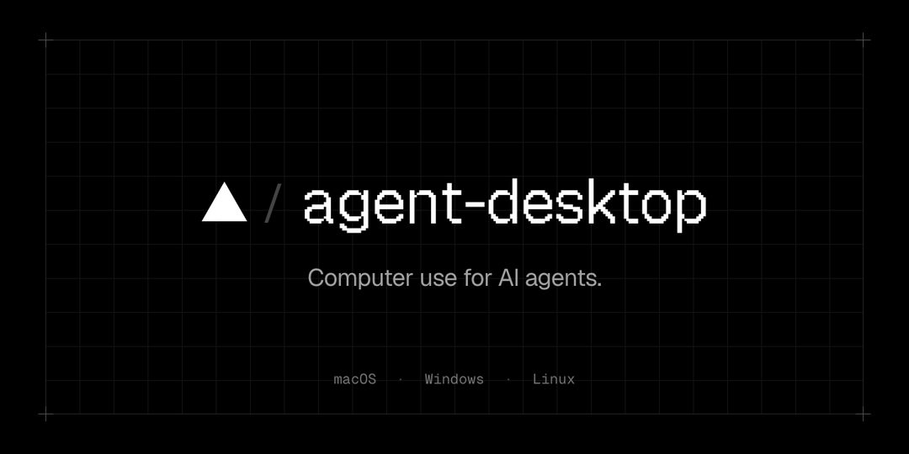

LoopForge 是面向 Coding Agent 的开源自进化研发平台，尝试把智能体引入研发团队，并让研发流程持续迭代。

关键点在“自进化”这个提法。当前多数 Coding Agent 产品的形态是“工具”：人给任务，agent 交付代码。LoopForge 想做的更像是“流程参与者”——agent 的产出被反馈回流程，流程本身再被调整。这比写代码难得多，因为它要求可观测、可回滚、可评估，否则“自进化”就会退化成“自漂移”。

为什么重要：Coding Agent 的瓶颈已经从模型能力转向工程约束——怎么验证、怎么定责、怎么防止它悄悄改坏东西。这类平台的真实价值不在演示，而在它是否沉淀出一套可复用的评估与回滚机制。目前信息有限，值得观察而非追高。

> 原文：[InfoQ](https://www.infoq.cn/article/QGaIWSgd9uwx2WGw0yFv?utm_source=rss&utm_medium=article)

### Vercel 开源 agent-desktop 与 agent-browser

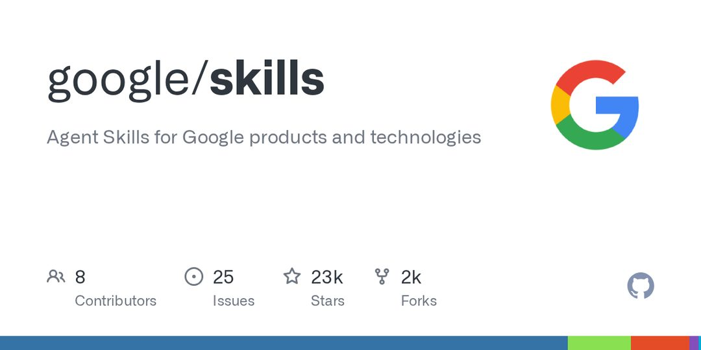

Vercel Labs 开源 agent-desktop 和 agent-browser，为 AI Agent 提供计算机使用（computer use）与浏览器自动化的命令行工具。

关键点在于形态选择：不是又一个带 UI 的 agent 框架，而是 CLI。CLI 意味着可脚本化、可组合、可进 CI，也意味着它把自己定位成“底层能力”而非“上层产品”。agent-browser 对应浏览器自动化，agent-desktop 对应更广的桌面操作，两者合起来基本覆盖了 agent 与图形界面交互的主要路径。

为什么重要：今年 agent 的竞争焦点从“会不会思考”转向“能不能动手”，而“动手”目前缺少稳定原语——每家都在自己实现点击、截图、填表。Vercel 把这层抽成开源 CLI，是在赌“操作计算机”会像部署一样变成一条标准命令。如果这个抽象成立，上层 agent 产品的差异就只能来自判断力，而不是手里的工具。

> 原文：[GitHub](https://github.com/vercel-labs/agent-desktop)

### Google 开源 Agent Skills 集合

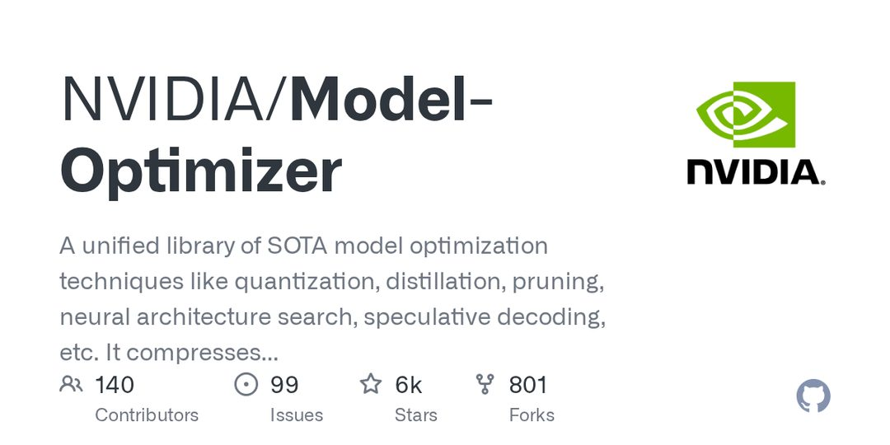

Google 开源面向自家产品与技术的 Agent Skills，同时发布覆盖 Gemini API、SDK 以及模型与智能体交互的相关 Skills。

关键点在于“Skills”这个载体本身。它不是文档，也不是 SDK，而是给 agent 读的结构化操作说明——什么场景、调什么接口、注意什么约束。对 Google 来说，这是把自己庞大产品线的接入知识，从人类可读的文档改写成 agent 可消费的格式。

为什么重要：如果 agent 成为调用 API 的主要客户端，那么“文档写得好不好”就变成“Skills 写得对不对”。这会重构开发者关系：过去的对手是竞品的文档质量，未来的对手是竞品的 Skills 是否被主流 agent 预置。Google 先把自家生态的这一层开源出来，实质是在争夺 agent 时代的分发入口。

> 原文：[GitHub](https://github.com/google/skills)

### NVIDIA 开源 Model-Optimizer：优化技术收进一个盒子

NVIDIA 开源 Model-Optimizer，统一提供量化、蒸馏、剪枝、神经架构搜索（NAS）和投机解码等模型优化技术。

关键点在于“统一”。这些技术每一项都有成熟的开源实现，但分散在不同仓库、不同接口、不同假设下，组合起来成本很高。把它们收进一个工具箱，解决的是工程串联问题：先剪枝再量化再上投机解码，这条流水线过去需要团队自己粘。

为什么重要：模型优化的目标是降低推理成本，而降低推理成本会直接削弱“必须买更新更贵的卡”的紧迫性。NVIDIA 主动开源这套东西，逻辑上并不矛盾——优化做得好，同样的硬件能跑更多负载，生态黏性反而更强。真正值得注意的是，推理效率的竞争正从硬件参数下移到软件栈，这对所有芯片厂商都是同一道题。

> 原文：[GitHub](https://github.com/NVIDIA/Model-Optimizer)

### 结语

今天八条里有五条是在给 agent 和推理补基础设施，而不是发新模型——开源社区的重心，确实从“造更强的模型”转向了“让模型跑得更便宜、动得更稳”。留给读者一个问题：当框架层不再绑死硬件，你所在团队的迁移成本，究竟还剩多少是真成本？

---
