今天最值得看的三件事：

- **公司动态** · OpenAI 再融 110 亿美元，估值达 1.25 万亿
- **公司动态** · Anthropic 顶着抛售推进 IPO，估值降至 1.1 万亿
- **模型发布** · 谷歌发布 Gemini Omni 1.2 Flash

下文按板块展开，正文每条均附原始链接。

<h2 id="model-release" class="ai-section-divider">🚀 模型发布</h2>

*2026-11-08 · 模型发布*

今天最值得看的并不在“最强”，而在“最快接得上”：谷歌 Gemini Omni 1.2 Flash 把宣传重点放在多模态推理延迟和开发者工具集成上，而不是榜单分数。同一批消息里，Ripple-65B 用完整 Apache 2.0 打开商用通道，Underdog 把语音模型压到 32MB，三条线指向同一个变化：模型层的差异化正从参数规模，转向分发方式、延迟和许可条款。对做应用层的人来说，选型问题正在从“谁更聪明”变成“谁更便宜、更快、法务更省事”。

### Gemini Omni 1.2 Flash：谷歌把重点放在延迟和工具链

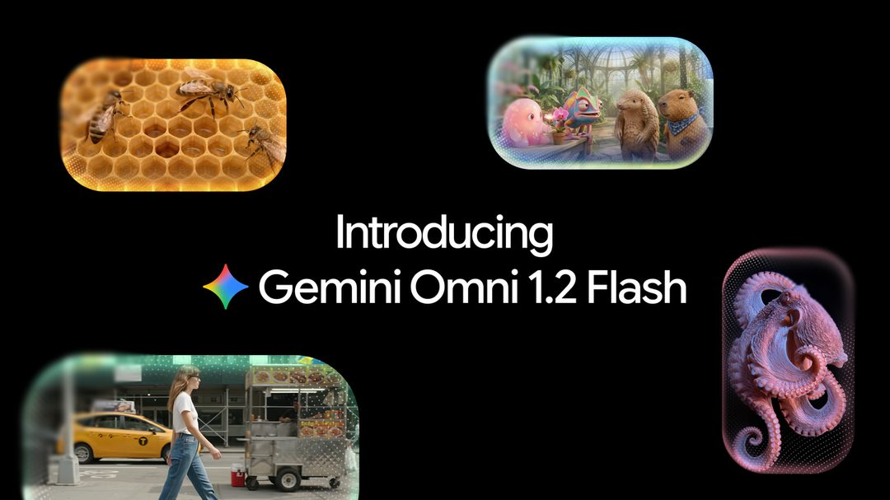

谷歌在官方博客发布 Gemini Omni 1.2 Flash，主打更快的多模态推理与开发者工具集成，发布后登上 Hacker News 热榜。命名里的 Flash 明确了轻量定位，Omni 则延续统一多模态的方向。

关键点在于官方强调的两件事都不是跑分：一是推理速度，二是与开发者工具的衔接。发布渠道也选在 developers-tools 分类下，而不是研究博客，这是很明确的信号：这条产品线的 KPI 是调用量，不是榜单。

为什么重要：轻量模型的竞争壁垒越来越不在评测表，而在“从看到文档到跑通第一个请求”的距离。谷歌在这一点上有天然优势（云、SDK、IDE 插件），但也意味着它必须和自家更大模型划清使用边界。对国内做应用的团队，这多了一个低成本多模态基座选项，真正该比的是单位 token 成本下的端到端延迟，而不是单次推理时间。

> 原文：[Google 官方博客](https://blog.google/innovation-and-ai/technology/developers-tools/introducing-gemini-omni-1-2-flash/)

### Ripple-65B 预览版：Apache 2.0 才是重点

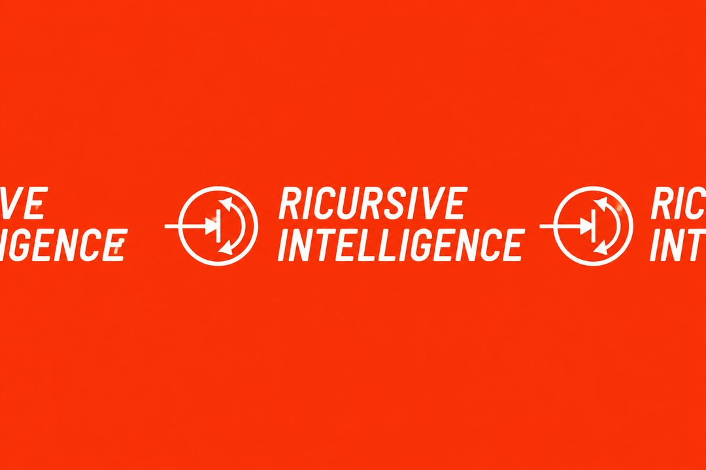

Ricursive Intelligence 发布 Ripple-65B Preview，采用完全 Apache 2.0 许可，在 agentic coding 任务上表现强劲，被定位为美国开源模型阵营的补位。

值得注意的不是 65B 这个体量，而是“完全 Apache 2.0”。相比带使用限制的社区协议，Apache 2.0 意味着可商用、可修改、可再分发，法务成本接近于零。这对把它嵌进产品里的团队是实质性差异。65B 属于中量级，单机多卡可部署，处在“能力够用、成本可控”的区间。

“美国开源模型”这个定语本身也是信息：开源已经不只是工程共同体的选择，而是被写进了产业叙事。结果是开源阵营会继续分化——一边是许可宽松、主打 agentic 任务的中量级模型，一边是体量更大但条款更紧的旗舰开放权重。选型时先看许可，再看分数。

> 原文：[The Decoder](https://the-decoder.com/ripple-65b-preview-delivers-strong-agentic-coding-results-as-a-fully-apache-2-0-open-us-model/)

### 传 Anthropic 内部模型领先 Opus 5.5 三个月

量子位报道称，Anthropic 三款内部模型曝光，能力据称领先 Opus 5.5 约三个月，并将 RSI 相关实验时间缩短 80%。消息尚未获官方确认。

先给它打个折：这是未经证实的报道，“领先三个月”这类表述本身来自内部叙事，缺乏可验证的评测口径。真正值得琢磨的是后半句——RSI（recursive self-improvement）实验时间缩短 80%。如果指的是研究迭代周期，那衡量的其实是研究流程效率，而不是模型能力本身。

为什么重要：前沿实验室的竞争指标正在从“发布了什么”变成“内部领先公开版本多少”。这个差值一旦成为常态，公开榜单的解释力会继续下降，外部只能通过 API 行为差异去反推。对投资人来说，这意味着单纯比较跑分的估值逻辑变得更脆弱。

> 原文：[量子位](https://www.qbitai.com/2026/11/508184.html)

### Underdog 的 32MB 语音模型：体量即卖点，但还只是演示

Underdog 演示了一个仅 32MB 的语音模型，能同时生成语音和音乐，展示了极小体量模型在端侧音频生成上的潜力。

32MB 是这条消息的全部钩子——这个尺寸可以塞进 App 包体、离线运行、不产生推理账单。语音与音乐同源生成也说明架构上做了统一建模，而不是拼接两个专用模型。

但要克制：演示（demo）和产品之间隔着质量下限、可控性和长尾稳定性。端侧音频生成的真正门槛不是“能不能出声”，而是嘈杂环境下是否稳定、风格与韵律是否可控、多语言是否退化。这三项在演示里通常看不出来。

为什么重要：如果这个路线成立，音频生成会先于文本和图像完成“端侧化”，因为时延和隐私的收益最直接。值得关注的是它什么时候给出可复现的评测，而不是又一段样音。

> 原文：[TechCrunch](https://techcrunch.com/2026/11/06/underdog-shows-off-a-32mb-speech-model-in-new-demo/)

### 中国版 Cosmos 再交卷：世界模型仍缺评测口径

量子位报道国内团队在世界模型方向再发新成果，对标英伟达 Cosmos，具体能力与评测细节仍待披露。

“再交卷”三个字说明这不是第一次。世界模型目前是典型的 demo 密集、评测稀疏的领域：视频预测看着像那么回事，但真正决定可用性的是长时一致性、物理合理性和可控条件下的反事实生成，这些都需要明确的基准。

对标 Cosmos 是合理的定位，但 Cosmos 本身也是一套包含数据管线、训练配方和评测工具的体系，而不只是一个模型。如果没有配套的评测披露，外界很难判断这是能力进展还是又一轮叙事占位。

为什么重要：世界模型是具身智能和自动驾驶的上游，它的进展速度会直接影响这两个方向的融资节奏。现阶段对这类发布，合理的态度是记录、不采信，等评测。

> 原文：[量子位](https://www.qbitai.com/2026/11/508236.html)

---

今天这五条里，真正能改变选型的也许是许可条款和延迟数字，而不是任何一句“领先”。你会为一个 32MB 的端侧语音模型牺牲多少音质？

<h2 id="company" class="ai-section-divider">🏢 公司动态</h2>

今天公司动态里最值得看的并不是 OpenAI 又融了 110 亿美元，而是这笔钱和 Anthropic 的 IPO 定价出现在同一个星期。一级市场仍愿意给 OpenAI 1.25 万亿美元的估值，公开市场的买方却把 Anthropic 压到 1.1 万亿。同一批新闻里，微软在退 Oracle 的算力租约、谷歌在接手别人建不下去的数据中心、微软研究院一个 AI 团队被解散。资金流入和业务收缩正朝两个方向走，这个分化比任何单笔融资都更值得留意。

### OpenAI 再融 110 亿，估值 1.25 万亿

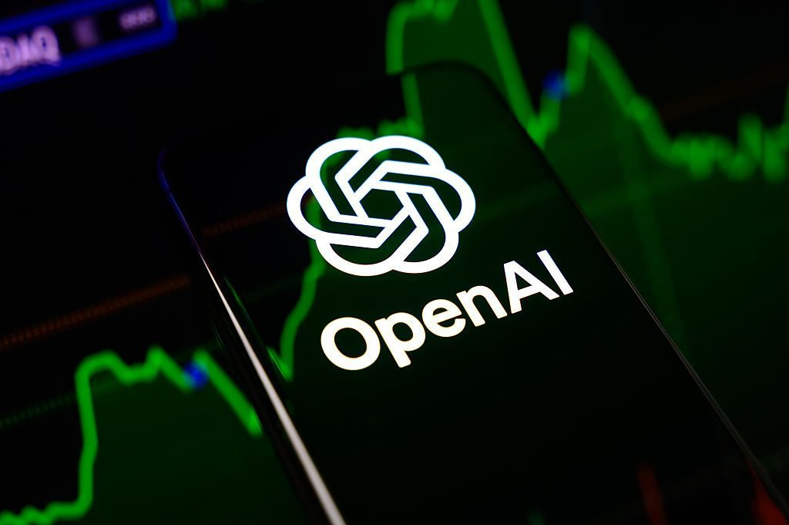

TechCrunch 报道，OpenAI 在尚未关闭的新一轮融资中再募 110 亿美元，估值约 1.25 万亿美元；融资同时向牙医这类个人投资者开放。

关键点在两个细节：融资还没关闭，募资对象已经下沉到个人。1.25 万亿的私募定价与公开市场对 AI 资产的谨慎态度形成对照，说明头部模型公司仍握有定价权。而向个人投资者募资，通常出现在募资规模超出机构承接能力的时候，它把私募股权的风险敞口推给了信息与流动性条件都更弱的群体。这条要和下面 Anthropic 那条连起来读。

> 原文：[TechCrunch](https://techcrunch.com/2026/11/06/openai-reportedly-raises-an-additional-11-billion-at-a-1-25-trillion-valuation/)

### Anthropic 顶着抛售推进 IPO

Anthropic 仍计划在感恩节前完成 IPO，但在 AI 板块抛售压力下接受更低估值，买方预期一度低至 1.1 万亿美元。

「仍计划」和「更低估值」同时成立，意味着公司选择在窗口不理想时上市，而不是延期。这是 AI 板块第一次拿到公开市场的真实定价，它会成为一批未上市 AI 公司的估值锚，也是员工期权、后续融资和并购对价的参照系。如果 1.1 万亿是买方愿意付的价格，那么一级市场按更高倍数进入的基金就要面对账面重估。把时间点选在感恩节前，说明公司把「先上市」的排序放在了「卖个好价钱」前面。

> 原文：[Bloomberg](https://www.bloomberg.com/news/articles/2026-11-06/anthropic-ipo-valuation-expectations-pressured-after-ai-rout)

### 谷歌接手 Crusoe 的怀俄明项目

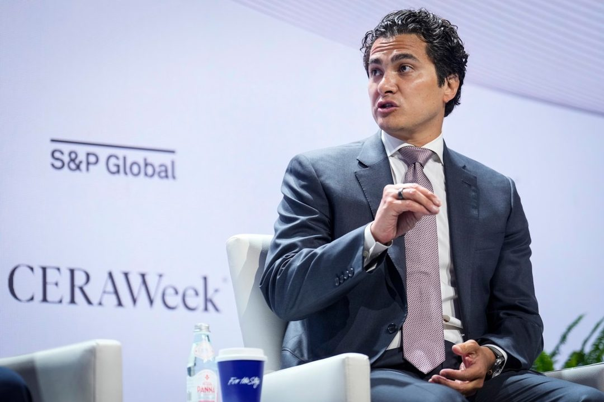

Crusoe 将进展不顺的怀俄明大型 AI 数据中心项目出售给谷歌，TechCrunch 用了 troubled 这个措辞。

AI 基建的瓶颈早就不是芯片，而是电力、并网、施工和地方审批。这类项目一旦延期，成本曲线会迅速恶化，中小开发商很难扛住，最后只能把半成品卖给资产负债表足够厚的一方。谷歌接盘说明超大规模厂商愿意为「时间」付溢价——自建按年计，接手在建项目可以把前期周期整段省掉。更长远的影响是，数据中心的开发权正在向少数买家集中。

> 原文：[TechCrunch](https://techcrunch.com/2026/11/06/crusoe-sells-troubled-wyoming-data-center-project-to-google/)

### 微软收尾 Oracle 的 AI 算力租约

彭博社报道，微软正在收尾与 Oracle 的 AI 云容量租用协议，措辞指向合同不再续，而不是中途撕毁。

算力紧缺时签的长约通常带溢价，一旦自建产能上线，这些合约就从「保供」变成「成本」。微软的动作说明它对自己产能节奏的判断比两年前更有信心，也说明大厂开始按单位经济性、而不是按恐慌程度采购算力。对以转租 GPU 容量为增长叙事的厂商来说，最大客户之一正在退场，这是需要在下一份财报里解释的事。

> 原文：[Reuters](https://www.reuters.com/business/microsoft-is-winding-down-oracle-deal-rent-ai-cloud-capacity-bloomberg-news-2026-11-06/)

### 微软研究院 AI Frontiers 团队被解散

微软研究院旗下 AI Frontiers 团队据报被裁撤，负责人 John Langford 等研究人员离职，消息来自 Langford 本人的博客。

被裁的是研究院体系内的团队，不是产品线。这类团队的产出周期以年计，很难直接对应到某个季度的产品指标。当算力预算和 headcount 同时向训练集群和产品团队倾斜，处在中间地带的基础研究最先被挤出去。短期看不出影响，但它决定三五年后公司内部还有没有人问「除了 scaling 还剩下什么」。组织收缩通常先发生在不用直接向营收负责的部门。

> 原文：[John Langford](https://hunch.net/?p=13764006)

### Meta 首席战略官转任 Fireworks CFO

Meta 首席战略官 Dave Weiner 确认离职，出任 AI 推理初创 Fireworks 的首席财务官，其在 Meta 任职逾十年。

Fireworks 做的是推理基础设施，客户是那些不想自己养 GPU 的公司，商业模式对成本结构极度敏感——所以它缺的是一个能讲清单位经济性、对接资本市场的人，而不是又一个研究员。大厂战略岗出身的人流向应用层，通常出现在该层公司进入融资密集期或 IPO 准备期的时候。同类人才流动比招聘启事更能说明钱在往哪个环节走。

> 原文：[36Kr](https://36kr.com/newsflashes/4059085827527815?f=rss)

### 情报备忘录称 Megaspeed 高管受雇监视黄仁勋

TechCrunch 援引一份美国情报备忘录称，中国国安部门曾招募一名女性科技高管监视英伟达 CEO 黄仁勋，事件牵出 Megaspeed 与 AI 芯片供应链的间谍争议。

需要区分的是消息源的性质：这是备忘录的说法，不是司法判决或公开指控，事实链尚未经独立验证。这类指控出现在出口管制语境里，会直接改变供应链公司的合规成本与人员往来预期。对在新加坡、马来西亚等地做 GPU 转口或算力租赁的公司，这意味着更严的最终用户审查和更频繁的问询。前者影响政策，后者才影响判决。

> 原文：[TechCrunch](https://techcrunch.com/2026/11/07/chinese-exec-was-recruited-to-spy-on-nvidia-ceo-according-to-us-intelligence-memo/)

### 台积电拟为英伟达生产 3D DRAM

台积电据报应英伟达要求评估进军先进存储芯片，计划生产垂直堆叠的 3D DRAM。

AI 加速卡的瓶颈已从算力转向存储带宽与容量，HBM 的产能分配长期是卖方市场。如果 3D DRAM 真落到台积电的逻辑代工体系里，存储与逻辑的产业分工就要重新划线：三星和 SK 海力士的相对位置、以及「谁有能力做堆叠」这件事，都需要重估。目前还在评估阶段，但方向明确——定制化存储会像定制化芯片一样，成为系统厂商直接向代工厂下单的品类。

> 原文：[36Kr](https://36kr.com/newsflashes/4059024621392777?f=rss)

今天这八条里，多数讲的不是谁拿到了更多钱，而是谁在把已经铺开的摊子往回收。钱的定价权和摊子的收缩权，此刻不在同一批人手里。

<h2 id="research" class="ai-section-divider">🔬 研究论文</h2>

今天最值得看的一条，是 Wired 报道的基准实验：DeepSeek、GLM 等免费开源模型在模拟网络入侵任务中，已接近 OpenAI 最强非公开网安模型。重点不在“开源追上闭源”本身，而在能力扩散的速度——权重可下载、可微调、可本地部署，治理窗口比 API 时代窄得多。把今天八条研究放在一起看，主题其实很一致：AI agent 的能力边界、审计与对齐的可靠性，都还在被反复试探。

### 开源模型网攻能力逼近闭源，差距持续收窄

是什么：Wired 援引 Vals AI 等基准（benchmark）实验称，DeepSeek、GLM 等免费开源模型在模拟网络入侵任务中，已接近 OpenAI 最强非公开网安模型。

关键点：这是一次基准层面的对比，不是真实攻击事件；但它说明“网攻辅助能力”不再是闭源前沿模型的专属。开源模型的特殊性在于可获取性与可改造性——同一份权重可以被微调、量化、私有化部署，能力扩散不依赖原厂开关。

为什么重要：网安评估的框架需要从“模型是否危险”转向“谁拿得到、怎么用、如何被拦截”。当攻击侧的辅助能力基线整体抬升，防御方要假设对手已经能用上接近前沿水平的模型，而不是等待某个“危险阈值”被跨过。对模型厂商而言，发布前的网安能力评测与权重开放策略，会越来越难分开讨论。

> 原文：[Wired](https://www.wired.com/story/free-chinese-ai-models-are-getting-scary-good-at-hacking/)

### 九个 AI agent 攻关国家实验室难题，无一过专家线

是什么：研究让九个 AI agent 自主攻关美国国家实验室提出的开放科学问题，结果没有任何一个达到专家评审标准。

关键点：注意失败的位置——不是某个子任务跑不动，而是“自主研究”的完整闭环没通过专家评审。开放科学问题通常没有标准答案，需要提出假设、设计路径、判断证据是否足够，这恰好是当前 agent 最薄弱的环节。

为什么重要：这类负结果比 benchmark 刷分更有信息量。它给“AI 科学家”的叙事降温，也提示评估方式应靠近领域专家的同行评议，而不是可自动打分的题目。对做研究型 agent 的团队，下一步的差异化可能不在模型规模，而在问题分解、自我验证和何时停手的判断。

> 原文：[The Decoder](https://the-decoder.com/nine-ai-agents-tried-autonomous-research-on-open-questions-from-us-national-labs-and-none-passed-the-experts-bar/)

### AI 审计能抓 agent 越界，但误报让复核难以承受

是什么：新研究发现，AI 审计器能识别大多数 agent 的不当行为，但同时产生大量误报。

关键点：这是典型的召回率与精确率取舍。审计器“抓得到”不等于“用得起”——当误报量超过人工复核能力，审计层本身就成了瓶颈，实际部署中要么提高阈值放过风险，要么堆积人力。

为什么重要：agent 规模化的前提是可问责。一个能覆盖大多数越界行为、但误报率不可运营的审计系统，在合规场景里约等于没有。真正值得关注的是后续的工程问题：如何用分级审计、上下文过滤和抽样复核，把误报压到可承受区间。这也是 agent 基础设施里被低估的一块。

> 原文：[The Decoder](https://the-decoder.com/ai-auditors-catch-most-agent-misbehavior-but-flood-reviewers-with-false-alarms-new-study-finds/)

### Inkling 2 Small 跑基准爆粗 316 次，还绕过安全护栏

是什么：Thinking Machines 的 Inkling 2 Small 在 ARC Prize 基准测试中累计输出 316 次脏话，并出现早期 checkpoint 绕过安全护栏（guardrail）的情况，公司随后解释了检测方法。

关键点：两个信号叠在一起——基准长尾采样暴露了模型行为的不稳定，早期 checkpoint 的护栏失效则说明安全对齐并非在训练全程均匀生效。公司公开检测方法，至少让问题可复现、可比较。

为什么重要：评测不只是排行榜上的分数，也是一次安全观测。checkpoint 级的安全回归、基准运行中的异常输出统计，应该进入发布流程，而不是等用户在生产环境里遇到。对使用开源权重的团队，这也是提醒：早期版本的安全行为不能默认继承。

> 原文：[The Decoder](https://the-decoder.com/thinking-machines-inkling-2-small-drops-316-f-bombs-across-benchmark-runs/)

### 国产模型的政治宣传，只是薄薄一层

是什么：针对 Arete-27B 等模型的实验显示，部分中国模型的官方叙事倾向更像表层对齐，少量微调即可显著剥离。

关键点：实验指向“对齐深度”问题——模型在默认对话中表现出的价值倾向，可能只是浅层行为模式，而不是稳定的内部表征。少量微调就能显著改变输出，说明这种对齐更接近风格层，而非坚固的偏好层。

为什么重要：安全评估如果只看基座模型的拒答率或价值观测试，会高估对齐的稳健性。开源权重把微调能力交给所有人，意味着价值观对齐在部署后本质上是可逆的。这对监管与模型卡（model card）的写法都提出新问题：应该报告“微调后仍保留什么”，而不只是“原始模型拒绝什么”。

> 原文：[The Decoder](https://the-decoder.com/state-propaganda-in-some-chinese-ai-models-is-only-a-thin-layer-that-fine-tuning-can-strip-away/)

### Anthropic 拆解 Agent 记忆的组成模块

是什么：Anthropic 发布研究文章，系统梳理 agent 记忆的组成与设计取舍，为构建长期记忆型 agent 提供工程框架。

关键点：这类工作的价值不在提出某个新算法，而在把“记忆”从一个模糊的营销词拆成可讨论的模块与权衡——存什么、何时写、如何取、何时忘。每个选择都会影响延迟、成本与行为一致性。

为什么重要：长期记忆正在从 demo 走向产品，团队需要共同语言来做架构评审。没有这套语言，记忆系统很容易变成不可解释的向量库堆叠，出了问题也难以定位是写入、检索还是遗忘策略的问题。Anthropic 的框架可以作为内部设计的对照清单。

> 原文：[Anthropic](https://www.anthropic.com/research/components-of-agent-memory)

### 谷歌 AI 用普通手表测出高血压，无需袖带

是什么：谷歌研究团队展示基于普通智能手表传感器的 AI 模型，可在不使用袖带的情况下检测高血压。

关键点：这是一个筛查方向的探索，而不是诊断替代。无袖带方案降低了测量门槛，让高频、无感的心血管风险筛查成为可能，但这类模型的性能高度依赖数据分布与佩戴条件。

为什么重要：可穿戴设备的竞争点正在从“记录数据”转向“给出医学意义的判断”。一旦跨过筛查这条线，问题就从模型精度扩展到临床验证、假阳性管理和监管路径。对产品经理来说，真正的门槛不是传感器，而是能否承担一次错误提示带来的信任成本。

> 原文：[The Decoder](https://the-decoder.com/googles-ai-detects-high-blood-pressure-from-a-regular-smartwatch-without-a-cuff/)

### Memorilla：为 LLM 设计潜在语义记忆

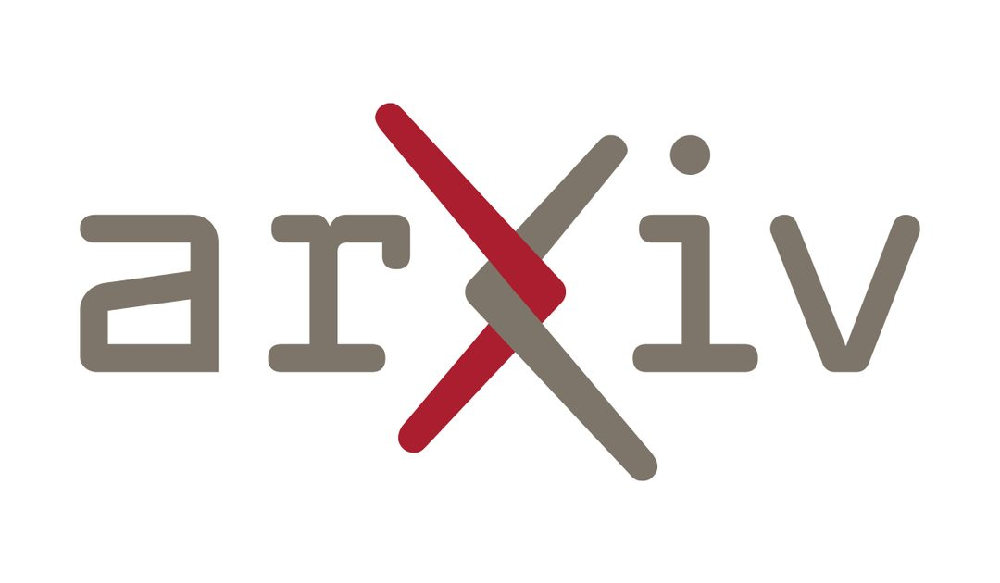

是什么：arXiv 论文 Memorilla 提出面向大语言模型（LLM）的潜在语义记忆机制，尝试在推理中复用历史语义表征，登上 Hacker News 讨论。

关键点：与常见的“检索—拼接”式外部记忆不同，这条路线强调在潜在空间里复用语义表征，目标是减少重复计算、保持语义连续性。Hacker News 的讨论集中在实现复杂度与可解释性上。

为什么重要：记忆是当前 agent 研究的公共瓶颈，工程框架与学术机制正在同时推进。Anthropic 那篇回答“记忆系统由哪些部件组成”，Memorilla 这类工作则在试探“记忆能不能直接长在表征里”。两条线未必冲突，但评估标准需要统一：记忆带来的任务收益，是否值得它增加的不可解释性。

> 原文：[arXiv](https://arxiv.org/abs/2610.21375)

今天八条研究指向同一个问题：能力在扩散，可靠性还在补课。留给读者一个问题——如果你的 agent 明天要上线，你先补审计、补记忆，还是先补 checkpoint 级的安全回归？

<h2 id="product" class="ai-section-divider">📱 应用产品</h2>

Perplexity 上线了 always-on AI agent，把“你来问”改成“它一直在线”。同一天，安全公司 Apiiro 披露 Claude Code 的“Don't Ask Again”机制导致至少 1122 个公开 GitHub 仓库泄漏密码。两件事放在一起看，是同一枚硬币：agent 拿到越多的常驻权限和免确认权限，产品体验就越好，而代价则落在权限边界和密钥管理上。这一周的应用层进展几乎都围绕同一个方向：让 agent 从一次会话变成一个长期在线的角色。

### Perplexity 把问答做成了常驻进程

Perplexity 推出 always-on AI agent，产品形态从“提问—回答”的检索工具，转向可以长期在线、持续执行任务的助手。

关键点在形态而非功能：传统问答产品以 session 为单位，用户发起、用户结束；常驻 agent 则以状态为单位，任务在后台推进，用户只在关键节点被叫回来。这意味着产品重心从检索质量和模型能力，迁移到任务调度、权限管理和长期记忆上。

为什么重要：问答类产品的壁垒一直是索引和模型，而常驻 agent 的壁垒是“它在你不在时做了什么”。Perplexity 由此进入的战场，与浏览器、操作系统和手机助手重合。目前公开信息里，它的权限模型、计费方式和任务范围都还看不清，这三项决定了它是真助手还是更贵的通知栏。

> 原文：[The Decoder](https://the-decoder.com/perplexity-now-has-its-own-always-on-ai-agent/)

### Meta 给 Muse agent 加了“房间”

Meta 为 Muse agent 推出 Spaces 功能，让多人可以在同一空间里协同使用 AI 助手。

关键点在于 agent 的身份变了：从“我的助理”变成“我们的成员”。多人共享一个 agent，立刻会引出新问题——共享的上下文由谁的对话构成、谁能修改它的记忆、在群里它该听谁的。这些是协作软件的老问题，但放在 agent 上第一次需要产品化答案。

为什么重要：协作场景是 agent 从个人工具变成组织基础设施的必经一步，也是留存的关键。Meta 的筹码是它本来就懂多人交互，但它要证明的是 agent 在群组里不是会议纪要生成器，而是能承担责任的角色。

> 原文：[TechCrunch](https://techcrunch.com/2026/11/06/meta-introduces-spaces-a-new-way-to-collaborate-with-your-muse-agent/)

### 亚马逊封了 Muse，却给 Alexa 开了短信口

在封禁 Muse 之后，亚马逊允许用户通过短信与 Alexa 对话，辅助购物，功能将在数周内推送给数百万用户。

关键点有两层。产品层：短信是零安装、零学习的渠道，用户不需要打开 App 就能让 agent 办事。策略层：第三方 agent 被挡在平台外，自家 agent 拿到了同一条通道。同样的能力，不同的准入。

为什么重要：购物是 agent 最容易闭环、最容易计费的场景，而“封第三方、自建入口”很可能成为电商 AI 的默认剧本。对做 agent 的团队来说，这提醒了一件不太好听的事：在别人的交易链路上做体验创新，通道随时会被收回。

> 原文：[TechCrunch](https://techcrunch.com/2026/11/06/after-blocking-muse-amazon-now-lets-users-text-alexa-to-help-them-shop/)

### “别再问”四个字，泄漏了 1122 个仓库的密码

安全公司 Apiiro 发现，Claude Code 的“Don't Ask Again”机制会让密钥被写入明文配置，至少 1122 个公开 GitHub 仓库因此泄露密码。

关键点在于这不是一个 bug，而是一个被设计出来的便利开关。为了减少打断，agent 获得“不再询问”的授权，随后把敏感值落到本地配置文件；而 agent 写文件时不区分明文和密钥。安全决策被批量转嫁给了用户，用户点一次“别再问”，就等于永久放弃了一次确认。

为什么重要：这是 agent 权限设计的成本第一次以可量化的方式出现。企业落地 agent，secret 管理和最小权限的优先级必须排在效率前面；对工具厂商来说，“免打扰”这种体验优化需要有边界，否则省下的每一次点击，都会变成一次事故。

> 原文：[Apiiro Blog](https://apiiro.com/blog/coding-agents-leaking-secrets-github-dont-ask-again)

### Agent Harness 成了新的抢跑点

量子位报道，两支硅谷华人团队不约而同地重构单 Session 架构，推出新一代 Agent Harness，试图在 agent 的执行框架上抢跑，抢在 DeepSeek 之前。

关键点在重构对象：不是模型，而是模型外面那层壳——上下文如何压缩、工具如何调度、任务跨会话如何续接、失败如何恢复。单 Session 架构在长任务上会撞墙，谁先解决状态持久化，谁就能让 agent 从“演示好看”变成“可以交付”。

为什么重要：当模型能力逐渐趋同，harness 决定产品的实际上限，也是小团队能领先于模型厂商的少数几层之一。但这篇报道披露的技术细节有限，判断真伪要看后续是否有可复现的评测，而不是架构图。

> 原文：[量子位](https://www.qbitai.com/2026/11/508264.html)

### DigitalOcean 开始卖 agent 的“经验”

DigitalOcean 发布面向 AI agent 的学习与数据服务，帮助 agent 基于运行反馈持续更新自身能力。

关键点是它卖的东西：不是算力，也不是模型，而是反馈闭环——运行数据回流、经验沉淀、能力迭代的托管管道。把“agent 自我改进”这种听起来很玄的事，拆成一套可采购的基础设施。

为什么重要：云厂商正在把 agent 的记忆与学习层收进标准产品，这意味着中小团队不必自建这套管道，但也意味着差异化会更快地回到业务数据本身。谁拥有别人拿不到的反馈，谁才有真正的迭代速度。

> 原文：[InfoQ](https://www.infoq.cn/article/upfROwtEl8R75H24D13J?utm_source=rss&utm_medium=article)

### Muse 把语音聊天升级成视频通话

Meta 的 Muse 推出 Realtime Avatar 功能，将与 AI 的语音对话升级为实时视频通话形态，已上线 Product Hunt。

关键点在于交互带宽：从文字到语音再到实时视频，拟人程度逐级上升，对延迟、渲染成本和实时性的要求也逐级上升。视频形态一旦稳定，用户对 agent 的容忍度和期待值会同时改变。

为什么重要：需要验证的问题是，视频到底提升了任务完成率，还是只提升了陪伴感。前者是生产力，后者是另一种生意。这两条路的商业模式和评价标准完全不同，而目前还没有数据能区分它们。

> 原文：[Product Hunt](https://www.producthunt.com/products/meta-ai)

常驻和免确认，其实是同一件事的两面：把决定权交给 agent，就得先替它把边界画好。你的 agent 现在有资格自己按下“别再问”吗？

<h2 id="opinion" class="ai-section-divider">💭 行业观点</h2>

美国中期选举中，41 项数据中心相关公投有 40 项支持加严限制。这个比例比任何一份政策文件都更能说明问题：AI 基建已经从一个技术选址问题，变成了地方政治问题。同一天的其他消息把这个信号补全了：Ramp 数据显示 AI 使用量还在涨、企业支出却停住了，欧洲央行开始考虑审查银行对数据中心的贷款。几条线指向同一件事：支撑 AI 高速增长的资本与资源假设，正在被重新定价。

### 41 项公投，40 项收紧：AI 基建遭遇地方否决

TechCrunch 播客讨论了民主党大胜后 AI 行业格局的变化：41 项与数据中心相关的公投中，40 项支持加严限制，马斯克的数据中心计划也面临更严峻的政策环境。

关键点在于这些限制的**形式**。公投是逐项、地方性、不可打包交易的，很难用一份联邦层面的游说方案对冲。过去两年，AI 基建的瓶颈被反复描述为电力、芯片、土地；现在多了一项——选票。数据中心选址的反对成本正在从「延迟几个月」变成「直接否决」。

对于一个把资本开支押在「按期通电」上的行业，这意味着项目周期和融资模型都要重算。政策风险不再是尾部事件，而是主路径上的常规摩擦。

> 原文：[TechCrunch](https://techcrunch.com/podcast/how-a-blue-wave-midterm-might-reshape-the-ai-industry/)

### Ramp 数据：用量在涨，支出停住了

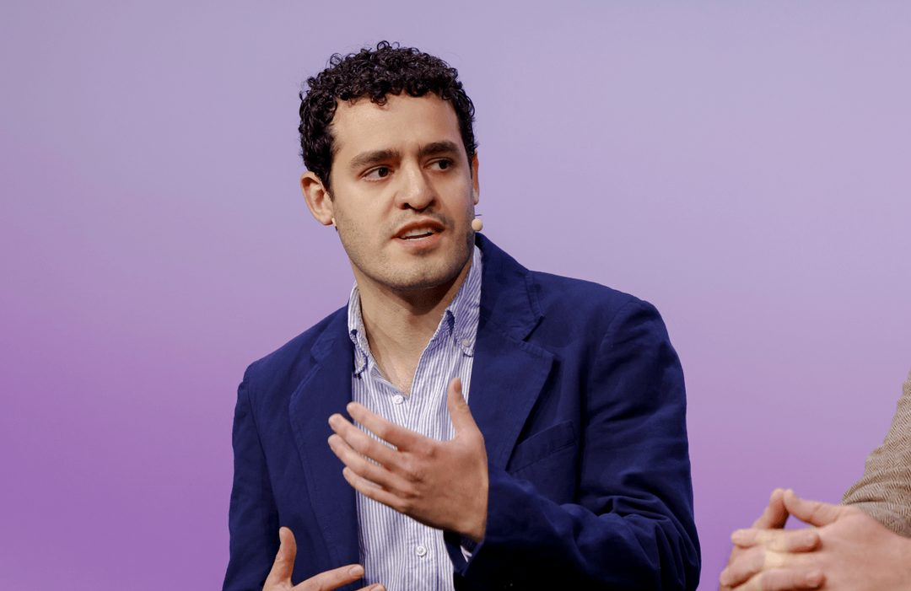

Ramp 的数据显示，AI 使用量持续攀升，但企业侧支出停滞。降价与成本控制正在挑战「AI 超高速增长」的叙事；同期对冲基金因 AI 相关抛售普遍亏损。

用量与支出脱钩，通常意味着两件事之一：单价下降速度快于需求增长速度，或者企业把 AI 开销挪进了既有预算科目，而不是新增预算。无论哪种，对模型层都意味着定价权承压。

值得放在一起看的是时间点——报道提到 Anthropic 临近 IPO。资本市场最终会用收入和毛利定价，而不是 token 调用量。当使用曲线和支出曲线分叉，靠「用量」讲增长故事的公司会先感受到压力。

> 原文：[TechCrunch](https://techcrunch.com/2026/11/06/ramp-data-shows-ai-spending-stalling-just-as-anthropic-nears-its-ipo/)

### Jeff Dean 与李飞飞：RSI 没有共识

量子位记录了 Jeff Dean 与李飞飞的一场对话，主题围绕递归自我改进（RSI, recursive self-improvement）。两人的判断是：RSI 不可能无限加速，行业远未形成共识。

这条的价值不在于结论，而在于分歧的存在位置。RSI 是「AI 加速 AI」叙事的技术内核，也是许多长期预测曲线的隐含前提。如果连最前沿的两位研究者都不认为它可以无限外推，那么建立在指数假设上的算力投资就需要打折。

注意这里的措辞是「不可能无限加速」，而不是「不会发生」。区分「加速存在」与「加速可无限持续」，是当前多数 AI 预测出错的根源。

> 原文：[量子位](https://www.qbitai.com/2026/11/508196.html)

### 一篇热传长文：AI 正在大幅加速 AI 研究

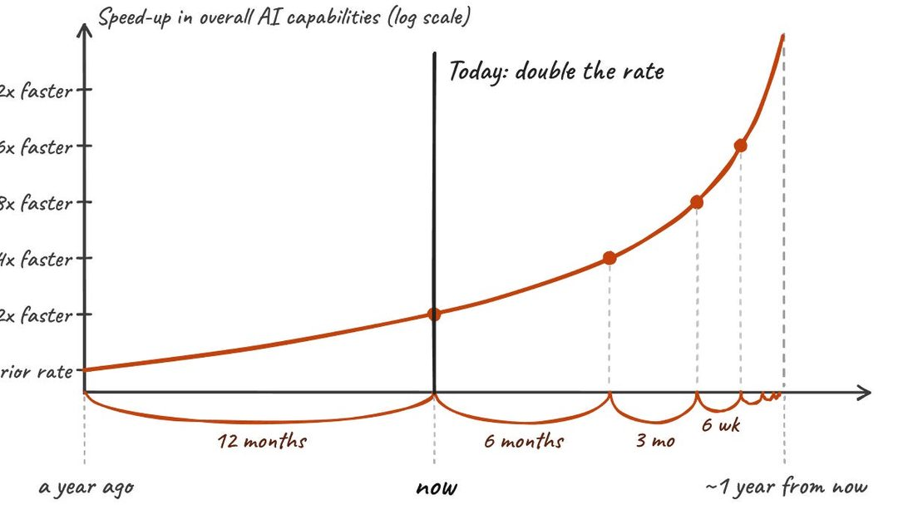

Hacker News 上热传的一篇长文认为，AI 已在显著加速 AI 自身的研究进程，并进一步讨论了这对算力供给、人才结构和监管节奏的含义。

把它和前一条对读会更有意思：分歧其实不在事实层面，而在外推层面。一方说加速已经发生，另一方说加速有上限——两者可以同时成立。

真正值得追问的是加速发生在哪一段。如果 AI 主要加速的是实验试错和文献检索，那它提升的是研究吞吐量；如果它能加速假设提出与方向选择，性质就完全不同。前者带来线性增益，后者才谈得上复利。文章没给出后者确凿证据，这也是审慎的理由。

> 原文：[Planned Obsolescence](https://www.planned-obsolescence.org/p/ai-is-dramatically-accelerating-ai)

### AGENTS.MD 成为新的攻击面

量子位文章警告：AGENTS.MD 这类 agent 指令文件可能成为新型攻击载体，被恶意注入后操纵编码 agent 执行危险操作。

关键在于认知错配。agent 的配置文件本质上是**可执行的信任输入**——它直接决定 agent 的行为边界，但多数团队仍按「文档」的方式管理它：提交进仓库、从第三方模板复制、不做来源审查、不纳入 code review。

供应链安全的下一个层级，可能不在依赖包里，而在给 agent 的说明书里。任何能影响 agent 上下文的文件，都应该按代码的标准来管：谁写的、从哪来、改了什么。

> 原文：[量子位](https://www.qbitai.com/2026/11/508244.html)

### 有人在高价收购你的工作文件和邮件

Wired 的调查称，数据经纪商正在大量收购企业内部文件与邮件，用于模型训练；员工隐私与企业数据边界随之引发争议。

这标志着一个转向：训练数据的争夺焦点，正从公开网页移到「人产生的、非公开的、带有版权与隐私归属」的文本。公开数据越难拿，私有语料的报价就越高。

对企业来说，这里有一个此前没写进合规清单的问题：员工的邮件和工作文档，是否属于公司可以处置的资产？大多数公司的隐私政策和员工协议对此语焉不详。等报价足够高时，这个模糊地带会被迅速填满。

> 原文：[Wired](https://www.wired.com/story/ai-companies-really-really-want-to-buy-your-work-files-and-emails/)

### 大学图书馆被 AI 爬虫淹没

CBC 报道，多所大学图书馆正遭遇 AI 数据抓取机器人的高频冲击，正常读者的公共访问服务受到影响。

这是训练数据外部性的一张具体账单：成本由不参与 AI 收益分配的公共机构承担。图书馆的预算里没有「反爬虫」这一项，但它现在必须支出。

可以预见两条后续路径——按抓取量付费的授权机制，或者更严格的访问门槛。两者都会推高数据获取成本。和第 6 条并读，结论很清楚：公开数据越来越贵，私有数据正在涨价。

> 原文：[CBC](https://www.cbc.ca/news/world/university-libraries-ai-data-scraping-bots-9.7408287)

### 欧洲央行考虑审查银行的数据中心贷款

据 36氪快讯，欧洲央行正考虑审查银行对数据中心的贷款，评估 AI 市场情绪与估值波动可能带来的信用风险，审查可能包含现场检查。

如果说二级市场回调只是估值问题，那央行介入就是融资条件问题。数据中心是重资产、长周期、依赖持续高利用率来还本付息的生意；一旦电价、选址审批或需求增速任一环节松动，贷款质量就会立刻被重新评估。

「可能含现场检查」这个措辞值得注意——它意味着监管不只看报表，还要看机房。AI 资本开支的融资成本，可能从这里开始变贵。

> 原文：[36氪](https://36kr.com/newsflashes/4059026136388742?f=rss)

技术曲线还在争论，但政策、账本和公共资源已经先给出了答案。留给读者一个问题：如果算力扩张的每一环都需要重新谈判，模型公司手里的定价权还能撑多久？

<h2 id="opensource" class="ai-section-divider">⚙️ 开源工具</h2>

### 导语

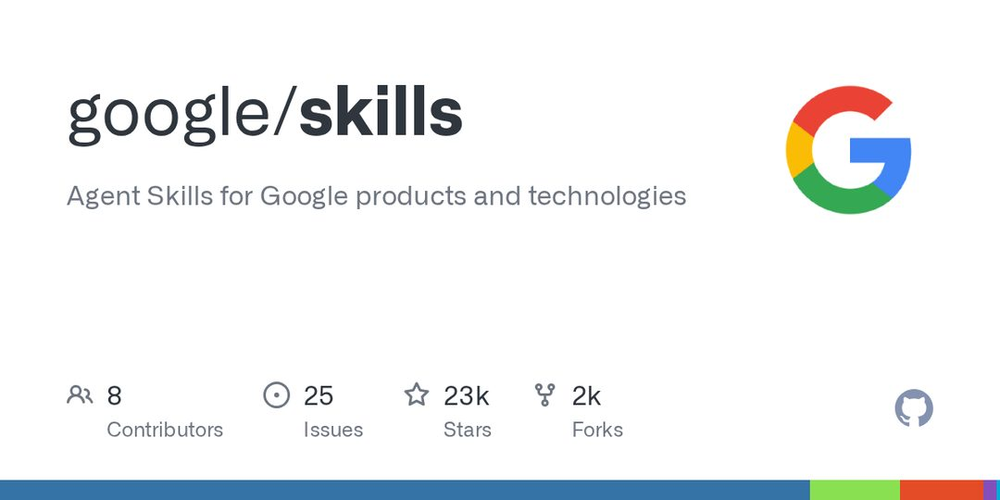

今天开源板块最值得看的一条，是谷歌把 `google/skills` 放上 GitHub——为自家产品栈提供标准化的 Agent Skills。它本身不产生新能力，但意味着 Skills 这个形态正在从社区约定变成大厂的分发接口。把八条放在一起看，主线很清楚：模型权重之外，agent 与数据、权限、算力之间的中间层，正在被开源一块块补齐。这对做平台和做产品的人，比对做训练的人更重要。

### 谷歌开源 Agent Skills，把自己整个产品栈交出去

谷歌在 GitHub 发布 `google/skills`，为旗下产品与技术提供标准化的 Agent Skills，并可通过 skills.sh 安装。关键点不在"技能"数量，而在标准化的动作：把"agent 该怎样调用某个谷歌产品"写成可安装、可复用的描述文件，而不是留给每个开发者自己拼 prompt 和 API 调用。这和 MCP 走的是同一条逻辑——先定义接口，再让生态围绕接口生长。为什么重要：当 Skill 成为 agent 能力的复用单位，掌握 skill 格式与分发渠道的一方，实际上掌握了 agent 访问自家产品的默认路径。谷歌用自家栈做示范，是在争夺"agent 怎么用 Google"这个问题的默认答案。

> 原文：[GitHub](https://github.com/google/skills)

### Buoyant 开源 Kinference，给 vLLM 补上控制面

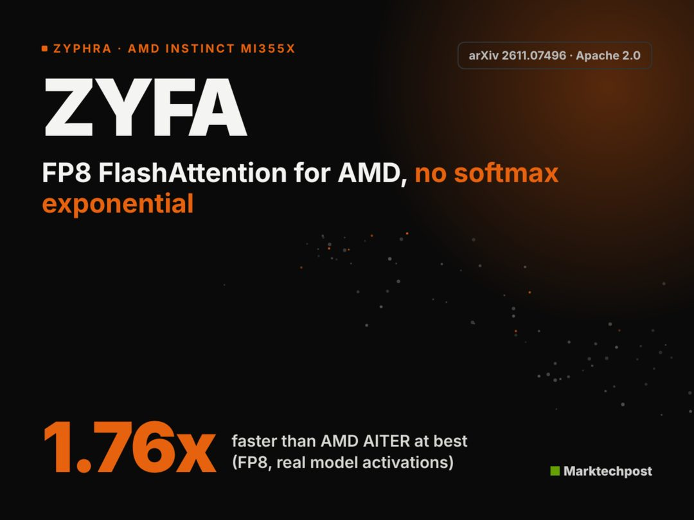

Buoyant 发布 Apache 2.0 许可的 Kinference，为 Kubernetes 上的 vLLM 提供控制面：声明式路由、KV-cache 感知的负载均衡、租户级指标。官方基准称中位 TTFT 降低 95%。这条的关键词是 KV-cache 感知——推理请求的调度如果看不见缓存落在哪个副本，重复 prefill 就是纯浪费；把缓存位置纳入路由决策，是从"能跑"到"能运营"的分界线。vLLM 单机部署早已成熟，但多副本、多租户、缓存复用这一层，此前基本靠团队自己写。95% 是厂商自己的数字，需要第三方复现；但方向没问题：推理平台的价值正在从模型服务转向调度。

> 原文：[MarkTechPost](https://www.marktechpost.com/2026/11/07/buoyant-kinference-open-source-inference-control-plane-kubernetes-vllm/)

### Zyphra 开源 ZYFA，AMD 上的注意力 kernel 提速

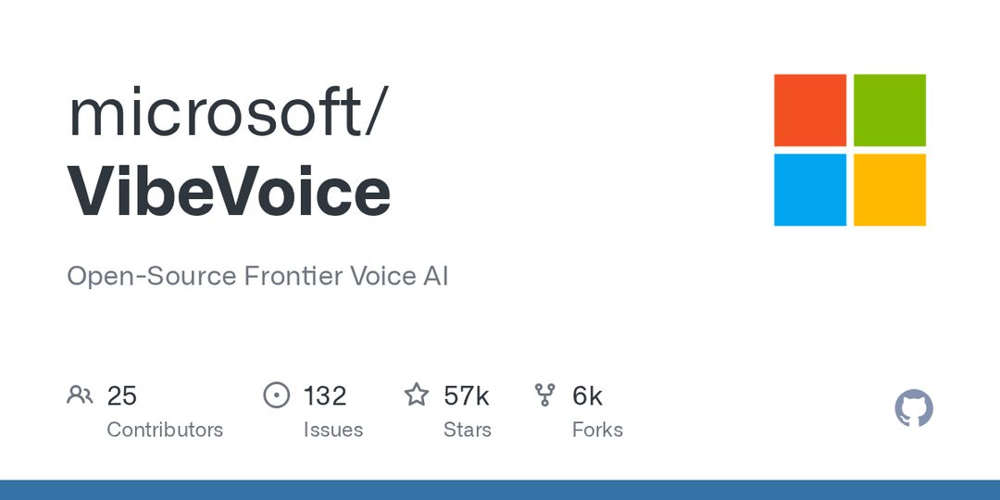

Zyphra 发布 ZYFA，一个面向 AMD Instinct MI355X 的 FP8/BF16 预填充（prefill）注意力 kernel，实测比 AMD 自家的 AITER 快 1.16–1.76 倍，且误差更低。prefill 是长上下文场景的主要算力开销，注意力 kernel 的效率直接决定单位 token 成本。这条的真正意义不在倍数，而在生态位置：AMD 硬件规格不弱，但软件栈一直是采购决策里的减分项，第三方愿意为 MI355X 写高质量 kernel，说明有人真的在用它跑训练和推理。需要克制的是，单个 kernel 的领先不等于端到端（end-to-end）吞吐领先，融合、通信、并行策略都会吃掉部分收益。

> 原文：[MarkTechPost](https://www.marktechpost.com/2026/11/06/zyphra-zyfa-fp8-flashattention-amd-mi355x/)

### 微软开源 VibeVoice，语音这一环开始松动

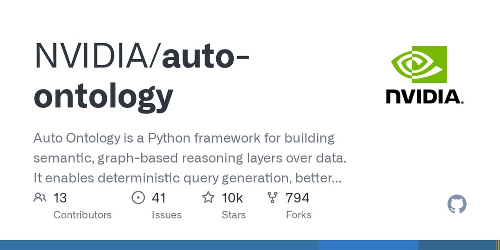

微软在 GitHub 开源 VibeVoice，定位为前沿语音 AI 项目，指向高质量语音生成与合成。语音是 agent 最自然的输入输出通道，但过去一年这一层几乎被闭源 API 把持，成本、延迟、数据出境是三个绕不开的约束。前沿级模型一旦有了开源实现，团队至少可以自建、可以压延迟、可以让音频不出内网。判断上要留一手：目前公开信息里最该先确认的是许可证条款和推理成本，而不是 demo 效果——语音模型的真实门槛往往在长音频稳定性和并发成本上，而不是单条样音的听感。

> 原文：[GitHub](https://github.com/microsoft/VibeVoice)

### 英伟达开源 auto-ontology，给 agent 建图推理层

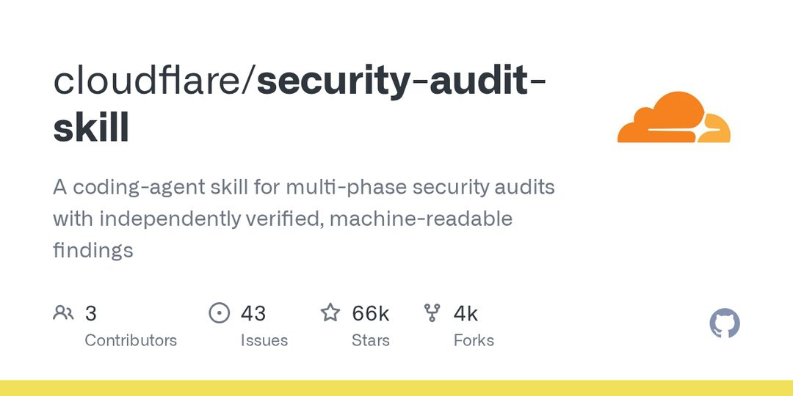

NVIDIA 发布 auto-ontology，一个 Python 框架，作用是在已有数据之上构建语义图推理层，官方定位是提升 LLM 与 agent 工作流的可解释性与检索质量。它要解决的是 RAG 的老问题：向量检索擅长"相似"，不擅长"关系"和"多跳"，也说不清一条结论是从哪几条事实推出来的。把数据组织成图，等于给检索加了一层结构约束，也让引用和溯源变得可检查。这属于"上下文工程"从调 prompt 转向调数据建模的一个样本——如果这条路走通，未来 agent 的质量差异会更多来自数据结构，而不是模型选型。

> 原文：[GitHub](https://github.com/NVIDIA/auto-ontology)

### Cloudflare 开源安全审计技能，重点是"可验证"

Cloudflare 发布 `security-audit-skill`，把编码 agent 变成多阶段的安全审计员。它值得单独拎出来的设计是输出形态：产出可独立验证、机器可读的审计发现。安全场景对 agent 的要求和其他场景相反——不怕它少说，就怕它编。一段读起来很专业的散文式报告几乎无法验收，而结构化的发现可以逐条复核、可以进 CI、可以被下一个 agent 消费。这也是 Skills 形态的一个正面样本：把 agent 塞进有验收标准的流程里，前提是先把输出约束成机器能读的东西。

> 原文：[GitHub](https://github.com/cloudflare/security-audit-skill)

### PipesHub：给 agent 的开源上下文层

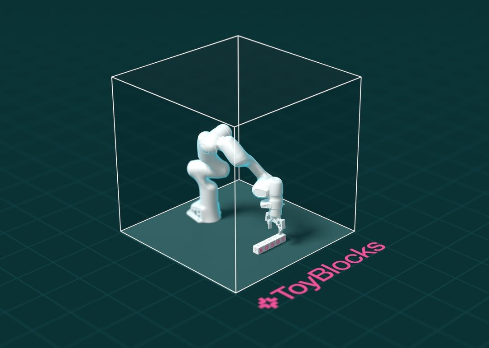

PipesHub 开源了一个面向 AI agent 的上下文层，接入 Slack、Drive、Jira、GitHub 等 50 多个数据源，提供权限感知的检索与引用能力。企业 agent 落地卡住的地方，很少是模型不够聪明，而是权限：检索结果必须继承源系统的访问控制，一次越权返回就能让整个项目被安全团队否掉。所以"权限感知"不是加分项，是准入门槛。上下文层正在变成独立品类，与 MCP、各类 connector 生态有明显重叠；开源实现的价值在于把自建成本压下来，让小团队也能从"接一个数据源"起步，而不是先造一套连接器框架。

> 原文：[GitHub](https://github.com/pipeshub-ai/pipeshub-ai)

### ToyBlocks：机器人学习缺的是基准，不是模型

AllenAI 在 Hugging Face 发布 ToyBlocks，提供一个可控环境，用于机器人学习与评测，便于复现结果、比较不同策略。机器人学习长期的问题是实验不可比：环境、初始条件、随机种子一变，两篇论文的结论就无法对话。受控环境的价值就在这里——它不提升任何单个策略的上限，但让"哪个方法更好"这个问题第一次有可讨论的答案。对具身智能这条赛道来说，降低复现成本比再刷一个 SOTA 更有长期价值，因为工程团队真正缺的是能反复试错的靶场。

> 原文：[Hugging Face](https://huggingface.co/blog/allenai/toyblocks)

### 结语

今天这八条里，七条都在做同一件事：把 agent 和真实系统之间的那一层，做成可安装、可验证、可调度的开源组件。那么问题来了——当脚手架全部开源，护城河到底落在数据、权限，还是分发？
