今天最值得看的三件事：

- **模型发布** · Anthropic 发布 Fable 5.2 与 Mythos 5.2
- **公司动态** · 黄仁勋承认出轨，英伟达启动调查
- **模型发布** · Meta 推出轻量 Agent 模型 Muse Ember

下文按板块展开，正文每条均附原始链接。

<h2 id="model-release" class="ai-section-divider">🚀 模型发布</h2>

今天最值得看的一条是 Anthropic 在 IPO 之前一次发布两个模型：Fable 5.2 与 Mythos 5.2，Artificial Analysis 评分到 65，官方称这是新高。分数本身不稀奇，关键在于时点——模型发布同时服务用户和资本市场两个受众，前者看能力，后者看可比较的指标。与此同时，Meta 把 Agent 场景的输入价格压到每百万 token 10 美分，另一条战线也在成形。这一轮模型发布的竞争方向，正在从“最强”分成“最强”和“最便宜且够用”两条。

### Anthropic 一次发两个模型：Fable 5.2 与 Mythos 5.2

Anthropic 推出 Claude Fable 5.2 和 Mythos 5.2，称在编码、推理、视觉和沟通清晰度上均有提升，Artificial Analysis 评分达到 65，官方表述为新高。双线并行的命名方式比分数更值得看：同一代能力拆成两个型号对外，通常意味着按客户和任务分层，而不是把所有资源压在单一榜单上。

为什么重要：IPO 前的发布会天然面向两个受众，用户关心能力边界，资本市场关心可比较的数字。65 更像是给后者的答案。真正的考题是这些能力能否转成留存与收入，那要等后续几个季度的数据，而不是发布日的评测分。

> 原文：[Anthropic](https://www.anthropic.com/claude-fable-and-mythos-5-2)

### Meta 把 Agent 的输入价打到每百万 token 10 美分

Meta 发布小型模型 Muse Ember，定位是承接 AI Agent 实际执行中的重复性工作，输入价格低至每百万 token 10 美分，明显低于 Haiku、Luna 等竞品。

关键点在“重复性”三个字。agent 跑一个任务，往往要反复重放上下文、反复调工具，账单大头落在输入侧而非输出侧。把输入单价压到这个量级，等于把“多跑几轮”从成本约束变成工程选择。

为什么重要：小模型这一层正在换考核指标——不是跑分多高，而是完成一个任务的总成本多少。当调用成本接近可忽略，产品设计就会从“省 token”转向“多试几次”，这会改变很多 agent 产品的架构选择。

> 原文：[Meta AI Research](https://research.meta.ai/blog/muse-ember)

### 字节 Seedream 5.5：图像模型开始拼生产链路

字节跳动发布豆包图像创作模型 Seedream 5.5，生成速度提升，多轮编辑稳定性增强，支持透明素材生成，并优化真实感与小字渲染，豆包、豆包工作、即梦均已接入。

这些改动都不炫：透明素材、小字渲染、多轮编辑的一致性，恰恰是设计、电商、投放素材生产中最常卡住的地方。图像模型的竞争重心正从单张出图质量，转向能不能直接进工作流、少返工。

为什么重要：接入自有产品矩阵意味着分发和反馈闭环都在自己手里，迭代速度会快于只供 API 的厂商。对使用方而言，评估标准也该从样张好看，换成同一张图改五轮之后还能不能用。

> 原文：[雷锋网](https://www.leiphone.com/category/industrynews/CoJod8Z9X1pDj1sv.html)

### 蚂蚁灵波开源触觉基础模型 LingBot-Touch

蚂蚁灵波发布 LingBot-Touch，一个触觉基础模型，基于近 5000 小时真实触觉数据预训练，覆盖磁触觉、视触觉和压阻式三类传感器，技术报告、模型与代码均已开源。

关键点在三类传感器。触觉数据的麻烦在于采集成本高、与硬件强绑定、跨设备几乎不可复用；做成“基础模型 + 多传感器覆盖”，是在赌触觉也存在一层与硬件解耦的通用表征。

为什么重要：具身智能的公开资源里，视觉和语言都有底座，触觉长期是各家私有数据。开源模型和代码，本质是争夺这套数据与接口标准的话语权——先让人用起来，比先证明 SOTA 更划算。

> 原文：[36氪](https://36kr.com/newsflashes/4063366405936004?f=rss)

### 腾讯混元 Hy4 开源，评测重点落在“交付”

腾讯混元发布开源模型 Hy4，量子位实测了它搭配 WorkBuddy 的多模态 Agent 交付能力，称其已跻身最强开源模型行列。

需要说明这是媒体实测结论，不是独立第三方榜单。“交付能力”这个提法本身值得留意：它衡量的不是单轮问答的漂亮程度，而是能否把一个多模态任务从头做到尾、中间不掉链子。

为什么重要：开源模型的比拼正从 benchmark 分数转向任务完成度，因为企业选型时真正问的是“能不能替我少用人”，而不是“高几分”。对 Hy4 的判断，还要等更多独立复现和真实项目反馈。

> 原文：[量子位](https://www.qbitai.com/2026/11/507843.html)

### 基元律动 NeoHorse-1.5-Flash：基于 Qwen 做 Agent 原生模型

基元律动发布 Agent 原生模型 NeoHorse-1.5-Flash Preview，基于 Qwen3.8-Flash 训练，总参数 180B、激活 6B，重点提升 Agent 任务与软件工程能力，目前限量内测。

两个信息值得拆开：一是“基于 Qwen3.8-Flash 训练”，在开源基座上做后训练已成常见路径，初创公司的差异化落在数据和任务配方上；二是 180B 总参、6B 激活的稀疏结构，明显是为推理成本而非参数规模服务。

为什么重要：Agent 与软件工程是当下最愿意付费、也最容易评测失真的两个场景——榜单分数和真实工程任务的差距历来最大。内测阶段的能力宣称，最终要由开放后的实际任务来校验。

> 原文：[量子位](https://www.qbitai.com/2026/11/508603.html)

### 结语

今天这批发布里，多数都在回答同一个问题：模型要多便宜、多能干活，而不是多能刷榜。留一个问题给你——如果 agent 账单里输入 token 占大头，你会先换模型，还是先改架构？

<h2 id="company" class="ai-section-divider">🏢 公司动态</h2>

今天公司动态里最该看的不是产品发布，而是英伟达董事会对 CEO 黄仁勋的调查：他承认婚外情，董事会正在核查其与一名疑似中国间谍的关系。这件事的影响不止在个人层面——股价下跌、诉讼风险和对华出口管制的游说能力同时受到冲击。同一时间，Anthropic 一边推进 IPO、一边花 34 亿美元买天然气涡轮，Google 则把年内第四款 TPU 推上台面。把这几条放在一起看，AI 竞争的重心正在从“谁的模型更强”，转向“谁的治理、能源和资本结构更稳”。

### 英伟达董事会调查黄仁勋

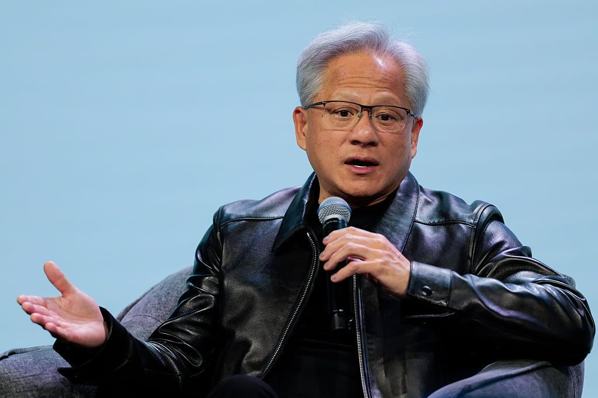

英伟达确认正在调查 CEO 黄仁勋与一名疑似中国间谍的关系，黄仁勋本人已承认婚外情。董事会介入后，公司出现股价下跌、诉讼风险上升，黄仁勋退出公开活动。

关键点在于黄仁勋有两个角色，此时重叠：他既是英伟达的 CEO，也是对华芯片出口管制最重要的游说面孔。个人调查会直接削弱这套沟通的可信度。英伟达当前的估值相当程度上建立在“政策可预期”之上——管制的边界、可售产品的清单，都依赖公司与华盛顿的持续沟通。CEO 进入调查状态后，公司必须在治理层面回答三个问题：董事会监督是否到位、信息披露是否充分、利益冲突如何隔离。这三件事的修复周期，远长于一次产品迭代。

> 原文：[TechCrunch](https://techcrunch.com/2026/11/08/nvidia-says-its-investigating-ceo-jensen-huangs-relationship-with-possible-chinese-spy/)

### Anthropic 的 IPO 进入定价周

据 WSJ 报道，Anthropic 计划推进 IPO，预计本周设定估值区间。这是本轮 AI 周期里第一家走到定价环节的头部模型公司。

关键点：一旦估值区间公布，它就会成为二级市场给其他模型公司定价的参照。进入定价周意味着承销、披露与投资者沟通都已实质启动，市场会开始追问收入结构、算力成本与客户集中度，而不只是模型能力。过去两年，AI 公司的估值主要由私募轮次决定，缺少公开市场锚点；Anthropic 的招股披露会把“训练成本—推理毛利—企业客户留存”这套账摊在台面上。无论最终定价偏高还是偏低，它都会重塑整个板块的估值语言。

> 原文：[TechCrunch](https://techcrunch.com/2026/11/09/anthropic-reportedly-plans-to-move-forward-with-ipo-plans/)

### Google 一年四款 TPU，开始按场景切分芯片

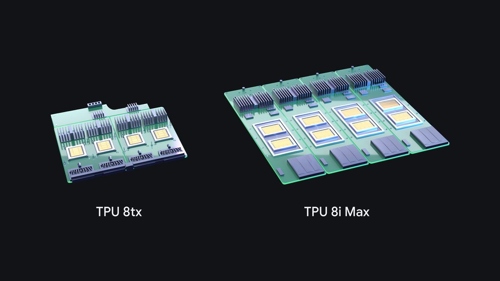

Google 发布 TPU 8i Max 与 TPU 8tx：前者采用双芯片封装，面向长上下文 Agent 负载；后者支持机密推理（confidential inference）。这是 Google 年内推出的第四款 TPU 变体。

关键点不是单颗芯片的峰值性能，而是节奏和切分方式。一年四个变体，说明 Google 在按场景定义芯片——长上下文、机密计算、推理各有对应型号。英伟达的优势长期是“通用 GPU + 软件生态”，Google 选的是“专用变体 + 自家云”的路线，用迭代速度换取特定负载上的性价比。对做 agent 的公司，这提供了第二个议价选项；对英伟达，则意味着客户在采购谈判桌上多了一个可以拿来比价的东西。

> 原文：[Google Blog](https://blog.google/innovation-and-ai/infrastructure-and-cloud/global-network/tpu-8i-max-and-8tx/)

### 34 亿美元的涡轮：能源进了资产负债表

Anthropic 购买价值 34 亿美元的天然气涡轮，加入 AI 行业抢购能源的热潮。报道同时提示，这笔交易可能让公司在未来面临后悔的风险——长期锁定化石燃料资产，在电价下行、碳排放规则收紧或自建电源成本更低时，都可能变成负担。

关键点：AI 公司的资本开支正从 GPU 扩到发电设备，能源从“按量采购的运营成本”变成“写进资产负债表的长期资产”。这改变了竞争壁垒的构成——谁能以更低成本、更确定的节奏拿到电，谁就能决定扩张速度。融资能力、选址、与公用事业的谈判，正在和模型能力一样重要。把这条和 IPO 那条放在一起看，Anthropic 在一个月内同时动用了股权市场和重资产投入，节奏相当激进。

> 原文：[TechCrunch](https://techcrunch.com/2026/11/09/anthropic-joins-ais-natural-gas-frenzy-buys-3-4b-worth-of-turbines/)

### 高盛把 Claude Code 撤了下来

据 The State of AI 报道，高盛正在把 Claude Code 从银行家和交易员处撤下。报道未给出撤下的具体原因。

关键点：金融机构评估编码类 AI 工具的维度与科技公司不同——代码是否出域、提示与输出是否被留存、模型供应商能否满足审计要求，任何一项不过关都可能让部署停摆。过去一年“企业采用 AI”的叙事基本是单向的，这条新闻是少数反向样本。它提醒做 to B 模型的公司：签下大客户只是开始，合规审查、内部风控与可解释性才决定席位能否保住。金融业是受监管行业里最保守的买家，它的动作往往会被其他行业跟随。

> 原文：[The State of AI](https://www.thestateofai.com/news/goldman-sachs-claude-code-traders-bankers)

### 英伟达在韩国做“主权 AI”

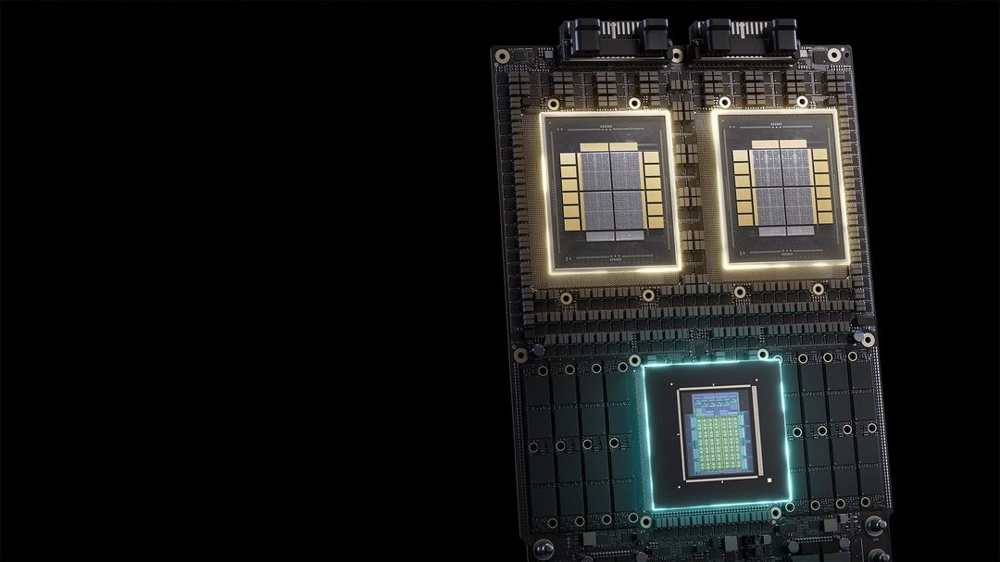

NVIDIA 与韩国科学技术信息通信部扩大主权 AI（sovereign AI）合作，范围覆盖 AI 半导体、数据中心、人才、初创企业、模型、Agent 与安全，并计划投资韩国初创公司。

关键点：这份清单几乎覆盖 AI 全栈，而不是单纯的芯片供货。“投资本地初创”则把英伟达从供应商变成生态股东。在出口管制收紧的背景下，主权 AI 是英伟达把地缘政治风险转化为本地化绑定的一种方式——每个国家都想有自己的算力和模型，英伟达提供整套方案，换取长期采购与政策善意。对各国政府来说，代价是把技术栈的关键部分交给一家美国公司，这也是“主权”一词里最值得追问的地方。

> 原文：[NVIDIA Blog](https://blogs.nvidia.com/blog/korea-sovereign-ai-collaboration/)

### OpenAI 给自己装了急停开关

OpenAI 介绍其内部系统 Control Room：集中追踪研究基础设施中的模型工作负载，一旦出现安全或安保方面的担忧，可以快速停止任务。

关键点：这是一套可观测性加中断能力的组合，覆盖的是“研究基础设施”这一层，而非单个产品。能力越强的实验室，越需要证明自己在失控前能踩刹车——这既是内部安全工程，也是对外部监管者和企业客户的信任凭证。把“停机能力”做成常设系统，本身是 AI 治理从原则声明走向工程实现的一个信号：安全不再只写在模型卡里，而是写进运维流程。

> 原文：[OpenAI](https://openai.com/index/control-room)

### 晶泰科技拿下皮尔法伯的肿瘤项目

皮尔法伯集团（Pierre Fabre）与晶泰科技达成合作，将在肿瘤领域联合开展多个药物发现项目，晶泰依托 AI + 机器人的能力从头设计小分子药物。

关键点：合作对象是肿瘤领域的多个项目，而非单点验证；晶泰承担早期发现，用自动化实验形成数据闭环。AI 制药过去几年最受质疑的地方就是“平台故事多、管线成果少”。与大型药企的联合发现项目，是把能力换成具体里程碑的路径；对国内 AI 制药公司而言，拿到欧洲药企的订单也是一次外部验证。真正的分水岭仍在于项目能否推进到临床阶段。

> 原文：[雷峰网](https://www.leiphone.com/category/shengwuyiyao/HMCKdmWiZA0bT07Q.html)

今天这八条里，真正的产品发布只占少数，多数是治理、能源和资本的考题。留一个问题：当 AI 公司的风险从“模型不够强”变成“CEO 被调查、电买贵了、大客户撤单”，估值模型里该给这些打几折？

<h2 id="research" class="ai-section-divider">🔬 研究论文</h2>

今天研究板块最值得看的一件事，是百度首次披露 RSI（recursive self-improvement，递归自我改进）方向的进展：ERNIE Evolve 不只写实验代码，而是自主提出研究方向、验证结果并积累经验，且已实际用于文心 5.5 Flash 的研发。同一天还有几条消息在别的层面呼应它——NVIDIA 用仿真给机器人造稀缺的操作数据，arXiv 上有论文想拆掉自回归生成的串行成本。把它们放在一起看，会得到一个判断：AI 研究的瓶颈正从「想不出方向」转移到「验证不了结果」。在这条链上，谁掌握可信的验证信号，谁才真正握住了自动研究的开关。

### 百度披露 ERNIE Evolve：自动研究进入产品研发链条

百度首次对外披露 RSI 方向进展，核心是 ERNIE Evolve 这套自动研究系统：它能自主提出研究方向、开展实验、验证结果，并把过程中的经验沉淀下来。官方给出的成绩是，在 NanoChat AutoResearch 和 NanoGPT Speedrun 两个基准上取得 SOTA（state of the art），更重要的是它已经参与到文心 5.5 Flash 的研发流程中。

关键点有两个。其一，自动研究的闭环里最难的不是生成实验代码，而是「验证」——判断一个结果是真的改进，还是评测口径的自我欺骗。其二，「已用于自家模型研发」这句话的分量大于任何 benchmark 数字，它意味着这套系统开始进入真实的产品迭代回路，面对的是不肯配合的工程约束。

值得留一分谨慎的是：验证环节是否依赖独立信号、结果是否可复现，这两点决定了 RSI 是能力还是叙事。递归自我改进的第一个门槛，从来不是想得有多快，而是错得有多早被发现。

> 原文：[雷峰网](https://www.leiphone.com/category/industrynews/FO9Dx6HKj5Bvno5y.html)

### NVIDIA 在 CoRL 展示精细操作仿真

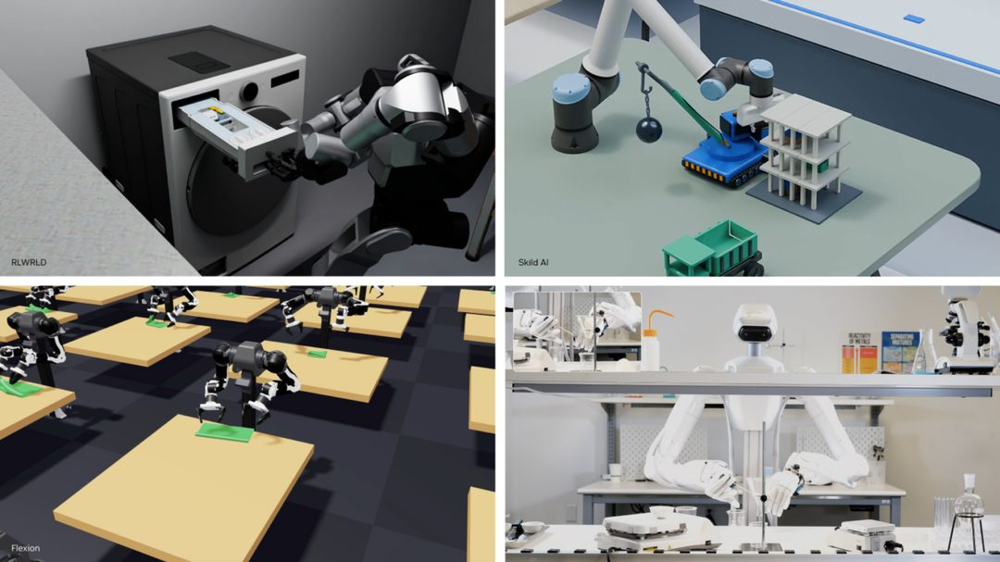

NVIDIA 与合作伙伴在 CoRL 上展示了如何通过仿真训练机器人完成一类过去很难规模化的任务：对准齿轮、连接线缆、组装小零件。

这类任务的共同特征是接触密集、公差极小、视觉上还常被遮挡。它们恰好是 sim-to-real（仿真到现实）最难跨越的一段，也是工厂与实验室里仍然高度依赖人手的部分。仿真的价值不在「便宜」，而在能大规模生成物理一致、带标注、可反复失败的数据；对当下的机器人学习来说，数据稀缺比算法稀缺更致命。

因此这条消息真正的观察点，不是演示视频有多顺滑，而是接触丰富任务上的迁移效果能被压到多小。仿真管线的竞争，最终会落在「生成数据的物理可信度」上，而不是渲染质量。

> 原文：[NVIDIA Blog](https://blogs.nvidia.com/blog/robotics-simulation-advancements-corl/)

### arXiv：Next-Concept Modeling 想拆掉自回归的串行税

arXiv 上的一篇论文提出 Next-Concept Modeling，一种快速、并行的粗到细文本生成方法。

主流大模型的自回归（autoregressive）解码是逐 token 串行的，延迟随输出长度近似线性增长，这构成了长文本、实时语音、多轮 agentic 工作流共同的基础成本。粗到细的思路是把生成拆成两层：先在概念或语义单元层面并行铺开骨架，再做细化填充，用「先想清楚说什么」换掉一部分「逐字往下写」。

这类方法的历史难题一直没变：并行解码在速度上的收益，往往被质量的下降吃掉。所以真正该看的不是它比自回归快多少，而是质量—速度的帕累托前沿长什么样，以及在长输出、强约束（如代码、结构化输出）场景下是否还站得住。

> 原文：[arXiv:2610.14162](https://arxiv.org/abs/2610.14162)

### E-means 声称十分之一 epoch 超越 k-means

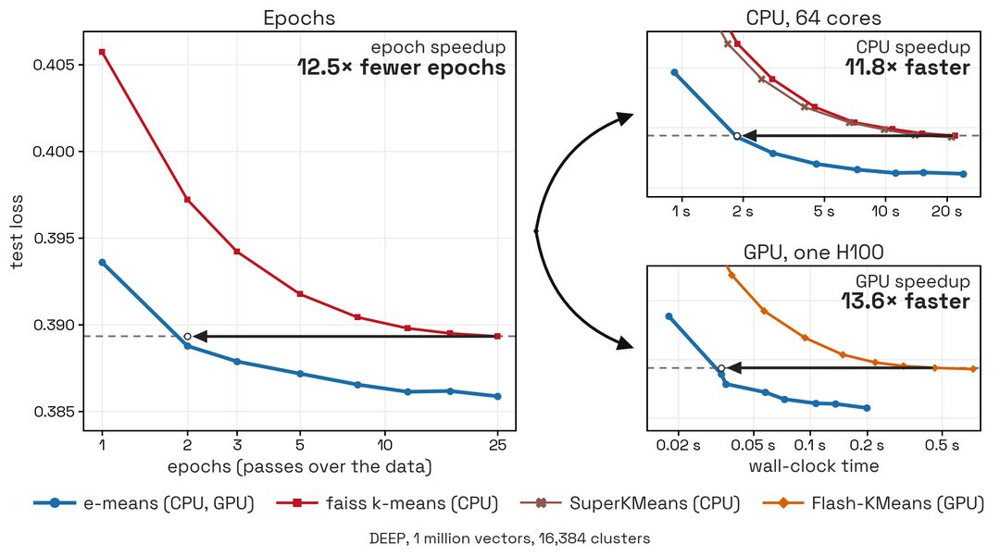

E-means 项目主页声称，在仅需十分之一 epoch 的情况下，其聚类效果就超过了 k-means。

k-means 是机器学习里少见的「几十年没被替换掉」的基线：简单、可解释、够快，至今仍是向量检索、数据去重、训练集筛选的默认工具。任何声称要替代它的方法，都值得看一眼——但也值得先看一眼比较口径。这里最需要厘清的是语义差异：k-means 的迭代轮次与基于梯度的 epoch 并不是同一种计量单位，「十分之一」这个说法要先换算成同等算力或同等墙钟时间才有意义。

如果收敛速度的提升在公平口径下依然成立，影响会落在数据管线这一层：embedding 时代最贵的不是模型，而是反复对十亿级向量做聚类的那部分成本。目前这是项目方自述，尚无同行评审，先记为待验证的信号。

> 原文：[E-means 项目主页](https://e-means.github.io/)

### NVIDIA 发布日本金融合成数据集

NVIDIA 发布 Nemotron-Personas-Finance-Japan，一个试图捕捉日本人口结构与金融背景的合成数据集。

它的做法是 persona（人物画像）驱动：先按真实人口结构分布设定人物属性，再据此生成金融场景下的合成数据。这代表合成数据的目标正从「补数量」转向「补分布」——不是为了把 token 数堆上去，而是让长尾人群、长尾情境在训练分布里有位置。对日语这类高质量语料相对稀缺、且金融合规表达高度本地化的市场，这个思路的边际价值更明显。

随之而来的责任转移也值得注意：当数据发布方开始定义「人口结构应该长什么样」，偏见与合规的责任就从使用方部分上移到了发布方。合成数据不会消除偏差，它只是把偏差的选择权交给了做分布的人。

> 原文：[Hugging Face Blog](https://huggingface.co/blog/nvidia/nemotron-personas-finance-japan)

自动研究最难的不是提出假设，而是知道自己错了。ERNIE Evolve 们最终要交出的，恐怕不是又一个 SOTA，而是一套机器自己认得出的错误信号。

<h2 id="product" class="ai-section-divider">📱 应用产品</h2>

### 导语

今天最值得看的一条是千问办公 2.0 的「协作」：它把 Agent 正式放进了多人共享的工作空间，而不只是每个人的私人助手。这个变化听起来像功能更新，实质是办公软件从“人使用工具”转向“人机共同工作”的接口变更，权限、产物归属、责任划分都得重新定义。巧的是，同一天另外两条消息分别从采购和安全两端给出了注脚：ChatGPT Enterprise 上了 AWS Marketplace，Claude Code 的配置文件把密钥送上了 GitHub。Agent 进办公室的速度，比管理它的规则快。

### 千问办公 2.0：Agent 从助手变成协作成员

千问办公发布 2.0，上线「协作」功能，官方称这是行业首个支持多人与 Agent 协作的能力，同时推出人机共创、资料空间、自动任务和三端互联。关键点不在生成能力，而在结构：Agent 与人共享同一份资料空间和任务上下文，意味着它必须被纳入多人权限模型，而不只是挂在某个人的会话里。过去办公套件卖的是「多人协作」，这一代要卖的是「人机混合协作」，而这层的形态定义全球都还没有标准答案。判断一个这类产品是否可用，看三件事：Agent 的操作是否可审计、产物归属是否明确、以及一个人退出空间后 Agent 的权限是否同步收回。演示视频不会回答这些。

> 原文：[量子位](https://www.qbitai.com/2026/11/508694.html)

### ChatGPT Enterprise 上架 AWS Marketplace

OpenAI 宣布 ChatGPT Enterprise 可通过 AWS Marketplace 采购，企业能沿用既有的 AWS 采购与计费关系，不必新开一套供应商流程。这条新闻的信息量不在产品，而在渠道：企业采购大模型的真实摩擦往往不是价格，而是法务、安全审查、付款周期这些流程成本，云市场恰好是很多公司已经打通的那道门。模型厂商的竞争正从「谁的模型强」延伸到「谁更容易被买进去」。对 OpenAI 而言，这是把企业销售交给客户已有的采购习惯；对云厂商而言，模型成了 marketplace 里最贵的一类 SKU。这条路径一旦跑通，后来者的模型差距会被采购惯性放大。

> 原文：[OpenAI](https://openai.com/index/chatgpt-enterprise-aws-marketplace)

### Claude Code 的配置文件，把密钥送上了 GitHub

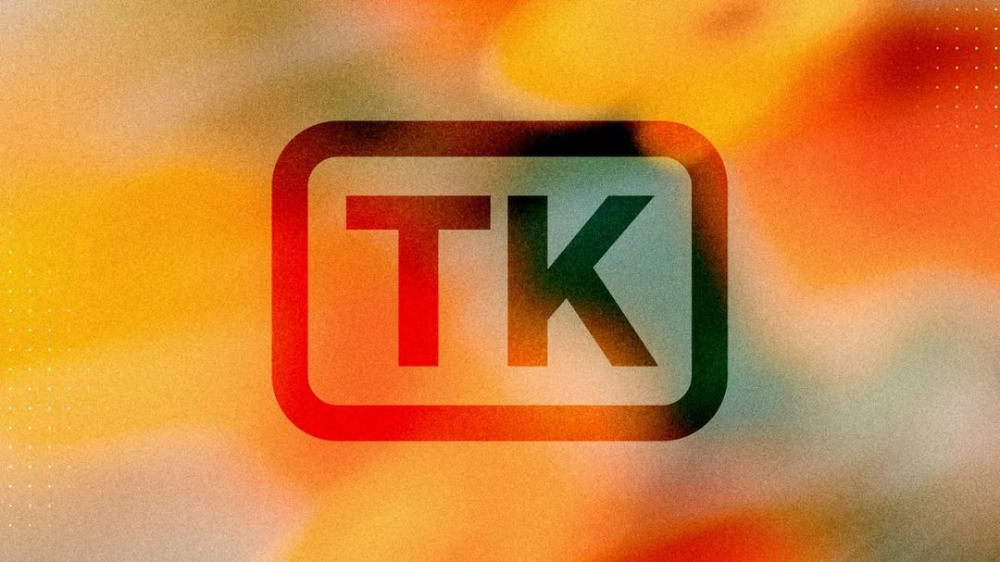

Ars Technica 报道，Claude Code 的设置文件正让大量敏感信息暴露在 GitHub 上：用户在使用过程中选择「Do not ask again」，本地配置被写入随后被提交的文件，密码、API key 等凭证随之进入公开仓库。这是典型的便捷选项与安全默认值冲突——一次「不再询问」，就把本该留在本机的凭证变成了可被 clone 的内容。更值得注意的是暴露面：agentic 编码工具会把模型 key、外部服务凭证、MCP 配置都拉到本地，比 IDE 时代的风险面大得多。对所有正在推编码 Agent 的团队，这类工具的准入清单里应该明确加上两条：默认不落盘、密钥走隔离存储。别指望 .gitignore，它已经被证明靠不住。

> 原文：[Ars Technica](https://arstechnica.com/ai/2026/11/claude-code-settings-files-expose-thousands-of-secrets-on-github/)

### Medium 做了一款 AI 写作应用 TK

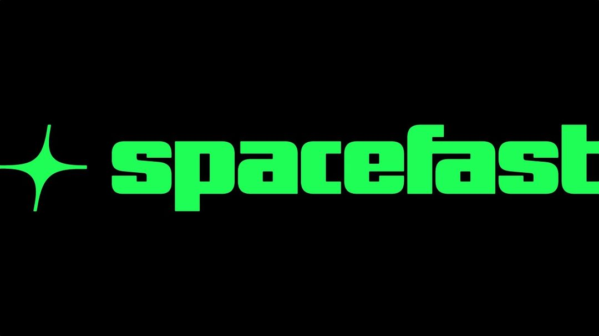

Medium 推出写作应用 TK，把 AI 辅助直接嵌入写作过程。这条的产品看点不是「又一个 AI 写作工具」，而是介入位置：它选择在写作过程中补位，而不是替你整段生成，这既降低了产出成本，也避开了「全自动生成」最容易引发的平台内容生态争议。在一个对 AI 写作仍高度敏感的出版环境里推出这类产品，平台需要同时向作者和读者解释清楚边界在哪里。写作工具的竞争重心正从生成质量转向嵌入点——是替你写，还是在你卡住时递一句话。后者更难做，也更难被察觉，但更可能长期留在工作流里。

> 原文：[TechCrunch](https://techcrunch.com/2026/11/09/mediums-new-tk-app-brings-ai-assistance-directly-into-the-writing-process/)

### Automattic 推出 Spacefast，接住 vibe coding 的产物

Automattic 发布 Spacefast，用于部署 vibe-coding 应用，直接对标 Lovable 这类产品。这条抓的是一个被忽略的缺口：过去一年大量的氛围编程产物堆在本地目录和聊天窗口里，缺的不是代码，而是托管、域名、部署这最后一公里——恰好是 Automattic 手里最厚的资产。如果生成代码的边际成本趋近于零，价值就会向分发与托管转移，这也解释了为什么一批老牌建站与主机公司在 AI 这轮反而重新有了位置。真正的竞争不在谁能生成得更快，而在谁的部署链路更短、更不需要用户理解服务器。

> 原文：[TechCrunch](https://techcrunch.com/2026/11/09/automattic-debuts-a-platform-to-deploy-vibe-coding-apps-amid-a-changing-internet/)

### 百度搭子连中三家，企业智能体的采购逻辑浮出水面

百度搭子在中信建投、国家电投数科、通用数科三个项目中均排名第一，连续拿下企业智能体采购。客户的分布值得一看：一家头部券商、两家能源与央企背景的数科公司，采购语言是合规、私有化、系统集成，而不是模型榜单上的分数。这提示企业智能体正在被「项目制采购」定义，交付形态更像当年的信息化项目，而非 SaaS 订阅。对投资人来说，中标新闻本身价值有限，更该追问的是复购率、单项目交付人天，以及一个项目做完能不能沉淀成可复用的能力。企业市场和消费市场用的是两套完全不同的估值逻辑。

> 原文：[雷峰网](https://www.leiphone.com/category/industrynews/tm7T5JBmm4u6YUQi.html)

### 迪士尼选 Adobe Firefly，为的是「品牌安全」

迪士尼选择 Adobe Firefly，为其娱乐业务打造品牌安全的 AI 模型与内容创作能力。关键词是 brand-safe：对一家靠 IP 授权和形象授权吃饭的公司，训练数据的权利链是否干净、产出能否商用、风格会不会侵权，权重远高于生成质量本身。这基本勾勒出内容公司的 AI 采购标准——不选最强的模型，选责任最清楚的模型。对 Adobe 这是护城河，对通用模型厂商则是一道不靠跑分能跨过的门槛。IP 持有者的签约动作，往往比任何评测榜单更能说明版权问题在这一轮里的定价。

> 原文：[The Decoder](https://the-decoder.com/disney-bets-on-adobes-firefly-to-create-brand-safe-ai-models-for-its-entertainment-empire/)

### 结语

今天七条里有五条讲的不是模型能力，而是模型怎么被买、被管、被追责。Agent 既然坐进了工位，下一步该写的就不是它的说明书，而是工位规则。

<h2 id="opinion" class="ai-section-divider">💭 行业观点</h2>

今天的行业观点里，最值得看的信号来自两组看似无关的数字：一组是腾讯 AI 首席说 AI 生物武器“将会出现”，另一组是开发者每周靠 AI 省下数十小时的比例一年内从 68% 掉到 26%。前者说明风险叙事已经从论文走进政策桌，后者说明工具红利正在被现实摩擦吃掉。两条线在今天汇成一个判断：AI 的瓶颈正从模型能力，转向治理能力与组织消化能力。李飞飞和 Jeff Dean 对“自我进化”泼的冷水，本质也是同一件事。

### 腾讯 AI 首席：AI 生物武器会出现，但封闭模型不是解药

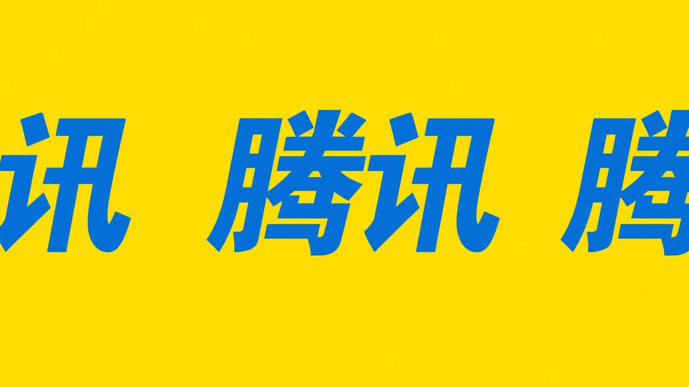

腾讯 AI 首席公开表示，AI 辅助的生物武器“将会出现”，但他明确反对用封闭模型来应对。这一立场的核心在于：把能力锁在少数机构手里，并不能消除风险，只会让风险向监管更弱的地方转移。这是中国科技公司高管少见的、对 AI 安全治理路径的直接表态。

关键点在于责任分配。如果威胁是普遍性的，那么防御也必须是普遍性的——开放研究、可审计的模型、跨国的最低安全标准，比单纯限制权重更实际。对做模型和做安全的人来说，这意味着合规成本将从“准入”转向“持续披露”。

为什么重要：生物安全是少数几个被反复讨论、却少有实际落地的 AI 风险领域。当产业界开始主动给出方案而非等待监管，说明这条线正在从公关话题变成工程话题。

> 原文：[The Decoder](https://the-decoder.com/tencents-ai-chief-says-ai-bioweapons-are-coming-but-closing-off-models-isnt-the-answer/)

### 李飞飞、Jeff Dean 给“AI 自我进化”泼冷水

硅谷近期热炒 AI 自我进化与“无限加速”，李飞飞和 Jeff Dean 同时表达了怀疑。两人的共同点是：他们都深度参与过前沿模型研发，因此这次表态更像是内部人对叙事泡沫的校正，而非外部质疑。

他们的质疑集中在两点：一是当前模型的“自我改进”仍依赖人类设计的目标与评估，离闭环自主进化很远；二是能力提升的曲线受制于数据、算力和验证成本，不会出现指数级的突然跃迁。

为什么重要：这类叙事直接影响资本定价和人才流向。当最接近技术的人公开降温，说明行业需要为“进步比预期慢”准备好解释框架——这对投资人和做三年技术规划的人尤其关键。

> 原文：[InfoQ](https://www.infoq.cn/article/mZlISiZL9c1eurrsZRpo?utm_source=rss&utm_medium=article)

### Scott Wiener 进国会，AI 监管从州级走向联邦

Scott Wiener 赢下佩洛西的旧金山席位，进入美国国会。他此前在加州参议院主导了遏制先进 AI 风险的立法工作，是州层面最积极的 AI 监管推动者之一。

关键点在于路径依赖：美国 AI 监管长期卡在联邦立法停滞、州级各自为政的局面。Wiener 进入国会，意味着这套州级经验会被带进联邦议程，AI 安全议题可能获得一个稳定的立法发起人。

为什么重要：对 AI 公司来说，合规策略一直建立在“联邦不会动、州级碎片化”的假设上。一个熟悉条文细节、且有实际立法战绩的人进入国会，会改变这个假设的时间表。

> 原文：[MIT Technology Review](https://www.technologyreview.com/2026/11/09/1148182/nancy-pelosis-replacement-is-ready-to-regulate-ai/)

### 数据中心的反弹，可能本质是电价问题

MIT Technology Review 提出一个视角：围绕数据中心的公众反弹，核心可能不是对 AI 本身的抵触，而是电力供应紧张与电价上涨。居民感受到的是账单和电网，而不是模型参数。

关键点在于归因错误会带来错误的解法。如果反对声浪被理解为“反 AI”，行业会倾向于做公关；如果被理解为“电力分配冲突”，解法就变成了电网投资、电价机制和选址谈判——这是地方政府真正关心的事。

为什么重要：数据中心的扩张速度已经超过多数地区的电力配套能力。把 AI 叙事翻译成能源叙事，可能是这个行业未来两年最重要的一次沟通策略调整。

> 原文：[MIT Technology Review](https://www.technologyreview.com/2026/11/09/1148194/the-backlash-about-data-centers-might-really-just-be-about-electricity/)

### HN 热帖：我不相信 AI 泡沫存在

Hacker News 上一篇热帖反驳 AI 泡沫论，作者认为当前的 AI 投资与采用模式并不符合典型泡沫特征：收入在增长、使用在扩散、基础设施有实际需求支撑。

这类论证的价值不在结论，而在检验标准。泡沫的核心特征是估值与现金流长期脱节、且需求是叙事驱动而非使用驱动。作者主张用采用率和单位经济性去衡量，而不是用股价涨幅。

为什么重要：泡沫争论往往变成立场之争。把指标摊开来讲，至少能让讨论回到可验证的层面——比如推理成本、留存率、企业实际付费比例。

> 原文：[Matteo Raso](https://matteoraso.github.io/im-not-convinced-the-ai-bubble-exists.html#im-not-convinced-the-ai-bubble-exists)

### AI 正在改变计算机学位本身的价值

量子位讨论 AI 对计算机教育的冲击：学生用 Claude 等工具完成作业，教授在课堂上难以区分理解与生成，学位所代表的技能信号因此变得模糊。

关键点在于评估体系的失灵。编程教育长期依赖“能否写出可运行代码”作为能力证明，而这个门槛正被工具抹平。部分课程开始转向过程审查、口头答辩和设计能力考察，但缺乏统一标准。

为什么重要：计算机学位是过去二十年最稳定的职业入场券之一。如果它的信号价值下降，受影响的不只是学生，还有依赖学历筛选的招聘体系。

> 原文：[量子位](https://www.qbitai.com/2026/11/508706.html)

### 开发者用 AI 省时的比例，一年内腰斩

InfoQ 报道，开发者每周借助 AI 节约数十小时的比例，在一年内从 68% 降至 26%。这个下降幅度远比“AI 编码能力变差”更复杂。

关键点在于基线效应与摩擦成本。早期采用者尝到的是模板化任务的红利；随着使用深入，代码审查、上下文维护、错误修复的成本开始显现，节约时间被重新分配而非消除。同时，“数十小时”这种极端节约本身也难以持续。

为什么重要：这是今天最反直觉的一个数字。它提示企业评估 AI 生产力时，不能只看工具侧的基准测试，还要看组织侧的真实工作流——收益往往在流程改造之后才出现。

> 原文：[InfoQ](https://www.infoq.cn/article/sdqHapplv45dQguTJ415?utm_source=rss&utm_medium=article)

### Gartner：智能体治理是 2027 年的新战场

Gartner 发布 2027 年十大趋势，核心判断之一是：AI 越聪明，企业越难管理，智能体治理（agentic governance）将成为新的竞争领域。

关键点在于管理对象的改变。传统 IT 治理管的是系统和权限；智能体有目标、有自主性、会调用其他系统，出错时的责任链条因此变得模糊。Gartner 认为企业需要新的审计、授权与回滚机制。

为什么重要：这给企业软件市场指出了一个明确的产品方向。谁能解决“多个 agent 协作时谁负责”的问题，谁就拿到了下一代企业 AI 基础设施的入口。

> 原文：[InfoQ](https://www.infoq.cn/article/CUgMFMX7uRJNMec1pfYo?utm_source=rss&utm_medium=article)

今天的八条故事几乎都指向同一处：模型之外的约束——电力、法规、教育、治理——正在决定 AI 能走多远。留一个问题：如果瓶颈真的不在模型，你所在的团队今年有多少预算花在了这些“非模型”环节上？

<h2 id="opensource" class="ai-section-divider">⚙️ 开源工具</h2>

导语：Anthropic 把 Claude 的 skills 实现放上 GitHub，并指向一份 Agent Skills 标准——这是今天开源板块里最值得看的一条。单看代码量它并不惊人，但它试图把「一个 agent 会做什么」从提示词里的自由文本，变成可分发、可版本化的构件。同一天上榜的还有面向 agent 的 Git 服务器、沙箱运行时、安全 harness 和「agent-ready」设计系统，方向出奇一致：模型能力之外的工程层，正在被一批开源项目快速填满。

### Anthropic 开源 Agent Skills 仓库

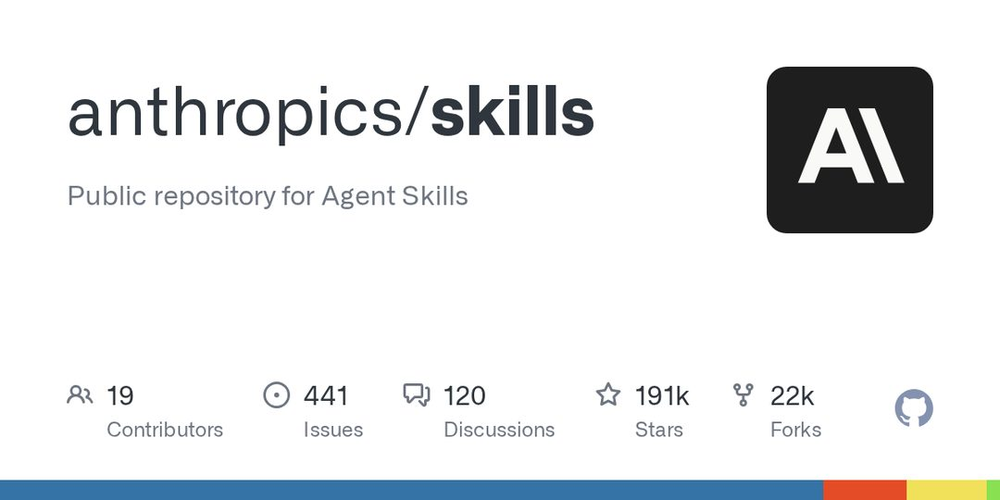

Anthropic 在 GitHub 公开了 Agent Skills 仓库，其中包含 Claude 的 skills 实现，并明确指向 Agent Skills 标准。

关键点在于定位：这不只是一个示例集合，更像标准的一份参考实现。技能被当作独立于模型版本的封装单元，可以单独维护、替换和分发。一旦「技能」有了公共格式，围绕它的工具链——分发、评测、权限控制——才有地方挂载。

为什么重要：过去一年 agent 的能力主要靠提示词工程和工具调用临时拼接，复用性差、难以审计。把技能标准化，是让 agent 行为可被审查、可被组合的前提。判断：真正的分水岭不在这个仓库本身，而在有多少团队愿意按这套约定去写技能。

> 原文：[anthropics/skills](https://github.com/anthropics/skills)

### Aspen：给 Agent 用的 Git 服务器

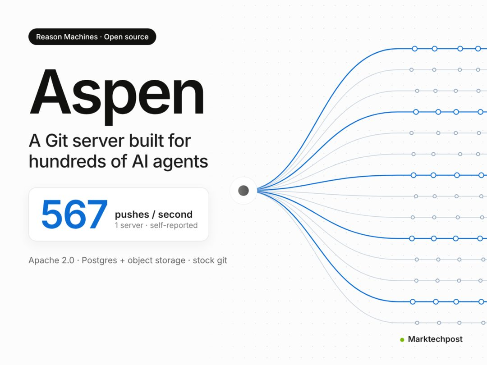

Reason Machines 开源了自托管的 Git 服务器 Aspen，面向 AI Agent 场景，遵循 OpenAI Pando 的设计；按其公司内部测试，单台 8 核服务器可达到每秒 567 次 push。

这个数字值得琢磨，因为它改写了前提。人类开发者的 push 频率以天计，agent 的频率以秒计；而现有托管平台的配额、限流和 review 流程，全都是按人的节奏设计的。

为什么重要：agent 写代码的瓶颈正在从「生成」转向「提交与协作」。如果 agent 成为主要提交者，仓库就需要新的分支策略、审计粒度和冲突处理方式。Aspen 是少数直接改 Git 服务端的项目，接下来要看它能否被现有 CI 生态接住，而不是长成一座孤岛。

> 原文：[Reason Machines open-sources Aspen](https://www.marktechpost.com/2026/11/09/reason-machines-aspen-open-source-git-server-ai-agents/)

### 0sec Labs 开源 AI 安全 harness「0」

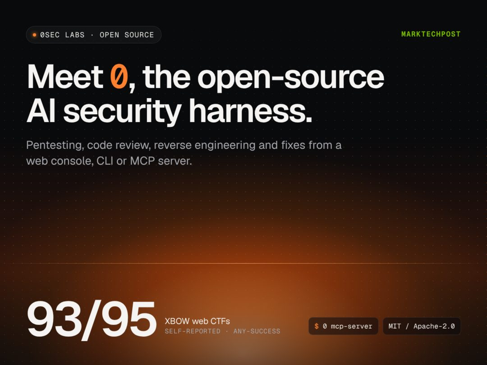

0sec Labs 开源了 AI 安全测试框架「0」，覆盖代码审查、渗透测试、逆向工程与修复，提供 Web UI、CLI 和 MCP 三种接口，并支持本地运行自有模型。

两个设计选择透露了它的判断：MCP 被当作主要接口，说明默认调用方已经是 agent 而非人；允许本地自有模型，则直接回应企业最在意的数据边界——漏洞细节不必出内网。

为什么重要：把进攻性安全能力打包成 harness，意味着渗透测试有机会进入 CI 流程。风险也在这里：同一套能力既能用于修复也能用于攻击，开源之后，护栏设计比功能列表更值得审视。

> 原文：[0sec Labs open-sources 0](https://www.marktechpost.com/2026/11/08/0sec-labs-open-sources-0-ai-security-harness/)

### Meta 开源设计系统 astryx

Meta 开源了设计系统 astryx，完全可定制，并针对 Agent 使用场景做了准备。

「agent-ready」是这份仓库最值得注意的标签。设计系统的消费者正从人扩展到 agent，组件需要的不只是视觉规范，还需要可被程序理解的结构化约定——否则 agent 改前端只能靠猜。

为什么重要：如果 agent 要参与写 UI，它首先得读懂设计系统。谁的设计系统先对机器友好，谁在「agent 写界面」的时代就更占便宜。目前这还只是一个仓库，但方向值得记一笔，尤其值得前端团队留意。

> 原文：[meta/astryx](https://github.com/meta/astryx)

### OpenSandbox 开源 Agent 沙箱运行时

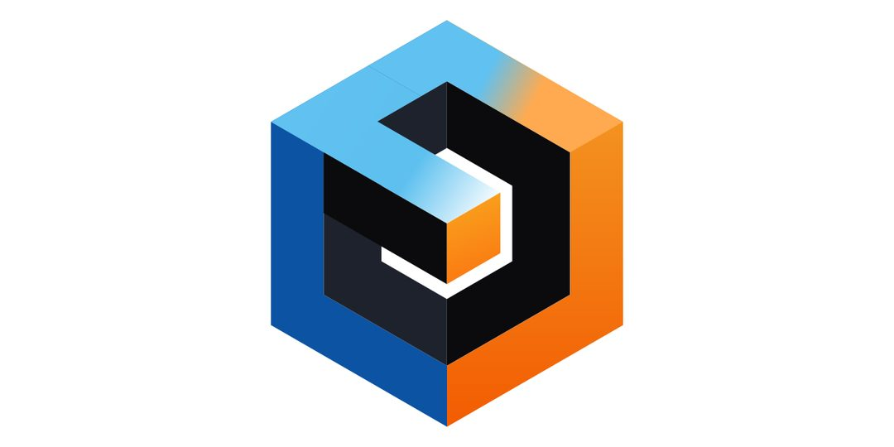

OpenSandbox 开源了一个面向 AI Agent 的沙箱运行时，主打安全、快速、可扩展。

把它和前几条连起来看，agent 执行面的拼图开始成形：Aspen 管「写」——代码落在哪里；0sec 管「查」——行为是否越界；OpenSandbox 管「跑」——执行环境如何隔离。

为什么重要：沙箱是 agent 从 demo 走向生产的前置条件，也是最容易被低估的一环。项目尚处早期，评估重点应放在隔离强度、冷启动开销、以及与现有容器编排的兼容性上，而不是功能清单有多长。

> 原文：[OpenSandbox](https://github.com/opensandbox-group/OpenSandbox)

### OpenBMB 开源无分词器 TTS VoxCPM2

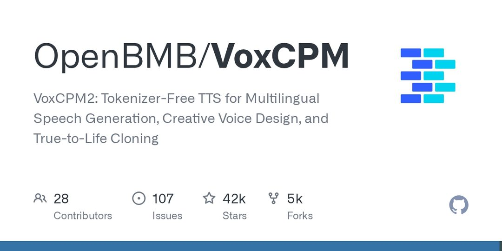

OpenBMB 开源了 VoxCPM2，一种无分词器（tokenizer-free）TTS，支持多语言语音生成、创意音色设计和拟真声音克隆。

无分词器是一条明确的路线选择：不在音频与文本之间插入离散 token 层，其主张是避开量化带来的信息损失。三项能力里，音色设计与声音克隆最容易被产品化，也最快会被拿去和闭源方案比价。

为什么重要：语音正在成为 agent 的默认输出之一，TTS 的竞争点也从「像不像人」转向可控性与成本。开源把这条线的门槛继续压低，同时把声音克隆的滥用风险一并放大——能力已经开源，授权与溯源机制还没有跟上。

> 原文：[OpenBMB/VoxCPM](https://github.com/OpenBMB/VoxCPM)

今天这六条拼在一起，指向同一件事：agent 的竞争正从模型参数转到它脚下的地面。留一个问题——如果技能、仓库、沙箱都被标准化了，下一个被商品化的会是什么？
