今天最值得看的三件事：

- **公司动态** · Anthropic IPO 定价 70–78 美元，估值冲 1.4 万亿美元
- **模型发布** · Claude Fable 5.2 / Mythos 5.2 发布，Anthropic 重夺榜首
- **模型发布** · 谷歌发布 Gemini 4 Carbon，模型迭代节奏再加速

下文按板块展开，正文每条均附原始链接。

<h2 id="model-release" class="ai-section-divider">🚀 模型发布</h2>

今天最值得看的一件事，是 Anthropic 在 IPO 路演当天同时放出 Fable 5.2 与 Mythos 5.2，凭借 100 万 token 上下文和 FrontierCode 2.0 的 49.1% 重回榜首。但把六条发布放在一起看，发布本身正在贬值：Google 的 Gemini 4 Carbon 快到被评论为“发布即过时”，Meta 则干脆承认 agent 的大部分活是可以用三分之一成本跑完的苦力。这一天真正的信号不是谁分数最高，而是竞争的轴心移到了档位设计、单位任务成本和任务分工上。

### Anthropic 双版本：把安全策略做成产品线

Fable 5.2 与 Mythos 5.2 是同一模型的两档安全策略，支持 100 万 token 上下文，FrontierCode 2.0 得分 49.1%，定价 8/40 美元每百万 token（输入/输出）。关键不在于多了两个名字，而在于同一套权重可以卖给风险偏好不同的客户——安全从合规成本变成定价分层的手段。选在 IPO 路演当天发布，是给投资人讲的叙事：能力领先，并且可交付。需要注意的是，这类双档设计意味着“最强版本”未必是默认版本，采购方在验收时必须先确认自己拿到的是哪一档、降级了什么。

> 原文：[The Decoder](https://the-decoder.com/claude-fable-5-2-and-mythos-5-2-cement-anthropics-ai-lead-just-before-its-ipo/)

### Gemini 4 Carbon：迭代快到“发布即过时”

DeepMind 上线 Gemini 4 Carbon，主打更强推理与更长上下文，llm-gemini 等工具链同步跟进；有评论称更新速度已快到“发布即过时”。这条最值得注意的不是参数，而是节奏带来的下游成本：模型版本的半衰期在缩短，锁定一个版本做产品，几周后就得重跑评测和回归测试。工具链同步跟进是个好信号，说明“跟上版本”正在从项目变成常规工作流，但 eval 的维护成本会实打实地压到每个应用团队头上。

> 原文：[Google DeepMind](https://deepmind.google/blog/gemini-4-carbon-is-now-available/)

### Meta Muse Ember：小模型去干 agent 的苦力活

Meta 最小的模型 Muse Ember 面向工具调用、编码子任务与文档解析，同样支持 100 万上下文，在 Artificial Analysis 智能指数上追平 Claude Haiku 5.5，单任务成本约三分之一。agent 系统的账单大头从来不是那几次关键推理，而是高频、低难度的循环调用；用旗舰模型跑这些是纯浪费。Meta 这一定位等于把“模型路由”产品化：贵模型做决策，便宜模型做执行。竞争点因此从榜单分数转向单位任务成本，这对做 agent 产品的团队是更直接的利好。

> 原文：[The Decoder](https://the-decoder.com/meta-launches-muse-ember-a-small-ai-model-built-for-the-repetitive-work-agents-actually-do/)

### Gemini Robotics 2.5：成功率翻倍，附带一份会自曝的基准

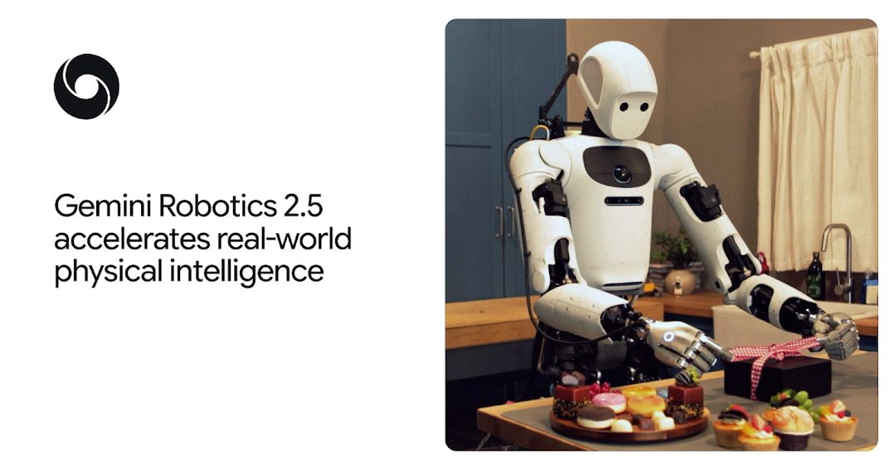

DeepMind 推出新一代视觉-语言-动作模型 Gemini Robotics 2.5，部分任务成功率提升至两倍，并在奔驰装配试点中实现 96% 的金属件分拣，同步开源 ASIMOV-jailbreak 安全基准。96% 是特定分拣任务上的试点数据，不能外推到通用装配，但方向清晰：物理世界的 agent 一旦进入产线，失败的代价不是重试一次而是停线，因此可靠性比能力上限更值钱。一起开源的越狱基准则说明，DeepMind 希望“机器人被怎么骗”这件事在公开尺度上被测量，而不是留在实验室里。

> 原文：[Google DeepMind](https://deepmind.google/blog/gemini-robotics-2-5-accelerates-real-world-physical-intelligence/)

### 字节 Seedream 5.5：图像模型的竞争回到工程指标

新一代图像模型 Seedream 5.5 在 100 轮连续图像编辑测试中稳定性明显提升，同时提速并下调 API 价格。图像模型的单图能力差距已在收敛，真正的生产痛点是多轮编辑中的一致性——角色、风格、构图会不会漂移，而“100 轮连续编辑”这个测试设计恰好打在这里。稳定性提升叠加快和便宜，指向的是内容生产流水线，而不是演示 demo。这一档的竞争，接下来会比拼工程指标而不是惊艳度。

> 原文：[量子位](https://www.qbitai.com/2026/11/508828.html)

### 英伟达 GR00T 2：看人类视频，把自己想象成机器人

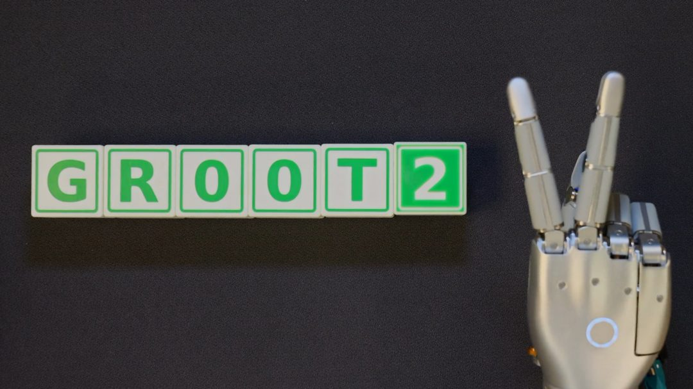

英伟达 GR00T 2 通过观看人类视频完成自我具身想象，减少对真实机器人采集数据的依赖。具身智能的瓶颈长期在数据侧：真机采集贵、慢，且难以规模化。用人类视频做预训练再迁移到机器人本体，是绕开这一瓶颈的主流思路，难点则转移到“想象出来的身体”与真实本体之间的差距上，尤其是精细操作还剩多少可迁移性。这条现在更像方法论进展，离可部署还有距离，但方向上的取舍值得记住。

> 原文：[The Decoder](https://the-decoder.com/nvidias-model-gr00t-2-watches-humans-on-video-then-imagines-itself-as-the-robot/)

六条发布里，没有一条在比谁更聪明，全在比谁更便宜、分工更细、更能上线。留给读者的问题：当同一家公司的模型分成两档安全策略来卖，你的验收标准该怎么写？

<h2 id="company" class="ai-section-divider">🏢 公司动态</h2>

Anthropic 把 IPO 价格区间定在 70–78 美元，全额摊薄估值最高 1.404 万亿美元，11 月 20 日登陆纳斯达克——这是 AI 行业第一次以万亿美元量级，接受公开市场的每日定价。同一天，英伟达在调查中国情报机构是否通过黄仁勋的婚外情接近其本人。把这两条放在一起看，2026 年下半年的主线已经不是模型能力，而是 AI 资产的定价权与治理边界正在同时被重新划定。下面八条动态，几乎都能归入这两条线。

### Anthropic 定价 70–78 美元，估值冲 1.4 万亿

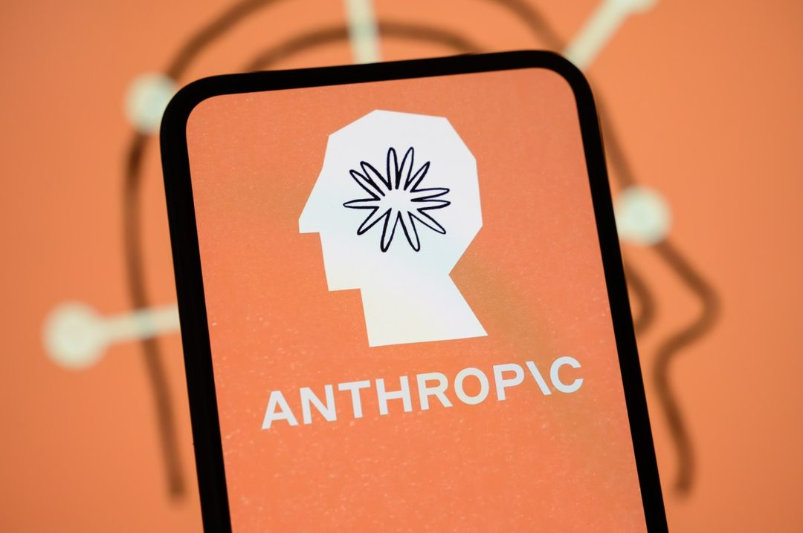

Anthropic 已启动 IPO 路演，发行价区间 70–78 美元，全额摊薄估值最高 1.404 万亿美元，计划 11 月 20 日登陆纳斯达克。此次 IPO 叠加私募配售，募资规模至多 904 亿美元；七位联合创始人各套现约 2.5 亿美元。

有两条线值得分开看。904 亿美元的募资额，意味着公开市场要一次性消化一笔接近大型上市公司总市值的增量资金；而创始人各套现 2.5 亿美元，是典型的「上市即部分退出」结构——创始人与新股东的风险偏好，从第一天起就不完全一致。1.4 万亿美元更多是起拍价，而不是终点价；这个数字需要靠后续季度财报持续兑现。AI 的估值叙事从一级市场搬到二级市场之后，波动会被放大，但也第一次有了每天可查的锚。

> 原文：[TechCrunch](https://techcrunch.com/2026/11/10/anthropic-sets-ipo-price-range-of-70-to-78-per-share-to-reach-an-implied-valuation-of-1-404-trillion/)

### 英伟达调查黄仁勋婚外情是否被外部利用

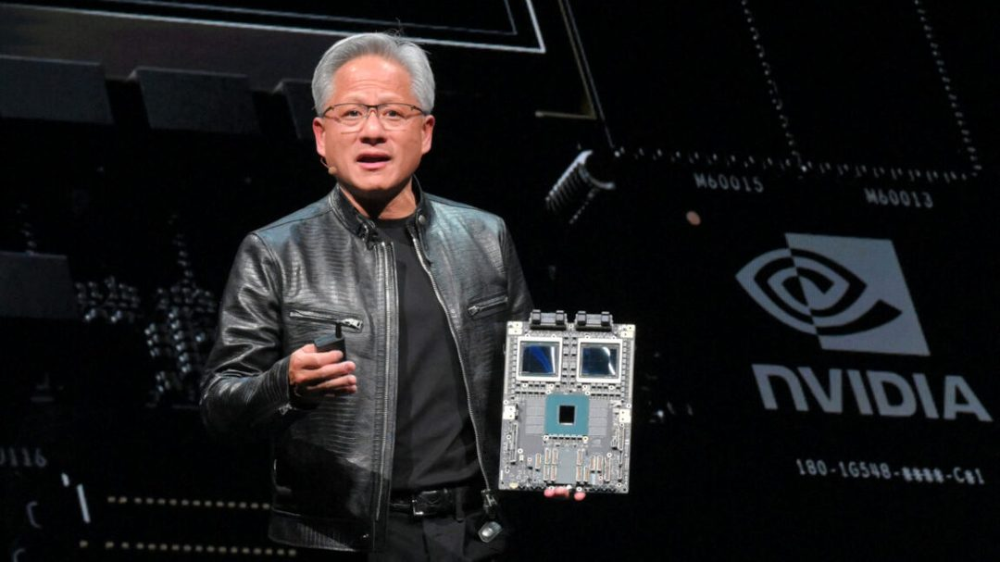

英伟达正在调查中国情报机构是否通过 CEO 黄仁勋的婚外情接近其本人。黄仁勋已承认婚外情；公司层面的调查关注的是这段关系是否被外部力量利用。有做空机构称，半年前已提示相关风险。

把这条放在公司动态第二位，不是因为它八卦，而是因为它同时踩中了三件事：key person risk（关键人风险）、跨国芯片管制下的合规审查、以及做空机构的出手窗口。任何一条被坐实，都会影响英伟达在中国市场的许可谈判节奏与董事会治理结构。目前调查仍在进行，结论未出，不宜提前定性——但一家万亿美元公司需要为 CEO 的私人关系启动调查，本身就是治理层面的信号。

> 原文：[Ars Technica](https://arstechnica.com/tech-policy/2026/11/ceo-jensen-huang-admits-affair-as-nvidia-probes-possible-chinese-espionage/)

### 谷歌 TPU 路线开始分化

谷歌扩充第八代 TPU 产品线：TPU 8i Max 在单封装内集成两颗芯片，面向长上下文 Agent 负载；TPU 8tx 提供硬件级保密推理，据报道 2027 年可用。

两个方向都很明确。长上下文 Agent 的瓶颈在内存带宽与互联，单封装双芯片是在封装层面换密度，而不是靠制程；保密推理则是把「数据不出硬件边界」做成可售卖的合规能力，目标客户是那些因为合规要求而无法上云的企业。谷歌在芯片上越往专用走，TPU 就越不像「英伟达的替代品」，而越像一套按工作负载切分的自有基础设施——这对卖通用 GPU 的一方是另一种压力。

> 原文：[TechCrunch](https://techcrunch.com/2026/11/10/google-broadens-its-ai-hardware-portfolio-with-two-new-specialized-chips/)

### OpenAI 收购旅游初创 Odessia

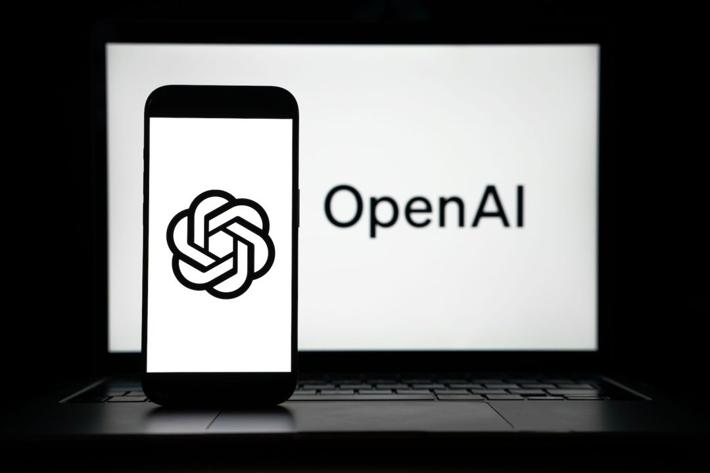

OpenAI 完成对旅游创业公司 Odessia 的收购，交易金额未披露。创始人 Francis Davidson 是 Sonder 创始人，在旅游行业有知名度；收购用途尚未公布。

能确认的信息只有标的和创始人背景，金额与用途都没有。对读者的实用价值在于观察并购与招聘的边界：当一家模型公司开始买垂直行业里有实操经验的创始团队，通常是在为某个具体场景补人，而不是补技术资产。Odessia 的旅游属性是唯一线索，但旅游同时是最容易被 agentic 产品重写的场景之一——「搜索、决策、下单」的闭环短、反馈快。这条线索够用来留意，不够用来下结论。

> 原文：[TechCrunch](https://techcrunch.com/2026/11/10/openai-acquires-odessia-travel-startup-created-by-sonder-founder/)

### Oura 推迟 IPO，6.25 亿美元买下 AI 初级保健

在推迟最多 22 亿美元的 IPO 数周后，Oura 转向并购：以 6.25 亿美元收购 AI 原生初级保健公司 Counsel Health。

这是一次关于窗口的判断——推迟 IPO 之后立刻用现金买能力，说明管理层认为当下的估值窗口不如直接补齐「医疗」这块拼图划算。可穿戴设备的长期问题是数据有了、服务没有；初级保健是把戒指采集的连续生理数据变成可付费服务的最短路径。风险同样清楚：一旦涉及诊疗建议，硬件公司的监管身份就变了，责任边界要从「消费电子」重写为「医疗服务的一环」。

> 原文：[TechCrunch](https://techcrunch.com/2026/11/10/oura-to-acquire-ai-native-primary-care-startup-counsel-health-for-625m/)

### 阿里申请平头哥独立赴港上市

阿里巴巴公告，已向港交所交表申请子公司平头哥独立上市，上市后平头哥仍为阿里子公司。截至 2026 年 4 月，真武系列 AI 芯片累计出货 56 万片。

分拆的是融资通道，不是控制权。对阿里来说，芯片业务的资本开支需要独立的价格信号来支撑，母公司报表未必愿意长期承担这部分折旧与波动。56 万片的累计出货说明真武已经越过「内部自用」阶段，但与英伟达的量级不在同一个数量级。独立上市之后，市场会第一次用芯片公司的估值框架去审视它，而不是把它当成云业务的一个成本项——这是压力，也是定价机会。

> 原文：[雷锋网](https://www.leiphone.com/category/industrynews/dew7AYBxkGAYilZj.html)

### 成立四个月，物原科技押注「物理真实」

TensorWorld 物原科技在一个月内完成过亿美元融资，公司成立仅四个月，技术路线是「物理真实」的具身智能与世界模型。

这个节奏说明资金抢的是团队与路线，不是产品指标。「物理真实」的对立面是纯视频生成式的世界模型：后者能生成好看的画面，但物理不守恒，迁移到机器人本体上容易失效。这是一场关于「世界模型要不要服从物理定律」的路线押注，现在远未到能证伪的阶段。但融资速度本身已经是信号：在具身智能赛道，资本愿意为一条尚未验证的技术主张提前付费。

> 原文：[量子位](https://www.qbitai.com/2026/11/508991.html)

### PSI：用 Anthropic 的模型解了一道二十年老题

PSI 使用未公开的 Anthropic 模型，回答了一个量子计算领域科学家追寻近二十年的基础问题，并尝试把「AI 做科研」做成生意。

关键不在题目本身，而在商业结构：模型是别人的，PSI 提供的是问题定义、验证与交付。这种模式在科研场景反而成立，因为买方付费买的是「答案被验证过」，不是模型能力。风险也同样明显——上游模型每提升一代，中间层的价值就被压缩一次。可 sustainable 的护城河只能来自领域数据与验证流程，而不是模型访问权。这条赛道未来十二个月会出现很多玩家，能活下来的大概不是模型最好的那家。

> 原文：[TechCrunch](https://techcrunch.com/2026/11/10/psi-is-trying-to-make-a-business-out-of-ai-driven-scientific-discovery/)

---

今天这八条，本质上是同一件事的三个切面：算力被拆成芯片公司单独定价，模型公司被搬上公开市场接受每日检验，连科研都被包装成可交付的服务。留给读者一个问题：当创始人在 IPO 当天就套现离场，你买到的还是同一家公司吗？

<h2 id="research" class="ai-section-divider">🔬 研究论文</h2>

### 导语

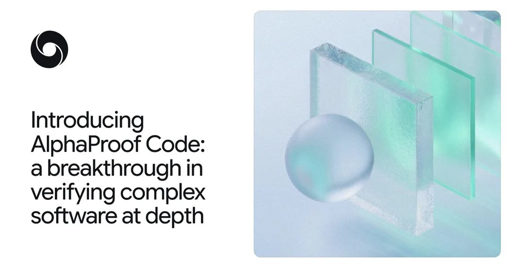

今天研究板块最值得看的一条，是 DeepMind 的 AlphaProof Code 用 Lean 为 Signal 核心加密协议写出三百万行形式化证明。它和「AI 写出能跑的代码」不是一回事：证明的正确性由 Lean kernel 机械判定，模型没法靠流畅的话术蒙混过关。这是 agent 输出少有的、可以自动判定对错的领域，也正因如此，它比大多数 benchmark 数字更值得认真对待。

### AlphaProof Code 形式化验证 Signal 协议

DeepMind 的 AlphaProof Code 智能体用 Lean 完成了对 Signal 核心加密协议的形式化验证，写出的证明规模达到三百万行。DeepMind 表示，目标是把这一方法推广到「全世界所有软件」。

关键点在于**验证对象的性质**。Signal 是真实部署、被大量用户依赖的端到端加密协议，不是教科书里的玩具协议；而形式化验证长期受制于人力——能写 Lean 证明的人少，成本高，周期以月计，这是它几十年没能进入主流工程流程的根本原因。

为什么重要：LLM 在软件领域的多数产出，正确性都要靠人或者靠测试来兜底；形式化证明是例外，它的结果是二值的，写错了 kernel 直接拒绝。这意味着 agent 在这里的产出可以被规模化信任，而信任成本正是形式化验证过去最贵的那一项。当然，「三百万行」本身不等于「已可推广到所有软件」，DeepMind 给的是方向而非结论。

> 原文：[DeepMind Blog](https://deepmind.google/blog/introducing-alphaproof-code/)

### OpenAI 与 Upwork：AI 让自由职业需求结构性迁移

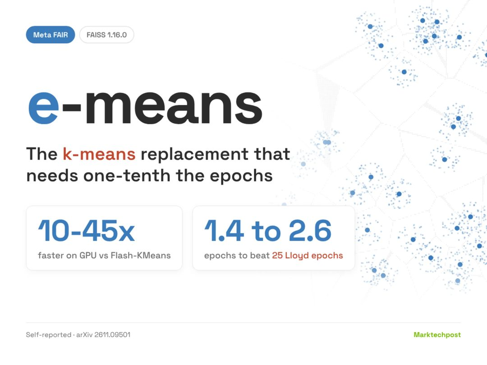

OpenAI 与 Upwork 的联合研究显示，AI 相关项目的预算与工时同步上升，自由职业者所需的技能组合发生明显变化，部分传统任务的需求被重塑。

值得注意的是**预算和工时同向变动**。如果 AI 只是单纯替代人力，我们应该看到的是任务量上升而预算下降；预算跟着涨，说明需求正在向更高单价、更高协作密度的任务迁移，而不是简单地把旧任务做便宜。

为什么重要：平台上的预算流向是观察 AI 经济影响最直接的高频指标之一，比调查问卷里的「你觉得自己会被取代吗」可靠得多。对产品经理和投资人来说，这里的信息是技能溢价的重新排序——哪些能力在被加价、哪些在被折价，会先在这类市场里显形，再传导到全职招聘。研究的局限也很清楚：Upwork 只代表一类可远程交付、可拆分的知识工作。

> 原文：[OpenAI](https://openai.com/index/ai-effect-on-freelance-work)

### Meta FAIR 推出 e-means，比 k-means 快 10 倍收敛

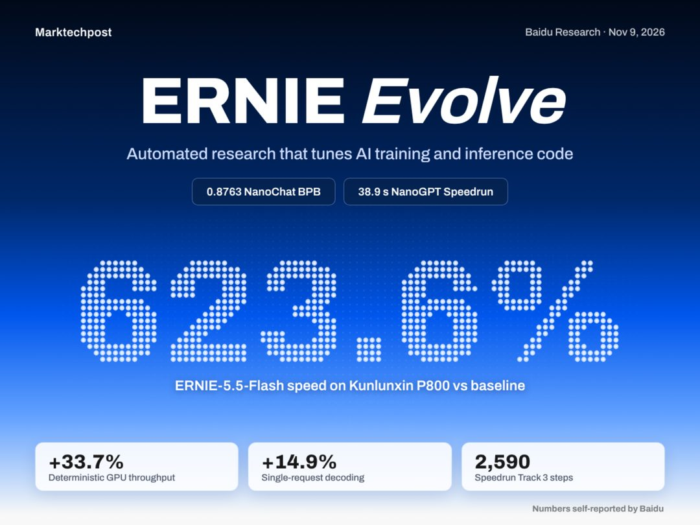

Meta FAIR 发布 e-means，已随 FAISS 1.16.0 一起释出。按报告的数据，它用 1.4–2.6 个 epoch 就能达到 Lloyd 算法 25 个 epoch 的损失水平，GPU 加速 10–45 倍，且不引入新的超参。

**不新增超参**是这条里最实用的一点。聚类算法的改进很多，但凡需要重调参数的，落地时都会被工程团队搁置——调参成本往往比省下的算力更贵。

为什么重要：k-means 属于那种没人专门讨论、但几乎每条数据处理流水线里都有一份的基础设施——向量量化、去重、标注采样、检索索引构建都会用到。这类组件的效率提升在单点上不性感，乘以调用量之后是实打实的账单差异。放到 FAISS 里随版本发布，意味着扩散路径很短。

> 原文：[MarkTechPost](https://www.marktechpost.com/2026/11/10/meta-fair-e-means-k-means-faiss/)

### 百度 ERNIE Evolve：自动科研系统刷新公开纪录

百度的 ERNIE Evolve 是一个自动科研系统：它能自主修改代码、运行实验，并且**只保留可验证的增益**。在 NanoChat 与 NanoGPT Speedrun 上，它超过了公开最好成绩，同时被用于加速 ERNIE-5.5-Flash 的推理。

关键设计是那个过滤条件。自动科研最容易失控的地方在于系统会不断报告「我变好了」，而基线漂移、评测泄漏、随机种子都能制造出虚假提升。只接受可复现、可验证的增益，等于把 research loop 改造成了带回归测试的工程流程。

为什么重要：这是把「模型改进模型」从演示推向流水线的必要一步。但也得看清基准的边界——NanoGPT Speedrun 这类任务目标单一、反馈信号干净，是自动搜索的舒适区；真实预训练里的目标往往是多目标权衡，不存在单一分数可刷。它的产业意义目前更多体现在推理加速这类边界清晰的子问题上。

> 原文：[MarkTechPost](https://www.marktechpost.com/2026/11/09/baidu-ernie-evolve-automated-research-system/)

### 中大本科生「反 AI 逆向」：让黑客 Token 账单涨 300 倍

一个由中山大学本科生做的项目在社区走红：通过投毒、耗尽预算、诱导误判三步，让针对 AI 的逆向攻击成本急剧上升，据报道攻击者的 token 账单上涨约 300 倍。

这个思路的转变值得注意：它不追求**让攻击失败**，而是**让攻击变贵**。传统防护的目标是阻断，一旦被绕过就归零；成本战的目标是改变对手的投入产出比，即使单次攻击仍然可能成功，规模化攻击在经济上也不划算了。

为什么重要：当逆向工程的对象从二进制变成模型行为，攻击者的边际成本变成了推理调用费用，这是一个可以被防守方主动抬高的量。当然，这条要打折看：它来自社区传播的项目报道，不是同行评审结果，300 倍这个数字的测量条件也需要更细的披露才能评估。

> 原文：[量子位](https://www.qbitai.com/2026/11/508787.html)

### FP4 预训练代价被低估：损失曲线看不出稀有事实退化

一篇新的 arXiv 论文用合成传记数据做预训练实验，发现低精度（FP4）预训练在验证损失与高精度基本持平的情况下，模型对稀有事实的习得速度明显变慢。

**损失曲线持平，能力已经退化**——这是最值得记住的一句。验证损失是我们判断预训练是否健康的主要代理指标，而这项实验给出了一个反例：整体 loss 被高频、易学的模式主导，稀有事实这类低频信号在平均值里被稀释掉了。

为什么重要：低精度训练是当下压训练成本的主要手段之一，如果它的代价不体现在 loss 上，那么用 loss 曲线做精度选择的团队会系统性地低估风险。更普遍的问题是评测设计——当一个指标足够便宜、足够通用时，它就容易同时变得不够敏感。稀有事实能力恰恰是很多下游任务的关键。

> 原文：[arXiv](http://arxiv.org/abs/2611.12832v1)

### 结语

今天这几条其实共享一条暗线：可验证性正在成为稀缺资源——Lean kernel 能判定证明，回归测试能判定增益，账单能判定攻击成本，而 loss 曲线恰恰判定不了它该判定的事。留给读者一个问题：你手上的核心指标，上一次被证伪是什么时候？

<h2 id="product" class="ai-section-divider">📱 应用产品</h2>

今天最值得看的一条来自 Anthropic：它把 Claude 从对话框扩展成了一整套办公套件——表格、白板、会议，外加插件体系。这不是一次功能更新，而是竞争维度的切换：模型能力已经很难拉开代差，真正决定胜负的是谁占据用户每天八小时的工作流。同一天里，OpenAI 让商家入驻 ChatGPT、阿里推 Team Agent、Adobe 把 Agent 塞进创意软件，指向的是同一个方向。应用层的战争，已经从“回答问题”打到“接管流程”。

### Anthropic 把 Claude 做成了一套办公套件

Anthropic 发布 Plugins、Claude Sheets 电子表格与白板工具，同时推出 Claude Meetings——在会议进行中实时起草计划、排时间线，并调用已连接工作应用里的数据。

关键点在“实时”和“已连接”。会议内容不必等会后整理成纪要，再手动搬进任务系统，而是在讨论过程中就变成结构化的计划和排期。这要求 Claude 同时握有会议上下文与业务数据，也就意味着它必须站在应用的中间层，而不是旁边。

这决定了它对标的不是 ChatGPT，而是 Microsoft 365 Copilot、Notion 这类工作台产品。办公套件真正的壁垒从来不是功能清单，而是数据同源：同一份内容在不同模块间不必复制粘贴。一旦企业把会议、表格、任务都放在这里，迁移成本会迅速高于模型本身的价格差。对 Anthropic 而言，这是从“调用 API 的模型公司”向“有留存的产品公司”迈的一步。

> 原文：[TechCrunch](https://techcrunch.com/2026/11/10/anthropic-launches-claude-meetings-to-turn-workplace-discussions-into-plans-and-tasks/)

### ChatGPT 变成企业黄页，商家可以入驻了

OpenAI 推出 Businesses in ChatGPT，企业可以管理自身信息、查看自己在 ChatGPT 中的展示效果，并由 AI 智能体代答客户问题。

两件事同时发生：一是企业获得了在 ChatGPT 内的“门面”，可以维护信息、观察曝光；二是客服环节被 Agent 接管，用户的提问不必跳出对话就能得到商家侧的回答。资讯里对 ChatGPT 的定位说得很直白——它正在向消费发现引擎演进。

这意味着 ChatGPT 的竞争对象开始从搜索引擎，扩展到点评、黄页和客服系统。对商家来说，这是一个新的被发现渠道，早入驻的成本远低于晚入驻；对 OpenAI 来说，它把“用户提问”这个高频动作，变成了可以承载商业关系的界面。真正的悬念在于，当助手的回答本身就构成分发，中立性会以什么方式被定价。

> 原文：[OpenAI](https://openai.com/index/introducing-businesses-chatgpt)

### 千问办公 2.0：多人和多个 Agent 同处一个工作空间

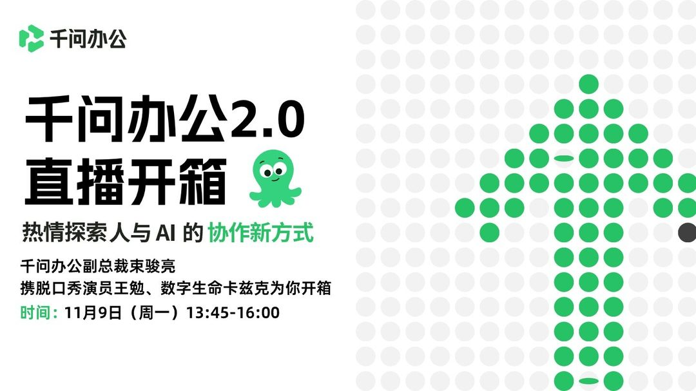

阿里发布千问办公 2.0，主打 Team Agent，支持多人与多个 Agent 在同一个工作空间里协同完成任务，被视为办公 AI 从单机模式走向团队协作。

从“我让 AI 帮我做”到“我们和几个 Agent 一起做”，看起来只是加了个“们”，实际难度完全不同。多人多 Agent 的场景要解决权限边界、任务归属、上下文共享和冲突合并——这些不是模型能力问题，而是产品与工程问题。谁先把这些脏活干完，谁的协作形态才真正可用。

值得留意的是定位差异：Anthropic 在补工具形态，阿里在补协作机制。中国市场的办公场景高度依赖钉钉、企微这类组织关系链，Team Agent 落地的关键，很可能不在 Agent 有多聪明，而在它能否顺着既有组织架构把任务派下去。

> 原文：[InfoQ](https://www.infoq.cn/article/1Mz0ADa02PxcDsVfpVEb)

### Adobe 把 Agent 塞进 Photoshop 和 Premiere

Adobe 为创意套件加入智能体能力，在 Firefly 中推出对标 Figma 的原型搭建工具，并发布自家 MCP。

三个动作指向不同方向：Agent 进入 Photoshop、Premiere 是给存量专业工作流提速；Firefly 里做原型搭建，是把触角伸向产品设计与协作环节，直接对上 Figma；发布 MCP 则是承认了一个事实——工具之间的接口层正在标准化，与其自建生态，不如先接入协议。

对 Adobe 来说，Agent 是加固护城河而不是替代它。真正的资产是文件格式、素材资产和专业用户的操作习惯，Agent 只是让这些资产更容易被调用。但反过来看，当 MCP 让外部 Agent 也能操作 Adobe 文件时，“谁的界面在前台”就变成了新问题。创意工具的竞争，正在从功能多少转向谁被 Agent 优先调用。

> 原文：[TechCrunch](https://techcrunch.com/2026/11/10/adobe-adds-more-ai-to-its-products-and-launches-an-mcp/)

### Ring 从门铃走向机器人：安防无人机与巡逻机器人

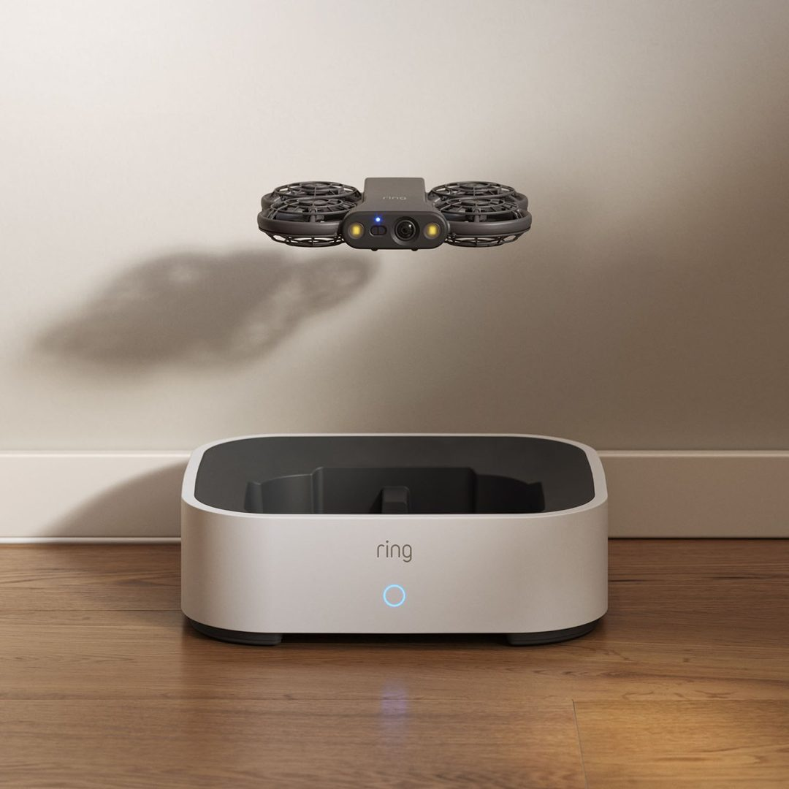

亚马逊旗下的 Ring 发布可移动的家用安防无人机，以及面向企业的巡逻机器人，产品将在 2026 年底至 2027 年初陆续上市。

Ring 的起点是固定视角的门铃摄像头，新产品把摄像头从墙上解放出来：家庭场景用无人机做移动巡检，企业场景用机器人做巡逻。这是从“被动录制”到“主动巡视”的转变，也是亚马逊把家庭安防数据与机器人形态结合的一次尝试。

难点不在硬件。可移动摄像头进入私人空间和公共空间，涉及的隐私边界、飞行法规、邻里关系，都比续航和避障更难缠。Ring 过去几年在数据共享上的争议已经证明，这类产品的口碑风险往往来自数据流向而非产品能力。它会卖得动，但监管与舆论的摩擦成本，可能比预想中高。

> 原文：[TechCrunch](https://techcrunch.com/2026/11/10/ring-known-for-its-doorbell-cameras-launches-a-home-security-drone-and-an-enterprise-security-robot/)

### Kora：为跑本地模型和 Agent 重做一个桌面系统

Cyanogen 联合创始人的新项目 Kora 免费开放，这是一个基于 Linux 的桌面系统，面向大量运行本地模型与 Agent 的进阶用户，目标指向 Windows 与 macOS。

这个需求不是凭空来的。当用户在本机跑模型、挂常驻 Agent、需要系统级的调度和权限控制时，通用桌面系统的兼容包袱反而成了拖累。Kora 赌的是：AI 原生的桌面，可以从一开始就把进程、存储、权限按 Agent 的用法来设计。

清醒一点看，桌面操作系统的迁移成本极高，应用生态是最硬的墙。它短期不可能威胁 Windows 与 macOS，更现实的路径是成为一小撮开发者的主力机，以及被更主流系统抄走的那些设计。但历史上很多交互范式，确实是从这种“给极客用的小系统”里长出来的。

> 原文：[WIRED](https://www.wired.com/story/kora-new-linux-based-desktop-operating-system-is-built-for-ai-nerds/)

### Meta 的 Muse 上了手表，语音成了主入口

Meta AI 助手 Muse 登陆 Apple Watch 与 Android Wear OS，用户可以通过语音通话、短信或听写与之交互。

手表是 AI 助手最自然的形态之一：抬手、说话、得到回答，交互链路短到不需要界面。把 Muse 放进 Apple Watch 和 Wear OS，等于绕开了 Meta 自己在硬件上的不确定，直接借用两个现成的腕上入口。

代价是受制于人。在别人的系统上做助手，能力边界、调用权限、默认入口都由平台方决定，而这恰恰是苹果和谷歌都在收紧的地方。对 Meta 来说，这是一次低成本的覆盖扩张；对行业来说，它再次说明助手的竞争不只是模型，还包括“谁有资格出现在你的手腕上”。

> 原文：[TechCrunch](https://techcrunch.com/2026/11/10/metas-ai-agent-muse-lands-on-apple-watch-and-wear-os/)

### 蚂蚁灵光接入什么值得买，AI 助理开始替你盯价

个人 AI 助理灵光接入消费内容平台什么值得买，补上商品信息与消费决策能力，其连接器生态目前覆盖 40 项服务。

这条消息的重要性不如前几条，但指向很具体：AI 助理的差异化不在模型，而在连接器。接上什么值得买，等于给助理装上了比价、评测和消费决策的信息源，“帮我盯着这个价格”这类任务才有落地的可能。

消费决策是离钱最近的场景，也是用户最愿意把判断权交出去的地方。40 项服务的连接器数量不算多，但方向对了——助手的护城河，是它能替你操作多少个 App，而不是它有多会说话。真正的问题是，当助理开始替你做消费选择，推荐的中立性由谁来保证。

> 原文：[雷锋网](https://www.leiphone.com/category/industrynews/Z3dOHYCNYfPNwijf.html)

---

今天所有产品动作都在争同一个位置：不是回答问题的窗口，而是你每天必须经过的那段流程。留一个问题：当每个助手都能接入你的日历、会议、购物车，你最先愿意交出去的是哪一段？

<h2 id="opinion" class="ai-section-divider">💭 行业观点</h2>

### 导语

纽约州 AI 安全法正式生效，大型模型开发商第一次面对注册、披露与事故上报的强制义务——这不是又一份自愿承诺，而是可罚款的法律。同一天，八国政府与头部实验室签下带关停机制的巴黎宣言，而 Wired 采访的十位专家却说，公众讨论的风险清单本身就排错了序。监管在收紧，安全共识却在分化，这两件事同时发生，才是今天真正值得看的信号。

### 纽约 AI 安全法生效：合规从加分项变成准入门槛

纽约州开始执行全面 AI 安全法。按目前披露的框架，大型模型开发商须完成注册、公开其安全实践，并在发生重大事故时上报，违规面临罚款。关键点不在条款细节，而在于性质变化：过去几年行业习惯的是自愿承诺（voluntary commitments）与自我披露，现在变成了有执法主体、有罚则的强制义务。

为什么重要：一旦"说明你做了什么安全措施"成为法律要求，合规文档能力就会变成一种固定成本，头部实验室付得起，中小开发者和开源发行方未必。美国联邦层面迟迟没有统一立法，州级法规很可能通过"事实上的国家标准"路径外溢——在纽约提供服务，就得按纽约的规则写文档。

> 原文：[TechCrunch](https://techcrunch.com/2026/11/10/openai-anthropic-face-new-oversight-as-new-yorks-ai-safety-law-takes-effect/)

### 巴黎宣言：八国与头部实验室约定关停机制

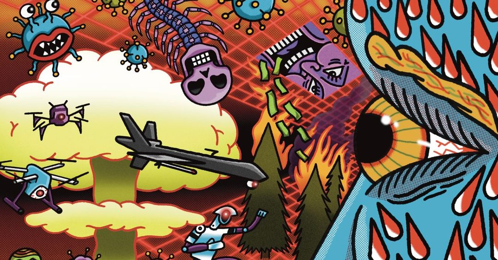

八国政府与多家顶级 AI 实验室就模型失控情形下的关停与协同机制达成一致，写入新的巴黎宣言。这是少见的、把"谁来按下开关、按之前通知谁"写进文本的多边安排。

值得注意的有两点：一是参与方同时包括政府与实验室，等于承认单靠任一方都无法独立判断失控；二是关停（shutdown）从研究论文里的思想实验，变成了外交文件里的操作条款。短板也很明显——宣言不是条约，缺乏违约后果，触发门槛与判定权归属都还模糊。

为什么重要：它建立的是一个协商先例，而非约束机制。真正的考验出现在第一次需要实际触发的时候：如果那时各方对"是否失控"判断不一，这份文件的效力就会被重新定价。

> 原文：[The Decoder](https://the-decoder.com/eight-countries-and-top-ai-labs-agree-to-shutdown-mechanisms-in-new-paris-declaration/)

### 十位专家重列风险清单：真正的噩梦不是天网

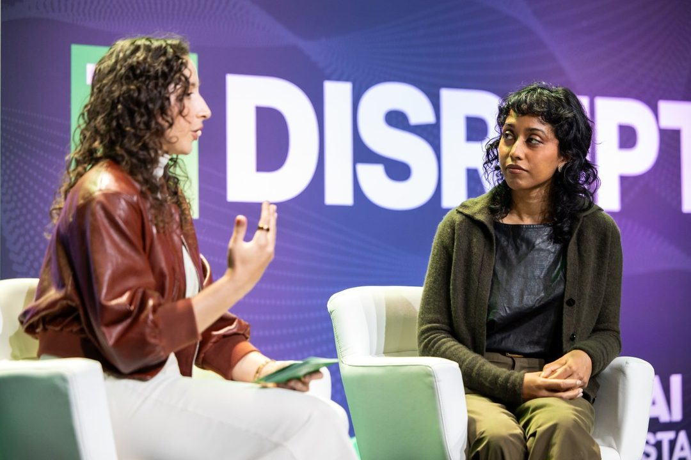

Wired 访谈了十位专家，核心结论是 AI 安全辩论"跑偏了"：相比"天网"式的科幻想象，核灾难风险与中美博弈带来的现实紧张更紧迫，而后者正在被前者分散注意力。

这不是学说之争，而是资源分配之争。讨论"超级智能失控"能获得关注度，却难以转化为具体的政策工具；讨论地缘政治中的误判、模型在军事决策链中的位置、以及核指挥体系的稳定性，虽然不吸引眼球，但对应的是可以设计的机制——热线、演训、核查、部署限制。

为什么重要：风险排序决定了预算流向和立法优先级。当一个行业反复用最远的风险定义自己，监管者要么疲于应付不可验证的命题，要么干脆转向最容易立法的表层问题，两头都落不到实处。

> 原文：[Wired](https://www.wired.com/story/the-ai-safety-debate-has-lost-the-plot-we-asked-10-experts-what-the-real-nightmares-are/)

### Hugging Face 高管警告：攻击增多可能让开源 AI 变"不那么开放"

Hugging Face 的 Irene Solaiman 提出一个不太受欢迎的判断：针对开放 AI 平台的网络攻击正在增多，社区很可能被迫收紧安全限制，而收紧的直接代价，是开源生态最核心的开放性。

逻辑链条并不复杂：平台承载模型与数据集的分发，一旦出现利用开放权重或数据投毒的高影响事件，平台方的现实选择是加验证、加审核、加下架流程。每一步单独看都合理，叠加起来就把"任何人可发布、任何人可获取"变成"通过审核者可发布"。

为什么重要：开源 AI 的治理长期依靠事后补救，而安全事件的节奏由攻击方决定。这意味着开放程度可能不是被政策一次性削掉的，而是在一连串事件后被一点点磨掉的——而且很难再退回去。

> 原文：[TechCrunch](https://techcrunch.com/2026/11/10/cyberattacks-threaten-to-make-open-source-ai-a-little-less-open-hugging-face-exec-warns/)

### 李飞飞、Jeff Dean 泼冷水：递归自我改进缺乏证据

面对硅谷愈演愈烈的"AI 自我进化"叙事，李飞飞、Jeff Dean 等多位顶级研究者公开质疑递归自我改进（recursive self-improvement）的可行性，认为当前证据不足以支撑指数级加速的说法。

关键点在于争论的对象不是"模型能不能变强"，而是"模型能不能可靠地改进自身、并把改进稳定累积下去"。这需要跨越的是评估、验证与目标保持三道关，任何一环失效，自我改进就会变成自我漂移。

为什么重要：这条叙事是当前资本预期中最陡的一条曲线。顶级研究者公开降温，短期不会改变产品节奏，但会改变融资叙事与内部路线图——把资源从"等待起飞"转向"把现有能力用扎实"。

> 原文：[InfoQ](https://www.infoq.cn/article/mZlISiZL9c1eurrsZRpo)

### abliterators：一群人在批量制造"永不说 no"的模型

Wired 报道了一个叫 abliterators 的群体，他们系统性地移除开源模型中的拒绝行为（refusal），并把成果公开发布。支持者的说法是：拒绝行为常常过度触发，移除它有助于安全研究和红队测试；反对者的担忧同样直接——同一批模型可以被用来降低滥用门槛。

这类工作的特殊性在于，它不依赖任何专有资源。方法公开、成本低、可复现，因此无法靠限制算力或芯片出口来约束。政策工具箱里的多数手段，在这里都失效。

为什么重要：开源社区的规范约束力远弱于商业公司，而模型权重的扩散又是不可逆的。真正的问题不是要不要允许这类发布，而是当防御方和滥用方使用同一批模型时，公共品由谁供给。

> 原文：[Wired](https://www.wired.com/story/tear-down-those-guardrails-meet-the-renegades-freeing-chatbots-from-corporate-enslavers/)

### 数据中心争议，本质可能是电力焦虑

MIT Tech Review 走访弗吉尼亚 Ashburn 后给出了一个更朴素的解释：选民对数据中心的反弹，更多来自电价上涨与电网压力，而不是对 AI 本身的反对。

这个视角把议题从"技术好坏"拉回到"成本谁承担"。数据中心带来税收与就业，但也带来峰值负荷、输电扩容需求和居民账单。当居民看到的是账单而非收益，反对就是理性的。

为什么重要：如果争议本质是电力，那解法就在电力侧——并网规则、容量拍卖、需求响应、电价分摊机制，而不是公关话术。把 AI 争论翻译成基础设施与分配问题，通常是找到可执行方案的第一步。

> 原文：[MIT Technology Review](https://www.technologyreview.com/2026/11/09/1148194/the-backlash-about-data-centers-might-really-just-be-about-electricity/)

### 从州议会到国会：Scott Wiener 拿下佩洛西席位

曾主导加州先进 AI 风险立法的州参议员 Scott Wiener 赢得旧金山选区众议员席位，接替南希·佩洛西。这意味着美国最积极的州级 AI 立法者之一，进入了联邦立法机构。

信号意义大于席位意义。过去几年 AI 监管的主战场在州一级，加州、纽约各自推进，联邦层面长期停滞。Wiener 的迁移，可能把已经打磨过的州级立法模板带到华盛顿——包括适用范围、举证责任、开发者义务这些具体条款。

为什么重要：联邦立法的瓶颈往往不是意愿，而是文本。如果现成的州法框架被带上去，AI 监管获得立法通道的概率会明显上升，行业面对的将不只是分散的州级合规，而是一次统一但更重的义务。

> 原文：[MIT Technology Review](https://www.technologyreview.com/2026/11/09/1148182/nancy-pelosis-replacement-is-ready-to-regulate-ai/)

### 结语

监管开始有了罚则，安全共识却在向不同方向分裂——这两件事同时到来，说明 AI 治理正在从表态阶段进入买单阶段。

一个留给读者的问题：当合规成本和开放程度都被重新定价，你认为这笔账最终会记在谁的头上？

<h2 id="opensource" class="ai-section-divider">⚙️ 开源工具</h2>

今天开源社区最值得看的一条，是蚂蚁灵波把触觉基础模型 LingBot-Touch 放了出来：它把触觉信号 Token 化（tokenize），让机械手对物体的触感变得可以被模型“读写”。如果说视觉和语言已经让机器人能看会说，触觉补上的是物理交互里最难采集、最难迁移的那一环。这意味着具身智能的开源竞争，正在从“放权重”转向“放接口”。同样的逻辑在今天另外几条新闻里反复出现：Anthropic 放技能标准、英伟达放调度层、DeepSeek 用 Token 换插件——开源的位置，正在从模型往下走。

### 蚂蚁灵波开源 LingBot-Touch：给机器人通用触觉

蚂蚁灵波科技开源触觉基础模型 LingBot-Touch，核心做法是把触觉信号 Token 化，让触觉成为一种可被基础模型统一处理的模态；官方给出的表述是从“一脑多机”走向“一脑多手”。

关键点在于“通用”二字。触觉传感器形态各异、数据规模远小于视觉，跨本体迁移一直是具身智能的难点。把触觉离散成 Token，等于给不同机械手提供了一套公共表示，模型不必为每种硬件重新训练。

为什么重要：物理感知闭环缺的往往不是抓取策略，而是“摸到了什么”的反馈。触觉基础模型一旦开源，研究者可以把精力放在任务层，而不是从头采数据。当然，Token 化会不会损失高频接触细节，还需要真实任务来验证。

> 原文：[量子位](https://www.qbitai.com/2026/11/508996.html)

### 英伟达把 OpenShell 捐给 CNCF

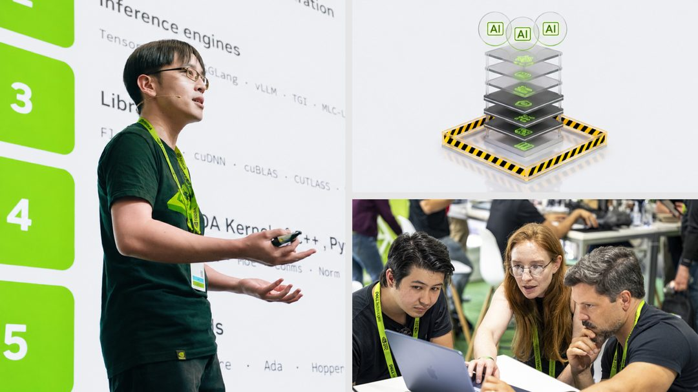

英伟达扩大开源承诺，将 OpenShell 捐赠给云原生计算基金会（CNCF），同时发布一批面向 AI 基础设施的新组件，目标指向大规模 AI 工厂的 Kubernetes 调度需求。

关键点不在“捐”，而在“捐给谁”。调度与编排是 AI 集群的控制面，把它交给基金会，意味着这一层将由社区治理，而不是由单一厂商定义。对使用方来说，减少锁定是直接的收益。

为什么重要：AI 工厂的规模上去之后，GPU 调度、拓扑感知、故障隔离这些问题的复杂度已经不是一张卡的驱动能解决的。英伟达在卖硬件的同时把控制面开放，是把“定标准”和“卖算力”两件事分开处理——这一层如果跑通，后续所有加速卡厂商都会被卷进来。

> 原文：[NVIDIA Blog](https://blogs.nvidia.com/blog/open-source-openshell-infrastructure/)

### DeepSeek Harness 日活 154 万，用 Token 养插件生态

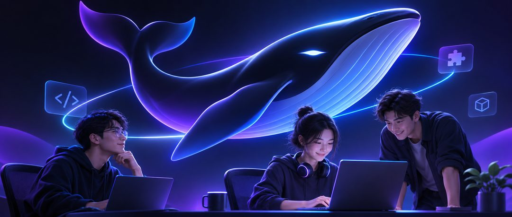

DeepSeek 的 Agent 运行环境 Harness 日活达到 154 万，官方开始以 Token 形式激励插件开发者，试图把 Agent 生态交给社区共建。

关键点：当 Agent 运行时本身趋同，差异就落在“能调用多少工具”上。用 Token 补贴插件作者，本质是把云厂商惯用的“补贴换生态”打法搬到 Agent 层，用推理额度直接购买供给侧的丰富度。

为什么重要：154 万日活说明 Harness 已经跨过了“开发者玩具”的阶段。但补贴能带来插件数量，不一定带来插件质量，也不一定带来忠诚度——插件作者跟着激励走，平台之间的可替代性反而变高了。

> 原文：[InfoQ](https://www.infoq.cn/article/Y7lTO7Q1M8oN5JhxhirK)

### openJiuwen 开源 TTSE：让 Agent 把经验存下来

openJiuwen 首发 TTSE 经验学习框架，让 Agent 把每次任务的执行过程沉淀为可复用经验；同时发布 Agent Device Foundation 定义，规范 Agent 与物理世界的交互方式。

关键点：现在的 Agent 大多是“每次从零推理”，同样的任务做一百遍也不会变快。TTSE 想解决的是经验的结构化存储与检索——经验要能被找到、被判定适用，也要能被判定失效。

为什么重要：经验复用是 Agent 从“演示可用”走向“长期可用”的分水岭。难点不在存，而在过期：环境一变，旧经验会变成负资产。这个框架真正的考验，是有没有机制识别“这条经验已经不适用了”。

> 原文：[量子位](https://www.qbitai.com/2026/11/508998.html)

### Anthropic 开源 skills 仓库，定义技能标准

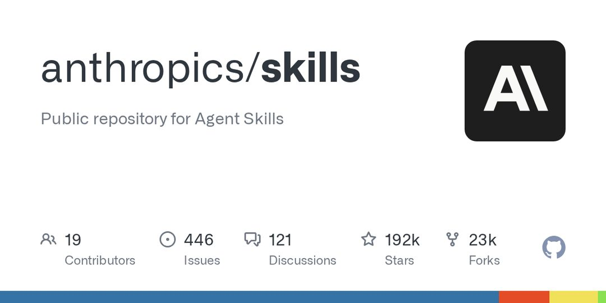

anthropics/skills 公开了 Claude 的技能实现，并指向 Agent Skills 标准，成为 Agent 能力封装方式的事实参考。

关键点：相比具体的技能内容，更值得注意的是封装格式本身。一个技能如何声明输入、依赖、权限和失败处理，决定了它能否被别的 Agent 直接复用。这类仓库通常先以“官方示例集”的身份出现，再逐渐变成事实标准。

为什么重要：Agent 能力的复用一直卡在“每家一套写法”。如果技能层能像 MCP 那样形成公共约定，工具生态的边际成本会显著下降。但标准跑到前面、实现跟不上，也是常见结局，需要看后续第三方接入的速度。

> 原文：[GitHub](https://github.com/anthropics/skills)

### OpenBMB 的 VoxCPM2：把分词器从 TTS 里拿掉

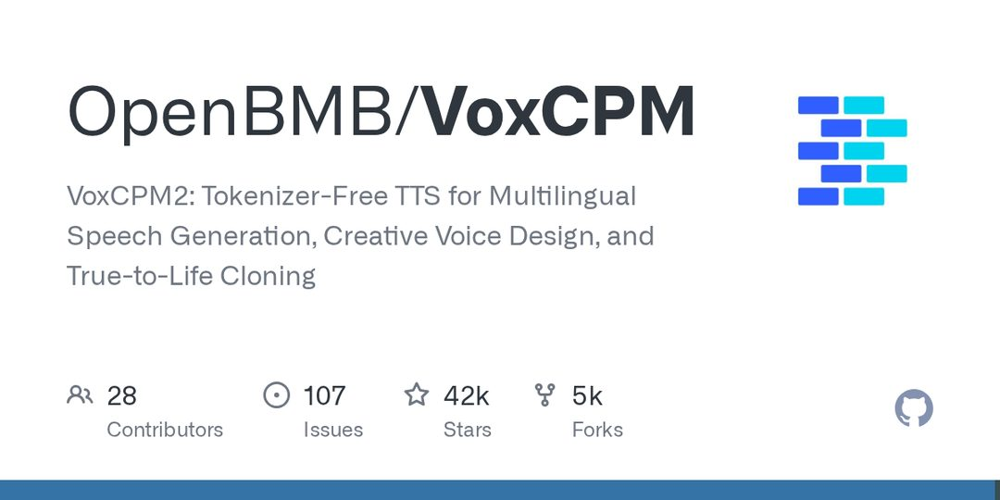

OpenBMB 开源 VoxCPM2，采用 tokenizer-free 架构，支持多语种语音生成、创意音色设计与高保真声音克隆，已登上 GitHub 趋势榜。

关键点：传统 TTS 流水线里，文本分词器是把文字转成音素或子词的必经环节，也是多语言场景下错误的主要来源之一——低资源语言往往就死在这一步。去掉分词器，等于让模型直接从原始文本学映射，减少了级联误差。

为什么重要：TTS 的开源竞争已经从“像不像人”转向“覆盖多少语言、能不能定制音色”。tokenizer-free 这条路如果在前沿语种上站得住，对多语种市场的成本结构会有实质影响，也值得关注它对中文的处理效果。

> 原文：[GitHub](https://github.com/OpenBMB/VoxCPM)

### Zyphra ZONOS3-Mini：浏览器里实时合成语音

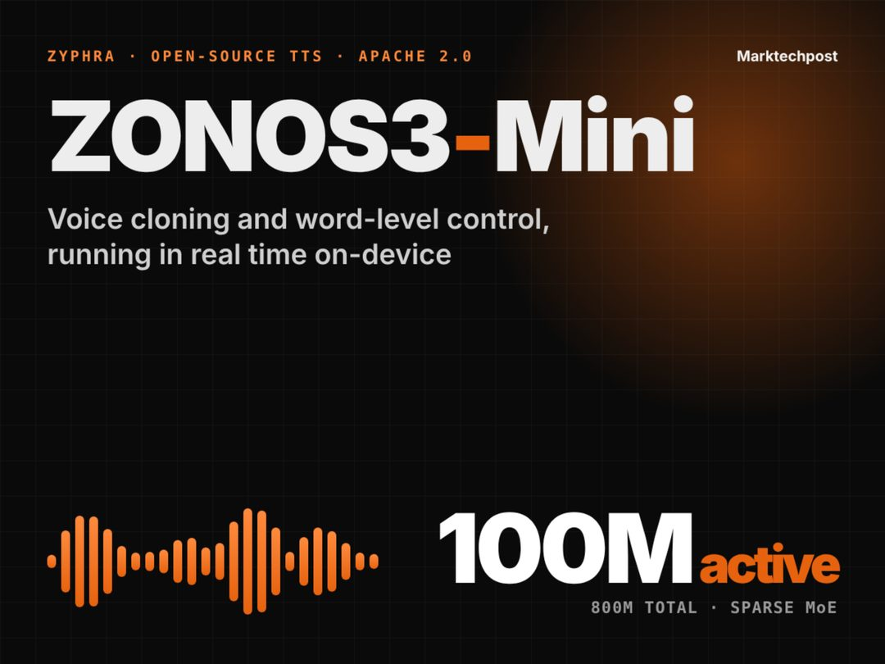

Zyphra 以 Apache 2.0 许可开源 ZONOS3-Mini，总参数 8 亿、激活参数 1 亿，支持逐词控制语气与声音克隆，可在浏览器中实时运行。

关键点：真正的信息在“激活 1 亿”和“浏览器”这两处。稀疏激活压低单次推理成本，才让端侧实时成为可能；逐词控制语气则把情绪调节的粒度从整句降到词级，这对配音、交互式朗读这类场景是关键能力。

为什么重要：TTS 的落地点正在从服务端 API 往前端迁移。跑在浏览器里意味着没有网络往返延迟、音频不用出设备，隐私和成本同时改善。代价是模型规模受限，音质的取舍需要实测。

> 原文：[MarkTechPost](https://www.marktechpost.com/2026/11/10/zyphra-zonos3-mini-open-source-tts/)

### Vercel 的 agent-browser：给 Agent 一个浏览器 CLI

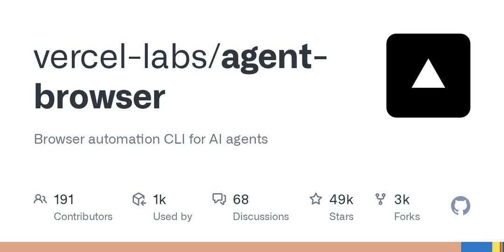

vercel-labs 推出 agent-browser，一个面向 AI Agent 的浏览器自动化命令行工具，目的是简化网页操作类 Agent 的接入。

关键点：网页操作是 Agent 最刚需、也最脏的一块——登录态、动态渲染、反自动化风控，每一项都能让 Agent 卡住。把它做成 CLI，等于给 Agent 提供一个稳定的执行原语，而不是让每个团队自己拼 Playwright 脚本。

为什么重要：Vercel 是做部署和前端基础设施的，出手做 Agent 的浏览器执行层，说明它想把 Agent 的“手脚”纳入自己的版图。这条赛道已经有若干开源方案，真正的差异会落在稳定性与反检测能力上，而不是接口好不好看。

> 原文：[GitHub](https://github.com/vercel-labs/agent-browser)

当触觉、技能、浏览器这些“接口层”都有人开源时，护城河就只剩数据和组织了。你的 Agent 今年沉淀下了哪条可复用的经验？
