今天最值得看的三件事：

- **模型发布** · Gemini 4 Carbon 正式开放，价格仅为对手 1/4
- **公司动态** · 英伟达董事会拟罢免黄仁勋，国会传唤作证
- **公司动态** · Anthropic 启动 IPO 路演，联创人均套现 2.5 亿美元

下文按板块展开，正文每条均附原始链接。

<h2 id="model-release" class="ai-section-divider">🚀 模型发布</h2>

今天最值得看的一条，是 Gemini 4 Carbon 全面开放：官方给出的定价约为 Fable 5.2 的四分之一。这个数字比任何 benchmark 都更能改变开发者的行为——原本因为成本不敢放开的 agentic 循环，突然变得可以承受。同一天，Anthropic 把安全防护做成两档 SKU，DeepMind 把机器人越狱评测开源成基准。能力和价格之外，模型正在被拆成更多可售卖的维度。

### Gemini 4 Carbon 开放：价格是四分之一

Google DeepMind 宣布 Gemini 4 Carbon 全面可用。官方给的例证颇为具体：它能在一夜之间重写 OpenCode 桌面应用——这更像在强调长上下文与 agentic 编码的耐力，而不是某个单点分数。定价约为 Fable 5.2 的四分之一，第三方工具 llm-gemini 已同步支持，生态跟进速度本身就是信号。

为什么重要：当旗舰模型把价格压到对手的四分之一，压力不只在同行定价表上，更在开发者的架构选择上。多轮工具调用、失败重试、长上下文反复读取，这些过去要精打细算的动作，现在可以放开跑。但便宜四倍不等于便宜——如果单位任务需要两次重试，账就要重算。接下来该看的是真实负载下的每任务成本，而不是发布会上的 token 单价。

> 原文：[Google DeepMind](https://deepmind.google/blog/gemini-4-carbon-is-now-available/)

### Fable 5.2 与 Mythos 5.2：把安全做成 SKU

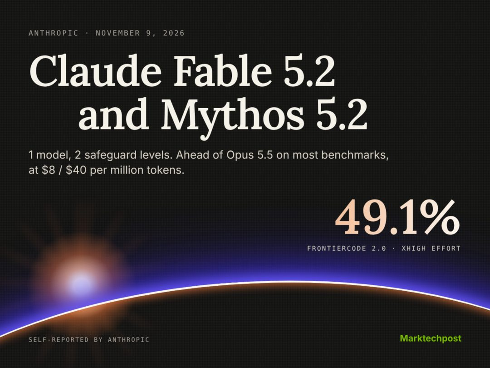

Anthropic 发布 Fable 5.2 与 Mythos 5.2，两者实为同一模型的两套安全防护等级。Fable 5.2 在 FrontierCode 2.0 上得分 49.1%，定价 8/40 美元每百万 token（输入/输出），支持 100 万 token 上下文。

为什么重要：同一套权重、两个名字，意味着「安全」从合规成本变成了产品分层。对企业客户是好事——可以按场景挑防护强度，不必为一个高敏场景牺牲全部体验。对评测生态则是麻烦：同一模型会存在两个分数，榜单若不标注防护档位，横向比较就会失真。这也把一个老问题摆上台面——我们评测的到底是模型能力，还是「模型加一层策略之后」的可用性。

> 原文：[MarkTechPost](https://www.marktechpost.com/2026/11/10/anthropic-claude-fable-5-2-mythos-5-2-release/)

### Gemini Robotics 2.5：成功率翻倍，越狱基准开源

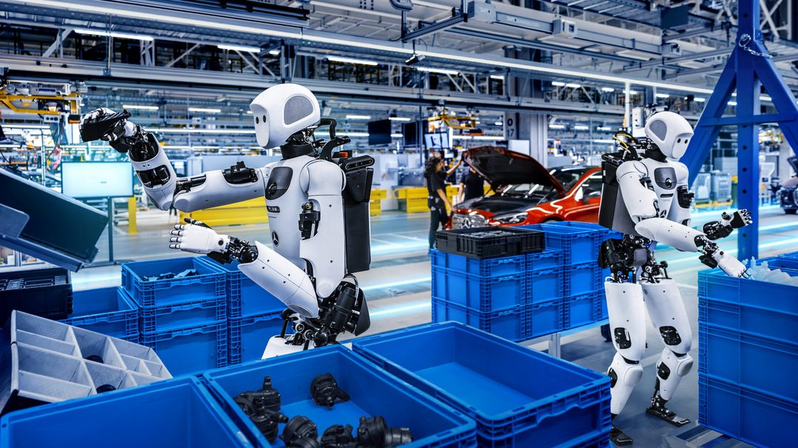

DeepMind 发布 Gemini Robotics 2.5，官方称部分任务成功率提升到原来的两倍；同一天还开源了安全基准 ASIMOV-jailbreak，用于评测机器人模型被越狱的风险。

为什么重要：机器人模型长期缺一把公共的安全标尺，「能否被诱导做出危险动作」往往只在论文附录里讨论。开源基准把这件事变成可复现、可比较的指标，客户和监管方终于有了参照物。另一面是话语权——谁定义基准，谁就定义「安全」的边界。成功率翻倍是宣传点，基准才是长期资产；把两者放在同一天发布，本身是一种姿态。

> 原文：[Ars Technica](https://arstechnica.com/google/2026/11/deepmind-reveals-gemini-robotics-2-5-and-open-safety-benchmark-asimov-jailbreak/)

### Fish Audio Live 3：边说边听，186 毫秒

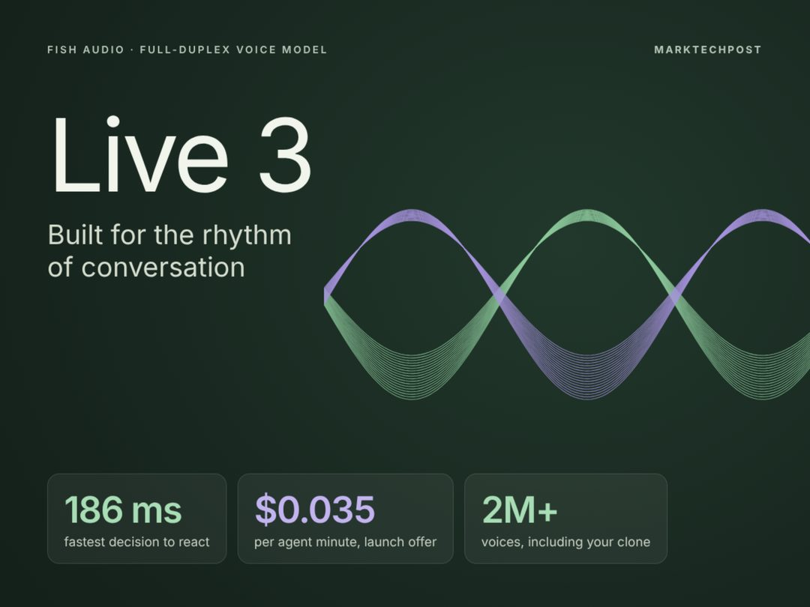

Fish Audio 发布全双工（full-duplex）语音模型 Live 3，能在说话的同时持续监听，并区分「嗯哼」这类附和与真正的打断，最低 186 毫秒响应，首发仅支持英文。

为什么重要：语音交互的分水岭不在音色，而在轮转（turn-taking）。半双工模型像对讲机——你说完我才能说；全双工才接近电话。186 毫秒已落在人类对话的间隙区间内，而「附和 vs 打断」的判定是真正的工程难点：判早了抢话，判晚了迟钝，两者的体感差异远大于音质差异。仅英文首发说明这类模型对语料与韵律标注的依赖仍然很重，中文场景还要等。

> 原文：[MarkTechPost](https://www.marktechpost.com/2026/11/10/fish-audio-live-3-full-duplex-voice-model/)

### 结语

四条新闻指向同一件事：模型本身正在变成标配件，价格、防护档位、交互形态才是新的差异化战场。留一个问题——当同一个模型能按四分之一的价格、两种安全等级卖给你，你为「能力」付的那笔钱，究竟买到了什么？

<h2 id="company" class="ai-section-divider">🏢 公司动态</h2>

英伟达董事会据报最早周三晚间决定是否罢免创始 CEO 黄仁勋，这是这轮 AI 行情里第一次由公司治理、而非技术路线触发的系统性风险。同一时间，资本侧一刻没停：Anthropic 启动 IPO 路演，OpenAI 单季营收破百亿，台积电准备向两家模型公司各投 10 亿美元。把这两条线并排看，2026 年末的关键词是 AI 公司的权力结构正在被重新分配，而不只是「泡沫与否」。钱比人乐观。

### 英伟达董事会准备罢免黄仁勋

TechCrunch 报道，英伟达董事会最早可能在周三晚间决定是否罢免这位创始 CEO。触发点是两项指控：黄仁勋被曝与一名被指为中国情报人员的女性有染，以及另一项与英伟达下属的婚外情指控。众议院共和党人已要求其闭门作证，消息传出后股价下跌。

关键在程序，不在传闻本身：董事会用多短的时间完成评估、以什么理由启动罢免、是否先做独立调查——这几个决定会定义「创始人 CEO 风险」的可处置边界。国会介入则把公司治理问题拖进国家安全叙事。「被指为中国情报人员」目前只是指控、尚未证实，但它足以改变董事会的风险计算方式。

为什么重要：英伟达是整轮 AI 资本开支的定价锚。市场愿意为算力叙事付溢价时，几乎没人给「关键人物风险」打折；若董事会真的启动罢免，这会是该风险第一次被显性定价。反过来，若选择留任，董事会也需要交代它对指控的处理标准。

> 原文：[TechCrunch](https://techcrunch.com/2026/11/11/nvidias-stock-drops-as-board-reportedly-preps-to-oust-ceo-jensen-huang/)

### Anthropic 路演：七位联创人均套现 2.5 亿美元

TechCrunch 报道，Anthropic 七位联合创始人计划在 IPO 中各卖出相同数量的股份，按发行价区间中值计算，每人套现约 2.5 亿美元，同时仍保持对公司的控制权。

关键点有二。一是「等额」：七人卖出同样多，而非按持股比例减持，这是刻意设计的信号，压缩了外界揣测「谁在离场」的空间。二是「套现 + 控制权」并存——这次 IPO 的结构不是创始人退出，而是把一部分纸面财富换成现金，投票权留在手里。

为什么重要：Anthropic 是这一轮头部模型厂商中第一个走进公开市场定价的。路演给出的区间会成为同类公司的估值参照，创始人减持的节奏也会被后来者复制或规避。对投资人来说，真正该看的不是 2.5 亿美元这个数字，而是招股材料里的算力承诺、毛利率与客户集中度——这些才决定上市后能否撑住发行价。

> 原文：[TechCrunch](https://techcrunch.com/2026/11/10/all-7-anthropic-founders-will-each-cash-out-about-250m-in-ipo/)

### OpenAI 单季营收首次破 100 亿美元

报道称 OpenAI 单季营收达到 100 亿美元，较上季度的 67 亿美元增长近 50%，主要来自企业级销售。同一篇报道指出，其规模仍落后于 Anthropic。

近 50% 的环比增速放在任何软件公司身上都是异常值，说明企业采购正在从试点预算转成常规科目。但有两个问题报道没有回答：收入确认口径是否包含算力转售或云厂商分成；以及与收入同步增长的推理成本——营收翻倍不等于亏损收窄。

「落后于 Anthropic」这句更值得琢磨。它意味着市场分布与公众认知并不一致：OpenAI 握着最大的消费者心智，但在企业合同这块，Anthropic 可能占了更好的位置。对投资人的含义是，估值比较不能只看 API 调用量或月活，要看合同期限与续约率。企业生意的增速慢于消费级病毒传播，但留存曲线更平。

> 原文：[TechCrunch](https://techcrunch.com/2026/11/11/openais-quarterly-revenue-reportedly-crosses-10b-for-the-first-time/)

### 台积电拟向 Anthropic、OpenAI 各投 10 亿美元

Ars Technica 报道，台积电计划向 Anthropic 和 OpenAI 各投资 10 亿美元，被归入 AI 热潮中「循环融资」（circular financing）的最新案例。

所谓循环融资，指供应商向客户投资、客户再用这笔钱买回供应商的产能。台积电处在两家公司算力供应链的最上游，用股权换订单确定性，逻辑上说得通。风险在于：当上下游互相持股，收入与融资的边界会变模糊，估值里「真实需求」的成分也更难拆。

为什么重要：这类交易会改变 AI 资本开支的性质。如果芯片厂同时是模型公司的股东，「算力短缺」就同时是成本问题和资产问题，产能扩张的决策会部分脱离市场信号。对二级市场投资者，这意味着未来几个季度的营收数据需要更多披露，才能分清哪些是终端需求、哪些是关联方循环。

> 原文：[Ars Technica](https://arstechnica.com/ai/2026/11/taiwans-chipmaking-giant-tsmc-to-invest-1b-in-anthropic-openai/)

### Anthropic：AI 正在瓦解 CUDA 护城河

Anthropic 称，借助 AI 辅助迁移，把训练栈从英伟达平台切换到 AMD 芯片的工期从数月压缩到三天，并据此认为 CUDA 的生态锁定正在被削弱。

关键不在「三天」这个数字，而在迁移成本的变化方向。CUDA 的护城河由三部分组成：算子库与编译器成熟度、开发者习惯、迁移的沉没成本。AI 辅助代码转换直接作用于第三项，前两项仍要时间——三天完成迁移，不等于三天达到稳定运行，性能调优与故障排查还在后面。

为什么重要：若迁移成本持续下降，定价权会从「生态锁定」转向「单位算力性价比」，这对英伟达毛利率是结构性压力，对 AMD 与自研芯片厂商是窗口期。但要保留怀疑：这是一家模型公司基于自身迁移经验的说法，没有第三方复现，也未披露迁移后的训练效率损耗。

> 原文：[The Decoder](https://the-decoder.com/anthropic-says-ai-is-eroding-nvidias-cuda-lead-cutting-an-amd-chip-switch-from-months-to-three-days/)

### Mercor 完成 7.5 亿美元 D 轮，估值 200 亿美元

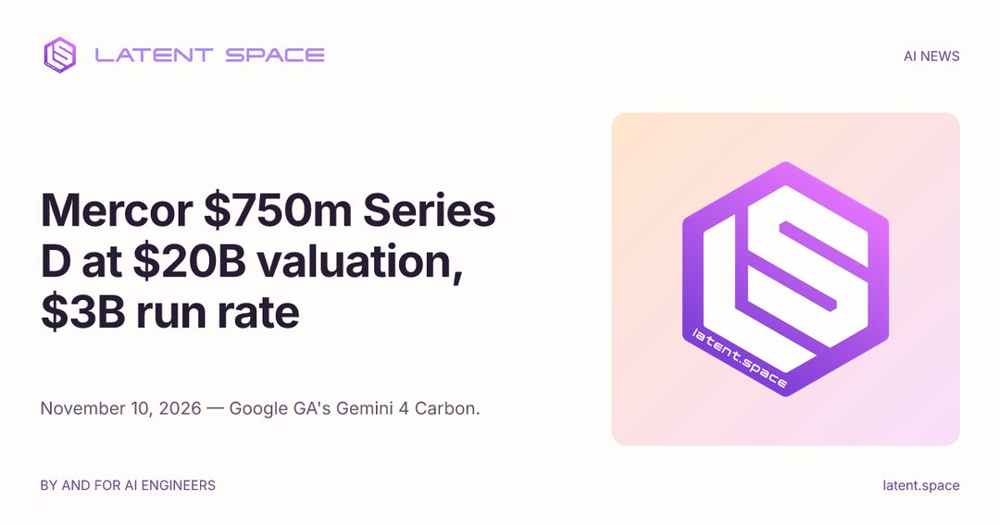

AI 数据与人才平台 Mercor 完成 7.5 亿美元 D 轮融资，估值 200 亿美元，年化流水约 30 亿美元规模。

按流水算，估值约为年化流水的 6.7 倍，放在 SaaS 里不算离谱。但「流水」与「收入」的口径差别在这个赛道尤其大：平台撮合的人才费用可能全额计入流水，实际留存比例要低得多。这是读这类数字时第一个要问的问题。

为什么重要：Mercor 的位置很特殊，它同时是数据供应商和人力中介。模型公司对高质量人类反馈与专家标注的需求，把这一层从成本项变成了资产项；反过来，当模型能力提升、合成数据占比上升，这类需求会不会突然收缩，是 200 亿美元估值里最大的未定价风险。

> 原文：[Latent Space](https://latent.space/p/ainews-mercor-750m-series-d-at-20b-valuation-3b-run-rate)

### 英国 Fractile 融资 7.2 亿美元，押注 AI 专用芯片

英国 AI 芯片初创 Fractile 拿到 7.2 亿美元融资，进入专用 AI 芯片赛道资金最充裕的玩家行列。

「专用」是关键词。与通用 GPU 相比，针对推理或特定模型结构做定制的芯片，理论上能在单位功耗上取得更好表现，代价是灵活性——一旦模型架构变化，专用硬件的价值需要被重新评估。这笔钱本质上是投资人对「其架构假设会成立」下注。

为什么重要：把它和 Anthropic 的迁移案例放在一起，会看到一条更清晰的线——资本正在同时给「离开英伟达」的软件路径和硬件路径定价。这不代表英伟达份额会立刻下降，但意味着替代方案的融资环境已明显改善。对英伟达而言，真正的威胁不是某一家 challenger，而是「迁移」这件事本身变得常规化。

> 原文：[TechCrunch](https://techcrunch.com/2026/11/11/with-720m-round-britains-fractile-gets-a-leg-up-in-the-race-for-ai-chips/)

### OpenAI 收购旅游初创 Odessia

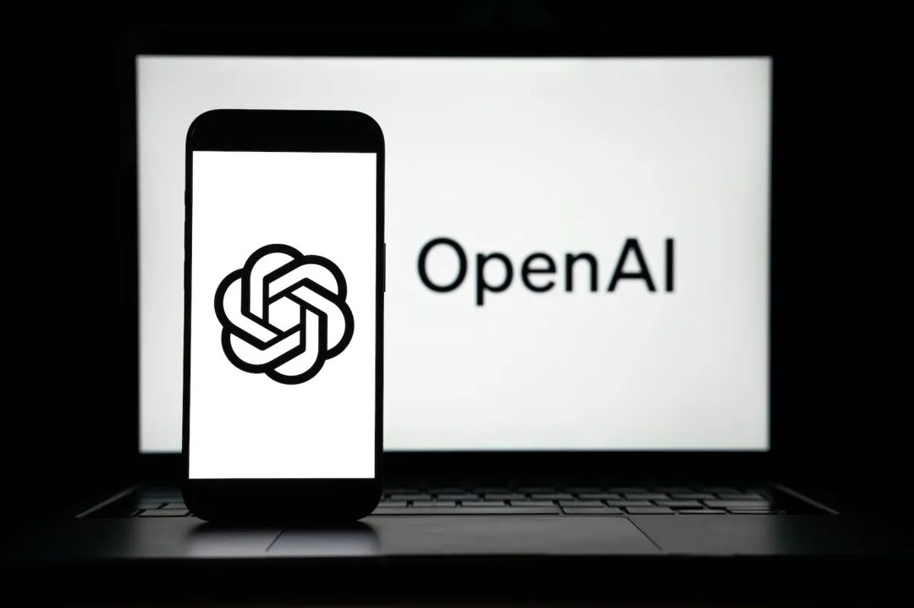

OpenAI 收购旅游初创公司 Odessia，被收购方由 Sonder 创始人 Francis Davidson 创办。OpenAI 尚未说明将如何把旅游业务纳入自身产品线。

信息很少，但有两点可读。一是创始人背景：Davidson 做的是长租公寓运营（Sonder），重运营、重供应链，不是典型技术型创业者。二是标的行业：旅游是典型的多约束、多步决策场景，正好是大模型 agent 的试验田。

为什么重要：在整合意图未披露的情况下，更合理的解读是这是一次 acquihire（人才收购），而非产品线扩张。OpenAI 近期的动作集中在企业与算力侧，突然买下一家旅游公司，说明它可能在为「能替用户完成多步预订的 agentic 产品」储备能力。这条路径的商业化尚不清晰，但一旦跑通，直接冲击的是 OTA 与搜索广告的入口位置。

> 原文：[TechCrunch](https://techcrunch.com/2026/11/10/openai-acquires-odessia-travel-startup-created-by-sonder-founder/)

算力、资本、人，三条线今天同时加速，唯一还没被定价的是关键人物风险。留个问题：如果你要给英伟达的「CEO 风险」标一个折价，会是多少？

<h2 id="research" class="ai-section-divider">🔬 研究论文</h2>

### 导语

今天最值得看的不是某个模型涨了多少分，而是 DeepMind 的 AlphaProof Code 用四周时间完成了 Signal 协议密码学核心的形式化验证——一件原本被估算为「数年」的工程。这件事的意义不在于 AI 又会做题了，而在于形式化验证这个长期「理论上很美、工程上不划算」的领域，第一次出现了成本曲线的拐点。同一批故事里，还有三件事指向同一个方向：AI 正在从「生成内容」转向「替人完成本该很贵的工作」。

### DeepMind 用四周做完数年的验证工作

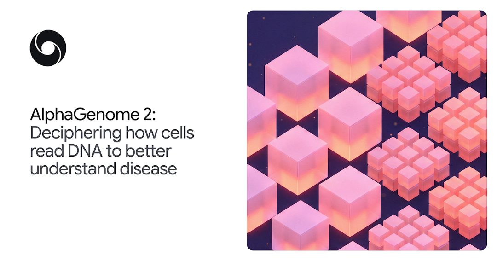

DeepMind 的 AlphaProof Code 在四周内完成了 Signal 协议密码学核心的形式化验证。Signal 是端到端加密领域最被信任的实现之一，其协议正确性此前主要靠人工审计与测试保障；形式化验证能给出更强的保证，但成本极高，因此长期停留在学术演示阶段。

关键点有两个：一是耗时从「数年」压缩到「四周」，量级变化而非百分比优化；二是验证对象是真实生产协议的密码学核心，不是玩具定理。这提示了一条新路径——AI 不替代数学家，而是把「写出机器可检验的证明」这件苦力的边际成本压到足够低。

值得留意的是它的边界：形式化验证证明的是「实现符合规约」，规约本身是否描述了你想要的安全性质，仍然要人来定。但对工程团队来说，这已经足够改变排期表。

> 原文：[Ars Technica](https://arstechnica.com/ai/2026/11/signals-encryption-just-passed-an-ai-powered-mathematical-checkup/)

### AlphaGenome 2：把「变异的影响」放到具体细胞里问

DeepMind 发布 AlphaGenome 2，一个条件 DNA 序列模型，能针对具体的人类细胞类型预测调控活性与变异效应，并通过 AlphaGenome API 向非商业研究开放。

这里的「条件」是核心。同一个基因变异在不同细胞类型里可能有完全不同的后果，而传统模型往往给出一个去上下文（context-free）的分数。把细胞类型作为条件输入，等于把「这个变异致不致病」的问题改写成「在哪种细胞里、通过哪条调控路径起作用」——后者才是药物研发真正要回答的问题。

对做基因组学与靶点发现的人，这是可直接接入 API 的基础设施级变化；对更广的读者，它说明生物基础模型的竞争点已从「预测更准」转向「预测更可解释、更可控」。当然，预测分数不等于因果结论，实验验证仍是瓶颈。

> 原文：[Google DeepMind Blog](https://deepmind.google/blog/alphagenome-2-deciphering-how-cells-read-dna-to-better-understand-disease/)

### PSI：把「AI 做科学发现」做成生意

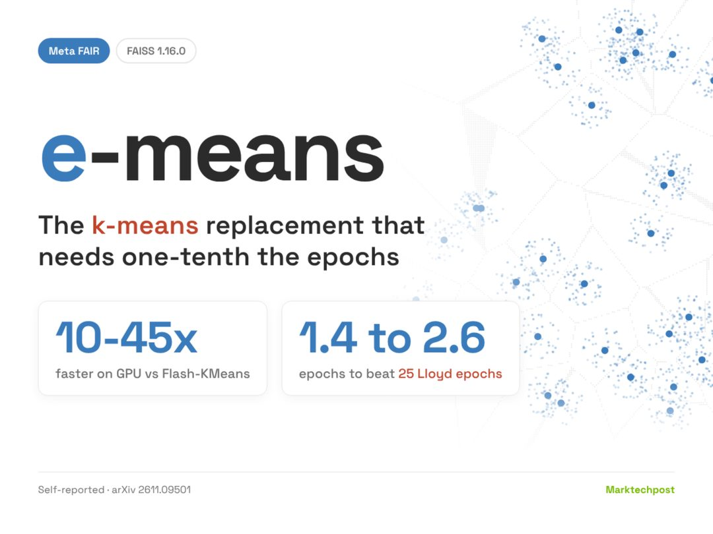

初创公司 PSI 使用一款尚未公开的 Anthropic 模型，回答了一个量子计算领域科学家追寻近二十年的基础问题，并试图将这种 AI 驱动的科学发现商业化。

这条最值得注意的不是结果本身，而是商业形态。如果前沿模型的能力要靠「未发布版本 + 特定提示与流程」才能兑现，那么价值捕获点就不在模型，而在知道该问什么、怎么验证答案的那一方。PSI 押的正是这个位置——做模型与科学问题之间的中间层。

风险也很清楚：对单一模型供应商的依赖、成果的可复现性、以及「AI 提出假设、人类验证」这条链路里到底谁贡献了多少。但趋势是明确的：科学发现正在成为模型能力变现最贵的场景之一。

> 原文：[TechCrunch](https://techcrunch.com/2026/11/10/psi-is-trying-to-make-a-business-out-of-ai-driven-scientific-discovery/)

### e-means：一个安静但会被大量调用的改进

Meta FAIR 提出 e-means，作为 mini-batch k-means 的替代方案，已并入 FAISS 1.16.0。数字很直接：用 1.4–2.6 个 epoch 就达到 Lloyd 算法 25 个 epoch 的损失水平，GPU 加速 10–45 倍，且不引入新的超参数。

在研究和新闻层面这条最不性感，但在工程层面可能是本周最容易被真正用上的东西。k-means 是向量检索、聚类、数据去重的默认起点，它的训练成本经常被当成常数忽略；把 epoch 需求和硬件效率同时改善一个量级，等于把「要不要重跑一次聚类」从需要审批的决定变成随手操作。

「不需要新增超参」是这次能被快速采纳的关键——任何需要重新调参的改进，在实际系统里都会拖上几个季度。

> 原文：[MarkTechPost](https://www.marktechpost.com/2026/11/10/meta-fair-e-means-k-means-faiss/)

### 不是模型变笨，是评审标准在移动

一篇论文在 Chatbot Arena 上把「模型变差」与「评审标准变化」两种解释做了拆解，结论是用户评分的下滑在很大程度上来自人类评价标准的抬升，而非模型能力的退步。

这个结论的方法论价值高于结论本身。Arena 类排行榜被广泛当作能力标尺，但它的输入是人的偏好，而偏好会随使用经验漂移：用户见过更好的输出后，会把昨天的惊艳当成今天的基线。这意味着跨时间比较榜单分数在统计上是可疑的，除非显式建模评审群体的变化。

对做模型评估的人，这是必须处理的内生性问题；对普通用户，它解释了一种普遍体感——「好像没以前惊艳了」，可能只是你变挑了。

> 原文：[arXiv](http://arxiv.org/abs/2611.14333v1)

### 结语

今天这五条指向同一个判断：AI 的增量价值正从「做得更好」转向「让原本做不起的事变得做得起」。留一个问题：当验证、预测、发现、聚类这些环节的成本都下降一个量级，你手上哪件「一直想做但算过账就放弃」的事，现在值得重新算一遍？

<h2 id="product" class="ai-section-divider">📱 应用产品</h2>

### 导语

今天最值得看的一条，是谷歌把「判断」做成了 API：Decisions API 一次可对最多 1000 个问题返回校准概率，输入价 0.1 美元每百万 token。这意味着评估、标注、路由这类原本靠人力或 prompt 工程完成的活儿，正在变成按量计费的基础设施。同一天的另一面是，Grok Build 生成的约 3.5 万个应用被发现对外完全开放——产出速度上去了，责任边界还没跟上。把这两条放在一起看，今天这 8 条新闻讲的是同一件事：AI 正在被塞进越来越多「替你决定」的位置，而它还没拿到默认权限。

### Gemini Decisions API：把「打分」变成一次批量调用

谷歌发布由 Gemini Decision 1 驱动的 Decisions API，可对最多 1000 个是/否题、选择题和评分标准问题一次性返回校准概率（calibrated probability），输入支持文本、图像、音频、视频与 PDF，定价 0.1 美元每百万 token。

关键点在两个词：批量和概率。批量意味着它面向的不是对话，而是数据集——整份工单、整批客服记录、整个内容库可以一次打完分。概率意味着输出是可直接阈值化的数字，能进流水线而不必再解析自然语言。多模态输入则让它能处理扫描件、录音和视频这类过去必须先转写的物料。

为什么重要：评估一直是 agent 系统里最脏最贵的环节，通常靠人抽检或另一个模型自评。把它做成标准 API 后，成本结构变了，但校准质量本身如何验证仍是个开放问题——你用什么来评估这个评估器？原文：[Simon Willison](https://simonwillison.net/2026/Nov/11/gemini-decisions-api/)

### Claude 杀入办公套件：从代写到代你出席

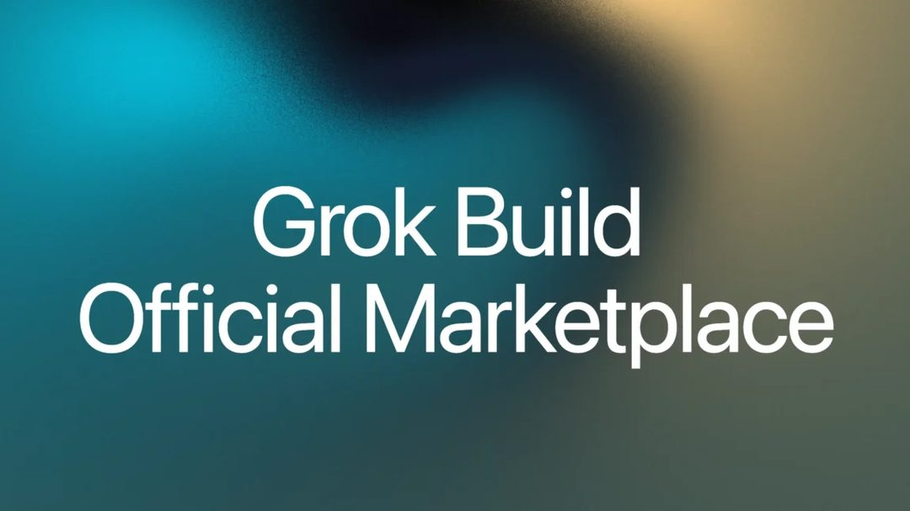

Anthropic 把 Claude 推进办公软件核心场景，能力包括自主参加会议、生成表格与演示文稿，直接对上微软 Office 的地盘。

值得注意的不是「能生成 PPT」——这件事一年前就有产品在做——而是「自主参加会议」。参会意味着实时音频接入、发言理解、行动项提取和后续跟进，这是一条比文本生成长得多的链路，也是办公套件真正的粘性所在。

为什么重要：Office 的护城河从来不是格式，而是协作惯性——文件在谁那里、权限在谁手里、同事用什么打开。Claude 如果停留在「帮你生成再导出」，它就是个插件；一旦它开始代表你出席、代表你写会议纪要，争夺的就是工作流的所有权。这条目前披露的细节有限，但方向已经很清楚。原文：[InfoQ](https://www.infoq.cn/article/1PdshF8SLevbGZbbZHoP)

### Grok Build 生成的应用大面积对外开放，3.5 万实例泄露机密

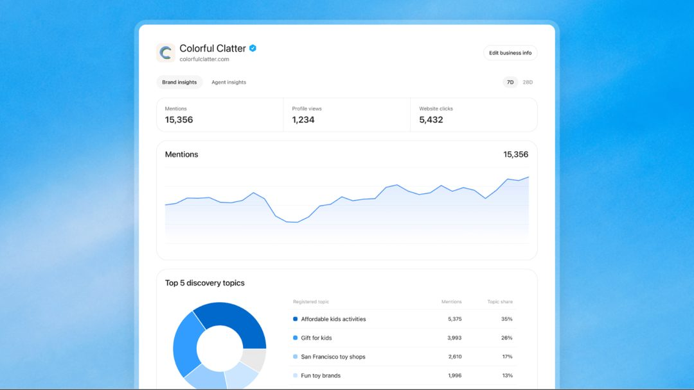

安全研究者发现约 3.5 万个由 Grok Build 编码 agent 生成的应用对外完全开放，泄露内容包括患者数据、明文密码，乃至 SpaceXSI 自家的销售管线。

问题不在模型的代码能力，而在默认配置。用自然语言生成一个能跑的应用，门槛已经很低；但把它放上公网、配好鉴权、隔离环境、管住密钥，这些事一步都不能省，而恰恰是这一步被跳过了。

为什么重要：这是 agentic 编码的第一个规模化事故样本，而且很可能不是最后一个。它把「让不会写代码的人上线应用」这件事的真正瓶颈暴露出来——不在生成，在运维与安全基线。随之而来的是一个采购问题：谁为 agent 生成的代码负责，写 prompt 的人、平台方，还是模型供应商？原文：[Ars Technica](https://arstechnica.com/security/2026/11/grok-build-coding-agent-leaks-oodles-of-confidential-info-some-belonging-to-spacexsi/)

### ChatGPT 上线商家主页，向搜索广告再走一步

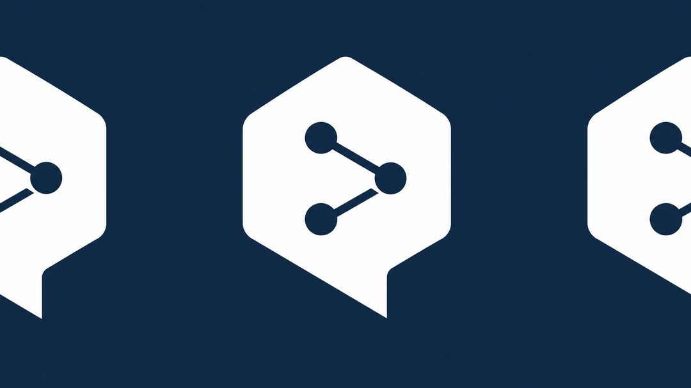

OpenAI 为商家推出新版档案页及相关功能，试图把 ChatGPT 从聊天工具变成消费者的发现入口，商业模式进一步向搜索广告靠拢。

商家主页是搜索广告体系里最基础也最容易被低估的一块：它不只是展示位，而是供给端的运营抓手。有了它，平台才能谈商家自助管理、评价体系、以及基于位置的推荐。

为什么重要：搜索广告的本质是意图变现，而 ChatGPT 手里握着最不加修饰的意图表达——用户是直接把需求说出来的，不是拆成三个关键词。但需求端强不等于生意成立，商家主页需要供给端一笔一笔地运营，这是谷歌用十几年建起来的东西。判断：这是入口之争的第二步，第一步抢的是用户时间，第二步抢的是商家预算，而第二步难得多。原文：[TechCrunch](https://techcrunch.com/2026/11/10/openai-rolls-out-new-business-profiles-making-chatgpt-just-a-little-bit-more-like-google/)

### DeepL 新语音模型：把语气和语速一起搬过去

DeepL 发布新语音模型，声称可把语调、语速与情绪迁移到目标语言，让实时同传不再丢掉语气。

语音翻译过去的取舍很明确：先保语义准确，副语言信息（音高、节奏、停顿、情绪）基本丢弃。但这部分信息在实际沟通里承担着信任判断的功能——同样一句「我理解你的顾虑」，语速快半拍就成了敷衍。

为什么重要：这看起来是体验优化，其实影响的是转化率。客服、跨国销售、远程医疗这些场景里，语气丢失直接换算成沟通失败率。DeepL 选择在语音上做差异化，也是在绕开文本翻译已被大模型商品化的正面战场。原文：[The Decoder](https://the-decoder.com/with-its-new-voice-model-deepl-voice-now-translates-intonation-and-speaking-speed-into-other-languages-as-well/)

### Databricks 让 AI 向 CEO 报坏消息

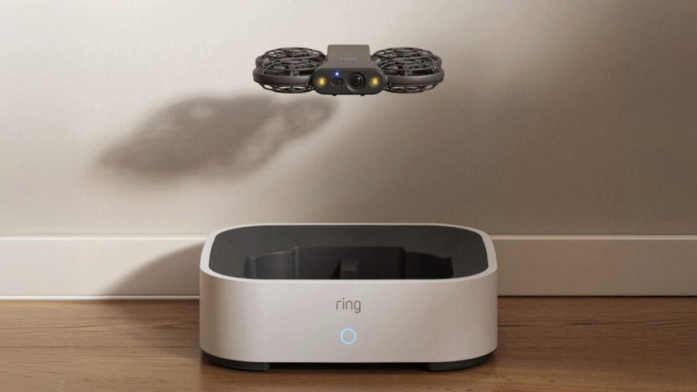

员工规模 1.2 万人的 Databricks 用升级版 Genie agent 汇总内部问题，让 CEO Ali Ghodsi 不必依赖下属主动上报就能知道哪里出了问题。

核心是绕开信息过滤。坏消息向上传递时会层层衰减，这是组织学的老问题，不是靠「鼓励坦诚」的文化口号能解决的。用一个 agent 从系统数据里直接汇总，等于在汇报链条之外开了一条旁路。

为什么重要：做法聪明，但会带来新的激励扭曲——如果 agent 会替你说，中层就更没有动机主动说，而 agent 只能看到被记录下来的部分，看不到那些从未进入系统的判断与顾虑。工具解决了可见性问题，不解决意愿问题。原文：[TechCrunch](https://techcrunch.com/2026/11/11/databricks-new-ai-agent-tells-ceo-ali-ghodsi-the-unvarnished-truth/)

### Ring 摄像头长脚：亚马逊发布 AI 安防无人机与机器人

亚马逊推出可移动的 Ring Robotics 设备与 AI 安防无人机，将于 2026 年底至 2027 年初陆续上市。

从固定摄像头到移动巡逻，功能上的变化是从「事后取证」转向「事中干预」——设备可以主动靠近异常、改变视角、覆盖固定机位看不到的死角。

为什么重要：这是硬件公司用 AI 重定义品类的典型样本，也是隐私争议的新起点。固定摄像头至少位置可预期，移动设备进入社区空间后，监管面对的是一套全新的问题：飞行器在谁家上空、拍到邻居算不算侵权、巡逻路线由谁决定。这类产品真正的上市阻力恐怕不在技术。原文：[Ars Technica](https://arstechnica.com/ai/2026/11/ring-cameras-go-mobile-as-amazon-debuts-ai-powered-security-drone-and-robot/)

### Cloudflare 推出 Web Search API，为 AI 应用提供实时检索

Cloudflare 发布面向 AI 应用的 Web Search API，开发者不必自建抓取与索引管线，即可为 agent 接入实时网络信息。

这条的分量在位置：Cloudflare 同时是 CDN、反爬虫方和现在的检索供给方。它既决定了哪些爬虫能进来，现在又要向 AI 应用卖检索结果，这个双重身份会让内容方的付费问题变得更尖锐——网站被索引、被抓取、被转卖，收益如何回到内容生产者手里，目前还没有答案。

为什么重要：RAG 里的那个「R」正在被外包，这降低了 agent 应用的启动成本，也意味着实时信息这条链路的议价权正在向少数基础设施方集中。原文：[InfoQ](https://www.infoq.cn/article/SgXuVvzbHr8lKrihTAZW)

### 结语

今天这八条里，AI 一边被放进越来越多「替你判断、替你出席、替你上线」的位置，一边用 3.5 万个对外开放的实例提醒我们：它还不配拥有默认权限。留给读者一个问题——你手上的 agent，权限是谁批的？

<h2 id="opinion" class="ai-section-divider">💭 行业观点</h2>

今天最值得看的不是某个新模型，而是纽约州 AI 安全法正式生效：主要开发商要注册、要披露安全实践、要上报重大事故，否则罚款。把它和 Helsing 的「每一步都有人署名」、英国监管对高校的最后通牒放在一起看，方向是一致的——治理的颗粒度正从「原则宣言」下降到「可追责的记录」。对从业者，合规开始变成产品设计的一部分；对投资人，这是评估 AI 公司风险敞口时绕不开的一栏。

### 纽约州 AI 安全法生效：注册、披露、报事故

纽约州开始执行全面 AI 安全法，要求 OpenAI、Anthropic 等主要开发商注册、披露安全实践，并在发生重大事故时上报，否则面临罚款。

关键点在于义务的类型：不是事前审批，而是登记、披露与事后上报。这三件事听起来温和，实际要求公司先具备几样东西——安全事件的内部定义与分级、可追溯的日志、以及对外通报的既定流程。过去这些多存在于自愿承诺和模型卡里，现在变成了行政记录。

为什么重要：一旦事故上报成为常态，披露内容就会成为监管、诉讼和竞争对手共同引用的材料。安全能力从「公关叙事」变成「档案能力」，会实质抬高进入门槛。

> 原文：[TechCrunch](https://techcrunch.com/2026/11/10/openai-anthropic-face-new-oversight-as-new-yorks-ai-safety-law-takes-effect/)

### Helsing 的 Clarity：每个目标都挂一个人的名字

欧洲防务公司 Helsing 推出 Clarity 系统，用于为武器系统准备打击目标。公司强调，每个决策环节都会记录具名的人类责任人。

这是对「human in the loop」这句话的一次具体化。惯例表述里，「有人在环内」往往是免责话术，没人说得清那个人做了什么。把责任落到具体姓名，等于把伦理争议转成工程与审计问题：日志要记什么、谁有权覆盖系统建议、事后如何复盘。

真正的问题没有被解决：人在环内是「按了按钮」，还是「真的做了判断」？署名机制能证明前者，未必能证明后者。但它至少让这个问题可以被追问。

> 原文：[The Decoder](https://the-decoder.com/helsing-built-an-ai-system-that-prepares-targets-for-weapons-systems-and-says-every-decision-will-carry-a-human-name/)

### 英国监管给高校下最后通牒：改考法，否则处罚

英国监管机构要求大学改用能抵御 AI 代写的考试形式，否则将面临处罚。

关键点是把压力从「学生是否用了 AI」转移到「评估方式是否可靠」。过去两年高校主要依赖检测工具和荣誉准则，效果一直存疑；监管把责任压回机构，某种意义上是对检测路线的否决。

为什么重要：改考法意味着重新设计课程、评分标准与认证流程，成本远高于采购一个检测器。对教育科技公司这是窗口期，对高校则是一次被迫的教学法升级——而这类升级通常比技术采购慢得多。

> 原文：[The Decoder](https://the-decoder.com/uk-regulator-threatens-universities-with-sanctions-unless-they-adopt-ai-proof-exam-formats/)

### 5 亿美元的 RL 环境：管制清单外的灰色地带

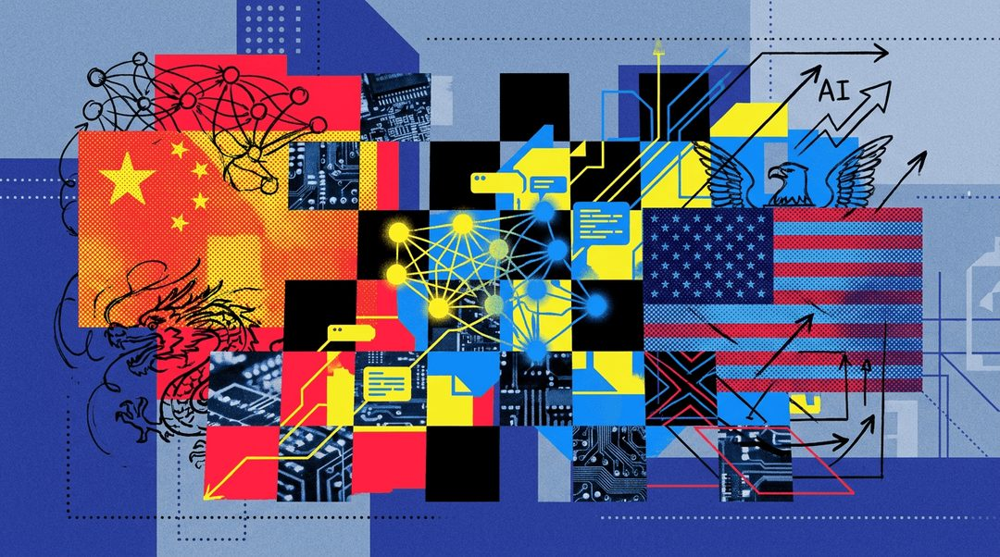

报道称，美国数据经纪商正向中国 AI 实验室出售价值约 5 亿美元的强化学习训练环境。

关键点在于交易标的的性质。RL 环境（可交互的任务与工具环境）既不是模型权重，也不是传统意义上的数据集，它落在现有训练数据出口管制的缝隙里。而环境的质量，很大程度上决定了 agentic 模型能练出什么能力。

为什么重要：如果管制目标是能力扩散，那么按「数据」定义对象会系统性漏掉环境、评测集和工具链。这类套利会一直存在，直到规则把整个训练栈纳入视野——而那时，界定「什么算出口」会变得更难，不是更容易。

> 原文：[The Decoder](https://the-decoder.com/us-data-brokers-are-selling-half-a-billion-dollars-in-rl-training-environments-to-chinese-ai-labs/)

### 13 岁女孩向 Gemini 倾诉，监控数周未预警

一名 13 岁女生通过学校的 Chromebook 使用 Gemini 筹划自杀，家长指控校方监控系统数周未触发警报，直到险些酿成悲剧。

冲突不在模型本身，而在部署配置：谁在看这些对话、看到什么程度、触发之后谁来响应。校园采购 AI 时，合同里最容易被忽略的正是事件响应条款——检测只是第一步，没有明确的升级路径和责任人，监控等于没装。

为什么重要：这类案例会推动学区把「安全运营」写进采购要求，而不只是问「有没有内容过滤」。对厂商来说，这是一块必须自己补上的交付能力。

> 原文：[WIRED](https://www.wired.com/story/teen-girl-asked-gemini-about-suicide-for-months-until-it-was-flagged/)

### 企业 AI 支出破纪录，增速降到 1.65%

10 月美国企业 AI 支出绝对值再创新高，但环比增速放缓至 1.65%，市场开始讨论 AI 资本开支见顶的可能。

关键点要分开看：绝对水平仍在上涨，边际增速在收窄。单月数据不足以证明拐点，但增速放缓通常先出现在试验性预算上，再传导到基础设施订单，这个顺序值得盯。

为什么重要：真正该看的不是这个百分比，而是推理侧收入能否跟上折旧节奏。如果企业支出从「试点」转向「续约」，增速会降、质量会升——那是健康的放缓；如果续约率同时走弱，才是另一种故事。

> 原文：[The Decoder](https://the-decoder.com/us-corporate-ai-spending-hits-a-new-high-in-october-but-growth-slows-to-1-65-percent/)

### 《Big Walk》修了个 bug，评委退场

独立游戏《Big Walk》承认用 AI 修复了一个 bug，随即遭到独立游戏节（IGF）多位评委抵制。

争议点不在生成内容的质量，而在行业对「任何程度 AI 参与」的容忍度。这是过程伦理而非结果伦理：作品没变，评价变了。

为什么重要：对工具厂商，这意味着 AI 进入创作流程时，最大阻力可能来自署名与荣誉体系，而不是能力。透明披露未必换来接受——IGF 的反应说明，社区要的不是「说清楚」，而是「别用」。这条线目前还没谈拢，独立开发者会被夹在中间。

> 原文：[Ars Technica](https://arstechnica.com/gaming/2026/11/big-walk-used-ai-to-fix-a-bug-now-the-indie-gaming-world-is-having-a-reckoning/)

### 当 AI 成为数学的「神谕」，数学家怎么办

数学家 Steven Strogatz 在新书《Big Math》访谈中讨论：当 AI 能直接给出正确结论，数学研究的方式与意义将如何被改写。

关键点在于被省略的东西——证明过程。数学共同体的工作方式、训练机制和声誉分配，都建立在「证明可被同行检验」之上；只给结论，等于抽掉了这套基础设施。

为什么重要：这是所有知识型行业的预演。当答案变便宜，稀缺的变成两件事：判断哪个答案值得要，以及能否解释它。数学家可能要更早面对这个问题，但不会是唯一面对的群体。

> 原文：[Ars Technica](https://arstechnica.com/science/2026/11/what-happens-to-mathematics-when-ai-becames-an-oracle/)

今天这八条指向同一件事：模型越强，社会越倾向于用记录、署名和责任链来给它定价。留一个问题——如果你的产品明天要为每一次输出标一个责任人，你的系统现在查得出是谁吗？

<h2 id="opensource" class="ai-section-divider">⚙️ 开源工具</h2>

英伟达把 OpenShell 捐给了开源社区。它捐出的资产是管理大规模 AI 工厂的 Kubernetes 生态，既不是芯片，也不是模型。这一动作的意义在于，AI 基础设施的默认形态正被固定到 K8s 上，而标准一旦形成，比硬件更难受替换。今天同一板块里，Anthropic 开源 Agent Skills 仓库、两个开源 TTS 项目进入同一赛道，本质上都是同一个动作在不同层面的表现：把能力封装成别人可以直接复用的单元。

### 英伟达开源 OpenShell，瞄准 AI 工厂的 K8s 层

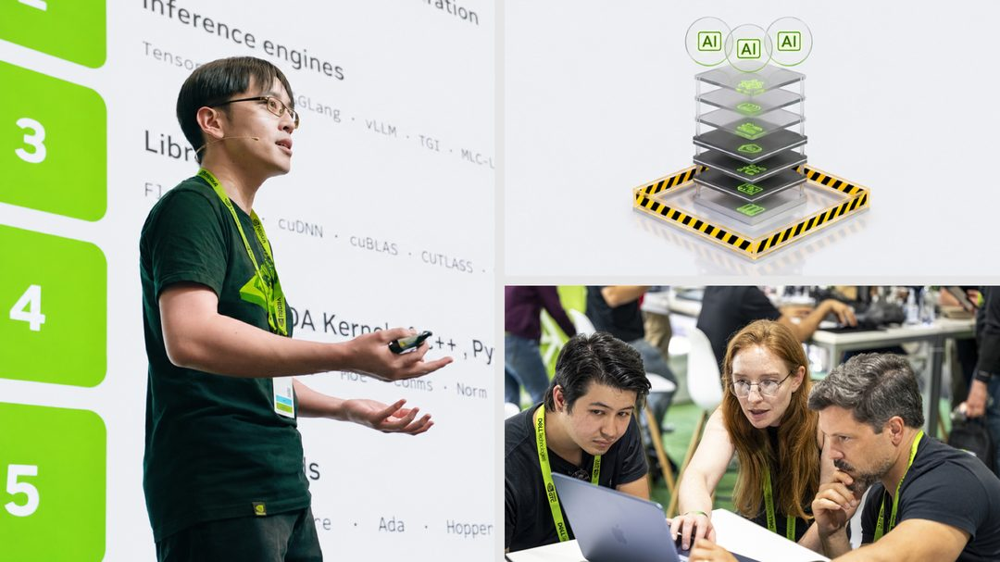

英伟达宣布将 OpenShell 捐赠给开源社区，同时公布新的 AI 基础设施项目，方向指向管理大规模 AI 工厂的 Kubernetes 生态。

关键点在“捐什么”。交出去的是集群管理与编排这一层，而不是硬件或模型权重；并且它明确依附在 Kubernetes 生态上，意图是接入既有的运维体系，而不是另起一套新标准。

为什么重要：英伟达的软件栈长期是硬件销售的护城河，把编排层开源，短期看是放弃控制权，长期看是把“AI 工厂”的默认部署形态固定在 K8s 上。生态标准带来的收益，比任何单点工具都更持久。对正在做算力调度、集群运维的团队来说，这是一个需要重新评估“自研还是跟随”的信号。

> 原文：[NVIDIA Blog](https://blogs.nvidia.com/blog/open-source-openshell-infrastructure/)

### Anthropic 开源 Agent Skills 仓库，冲上热榜

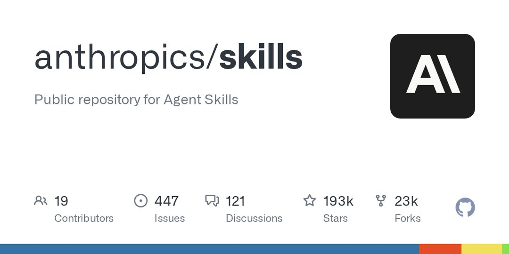

Anthropic 公开了 Claude 的 Agent Skills 实现仓库，配套的社区技能库与快速上手项目同步走红，在 GitHub 热榜上占据位置。

关键点在“开源的是什么”。这次开源的是技能的封装方式：把 agent 的一项能力做成可复用、可组合的单元，而不只是放出示例提示词。配套社区库的存在说明它已经超出官方 demo 的范围，开始有人往里填内容。

为什么重要：agent 落地最贵的成本在把业务动作拆成模型能稳定执行的步骤，不在模型本身。谁定义了这层封装格式，谁就定义了迁移成本。它目前只是“事实标准候选”，但生态一旦成形，后来者要兼容的代价会很高。这也是为什么这条比多数模型发布更值得跟踪。

> 原文：[GitHub - anthropics/skills](https://github.com/anthropics/skills)

### MBZUAI 开源 PAN 2：290 亿参数的世界模型

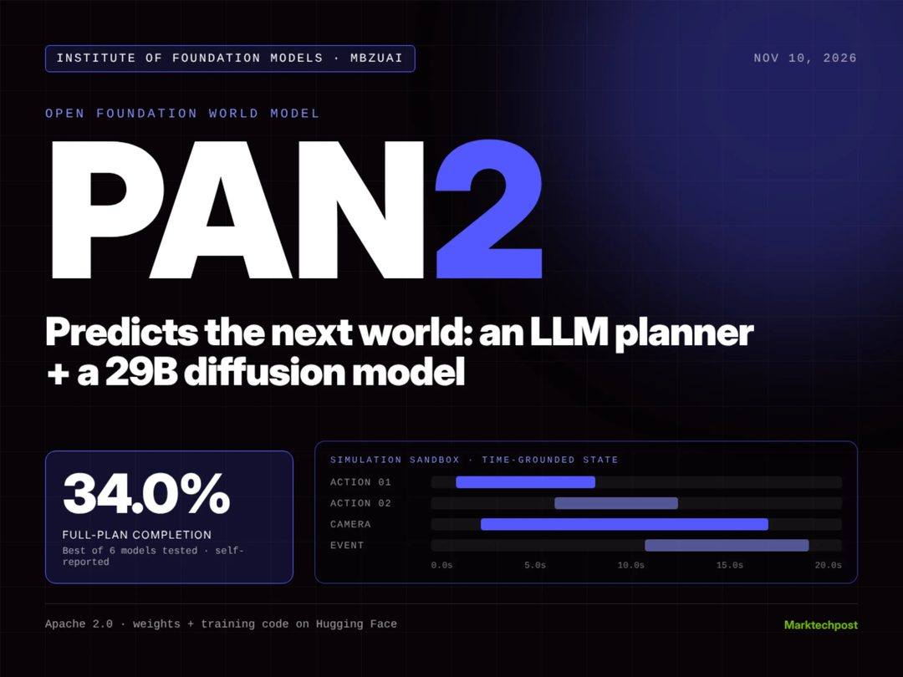

MBZUAI 基础模型研究院以 Apache 2.0 协议发布 PAN 2，用 LLM 规划器搭配 290 亿参数的扩散 Transformer，把动作后果模拟成最长 20 秒的视频。

关键点在架构组合：LLM 负责规划，扩散模型负责推演，输出的是视频而不是状态向量。它试图在像素层面回答“如果我这么做，接下来会发生什么”。

为什么重要：机器人和自动驾驶这类场景，最缺的是低成本的试错环境。用视频预测后果，比真机试错便宜，也是区别于传统物理仿真的另一条路径。20 秒的上限说明它还停留在短程预测，但 Apache 2.0 让这条路线第一次可以被广泛复现和验证。

> 原文：[MarkTechPost](https://www.marktechpost.com/2026/11/10/ifm-pan-2-open-world-model/)

### Zyphra 开源 ZONOS3-Mini：浏览器里跑实时 TTS

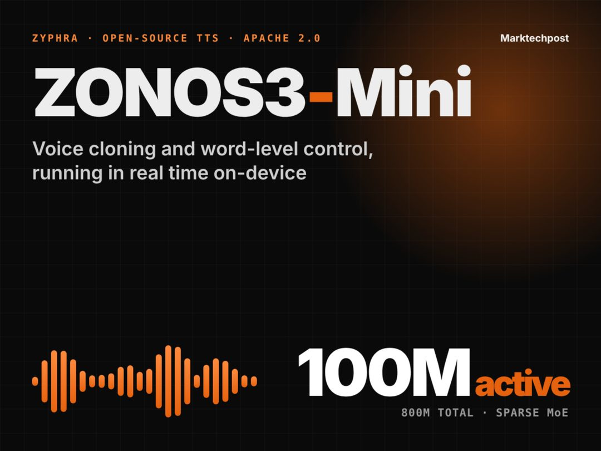

Zyphra 以 Apache 2.0 协议开源 ZONOS3-Mini，总参数 8 亿、激活 1 亿，支持声音克隆与逐词语气控制，可在浏览器内实时合成。

关键点在参数结构：8 亿总参数只激活 1 亿，推理成本因此被压到能进浏览器；而逐词语气控制给 TTS 增加了“表演”这个维度，不再只是把字读对。

为什么重要：当实时、本地、可克隆的 TTS 便宜到前端就能跑，语音交互的门槛就从“调 API”变成“前端工程”。对做硬件、车载、客服类产品的团队来说，延迟和成本的约束条件已经变了；过去必须上云的能力，现在可以放进端侧。

> 原文：[MarkTechPost](https://www.marktechpost.com/2026/11/10/zyphra-zonos3-mini-open-source-tts/)

### OpenBMB 开源 VoxCPM2：去掉分词器的 TTS

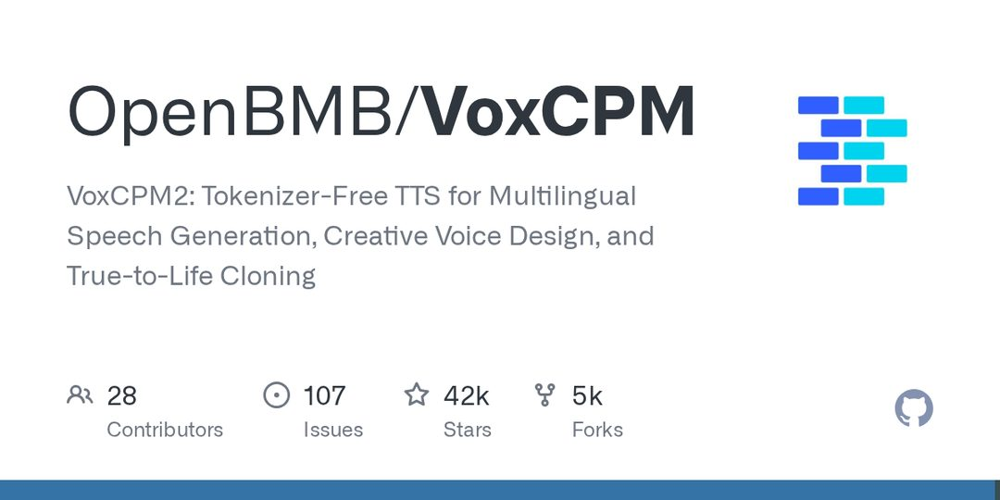

OpenBMB 开源 VoxCPM2，去掉分词器环节，主打多语种语音生成、创意音色设计与高保真声音克隆，登上 GitHub Python 趋势榜。

关键点在“无分词器”（tokenizer-free）。不再依赖离散化的语音 token，理论上能保留更多韵律与细节；多语种加音色设计指向的是可控生成，而不只是复刻某个人的声音。

为什么重要：分词器长期是 TTS 的信息损失来源，也是多语种混合时的麻烦制造者。VoxCPM2 与今天同批的 ZONOS3-Mini 进入同一赛道，说明开源 TTS 的竞争点已经从“像不像人”转向两件事：能不能被精细控制，能不能跑在本地。

> 原文：[GitHub - OpenBMB/VoxCPM](https://github.com/OpenBMB/VoxCPM)

### OpenSandbox：给 agent 一个能跑代码的沙箱

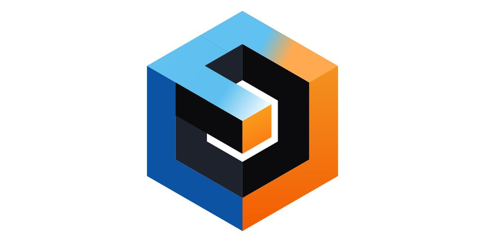

OpenSandbox 是一个开源沙箱运行时，为 AI agent 提供安全、快速、可扩展的执行环境，用于隔离 agent 产生的代码与工具调用。

关键点在隔离层次。它要解决的是 agent 从“说”到“做”之后新增的攻击面——模型生成的代码不能直接跑在生产机上，这层边界放在运行时，而不在模型侧。

为什么重要：agent 要真正接管工作流，必须先有一个默认安全的执行边界，否则每一次工具调用都是风险敞口。这类项目单独看价值有限，但它是 agent 从 demo 走向生产绕不开的一块。接下来值得观察的是它能否与主流 agent 框架形成事实上的集成。

> 原文：[GitHub - opensandbox-group/OpenSandbox](https://github.com/opensandbox-group/OpenSandbox)

### AWS 发布本地模拟器 aws-emulator

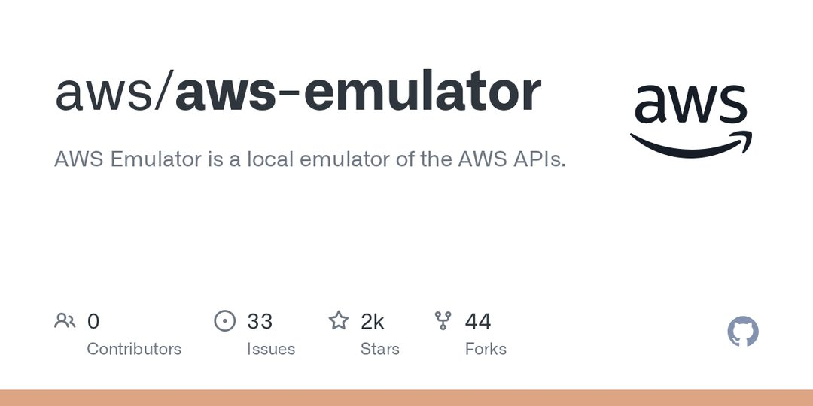

AWS 官方推出模拟器 aws-emulator，可在本地复刻其多项云服务用于测试，无需申请付费 API Key 即可跑通集成流程。

关键点在“官方出品”。本地模拟云服务此前主要靠第三方方案维持，官方下场意味着这套能力会被纳入 AWS 自己的开发体验与文档体系。

为什么重要：本地模拟直接降低的是集成测试的金钱与时间成本，也顺手解决了“CI 里怎么跑云服务”这个老问题。对 AWS 而言，这是让开发者更早把流程绑在自己 API 上的方式：先在本地跑通，再自然地上了云。

> 原文：[GitHub - aws/aws-emulator](https://github.com/aws/aws-emulator)

### llm 0.37.2 修复一处安全问题

Simon Willison 的 llm 命令行工具发布 0.37.2，修复了由研究者 Daniel de Araujo 报告的一处安全问题。

关键点在版本号：补丁级更新，说明影响范围有限，官方也未做大范围披露。但 llm 这类工具常被脚本和自动化流程调用，一旦被利用，影响会沿着调用链向下扩散。

为什么重要：这条单看很小，却是今天这轮更新的注脚——你装的开源工具本身就是供应链的一部分。对于高频出现在个人脚本和 CI 里的工具，安全响应速度比新功能更值得纳入选型标准。

> 原文：[Simon Willison](https://simonwillison.net/2026/Nov/11/llm/)

今天这 8 条里真正稀缺的是把能力封装成可复用单元的那层约定，模型本身并不稀缺。谁写下这层约定，谁就顺手写下了别人的迁移成本。你们团队现在有没有人在负责这层约定？
