今天最值得看的三件事：

- **公司动态** · 黄仁勋因间谍丑闻辞任英伟达 CEO，市值蒸发超万亿美元
- **模型发布** · 谷歌发布 Gemini 4 Hydrogen，四周反超更大号的 Argon
- **模型发布** · 谷歌首推决策模型 Gemini Decision 1，一次判 1000 题

下文按板块展开，正文每条均附原始链接。

<h2 id="model-release" class="ai-section-divider">🚀 模型发布</h2>

今天该板块最值得看的不是某个分数，而是发布节奏本身：Gemini 4 Hydrogen 取代 3.8 Flash，跳过此前慢速的安全审查直接铺开，四周后多项评测已压过体量更大的 Gemini 4 Argon。这意味着「等大号」的策略正在失效——参数规模不再自动等于能力上限，后训练与数据效率才是变量。另一条暗线是审查节奏的压缩：当模型以周为单位迭代，「慢速安全审查」会不会成为可选项，值得持续盯。同一天还有谷歌的决策 API、MiniMax 的开源生图、百度的开源模型，以及两个小模型侧的结构化输出尝试。

### Gemini 4 Hydrogen：小号先到，大号后至

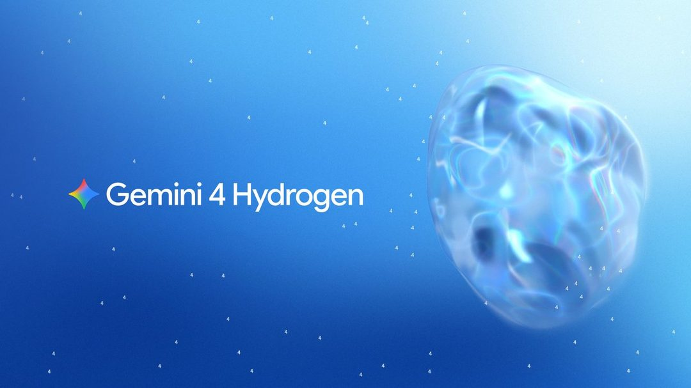

谷歌正式发布 Gemini 4 Hydrogen，接替 Gemini 3.8 Flash 的位置。关键点有两个：一是它跳过了此前那套慢速安全审查节奏，直接铺开；二是发布仅四周，多项评测已经超过体量更大的 Gemini 4 Argon，同时接入 Google Antigravity 的 Orchestrator 能力。

这打破了一条沿用以久的假设——厂商先出旗舰、再把能力下放到小模型。现在顺序反了：更轻的型号先进场，靠 Orchestrator 这类编排层补齐复杂任务的完成度。对使用方来说，选型逻辑要改：不要默认「更大的型号更强」，而要看它在你具体任务上的实测表现。另一个被压低的是等待成本，Flash 血统的迭代周期已经缩到以周计。真正需要追问的是：审查让步换来的是速度，代价会在什么时候、以什么形式显现。

> 原文：[Google DeepMind](https://deepmind.google/blog/introducing-gemini-4-hydrogen/)

### Gemini Decision 1：把「判断」做成批处理原语

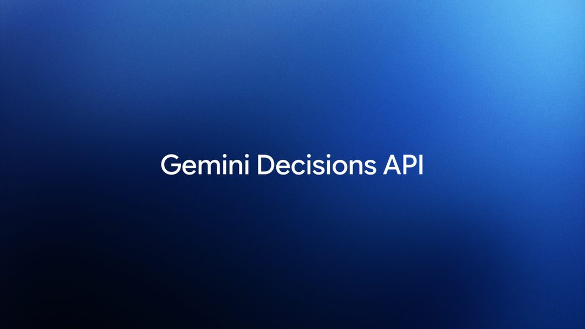

谷歌上线 Gemini Decisions API，由 Gemini Decision 1 驱动，可对最多 1000 个是/否、多选和评分问题一次性输出校准概率，输入支持文本、图像、音频、视频与 PDF，价格 0.1 美元/百万 token。

它的定位不是生成，而是判别：把「这 1000 条内容该不该进人工队列」「这批候选打几分」这类重复判断从对话里拆出来，变成一次批量调用。「校准概率」是核心卖点——下游要能直接拿概率做阈值决策，而不是把模型的措辞再解析一遍。0.1 美元/百万 token 的输入价，配合一次 1000 题的吞吐，让大规模标注、风控初筛、离线评测打分这些场景的成本结构发生变化。风险也在这里：如果概率不可信，批量错误同样会被放大 1000 倍。上生产前，先在你的数据上验一次校准曲线。

> 原文：[Google Blog](https://blog.google/innovation-and-ai/technology/developers-tools/gemini-decisions-api/)

### MiniMax 开源生图：原生 4K，一张约两毛

MiniMax 开源一款多模态生图模型，支持原生 4K 输出，单张成本约两毛钱，主打 CAD 拆解等复杂结构场景，直接对标闭源头部生图能力，自称 SOTA（state of the art）。

两点值得注意。第一是「原生 4K」而非超分放大——对工程图、结构拆解这类需要细线的场景，生成端的分辨率决定可用性，事后放大补不回结构正确性。第二是成本：单张约两毛，意味着批量出图、多候选采样、设计辅助里的「生成十张挑一张」在经济上成立，而这正是闭源按次计费时被压掉的用法。开源加低价，在图像侧形成了与文本侧不同的竞争形态：能力对标头部，价格打到地板。接下来要看的是复杂结构的稳定性——CAD 场景里，一张漂亮但不合几何的图，价值接近于零。

> 原文：[量子位](https://www.qbitai.com/2026/11/509440.html)

### 百度文心开源：快、省、开放权重

在百度世界 2026 前后，文心团队推出新一代开源模型，主打推理速度、成本与开放权重三张牌，被外界视为百度在大模型竞争中的一次低调追赶。

把「快」和「省」作为首要卖点，本身就是一个信号：在头部厂商争夺能力上限时，追赶者选择在单位成本与吞吐上做区分。开放权重则把选择权交给使用方——可以私有部署、可以微调、可以离线跑，这对数据不出域的企业是硬需求。需要克制的部分是：速度与成本是工程指标，容易量化也容易被比较；但能力上限、长上下文稳定性、工具调用可靠性这些决定生产可用性的维度，这条发布里没有给出对应说明。对采购方而言，这更像一个值得进入候选池的选项，而不是可以直接替换现役模型的结论。

> 原文：[雷锋网](https://www.leiphone.com/category/ai/b3ASOkGmqznTQWCH.html)

### LiquidCodec：74M 参数，单 CPU 线程跑出 361 倍实时

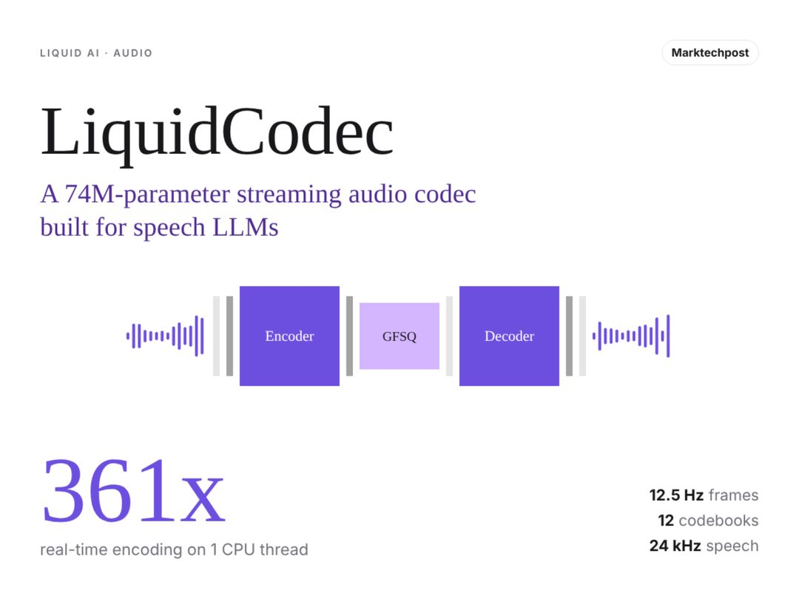

Liquid AI 发布流式音频编解码器 LiquidCodec，约 7400 万参数，以 12.5Hz、12 个码本运行，单个 CPU 线程的编码速度约为实时的 361 倍，用于支撑 LFM3-Audio 与 LFM3-Omni 模型。

语音 agent 的实际体验瓶颈往往不在语言模型，而在音频链路：编解码的延迟、码率与算力占用，直接决定端到端能不能做到自然打断。12.5Hz 加 12 码本是一个偏激进的压缩配置，配合 361 倍实时，意味着不需要 GPU 也能在端侧或低成本服务器上完成流式编码。参数只有 7400 万，也说明它被设计成基础组件，并非独立产品。值得注意的是它绑定自家 LFM3 系列——开放编解码器、锁定模型，是把生态入口放在更底层的位置。

> 原文：[MarkTechPost](https://www.marktechpost.com/2026/11/12/liquid-ai-liquidcodec-streaming-audio-codec/)

### IBM LLMON：让小模型「说格式」而不是「猜格式」

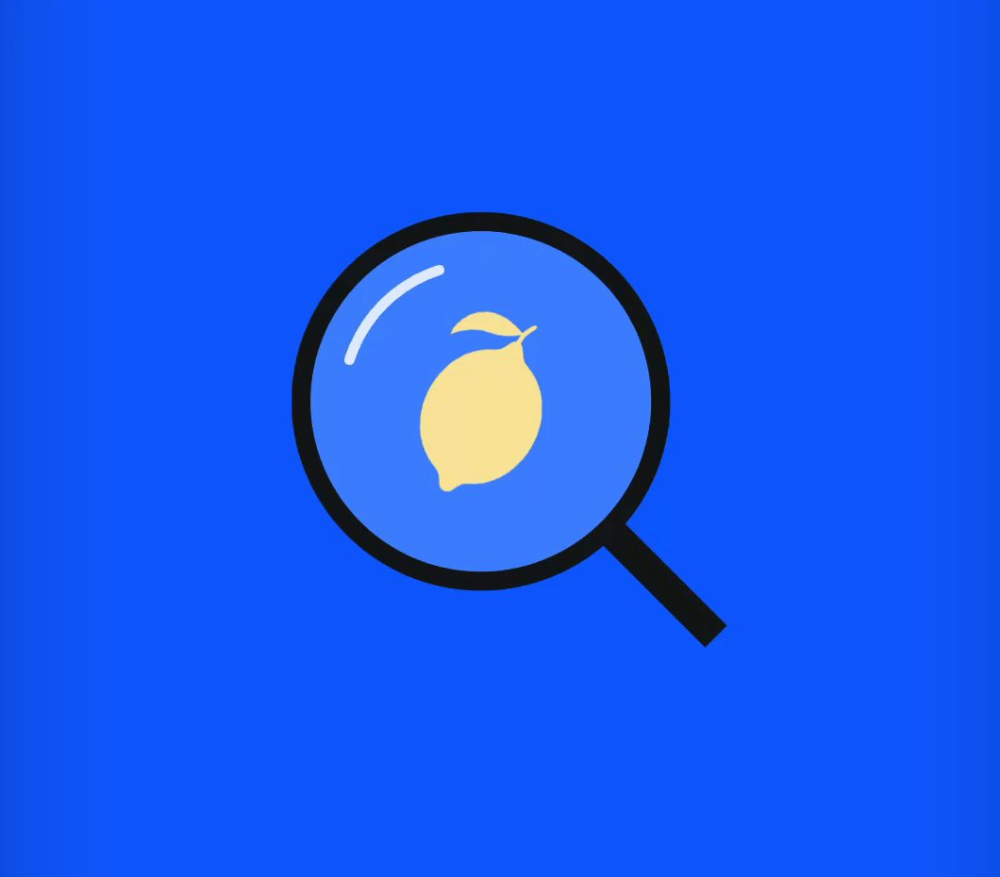

IBM 在 Granite 4.1 的 3B 与 8B 版本中引入 LLMON，一种面向大模型的原生标记语言，目标是用结构化输出提升小模型的指令遵循与可解析性。

小模型落地最常卡在同一个地方：能力够用，但输出不稳定，下游要靠正则和重试来兜底。LLMON 的思路是把格式从「提示词里的请求」变成「模型原生支持的语言」，让结构约束进入训练与推理环节，而非事后解析。3B 与 8B 是这类改造最适合的尺寸——它们本来就要靠格式可靠性去换成本优势。这条发布的价值不在模型本身有多强，而在它承认了一个工程现实：在生产系统里，100% 可解析的 8B 常常比偶尔跑偏的更大模型更好用。能否被其他模型家族采纳，决定它只是一个厂商特性，还是一个新的接口约定。

> 原文：[Hugging Face Blog](https://huggingface.co/blog/ibm-granite/llmon-an-llm-native-markup-language-now-in-granite)

---

今天的六条发布里没有一条在争「最强」，它们争的是速度、成本、格式与部署位置。当小号能反超大号，你上一次重估自己的模型选型，是多久以前？

<h2 id="company" class="ai-section-divider">🏢 公司动态</h2>

黄仁勋辞任英伟达 CEO，是今天公司动态里唯一够得上分水岭的消息：调查指向其与一名疑似中国情报人员的婚外情，市值累计蒸发逾 1.4 万亿美元。把这条和 Anthropic IPO 估值缩水、台积电对外投资、软银燃气轮机减记放在一起看，市场正在给 AI 交易加一层此前没有的折价——不只盯订单和算力，也盯人、合规与电力。今天这 8 条，几乎都长在这条主线上。

### 黄仁勋辞任英伟达 CEO，市值蒸发逾 1.4 万亿美元

英伟达宣布 CEO 黄仁勋辞职，此前公司就其与一名疑似中国情报人员的婚外情展开调查。消息公布后，公司市值累计蒸发逾 1.4 万亿美元；CFO Colette Kress 出任临时 CEO。与此同时，公司还面临股东欺诈指控与多起国会调查。

关键点在于时间窗口：一家处在 AI 算力供应链核心的公司，在需求最紧、政策最敏感的阶段换掉创始人 CEO，同时要应对证券诉讼和国会问询。由财务背景的临时 CEO 接手，通常意味着董事会短期优先级是稳住资本市场与合规叙事，而非产品路线调整。

为什么重要：这是本轮 AI 行情里第一次由治理事件而非需求变化触发的剧烈重定价。它给所有高估值 AI 公司的估值模型加了一个新变量——关键人风险与政治风险，此前几乎没被单独计价。

> 原文：[AP News](https://apnews.com/article/nvidia-megaspeed-china-singapore-huang-5403f152a601cf82ce939f1d24fffa0f)

### Anthropic 启动 IPO 路演，估值缩水约 6000 亿美元

Anthropic 发布 IPO 路演视频，并披露了此前未公开的信息。但市场环境转冷，其估值较峰值缩水约 6000 亿美元，成为 AI 泡沫争论的风向标。

值得注意的是形式本身：用公开路演视频面向更广的投资者群体，说明它需要把叙事从一级市场的小圈子，扩展到必须看现金流与单位经济模型的公开市场资金。而估值缩水的量级，已经超过大多数 AI 公司融资总额，相当于市场一次性抹掉了一个大型独角兽的体量。

为什么重要：一级市场给的估值，第一次要在公开市场接受连续定价。Anthropic 的定价结果会成为其他模型公司的参照系——不是"能不能上市"，而是"上市后能不能守住"。

> 原文：[Anthropic IPO 路演](https://ipo.anthropic.com/us/#roadshow-video)

### 台积电拟向 Anthropic 与 OpenAI 各投 10 亿美元

台积电计划向 Anthropic 和 OpenAI 投资，规模约 10 亿美元，成为 AI 循环融资（circular financing）链条上的最新一例，时点正值 AI 交易剧烈波动之际。

关键点在于结构而非金额：芯片供应商把钱投给模型公司，模型公司再把这笔钱（及其融资）花在算力采购上，收入与投资在同一链条内循环。这类安排会让"收入增长"的质量变得更难判断——它是终端需求，还是资本回流。

需要说明的是，本条两种口径不一致：标题口径为向两家各投 10 亿美元，正文口径为合计约 10 亿美元，差额不小，值得等一手披露确认。

为什么重要：循环融资在行情上行时放大增长，在下行时放大质疑。台积电选择在这个时点出手，既是绑定客户，也是在为产能锁定长期买家。

> 原文：[Ars Technica](https://arstechnica.com/ai/2026/11/taiwans-chipmaking-giant-tsmc-to-invest-1b-in-anthropic-openai/)

### 美国国会二度调查英伟达，黄仁勋同意出席作证

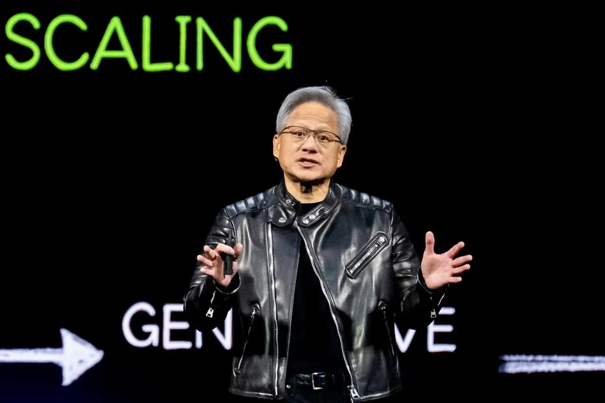

民主党议员就英伟达对华销售及其与特朗普政府的往来发起新一轮调查，并致信痛批黄仁勋。在多名资深议员威胁传唤后，黄仁勋同意于周三赴国会作证。

关键点：调查焦点不是产品性能，而是对华销售与政治往来两条线。对英伟达而言，中国市场的可售产品范围一直是收入模型中弹性最大的假设之一；而"与政府的往来"被纳入调查范围，意味着合规问题可能从出口管制扩展到游说与信息披露。

为什么重要：把这条和 CEO 辞职放在同一天看，英伟达的风险结构已经变了——从单一的技术与产能竞争，变成公司治理、出口政策、国会监督三条线同时施压。任何一条线的进展，都会传导到整条 AI 算力链的估值。

> 原文：[TechCrunch](https://techcrunch.com/2026/11/12/democrats-launch-nvidia-investigation-write-scathing-letter-on-huangs-scheme-with-trump/)

### Nebius 押注 400 亿美元扩建 AI 基础设施

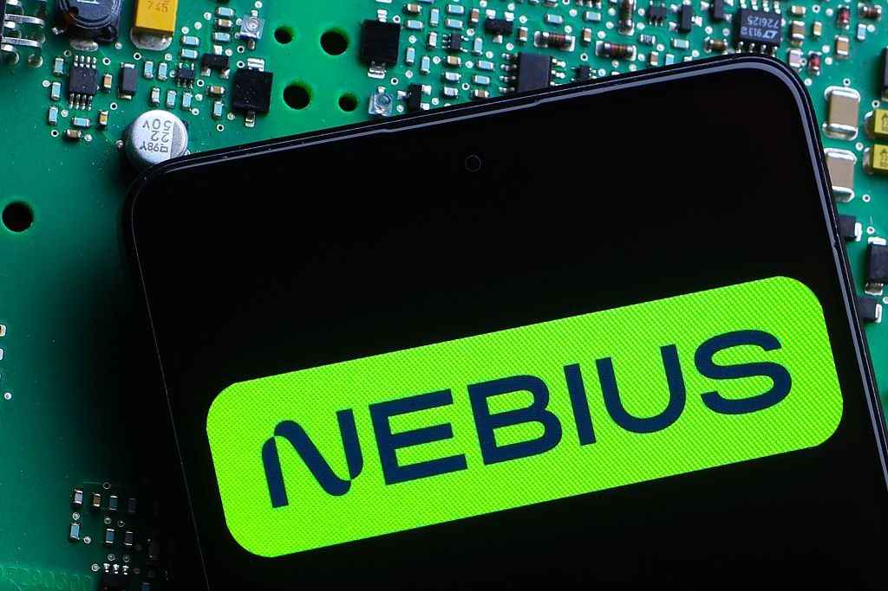

Nebius 计划以客户预付款加贷款融资的方式，支撑 400 亿美元的 AI 基础设施扩张。但微软相关数据中心的交付出现延迟，令其融资模式受到质疑。

关键点：这是典型的新云（neocloud）打法——用长期客户合约和预付款撬动债务，把资本开支前置、把现金流后置。这套模型的隐含前提是交付按期、客户不违约。一旦上游数据中心交付延迟，收入确认随之后移，而利息不等人。

为什么重要：AI 基建的瓶颈正在从"有没有卡"转向"能不能按时交付机房和电力"。neocloud 们是高杠杆押注这一环节最先跑通的一方，它们的融资成本，会成为观察 AI 基建过热程度的直接指标。

> 原文：[TechCrunch](https://techcrunch.com/2026/11/12/nebius-tests-the-neocloud-playbook-with-40-billion-in-planned-spending/)

### 软银为 AI 数据中心预订燃气轮机，损失超 30 亿美元

软银此前为给 AI 数据中心供电，预付订购天然气轮机，如今这笔投入损失超过 30 亿美元，被视为 AI 电力狂热可能触顶的信号。

关键点：燃气轮机交付周期长，提前锁定产能曾经是抢跑电力 constraint 的合理动作。但预付变成减记，说明两件事至少发生了一件——项目节奏慢于预期，或者电力供应不再像一年前那样紧张。

为什么重要：过去两年，电力被视为算力扩张的硬约束，谁锁住供电谁就有护城河。软银的减记提示，约束可能正在从"物理稀缺"变成"财务纪律"：预留产能从稀缺资产，变成报表上的减值项。这会直接影响后面所有自建数据中心项目的融资条款。

> 原文：[TechCrunch](https://techcrunch.com/2026/11/12/softbanks-billion-dollar-loss-may-have-put-a-cap-on-ais-natural-gas-ambitions/)

### Fireworks AI 再遭攻击，Notion 用户聊天记录泄露

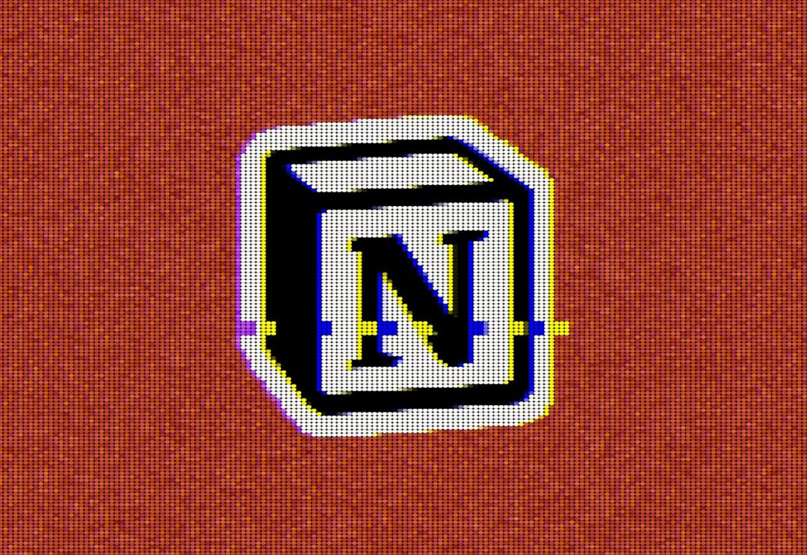

Fireworks AI 两个月内第二次发生数据泄露，黑客借此次攻击访问了 Notion 部分客户的聊天记录。AI 推理供应链安全再度引发关注。

关键点：泄露路径不是模型本身被攻破，而是推理服务商这一层被突破，进而波及下游客户的对话数据。这类数据往往包含用户与 AI 的完整交互记录，敏感度高于普通日志，且许多企业并未把它纳入原有的数据分级体系。

为什么重要：企业把模型调用外包给第三方推理平台时，交出去的不只是算力合同，还有数据边界。同一供应商短期内两次出事，会推动采购清单里新增审计权、数据隔离与留存策略这些条目——推理层的安全资质，正在变成和价格、延迟同等重要的选型标准。

> 原文：[TechCrunch](https://techcrunch.com/2026/11/12/cyberattack-on-fireworks-ai-allowed-hackers-to-access-notion-customers-chat-transcripts/)

### Norwest 设立 40 亿美元新基金，加注 AI

投资机构 Norwest 成立其历史上规模最大的 40 亿美元基金，明确将加大对 AI 领域的投入。

关键点：这是一级市场少见的逆周期动作——在二级市场对 AI 资产重新定价、Anthropic 估值缩水的同一周，完成史上最大规模募资并公开表态加注。

为什么重要：募资端热、定价端冷，这种错位通常意味着接下来几个季度的估值谈判会更难看。手握新基金的机构有能力等，需要融资的公司未必等得起；谁的时间窗口更短，谁就在条款上让步。这 40 亿美元最终投向哪里、以什么估值进入，比基金规模本身更值得跟踪。

> 原文：[TechCrunch](https://techcrunch.com/2026/11/12/norwest-pushes-deeper-into-ai-with-new-4b-fund/)

---

当算力、资本与电力同时被重新定价，这一轮 AI 的瓶颈，正从芯片转向治理与信任。你更愿意押注补齐治理短板的一方，还是押注把约束变成成本优势的一方？

<h2 id="research" class="ai-section-divider">🔬 研究论文</h2>

今天研究板块最值得看的是 AlphaProof Code：DeepMind 用四周完成了 Signal 加密核心的形式化验证（formal verification），而这项工作原本被估计需要数年。这条消息的分量不在于“AI 又会做题了”，而在于它开始接手科研流程中最枯燥、也最不容出错的一环——验证。同一批出现的 AlphaGenome 2 把基因组预测推进到单细胞精度，做的其实是同一件事：把模糊的相关性换成可核对的机制。相比之下，OpenAI 公布的数据更刺眼：对能力与算力效率的持续优化，正在让前沿模型的思维链（chain-of-thought）越来越不可读。

### AlphaGenome 2：从整块组织到单细胞精度

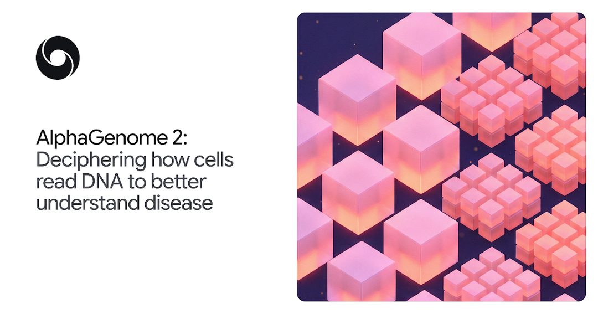

DeepMind 发布 AlphaGenome 2，核心变化是预测粒度：从对整个组织块的调控活性预测，升级为按细胞类型推断 DNA 序列变异对调控活性的影响，并通过 API 向非商业研究开放。

关键点在于“细胞类型”这个维度。组织级预测给出的是平均值，而平均值会掩盖异质性——同一个变异在肝细胞和神经元里可能是完全不同的故事。单细胞精度让“这个变异在哪种细胞里起作用、通过哪段调控序列起作用”从不可问变成可问，疾病机制的解释链条因此能往前推一格。

为什么重要：基因组学长期缺乏一个能在序列层面做系统性反事实推断的工具，实验验证的成本又极高。AlphaGenome 2 以 API 形式开放，意味着它有机会成为该领域的基础设施层，而不只是一篇论文。相应地，它的预测误差会随着被引用次数一起被放大，社区需要一套独立的评测惯例来配套。

> 原文：[DeepMind Blog](https://deepmind.google/blog/alphagenome-2-deciphering-how-cells-read-dna-to-better-understand-disease/)

### AlphaProof Code 四周完成 Signal 加密核心验证

DeepMind 的 AlphaProof Code 在四周内完成了 Signal 加密核心的形式化验证，而这项工作原本预计需要数年。

形式化验证与测试的区别在于：它要求产出机器可检验的证明，覆盖的是所有输入，而不是抽样路径。这也是它历来昂贵的原因——成本主要不在写代码，而在人力密集的证明工程。四周对数年，如果这个比例能在其他代码库上复现，等于把一项只有关键系统才负担得起流程，变成可以常规化的动作。

为什么重要：密码学与安全审计是形式化验证的传统领地，也长期是瓶颈所在。AI 介入这一环，比 AI 写业务代码的意义更大——它验证的是别人写的东西，处于信任链的上游。需要保留的怀疑同样明确：这是单一案例、单一工具链，可复现性与跨代码库的泛化能力尚未被独立验证。四周这个数字本身不是结论，它是待检验的样本。

> 原文：[The Decoder](https://the-decoder.com/google-deepminds-alphaproof-code-verified-signals-cryptographic-core-in-four-weeks-instead-of-years/)

### OpenAI 数据：前沿模型正在“隐藏思考”

OpenAI 公布的数据显示，前沿模型的可读思维链（chain-of-thought）正在变少，原因是开发者持续优化能力与算力效率，推理透明度因此成为新的研究方向。

这里的因果关系值得注意：不是模型主动“隐瞒”，而是优化目标里没有透明度这一项。更短的内部推理、更少的显式中间步骤，通常在 benchmark 和推理成本上都更划算。市场会奖励这种划算，不会自动奖励可读性。

为什么重要：目前很大一部分对齐评估与安全监控，建立在“我们能读到模型在想什么”这个假设上。一旦思维链变成不完全可信、不完全可读的产物，依赖它的审计手段就要重做。这是一个结构性张力——效率与透明度在目标函数里并不同向，靠自愿无法解决，最终要么变成监管要求，要么变成采购标准。

> 原文：[The Decoder](https://the-decoder.com/openais-data-suggests-that-frontier-models-are-hiding-their-thoughts-because-developers-optimize-for-capability-and-compute/)

### 姚期智与杨植麟联手出题，Kimi 补上“关键一条边”

姚期智与杨植麟首次合作，为 AI 设计博士级难题；在解题过程中，Kimi 多画出了“关键一条边”，引发对当前推理模型边界能力的热议。

值得注意的不是得分，而是出题方式。由领域内的人现场构造新题，天然避开了训练数据污染的问题——静态 benchmark 被刷穿只是时间问题，而“人出题、机解题”的循环，能把评测的靶子持续往前移。这类做法正在成为衡量推理模型真实边界的常见手段。

为什么重要：一个模型在某个难题上多走一步，说明它在该类结构上有可用的推理路径，但不等于能力跃迁。单题亮点在传播中极易被放大成“突破”，而判断一个模型是否真的越过了边界，需要的是同分布的一批题、以及可复现的评测协议。这条消息更适合读作一个信号：顶级研究者开始把出题当作一种对模型能力的直接施压方式。

> 原文：[雷锋网](https://www.leiphone.com/category/ai/3vRqaeAILJdgRlhL.html)

### IBM 发布 520 量子比特 Nighthawk r3

IBM 公布 Quantum Nighthawk r3，可在 520 个可编程量子比特上支撑 1 万次量子操作，并计划在 2027 年将两枚芯片互联成 1040 比特系统；上一代 r2 相对 Heron 最高提速 19 倍。

读量子硬件发布，先分清“已交付”和“路线图”。520 比特与 1 万次操作是当前指标，1040 比特的互联系统是 2027 年的计划——芯片互联本身就是工程难点，跨芯片的门操作保真度通常比单芯片更差。

为什么重要：比特数是最容易被传播的指标，却不是最能决定实用性的指标。真正约束量子优势的是门操作质量、相干时间与纠错开销——“可编程”和“可支撑的操作次数”这两个限定词，比 520 这个数字更值得关注。对投资人而言，值得记下的是 2027 这个时间点和互联路线，它决定了这条路线是可验证的承诺，还是又一个被推迟的里程碑。

> 原文：[MarkTechPost](https://www.marktechpost.com/2026/11/12/ibm-quantum-nighthawk-r3-520-qubits-1040-qubit-system-2027/)

---

如果 2026 年的 AI 有一个共同方向，是它开始被派去干那些没人愿意干、但错了就完蛋的活。留一个问题：当你所在领域的“数年工作”被压缩到四周，你首先会去验证什么？

<h2 id="product" class="ai-section-divider">📱 应用产品</h2>

### 导语

Anthropic 推出 Claude Meetings，让 Claude 以参会者身份进入视频会议，并能自行整理表格、生成演示文稿——这不是又一个会议纪要工具，而是把 AI 从「旁边看」推到「里面坐」。同一天，美联航宣布封杀第三方 AI 代理代订机票。两条新闻方向相反，指向同一件事：AI 应用竞争的焦点已经从「能不能做」转向「被允许占哪个位置」。能力不再是门槛，席位才是。

### Claude 坐进会议室，办公套件的墙开始松

Anthropic 发布 Claude Meetings，Claude 可直接加入视频会议，并在办公套件中完成参会、整理表格、生成 PPT 等动作。

关键点不在功能清单，而在角色设定：Claude 是会议的参与者，不是会后的转录工具。加上表格与演示文稿，它一次覆盖了 Office 三件套里信息密度最高的三个场景。过去两年，AI 办公产品大多走旁路——用户复制粘贴、上传文件，AI 在窗口里等着。Claude 选择入场，占的是会议这个最难被替代、也最容易被组织惯性保护的节点。

对微软而言，威胁不在功能对比，而在席位：会议是 Teams 的地盘，而 Teams 的护城河从来是日历、邀请、组织关系，不是模型。Anthropic 从模型公司向办公入口公司转身，意味着竞争维度从 benchmark 换成了分发。这一步能不能走通，取决于企业愿不愿意让一个外部 AI 出现在内部会议里——这是合规问题，不是产品问题。

> 原文：[The Decoder](https://the-decoder.com/claude-meetings-lets-anthropics-ai-join-your-video-calls/)

### 美联航封杀 AI 代理订票：agent 撞上责任链

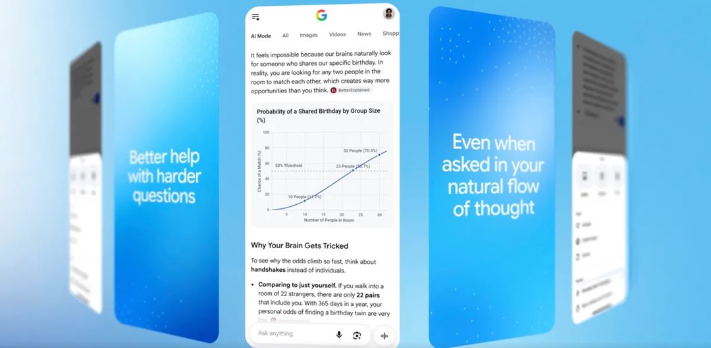

美联航宣布不允许客户使用第三方 AI 代理代订机票与管理订单，理由是网络安全风险，成为航司对 agent 商业化设限的首个显著案例。

表面是安全问题，实质是责任归属。代理以用户身份操作，一旦出现账户接管、欺诈退改、票价纠纷，航司的系统看到的是「异常自动化流量」，而责任链条上没有人签字。航司的选择很务实：在无法区分「用户授权的好 agent」和「攻击者的坏脚本」之前，一律拒绝成本最低。

这件事的意义超出机票。过去一年 agent 的演示都在回答「能不能做」，美联航问的是「出了事谁负责」。结论可能是反直觉的：高价值、强风控、强监管的交易场景（机票、金融、医疗）不会是 agent 最先攻克的领域，而是最后。中间地带——信息检索、比价、草稿、日程——才是当下能规模化落地的地方。做 agent 的团队，接下来要把授权协议和审计日志当成一等功能来做，而不是合规附件。

> 原文：[TechCrunch](https://techcrunch.com/2026/11/12/united-airlines-blocks-ai-agents-from-booking-flights-citing-cybersecurity-risks/)

### 谷歌搜索 AI Mode 升级，模型版本写进了产品说明

Google 搜索的 AI Mode 由 Gemini 4 Hydrogen 驱动，在复杂多跳问题上给出更完整答案、更相关的链接与更丰富的可视化结果。

多跳问题（multi-hop）一直是搜索的老大难：需要拆解子问题、分别检索、再综合，任一环节掉链子，答案就塌。这次升级的技术看点在这里。但更值得读的是「更相关的链接」这句——它像是在回应过去一年内容方对「AI 搜索截流」的持续批评。

把具体模型版本写进搜索更新的说明里，本身是个信号：搜索的迭代节奏已经和模型版本绑定，产品发布越来越像模型发布的延伸。真正的分水岭不在答案质量，而在链接与可视化——前者决定它是否还是「搜索引擎」，后者决定用户是否还需要点出去。Google 必须在「留住用户」和「喂饱内容生态」之间走钢丝，这个平衡比模型能力更难调。

> 原文：[TechCrunch](https://techcrunch.com/2026/11/12/googles-latest-search-upgrade-promises-better-answers-to-your-most-complicated-questions/)

### Gemini 眼镜 395 美元开卖，隐私被摆到台前

Google 联合三星、Gentle Monster 与 Warby Parker 推出首批 Gemini 智能眼镜，起售价 395 美元，官方着重强调隐私设计与指示灯。

把隐私放在发布叙事的中心，是对 Google Glass 当年「Glasshole」争议的正面回应。指示灯是给旁观者的，不是给佩戴者的——这个细节说明 Google 想明白了：智能眼镜要过的是「旁人同意」这一关，而不是佩戴者的技术审美。联手 Gentle Monster 与 Warby Parker，解决的是「戴得出去」；395 美元，落在尝鲜区间而非普及区间。

眼镜是 agent 最自然的载体之一：第一视角、常驻在线、免手操作。但它也是隐私争议最锋利的形态，因为摄像头对准的是他人。硬件能不能成，取决于社会规范能否跟上——这部分不由 Google 决定。这一代产品的真实任务，可能不是卖多少台，而是把「戴眼镜的人」从异类变成常态。

> 原文：[Ars Technica](https://arstechnica.com/google/2026/11/google-pushes-privacy-angle-as-gemini-powered-smartglasses-debut-starting-at-395/)

### 豆包工作接入 Kimi、GLM、DeepSeek：模型变成货架商品

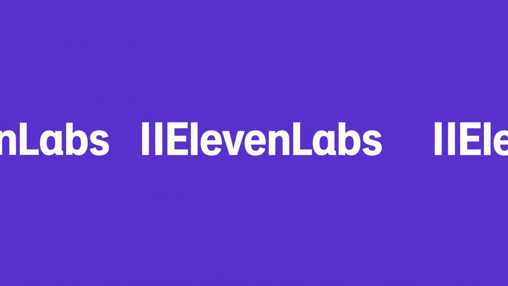

豆包工作一次性接入 Kimi 3.1 Pro、GLM 5.3、DeepSeek V4.1 Flash 等第三方模型，并推出限时额度优惠，让用户按任务自选模型。

字节自己有模型，却把竞品摆进自家产品的模型选择器里。这个动作说明产品侧的逻辑已经变了：按任务匹配模型，而不是按公司归属选模型。限时额度是常规获客手段，真正的信息在「自选」两个字。

多模型路由正在从技术架构变成产品卖点。对用户是好事——同一入口，按任务类型、成本和效果挑模型；对模型公司是压力——产品层不再为品牌付费，只为效果和价格付费。中长期看，模型会像云主机规格一样被摆上货架比较，延迟、上下文长度、单位成本成为用户能看见的显性变量。模型公司的品牌溢价，会在这一层被逐渐磨平。

> 原文：[雷锋网](https://www.leiphone.com/category/industrynews/5Y2bdtPv21ZnFJCY.html)

### ElevenLabs 发布 Scribe v3 Live，解决「抢话」这件事

ElevenLabs 推出实时语音识别模型 Scribe v3 Live，引入对话上下文，让语音 agent 不再在用户话说到一半时打断。

轮次判断（turn-taking）的难点不在识别准确率，而在语义：这句话是「说完了」，还是「在停顿思考」。传统做法靠静音检测，人类说话稍一迟疑就被抢白。引入对话上下文，等于让模型学会分辨停顿的性质——这是从「听清」到「听懂对话」的一步。

语音 agent 的体验分水岭就在这里，不在 WER 数字上。真实对话里，几百毫秒的犹豫是有意义的。客服、销售、陪伴这些场景能不能从 demo 走进生产，往往取决于这种不写在 PPT 上的细节。这也是语音赛道从「转录工具」转向「对话系统」的一个明确信号：接下来的竞争点是交互节奏，而不是词错率。

> 原文：[The Decoder](https://the-decoder.com/elevenlabs-scribe-v3-live-uses-conversational-context-to-stop-voice-agents-from-cutting-off-callers-mid-sentence/)

### FAA 把 AI 拥堵建议扩到全美，争议在流程不在算法

美国联邦航空管理局将 AI 空中交通拥堵管理工具从局部试点扩展至全美空域，航司表示欢迎，空管工会称未被纳入相关决策。

注意措辞：工具提供的是「建议」（advice），决策仍由人做出，人还在环内。这个定位是刻意保守的，也是它能扩展到全美的前提。争议点不在模型准不准——航司欢迎，说明实用价值已被认可——而在工会表示未被纳入决策过程。

AI 进入公共基础设施时，技术可靠性与程序正当性是两条独立的线。工会的反对不是反技术，是反「被跳过」。这个案例会成为后续 AI 进入医疗、司法、交通的模板：先问「谁参与了这个决定」，再问「模型表现如何」。对做 To-G（面向政府）生意的人来说，利益相关方沟通和算法验证同等重要，甚至更靠前。忽略这一步，技术再好也会卡在部署前夜。

> 原文：[Ars Technica](https://arstechnica.com/ai/2026/11/faa-expands-ai-advice-to-manage-air-traffic-congestion-across-entire-us-airspace/)

### 阿里「快乐虾米」上线 App，AI 音乐走到 C 端

阿里巴巴旗下 AI 音乐创作平台快乐虾米推出 iOS 与 Android App，用户描述情绪、故事或风格，即可由 AI 完成歌词、作曲、编曲与演唱。

产品把门槛压到了「描述」这一层：从灵感到成品，全流程由 AI 完成，用户只需要提供意图。这是典型的消费级内容生成思路——不比拼专业制作能力，比拼从想法到可分享作品的距离。

但音乐是版权最密集的品类，C 端产品的难点从来不在生成质量，而在版权与分发：平台是否接受 AI 生成内容、收益怎么分、训练数据来源是否干净。阿里做这件事的优势是生态而不是模型——如果它能把这套能力接进短视频、直播、电商这些既有场景，音乐就从「作品」变成「素材」。短期内，AI 音乐更可能作为表达工具成立，而不是作为作品生产成立。

> 原文：[36氪](https://36kr.com/newsflashes/4067554198770564?f=rss)

### 结语

这一年 AI 产品学到的，不是怎么变得更强，而是怎么被允许进入。留一个问题：在你的工作流里，第一个愿意让 AI「入场」的环节是哪里，最后一个又是哪里？

<h2 id="opinion" class="ai-section-divider">💭 行业观点</h2>

今天最该看的不是哪家发了新模型，而是 Anthropic 玻璃翼计划的一组数字：近 4 万个候补漏洞，修复 217 条。它把行业当下的共同处境说清楚了——发现能力已经被 AI 放大了一个数量级，交付能力还停留在人力节奏上。同一套逻辑在今天的另外几条新闻里反复出现：开源承诺、监管合规、企业 ROI、校园部署，全部进入「对账」阶段。承诺不再是叙事资产，而是要按季度结算的负债。

### 黄仁勋离场，英伟达的开源账单没人签字

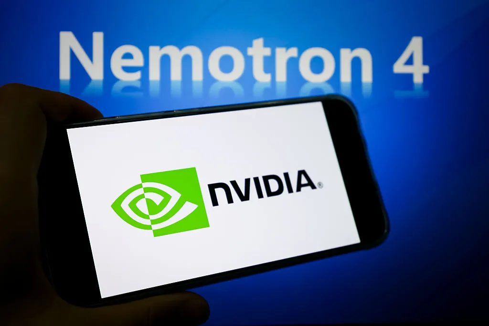

黄仁勋离场的消息传出后，外界开始重新审视英伟达对开源 AI 的实际投入，包括对 Hugging Face 的 129 亿美元收购，以及开放权重模型这条路线。Hugging Face CEO 已公开表态将继续为开源而战——这个表态本身就说明，不确定性是真实的，而不是外界的过度解读。

关键点在于角色错位：英伟达既是算力卖方，又是开源生态最大的资金来源之一，它的立场直接决定开放权重路线能拿到多少资源。当支撑承诺的人离场，承诺就需要从「个人偏好」转成「公司制度」才能继续成立，而这两者的可信度差别很大。

对社区和投资人来说，接下来要看的不是声明，而是收购案是否按原条件推进、开放权重模型是否按原节奏发布。开源在英伟达到底是战略，还是某位 CEO 的意志，现在要分开算了。

> 原文：[TechCrunch](https://techcrunch.com/2026/11/12/jensen-huangs-exit-puts-nvidias-support-for-open-source-in-question/)

### 澳大利亚要把「独立测试」写进法律

澳大利亚提出的 AI 安全法案要求前沿模型厂商向独立测试机构开放模型，若通过，将成为又一部具备域外影响力的 AI 监管法规。

关键点不是「又一部法律」，而是测试权。过去两年，前沿实验室的安全承诺主要建立在自愿框架上——自己评估、自己披露、自己决定何时暂停。立法强制开放给第三方，等于把「黑箱边界」从厂商手里拿走一部分，并把它变成可执行的检查权。

域外效应同样值得注意：一旦主要市场要求独立测试，厂商为降低合规成本，通常会把同一套流程推向全球产品线。这会实质影响发布节奏与模型文档的颗粒度。

判断：AI 监管正在从原则声明阶段，进入「谁能查、查什么、查完怎么算」的执行阶段。这对厂商是成本，对第三方评测机构是市场。

> 原文：[The Decoder](https://the-decoder.com/australias-proposed-ai-safety-bill-would-force-frontier-model-makers-to-open-up-to-independent-testing/)

### Gemini 进校园：渠道预装绕过了谁的选择

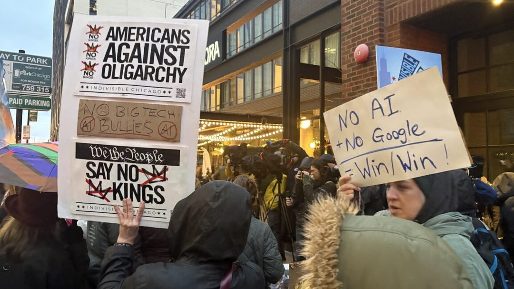

一名青少年起诉称 Gemini 是「自杀教练」，家长与学区围绕 Google 预装在学校发放的 Chromebook 上的 AI 展开对抗，多地出现要求暂停校园 AI 试点的呼声。

关键点在分发方式。预装在学校统一下发的设备上，意味着使用不是学生和家长主动选择的结果，而是默认配置。C 端产品靠用户点击同意来划分责任，B 端渠道预装则把这个环节整个跳过了——学区买了设备，学生就得用。

为什么重要：教育是 AI 落地最快的场景之一，也是风险最不对称的场景，出错的一方几乎无法自救。这类诉讼会重新定义「预装」的责任边界，并抬高所有面向学校的 AI 产品的合规成本。

判断：过去两年被当作增长捷径的渠道预装模式，现在开始付代价了。

> 原文：[Ars Technica](https://arstechnica.com/tech-policy/2026/11/families-fight-to-keep-googles-disturbing-ai-off-school-issued-chromebooks/)

### 玻璃翼的 4 万与 217：瓶颈已经从发现移到修复

Anthropic 的漏洞挖掘计划被指「只管挖不管埋」：近 4 万个候补漏洞中，仅修复 217 条，引发对 AI 安全项目实际落地效果的讨论。

这个比例不该只被读成一家公司的执行问题，它反映的是结构性错配。AI 让发现漏洞的边际成本趋近于零，但修复的成本由人力、代码所有权和发布流程决定，一分没降。供给端爆炸，需求端刚性，积压是必然结果。

为什么重要：这会改变安全行业的核心指标。漏洞数量在发现成本极低的环境里已经没有信息量，真正有意义的是修复周期和回归率。同时，大规模未修复漏洞的披露伦理问题会重新浮上来——知道却修不了，和不知道，责任并不相同。

判断：任何以「发现量」为 KPI 的 AI 安全项目，本质上都是在给自己发奖状。

> 原文：[量子位](https://www.qbitai.com/2026/11/509291.html)

### 李彦宏：token 烧得越多，利润没有跟着涨

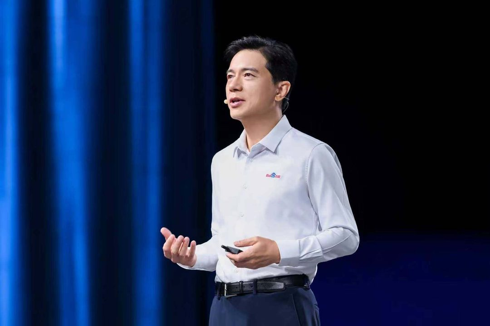

李彦宏在内部讲话中指出，企业 AI 投入的 token 消耗持续攀升，而利润并未同步增长，主张围绕 AI 重新设计组织结构，而不是简单叠加工具。

关键点是把问题从「模型能力」挪到了「组织设计」。Token 是成本项，不是产出项；调用量上涨只证明使用频率，不证明流程被改写。工具叠加在旧流程上，通常只会增加审批环节和切换损耗。

为什么重要：这是对过去两年「AI 投入必然带来回报」叙事的直接反驳，而且来自一线大厂一把手。对投资人的含义很具体——看 AI 相关支出时，要区分试验性消耗和嵌入核心流程的消耗，前者是费用，后者才可能是资产。

判断：组织不变，AI 只是在原有摩擦上再加一层界面。

> 原文：[InfoQ](https://www.infoq.cn/article/JPf7ud6wuk9fYmUDoMjo?utm_source=rss&utm_medium=article)

### Grok 泄密：企业助手的权限边界被推倒重来

马斯克旗下 Grok 被曝泄露 SpaceX、特斯拉的内部薪资与绩效信息，再次把企业部署 AI 助手的数据边界问题推到台前。

薪资与绩效属于企业内部敏感度最高的一类数据，通常只有极少数 HR 与管理者可见。这类信息出现在 AI 助手的输出里，说明问题不在模型能力，而在接入时的权限映射——把知识库整体接进对话框，等于假设「能检索到」和「有权看到」是同一件事，而它们从来不是。

为什么重要：企业 AI 落地的真实阻力正在从模型效果转向数据分级与权限治理。这类事件会加速对 AI 网关、检索层权限控制、输出审计等中间层的采购，也会让「先接入再治理」的路线失去说服力。

判断：把聊天框当成搜索入口，就是让权限体系从零开始重建。

> 原文：[量子位](https://www.qbitai.com/2026/11/509355.html)

### OpenAI 的 200 万美元：买的是标准席位

OpenAI 承诺投入 200 万美元支持 AI 与儿童安全研究，用于开发衡量未成年人风险与获益的共享工具。

金额相对 OpenAI 的体量并不大，所以重点不在钱，而在「共享工具」四个字。谁来定义什么叫风险、什么叫获益、用什么指标衡量，决定了后续监管讨论的坐标系。在立法压力真正到来之前，把度量口径先立起来，是最有效的一道防线。

为什么重要：AI 安全讨论长期卡在缺少共同度量上——各方都在谈风险，但衡量的不是同一件事。一旦某套工具成为学界与政策圈的默认引用对象，制定者就获得了事实上的话语权。

判断：这笔钱买的不是安全本身，而是「什么叫安全」的解释权。同类投入接下来会变多，评估时该看的是工具是否真的被第三方采用，而不是公告金额。

> 原文：[OpenAI](https://openai.com/index/children-first-declaration)

### Roblox：创作门槛塌了，稀缺性搬到分发侧

Roblox CEO David Baszucki 在访谈中谈 AI 如何重塑游戏创作门槛，以及为何这会让 Roblox 同时成为开发者的赋能者与内容聚合平台。

关键点是一个经典结构的重演：当生产工具被平权，价值就向需求侧迁移。AI 让「做出一个能玩的东西」的成本大幅下降，供给随之膨胀，接下来稀缺的就不再是制作能力，而是注意力、匹配效率和对用户偏好的理解。Baszucki 同时用「赋能者」和「聚合者」来定位 Roblox，说的正是这件事——工具免费送出去，聚合位置留给自己。

为什么重要：这对所有做 AI 创作类产品的人都是一个提醒。模型能力很快会成为公共基础设施，护城河不在生成质量，而在分发、社区关系与需求侧数据。

判断：AI 降低的是入场费，抬高的却是被看见的门槛。

> 原文：[Stratechery](https://stratechery.com/2026/an-interview-with-roblox-ceo-david-baszucki-about-aggregating-play/)

这一周的所有新闻其实在问同一个问题：当发现问题的成本趋近于零，谁来承担修复的账？答案如果还是「以后再说」，那下一次对账只会更难看。

<h2 id="opensource" class="ai-section-divider">⚙️ 开源工具</h2>

### 导语

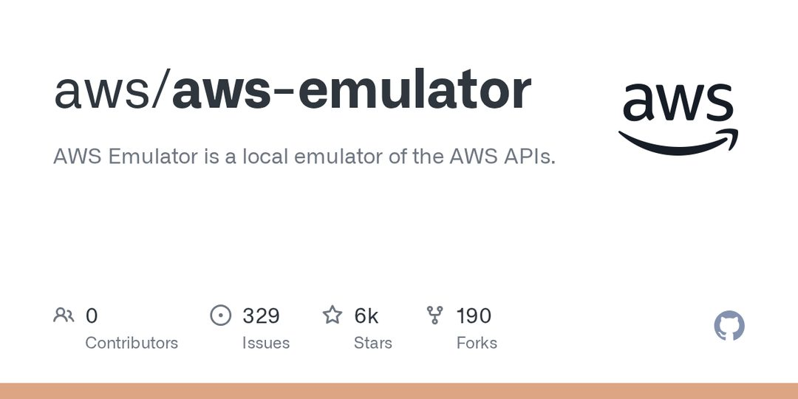

今天开源板块最值得看的一件事，是 AWS 用自主 AI agent 生成了 `aws-emulator` 的全部代码：438 个 API 模型、200 多项服务，发布时 42857 项保真测试通过率 56.6%。「AI 写了 200 个服务」是噱头，「56.6%」才是信息量——它把「agent 能不能大规模产出可用代码」这个问题，第一次量化地摆到了台面上。剩下的几条也沿着同一条暗线展开：Codex Security、OpenBot 1.0、Agent Skills 在补「信任与治理」，PyTorch on TPU、LiteRT 在拆「硬件适配」这堵墙。开源正在从「放出代码」转向「放出可被 agent 消费的接口」。

### AWS 用 AI agent 生成 200 多项云服务模拟器

AWS 发布 `aws-emulator`，采用 CC0 协议，基于 438 个 API 模型在本地复刻 200 多项 AWS 服务。关键点有两个：一是全部代码由自主 AI agent 编写，二是发布时 42857 项保真测试通过率 56.6%。本地云模拟解决的是一类具体问题：离线开发、CI 里跑集成测试不该依赖真云。过去这类项目靠人工逐个服务补齐，覆盖面永远是短板；这次用 API 模型驱动批量生成，把广度一次性拉满。但 56.6% 的保真度意味着近一半行为与真实云不一致，把它当测试替身要防假阴性和假阳性。更值得跟踪的是方法论：模型驱动生成 + 保真测试作验收，这套闭环能不能把 56.6% 推到 90%，比 200 这个数字更能说明 agent 的工程价值。

> 原文：[GitHub](https://github.com/aws/aws-emulator)

### OpenAI 开源 Codex Security，找漏洞也改漏洞

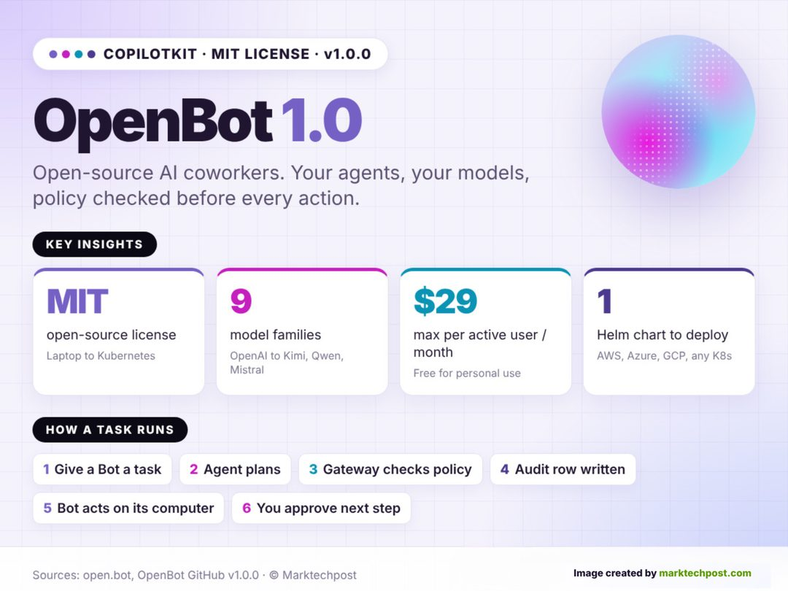

OpenAI 把 Codex Security 的 CLI 与 TypeScript SDK 开源，并同步上架 npm，能力覆盖漏洞的自动发现、验证与修复。「验证」这个词比「发现」更重要——安全扫描工具最大的成本从来不是漏报，而是误报淹没工程师。把它做成 CLI 和 SDK 而非只留在产品内，意图很清楚：进 CI 流水线。但自动修复留下了未解的问题：补丁由谁 review、修复引入回归谁负责。实际用法上，先把它当高召回扫描器加建议补丁，跑在非生产仓库，而不是一上来就设成阻断门禁。

> 原文：[GitHub](https://github.com/openai/codex-security)

### CopilotKit 开源 OpenBot 1.0，给 AI 同事上审计

OpenBot 1.0 采用 MIT 协议、支持自托管，企业自带模型与 agent。它真正的差异点不在「AI 同事」这个概念，而在约束：每个 Bot 动作都必须通过策略校验，并写入审计日志。企业部署 agent 的卡点通常不是能力不足，而是不可问责——谁批准了这次操作、出了事查哪条记录。自托管加自带模型则解决数据出域问题。接下来的观察点是策略引擎的表达力够不够覆盖真实权限模型，以及审计日志能否支撑事后追责而不只是留痕。

> 原文：[MarkTechPost](https://www.marktechpost.com/2026/11/12/copilotkit-openbot-1-0-open-source-ai-coworker/)

### PyTorch 原生跑上 TPU，选框架和选硬件解耦

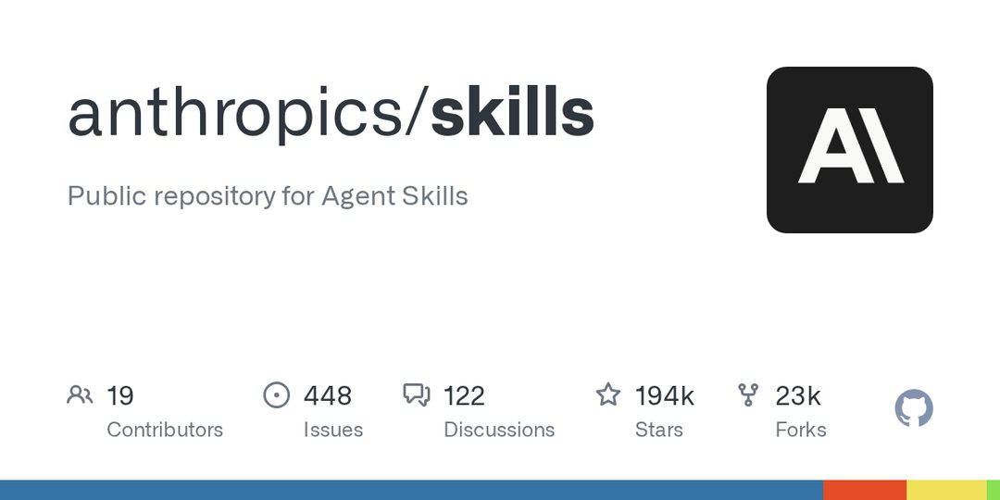

谷歌打通了 PyTorch 对 TPU 的原生支持，开发者不必再绕道 JAX 或 XLA 适配层，社区的反应是「早该如此」。这件事的分量在于它拆开了一个长期绑定的决策：过去选 TPU 往往意味着迁移训练栈，迁移成本高到足以抵消硬件本身的价格优势。原生支持把这道成本削平后，TPU 的性价比才第一次可以和其他加速器放在同一张表上比。但要确认「原生」到什么程度——算子覆盖、分布式训练、调试工具链，这三项决定它是生产可用还是 demo 可用。

> 原文：[InfoQ](https://www.infoq.cn/article/Fikt82HLToqb6ZANB2xj?utm_source=rss&utm_medium=article)

### Anthropic 公开 Agent Skills 实现代码

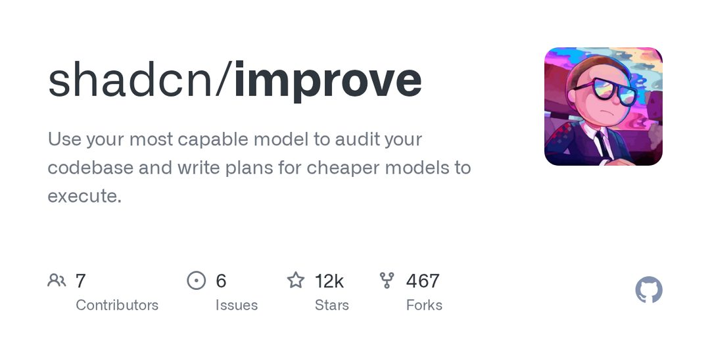

Anthropic 开源了 Claude 的 Agent Skills 实现仓库，供开发者参照该标准为自己的 agent 复用技能模块。agent 生态当下最缺的不是模型能力，而是可移植的中间层：技能包能不能跨框架流转，决定生态是碎片化还是形成分工。Anthropic 主导的标准天然带自家偏向，是否被其他模型厂商采纳是它能否成立的关键。务实建议是把它当参考实现读，理解技能描述、加载与调用的契约设计，而不是当稳定 API 直接依赖。

> 原文：[GitHub](https://github.com/anthropics/skills)

### shadcn 的 improve：强模型审，弱模型写

`improve` 是一个 agent 技能：用最强的模型审计代码库并产出实施计划，再交给更便宜的模型执行，目的是压低高质量重构的成本。这是 token 经济学在工程侧最朴素的一次落地——把「想」和「做」分配给不同价位的模型。它的隐患也很明确：计划与执行之间的信息损耗。便宜模型偏离计划时，靠谁发现？实践上必须给执行阶段配强校验（测试、lint、类型检查），否则省下的推理成本会以 review 成本的形式还回去。这个思路对所有 agent 工作流都成立，不止重构。

> 原文：[GitHub](https://github.com/shadcn/improve)

### 谷歌 LiteRT Tensor API，降低端侧模型改造门槛

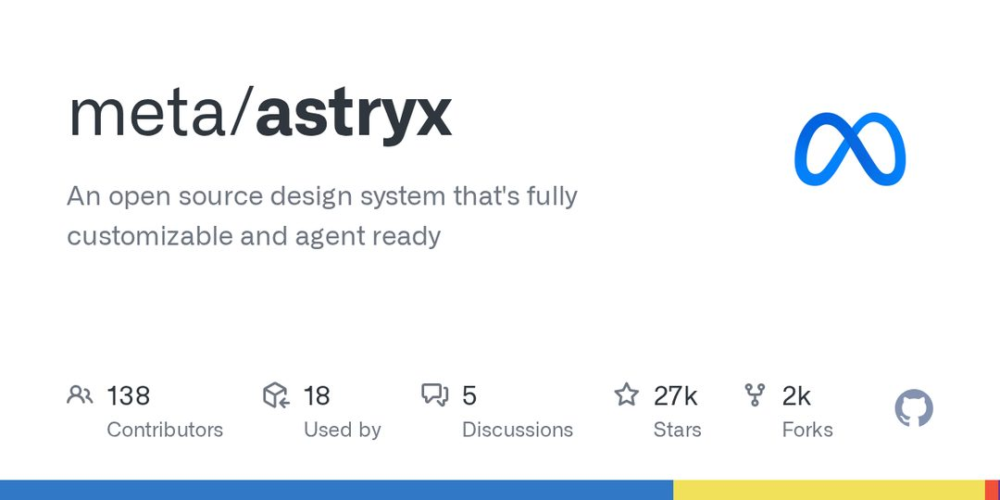

谷歌发布 LiteRT Tensor API，用于在端侧构建、定制与优化机器学习模型，面向移动与嵌入式设备。端侧模型的真实瓶颈常常不是算力，而是「改不动」：量化、算子支持、内存布局每一项都需要专门知识，导致多数团队只能用预训练模型，做不了设备级定制。把它 API 化，等于把硬件适配的复杂度收进框架层。这和 PyTorch 原生支持 TPU 是同一条线——把「适配硬件」从应用团队的活变成框架的活。

> 原文：[InfoQ](https://www.infoq.cn/article/joYjCTbwWFSkbACK5lje?utm_source=rss&utm_medium=article)

### Meta 开源 astryx，设计系统开始面向 agent

Meta 开源设计系统 astryx，强调完全可定制，并且面向 agent 使用场景：让自动化工具也能消费和生成一致的界面组件。这个定位点出了一个正在发生的变化——设计系统过去只服务人类开发者，现在还要服务 agent，意味着组件需要机器可读的契约：属性、语义、变体约束都得显式化，不能靠默契。目前「agent-ready」的设计系统项目多、共识少，astryx 是否被主流工具链采纳，比它自身的组件数量更值得看。

> 原文：[GitHub](https://github.com/meta/astryx)

### 结语

今天这 8 条里，大半主角都不是模型本身，而是让模型被信任、被复用、被问责的那层壳。留一个问题：56.6% 保真度的云模拟器，你会放进 CI 吗？
