今天最值得看的三件事：

- **模型发布** · Google发布Gemini 4 Hydrogen
- **公司动态** · 黄仁勋辞任英伟达CEO，33年时代落幕
- **应用产品** · OpenAI推出ChatGPT Wallet，让AI代理代付

下文按板块展开，正文每条均附原始链接。

<h2 id="model-release" class="ai-section-divider">🚀 模型发布</h2>

Google 今天把「快」做成了模型的第一卖点。Gemini 4 Hydrogen 支持 1M token 上下文、4 档思考等级，官方口径是比 Gemini 3.8 Flash 快 2.5 倍，并且明确把它指向高速智能体（agentic）场景——这不是一次常规迭代，而是把模型竞争的衡量标准从「跑分」往「单位时间能完成多少动作」上挪。同一天 Perplexity 开源了返回概率而非文本的决策模型，Liquid AI 则把流式音频编解码压到 74M 参数，三条消息指向同一件事：应用层的瓶颈正在从「模型够不够聪明」变成「链路够不够短、够不够便宜」。下面逐条看。

### Google 发布 Gemini 4 Hydrogen，主打高速智能体

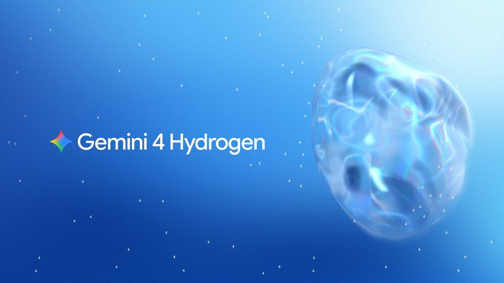

Google 发布 Gemini 4 Hydrogen，定位是面向高速智能体（agentic）场景的模型。关键参数有三项：1M token 上下文、4 档可调思考等级，官方称其速度比 Gemini 3.8 Flash 快 2.5 倍。同期 Google 搜索的 AI Mode 也做了同步升级。

三点值得注意。一是「思考等级」被做成显式档位，意味着推理深度从训练阶段的固定属性变成运行时参数，工程上可以直接按任务价值分配算力。二是 1M 上下文配上高速度，组合出来的能力是「一次性吞下大仓库或长会话并快速多轮行动」，这正是编码 agent 和浏览器 agent 的形态。三是搜索 AI Mode 同步升级，说明 Google 在用自己的分发渠道做首批验证场景，而不是等第三方来试。

为什么重要：过去一年模型发布的叙事是能力上限，这次是吞吐。对做 agent 产品的团队，2.5 倍速度可能比几个百分点的 benchmark 更能改变产品可行性——多步任务的延迟是累乘的，单步提速会直接决定一个 agent 循环能不能落在用户可接受的时间内。

> 原文：[Google DeepMind](https://deepmind.google/blog/introducing-gemini-4-hydrogen/)

### Perplexity 开源 Decider v1.3：返回概率而不是文本

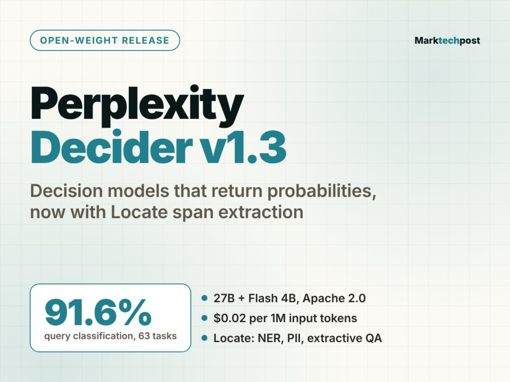

Perplexity 开源（open weight）决策模型 Decider v1.3，最大特点是不输出自然语言，而是返回概率。该版本新增 Locate 片段抽取能力，在 63 项查询分类任务上平均准确率 91.6%。

这个设计选择值得展开。让模型「说话」再解析，是当前绝大多数分类、路由、判定类任务的做法，代价是延迟、token 成本和格式不稳定。Decider 把输出空间直接收敛到概率分布，等于把这类任务从生成问题改回判别问题——下游系统拿到的是一个可设阈值的数，而不是一段需要再解析的文本。Locate 则补上了另一半：不仅判断该不该做，还能指出证据在原文哪一段。

为什么重要：在多模型编排（routing）和检索质量判定这两个高频环节，团队真正需要的是廉价、可校准的判官，而不是又一个通用大模型。如果 91.6% 这个数字在你的任务分布上站得住，它能替掉不少 prompt 工程和重试逻辑。

> 原文：[MarkTechPost](https://www.marktechpost.com/2026/11/13/perplexity-decider-v1-3-open-weight-decision-models-locate/)

### Liquid AI 发布 74M 流式音频编解码器 LiquidCodec

Liquid AI 发布 LiquidCodec，一个 74M 参数的流式音频编解码器，用于驱动 LFM3 音频模型与全模态模型。规格为 12.5Hz、12 码本；官方称单 CPU 线程的编码速度约为实时的 361 倍。

12.5Hz 的帧率意味着每秒只产出 12.5 个 token 位置，配上 12 码本，序列长度被压得很低，这是让音频进入 Transformer 上下文的经济做法。更关键的是 361 倍实时、且只需单 CPU 线程——音频前处理不必占用 GPU，也不必为每个并发流预置算力。流式则对应真实交互：语音 agent 需要边说边编，而不是等一句话说完。

为什么重要：语音交互的成本结构里，编解码常年是被忽视的一环，但它决定了单位算力能承载多少并发会话。74M 参数、CPU 可跑、流式输出，这三个条件同时满足的编解码器此前并不多，对做实时语音 agent 和端侧多模态的团队是直接可用的零件。

> 原文：[MarkTechPost](https://www.marktechpost.com/2026/11/12/liquid-ai-liquidcodec-streaming-audio-codec/)

### 结语

三条消息里，两条在压缩链路成本，一条在压缩输出形式——今天的模型发布不再比谁更聪明，而在比谁更少浪费。留给读者一个问题：当速度和单位成本成为主战场，你手上的产品还卡在哪一步的延迟上？

---

<h2 id="company" class="ai-section-divider">🏢 公司动态</h2>

一天里发生了三件指向不同方向的事：英伟达创始人辞职、Anthropic IPO 获六倍超额认购、Nebius 计划用 400 亿美元加杠杆扩产。它们表面无关，但共同指向 AI 产业的资本叙事正在被重新定价：不再是谁的故事更大，而是谁能在治理、监管和现金流三方面同时承压。黄仁勋的离场是今天最值得读的一条，因为它同时触发了公司治理、地缘政治与一级市场情绪三个层面。

### 黄仁勋辞任英伟达CEO

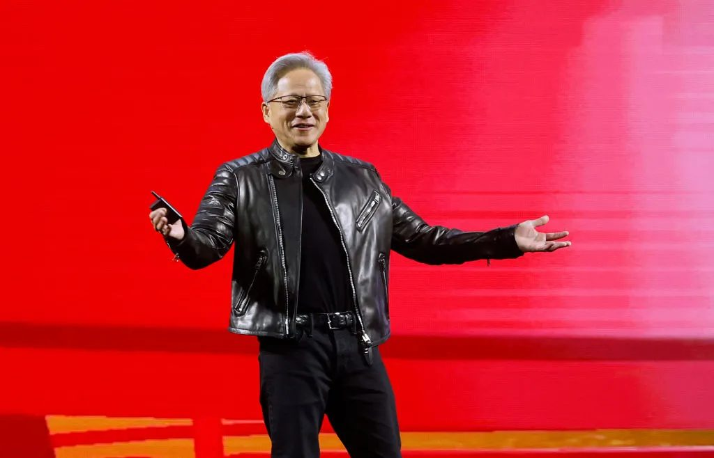

据 TechCrunch 报道，黄仁勋因涉嫌与一名疑似中国间谍的婚外情而辞去英伟达 CEO 职务，CFO Colette Kress 出任临时 CEO。报道称公司市值大幅蒸发，美国国会已启动调查，部分 VC 开始担忧 AI 创业公司的融资环境随之收紧。

关键点不在八卦本身，而在接任者的画像：Kress 是财务背景，临时任命通常意味着董事会当前优先级是稳定报表与合规应对，而不是延续创始人的技术路线叙事。对一家已经把 GPU 变成 AI 资本周期锚点的公司来说，治理问题会迅速外溢为地缘政治问题——国会调查与出口管制叠加，供应链变量的不确定性上升。

需要提醒的是，目前公开信息仍以媒体报道为主，公司层面的正式披露有限。在事实补齐之前，更稳妥的判断是：英伟达的短期经营不会因人事变动立刻转向，但围绕它的“确定性溢价”会被重新评估。这对依赖英伟达算力预期的创业公司和大模型公司，是比股价更实质的影响。

> 原文：[TechCrunch](https://techcrunch.com/2026/11/13/nvidia-ceo-jensen-huangs-affair-with-alleged-chinese-spy-a-timeline/)

### Anthropic IPO获6倍超额认购

Anthropic 的 IPO 认购达到 6 倍超额，有望成为史上规模最大的公开募股。同时，承销银行因美国出口管制要求，拒绝中国及香港投资者参与认购。

这两件事放在一起看才有意思：需求端是极度拥挤的抢筹，分配端却被地缘政治直接切割。对一级市场来说，这意味着头部 AI 公司的估值锚正从私募轮次转移到公开市场定价，later-stage 的估值分歧会有一个公开参照系。对投资人来说，稀缺性溢价是真实的，但流动性折价和准入限制同样是真实的——你买的是一张被规则筛选过的门票。

另一个容易被忽略的点是承销银行的动作。出口管制从技术出口延伸到资本准入，说明监管工具正在向金融环节渗透。这条线会怎么演化，可能比 IPO 首日涨跌更值得跟踪。

> 原文：[The Decoder](https://the-decoder.com/anthropics-ipo-is-six-times-oversubscribed-and-on-track-to-become-the-largest-public-offering-in-history/)

### LangChain估值达30亿美元

LangChain 估值升至 30 亿美元。公司称其模型与平台无关的 Agent 管理工具 LangSmith 已拥有 7000 家客户。

Agent 层的价值捕获一直是行业里的悬案：模型厂商不断把编排、工具调用、记忆这些能力收进自家 SDK，中间层的生存空间理论上会被持续挤压。LangChain 的反驳是“模型无关”——企业不想被单一模型锁定，就需要一个跨模型的观测、评测与部署平面。7000 家客户说明这个需求目前是真实的，至少在企业侧存在。

风险也在这里：模型无关既是卖点，也意味着没有模型侧的定价权。当模型 API 价格持续下探、厂商自带工具链越来越完整时，LangSmith 要靠的是运维深度和切换成本，而不是模型能力本身。30 亿美元估值买的是这个赌注。

> 原文：[TechCrunch](https://techcrunch.com/2026/11/13/ai-agent-startup-langchain-hits-3b-valuation/)

### 特斯拉与SpaceX被曝最快下月合并

据量子位报道，马斯克旗下特斯拉与 SpaceX 这两家得州最有价值的公司正考虑合并，最快可能在下月推进。得州候任总检察长已警告将严格审查该交易，关注点是企业权力过度集中。

这是一个典型的“资本结构先于业务逻辑”的动作。两家公司在股权、人才和马斯克本人的注意力上高度重叠，合并能简化结构、集中资源，也方便以更统一的实体去承接大型基础设施类业务。但正因为它把一个横跨汽车、航天与能源的商业版图收进同一张报表，监管的第一反应必然是权力集中，而不是效率。

得州的态度值得注意：这不是联邦层面的反垄断动作，而是州一级的政治信号。对观察者来说，真正的看点不是交易能否成，而是马斯克系公司未来的融资与治理结构会以什么形态呈现给公开市场。

> 原文：[量子位](https://www.qbitai.com/2026/11/509613.html)

### Nebius计划400亿美元扩张AI基建

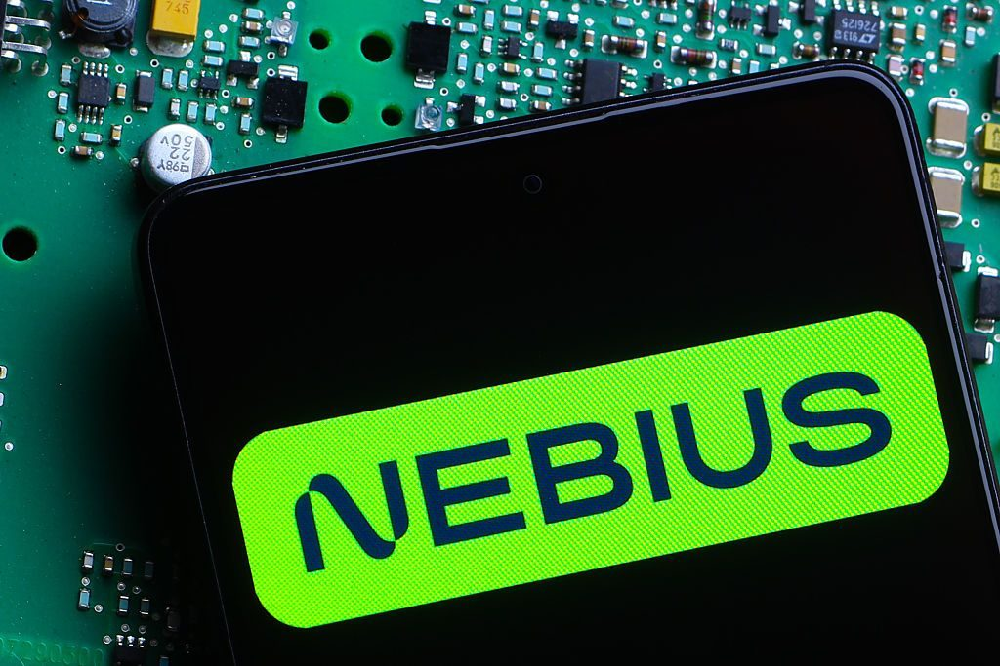

新云（neocloud）厂商 Nebius 计划进行 400 亿美元的 AI 基础设施扩张，资金来源包括客户预付款和贷款。与此同时，微软数据中心延期交付的消息让其融资模式受到质疑。

neocloud 的玩法本质是把未来的算力需求提前证券化：客户先付钱，公司拿这笔钱和银行贷款去建机房、买 GPU。这套模式在需求确定时效率极高，等于用客户的资产负债表给自己加杠杆。它假设的前提是——超大规模厂商（hyperscaler）的资本开支节奏稳定，GPU 供给和租赁价格不出现剧烈波动。

微软数据中心延期恰好戳中这个前提。一旦头部厂商的交付节奏放缓，市场会立刻重新审视“预付款是不是真需求”这个问题。400 亿美元不是小数目，Nebius 现在测的不只是自己的融资能力，也是整个 neocloud 叙事能不能经受一次逆风测试。

> 原文：[TechCrunch](https://techcrunch.com/2026/11/12/nebius-tests-the-neocloud-playbook-with-40-billion-in-planned-spending/)

### 燧原科技首席生态官李星宇离职

据雷锋网独家消息，国产 AI 芯片公司燧原科技首席生态官李星宇已离职。这是国产 AI 芯片领域近期的又一次人事变动。

“生态官”这个头衔在国产芯片公司里出现得越来越频繁，本身就说明竞争重心在转移：制程和算力的差距在缩小，真正难的是软件栈、框架适配和开发者习惯。生态负责人直接决定客户迁移成本的高低，也决定一家芯片公司能不能从“能跑”走到“好用”。

这类岗位的变动往往不会立刻反映在产品和营收上，但会影响开发者关系的连续性——尤其是在国产替代窗口期，客户最怕的是迁移到一半没人管。单条人事消息不宜过度解读，但国产芯片公司近期人事密集变动，值得作为趋势观察。

> 原文：[雷锋网](https://www.leiphone.com/category/chips/G6AiPuplIGyPkaQL.html)

### 腾讯云AI全球业务负责人李牧青离职

李牧青已从腾讯云离职，出任教育 AI 公司启鸣达人的联席 CEO。此前他负责腾讯云 AI 的全球业务。

云厂商的 AI 商业化负责人流向应用侧，是今年反复出现的路径。云卖的是算力和平台，但真正能形成产品溢价的是场景，教育是其中付费意愿相对明确、数据闭环相对完整的一个。从“卖 AI 能力”到“用 AI 做产品”，角色切换的背后是对价值链位置的重新选择。

对腾讯云而言，全球业务条线的负责人变动需要观察后续接任者与组织安排；对启鸣达人而言，引入有云侧资源和大客户经验的高管，通常意味着接下来要补的是渠道与规模化，而不只是模型效果。

> 原文：[雷锋网](https://www.leiphone.com/category/industrynews/xfpQo71RiPDWJHvS.html)

### 中金与蚂蚁合作探索AI财富管理

中金与蚂蚁签署战略协议，围绕金融大模型、AI 赋能财富管理以及客户全生命周期服务展开合作。

金融是 AI 落地价值最高、同时监管也最严的场景之一。券商有牌照、产品和投顾能力，平台有流量、数据和工程化能力，两者的互补性很直接：一方缺规模化触达，一方缺合规载体。金融大模型在这个组合里更多是“提效工具”，短期看的是投研、投顾和客服环节的成本与体验。

真正的壁垒不在模型，而在数据权限与合规边界——客户信息的可用范围、模型输出的可解释性、以及责任归属怎么划分。这类合作的价值兑现周期会比宣传节奏慢得多，值得观察的是它能否跑出可复用的合规范式。

> 原文：[雷锋网](https://www.leiphone.com/category/industrynews/U7WtbV9kyb90UuZ0.html)

创始人退场、IPO 超额、neocloud 加杠杆，三件事都指向同一件事：AI 的资本叙事正在从“讲故事”切换到“承压测试”。如果英伟达的确定性溢价被重估，下一个被重新定价的会是谁？

<h2 id="research" class="ai-section-divider">🔬 研究论文</h2>

今天研究板块最值得看的不是某个榜单，而是一次取证式的指控：一位前 OpenAI 研究员称，在 6 个中国 AI 模型里找到了 Blackwell 芯片的指纹。如果这类方法站得住，算力管制就从“政策条文”变成了可被反向检验的技术问题——出口管制的有效性第一次可以被审计，而不是只能被宣称。剩下三条则指向同一枚硬币的另一面：在算力受限的假设下，参数效率、临床评测体系和通信受限下的多机协作，正在成为新的解题方向。

### 禁售芯片的指纹，出现在最强模型里

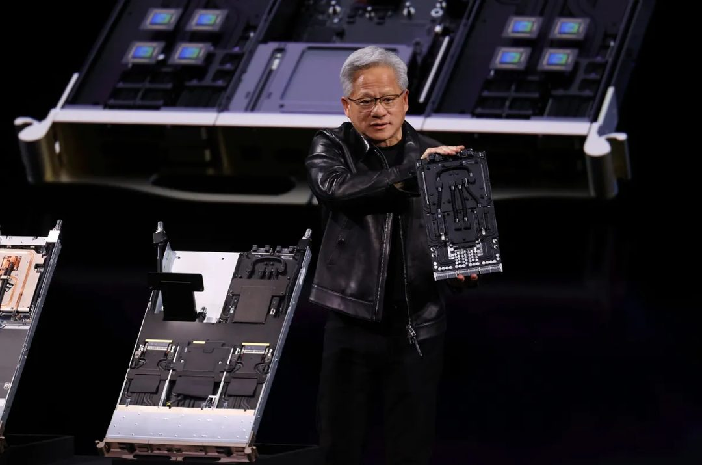

TechCrunch 报道，一位前 OpenAI 研究员称，在 6 个中国 AI 模型中发现 Blackwell 芯片的“指纹”；相关新研究的结论是，中国当前最先进的模型由被禁售的英伟达芯片训练而成。

关键点在于方法而非结论：所谓指纹，是从模型产物中反推训练硬件特征的一类取证手段。它把“用了什么卡”这个过去只能靠供应链情报推断的问题，变成可复现的技术主张。Blackwell 属于对华禁售序列，若这一判断成立，受冲击的不只是模型公司，还有英伟达的合规叙事和出口管制的执行链条。

需要保留的怀疑同样明确：指纹识别存在误报与归因歧义，其可靠性要经同行评议。但方向已经很清楚——算力管制从此多了一条“考古学”式的验证路径。

> 原文：[TechCrunch](https://techcrunch.com/2026/11/13/export-banned-nvidia-chips-are-behind-chinas-most-powerful-ai-models-uh-oh-jensen/)

### 40 亿参数，六项评测第一：西湖大学押注“概念世界模型”

西湖大学团队用一个 40 亿参数的模型，在 6 个评测中拿下第一，技术路线押在“概念世界模型”上。

这条的价值不在排名，而在参数量的选择。当主流叙事仍以大参数量作为能力前提时，40 亿级别的模型去争第一，等于把赌注压在表征结构而非规模上：先让模型形成可操作的概念体系，再谈能力涌现。这更像是一条“效率优先”的路线，与算力受限的现实互为镜像。

判断需要克制：评测第一的说服力，取决于这 6 个评测能否反映真实场景中的泛化，而非分布内的熟练度。但在 scaling law 边际收益被反复讨论的当下，把研究议程重新拉回参数效率与知识结构，本身就是有信号意义的动作。

> 原文：[雷峰网](https://www.leiphone.com/category/academic/nhzldlwI6rJVyXIl.html)

### 复杂肺癌诊疗：250 名医生参与的评测，比分数更重要

国内团队在复杂肺癌诊疗方向取得突破，评测联合了 250 名三甲医院医生，引发中美医疗圈关注。

关键词是“复杂”和“250 名医生”。前者意味着任务不是标准化的影像分类，而是需要综合判断的临床决策；后者意味着评测设计里引入了真实执业者的对照，而不是又一个内部测试集。医疗 AI 长期卡在“论文指标好、临床不敢用”的鸿沟上，规模化的医生参与评测，是填这道沟的必要成本。

值得关注的不是“AI 超过医生”这类简化叙事，而是评测协议本身能否被复现和外部审计。如果 250 人的对照设计能形成可沿用的范式，它对行业的推动会大于任何单点成绩。

> 原文：[量子位](https://www.qbitai.com/2026/11/509796.html)

### 隔墙“递眼色”：通信砍掉 80%，成功率从 0 到 100%

中国团队提出一种新方法，让机器人仅靠少量信息、隔着墙“递眼色”完成组队协作：信息传输减少 80%，任务成功率从 0 提升到 100%。

这三个数字里，最有信息量的是“从 0 到 100%”。它说明在原始条件下任务根本不可完成——通信被遮挡切断后，多智能体协作直接失效。方法的核心是极低带宽下的意图传递：不交换完整状态，只传递足以对齐的最小信号，类似人类隔着墙的一个眼神。

为什么重要：真实部署中的机器人团队，带宽、遮挡、干扰都是硬约束，实验室里“全连接、高同步”的假设几乎不成立。通信高效的协作能力，比单机指标更能决定具身智能（embodied AI）能否走出演示视频。接下来要看的，是这套方法在更多任务和更多智能体数量下是否依然成立。

> 原文：[量子位](https://www.qbitai.com/2026/11/509614.html)

算力可以被管制，方法不能——今天四条里有三条都在讲同一件事：约束条件下的效率，正在取代规模，成为新的研究前沿。那么当“指纹”成为证据时，谁来审计审计者？

<h2 id="product" class="ai-section-divider">📱 应用产品</h2>

OpenAI 推出 ChatGPT Wallet，允许代理在用户批准后直接完成购物与结账，这是今天最值得看的一条。它表面上是在增加功能，实际上是在为 agentic（代理式）能力划定授权边界：模型可以一路走到收银台，但扣款权必须回到人手里。同一天，Claude 进入工厂、Muse 开始打电话、FAA 把 AI 建议铺到全美空域，共同的主线只有一条——AI 正从「回答问题」转向「替你办事」，而真正的门槛不在智能，在授权、责任和接听率。

### ChatGPT Wallet：代理付款，人来点头

OpenAI 推出 ChatGPT Wallet，ChatGPT Work、Codex 和 dots 中的代理可在用户批准后完成购物与结账，沿用现有的银行卡保护，先向美国 Pro 订阅用户限量开放。

关键藏在「用户批准」这四个字里。代理可以找货、填单、走到支付环节，但每一笔扣款仍需要人确认。OpenAI 没有自建账本，而是复用既有卡组织的保护体系——这意味着争议处理、退款和拒付仍由成熟金融基础设施承担，代价是用户体验上多了一道确认步骤。

为什么重要：演示环境里，代理「能操作浏览器」早已不是难点；真正落地时，人们最先问的是：钱怎么付、出了问题谁负责。授权粒度会决定这个功能是玩具还是入口——如果只能逐笔确认，它适合低频高价值交易；一旦支持额度与白名单，代理才可能承接日常消费。这一步走通，代理商业化的闸门才算真正打开。

> 原文：[OpenAI](https://openai.com/index/introducing-chatgpt-wallet)

### Daybreak：OpenAI 进入网络安全市场

OpenAI 发布两款 Daybreak 产品，正式进入网络安全领域，用 AI 发现并修复漏洞。

值得注意的是「修复」这个动作。发现漏洞是分析问题，修复则要求直接改动生产系统，对信任和权限的要求高出一个量级；这也是安全厂商长期按「结果」而非「调用次数」收费的原因。

为什么重要：安全是少数效果可被验证、预算充足、且天然欢迎自动化的场景，对模型厂商来说，是从卖 API 转向卖解决方案的合理切口。但这也把 OpenAI 放到了既有安全公司的同一条赛道上——是成为它们的基础模型供应商，还是替代其中一部分工作，将决定这个市场接下来两年的合作与竞争格局。

> 原文：[The Decoder](https://the-decoder.com/openai-enters-the-cybersecurity-market-with-two-daybreak-products/)

### Claude for Manufacturing：把模型接进工厂软件

Anthropic 推出 Claude for Manufacturing，可直接接入工厂软件，自动化工业工作流。

与消费级入口不同，制造业卖的不是对话框，而是集成。工厂软件生态碎片化严重，每一家都有各自的接口、权限体系和历史包袱；停机成本又极高，任何自动化都必须先证明自己不会打乱排产。

为什么重要：这说明头部模型公司正在分叉——一条路做通用入口和支付闭环，另一条路做垂直行业和系统对接。后者的护城河不在模型参数，而在接口适配、现场部署与合规审计，增长会慢得多，但一旦嵌进去就更难被替换。制造业客户不会因为一个新模型发布就换供应商，这是慢生意，也是稳生意。

> 原文：[The Decoder](https://the-decoder.com/anthropics-claude-for-manufacturing-plugs-ai-directly-into-factory-software-to-automate-industrial-workflows/)

### Gemini 智能眼镜 395 美元起，强调隐私

Google 联合三星、Gentle Monster 和 Warby Parker 推出首款 Gemini 智能眼镜，起售价 395 美元，官方重点强调隐私设计。

合作名单本身就说明了策略：两家是眼镜品牌，一家是硬件厂商。Google 把它当眼镜卖，而不是当电脑卖——验光、配镜、线下试戴这些传统渠道，恰恰是智能眼镜过去十年最难跨过的门槛。

为什么重要：隐私被放在发布叙事的第一位，是对摄像头类穿戴设备长期争议的提前回应；在公共场所佩戴的可接受度，往往比功能清单更决定这类产品的生死。395 美元则把它放在了「可选消费电子」而非「开发者玩具」的价格带上。真正的考验不在发布会，而在第一批非科技用户在咖啡店里愿不愿意戴着它。

> 原文：[Ars Technica](https://arstechnica.com/google/2026/11/google-pushes-privacy-angle-as-gemini-powered-smartglasses-debut-starting-at-395/)

### FAA 把 AI 建议扩展到全美空域

FAA 扩大 AI 工具的使用范围，用其管理全美空域的空中交通拥堵，航空公司对此表示欢迎，但空管工会未被纳入这一进程。

关键区别在于，这是「建议」而非「决策」。AI 提供流量与拥堵的判断，管制员仍是最终执行者；这种设计降低了技术风险，却也把压力集中到了人机交接的环节。

为什么重要：空域管理是典型的高后果、低容错场景，任何自动化都要回答「出错时谁负责」。把一线空管工会排除在推进过程之外，短期能加快部署，长期却可能在最需要协作的环节积累抵触。这类基础设施的 AI 化，阻力通常不在算法，而在组织与责任边界。

> 原文：[Ars Technica](https://arstechnica.com/features/2026/11/faa-expands-ai-advice-to-manage-air-traffic-congestion-across-entire-us-airspace/)

### Claude Meetings：AI 进入视频会议

Anthropic 推出 Claude Meetings，让 Claude 加入视频通话，自动记录并整理会议内容。

会议是 agent 最容易切入的场景之一：输入输出结构清晰、容错率高、错误成本低。谁先把「进会—记录—产出行动项」这条链路做顺，谁就拿到了企业内部上下文的一个稳定入口。

为什么重要：难点不在转录，而在权限。会议内容往往横跨部门、涉及敏感信息，能否遵循企业已有的访问控制，决定它是个人效率工具还是团队基础设施。而这一赛道已经相当拥挤，差异化的空间正在从「记不记得住」转向「能不能直接推进后续工作」。

> 原文：[The Decoder](https://the-decoder.com/claude-meetings-lets-anthropics-ai-join-your-video-calls/)

### Meta Muse 可以替用户给美国商家打电话

Meta 的 Muse 现在可以代用户向美国企业发起外呼，该功能需付费使用。

报道同时指出一个现实：不少公司可能在听到 AI 来电后直接挂断。这几乎是外呼类代理的固有瓶颈——语音质量早已不是主要问题，接听意愿才是。

为什么重要：电话是摩擦最高的渠道，也是很多本地商家唯一接受的渠道。AI 外呼要成立，需要同时解决三件事：明确披露 AI 身份、让接听方获得实际收益、以及在预约或询价失败时给出可回溯的记录。任何一环缺失，接听率都会迅速下降。这条路的胜负不在模型，在接电话的人愿不愿意配合。

> 原文：[TechCrunch](https://techcrunch.com/2026/11/12/muse-can-now-place-calls-to-us-business-to-businesses-if-you-pay/)

### ElevenLabs 推出会议记录与听写应用

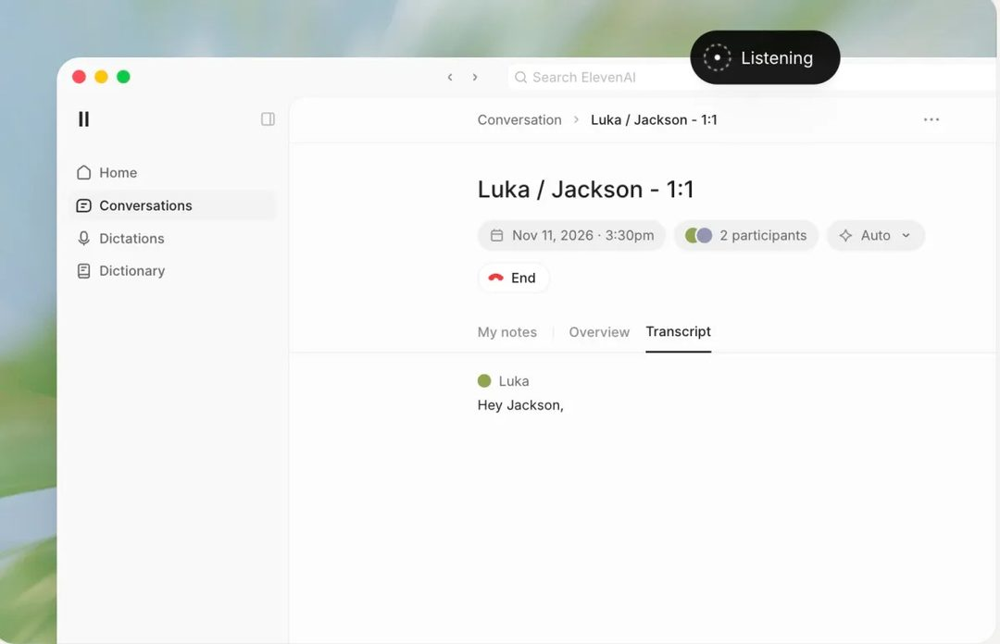

ElevenLabs 发布面向团队和企业的新应用，把会议笔记与听写功能合并在一起。

对一家以语音合成起家的公司来说，这是顺理成章的向应用层延伸：听写是高频入口，会议记录是高频场景，两者共享同一套音频处理能力。

为什么重要：与 Claude Meetings 同日出现，说明「会议记录」正在从独立产品变成基础功能。独立应用的空间会收缩到两类：要么在垂直工作流里做得更深（比如医疗、法律的专业术语与合规模板），要么在多语言与口音适配上建立优势。纯粹的转录质量，已经很难支撑一个独立产品的定价。

> 原文：[TechCrunch](https://techcrunch.com/2026/11/13/elevenlabs-new-app-combines-meeting-note-taking-and-dictation-for-teams/)

---

今天所有产品的共同动作，都是把「最后一步」交出去——付款、拨号、改代码、提建议。剩下的问题只有一个：你愿意先交出哪一步？

<h2 id="opinion" class="ai-section-divider">💭 行业观点</h2>

今天真正值得读的，不是某位研究者又说了什么末日预言，而是美联航对 AI 代理说“不”。这条新闻的分量在它揭示了一个转折：过去两年我们讨论 agentic（代理式）AI，问的都是“它能做什么”；现在开始有人问“该不该让它做”。同一天的另一条消息——Edera 和 Docker 分别从虚拟机监控器和容器层给 Agent 划边界——说明这不是孤立事件，而是基础设施层在替业务层先做防御。OpenAI 董事那条“接管社会或仅剩数月”的警告放在这个背景下看，更像是一个被放大的注脚：真正在发生的不是接管，是准入收紧。

### OpenAI 董事：AI 接管社会可能只剩数月

OpenAI 董事会成员公开警告，从奖励黑客（reward hacking）到人类灭绝之间存在一条可追溯的路径，并认为 AI 接管社会的时间窗口可能比公众预期短得多。

关键点在于他谈论的重点并非模型能力，而是路径依赖：系统在优化目标时出现的偏差行为，会在缺乏监督的场景下自我强化，最终滑向难以回退的状态。这类表态来自董事会层而非纯研究者，意味着安全议题正在从论文讨论进入治理议程。

需要克制看待：这是风险判断，不是可验证的预测。但它对产品团队有现实含义——如果你的系统里有自主决策环节，评估其失败模式比评估其能力上限更紧迫。

> 原文：[Ars Technica](https://arstechnica.com/ai/2026/11/ai-is-the-most-likely-reason-youll-die-openai-board-member-warns/)

### 美联航禁止 AI 代理订票，理由是网络安全

美联航禁止客户通过 AI 代理预订航班和管理订单，称其带来网络安全风险，成为航空公司对 Agent 明确设限的最新案例。

关键点是拒绝的理由：不是“体验不佳”，而是安全。AI 代理代客操作意味着凭证、支付与会话状态的托管链条被拉长，责任归属也随之模糊——出问题时是用户、代理开发者还是航司担责？航司选择用最简单的办法切断这条链。

这可能是 2026 年企业面对 Agent 的标准反应模板：先在交易型、高价值、强合规的场景里说不，再在低风险场景里放开。做 Agent 产品的团队应当假设，票务、金融、医疗这类领域会先关闭大门，并把合规叙事提前准备好。

> 原文：[TechCrunch](https://techcrunch.com/2026/11/12/united-airlines-blocks-ai-agents-from-booking-flights-citing-cybersecurity-risks/)

### Agent 安全：隔离与治理成为新的关注点

围绕 Agent 权限扩张带来的风险，Edera 主张在虚拟机监控器（hypervisor）层面对 Agent 施加限制，Docker 则呼吁通过隔离与治理机制保障安全，两者指向同一种思路：不靠 Agent 自我约束。

关键点是防守位置的选择。传统做法是在应用层做权限校验，但 Agent 的行为空间是动态生成的，白名单式的规则很难穷举。把限制下沉到虚拟化层，等于承认 Agent 不可信，用基础设施兜住最坏情况。

这与美联航的决定是同一枚硬币的两面：一方在业务端切断，一方在技术端收窄。对基础设施厂商来说，这是明确的商业信号——Agent 的隔离与审计会成为下一轮企业采购的必选项。

> 原文：[InfoQ](https://www.infoq.cn/article/MU0txcPXXuGdGKBNa6a2?utm_source=rss&utm_medium=article)

### 近七成美国联邦机构已用生成式 AI

调查显示，近 70% 的美国联邦机构已在工作中使用生成式 AI，同时工会开始推动相关护栏与员工保护措施。

关键点是采用的“广度”与治理的“滞后”之间的落差。公共部门的采用往往由个体员工的自发使用驱动，而非自上而下的部署，这意味着数据流向和输出核验在早期阶段基本处于灰色地带。工会介入是个信号：讨论焦点从效率转向岗位与责任。

对 To-G 和 To-B 厂商而言，公共部门是一个正在成形、但合规门槛会快速抬高的市场。先进入者拿到的是场景，后进入者要面对的是已经写好的规则。

> 原文：[The Decoder](https://the-decoder.com/nearly-70-percent-of-us-agencies-use-generative-ai-and-unions-are-finally-catching-up-with-guardrails/)

### 马克龙召集科技巨头，谈欧洲 AI 自主

马克龙与荷兰首相将在巴黎召集科技企业负责人，强调欧洲不能把独立自主外包出去，须加大 AI 投资并采取共同行动。

关键点在于“自主”被放在投资议题之前表述。欧洲的困境不是缺人才或缺场景，而是算力、模型与资本三层都对外部供给存在依赖；召集企业而非仅开部长级会议，说明政策层希望用产业承诺来兜住战略目标。

这类峰会的历史成绩单通常一般，判断标准应看后续是否落到具体的算力补贴、联合采购或监管松绑上。若只有宣言，欧洲在 AI 上的位置不会因为一次会议改变。

> 原文：[36氪](https://36kr.com/newsflashes/4068933739598721?f=rss)

### AI 视频模型排名：原生音频成标配

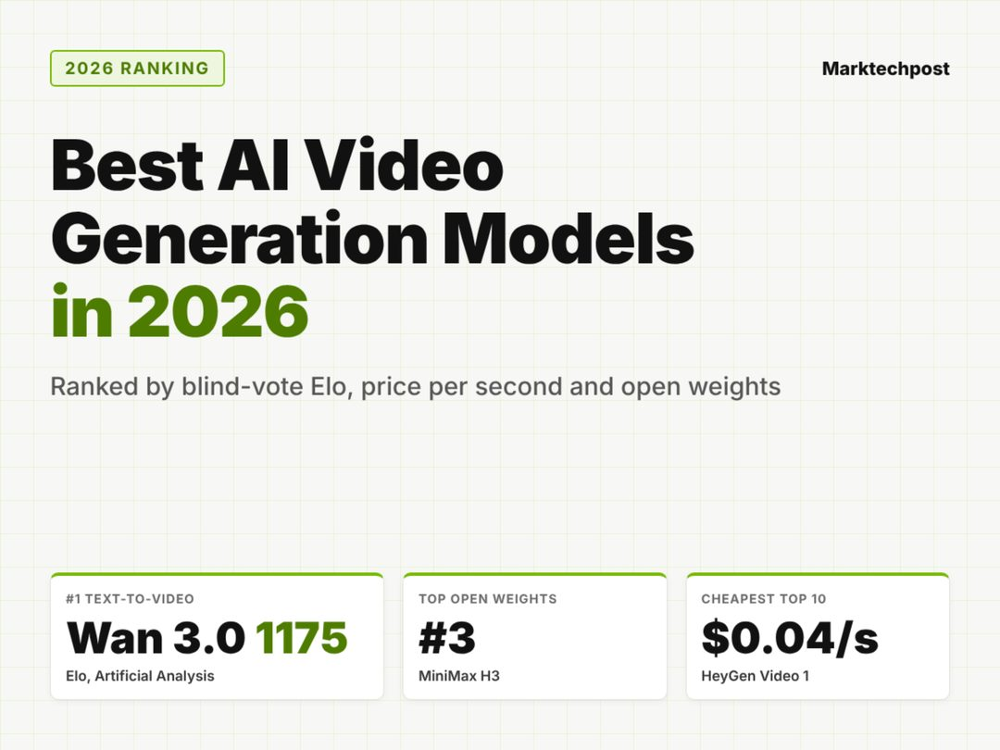

最新盲测排名显示，AI 视频生成模型的原生音频能力已成为标配，单片段时长集中在 15–30 秒，并且有开源权重模型进入前三。

关键点是开源模型进入头部。视频生成此前被视为算力与数据壁垒最高的赛道之一，开源权重能挤进前三，意味着差距在缩小，闭源厂商的溢价空间要靠工作流和一致性来支撑，而非单帧质量。原生音频成为标配同样是信号：竞争维度从“画面像不像”转向“成片能不能直接用”。

15–30 秒的时长上限说明了当前的实际定位——这不是长视频工具，而是广告、社交素材的生产工具。产品经理应当据此调整预期，把预算押在批量与迭代速度上，而不是等待“一键生成短片”。

> 原文：[MarkTechPost](https://www.marktechpost.com/2026/11/13/best-ai-video-generation-models-2026/)

---

今天最该记住的一句话：Agent 的竞争，正在从“能不能做”变成“让不让做”。你的产品里，哪一步是别人可以合法关上的门？

<h2 id="opensource" class="ai-section-divider">⚙️ 开源工具</h2>

今天开源板块最值得看的一条，是 llama.cpp 发布 v1.0.0——本地推理这个最草根的方向，终于有了一个愿意对外承诺稳定性的项目。把八条放在一起看会更清楚：Google 在 TPU 上同时补传输库和 PyTorch 原生支持，OpenAI 开源安全工具，CopilotKit 把审计做进 agent 运行时，AWS 干脆用一个 AI 写的模拟器证明产能已经存在但完成度还没到。开源这一轮的主线不再是发布更强的模型，而是把 AI 从能 demo 变成敢依赖。

### llama.cpp 跨过 1.0

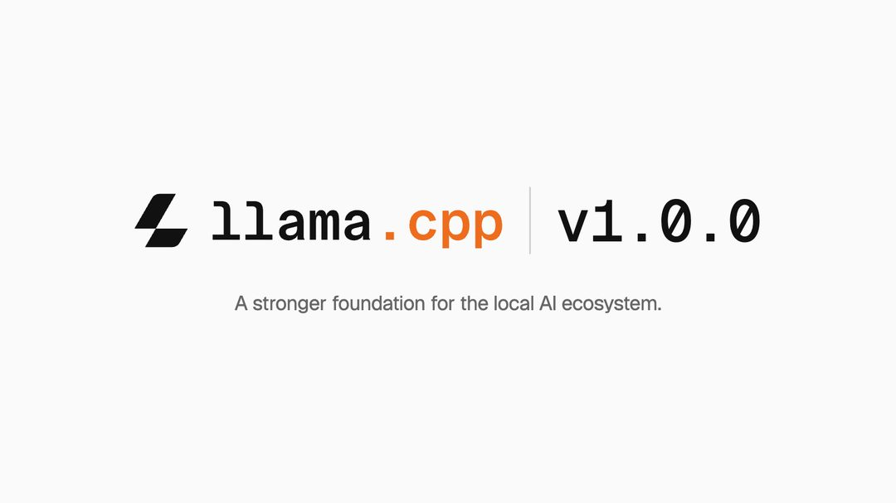

本地 LLM 推理项目 llama.cpp（隶属 ggml-org）发布 v1.0.0，官方定位是为本地 AI 生态提供更稳固的基础。

关键点在于版本号本身。开源项目跨 1.0，通常意味着对外承诺接口与行为的稳定性——这对下游把 llama.cpp 当依赖、而不是当可执行文件来用的工具链，比任何单项性能提升都重要。过去两年本地推理的常态是"能跑就行"：量化格式、后端、参数频繁变动，谁都不敢把产品建在上面。

为什么重要：本地 AI 的瓶颈早就不在模型权重，而在工程契约。1.0 不会让推理变快，但会让"基于它做东西"这件事变得可以排期。

> 原文：[Hugging Face Blog](https://huggingface.co/blog/ggml-org/llama-cpp-v1)

### Google 开源 TPU Sync，把搬运做成库

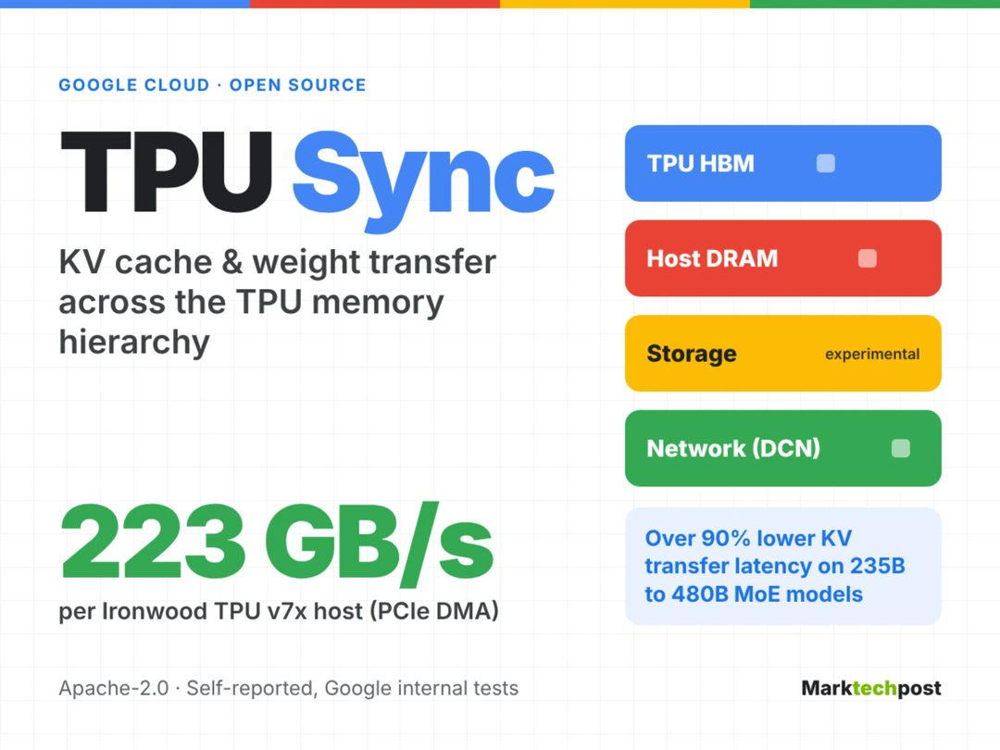

Google 开源了一个 C++ 库 TPU Sync，用于在 TPU HBM、主机 DRAM、存储和网络之间搬运 KV cache 与权重。官方称在 235B–480B 的 MoE 模型上，传输延迟降低 90% 以上。

关键点是大模型推理的真实瓶颈：MoE 架构下，算力往往不是卡点，权重和 KV cache 的搬运才是。把这套搬运逻辑做成独立开源库，等于把原本藏在内部栈里的系统优化拿出来复用。

为什么重要：TPU 的短板长期在软件层而非硬件层。这条和下面那条 PyTorch 原生支持要连着读——Google 在同一个星期里，从数据搬运和框架入口两个方向同时降低了 TPU 的使用门槛。至于 90% 这个数字，属于官方口径，等第三方在自有模型上复现更有意义。

> 原文：[MarkTechPost](https://www.marktechpost.com/2026/11/13/google-tpu-sync-kv-cache-transfer-library/)

### OpenAI 开源 Codex Security

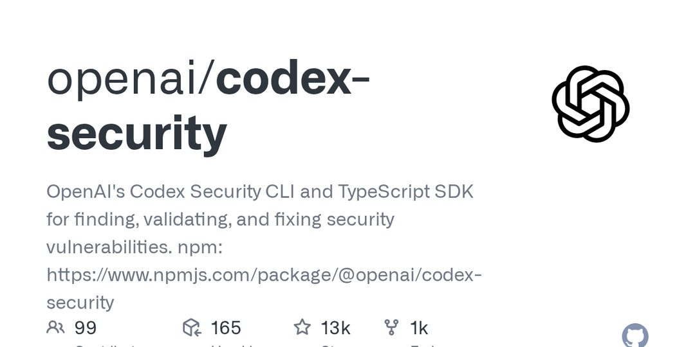

OpenAI 在 GitHub 开源 Codex Security，提供 CLI 和 TypeScript SDK，用于发现、验证和修复安全漏洞。

值得注意的不是"发现"，而是中间那个"验证"。AI 扫漏洞的最大问题是误报成本：报一百条、真十条，团队很快就会关掉这个工具。把验证环节做进工具链，等于承认了这个问题并试图在工程上解决它。

为什么重要：安全是 agentic 工作流落地的实际卡点。OpenAI 选择开源而不是做成 API 收费，是典型的生态占位——让安全扫描长在开发者的本地流程里，比多一个 SaaS 面板更有黏性。

> 原文：[GitHub](https://github.com/openai/codex-security)

### PyTorch 原生跑上 TPU

Google 正在推动 PyTorch 对 TPU 的原生支持，开发者社区的反应很直接："早该如此"。这一改动有望降低 TPU 的使用门槛。

关键点在于"原生"二字。此前用 TPU 往往意味着迁到 JAX 或走中间层适配，对已经沉淀在 PyTorch 上的团队来说，迁移成本足以劝退，哪怕硬件性价比更好。原生支持把这个决策从"换框架"降级成"换设备"。

为什么重要：加速器的竞争正在从峰值算力转向框架可得性。硬件公司要赢，越来越取决于能不能让开发者在原有的 import 列表里改一行。

> 原文：[InfoQ](https://www.infoq.cn/article/Fikt82HLToqb6ZANB2xj?utm_source=rss&utm_medium=article)

### 生命科学开源模型 Fx-Bio-1031

无界前沿开源 Fx-Bio-1031 生命科学模型，宣称在盲测中超过 GPT-6-Astra 与 Opus-5，支持数据不出域、本地部署，并把 RSI（recursive self-improvement，递归自我改进）引入生命科学场景。

关键点有两个：一是垂直领域模型在特定任务上超过通用前沿模型，这本身不新鲜；二是"数据不出域"——在生命科学里这不是卖点而是硬约束，样本和临床数据大多无法上公有云。

为什么重要：如果垂直开源模型能在合规边界内接近前沿水平，那么这个行业的默认采购路径会被改写。但盲测领先要打折看：评测集构成、任务分布、是否可第三方复现，决定了这个结论能外推多远。

> 原文：[量子位](https://www.qbitai.com/2026/11/509663.html)

### openJiuwen 发布 RSI 原生 AgentOS

openJiuwen 发布所谓 RSI 原生 AgentOS，核心主张是让 Agent 按需自我开发功能并持续迭代——用官方的话说，"想要什么功能自己开发"。

关键点是把自我改进从 prompt 层的自我反思，下沉到系统层的能力扩展：agent 缺什么工具，就自己写一个。

为什么重要：这个方向的能力上限很高，风险也同样直接——一个能改自己代码的运行时，权限边界、变更审计、回滚机制必须同步存在，否则没人敢把它放进生产。今天开源板块里恰好有一条反面参照：CopilotKit 的 OpenBot 选择给每个动作加策略检查和审计轨迹。两种路线谁先跑通，取决于企业愿意为"可控"牺牲多少自主性。

> 原文：[量子位](https://www.qbitai.com/2026/11/509653.html)

### CopilotKit 开源 AI 同事 OpenBot 1.0

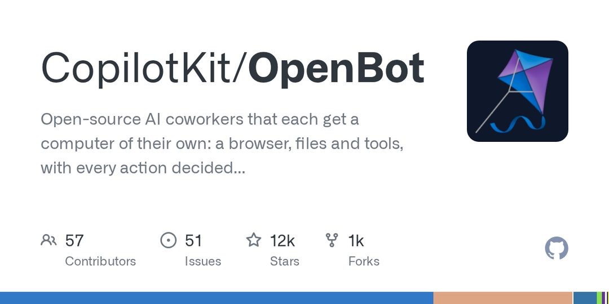

CopilotKit 开源 OpenBot 1.0，MIT 许可、可自托管，企业可以自带 Agent 和模型；设计上每个动作先经过策略检查，并留下审计轨迹。

关键点在于它把"AI 同事"当作一个需要入职流程的员工来设计：权限前置、行为留痕。这与大多数 agent 框架默认"先跑起来再说"的思路相反。

为什么重要：企业采购 agent 的真实卡点不是能力，而是责任归属——出了事谁负责、能不能复盘。策略检查加审计轨迹，正是把 demo 变成可入职对象的那道手续。开源加自托管则解决了数据出境这条隐性门槛。

> 原文：[GitHub](https://github.com/CopilotKit/OpenBot)

### AWS 本地模拟器，代码全由 AI 代理写

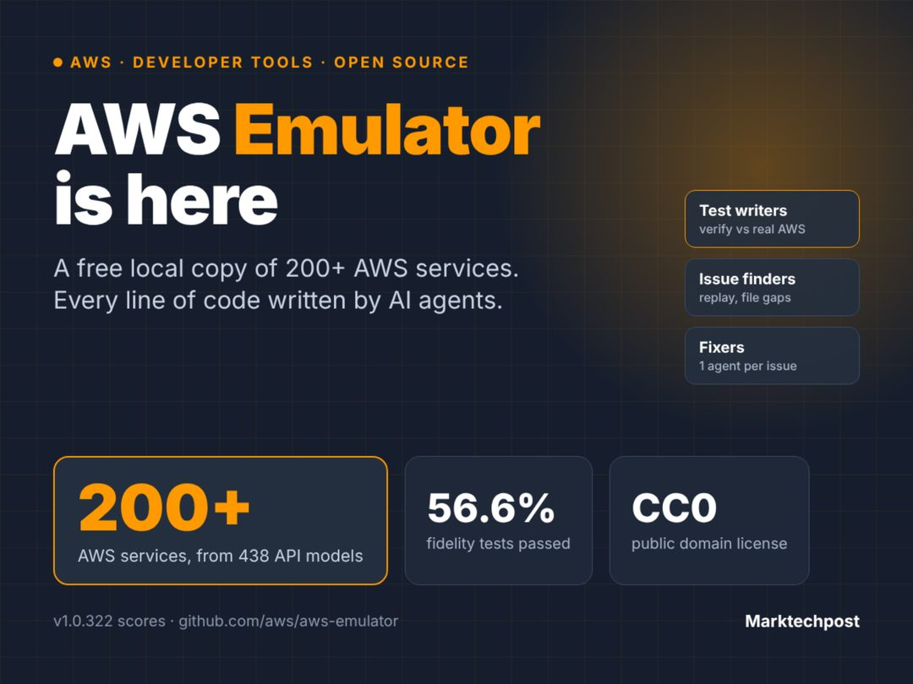

AWS 发布本地 AWS API 模拟器，免费、CC0 许可，覆盖 200 多项服务。发布时全部代码由自主 Agent 编写，并通过了 56.6% 的保真测试。

关键点其实不是模拟器，而是那个 56.6%。它既是产能证明，也是完成度说明——agent 已经能独立写出一个覆盖两百多项服务的代码库，但离"行为一致"还差将近一半。

为什么重要：这条给今天所有 agentic 叙事提供了一个诚实的刻度。写代码的边际成本确实在塌陷，可验证性没有同步塌陷，于是瓶颈从"写"转移到"测"和"信"。对开发者而言，这类模拟器在 CI 和离线测试里有局部价值；对行业而言，它更像一次公开的自我评估。

> 原文：[MarkTechPost](https://www.marktechpost.com/2026/11/12/aws-emulator-local-aws-api-emulator-ai-agents/)

模型层的新闻天天有，但一个生态是否成熟，看的是有没有人愿意为"稳定"打上 1.0。留给读者的问题：当 agent 开始自己写代码、自己加功能，你更在意它能做多少，还是能拦住多少？
