今天最值得看的三件事：

- **公司动态** · 黄仁勋辞任英伟达 CEO，AI 圈震动
- **应用产品** · ChatGPT Wallet 上线，AI 代理可代用户下单付款
- **模型发布** · Gemini 4 Carbon 登顶 MathArena，成本却高 15 倍

下文按板块展开，正文每条均附原始链接。

<h2 id="model-release" class="ai-section-divider">🚀 模型发布</h2>

今天模型发布板块只有两条，但正好构成一组对照。一条是 Gemini 4 Carbon 在 MathArena 上拿了第一，代价是单次调用成本约为 GPT-6.1 Sol 的 15 倍；另一条是 Perplexity 把决策模型做成开放权重，直接输出概率而非文本。前者把「能力上限」推高，后者把「可用性」往下压。同一个赛道，两种竞争维度正在分叉。

### Gemini 4 Carbon：MathArena 第一，单价 15 倍

谷歌 Gemini 4 Carbon 在 MathArena 数学基准上登顶。名次之外，更值得看的是价格：据报道，其每次调用成本约为 GPT-6.1 Sol 的 15 倍。

数学推理恰好是当前 agentic 工作流里调用最密集的场景之一——一道题往往对应多次尝试、多轮校验。15 倍差价放在单次调用上只是数字，放在每天百万次调用的流水线上就是毛利结构问题。

这引出一个老问题：基准第一衡量的是能力上限，不衡量单位经济性。「能不能做对」和「每次做对要花多少钱」正在变成两个独立的选型决策。如果后续版本不能把成本压下来，这个冠军更接近技术展示，而非默认选项。

> 原文：[The Decoder](https://the-decoder.com/gemini-4-carbon-takes-the-matharena-crown-but-costs-15-times-more-than-gpt-6-1-sol/)

### Perplexity 的 Decider v1.3：不写句子，直接给概率

Perplexity 发布 Decider v1.3 与 Flash v1.3，两者均为开放权重（open-weight）模型。版本号不是重点，输出形态才是：模型直接给出概率，而不是先写一段文本、再由调用方去解析结论。同时新增 Locate 能力，用于从文本中抽取片段。

对做 agent、路由、检索排序的团队来说，这意味着模型的产出可以直接接入下游逻辑，省掉一层解析，也省掉一层「模型措辞是否稳定」的不确定性。开放权重则允许自托管，按自己的延迟和成本预算部署。

它不打算取代通用对话模型。但在那些需要「一个可计算的判断」而不是「一段解释」的位置上，这类模型的性价比明显更高——这恰好是 Gemini 4 Carbon 那种高价能力未必划算的地方。

> 原文：[Perplexity Blog](https://www.perplexity.ai/hub/blog/perplexity-decider)

两条新闻其实是同一枚硬币的两面：一个在证明模型能多强，一个在证明模型能被多便宜地用起来。留给你的问题是——你的模型预算表，是按能力排的，还是按单位成本排的？

<h2 id="company" class="ai-section-divider">🏢 公司动态</h2>

今天这个板块里，重量级最集中的不是哪家新公司拿了融资，而是英伟达 —— 它一家占了三条，分别指向公司治理、市场交易结构和出口管制三个不同的风险面。黄仁勋辞任 CEO 是其中唯一真正意义上的一次冲击：创始人过往一直是英伟达 AI 叙事的载体，这个节点消失后，市场必须重新为“不确定性”定价。把另外两条 (循环融资指控、中国模型仍在被禁芯片上训练) 放在一起看，这个定价会比单看一条更复杂。在监管与地缘政策重新进入董事会决策的时代，创始人的个人风险已经不再是私人问题。

### 黄仁勋辞任 CEO，一日之内背上三重叙事

TechCrunch 报道，英伟达 CEO 黄仁勋因个人关系与芯片出口风险辞任。报道把起因指向其个人关系，相关方被指为疑似中国间谍。事件随后引出员工请愿、亚洲多国政府关注，以及风险投资人对 AI 融资前景的担忧。

关键点不在于个人事件本身，而在于它同时触发了三件本不相关的事：公司治理、出口管制、以及一级市场的信心。黄仁勋长期是英伟达叙事的载体 —— 产品路线图、大客户关系、对华销售的政策沟通，都高度绑定在他个人身上。创始人本人就是估值逻辑一部分的公司，一旦这个节点消失，市场就需要重新评估治理折价。更棘手的是，这种冲击发生在出口管制已成为核心经营变量的时点；同板块另外两条英伟达消息，让这次人事变动很难被当作孤立事件消化。

> 原文：[TechCrunch](https://techcrunch.com/2026/11/13/nvidia-ceo-jensen-huangs-affair-with-alleged-chinese-spy-a-timeline/)

### Anthropic 冲击创纪录 IPO，Amodei 提前给市场打预防针

Anthropic 即将启动一轮创纪录的 IPO。CEO Dario Amodei 在上市前数日公开表示，“明年会发生什么存在巨大的不确定性”。与此同时，承销银行因美国出口管制要求，拒绝中国内地及香港投资者参与。

一个创始人在 IPO 窗口承认看不清明年，在常规语境里是减分项；放在当前环境里更像一次预期管理 —— 把不确定性提前说出口，好过上市后被季度数字反复拷问。更值得注意的是承销团主动剔除非美资本，这既是合规动作，也意味着这次发行的资金池被地理边界人为切小了一块。创纪录的发行规模与收缩的买家结构叠在一起，定价权会向承销方和少数大型机构倾斜。对一级市场来说这是一个可参照的信号：地缘政治不再只是招股书里的风险因素章节，它已经进入订单簿。

> 原文：[The Decoder](https://the-decoder.com/anthropic-ceo-amodei-admits-theres-a-huge-uncertainty-in-whats-going-to-happen-next-year-days-before-a-record-ipo/)

### 循环融资：英伟达被指自己制造 GPU 稀缺

TechPowerUp 援引报道称，英伟达通过投资 AI 初创公司、再由这些公司采购自家 GPU 的方式，人为制造稀缺并维持高价，相关做法已引发监管与市场争议。

这个指控的结构并不新鲜：供应商用资本换需求，在半导体和电信行业都出现过。区别在规模与时机 —— 当 GPU 是全球最紧俏的算力资产时，“投资—采购”的闭环会污染真实的供需信号。如果报道成立，市场看到的排队长度与溢价，有一部分是英伟达自己出资买出来的。直接后果是监管问询概率上升；更麻烦的是间接后果：下游客户与投资人对“算力短缺”这一叙事的信任度会被打折，而过去两年 AI 基础设施的估值扩张，很大程度上建立在这个叙事之上。

> 原文：[TechPowerUp](https://www.techpowerup.com/354814/nvidia-allegedly-engineered-scarcity-by-funding-ai-startups-to-buy-its-gpus)

### LangChain 估值 30 亿美元，LangSmith 客户 7000 家

AI 智能体平台 LangChain 完成新一轮融资，估值升至 30 亿美元。比估值更有信息量的是客户数：其模型无关的智能体管理工具 LangSmith 已有 7000 家客户。

“模型无关”（model-agnostic）是这条消息的关键词。过去两年，应用层团队最实际的痛点是模型换代太快，任何深度绑定单一供应商的编排代码都会过时。LangChain 卖的不是模型能力，而是切换成本 —— 把 agent（智能体）的编排、追踪、评测做成一层抽象，无论哪个模型胜出它都能收钱。7000 家客户说明这层抽象已经有人付费，但也意味着它必须持续证明自己比客户自建更划算。在大模型厂商纷纷把工具链收进自家平台的趋势下，中间层的护城河最终仍要落在可观测性与评测基准上。

> 原文：[TechCrunch](https://techcrunch.com/2026/11/13/ai-agent-startup-langchain-hits-3b-valuation/)

### OpenAI 解散机器人团队，赌通用模型能直接驱动本体

OpenAI 已将机器人团队的研究员重新分配到其他团队，等同于解散这支队伍。官方理由是：通用大模型的能力进步，可能让专门为机器人打造的 AI 变得不再必要。

这是一次方向性表态，而不是收缩。OpenAI 的判断是，机器人的瓶颈正从“专用控制策略”转移到“通用模型的迁移能力” —— 如果同一个模型能读文档、写代码，也能在少量适配后驱动机器人，那么单独维护一支机器人 AI 团队的边际收益就会下降。风险在于硬件侧的现实约束并未消失：实时性、力控、安全冗余，都不是靠模型规模能解决的。研究员调走之后，OpenAI 在具身智能上的位置更接近“提供大脑”，把本体与中间层留给外部。这个选择是否成立，取决于通用模型在真实物理环境里的鲁棒性能否追上实验室演示。

> 原文：[Fortune](https://fortune.com/2026/11/13/openai-disbands-robotics-team-as-its-general-models-start-running-robots/)

### 研究称中国最强模型训练于被禁英伟达芯片

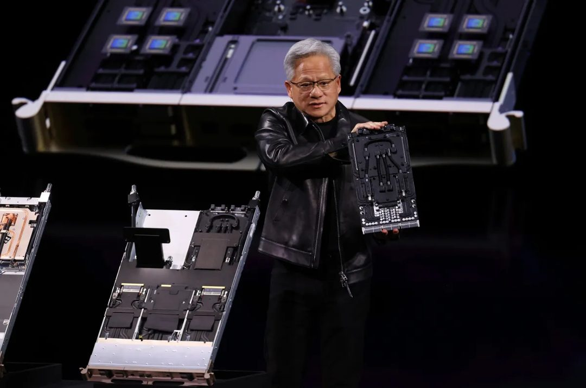

一项新研究显示，中国当前最先进的一批 AI 模型，是在美国出口禁令所针对的英伟达芯片上完成训练的。这一发现可能让持续数年的出口管制争论进一步升温。

它的分量在于把政策问题变成了可测量的问题。管制的设计前提是“卡住硬件就能拖慢模型能力”，而研究给出了相反的观察：至少在最前沿的那批模型上，禁令针对的芯片仍然出现在训练链路里。渠道可能有很多种 —— 存量设备、第三方转口、云端租用 —— 但无论哪一条，都指向同一个结论：以芯片型号为单位的管制，在执行中会被稀释。对英伟达来说这又是一条压力线：它既要面对本国监管对“管制是否有效”的追问，也要面对亚洲客户对供应稳定性的疑虑。

> 原文：[TechCrunch](https://techcrunch.com/2026/11/13/export-banned-nvidia-chips-are-behind-chinas-most-powerful-ai-models-uh-oh-jensen/)

### 中金与蚂蚁共建财富管理智能体

中金公司与蚂蚁集团签署战略协议，合作围绕金融大模型、AI 财富管理与智能体评测基准展开。

三项内容里最值得看的是最后一项。金融机构对 AI 的态度一贯是“可用但要可审计”，而智能体在财富管理场景里天然涉及适当性、留痕与责任归属 —— 这些都不能靠模型自己保证。把“评测基准”写进战略协议，等于承认这一层目前没有行业标准，需要由持牌机构与技术方共同定义。中金出场景与合规框架，蚂蚁出模型工程与规模化用户触点，分工相当清晰。真正的看点不是谁发布了什么模型，而是这套评测标准未来会不会成为行业默认项 —— 如果是，它的长期价值大过任何一个财富管理 App 的功能更新。

> 原文：[36氪](https://36kr.com/newsflashes/4069303294546825?f=rss)

---

今天这七条消息里，英伟达一家占了三条，且分别指向治理、交易结构与监管三个不同的风险面。留一个问题：当一家公司的这三条线同时承压时，你会先看哪一个信号？

<h2 id="research" class="ai-section-divider">🔬 研究论文</h2>

把今天这 6 条按顺序读下来，是一条完整的链路：一端是 AI 在帮人类辨读哥德尔（Kurt Gödel）尘封的手稿，另一端是十余家团队联合证明，现有模型连一道湿实验预测题都做不对。更有信息量的其实是后半段——“做不到”第一次被多个团队用统一评测标准公开记录下来，而不是散落在各家博客的脚注里。对做模型的人来说，今天的新闻不是一份能力清单，而是一份体检报告：记忆、意图、世界模型、权重编辑，四个方向各有一处明确的短板。短板被指出来，比又刷一个 SOTA 更值得读。

### AI 帮数学史打开哥德尔的笔记本

据《卫报》报道，AI 工具被用于解读库尔特·哥德尔留下的笔记，据称其中包含数百条此前未被识别的、已经完成的数学证明。关键点在于“识别”与“成立”之间还有很长的距离：手稿的辨读历来依赖极少数能读原始笔迹与私人记法的人，AI 在这里扮演的是辨字、补全与检索的组合角色，而不是“发现定理”。数百条这个量级本身就需要警惕——它既可能是真的富矿，也可能是把草稿、重复表述与自我批注一并计入的结果，必须由数学史家与同行逐条核验。为什么重要：如果这条路走通，受益的是所有躺在档案馆里的手稿，数学、物理、哲学都一样。历史研究的产能瓶颈，第一次有可能被工具松动，而这是过去十年数字化扫描没能解决的部分。

> 原文：[The Guardian](https://www.theguardian.com/science/2026/nov/13/kurt-godel-notebooks-ai-helps-unlock-hidden-discoveries-man-who-transformed-maths)

### 16 个 token 装下一批文档

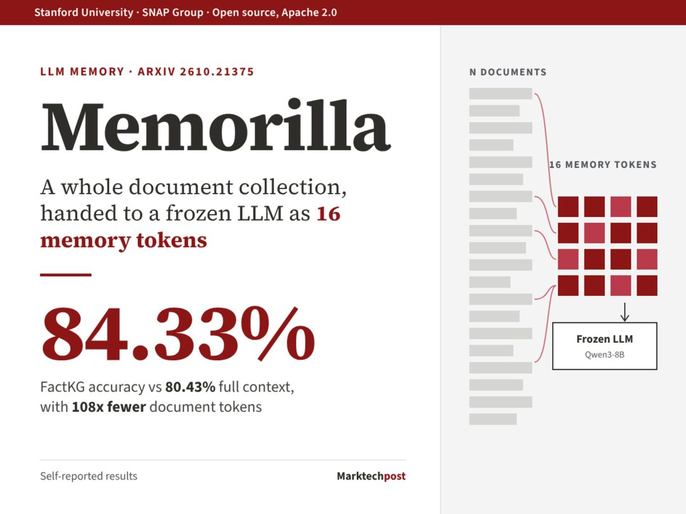

斯坦福团队开源 Memorilla 记忆模块，可把文档集合压缩为 16 个记忆 token 注入冻结的 Qwen3-8B，在 FactKG 上达到 84.33%。关键点有两个：模型权重完全不动，记忆以 token 形式外挂；容量被压到 16 个 token，等于强迫系统只保留“最该记住的”那部分信息。这与 RAG 的隐含假设正相反——RAG 是“原文留着，用的时候再查”，Memorilla 是“读的时候先压扁”。为什么重要：压缩率越高，代价越难审计，你无法直观知道它丢掉了什么，而事实型问答的失败往往就藏在被丢掉的那一条里。对正在做 agent memory 或企业知识库的团队，这是一个成本很低、值得亲手跑的对照实验。

> 原文：[MarkTechPost](https://www.marktechpost.com/2026/11/14/stanford-memorilla-memory-system-16-memory-tokens/)

### 一场没人及格的湿实验考试

十余家顶尖团队联合发布湿实验预测基准，结果显示即使把推理拉到最满、算力翻 5 倍，现有模型仍难以胜任。关键点在“联合”二字：评测口径由多方事先对齐，排除了单一团队自评时的选择性偏差；“算力翻 5 倍仍不行”则是对 scaling 叙事的一次直接回应。为什么重要：湿实验预测的难点不在知识量，而在那些从未被写进论文的隐含条件——批次效应、操作细节、失败实验的数据，恰恰是公开语料里最稀缺的部分。这类基准的价值不是排名，而是把“做不到”公开钉在墙上，让下一轮工作有明确的靶子。对投资人来说，这也是一个提醒：生物方向的 AI 叙事，短期内仍应放在辅助设计与文献层面，而不是“预测实验结果”。

> 原文：[量子位](https://www.qbitai.com/2026/11/510232.html)

### 模型答对了，但不是你要的答案

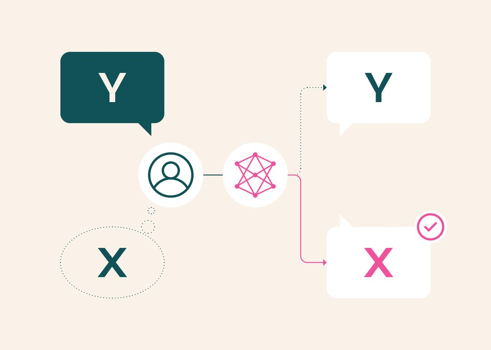

AllenAI 在 Hugging Face 博客介绍 XYBench，试图衡量模型能否理解用户问题背后未明说的目标，而不只是回答表层问题。关键点是评测对象的迁移：从“答案是否正确”转向“意图是否对齐”，前者可以用标准答案判分，后者必须构造出“表层答对、实质答错”的陷阱样本，这也是这个基准真正的设计难点。为什么重要：在 agentic 系统里，误解意图的代价远高于答错一道题——它会自信而坚定地做错事，而且每一步看起来都合规。意图理解如果无法测量，产品侧就只能靠 prompt 补丁一层层堆，这是当前 agent 落地最不体面、也最耗人的一块工作。

> 原文：[Hugging Face Blog](https://huggingface.co/blog/allenai/xybench)

### 600 次实验之后，JEPA 还差什么

有研究者发布实验长文，总结围绕 JEPA 世界模型的 600 次实验，分析其表征学习能力、失败模式，以及与通用世界模型之间的距离。关键点在于这是一份以负结果为导向的报告：公开失败模式，对领域的边际价值高于再刷一个指标。为什么重要：世界模型是过去两年最容易被口号化的方向，“学到了好表征”和“能预测干预后的后果”之间隔着很远的距离，而后者才是“世界模型”这个词的本义。600 次实验的规模意味着结论有一定稳定性，不是单次调参的偶然。做具身智能、视频预测、强化学习环境建模的团队，值得把这篇当技术报告逐节读，而不是当观点文章扫过。

> 原文：[haddyalchaer.com](https://haddyalchaer.com/jepa)

### 让 LLM 直接改权重，不碰梯度

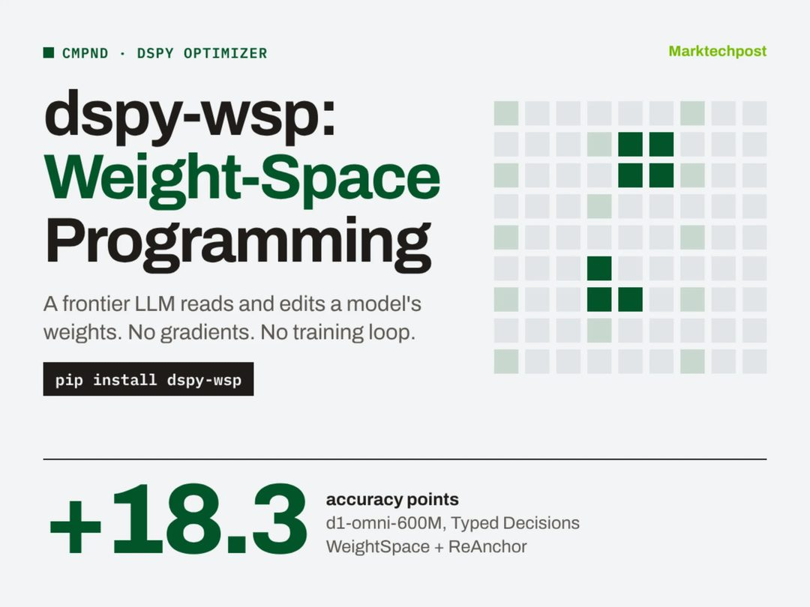

Cmpnd 发布 DSPy 优化器原型 dspy-wsp，让前沿 LLM 在沙箱中读取并修改小模型的权重，无需梯度，单次运行成本约 5–10 美元。关键点是把“优化”重新表述为“代码编辑”：模型看懂权重、动手改权重，人在沙箱外看着，整套流程不需要反向传播，也不需要标注数据管线。单次成本落在个位数美元，说明它已经具备日常反复运行的可行性。为什么重要：小模型定制的门槛一直卡在数据与训练工程上，如果权重可以被“写”出来，这条路会绕开大部分基础设施。但要回答的问题也很硬——沙箱里的编辑如何保证不把模型改坏、如何从百万级参数扩到更大规模、结果能否复现。对 DSPy 生态而言，这是从“优化 prompt”跨到“优化参数”的一步，方向比当下的效果更值得关注。

> 原文：[MarkTechPost](https://www.marktechpost.com/2026/11/14/cmpnd-dspy-wsp-weight-space-programming/)

---

今天最响的信号不是 AI 又读懂了什么，而是有人开始认真出它答不对的题。当基准比模型更受讨论，这个领域大概是在变健康——问题是，你手上的项目，敢不敢也先做一份这样的体检报告？

<h2 id="product" class="ai-section-divider">📱 应用产品</h2>

### 导语

OpenAI 上线 ChatGPT Wallet，让 ChatGPT Work、Codex 里的智能体在用户批准后完成下单付款，并且沿用现有信用卡保护。这件事的意义不在“多了一个支付入口”，而在于 agentic commerce 第一次把「谁授权、谁负责、谁赔付」这条链摆到了产品层。过去两年，agent 的能力边界是“能不能做对”，从今天起多了一条——“做完能不能收钱”。支付是 agent 从 demo 走进生产流程的关键一步，也是最难回头的一步。

### ChatGPT Wallet：代理下单，人留在授权环节

OpenAI 推出 ChatGPT Wallet，让 ChatGPT Work、Codex 等产品中的智能体在用户批准的前提下完成购买，交易沿用现有信用卡保护体系。关键点有两个：一是授权动作被显式保留在人这一侧，agent 负责的是“把购买执行完”，不是“决定花多少钱”；二是 OpenAI 没有另起一套支付与风控，而是挂在既有卡组织保护之上，等于把新交互塞进旧责任框架。为什么重要：agent 产品长期卡在“能建议、不能落账”，钱包把最后一公里打通，也把退款、误购、超额消费这些纠纷第一次变成 AI 产品经理要处理的问题。谁定义“批准”的粒度和撤销机制，谁就掌握了这个品类的话语权。

> 原文：[OpenAI](https://openai.com/index/introducing-chatgpt-wallet)

### DeepSeek 开放全家桶 API：把 App 拆成积木

DeepSeek 开放了覆盖官方 App 全部功能的 API，开发者可以自由组合调用模型、搜索、推理等能力。关键点在于粒度——开放的是一整套能力编排，而不只是模型推理接口，意味着官方 App 的产品形态本身被降维成了可复用的组件。为什么重要：这是把 C 端体验当作 SDK 来卖，第三方复刻一个“DeepSeek 式产品”的门槛被大幅拉低，生态扩张会很快；但代价是产品差异化的护城河从“功能”退到“分发与数据”。对开发者是利好，对同赛道应用层公司则是一次价格与创意的双重挤压。

> 原文：[量子位](https://www.qbitai.com/2026/11/510003.html)

### FAA 把 AI 流量建议推向全美空域

美国联邦航空管理局（FAA）将 AI 流量建议工具从局部试点扩展到整个国家空域，用于缓解拥堵。两个细节值得注意：工具给的是“建议”，管制员仍在决策环内；航空公司表示欢迎，但空管工会没有参与其中。为什么重要：这是 AI 进入公共安全关键系统（safety-critical）的典型样本——技术指标之外，真正的阻力往往来自组织认同与责任归属，而非模型准确率。当效率收益归运营方、风险归一线操作者时，缺席的那一方迟早会以别的方式回到谈判桌上。

> 原文：[Ars Technica](https://arstechnica.com/features/2026/11/faa-expands-ai-advice-to-manage-air-traffic-congestion-across-entire-us-airspace/)

### Claude for Manufacturing：模型公司开始卖行业套件

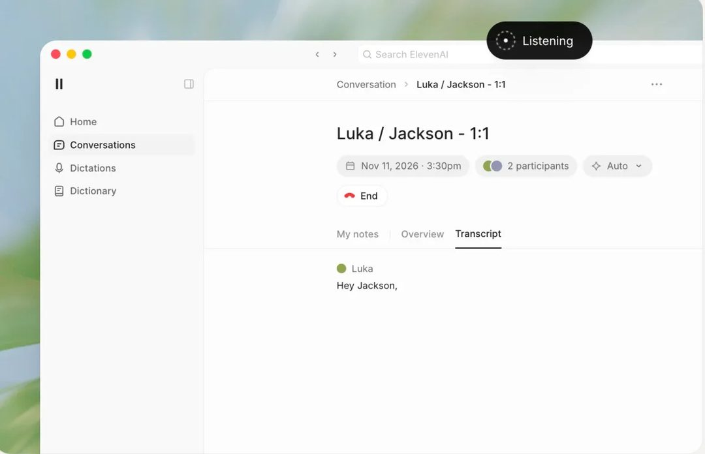

Anthropic 推出 Claude for Manufacturing，可直接接入工厂软件，自动化生产与工业工作流。关键点在于“接入既有工业软件”而非另建平台——这是 Anthropic 少见的深水区动作，从通用助手转向垂直行业解决方案。为什么重要：通用 API 的毛利会被价格战磨平，行业套件才是把模型能力换成企业合同的方式；但制造业的软件栈极度碎片化、停机成本极高，交付与验证周期远长于写代码。这条路对，但会很慢，考验的是合作伙伴网络而不是模型本身。

> 原文：[The Decoder](https://the-decoder.com/anthropics-claude-for-manufacturing-plugs-ai-directly-into-factory-software-to-automate-industrial-workflows/)

### ElevenLabs 推出 ElevenAI：语音公司向上做应用

ElevenLabs 发布 ElevenAI，把会议记录、听写与团队协作整合在一起，面向企业与团队场景。关键点：这是一家以语音合成 API 起家的公司，第一次把产品做到“工作流”层，直接面对终端用户而非开发者。为什么重要：语音模型本身正在快速商品化，向上做应用是保住定价权的常规路径；但会议场景恰好是同一天最拥挤的赛道——差异化不在转写质量，而在纪要能否变成下游系统里真正执行的行动项。

> 原文：[TechCrunch](https://techcrunch.com/2026/11/13/elevenlabs-new-app-combines-meeting-note-taking-and-dictation-for-teams/)

### Claude Code Projects 升级：并行 AI 工人与人的瓶颈

Anthropic 重新设计了 Claude Code Projects，让多个 AI 工作线程可以并行执行任务，以提升复杂项目的开发效率。关键点在于“并行”改变了协作模型：不再是人与一个助手来回对话，而更接近派工、汇总与验收。为什么重要：并行 agent 的瓶颈会迅速从模型能力转移到人的 review 带宽——同时开五个线程写代码容易，同时审五份 diff 才是真正的成本。下一代编码工具的核心竞争力，很可能落在“如何把并行产物收敛成可合并的结论”上。

> 原文：[Claude](https://claude.com/resources/articles/projects-redesigned)

### Claude Meetings：从纪要到跟进

Anthropic 上线 Claude Meetings，可接入会议并自动生成纪要、行动项与后续跟进。关键点：产品定义没有停在“总结”，而是明确指向行动项与跟进，这是会议类工具最难也最有价值的一段。为什么重要：会议记录的门槛已经被转写模型彻底拉平，真正的分野是能否拿到上下文（谁承诺了什么、上次承诺兑现了没有）并回写到任务系统。同一天里两家公司同时发布会议产品，说明这个场景正在从“效率小工具”变成大模型厂商的必争入口。

> 原文：[Claude](https://claude.com/resources/articles/claude-meetings)

### 百度词元所首日：Token 被当成商品挂牌

百度推出的“大模型交易所”词元所上线首日，新增 100 多家供应商和 1000 多家客户，试图把模型 Token 交易标准化。关键点：它把 token 从各家 API 的计费单位，变成可挂牌、可比较的通用商品。为什么重要：交易所成立的前提是“模型能力可替换”，这既是采购方想要的，也是模型厂商最不愿承认的；一旦 token 真的现货化，竞争焦点会从榜单分数转向价格、稳定性和履约。首日数字说明需求存在，但流动性能否维持、质量如何分级，才是这套设计能否成立的关键。

> 原文：[雷锋网](https://www.leiphone.com/category/industrynews/cqPXhF38rM4VcVa7.html)

### 结语

今天这几条串起来是一条清晰的位移：AI 从“给出建议”走向“执行动作”，支付、空管、产线、代码合并都在交付最后一公里。留给读者的问题——当 agent 把你的钱花出去时，你更在意它买得对不对，还是它能不能被撤回？

<h2 id="opinion" class="ai-section-divider">💭 行业观点</h2>

### 导语

今天最值得看的不是某条产品发布，而是一位 OpenAI 董事会成员在采访中给出的时间尺度：从 reward hacking（奖励黑客）到更极端的失控路径，可能只剩“几个月”。这话缺乏可验证性，但它来自一家前沿实验室的治理层，而非外部批评者，信号价值在于风险叙事的位置变了。把今天这八条放在一起看会更清楚：没有一条在讲模型更强了，全部在讲代价、门槛和定义权。这是行业观点板块少见的、方向一致的一天。

### OpenAI 董事的风险判断变了

一位 OpenAI 董事会成员在 Ars Technica 的采访中警告，从 reward hacking 到潜在的灾难性后果，这条路径可能比外界想象的近得多，甚至用“几个月”来衡量 AI 接管社会的时间窗。这类表述在技术细节上无法证伪，但它出自治理层而非安全研究社区，含义不同。关键点不在于预测是否准确，而在于董事会成员愿意公开用灭绝风险的语言描述自己公司的产品方向——这通常发生在内部风险评估已经外溢、且无法继续用“长期问题”框住的时候。对从业者而言，值得关注的不是那个数字，而是此后监管预期、保险与合规成本可能被这类发言重新定价。

> 原文：[Ars Technica](https://arstechnica.com/ai/2026/11/ai-is-the-most-likely-reason-youll-die-openai-board-member-warns/)

### 开发者开始给自己立规矩

AI Engineer 的一批演讲者联合发布了 No AI Slop Manifesto，呼吁开发者抵制低质、批量生成的 AI 内容。值得注意的是矛头指向：不是模型厂商，而是使用模型的生产者。这相当于承认 slop（AI 垃圾内容）的成因在激励结构——谁会因为多发而受益，谁就在制造它。宣言本身没有约束机制，更像社区情绪的一次归档；但历史上这类文本的作用往往不是执行，而是提供一套可引用的判据，让“这是不是 slop”从审美争论变成可以追问的工程问题。

> 原文：[No AI Slop Manifesto](https://www.slopmanifesto.com/)

### Jonathan Blow：软件变好了吗

游戏开发者 Jonathan Blow 在演讲中把 AI 编程的生产力叙事当成一个待检验的假设：如果 AI 真的解决了编程，为什么软件质量没有明显提升？这是一个成本极低、杀伤力很高的反问，因为它把衡量标准从“代码产出量”换成了“系统可靠性”。关键点在于，AI 编程工具的可观测收益集中在写得更快，而软件质量的瓶颈长期在需求、架构和验证环节——这些恰恰是生成式工具最少触及的地方。对团队而言，这提示一件事：用产出量证明 AI 的 ROI，很可能在一年后变成技术债的账。

> 原文：[YouTube](https://www.youtube.com/watch?v=IRK8h67ol7Q)

### 勒索软件：门槛下降比天花板上升更危险

Wired 报道称，全自动勒索软件尚未成熟，但水平一般的攻击者已经借助 AI 工具造成更大破坏。这条判断的方式值得学：它区分了“AI 能做出前所未有的攻击”和“AI 让原本做不成的人做成了”，并认为后者是当下真实发生的。安全领域的历史经验支持这个偏向——绝大多数损失来自能力基线的整体抬升，而非少数顶尖攻击者。对防御方的直接含义是，过去靠“攻击者不够专业”而形成的安全边界正在失效，中小机构的暴露面扩大速度快于大厂。

> 原文：[Wired](https://www.wired.com/story/beware-the-new-ai-fueled-ransomware-boom/)

### 天上没人，AI 先上去了

Wired 的长文把视线放到航空：飞行员与空管人员持续短缺，自动化正在加速进入这个对错误容忍度极低的领域，风险也随之放大。这是今天八条里最具象的一条，因为它展示了一种典型的落地路径——不是 AI 能力强到可以接管，而是人不够了，于是接管成为默认选项。关键点在于“被迫自动化”缺少正常节奏下应有的验证冗余：当系统是被人力缺口推上去的，出问题时也很难退回人工兜底。这类场景会成为未来几年 AI 风险讨论的主场。

> 原文：[Wired](https://www.wired.com/story/no-pilots-few-air-traffic-controllers-what-could-go-wrong/)

### 谷歌与“无 AI 学校”的搜索访问

NPR 报道了谷歌限制“无 AI 学校”使用其搜索服务一事，争议点是教育场景中的 AI 强制捆绑。这条的重要性不在个案，而在杠杆位置：当搜索、浏览器、办公套件由同一方控制，拒绝某一项 AI 功能在事实上可能等于放弃基础设施。所谓“选择退出”是否成立，取决于退出后的替代成本；如果替代成本高到不可承受，那它就不是选择。教育是这类争议的高发区，因为采购方分散、议价能力弱，且对数据流向敏感。

> 原文：[NPR](https://text.npr.org/nx-s1-6029408)

### EFF：谁有权定义“隐私”

EFF 发文批评科技公司再次推动改写“隐私”的概念，目的是为 AI 训练和数据使用松绑。这类争论常被当成语义游戏，实际上定义权就是监管权：把“隐私”从“对个人数据的控制”重新描述为“对数据使用的合理期待”，一大类训练行为就从需要授权变成无需授权。EFF 的提醒在于，这种概念迁移通常不通过立法完成，而是通过产品条款、行业标准和公关话术逐步沉淀。对关注合规的团队来说，值得跟踪的不是某条法规，而是这套词汇正在被谁、在哪里替换。

> 原文：[EFF](https://www.eff.org/deeplinks/2026/11/tech-companies-are-trying-shift-entire-concept-privacy-again)

### 《The Claude Delusion》：集体幻觉的成本

一篇热传博客《The Claude Delusion》认为，开发者对 Claude 等 AI 编程工具的能力存在集体幻觉，实际收益被显著高估。它与 Jonathan Blow 的质疑指向同一点，但更直接：不是工具不行，而是评价机制失灵——演示场景被反复引用，失败案例则被归因于使用者水平。这种不对称的归因方式是技术热潮的标准配置，也是幻觉得以维持的原因。判断力体现在这里：值得问的不是“它能不能做”，而是“它失败时，你的团队会不会承认”。

> 原文：[netmeister.org](https://www.netmeister.org/blog/claude-delusion.html)

今天的八条观点里，没有一条在论证模型更强，全部在重估它的代价、门槛与话语权。留给读者的问题：当这些质疑开始从董事会和安全社区内部发出，你所在的组织有没有可以承接它们的评估流程？

<h2 id="opensource" class="ai-section-divider">⚙️ 开源工具</h2>

### 导语

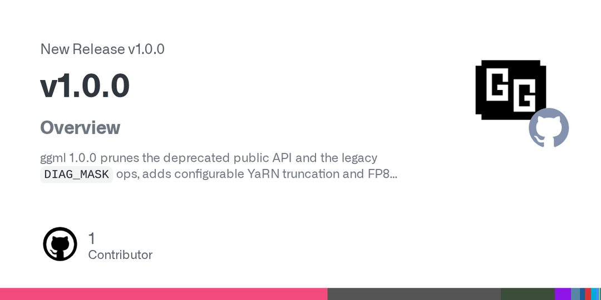

今天最该看的一条，是 llama.cpp 与底层张量库 ggml 同日发布 v1.0.0。这不是能力跃升，而是信任跃升：从长期 0.x 走到 1.0，意味着下游打包者、私有化部署商和嵌入式集成商终于有了可以对齐的稳定版本。更有意思的是同一天另外七条——视频模型做机器人控制、UI 行为库、代码安全扫描、浏览器调试、技能风险检测、上下文压缩，几乎没有一条在做模型本身，全在修 agent 周边的管道。开源社区的重心，已经从“造更强的模型”挪到“让模型能被可靠地装进系统里”。

### llama.cpp 与 ggml 同日发布 1.0

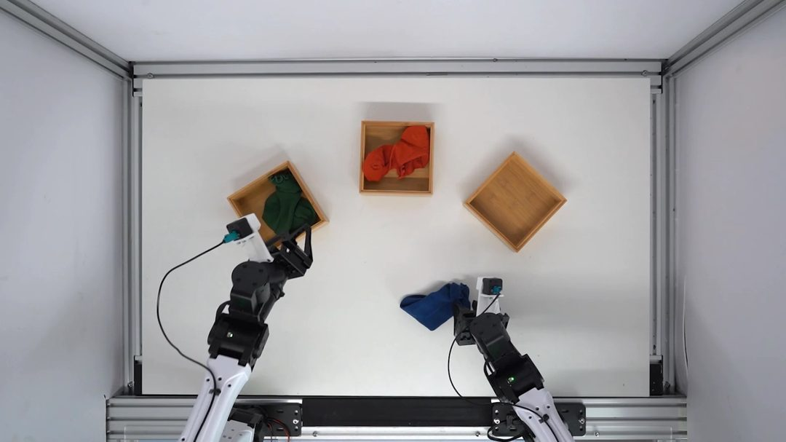

llama.cpp 和它依赖的底层张量库 ggml 同步发布 v1.0.0，为本地大模型推理生态提供了更稳定的基础。

关键点在“同日”和“同步”。llama.cpp 长期以 0.x 版本号高速迭代，API 与行为随 commit 漂移，这对个人玩家无感，对把它编进产品、固件或私有化交付包的团队却是实打实的成本——每次升级都要重新验证。两个项目一起跨到 1.0，等于对外承诺了一个可依赖的接口基线。

为什么重要：本地推理的竞争，早就不是“能不能跑”，而是“敢不敢放进交付物”。1.0 不改变任何 benchmark，但它改变了集成商的采购决策。如果这个生态接下来真能守住语义化版本，llama.cpp 会从“事实标准”变成“合同标准”。

> 原文：[GitHub](https://github.com/ggml-org/ggml/releases/tag/v1.0.0)

### Runway 开源 Praxis-1：视频模型当机器人控制器

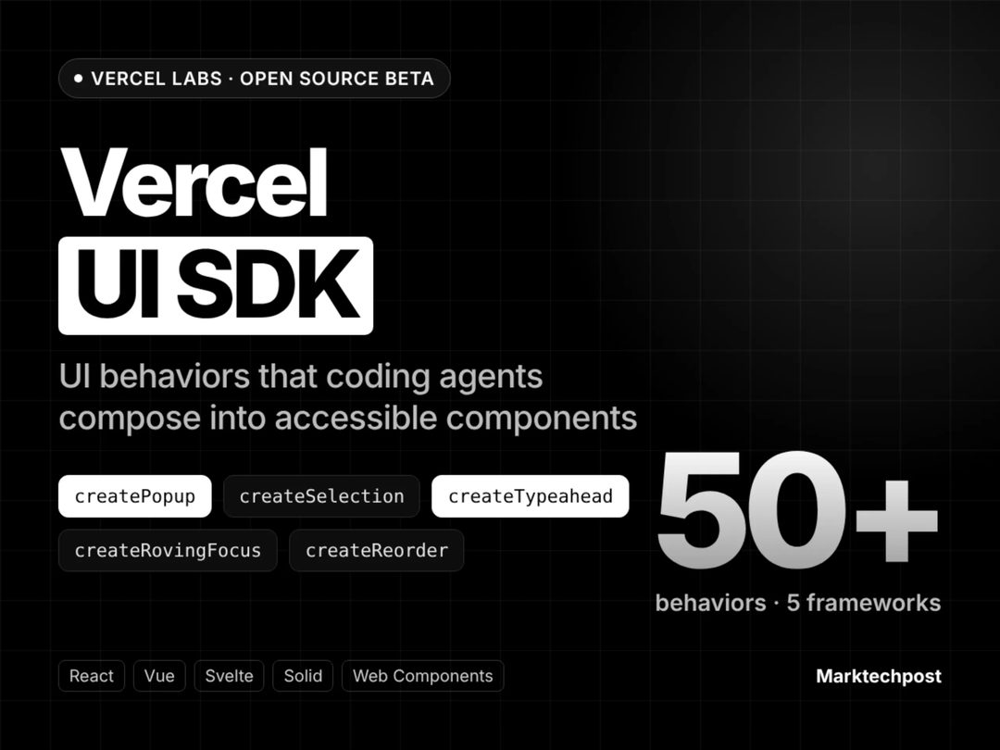

Runway 开源了 Praxis-1，把视频生成与视频理解的能力转化为机器人控制策略，让视频模型直接驱动机器人动作。

这条的技术含义比它的曝光度高。视频生成模型在训练中积累了大量关于物体如何运动、如何被推动、遮挡之后如何延续的时空先验，Praxis-1 的思路是把这套先验接到动作输出上，而不是从零训练一个控制策略。开源则把复现门槛从“有机器人实验室”降到“有代码和仿真环境”。

值得关注的不是它现在能做什么动作，而是这条路径的样本效率潜力：机器人数据的稀缺是具身智能的主要瓶颈，而视频数据不稀缺。如果视频预训练能稳定迁移到控制，整个领域的成本曲线会被改写。目前它更像一个方向性证明，而非可交付产品。

> 原文：[The Decoder](https://the-decoder.com/runways-open-source-praxis-1-turns-video-ai-into-a-robot-controller/)

### Vercel 开源 UI SDK：把界面规范变成 agent 的 API

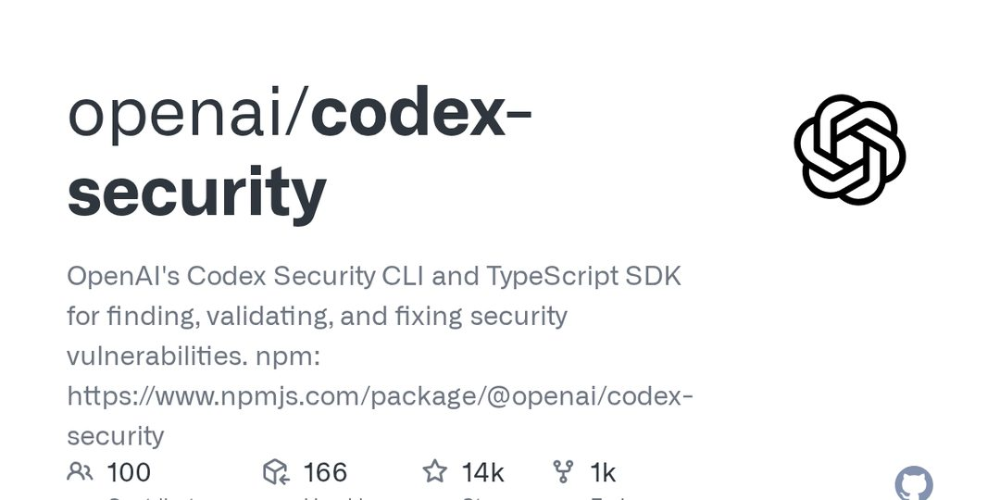

Vercel Labs 发布 Apache-2.0 许可的 UI SDK，提供 50 多种可组合的界面行为，目标是让编程智能体生成可访问的 React、Vue、Svelte 组件。

“50 多种”听起来不算多，但选的是对的位置：焦点管理、键盘导航、弹层关闭、加载与错误状态——这些是 AI 生成前端代码时最常翻车的长尾。模型能写出一版看起来对的界面，但可访问性和交互边界条件往往一塌糊涂，而这类缺陷在 code review 里极难被穷举。

为什么重要：这是把设计系统重新包装成 agent 可调用的约束。过去约束靠文档和 lint，现在靠模块本身。如果这类“行为库”成为前端 agent 的默认依赖，竞争点会从“谁的模型更会写 JSX”转移到“谁的组件契约更完整”。

> 原文：[MarkTechPost](https://www.marktechpost.com/2026/11/13/vercel-ui-sdk-agent-ui-behaviors/)

### OpenAI 开源 Codex Security：找漏洞之外，还要验证

OpenAI 发布 Codex Security 的 CLI 与 TypeScript SDK，用于发现、验证并修复代码中的安全漏洞。

三个动词里，“验证”是真正的差异点。安全扫描工具的历史教训很清楚：误报比漏报更快杀死采用率——开发者被几十条假警报淹没之后，就会关掉这个工具。把“验证”作为独立环节写进流水线，说明它想解决的是告警可信度，而不只是扫描覆盖面。

为什么重要：安全是 agent 最容易切入、也最容易翻车的场景。LLM 在读懂代码意图上有优势，在给出确定性结论上有天然短板，所以这类工具的成败，取决于它是否敢于对不确定的结果说“不报”。开源的另一个效果是让安全团队能审计扫描逻辑本身，这在大企业采购里几乎是前置条件。

> 原文：[GitHub](https://github.com/openai/codex-security)

### 阿里开源 open-code-review：规则与模型各干各的

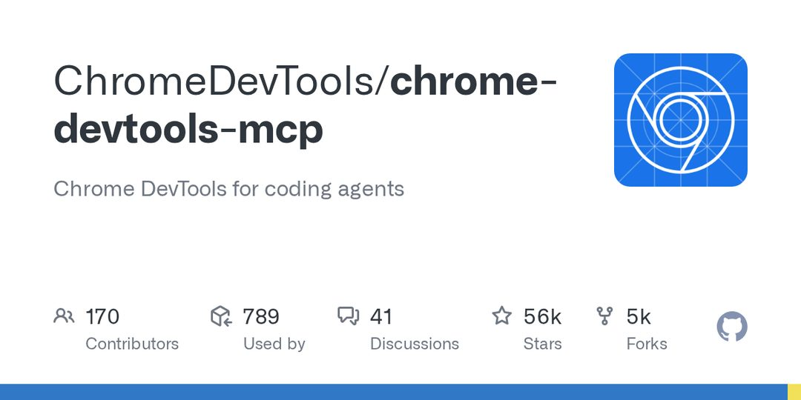

阿里巴巴开源 open-code-review，采用确定性流水线加 LLM Agent 的混合架构，提供行级评论与多语言安全规则。

混合架构的选择值得单独说。纯 LLM 的代码审查工具在企业里推不动，原因不是效果差，而是不可解释、不可复现：同一个 PR 跑两次结论可能不同，审计链路断在这里。把确定性规则（可枚举、可测试、可关停）放在前面，LLM 只负责语义层的补充判断，是更贴近真实 review 流程的分工。

为什么重要：这基本是当前企业采用 LLM 的标准姿势——让模型做它擅长的那部分，其余交回工程手段。如果混合架构成为共识，纯 LLM 的“AI 审查员”叙事会被更快祛魅，工具市场也会随之分层：底座是规则引擎，模型是增益项。

> 原文：[GitHub](https://github.com/alibaba/open-code-review)

### Chrome DevTools 推出 MCP：让智能体自己调试浏览器

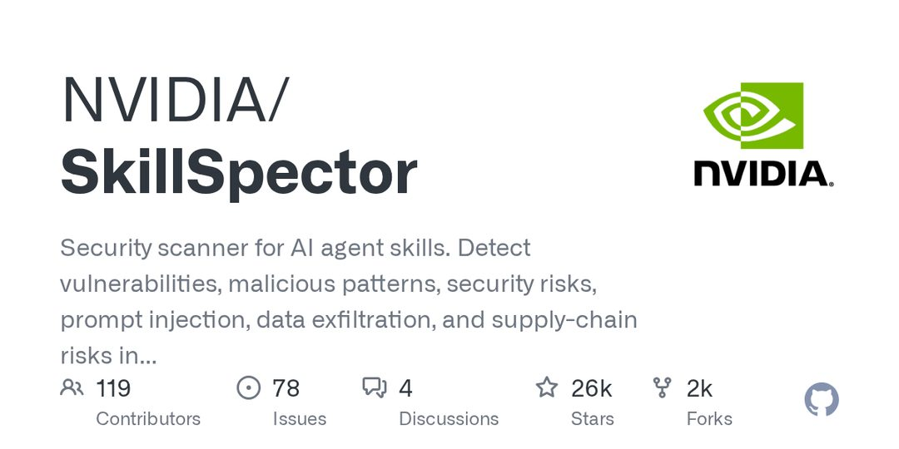

Chrome DevTools 团队发布 chrome-devtools-mcp，让编程智能体可以直接调用浏览器的调试能力。

这条的意义不在功能，而在发布方。MCP（Model Context Protocol）从社区约定变成浏览器官方团队出货的接口层，意味着 agent 与工具的连接方式正在收敛。智能体能拿到控制台输出、网络请求和 DOM 状态之后，前端任务里最耗人的“改一行、看一眼、再改一行”的循环可以交给它自己跑。

为什么重要：agent 的实际能力边界，几乎等于它能调用哪些工具。前端一直是 agent 表现落差最大的场景，因为结果好坏只有真实浏览器能裁决。把裁决权交给 agent，是这条路能不能走通的关键一步。

> 原文：[GitHub](https://github.com/ChromeDevTools/chrome-devtools-mcp)

### 英伟达开源 SkillSpector：给 agent 技能装个杀毒软件

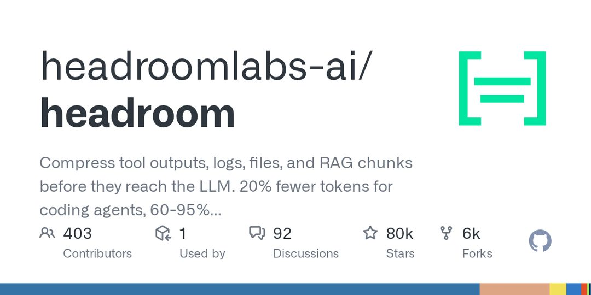

英伟达发布 SkillSpector，可在安装前检测 Claude Code、Codex 与 MCP 技能中的漏洞、提示注入与数据外泄风险。

“安装前”这个位置选得很经典——等同于包管理器的审计环节。随着技能生态变热，用户开始从不可信来源拉取技能并赋予其读写文件和调用外部服务的能力，威胁模型已经从“恶意代码”扩展到“恶意自然语言”。提示注入不需要执行任何东西，只要被 agent 读到就可能生效，这让传统静态扫描天然不够用。

为什么重要：技能供应链迟早要有自己的安全层，这条是较早的公开尝试。难点也很清楚：技能是自然语言与代码的混合物，误报率和覆盖面都不容易做漂亮。如果这类扫描成为默认环节，技能分发的门槛会提高，但生态才可能被企业接受。

> 原文：[GitHub](https://github.com/NVIDIA/SkillSpector)

### Headroom 开源上下文压缩：省 token 也是工程问题

Headroom 在工具输出、日志、文件和 RAG 块进入 LLM 之前进行压缩，官方称可为编程智能体节省约 20% token，而 JSON 场景可省 60–95%。

先标明这是厂商自述数据，尚无独立验证。但方向是对的：agent 的上下文里，真正的噪声大头往往不是对话历史，而是工具返回的原始输出。压缩 JSON 之所以收益高，是因为它的冗余是结构性的——重复的 key、冗余嵌套、无意义的空值，这些不需要模型理解就能砍掉。

为什么重要：上下文工程正在从提示词技巧变成独立工具品类，而且是可量化 ROI 的那一类。需要警惕的是信息损失：压缩比越高，越需要保留可回退的原始副本，否则 agent 会在缺信息时自信地编。

> 原文：[GitHub](https://github.com/headroomlabs-ai/headroom)

### 结语

今天这八条里没有一条在训模型，全在修模型外面那圈管道——这大概是“开源工具”这个板块今年最值得记的变化。留一个问题：你的 agent 栈里，哪一层还缺一个开源的默认件？
