今天最值得看的三件事：

- **公司动态** · 黄仁勋辞任英伟达 CEO，十余万人联署要求复职
- **模型发布** · 美团发布 1.6 万亿参数智能体模型，全程未用英伟达 GPU
- **模型发布** · Claude Fable 5.2 不生成图像，而是「画」图像

下文按板块展开，正文每条均附原始链接。

<h2 id="model-release" class="ai-section-divider">🚀 模型发布</h2>

今天模型板块最值得看的一条，不是榜单第一，而是美团把一个 1.6 万亿参数的智能体模型训完了——全程没用英伟达 GPU。参数规模是表面上的亮点，算力路线才是更关键的实质：训练侧的国产替代比推理侧难得多，一旦跑通，意义不在单点模型，而在供应链议价权。同一天的其他消息提醒了另一面——Gemini 4 Carbon 拿下 MathArena 第一，代价是 15 倍的单位成本。能力上限和单位经济性，正在变成两条必须分开看的曲线。

### 美团 1.6 万亿参数智能体模型，全程没碰英伟达

美团发布了一个 1.6 万亿参数的智能体（agentic）专用大模型，并称训练全程未使用英伟达 GPU。

关键点在两处。一是规模，二是算力栈——后者更难。训练对互联带宽、编译器、算子库的要求远高于推理，能跑通意味着国产芯片加软件栈至少在某个具体负载上形成了闭环，而不只是“能跑 demo”。

为什么重要：过去两年国产算力的故事多集中在推理侧（便宜、够用），训练侧则被默认是英伟达的地盘。如果这条路可复现，影响的不只是美团自己的模型能力，还有国内厂商采购时的谈判位置。接下来要追问的是：这个模型在公开基准上的表现、训练集群的实际规模与训练时长——这些决定了它是一次工程验证，还是一条可复制的产线。

> 原文：[The Decoder](https://the-decoder.com/meituan-releases-a-1-6-trillion-parameter-agent-model-that-never-touched-an-nvidia-gpu/)

### Claude Fable 5.2：不生成图像，而是「画」出来

Anthropic 新模型 Claude Fable 5.2 在图像产出上换了个说法：不是一次性生成（generate），而是分步骤地「画」（paint）。

关键点：过程性构建意味着中间状态可见、可干预——用户在构建途中就有机会纠偏，而不是只能在结果出来后重抽。这更接近人类画师的工作方式，也更像 agent 的做事逻辑：拆步骤、看反馈、再调整。

为什么重要：过去两年图像模型的竞争主线是画质与指令跟随，而这两项都在接近边际收益递减。真正的差异化解在可控性和编辑性上——商业场景（设计、营销物料、游戏资产）要的从来不是一张好图，而是一条能连续改十版还不崩的流程。如果「画」的范式成立，图像生成的评测维度也得跟着换：从单张质量转向多步可控。值得关注的是，它的定量表现是否配得上这个新叙事。

> 原文：[The Decoder](https://the-decoder.com/anthropics-claude-fable-5-2-doesnt-generate-images-it-paints-them/)

### Gemini 4 Carbon 登顶 MathArena，代价是 15 倍成本

Gemini 4 Carbon 在数学竞技场 MathArena 拿到第一，但单位成本是 GPT-6.1 Sol 的 15 倍。

关键点：这不是「谁更强」的问题，而是「强多少、贵多少」。15 倍成本意味着，如果领先幅度只有几个百分点，绝大多数生产场景不会买单——数学推理榜单上的小幅领先，很难直接换算成产品体验上的小幅提升。

为什么重要：模型采购正在从「选最强的」变成「选单位有效能力最便宜的」。榜单排名是能力上限的信号，成本曲线才是部署现实。对做产品的人更实用的做法是：把自己的任务集抽 200 条跑一轮 A/B，用「每解决一个任务的成本」而不是「每百万 token 的价格」来算账——这两个数在很多场景下会给出相反的结论。

> 原文：[The Decoder](https://the-decoder.com/gemini-4-carbon-takes-the-matharena-crown-but-costs-15-times-more-than-gpt-6-1-sol/)

### Anthropic：过时的提示习惯正在拖慢 Opus 5.5

Anthropic 指出，用户沿用旧模型的提示写法会让 Claude Opus 5.5 的表现打折，建议按新模型特性调整提示策略。

关键点：这是「提示债」的正式化。每次模型换代，团队里沉淀的 prompt、few-shot 示例、工具描述都会部分失效——尤其是那些为规避旧模型缺陷而写的补丁式指令（「不要做 X」「必须按 Y 格式输出」），在新模型上可能反而变成约束。

为什么重要：提示资产正在变成需要版本管理的东西。工程上可行的做法是，把 prompt 与模型版本绑定，每次升级跑一遍回归集，而不是靠个别同学的手感。Anthropic 主动提这件事也说明：模型能力的提升，正在把一部分「调参收益」还给用户——前提是你愿意重写。

> 原文：[The Decoder](https://the-decoder.com/anthropic-says-outdated-prompting-habits-are-slowing-down-claude-opus-5-5/)

### Bland 发布 Tofu-1 全双工语音模型

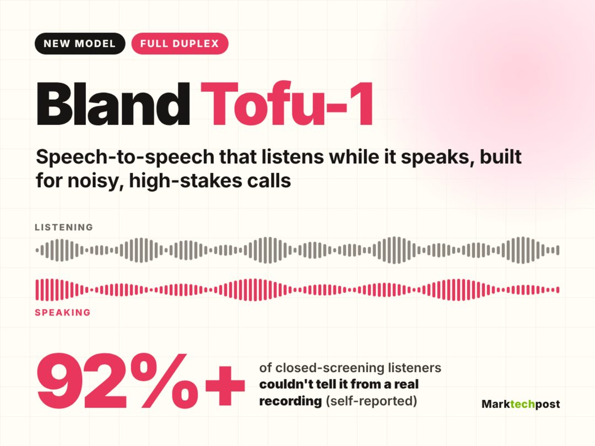

Bland 发布 Tofu-1，面向嘈杂、高风险的电话场景做全双工（full-duplex）语音到语音建模，目前处于企业研究预览阶段，未公布基准、参数规模与定价。

关键点：全双工意味着模型可以边说边听，支持打断与重叠说话，而不是「你说完我再答」的轮次式交互。电话场景的难点恰恰在这里——噪音、口音、抢话，以及必须实时响应的容忍度。

为什么重要：语音 agent 的商业价值集中在客服、外呼、预约这类高频电话场景，而体验的关键点就是「像不像真人接线员」。但 Tofu-1 目前没有可验证的数据，判断只能停留在方向层面：全双工是正确的问题定义，能否兑现要看延迟、打断恢复率和嘈杂环境下的识别率——这三项，等基准出来再说。

> 原文：[MarkTechPost](https://www.marktechpost.com/2026/11/15/bland-tofu-1-full-duplex-speech-to-speech-model/)

### 结语

今天这五条其实在讲同一件事：模型能力的比拼，正在从「能做什么」转向「以什么代价、在多可控的流程里做到」。留给读者的一个问题——你们团队的 prompt 和评测集，上一次跟着模型版本一起更新是什么时候？

<h2 id="company" class="ai-section-divider">🏢 公司动态</h2>

今天最该看的一条，不是 Anthropic 的 IPO 前夕，而是英伟达 CEO 黄仁勋辞任——一位在位三十余年的创始人突然离开，而且董事会没有继任方案。这件事的荒诞之处在于，市场对英伟达的定价很大程度上建立在“黄仁勋”这个个人变量上：他对供应链的掌控、对客户的直接关系、对技术路线的判断，都很难被制度化交接。马斯克等人发起的复职请愿突破 11.5 万签名，说明连产业界也不相信这家公司能平稳换人。相比之下，今天其他几条消息——GPU 定价、DRAM 诉讼、Meta 罚单——更像是同一条产业链上的注脚。

### 黄仁勋辞任，董事会没有 Plan B

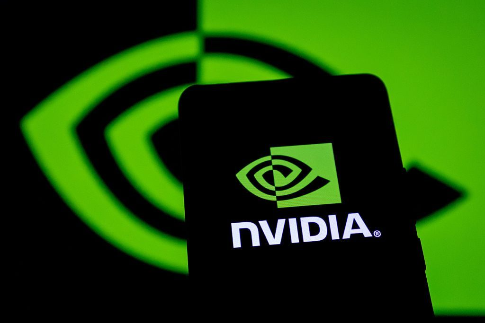

英伟达 CEO 黄仁勋已辞任。据报道，起因是他与一名被指协助向中国输送芯片的高管存在私人关系。消息传出后，马斯克等科技界人士发起联署，要求董事会让黄仁勋复职，签名数已超过 11.5 万；亚洲多国政府紧急确认芯片供应是否受影响；多位前《财富》500 强 CEO 公开批评董事会“毫无继任方案”。

关键点在于，这并非一次常规交班。创始人 CEO 的突然离场叠加出口管制敏感背景，让“谁在管英伟达”成了一个供应链问题，而不仅是公司治理问题。亚洲客户的反应说明，市场担心的不是战略转向，而是履约能力。

为什么重要：英伟达是当前 AI 资本开支周期的定价锚。锚一旦晃动，从 GPU 采购计划到数据中心融资成本都会重估。

> 原文：[TechCrunch](https://techcrunch.com/2026/11/14/elon-musk-other-tech-execs-sign-petition-calling-on-nvidia-to-reinstate-jensen-huang/)

### Anthropic 上市前，Amodei 说“明年高度不确定”

Anthropic 在创纪录 IPO 前几天，CEO Dario Amodei 公开承认“明年会发生什么存在巨大不确定性”，给上市叙事添了一层阴影。

这句话本身不算新闻——AI 公司的不确定性是常识。但时机敏感：IPO 定价需要的是可预期的收入曲线，而创始人自己在路演窗口前夜谈不确定性，等于把风险溢价摆上桌面。对投资人而言，值得观察的不是这句话，而是承销团如何在定价中消化它。

为什么重要：Anthropic 是这一轮 AI 公司上市潮的风向标。它的定价方式，会成为后续模型公司估值方法的参照系。

> 原文：[The Decoder](https://the-decoder.com/anthropic-ceo-amodei-admits-theres-a-huge-uncertainty-in-whats-going-to-happen-next-year-days-before-a-record-ipo/)

### 英伟达被指用循环融资维持 GPU 高价

TechSpot 报道称，英伟达通过循环融资（circular financing）安排抬高并维持 GPU 价格。该讨论在 Hacker News 获得近 450 分。

所谓循环融资，指供应商向客户或其关联方提供资金，客户再用这笔钱回购产品，从而在账面上制造需求、支撑价格。报道未给出监管认定，属于媒体调查与社区讨论层面。但在 GPU 供给紧张、云厂商资本开支高企的背景下，这类结构确实容易让“真实需求”和“融资驱动的需求”难以区分。

为什么重要：如果 AI 算力采购中存在相当比例的融资性需求，那么当前算力短缺的持续性就需要重新评估。

> 原文：[TechSpot](https://www.techspot.com/news/114558-nvidia-deliberately-kept-gpu-prices-high-through-circular.html)

### DRAM 涨价合谋案继续审理

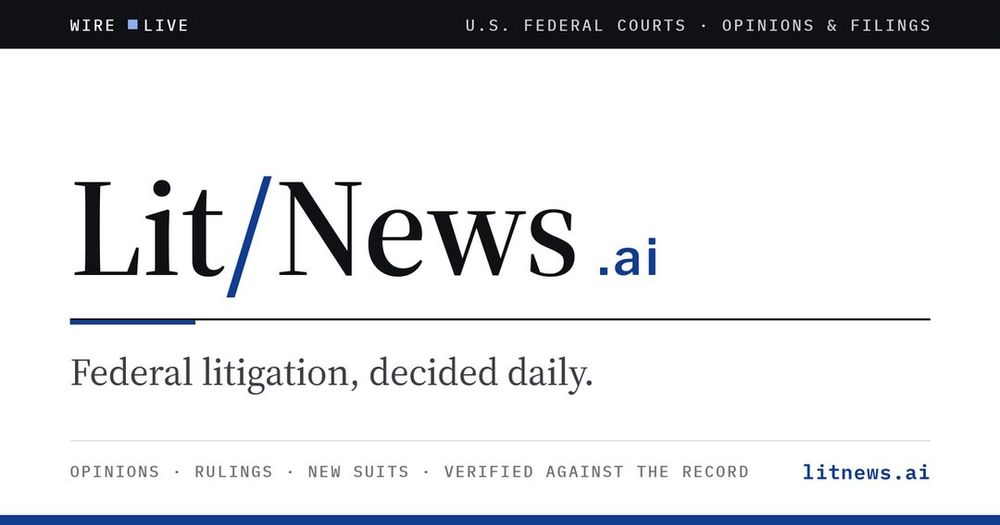

三星、SK 海力士、美光面临的 DRAM 合谋涨价集体诉讼躲过撤诉动议，法院驳回厂商撤诉请求，案件将继续审理。

这意味着原告方关于三家厂商协同操纵 DRAM 价格的指控，已具备进入证据开示阶段的程序基础。存储芯片是寡头市场，价格波动本就容易被质疑，而 AI 带来的 HBM、DRAM 需求激增，让涨价有了更充分的“基本面理由”，也更难界定其中有多少是合谋。

为什么重要：若案件推进到实质审理，HBM 与 DRAM 的定价机制会被迫公开，这对云厂商的长期成本模型是实质变量。

> 原文：[LitNews](https://litnews.ai/articles/garciaguirre-samsung-sk-hynix-micron-dram-conspiracy-suit-survives-dismissal)

### 意大利因照片隐私问题罚 Meta 8.05 亿欧元

意大利监管机构就照片相关隐私违规对 Meta 处以 8.05 亿欧元罚款。

这是欧洲对平台数据使用持续加码的又一例。与以往 GDPR 罚单相比，此次金额处于高位，且直接指向照片这一最敏感的用户内容类型。对 Meta 而言，罚款本身可控，真正的成本在于合规改造：训练数据、推荐系统、内容索引都可能需要重新设计数据流转路径。

为什么重要：欧盟执法的方向正从“告知同意”转向“数据用途本身是否合法”，这会直接影响多模态模型的训练数据来源。

> 原文：[Rapporteur](https://www.rapporteur.com/news/italy-fines-meta-880mn-over-photo-privacy-authority/)

### 印度 Bharat Semi 获 2400 万美元种子轮

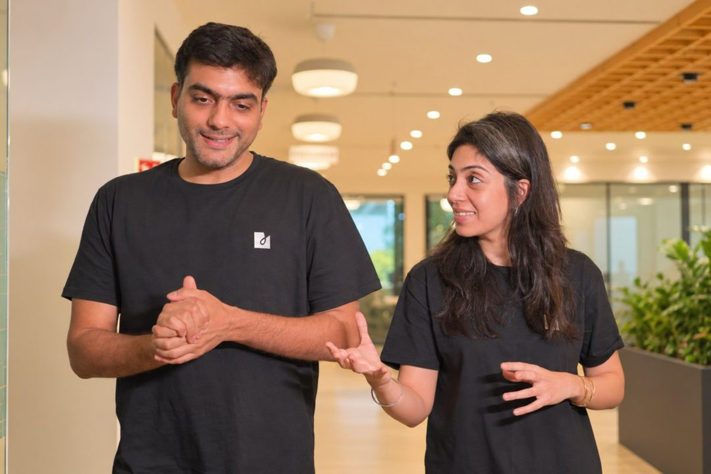

印度芯片公司 Bharat Semi 拿下 2400 万美元种子融资，其 AI 传感器技术已进入 General Atomics 等客户的设计名单，目标全球市场。

种子轮拿到这个金额，在半导体领域并不常见，说明资本愿意为“非美非中”的第三极供应链付溢价。公司切的是 AI 传感器而非通用算力，避开了与英伟达、AMD 的正面竞争，客户名单里的国防承包商也暗示了其场景偏向。

为什么重要：印度在半导体的角色长期停留在封装与设计服务，Bharat Semi 是少数尝试做自研产品的样本。

> 原文：[TechCrunch](https://techcrunch.com/2026/11/15/indian-chip-startup-bharat-semi-lands-24m-seed-round-as-it-eyes-global-ai-sensor-market/)

### SK 海力士五年投 10 亿美元扶持本土供应链

SK 海力士计划五年投入约 1.4 万亿韩元（约 10 亿美元），支持本土材料、零部件与设备供应商，以应对加剧的 AI 芯片竞争。

这是典型的“链主养链”动作：HBM 产能竞赛不只是堆产能，还取决于蚀刻、封装、检测等环节的本土供应商能否跟上节奏。把供应商纳入资金支持范围，本质上是在缩短交付周期、降低对日本与荷兰设备的单点依赖。

为什么重要：存储厂的资本开支正从“扩产”部分转向“补链”，这会影响上游设备与材料公司的订单结构。

> 原文：[36氪](https://36kr.com/newsflashes/4071686634067076?f=rss)

### 英伟达 AI Day 首尔：两千人谈物理 AI 与智能体

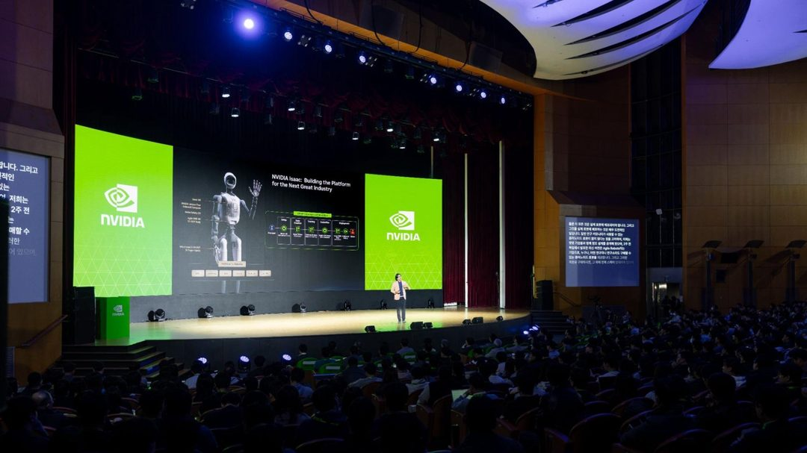

英伟达在首尔 COEX 举办为期两天的 AI Day，超过 2000 名开发者与初创公司参与，主题集中在物理 AI（physical AI）与 AI 智能体（agentic AI）。

在 CEO 辞任的同一周办开发者活动，本身就带有稳定军心的意味。议题选择也值得注意：物理 AI 指向机器人与自动驾驶，智能体指向软件自动化，两者都是“卖算力”之外的下游叙事——英伟达需要证明 GPU 需求不只来自大模型训练。

为什么重要：当训练需求增速存疑时，推理与具身智能能否接棒，是英伟达估值叙事的下一个支点。

> 原文：[NVIDIA Blog](https://blogs.nvidia.com/blog/ai-day-seoul-wrapup/)

---

一家公司的 CEO 变动，能让多国政府去确认芯片供应，这本身就说明 AI 产业链的集中度还没被真正解决。留给读者一个问题：如果英伟达的护城河有一半是人，那它到底值多少？

<h2 id="research" class="ai-section-divider">🔬 研究论文</h2>

### 导语

OpenAI 开了个面向科研的新博客，首篇不是产品介绍，而是讲 GPT-6 Astra 如何把标准模型的非微扰格点定义从「一个想法」推进成「一份详细证明」。这件事的分量不在于模型又赢了一个 benchmark，而在于它把展示面放在了可被同行审读的推导上——模型输出第一次要以「证明是否站得住」来结算。今天另外三条从位置编码的教学拆解、跨节点推理吞吐到权重空间的优化器原型，恰好拼出同一条线：模型正从「被调用」走向「参与生产」。

### OpenAI 上线科学博客，GPT-6 参与标准模型格点定义

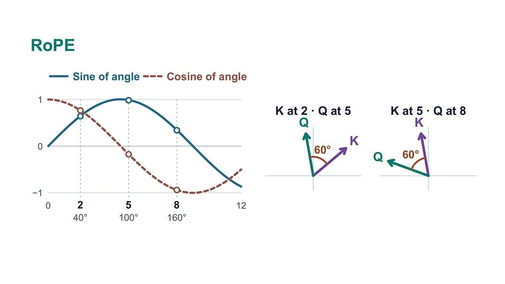

OpenAI 推出面向科研人员的博客，首篇文章讨论如何借助 GPT-6 Astra，把标准模型（Standard Model）的非微扰（non-perturbative）格点定义从初步想法推进为一份详细证明。

关键点有两个。一是选题：格点表述是处理强相互作用非微扰效应的标准路径，而「把定义写严谨」长期是依赖人力、进展缓慢的细活，属于典型的「难但可验证」任务。二是载体：OpenAI 没有用论文或技术报告，而是新开一个博客栏目，这意味着后续大概率会持续放出同类案例。

为什么重要：评估模型科研能力，最怕的是「读起来很专业」但无法核验。证明是一个自带裁判的产物——它对不对，同行能判。若这条路线成立，模型在理论物理中的角色会从文献助手变成推导参与者；若不成立，博客本身也会成为一份可追溯的记录。两种结果都比一次跑分有价值。

> 原文：[OpenAI](https://openai.com/index/step-toward-defining-the-standard-model)

### Raschka 长文拆解现代 LLM 的位置编码

Sebastian Raschka 发布长文，系统梳理现代大模型中位置编码（positional embedding）的原理与演进，重点覆盖 RoPE 及其后续变体。该文在 Hacker News 获得 200+ 分。

关键点：位置编码是 Transformer 里最容易被跳过、又最影响实际表现的一层。它决定了模型如何理解「谁在谁前面」，直接关系到长上下文外推、长度泛化，以及训练长度与推理长度不匹配时的性能塌陷。

为什么重要：过去两年，架构层面的公开讨论大多集中在注意力变体和 MoE 上，位置编码的改动往往被埋在实现细节里。Raschka 这类把演进线索拉直的文章，价值在于给工程判断提供参照——当你发现模型在超出训练长度后表现骤降，先要问的可能不是数据，而是位置编码的外推策略。对做长上下文产品的团队，这是必读的一篇。

> 原文：[Sebastian Raschka Magazine](https://magazine.sebastianraschka.com/p/understanding-positional-embeddings)

### 两块 DGX 跨节点跑 GLM-5.3，vLLM 吞吐 607.8 tok/s

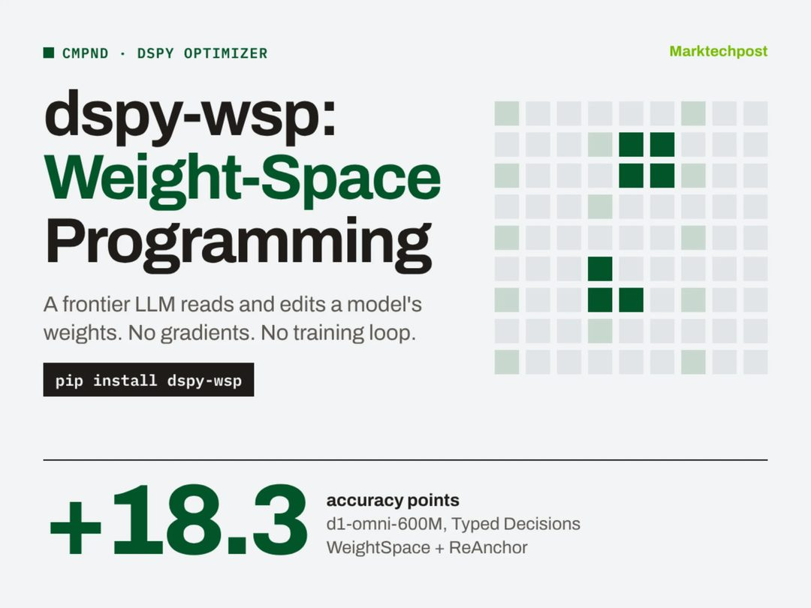

英伟达开发者博客展示了用两台 DGX 站跨节点部署 GLM-5.3，基于 vLLM 达到 607.8 tokens/s 的吞吐。

关键点：这是一个「跨节点」的部署案例，而不是单机多卡。模型规模超过单机舒适区之后，推理的瓶颈会从算力转向节点间通信与调度，vLLM 在这类拓扑上的表现，比单机峰值数字更能说明工程可行性。

为什么重要：开源权重模型的竞争，正在从「模型好不好」延伸到「服务起来贵不贵」。跨节点推理从「能不能跑」进入「跑起来值不值」的阶段，直接决定了中小团队能否用开源模型承接生产流量。607.8 tok/s 是个单点数据，缺少延迟分布和成本口径，不宜直接横向比较；但它至少说明，跨机部署这条路已经有人在认真打磨了。

> 原文：[NVIDIA Developer Blog](https://developer.nvidia.com/blog/when-one-gpu-isnt-enough-serving-glm-5-3-across-two-nvidia-dgx-stations-with-vllm/)

### dspy-wsp：让前沿模型直接改小模型权重

Cmpnd 推出名为 dspy-wsp 的 DSPy 优化器原型，让前沿模型直接读取并在沙箱中修改小模型的权重，每次修改后验证效果，全程不需要梯度，单次运行成本约 5–10 美元。

关键点：这不是提示词优化，也不是微调。它把「优化」的作用对象从输入文本换成了参数本身，并保留了逐步验证的闭环——改一步、测一步。前沿模型在这里扮演的是「编辑」，小模型是「被编辑的对象」。

为什么重要：DSPy 一路把 LM 程序的优化抽象成可编译的问题，而这一步把抽象推到了权重层，同时给出了明确的成本口径，这一点比方法本身更值得注意——成本可计量，才可能被工程采纳。真正的疑问在验证环节：什么样的评测集足以判断一次权重改动是改进而非过拟合？沙箱能防住破坏性修改，但防不住评估失真。这个原型的上限，取决于验证质量的上限。

> 原文：[MarkTechPost](https://www.marktechpost.com/2026/11/14/cmpnd-dspy-wsp-weight-space-programming/)

### 结语

模型开始写证明、跨节点跑推理、直接改权重——「研究」这件事的边界正在被重新划线。留一个问题：你所在的团队，会先把哪一环交给模型动手，又用什么来验证它没改坏？

<h2 id="product" class="ai-section-divider">📱 应用产品</h2>

### 导语

今天应用产品板块最值得看的一条，是 Yelp 在 AI 助手里混用客户端原生 UI 与服务端下发 UI。它看似是一个工程技术细节，实际点出了当下 AI 产品竞争重心的转移：模型能力逐渐变成公共供给，能否把模型输出稳定地装进一个可迭代、可控制的界面里，才是产品差异所在。同一天，GitLab 把智能体开发纳入 DevOps 治理体系，和 Yelp 的选择恰好在两个方向上回答了同一个问题——AI 功能进入生产后，工程约束会重新回到台前。

### Yelp：AI 助手的界面，一半由服务端决定

据 InfoQ 报道，Yelp 在其 AI 助手中采用了混合方案：一部分界面由客户端原生实现，另一部分由服务端下发 UI 描述来渲染。原生部分负责交互的响应速度和手感，服务端下发部分则让团队在不发版的前提下快速调整结果呈现。

关键点在于，AI 助手的输出不再只是文本，而是一段「界面」——推荐结果、商家卡片、操作入口都需要被动态拼装。传统做法要么牺牲迭代速度，要么牺牲体验一致性，混合方案是在两者之间划一条随场景移动的边界。

值得关注的是它对工程组织的影响。一旦 UI 有了服务端来源，客户端与服务端的职责边界、灰度策略、渲染层的兼容性测试都要重新设计。对正在做 AI 助手的产品团队来说，这是一个比「用什么模型」更早需要回答的问题。

> 原文：[InfoQ](https://www.infoq.cn/article/1N801doFOEl2Swqey5Jy?utm_source=rss&utm_medium=article)

### GitLab 19.5：把智能体当成需要治理的代码资产

GitLab 19.5 将 AI 智能体的开发流程纳入统一治理的 DevOps 平台能力，重点落在权限与可审计两方面。换句话说，智能体不再只是某个开发者本地 IDE 里的脚本，或者某个 SaaS 工具里的黑盒配置，而是和代码一样，进入版本、权限、审计的轨道。

这个方向并不意外。企业引入智能体时，真正的阻力很少是「能力不够」，而是责任边界不清：谁授权它访问哪些系统、它做了什么、出问题能否回溯。权限与审计正是把这些模糊地带变成可回答的问题。

对平台型厂商而言，这也是一个合适的生态占位——模型能力会趋同，治理能力却会随客户规模和合规要求累积。智能体要真正进入核心业务流程，治理层大概率会先于能力层成为采购标准。

> 原文：[InfoQ](https://www.infoq.cn/article/0IpE2EOypcqMFtL7z4z1?utm_source=rss&utm_medium=article)

### 斑马 AI 学 2027 版：AI 从问答入口退到学习任务里

斑马发布 2027 版，斑马英语 S8、思维 S7、大阅读 S7 同步更新，基于自研儿童科教大模型，并将学段向小学高年级延伸。官方表述中一个值得注意的转向是：AI 从「问答入口」变为嵌入学习任务之中。

这是儿童教育产品对聊天框的一次务实修正。对低龄用户来说，开放式对话既难控制内容边界，也难以衡量效果；把模型埋进题目生成、路径调整、反馈环节，反而更接近真实的教学场景，也更容易被家长理解为「有效」。

向高年级延伸则意味着用户生命周期与客单价的延长，同时竞争对象从启蒙类 App 转向更刚性的学科需求。「自研行业模型 + 既有内容体系」是这类玩家惯用的护城河叙事，接下来要比拼的是模型在具体任务上的可见提升，而不是有没有 AI。

> 原文：[36氪](https://36kr.com/newsflashes/4071740620673924?f=rss)

### 双 11 的「数字人队长」：从被动应答到主动推进

今年双 11 出现了一个名为 Super Agent 的主动型数字人角色，尝试在群聊与业务流程中自主推进任务。与常见的客服机器人不同，它的定位更接近「队长」——不是等人提问，而是主动找人、推流程。

这类产品的核心难点从来不是能力，而是打扰成本与信任阈值。主动型 agent 一旦判断失误，代价是用户注意力被浪费，甚至业务流程被带偏。因此它需要一个目标明确、节奏紧凑、反馈可量化的场景来验证，而大促恰好符合：周期短、指标清晰、协作密集。

如果这套模式在大促中跑得通，外溢到日常运营只是时间问题。届时产品经理要重新考虑的问题会是：当 agent 能主动发起任务，人和它的协作关系该如何设计。

> 原文：[InfoQ](https://www.infoq.cn/article/myl5Mcw3iyCYv3ZJ3hwQ?utm_source=rss&utm_medium=article)

### OATs：给绿植和哑铃装上性格的电子宠物

卡内基梅隆的学生做了一个名为 OATs 的小硬件，采用 E-Ink 屏幕，让绿植、滑板、哑铃这些日用品拥有人格化表达，通过情绪反馈推动用户养成好习惯。它的形态接近 Tamagotchi（电子宠物），但宿主是现实物件。

关键设计在于把抽象的提醒换成了关系：植物「不高兴」比 App 推送「该浇水了」更容易触发行动。硬件极简，成本与门槛都不高，这也让它更像一个可被复制的小品类切口，而不是通用 AI 助手。

风险同样明显。这类产品的价值高度依赖新鲜感，情绪反馈一旦被用户解码为固定套路，关系就会退化成通知。它真正要回答的问题是：当宠物不再新鲜，用户还愿意为这段关系付费吗？

> 原文：[WIRED](https://www.wired.com/story/this-ai-tamagotchi-oats-turns-everyday-objects-into-needy-virtual-pets/)

### Perit Marketplace：把数据和强化学习任务卖给实验室

Perit Marketplace 上线，主打让个人与企业向头部 AI 实验室出售训练数据与强化学习任务。它把原本分散在众包标注、外包数据团队、内部任务设计之间的供给，收拢成一个可交易的市场。

这个方向切中了一个真实的结构性变化：前沿实验室对高质量、领域化数据和可验证任务的需求在上升，而长尾供给方——行业从业者、小型工作室——缺少直接对接渠道。中间层的价值，就是定义商品规格与定价方式。

但市场的难点也在规格与定价：数据权利如何界定、任务质量如何评估、重复供给如何避免，都会决定它最终是变成一个真正的交易市场，还是一个信息撮合页。RL 任务尤其如此，它的价值高度依赖上下文，标准化难度远高于普通标注数据。

> 原文：[Product Hunt](https://www.producthunt.com/products/perit-marketplace)

### AgentGrid Canvas：用画布承载与智能体的设计协作

AgentGrid.io 推出 Canvas，用可视化画布组织与智能体的设计协作流程。它试图解决的问题很具体：线性聊天记录不适合承载复杂的、多分支的协作过程。

画布的价值在于保留人的空间组织能力——想法、素材、agent 的输出可以并置、比较、重新连接，而不是被压在一条不断滚动的消息流里。同时 agent 成为画布上的节点，人的操作与机器的产出共享同一套位置关系。

这是一个典型的工具类小切口：不追求通用，而是先占据「和 AI 一起做设计」这个具体动作。它能否成立，取决于画布是否真的降低了协作成本，而不是把聊天框换成了一张更漂亮的图。

> 原文：[Product Hunt](https://www.producthunt.com/products/agentgrid-io)

### 结语

今天这七条新闻里，几乎没有一条在比拼模型能力，它们比拼的是界面怎么拼、权限怎么管、任务怎么被主动推进。留给读者一个问题：当 AI 功能进入生产环境，你所在的团队更缺一个更强的模型，还是一套更清楚的协作与治理规则？

<h2 id="opinion" class="ai-section-divider">💭 行业观点</h2>

今天最值得看的是澳大利亚央行的一份研究：AI 对就业的冲击不是均匀铺开的，它先落在年轻劳动者身上，软件开发和客服最明显。这个结论的分量不在于重复「AI 抢工作」，而在于它给出了冲击的位置和顺序——从入口岗位开始。配合今天另外几条——千分热帖要求 AI 代码开源、TechCrunch 盘点 AI 坟场、有人写长文拆 Claude 的台——能看到同一条暗线：AI 叙事正从「能力展示」转入「成本与责任核算」。

### 当「AI 写的」成为不透明的理由

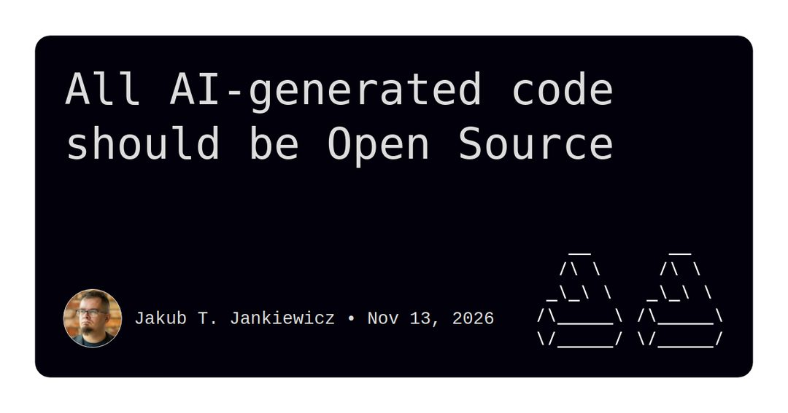

一篇主张「所有 AI 生成代码都应开源」的博文登上 Hacker News 榜首，评论区围绕版权、审计与责任拉锯了很久。主张本身不复杂，真正被顶上去的显然不是这条主张，而是它戳中的问题：当一段代码由模型生成、由人合并进主干，出了问题谁来解释、谁来负责。这个问题在法律层面尚无定论，在工程层面却已经迫在眉睫：代码审查的前提是审查者能理解来源与意图，而「AI 生成」目前恰好是这两者的黑洞。反方的现实顾虑同样成立：强制的开源义务与商业项目的基本假设冲突，且「AI 生成」的边界极难界定——一行补全和整函数生成并不是一回事。值得注意的不是结论，而是争论重心从「谁拥有」滑向了「谁负责」。

> 原文：[Hacker News 讨论](https://jakub.jankiewicz.org/blog/ai-code-open-source/)

### 央行看到的不是失业率，是入口

澳大利亚央行的研究给出一个更具体的切面：AI 对就业的冲击首先落在年轻劳动者身上，软件开发和客服岗位尤为突出。这两个岗位的共同点是任务可切分、流程标准化、输出可校验——恰好是当前模型能力覆盖最好的区域。真正值得警惕的不是岗位消失，而是入口收窄。初级岗位历来承担「边做边学」的功能，如果这一层被压缩，三五年后会在中间层留下断层，而组织往往要到那时才意识到。对个体而言，这意味着职业路径要更早从「执行任务」转向「定义问题」；对企业而言，用 AI 替换初级岗位的短期账很好算，长期账不好算。

> 原文：[The Decoder](https://the-decoder.com/australias-central-bank-finds-ai-hitting-young-workers-first-especially-in-software-and-customer-service/)

### 一份失败清单的正确读法

TechCrunch 维护了一份「AI 坟场」清单，持续收录被关停或未达预期的 AI 项目，样本里有苹果反复延期的 Siri AI，也有 OpenAI 那次被形容为混乱的「超级应用」发布。这类清单通常被当笑话看，但它的价值在于模式识别：清单上大公司的失败，读起来更像是产品定义摇摆、发布节奏被组织因素牵动，而不是单纯的模型能力不够。对做产品的人来说，比「他们为什么失败」更有用的问题是「他们当初在赌什么」——不少项目的死亡证明，在立项那一页就写好了。

> 原文：[TechCrunch](https://techcrunch.com/2026/11/14/the-ai-graveyard-a-running-list-of-projects-and-startups-that-didnt-make-it/)

### 拆台文章的价值不在结论

一篇题为《The Claude Delusion》的长文在 Hacker News 引发讨论，核心质疑是 Claude 的能力预期与实际表现之间的落差。文章立场从标题就摆明了，论证细节需要自己去读，但它引起的共鸣值得注意：一段时间以来，模型能力的公共讨论被 benchmark 分数和 demo 视频主导，而真实工作流里是另一套评价体系——长任务的连贯性、对模糊指令的容忍度、出错时的可察觉性，这些都不太容易进榜单。落差感往往不来自模型变差，而来自宣传口径把「能做到一次」讲成了「可以依赖」。对工具的评价，最终要回到你愿意把哪一部分工作交给它。

> 原文：[netmeister.org](https://www.netmeister.org/blog/claude-delusion.html)

### 不是所有留白都值得填

Wired 的一位作者吐槽 YouTube Music 和 Spotify 的合成主持人：尴尬的串场词和编造的歌曲冷知识，让听歌这件事变得难以忍受。这条排在最后，却是很典型的样本——「AI 填充」。产品团队看到一个留白（歌与歌之间的间隙、播放列表的介绍位），发现用生成内容填补的成本几乎为零，于是填了。问题在于那些留白原本不是缺陷，而是设计：用户在这几秒里做自己的事，或者什么都不做。用低成本内容填满所有缝隙，短期指标可能好看，长期是在消耗用户对产品的信任额度。不是所有空白都值得填。

> 原文：[Wired](https://www.wired.com/story/ai-djs-completely-kill-my-groove/)

今天的五条拼在一起，说的是同一件事：AI 的讨论正在从「能不能」转向「该不该、谁买单」。留一个问题——如果入口岗位真的在收窄，你所在的团队打算怎么培养下一个能定义问题的人？

<h2 id="opensource" class="ai-section-divider">⚙️ 开源工具</h2>

### 导语

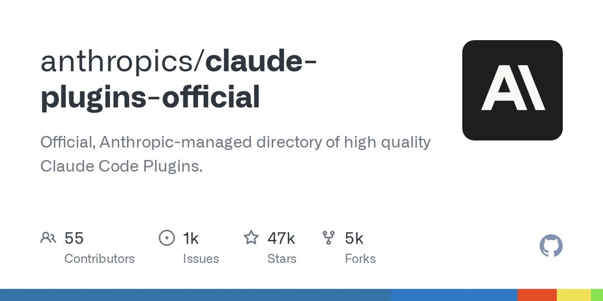

今天开源板块最有信号价值的一件事，不是某个模型，而是 Anthropic 上线了官方 Claude Code 插件目录——社区同期涌现的交易分析、漏洞挖掘、安全技能包等仓库终于有了统一的分发入口。这意味着编码智能体的竞争重心，正从「谁的模型更会写代码」转向「谁的生态里可复用的能力更多」。另一条并行的线索是 Chrome DevTools 官方把调试能力封装成 MCP：智能体不只要写代码，还要能自己看见运行结果。两条合起来看，今天的关键词是「接口」。

### Claude Code 插件与技能生态集中爆发

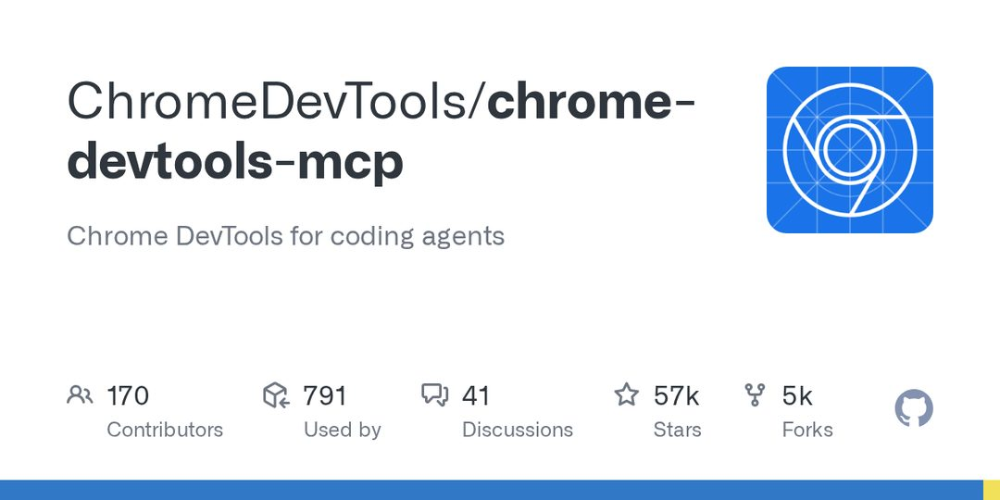

Anthropic 上线了官方插件目录（claude-plugins-official），同期社区出现了一批 Claude Code 技能仓库，覆盖交易分析、漏洞挖掘、安全技能包等方向。

关键点在于「技能」这个形态本身：它把提示词、脚本与工具调用打包成一个可分发、可安装的单元，而官方目录解决的是发现与信任入口。此前这类能力散落在个人 dotfiles 和博客文章里，无法被组织采购和版本化管理。

为什么重要：编码智能体的能力边界正在从模型侧外移到生态侧。对使用方来说，这意味着可复用资产的沉淀速度会明显加快；但同时也要意识到，安装一个第三方技能包，本质上是在给自己的开发环境授予一段不受审计的自动化权限，供应链与权限边界会成为下一个必须回答的问题。

> 原文：[GitHub](https://github.com/anthropics/claude-plugins-official)

### Chrome DevTools 发布面向编码智能体的 MCP

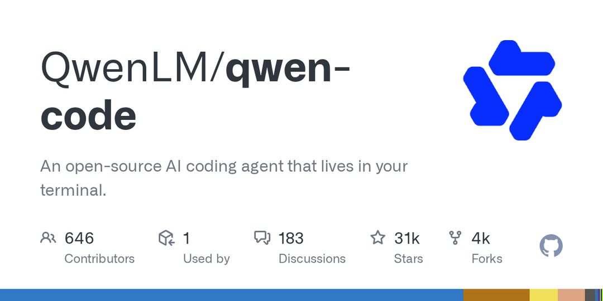

Chrome 官方团队把 DevTools 的能力封装成 MCP 服务（chrome-devtools-mcp），让编码智能体可以直接调试与分析浏览器页面。

关键点是接口形态：MCP（Model Context Protocol）正在成为智能体调用外部工具的事实标准，而这次接入的是浏览器里最「人类专属」的一块——控制台、网络请求、DOM 检查。

为什么重要：前端智能体此前最大的短板是看不见运行结果，只能靠静态读代码猜。一旦 DevTools 变成可调用能力，「改代码 → 跑页面 → 读日志与网络 → 再改」的闭环才真正成立。更值得留意的是这件事由浏览器厂商官方来做，说明调试接口的消费方正在从人扩展到 agent，未来 DevTools 的信息组织方式可能会为机器可读性做重新设计。

> 原文：[GitHub](https://github.com/ChromeDevTools/chrome-devtools-mcp)

### Qwen 开源终端里的编码智能体 qwen-code

qwen-code 是一款运行在终端内的开源编码智能体，直接对标 Claude Code 这一类工具。

关键点有两个：一是形态——终端内运行、以命令行交互为主，说明它瞄准的是与 Claude Code 相同的使用场景而非 IDE 插件；二是开源——意味着可私有化部署、可替换底层模型。

为什么重要：模型厂商正在把编码智能体当作模型的分发渠道，而不只是 demo。这条路径的逻辑是：谁占据了开发者每天敲命令的那个入口，谁就掌握了模型调用的默认选项。对企业的现实意义在于，终端 agent 是少数既能提效、又能把代码留在内网的形态，开源实现让「换模型不换工作流」第一次变得可行，接下来要比的就是工程细节而非榜单分数。

> 原文：[GitHub](https://github.com/QwenLM/qwen-code)

### 阿里开源代码审查工具：确定性流水线 + LLM Agent

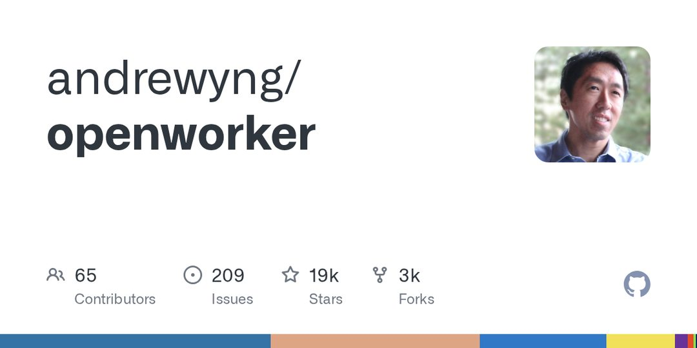

阿里开源了代码审查工具 open-code-review，采用确定性流水线加 LLM Agent 的混合架构，号称在大规模实战中打磨，提供行级精确评论，并内置 NPE、线程安全、XSS、SQL 注入等多语言规则集。

关键点在架构取舍：把「必须准确」的部分交给确定性规则，把「需要理解意图」的部分交给 LLM。行级精确评论听起来是体验细节，实际是可用性门槛——评审意见落不到具体行，开发者就不会看。

为什么重要：纯 LLM 评审在真实仓库里最大的问题是漏报与误报都不可控，且结论不稳定。规则保证下限、模型提供上限，这种混合路线大概率会成为企业级代码智能体的标准范式。同时它也提示了一件事：在代码质量这类有客观标准的场景，模型并不是越「纯」越好。

> 原文：[GitHub](https://github.com/alibaba/open-code-review)

### 吴恩达开源 openworker 项目

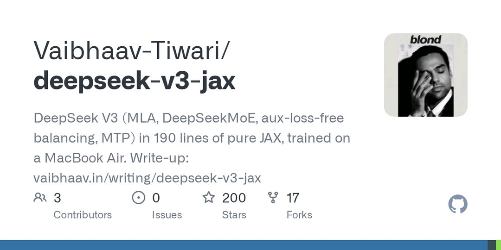

andrewyng/openworker 登上 GitHub Python 趋势榜，方向指向可托管的 AI 工作助手。

需要说明的是，目前公开信息有限，能确认的是项目定位与「可托管」这一形态描述，具体实现与能力边界仍需看仓库本身。

为什么重要：值得关注的不是单个仓库，而是「可托管」这三个字。编码智能体是同步的——你提问，它回答；而工作助手隐含的是异步的——任务在后台持续运行、按计划推进、需要时再回来汇报。从同步工具走向常驻进程，是 agent 产品形态的一次实质变化，也对应着完全不同的工程问题：状态持久化、失败重试、权限与审计。吴恩达近期的开源动作密集，这条线值得持续跟踪。

> 原文：[GitHub](https://github.com/andrewyng/openworker)

### 200 行纯 JAX 复现 DeepSeek V3 引热议

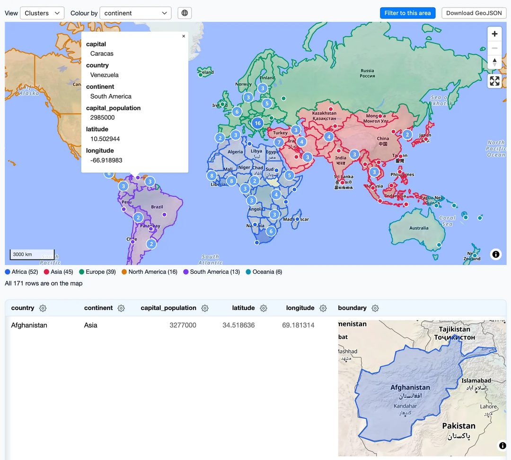

一个用约 200 行纯 JAX 实现 DeepSeek V3 的仓库登上 Hacker News，获得 270+ 分。

关键点在于「200 行」这个数字的修辞作用：它把 MoE（Mixture of Experts）路由、注意力、并行结构这些原本埋在工程代码里的设计，压缩到可以一口气读完的体量。

为什么重要：小实现当然不等于可训练规模的实现——数据、并行策略、通信优化、数值稳定性这些才是大模型工程的真正成本。但作为教学样本，它的价值很实在：理解一个架构最快的办法从来不是读论文，而是读一份能跑的最小实现。对想搞清楚 DeepSeek 路线为何在成本上占优的团队来说，这是一个低成本的上手入口。

> 原文：[GitHub](https://github.com/Vaibhaav-Tiwari/deepseek-v3-jax)

### Datasette 生态连发七版：地图、Agent 与 1.0a43

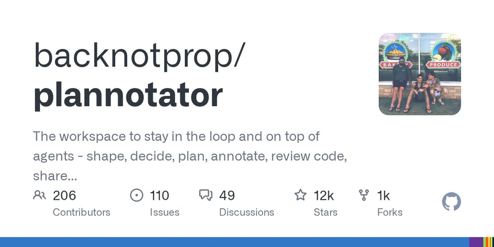

Simon Willison 一口气发布了 datasette-maplibre、datasette-agent、datasette-llm 等七个版本，其中包含一项安全修复的向下移植（backport）。

关键点有两个方向：一是能力扩展，地图可视化与 agent、LLM 插件把 Datasette 从数据浏览器推向数据交互层；二是维护动作，「向下移植安全修复」说明这套生态已进入需要同时维护多条版本线的阶段。

为什么重要：Datasette 长期是「单人维护者 + 高频发布」的样本，而这次的主题正好是给数据工具接上 agent 接口——让智能体能查表、能问数据，而不只是生成 SQL。同时，安全修复的向下移植也提醒使用方：小生态的版本维护负担真实存在，锁定版本时要把支持周期算进去。

> 原文：[Simon Willison](https://simonwillison.net/2026/Nov/15/datasette-maplibre/)

### plannotator：把智能体的计划与代码评审拉回人的视野

plannotator 登上 GitHub 日榜，是一个面向智能体协作的工作台：人类可以对智能体给出的计划做标注、决策与代码评审，并一键把反馈回传。

关键点是它介入的位置——不是代码生成，而是生成之前的「计划」与生成之后的「评审」。这两处正是当前 agent 工作流里人类参与度最低、但出错代价最高的环节。

为什么重要：agent 的产出速度已经明显快于人类的阅读速度，瓶颈从「写」转移到了「审」。把计划与评审做成可标注、可回传的结构化界面，本质上是为「人在环」（human-in-the-loop）造工具。这类产品短期内不会成为主角，但它决定了 agent 能不能被放心地放进真实的生产流程。

> 原文：[GitHub](https://github.com/backnotprop/plannotator)

### 结语

今天八条里，有五条本质在做同一件事：给智能体造接口，或给人造审阅智能体的界面。留一个问题——当插件目录、调试接口、评审工作台都齐了，你团队里第一个被交给 agent 的环节，会是写代码还是审代码？
