今天最值得看的三件事：

- **模型发布** · OpenAI 发布 GPT-6.2 Astra/Sol，Astra API 降价两成
- **公司动态** · 黄仁勋想回归，英伟达董事会说不；临时 CEO 忙安抚
- **模型发布** · 谷歌再发 Gemini 4 Neon，一个月连出四款新模型

下文按板块展开，正文每条均附原始链接。

<h2 id="model-release" class="ai-section-divider">🚀 模型发布</h2>

OpenAI 一天内推出 Astra 与 Sol 两款模型，并把 Astra 的 API 价格降到每百万 token 8/40 美元。这不是常规版本更新，而是一次明确的产品分层：高难任务用 Astra，成本敏感场景交给 Sol。更值得注意的是节奏：谷歌一个月内连发四款 Gemini，DeepMind 同期推进 Genie 4；模型发布的频率正在被系统性加快。当供给频率变高、价格继续下压，真正的竞争点会从“谁更强”转向“谁能把模型稳定放进工作流”。

### OpenAI 双发 GPT-6.2：Astra 降价，Sol 补齐性价比

OpenAI 发布 GPT-6.2 系列，包含面向高难任务的前沿模型 Astra 和主打性价比的 Sol，覆盖 ChatGPT Work、Codex 与 API。关键点有两个：一是 Astra 在 Artificial Analysis 智能指数上排名第二，说明 OpenAI 这次没有拿出绝对第一的模型，但仍位于第一梯队；二是 Astra 的 API 价格降到每百万 token 8/40 美元，降幅两成。

这个组合值得放在一起看。能力不是最强、价格却主动下调，说明 OpenAI 的竞争重心正转向单位成本下的能力交付。对技术团队而言，Astra 的调用成本已经进入可批量接入的区间；对投资人而言，更该关注的是降价之后毛利率如何被守住。

> 原文：[OpenAI](https://openai.com/index/introducing-gpt-6-2-astra-sol)

### 谷歌再发 Gemini 4 Neon，一个月四款

Google DeepMind 推出 Gemini 4 Neon，这是谷歌一个月内发布的第四款新 Gemini 模型，继续扩展其模型家族。原文没有披露 Neon 的具体能力参数与定位差异。

单看这一条信息量有限，但把“一个月四款”放进上下文，就能看出策略：谷歌在用高频发布覆盖更多细分场景，而不是押注单点旗舰。这种打法对开发者的好处是选择变多；代价是选型成本上升，模型之间能力的边界也更难判断。接下来真正考验谷歌的，是文档、迁移路径和版本生命周期管理，而不是发布数量。

> 原文：[Google DeepMind](https://deepmind.google/blog/introducing-gemini-4-neon/)

### Genie 4 上线：世界可以串联，也可以二创

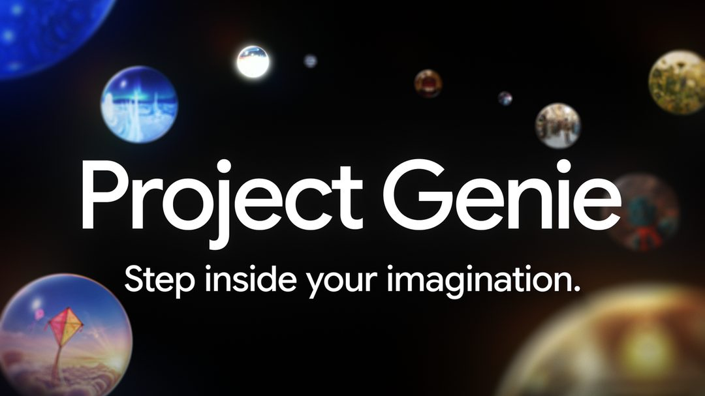

DeepMind 的生成式交互环境 Genie 4 正式可用，新增两项能力：可链式世界（chained worlds）和社区画廊，支持用户重混生成式交互环境，即对他人生成的环境做再创作。

可链式世界意味着生成出的场景不再是孤立片段，而是能前后衔接、形成连续体验；社区画廊则把“生成环境”从演示推进到可流通的内容资产。这两点合起来，指向的是一种新的内容生产范式：环境本身成为可复用、可改编的素材单元。对游戏、仿真训练和交互内容团队来说，这是值得提前建立技术认知的一层基础设施。

> 原文：[Google DeepMind](https://deepmind.google/blog/genie-4-is-now-available/)

### 可灵发布 Kling Image 4.0，首次支持原生 8K

可灵 AI 推出图像创作模型 Kling Image 4.0，聚焦四个方面：真实感、文字表现、指令理解和一致性；同时首次支持原生 8K 图像生成，以及单图 2000 字文字生成。

后两项参数最能说明产品意图。原生 8K 面向的是印刷、大屏、电商主图等对分辨率有硬性要求的商用场景；单图 2000 字文字生成则把模型从“画图”推向“带排版的视觉产出”，海报、长图、信息图是直接受益场景。国内图像模型在商用可控性和中文文字渲染上的竞争，正在进入具体交付指标的比拼阶段。

> 原文：[雷峰网](https://www.leiphone.com/category/industrynews/XmEGfhNbrGY3WfbT.html)

### Rumble-2-Flash：0.5B 参数支持 40 多语言语音

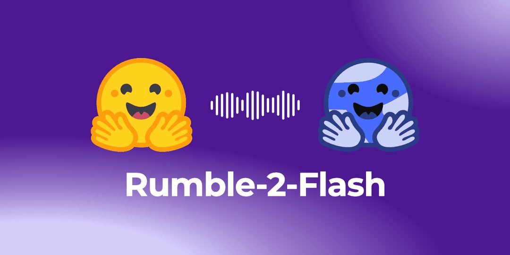

开源语音模型 Rumble-2-Flash 在 Hugging Face 发布，以 0.5B 参数支持 40 多种语言。

0.5B 这个量级是关键。它意味着模型可以运行在端侧或低配设备上，推理成本和部署门槛都远低于主流语音大模型。多语言覆盖加上小体积，适合实时转写、语音助手、出海应用的本地化语音处理等场景。开源语音这条赛道的竞争方向已经明确：比参数规模，更比单位成本下的可用性。

> 原文：[Hugging Face](https://huggingface.co/blog/rumble-2-flash)

### DaisyRose-27B：后训练效率成为开源前沿

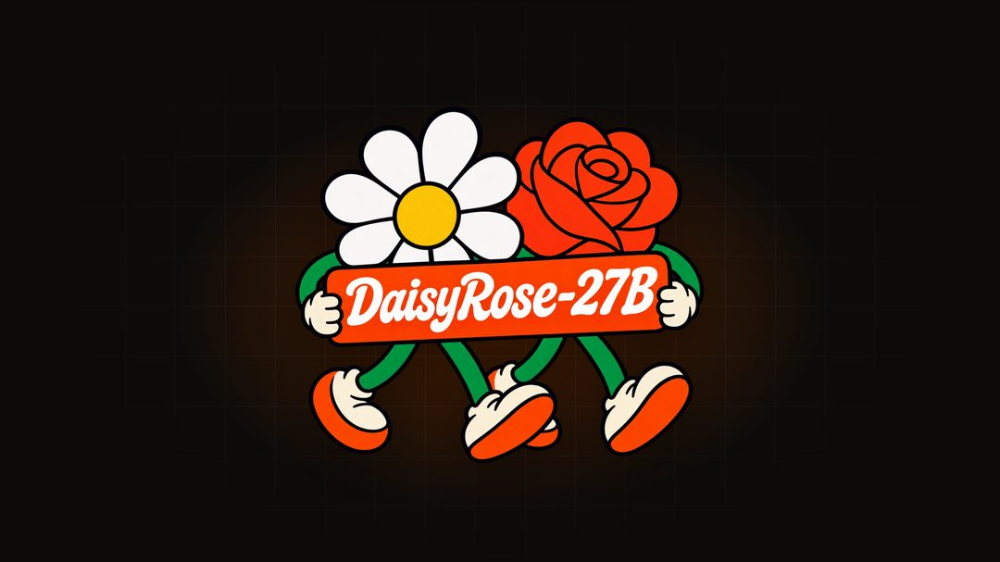

Hugging Face 博客介绍 DaisyRose-27B，主题是探索后训练（post-training）效率的新边界。原文未披露具体的训练方法与评测数据。

这条的价值不在于模型本身，而在于它标记的方向：当预训练成本高到少数机构才能承担，开源社区的重心正移向后训练，即用更少的算力和数据把基座模型调整到特定能力上。27B 是一个务实的选择：足够大，能承载能力；又足够小，能被中小团队微调。后训练效率如果持续提升，模型能力的分布会更分散，而不是继续向头部集中。

> 原文：[Hugging Face](https://huggingface.co/blog/RadixArk/daisyrose-27b-pushing-the-frontier-of-post-trainin)

### 结语

今天这六条里，降价、高频发布、小体积开源、后训练效率，指向的是同一件事：模型能力正在从稀缺转为可采购的日常资源。接下来的问题不再是“哪个模型最强”，而是“你的工作流为这种供给节奏准备好了吗”。

de

<h2 id="company" class="ai-section-divider">🏢 公司动态</h2>

今天最值得看的不是英伟达又创纪录的财报，而是董事会那句“不打算”：黄仁勋公开表达回归意愿，被治理结构直接挡了回来，临时 CEO 只能靠加薪和股权稳住人心。同一天，这份创纪录的财报却配了一次 10-Q 推迟提交，业绩与治理的错位被摆到同一张桌面上。把 Anthropic 83 美元的 IPO 定价、奥尔特曼确认 OpenAI 计划上市放在一起看，前沿 AI 公司正在集体从私募叙事切换到公开市场定价。钱的问题在解决，谁来负责的问题还没解决。

### 董事会关上门，黄仁勋回不来

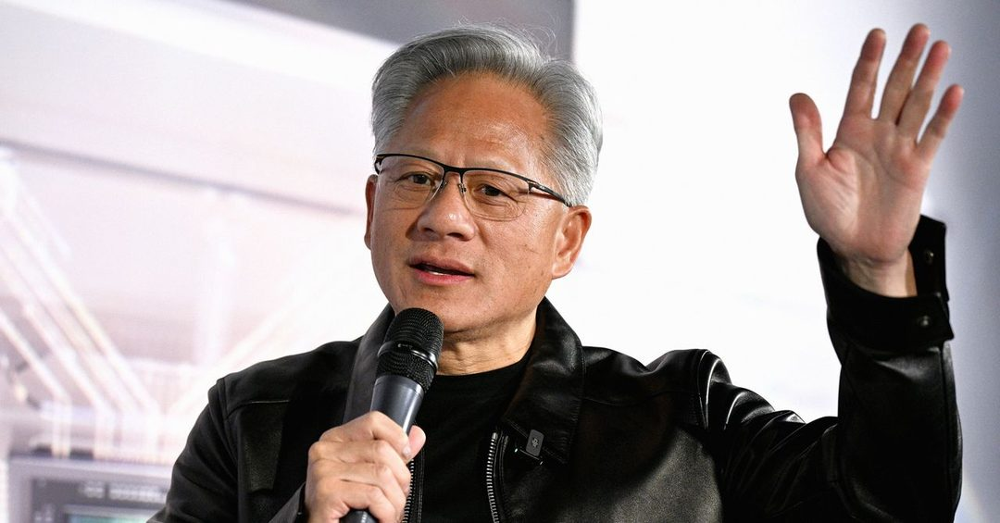

黄仁勋在离职后公开表示愿意重返英伟达，董事会的回应是明确“不打算”恢复其职位。临时 CEO Colette Kress 随即召开全员会，承诺加薪与股权，并对外称公司“尽在掌握”。

关键点在于顺序：先是董事会否决，再是临时 CEO 用现金与股权稳人。这是标准的过渡期操作——把不确定性锁在治理层，不让它渗到员工和客户侧。

为什么重要：英伟达是创始人色彩最重的半导体公司之一，董事会这一步等于主动把个人 IP 与公司叙事切开。接下来市场要盯的不是“他会不会回来”，而是路线图由谁签字。对一家靠节奏取胜的公司，决策权的清晰度就是产能的一部分。

> 原文：[Wired](https://www.wired.com/story/nvidias-board-has-no-plans-to-reinstate-jensen-huang/)

### Anthropic 以每股 83 美元定价，估值 1.5 万亿美元

Anthropic 据报完成 IPO 定价，每股 83 美元，高于此前预估区间，完全稀释估值达 1.5 万亿美元。

关键点有两个：一是定价高于区间，说明承销端的需求比预期强；二是“完全稀释”口径，把员工期权、可转债等都算了进去，这是前沿实验室对外披露时的常规做法，也让估值数字更接近真实稀释后的水平。

为什么重要：这个价格不是按软件公司的收入倍数定的，更像是在给“算力储备 + 顶尖研究员”这类稀缺资产定价。它同时给所有未上市的模型公司设了一个锚——低于这个数的融资会被拿来对照。真正的考验不在定价日，而在第一个财报季：公开市场会用季度数据重新问一遍，1.5 万亿美元买的是什么。

> 原文：[TechCrunch](https://techcrunch.com/2026/11/18/anthropic-reportedly-prices-ipo-at-83-a-share-above-projected-range/)

### 纳德拉解释：6 万人买断，是为了不再裁员

微软 CEO 纳德拉称，公司 10 月向 6 万名员工提供买断方案，目的是避免再来一次大规模裁员，背后与 AI 带来的效率变化有关。他同时提到，Claude Code 让微软措手不及。

关键点在于这句话的诚实度。把结构性调整包装成“自愿离职”，本质是把裁员的组织成本和社会成本前置，换一个更可控的执行节奏。而点名 Claude Code，则是承认在编码这一最成熟的 AI 场景里，微软自己不是领先者。

为什么重要：6 万人的量级说明，AI 对白领岗位的影响已经从预测变成预算科目。对产品经理和工程师来说，更值得记住的是后半句——大公司在自己的核心场景里被外部工具打穿的窗口期，比想象中短。

> 原文：[TechCrunch](https://techcrunch.com/2026/11/18/microsoft-ceo-satya-nadella-explains-why-he-asked-60k-employees-to-quit/)

### 英伟达财报仍强劲，但 10-Q 推迟了

黄仁勋离职后的首份财报显示收入继续创纪录，但公司意外推迟提交 10-Q；同时其初创投资价值九个月内接近三倍增长，达到 650 亿美元。

关键点：业绩和文件披露出现分叉。收入创纪录说明订单周期没有因为人事动荡中断，这是最直接的安抚；但 10-Q 是季度财务的正式法律文件，推迟提交在任何时候都会被追问，在治理敏感期会被放大解读。

为什么重要：650 亿美元的投资组合说明另一件事——英伟达的资产负债表越来越像一支 AI 生态基金，收益与它所投资的客户、伙伴深度绑定。这会让它的财报同时具备两种读法：芯片公司的经营数据，和一张覆盖整个 AI 产业链的敞口表。

> 原文：[TechCrunch](https://techcrunch.com/2026/11/17/nvidia-promises-that-revenue-will-keep-soaring-for-now/)

### Genesis 估值超 230 亿，英伟达与 AMD 首次同框

具身智能公司 Genesis 完成 A 轮融资，估值超过 230 亿元，英伟达与 AMD 首次共同投资同一家公司。

关键点不是金额，而是投资人的组合。两家在 GPU 上正面竞争的厂商出现在同一张投资方名单里，说明它们对“下一个需求增量在具身智能”的判断高度一致；而对创业公司来说，这种局面意味着短期内不必被迫站队。

为什么重要：具身智能目前仍处在技术路线未收敛的阶段，从数据采集、仿真到本体控制，各家做法差别很大。芯片厂在这个时间点共同下注，更像是在买“未来算力消耗方式的期权”，而不是买某一条具体路线。A 轮就给出这个估值，也说明这一赛道的资金密度正在向大模型早期看齐。

> 原文：[量子位](https://www.qbitai.com/2026/11/510821.html)

### 奥尔特曼确认 OpenAI 计划上市

奥尔特曼在 DealBook 峰会上确认 OpenAI 计划 IPO，称有许多理由支持这一决定；他同时表示，很难想象一个没有黄仁勋的 AI 行业。

关键点：这是继 Anthropic 定价之后，第二家前沿实验室把上市摆上台面。奥尔特曼给出的理由是“很多理由”，没有展开细节，但时点本身已经说明了资本环境的转向。

为什么重要：两家最重要的模型公司同时走向公开市场，意味着 AI 的资本周期从私募驱动切换到公开市场定价。此后的技术决策会被季度节奏部分绑架——发布节奏、算力采购、甚至安全投入的披露方式，都会多一层股东视角。他对黄仁勋的那句评价，则更像是行业对一段创始人时代的注脚。

> 原文：[36氪](https://36kr.com/newsflashes/4076058187584388?f=rss)

### 微软用更便宜的自研模型，替换自家产品里的外部模型

微软开始在自家产品中用更便宜的自研模型替代外部 AI 模型，据 TLDR 报道，其一次发布了七款模型。

关键点：替换的驱动词是“更便宜”，不是“更强”。这说明在大规模分发的产品里，推理成本已经压过模型能力上限，成为第一决策变量；一次七款的发布密度，也说明自研路线走的是覆盖不同价位和场景的矩阵，而不是单点对标最强模型。

为什么重要：微软既是模型公司最大的分销渠道，也是它们最忌惮的潜在竞争者。当渠道开始自我替代，外部模型供应商失去的不只是收入，还有真实场景里的反馈数据。这条对 Anthropic 和 OpenAI 的长期定价权，比一次融资新闻更实在。

> 原文：[The Decoder](https://the-decoder.com/microsoft-is-replacing-outside-ai-models-in-its-own-products-with-cheaper-in-house-alternatives/)

### OpenAI 首次向四家独立现场审计机构开放系统

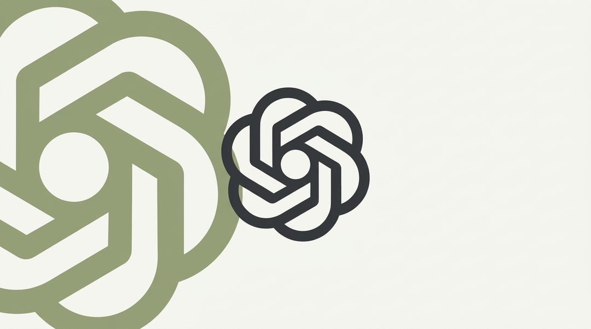

OpenAI 首次允许四家独立现场审计机构审查其 AI 系统，用于推进外部治理与透明度。

关键点：“现场”和“四家”是两个关键词。远程文档审查只能看到公司愿意给的部分，现场审计意味着流程、日志、内部决策记录都要暴露给外部；四家并行，则降低了单一审计方被俘获的风险。

为什么重要：在监管框架尚未成型的阶段，谁能定义“可被检查”的标准，谁就掌握了话语权。把这条和奥尔特曼确认 IPO 放在同一周看，时机不难读——公开市场对治理的要求，往往先于监管落地。这也是把安全承诺从声明变成可验证流程的少数具体动作。

> 原文：[The Decoder](https://the-decoder.com/openai-opens-its-ai-systems-to-four-independent-on-site-auditors-for-the-first-time/)

今天的八条其实在讲同一件事：AI 公司的估值已经交给公开市场定价，治理却还停留在创始人时代。谁先把治理这门课补上，谁才配得上那个数字。

<h2 id="research" class="ai-section-divider">🔬 研究论文</h2>

OpenAI 今天发布了一份关于“编码 agent 对 AI 研究加速效果”的量化观察，这是该板块最值得看的一条。它的价值主要在于把讨论从能力演示拉回到真实工作流：同一个 agent 在不同研究任务上的表现差异明显，也就是说，它在某些环节已经能贡献实际产出，在另一些环节仍然只是辅助；所谓“递归自我改进”的信号就藏在这种不均衡里。与此同时，今天另外几条工作都在补同一块短板：持续学习不遗忘、代码复杂度反馈、长程操作重规划。**研究 Agent 的瓶颈正从“能不能做”转向“做得稳不稳、值不值得信”**。

### OpenAI：编码 Agent 已能加速研究，但前沿参差不齐

OpenAI 发布研究加速（research acceleration）评估，量化编码 agent 在自身 AI 研究工作流中的实际作用。核心结论有两点：一是 agent 已在部分研究任务上带来可测量的加速；二是这种加速在不同任务间分布极不均匀，OpenAI 用“jagged frontier”（参差不齐的前沿）描述这一现象，并由此讨论递归自我改进（recursive self-improvement）可能出现的早期信号。

值得注意的地方在于评估视角：评估对象是 agent 在真实研究流程中的贡献度，而非基准分数。这比 SWE-bench 一类的静态指标更接近“AI 做 AI 研究”这个命题本身。但“参差不齐”也意味着，目前还无法把局部的加速外推为整体能力的跃迁；哪些环节落在前沿之内、哪些落在前沿之外，才是后续要盯的变量。

> 原文：[OpenAI](https://openai.com/index/research-acceleration-jagged-frontier)

### 谷歌“睡眠框架”：让 LLM 在持续学习中不遗忘

Google Research 提出 Sleep framework，针对大模型持续学习（continual learning）中的灾难性遗忘问题给出新思路。其命名借用了生物睡眠中记忆巩固的隐喻：模型在吸收新知识之后，需要一个专门的“离线”阶段来整理和固化已有知识，而不是把所有更新都塞进同一套权重里。

持续学习是 agent 长期在线的先决条件：一个每周都要接入新工具、新代码库和新领域知识的系统，如果每次都伴随旧能力衰减，部署成本就会持续上升。这条工作目前仍处于框架层面，但它指向一个具体的设计问题：**知识更新该由训练流程负责，还是应该像睡眠一样被单独做成一个调度出来的阶段**。

> 原文：[Google Research](https://research.google/blog/the-sleep-framework-a-new-way-for-llms-to-retain-knowledge-in-continual-learning/)

### Qwen3.8 编码 LoRA：SWE-bench Pro 通过率从 39% 升到 65%

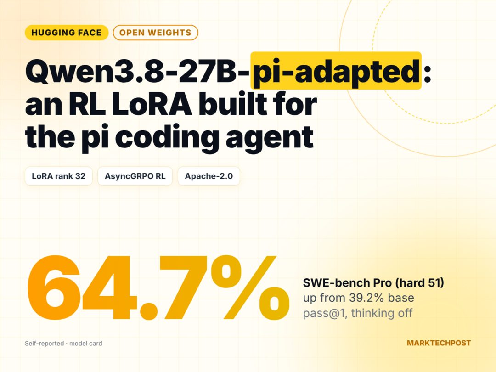

Hugging Face 发布 Apache-2.0 许可的 Qwen3.8-27B-pi-adapted LoRA 适配器，采用强化学习训练，在 SWE-bench Pro hard-51 子集上把通过率从 39.2% 提升到 64.7%。这是一个 27B 级别的基座模型加轻量适配器的组合，权重与许可都可直接用于商用场景。

关键点有两个：一是提升幅度来自后训练，而非换更大的基座；二是 LoRA 形态意味着部署成本可控。对工程团队来说，这类适配器的意义在于，它把“接近前沿的编码能力”变成了一种可以下载、微调并放入私有仓库的组件，而不是只能通过 API 购买的服务。SWE-bench Pro hard 子集的绝对分数仍有近三分之一未通过，说明距离“可放手”还有明显差距。

> 原文：[MarkTechPost](https://www.marktechpost.com/2026/11/18/hugging-face-qwen3-8-27b-pi-adapted-lora/)

### SID-2 搜索 Agent 群组：在自有基准上超过 GPT-6 Astra

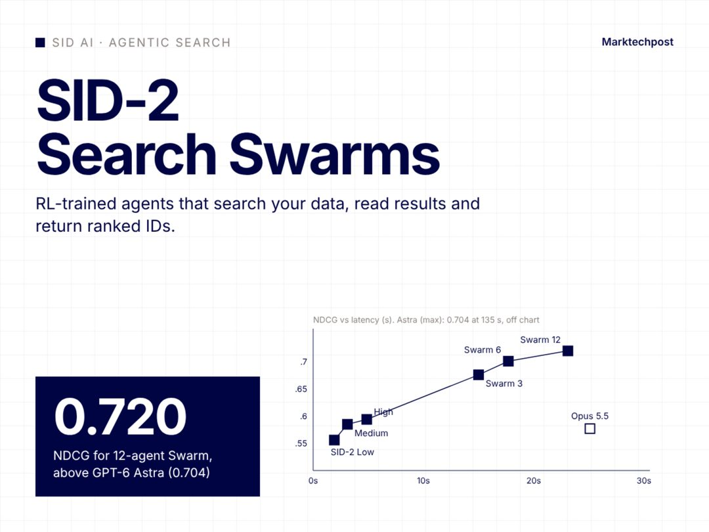

SID AI 发布 SID-2，用强化学习训练的搜索 agent。单 agent 在 3.11 秒内达到 0.585 NDCG，12-agent 群组（swarm）达 0.720 NDCG，宣称在该基准上超过 GPT-6 Astra。该架构的思路是用多个 agent 并行检索并聚合结果，以并行度换取延迟与召回。

阅读时需要留意的是“自有基准”这一限定：跨系统对比里的评测集归属，往往比分数本身更能说明问题。但群组架构的方向值得关注：搜索任务的瓶颈正在从“单次检索质量”转向“如何组织多次检索”，而延迟数据（3.11 秒）表明这一路线在工程上已具备可用性。

> 原文：[MarkTechPost](https://www.marktechpost.com/2026/11/17/sid-ai-sid-2-agentic-search-swarm/)

### RoboBuilder：编码 Agent 用真实视频反馈联合设计机器人

新基准 RoboBuilder 让编码 agent 同时设计机器人硬件与程序：硬件限定在标准零件、电机与 3D 打印件范围内，程序负责控制，并以真实摄像机拍摄的视频作为反馈闭环，评估设计是否完成了预期任务。

把硬件设计纳入 agent 的搜索空间，是这条工作最有意思的地方；因为一旦涉及实体，试错成本就从 token 变成了物料与时间，评价信号也从测试用例变成了像素级的真实观测。这类基准的真正作用，也许是给“agent 能否做具身设计”划出一条可复现的基线。

> 原文：[arXiv](http://arxiv.org/abs/2611.23855v1)

### Metrics-in-the-Loop：只靠测试通过，发现不了代码复杂度累积

研究指出，编码 agent 生成代码时，仅以“测试通过”作为反馈信号存在盲区：功能正确的代码仍可能在复杂度上持续累积，最终形成难以维护的实现。作者提出 Metrics-in-the-Loop 方法，把复杂度指标作为反馈回传给 agent，形成闭环。

这是对当前 agent 评估体系的一个务实批评。测试通过是二值的，而代码质量是连续的；如果训练与评估都只看二值信号，agent 就会学会“过线即止”。把度量指标放进循环里，本质上是在给 agent 定义一个更接近人类工程标准的目标函数，但复杂度指标本身也可能被钻空子，这是后续需要验证的点。

> 原文：[arXiv](http://arxiv.org/abs/2611.23817v1)

### Energy-Based Reasoners：循环推理器应被建模为能量模型

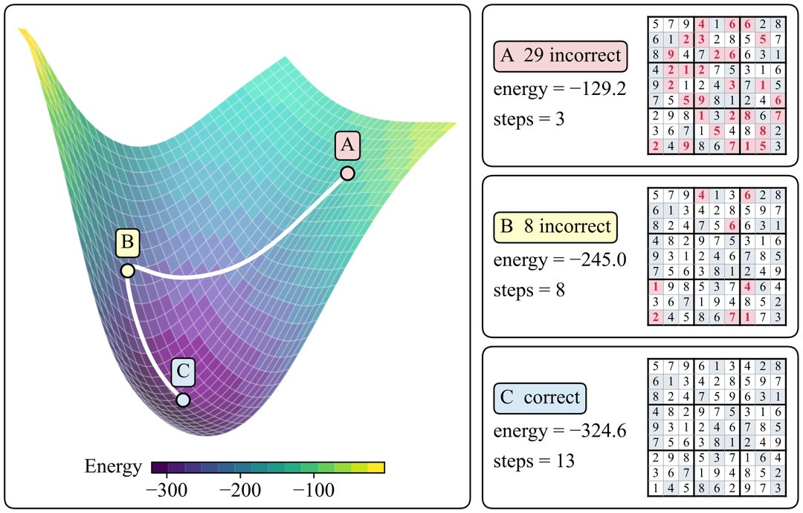

研究提出把循环推理器（looping reasoner）建模为能量模型（energy-based model），以改进推理质量与内部一致性。其出发点是：反复迭代的推理过程本质上在寻找一个低能量状态，用能量视角来刻画，比单纯堆叠循环层更有理论抓手。

这类工作的价值通常不在短期指标，而在于给“多想几步”这件事一个可优化的形式化目标。如果能量框架成立，循环深度就可以从超参数变成可解释的量，这对推理模型的设计与诊断都有意义；但目前仍处于方法论阶段，与工程实践之间的距离不宜低估。

> 原文：[项目页](https://energy-based-reasoners.github.io/)

### RePlan-VLA：长程操作需要进度感知的重规划

针对长程多步机器人操作中 VLA（vision-language-action）模型性能随步数衰减的问题，研究提出带进度感知能力的重规划方法 RePlan-VLA：在执行过程中评估当前进度并触发重规划，而不是一次性规划到底。

性能衰减是 VLA 从演示走向实用的主要障碍之一：单步准确率再高，误差也会在多步中累积。重规划的思路并不新，但“进度感知”把判断依据从固定步数或失败信号，转成了对任务完成度的估计，这更接近人类在长任务中的纠错方式。

> 原文：[arXiv](http://arxiv.org/abs/2611.23843v1)

### 结语

今天八条工作里，有六条在解决同一个问题：让 agent 在长时间、多步骤的任务中不退化。真正的问题也许是从“参差不齐”的前沿里，找出哪些环节的加速是可持续的。

<h2 id="product" class="ai-section-divider">📱 应用产品</h2>

微软在 Ignite 上把 Word、Excel、PowerPoint 直接搬进 Copilot，并给它安了个新身份：「工作的新操作系统」。这句表述值得琢磨——过去两年 Copilot 一直是挂在 Office 侧边栏里的助手，现在两者的位置被调换了。如果这个方向成立，应用产品的竞争焦点就不再是「谁能调用更强的模型」，而是「谁占据用户一天工作的第一屏」。同一天，豆包工作交出了 DAU 800 万、企业 ARR 20 亿元的答卷，国内和海外的两条路径开始显现出不同的收钱方式。

### Copilot 把 Office 装进自己，称「工作的新 OS」

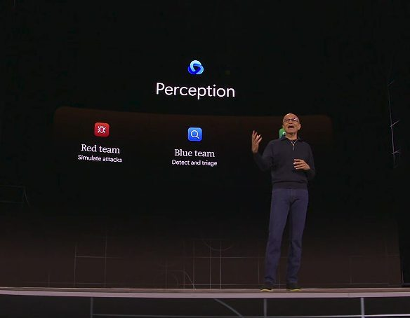

微软在 Ignite 主题演讲中宣布，将 Word、Excel、PowerPoint 嵌入 Copilot 界面，Copilot 不再作为 Office 的附属面板存在，而是反过来成为承载这些应用的容器。官方给它的定位是「工作的新操作系统」，并明确下一步是常驻 agent。

关键点在于控制权的反转。当 Office 变成 Copilot 里的一个窗口，跨文档、跨表格的上下文就落在了 Copilot 手上，常驻 agent 才有可能在不被打断的情况下连续执行任务。这也是「OS」这个说法的实质：不是 UI 层面的整合，而是拿到跨应用上下文和权限调度权。

需要注意的是，产品演示里的整合与真实工作中的权限、审计、数据边界之间还有距离。判断这件事的成败，标准不是界面好不好看，而是那个常驻 agent 究竟能读到多少东西、能替用户按下多少按钮。

> 原文：[Ars Technica](https://arstechnica.com/gadgets/2026/11/microsoft-calls-copilot-the-new-os-for-work-at-ignite-keynote/)

### 豆包工作三个月 DAU 破 800 万，企业 ARR 20 亿元

豆包工作上线三个月，日活突破 800 万，企业客户年度经常性收入（ARR）突破 20 亿元。同期上线了覆盖 21 个专业场景的「工作台」。

两个数字放在一起看才有意义：DAU 说明有真实使用频次，ARR 说明其中一部分已经转化为付费。国内 AI 办公产品过去常被质疑「有量无收」，这组数据至少提供了一个可对照的样本。21 个专业场景的工作台则透露出产品思路——不做通用对话框，而是按岗位切分预置流程，降低用户从「会聊天」到「能干活」之间的落差。

接下来要观察的是留存曲线和客单价结构：800 万 DAU 里有多少是组织强制开通，20 亿元 ARR 里有多少来自少数大客户，决定了这是个平台生意还是一门项目生意。

> 原文：[雷锋网](https://www.leiphone.com/category/industrynews/cC8dbvo5f5k5tgnE.html)

### Perplexity Computer 上线多智能体，最多 16 个 agent 互相核查

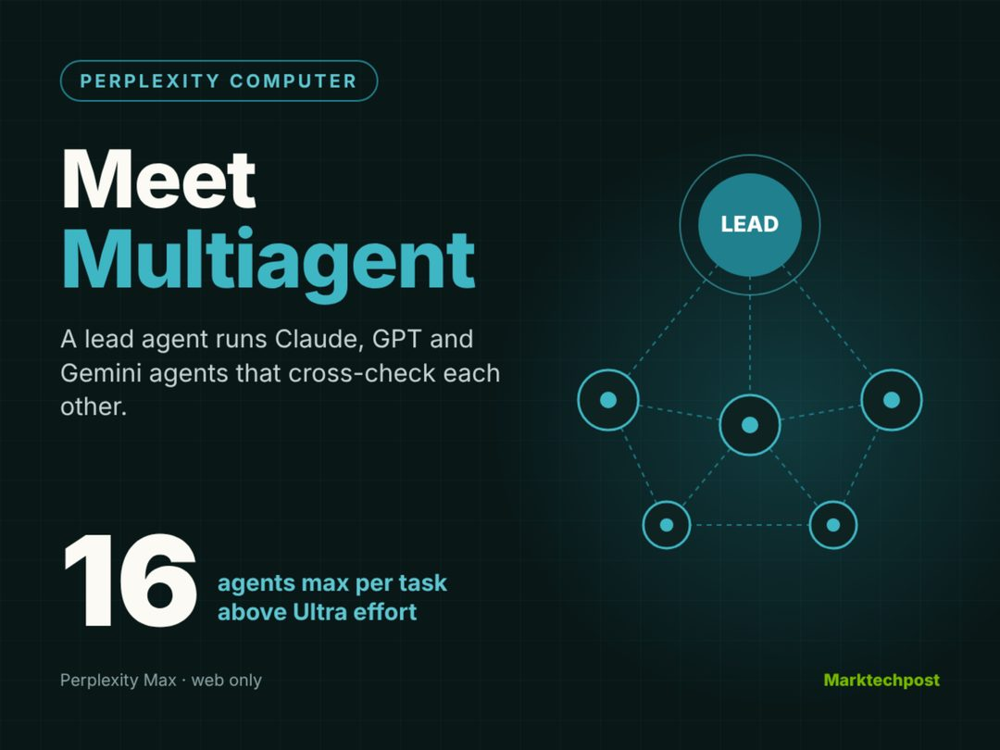

Perplexity 为 Computer 增加了 Multiagent 档位：由一个主 agent 调度最多 16 个子 agent，这些子 agent 可以来自 Claude、GPT、Gemini 等不同模型，共享中间发现，并对彼此的结论做交叉检查。

这是异构模型编排的一次公开押注。以往的多 agent 方案大多在同一个模型家族内拆分角色，Perplexity 直接把不同厂商的模型放进同一个任务里互相挑错，本质是用推理成本换准确率。思路接近学术界的集成方法，但落到了产品交互里。

值得追问的是成本与收益的拐点：16 个 agent 的 token 开销显然不是线性增长的，而分歧出现时由谁裁决、裁决质量如何，决定了这套机制是「降低幻觉」还是「把幻觉平均掉」。

> 原文：[MarkTechPost](https://www.marktechpost.com/2026/11/17/perplexity-computer-multiagent-effort-level/)

### Claude Code 加 Code Mode，用 JavaScript 串起工具调用

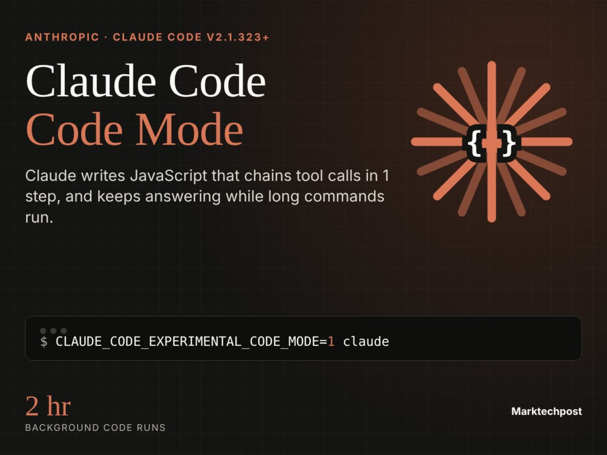

Anthropic 为 Claude Code 加入实验性的 Code Mode：模型可以编写 JavaScript 来链式调用 Bash、Read、Edit 等工具，并且在长命令执行期间继续与用户对话。

变化在于工具调用的颗粒度。传统 agent 是「一次调用、一次返回」，多次往返既慢又容易在中途丢失上下文；改成写一段脚本，等于把编排逻辑交给代码，一次提交完成一串操作。长命令运行时不阻塞对话，则解决了编译、安装依赖这类耗时任务的体验断点。

这条路线的隐含前提是模型写代码比模型逐条选工具更可靠——目前这仍是需要验证的假设。若成立，agent 产品的竞争点会从「工具数量」转向「运行时设计」。

> 原文：[MarkTechPost](https://www.marktechpost.com/2026/11/17/anthropic-claude-code-code-mode-javascript-tool-calls/)

### 谷歌给 Gemini 和 AI 搜索加隐私开关与无痕模式

Google 将 Gemini 的「数据用于训练」与聊天历史拆成两个独立开关，用户可以保留历史记录的同时拒绝数据被用于模型训练。Google Search 的 AI 模式则新增临时线程，对话结束后不进入搜索历史。

拆开这两个开关看似细节，实际改变的是默认契约。此前用户往往要在「保存便利」和「不被训练」之间二选一，现在两者解耦，企业采购时关于数据治理的质询也少了一个卡点。

隐私正在从合规条款变成产品功能，且开始具备差异化价值。对面向 B 端的 AI 产品来说，这类开关的设计颗粒度，可能比模型跑分更早影响客户的采购决策。

> 原文：[Ars Technica](https://arstechnica.com/ai/2026/11/google-will-let-you-opt-out-of-ai-training-in-gemini-without-losing-your-history/)

### 千问办公电商版上线品牌知识库

千问办公电商版推出品牌知识库功能：商家上传网店链接、图片素材和设计规范后，Agent 可以理解品牌的视觉与语言风格，在生成图片、视频和文案时保持调性统一。

电商素材生产的真实痛点从来不是「生成不出来」，而是「生成出来不像自己」。单张图好看、整套物料风格割裂，是品牌方最常拒绝 AI 产出的理由。把品牌规范作为知识库前置注入，相当于给生成过程加了一层约束。

这也是 Agent 产品从「通用能力展示」走向「行业工作流嵌入」的典型动作。有品牌资产可上传的商家会先受益，而缺乏规范沉淀的中小卖家，未必能立刻用上这套能力。

> 原文：[雷锋网](https://www.leiphone.com/category/industrynews/DEwlGyHOnFTL6jRy.html)

### Snapchat 让开发者用 Claude Code、Cursor 做 AR 滤镜

Snapchat 宣布 Lens 创作者可以用自然语言描述需求，由 Claude Code、Cursor 这类 AI 编程助手端到端完成 AR Lens 的构建。

这是把专业开发工具下放给创作者的一步。AR 滤镜此前需要专门的脚本与工具链知识，门槛把大量有创意但没工程背景的人挡在外面；引入 AI 编程助手后，平台赌的是创意供给量会发生跃升。

风险同样明确：AI 生成的 Lens 质量是否稳定、审核成本会不会随之上升、平台是否要为生成结果承担更多责任。对 Snap 而言，这是一次用开发者体验换内容生态密度的尝试。

> 原文：[TechCrunch](https://techcrunch.com/2026/11/18/snapchat-now-lets-developers-build-ar-lenses-with-ai-coding-assistants-like-claude-code-and-cursor/)

### Hugging Face 接入 OpenRouter，按价格或速度路由模型

Hugging Face 现在可以通过 OpenRouter 路由模型请求，自动选择价格更低或速度更快的提供商。

路由层的价值在成本敏感型应用里最直接：同一个模型在不同提供商处的定价和延迟差异，过去需要工程团队自己维护对照表，现在被抽象成一次配置。对把 AI 功能当水电用的产品团队，这是实打实的毛利改善。

更长远的影响在议价结构。当调用方可以无痛切换供应商，模型提供商之间的竞争会进一步向价格和吞吐靠拢，而中间的路由层则逐渐沉淀为基础设施——谁掌握路由，谁就掌握分发。

> 原文：[The Decoder](https://the-decoder.com/hugging-face-now-routes-model-requests-through-openrouter-for-the-best-price-or-speed/)

入口、编排、路由，今天这八条其实在回答同一个问题：价值正在从「模型有多强」转移到「谁拿着调用它的那一层」。你所在的产品，站在哪一层？

<h2 id="opinion" class="ai-section-divider">💭 行业观点</h2>

奥尔特曼和布罗克曼罕见地承认，控制先进模型“很难”，但他们真正想划出的线是：最终的决策权必须留在人类手里。同一天，纳德拉在另一端描述另一层冲击：AI agent 不只改变交互，还要重写广告和获客的经济学；而银行已经在用免责条款提前分配风险。三条消息指向同一个空缺——技术跑得比制度快，而各方都在把责任往外推。今天这期观点的关键词不是“能力”，是“归责”。

### 奥尔特曼：控制模型很难，但决定权不能交出去

TechCrunch 报道，OpenAI 的 Sam Altman 与 Greg Brockman 回应了硅谷近期关于“AI 接管”的争论。两人的表态有两层：一是坦承对先进模型的控制确实困难，二是明确警告，未来不能出现由 AI 而非人类来做决定的情形。

值得注意的是措辞的转变。过去这类回应多是“我们在做对齐研究”，这次更像是在为一句话预先划定边界：能力的上限可以争，决策的主体不能争。这一区分在治理讨论中很重要——它把问题从“模型会不会失控”转成“在人类保留最终否决权的前提下，系统该怎么设计”。

对做产品的人来说，这意味着 agentic 系统的权限设计迟早要从工程问题变成合规问题：哪些动作必须有人确认，哪些可以全自动执行，需要有可审计的答案。这个答案现在还没有标准。

> 原文：[TechCrunch](https://techcrunch.com/2026/11/18/sam-altman-warns-against-a-future-where-ai-not-humans-calls-the-shots/)

### 纳德拉：agent 会重写网络经济，而关键设施“不可打补丁”

微软 CEO Satya Nadella 提出两个判断。其一，AI agent 会冲击现有的广告驱动模式，让亚马逊这类依赖流量入口和获客漏斗的公司重新思考获客逻辑——当 agent 代替人去做筛选和比价，广告位这件事本身的意义就要打折扣。其二，大量关键基础设施在面对 AI 驱动的网络攻击时“不可打补丁”（unpatchable）。

第二个判断比第一个更重要。广告经济被重构，损失的是收入结构；基础设施无法打补丁，损失的是安全底线。而这两件事的时间尺度完全不同：前者可以用几个季度的财报消化，后者一旦被利用，就是不可逆的。

对投资人来说，纳德拉实际上是在提示：agent 时代的护城河可能不在模型层，而在那些“能被打补丁”的地方，因为不可修补的东西最终会被替换，不会被升级。

> 原文：[TechCrunch](https://techcrunch.com/2026/11/18/satya-nadella-predicts-ai-agents-will-reshuffle-the-economics-of-the-web/)

### 英伟达丑闻与对华芯片谈判缠在一起

Wired 报道称，“黄仁勋事件”正在影响特朗普政府内部对 AI 议题的谈判预期，多名官员对与中国在 AI 领域取得进展持悲观态度，对华芯片限制与这起丑闻相互纠缠。

这条的关键不在于丑闻本身的细节（公开报道有限），而在于它展示了政策形成的一种常见方式：一项技术限制的松紧，往往不取决于技术评估，而取决于当时政治环境的温度。当产业领袖的个人争议与出口管制议题被放在同一张桌上，两者就很难再分开谈。

对关注供应链的人来说，可操作的信号是：短期内对华 AI 芯片政策的可预测性下降，任何“放松”的预期都应当打折。企业侧的应对通常不是押注政策转向，而是把合规成本当作固定项来规划。

> 原文：[Wired](https://www.wired.com/story/administration-officials-dont-think-much-ai-progress-will-come-of-trumps-china-visit/)

### 银行开始划界：agent 被黑，客户自担

TechCrunch 报道，包括花旗在内的更多大型银行收紧了对个人理财 AI agent 的支持，并明确：客户使用 AI agent 遭遇攻击时，风险由客户自负。

这是今天最具体的一条责任分配消息。银行的做法在商业上不难理解——agent 一旦代持凭证、代发指令，攻击面就从银行系统延伸到了用户侧，而银行无法审计用户端跑的是什么。但把风险整体转移给客户，等于在新技术普及的早期就确立了一条对消费者不利的默认规则。

真正的分歧点会在事故出现之后：如果用户在“被授权”的 agent 上被骗，责任边界怎么划？目前并没有判例。这类条款在短期内会抑制 agent 在金融场景的渗透速度，也把创新空间推给愿意承担风险的第三方。

> 原文：[TechCrunch](https://techcrunch.com/2026/11/18/more-banks-says-customers-using-ai-agents-are-on-their-own-even-if-they-get-hacked/)

### 哲学家内格尔：AI 意识的主张“简直荒谬”

刚获得 Berggruen 奖的哲学家 Thomas Nagel 就 AI 意识话题表态，用“简直荒谬”（just ridiculous）形容当前一些相关主张，Wired 对此做了报道。Nagel 以探讨主观经验闻名，他对“意识”一词的使用一向严格。

这类表态常被工程圈视为无关紧要，但它实际影响的是叙事层：如果“模型有意识”的说法在严肃哲学界拿不到支持，那么围绕 AI 权利、AI 道德地位的公共讨论就缺少根基；反过来，产业界借用意识隐喻做营销，也会持续消耗自己的公信力。

一个务实的读法：不必在形而上学上站队，但要警惕把“看起来像理解”当成“理解”。在评估模型能力时，这个区分仍然是最容易被模糊掉的一条线。

> 原文：[Wired](https://www.wired.com/story/just-ridiculous-a-famed-philosopher-takes-on-ai-consciousness/)

### MIT 科技评论：AI 无处不在，但账单也在

MIT Technology Review 的 AI 炒作指数给出一个直观观察：AI 正像皮疹一样扩散——谷歌强推 AI Overviews，代价是广告收入的损失；街头则充斥各类 AI 硬件。

这个指数价值不在结论，而在它选择的观察角度：不看发布会，看钱从哪里漏。搜索结果的 AI 化直接侵蚀了最成熟的广告库存，这是少数可以用财报验证的“AI 成本”。至于街头硬件，更像是供给端的集体试错，需求侧尚未被证明。

对产品经理的提醒是：当一项能力变成默认开启，它的成本会从“项目预算”变成“结构性成本”，且通常由最赚钱的业务承担。判断一个 AI 功能是否成立，看它有没有让某条收入线变薄，比看 DAU 更早给出答案。

> 原文：[MIT Technology Review](https://www.technologyreview.com/2026/11/18/1148650/ai-hype-index-ai-is-everywhere/)

### OpenAI 的 Dean Ball：更强 AI 需要新的社会共识

OpenAI 战略未来负责人 Dean Ball 撰文，讨论更强的 AI 将如何重塑社会，以及人们如何保住对制度的控制。文章发布在 OpenAI 官网，题为 The Silent Consensus。

把它和今天第一条放在一起读，会看到一种分工：CEO 在公共场合划出“人类拍板”的底线，战略负责人在文本层面论证这条底线的社会基础。所谓“silent consensus”，指向的是那些未被明确表决、却被普遍接受的默认规则——而 AI 恰恰在改变这些默认值，却没有经过任何协商程序。

这是本轮讨论里最容易被忽略的一层：治理不只是立法，还包括让公众意识到哪些默认设定正在被改写。谁负责这个过程，目前没有人认领。

> 原文：[OpenAI](https://openai.com/index/the-silent-consensus)

责任正在被逐层下推：模型公司说决定权归人类，平台说风险在基础设施，银行说风险在客户，哲学家说意识之说站不住。留给读者的问题：当每一层都合理地划清界限，最后承担后果的那一层，是谁？

<h2 id="opensource" class="ai-section-divider">⚙️ 开源工具</h2>

今天开源板块的 8 个项目里，有 6 个指向同一件事：编码 Agent 的竞争重心正从模型能力挪到工程配套。最直接的是腾讯开源的 LoopForge——它本身不是 Agent，而是把 CodeBuddy、Codex、Claude Code 编排进同一条带人工审批门的交付流水线。这个位置选得有意思：当模型能力趋于同质，谁能定义 Agent 之间的调度方式与验收标准，谁就掌握了下一层的议价权。往下看，代码审查、技能库、插件规范、技能评测，几乎每一环今天都有人占位。

### 腾讯 LoopForge：把编码 Agent 塞进交付流水线

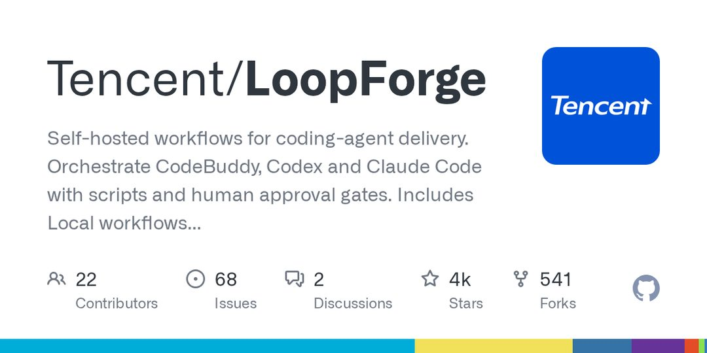

LoopForge 是腾讯开源的自托管工作流项目，目标不是造一个更强的编码 Agent，而是编排已有的 Agent——CodeBuddy、Codex、Claude Code 都可以作为流水线中的执行节点，由脚本控制流转，并在关键节点插入人工审批门（approval gate）。

关键点在两个词：自托管和审批门。前者意味着代码与流程数据不出企业边界，这是 to B 场景的硬门槛；后者意味着设计者默认 Agent 不能端到端交付，人的签字仍是流程的一部分。

为什么重要：过去一年大家比的是 Agent 能写多少代码，现在开始比谁能把 Agent 的产出安全地送进生产。这一步的难点不在模型，在流程定义权和责任边界。腾讯选择用开源方式定义这套流程，本身就是在争夺标准位。

> 原文：[Tencent/LoopForge](https://github.com/Tencent/LoopForge)

### 阿里 open-code-review：该确定的交给规则，该判断的交给模型

阿里开源的 open-code-review 采用混合架构：一条确定性流水线负责可枚举的检查，LLM Agent 负责需要语义理解的部分，输出粒度为行级评论，内置规则集覆盖 NPE、线程安全、XSS、SQL 注入等多语言场景。

值得注意的不是「用了 LLM」，而是它没有全押 LLM。代码审查是个特殊场景——漏报的代价远高于误报，而规则引擎在已知漏洞模式上的稳定性和可解释性，目前仍优于模型。把两者分层，是在可信度和召回率之间做的工程折中。

为什么重要：这是「LLM 落地企业流程」的一个范本答案。凡是有确定性解法的地方，模型不该上场；模型的价值应该集中在规则写不出来的那部分判断上。这个思路会越来越多地出现在后续工具里。

> 原文：[alibaba/open-code-review](https://github.com/alibaba/open-code-review)

### Google Stitch Skills：技能库赌的是标准，不是产品

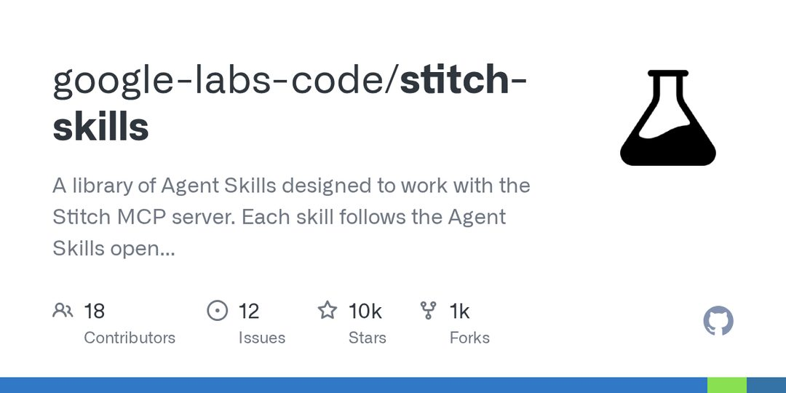

Google 开源了面向 Stitch MCP Server 的 Agent Skills 库，遵循开放标准，官方声明可兼容 Antigravity、Gemini CLI、Claude Code、Cursor。

这里的信息量在兼容列表：一个 Google 出品的技能库，把竞争对手的客户端写进了适配清单。这不是客气，是策略——技能（skills）如果要成为可复用资产，就必须跨客户端流动，而定义技能格式的一方，就握住了分发入口。

为什么重要：Agent 生态目前最缺的不是能力，是可移植性。每个客户端各写一套工具调用约定，用户就被锁死了。MCP 之后，skills 层正在成为下一个标准化战场，而 Google 选择先做「跨端可用」这件事，而不是先做「只有自家好用」。

> 原文：[google-labs-code/stitch-skills](https://github.com/google-labs-code/stitch-skills)

### Cursor 开源插件规范：编辑器之争转向生态分发

Cursor 发布了插件规范及一批官方插件，覆盖流行的开发工具、框架和 SaaS 服务。

这条单独看像常规动作，放到今天的语境里意味不同：Cursor 不只是编辑器，它在尝试定义「AI 编辑器如何接入外部系统」的接口形态。官方插件先行，是在给规范做示范，也是在用第一方供给拉动第三方跟进。

为什么重要：AI 编辑器的护城河正在从模型体验迁移到生态密度。用户不会因为补全快 5% 就换工具，但会因为「我的内部系统只有这边接得通」而不换。规范开源是这个策略的必要成本——想让人来写插件，就得先放弃接口的所有权。

> 原文：[cursor/plugins](https://github.com/cursor/plugins)

### Superpowers：把开发方法论本身做成可分发产物

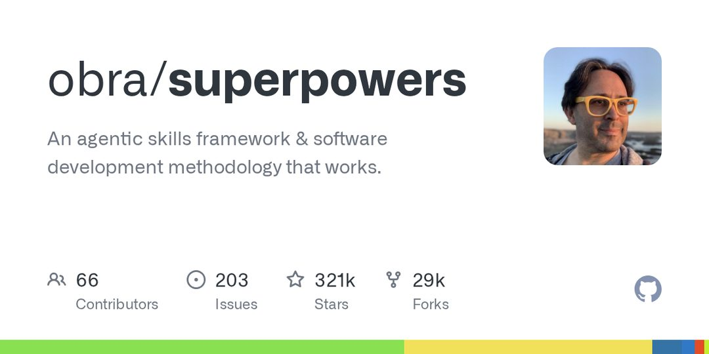

Superpowers 是一个基于可组合技能（composable skills）的 agentic 软件开发框架，目标是让编码 Agent 按照一套完整的开发方法论工作，而不是接到一句需求就开始写代码。

这类项目的价值判断需要谨慎：方法论框架最容易变成「看起来很完整、用起来很脆」的东西。但它的方向值得记录——它假设 Agent 的瓶颈不在单步能力，而在缺少从需求到验证的结构化流程。

为什么重要：如果这个假设成立，那么未来分发的不是代码，也不是提示词，而是被封装好的工作方法。这对团队协作的影响可能比单个工具更大：方法论一旦可执行、可版本化，工程规范就从文档变成了依赖。

> 原文：[obra/superpowers](https://github.com/obra/superpowers)

### 港大 RAG-Anything：All-in-One 的取舍

港大 HKUDS 开源了 RAG-Anything，定位是 All-in-One 的 RAG（Retrieval-Augmented Generation）框架。

目前公开信息有限，只给到定位层面，没有更多架构细节可评。但「All-in-One」这个选择本身值得说：RAG 生态过去两年高度碎片化，解析、切分、检索、重排各有一堆独立项目，集成成本转嫁给了使用方。一体化框架是在用耦合换上手速度。

为什么重要：这是典型的取舍题——一体化降低起步成本，但会在深度定制时反噬。对多数团队来说，RAG 的问题从来不是「没有工具」，而是「工具太多拼不起来」。所以这类项目真正的考题是：抽象的边界划在哪，能不能在不拆框架的前提下替换掉某一层。

> 原文：[HKUDS/RAG-Anything](https://github.com/HKUDS/RAG-Anything)

### 英伟达 SkillEvaluator：技能开始需要质检

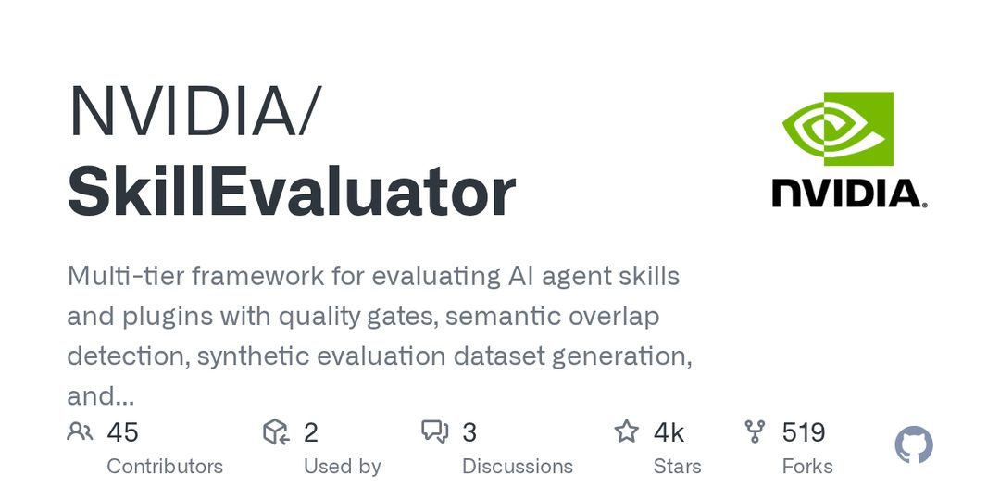

英伟达开源 SkillEvaluator，一个用于评估 Agent 技能质量的多层级框架，包含质量门（quality gate）、语义重叠检测、合成评测数据集构建，以及针对 agent 运行时行为的实时评估。

这补上了 skills 生态里最容易被跳过的一环。前面几个项目都在生产技能，但技能写得好不好、和其他技能是否重复、跑起来是否真的按预期行事，此前基本靠人肉试。语义重叠检测尤其务实——技能库一多，重复和冲突几乎是必然。

为什么重要：任何内容生态在数量起来之后，都会从「生产」转向「筛选」。评测层的出现，通常是一个品类开始成熟的信号。对团队而言，这也意味着技能可以进入 CI 流程，而不是停留在个人经验里。

> 原文：[NVIDIA/SkillEvaluator](https://github.com/NVIDIA/SkillEvaluator)

### Strix：渗透测试也被 Agent 接管

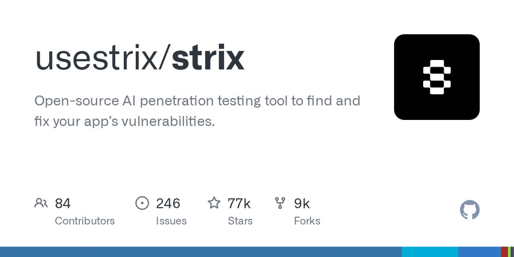

Strix 是一款开源的 AI 渗透测试工具，用于发现并修复应用漏洞，把「找漏洞」和「修漏洞」放在同一个闭环里。

渗透测试是 Agent 的天然场景：目标明确、可自动验证、反馈信号强（漏洞能不能打进去是二元的）。相比代码生成，这类任务的评测标准清晰得多，也因此更容易做出真正可用的产品。

为什么重要：攻防两侧正在同时 agent 化。当防守方用 LLM 做审查、攻击方用 Agent 做渗透，安全团队面对的对手不再是「慢速的人工」，而是可以持续扫描的自动化流程。这会给漏洞响应的时间窗口带来实质压缩——安全流程的节奏需要重新设计。

> 原文：[usestrix/strix](https://github.com/usestrix/strix)

---

今天这批项目没有一个是新模型，全是围绕 Agent 的「路、卡口和质检」。留给读者的一个问题：当编排层、审查层、评测层都被开源占满，你所在团队真正的差异化，还剩下哪一段？
