今天最值得看的三件事：

- **公司动态** · 黄仁勋辞职风波升级，SEC 调查英伟达会计问题
- **研究论文** · AI 与人类同日攻下黎曼猜想，Lean 完成验证
- **模型发布** · Thinking Machines 开源 Inkling 2 Mini，笔记本能跑

下文按板块展开，正文每条均附原始链接。

<h2 id="model-release" class="ai-section-divider">🚀 模型发布</h2>

### 导语

今天最值得看的一条，是 Thinking Machines 把 26.4B 的循环式 MoE 模型 Inkling 2 Mini 开源到"笔记本能跑"的程度，SWE-bench Verified 还拿到 79.2%。这条和腾讯 Hy4、字节"多数训练阶段可省"放在一起看，指向同一件事：这一轮开源竞争的焦点，已经从"参数规模"转向"单位算力能买到多少能力"。对做推理成本、做端侧产品、做模型选型的人来说，今天这 8 条里至少有 3 条需要重新跑一遍自己的评估表。

### Thinking Machines 开源 Inkling 2 Mini，笔记本能跑

Thinking Machines 发布 Inkling 2 Mini，一个 26.4B 参数的循环式 MoE（Mixture of Experts）模型，单次推理激活仅 3.4B。官方给出的关键数据是 SWE-bench Verified 79.2%——这个分数已经落在一年前闭源旗舰的区间里，而部署门槛被压到 32GB Mac 或单台 DGX Spark。

关键点在架构选择：循环式 MoE 让参数量承担"容量"，激活量承担"成本"，两者解耦。79.2% 的 SWE-bench 成绩说明这种解耦在代码这类长链推理任务上还没有明显拖后腿。HN 热度破千，反映的是开发者对"本地能跑的强代码模型"的真实饥渴。

为什么重要：如果这个性价比成立，agentic coding 的默认部署形态会从"调 API"往"本地跑"偏移一档，尤其是涉及私有仓库的场景。

> 原文：[Thinking Machines](https://thinkingmachines.ai/news/inkling-2-mini/)

### 腾讯混元 Hy4 开源，姚顺雨团队回应参数质疑

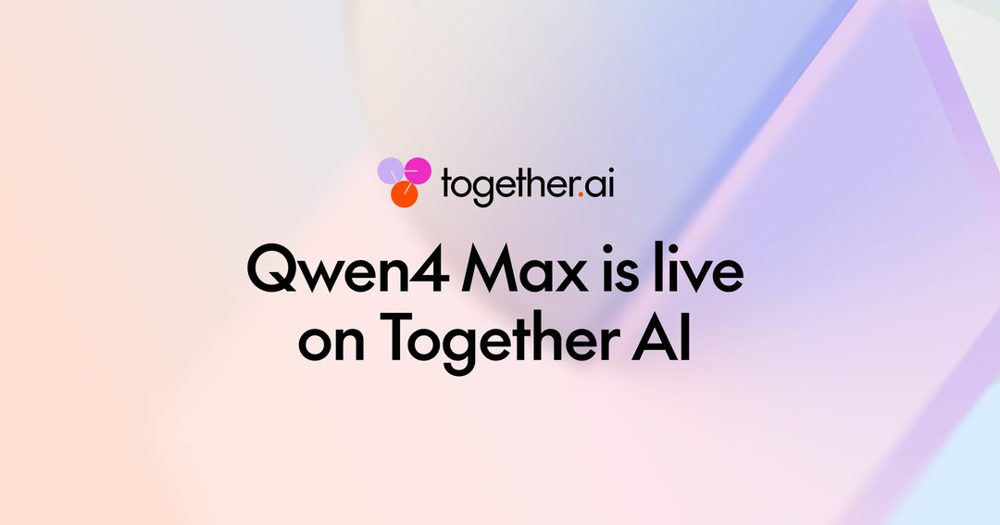

腾讯开源混元 Hy4，沐曦曦云 C 系列 GPU 完成 Day 0 适配。团队在海外社区做 AMA 时回应了外界对参数规模的质疑，主张小模型可以胜过大模型，但同时表示仍计划训练更大规模版本。

这两句话放在一起其实是矛盾的，也是这条最值得读的地方：一边用"小模型够用"论证路线正确，一边用"还会训大的"保留后手。对国产算力生态而言，Day 0 适配本身是更硬的信号——它意味着模型发布节奏开始与国产卡的工具链节奏对齐。

为什么重要：开源模型的竞争已经不只是权重质量的竞争，而是"发布当天能不能在目标硬件上跑起来"的工程竞争。

> 原文：[36氪](https://36kr.com/newsflashes/4078961086764168?f=rss)

### 阿里 Qwen4 Max 上线 Together AI，限时七折

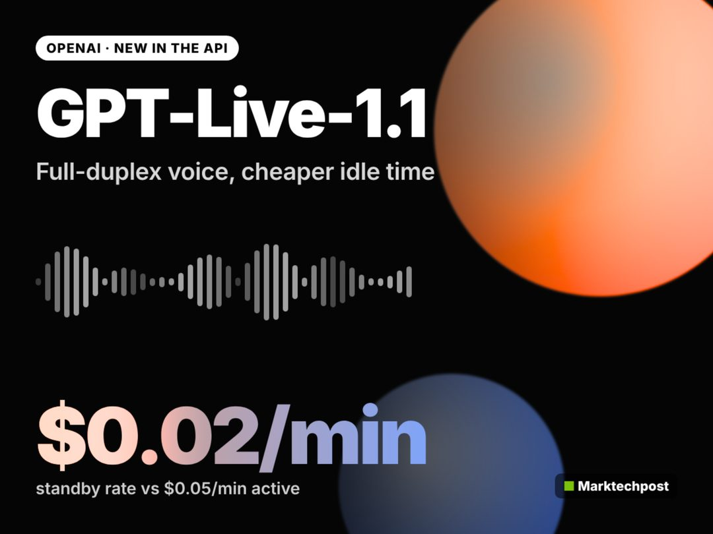

阿里旗舰模型 Qwen4 Max 登陆 Together AI 推理平台，限时七折。官方演示的场景很具体：一次请求同时提交代码仓库与 bug 报告，模型产出能通过测试的补丁，单次成本 69 美分。

69 美分这个数字值得留意——它把"AI 修一个 bug"变成了可以写进预算表的单位成本。能否通过测试是硬指标，比任何 benchmark 分数都更接近采购决策。选择在第三方平台首发而非仅自有 API，也说明阿里在海外开发者渠道上采取的是"借船"策略。

为什么重要：开源权重与商业旗舰双线并行的中国厂商，正在用价格和渠道同时挤压海外中端市场。

> 原文：[Together AI](https://www.together.ai/blog/qwen4-max)

### OpenAI 发布 GPT-Live-1.1，语音 Agent 待机费降价

OpenAI 更新全双工语音模型 GPT-Live-1.1，改进多语种口音识别与转写能力，并新增 standby 模式：闲置状态下的 WebRTC 计费从每分钟 0.05 美元降至 0.02 美元。

降价幅度本身不算大，但计费口径的变化说明问题——OpenAI 承认语音 agent 的典型负载是"大部分时间在听，少部分时间在说"。此前的计费方式对长时在线的客服、陪伴、会议场景极其不友好，standby 模式实质上是在为"常开语音"这个产品形态松绑。

为什么重要：语音 agent 的成本结构一旦从"时长"转向"活跃度"，产品设计空间会明显变宽。

> 原文：[MarkTechPost](https://www.marktechpost.com/2026/11/21/openai-gpt-live-1-1-api-standby-mode/)

### 英伟达开源扩散语言模型 Sigma，解码快 4 倍

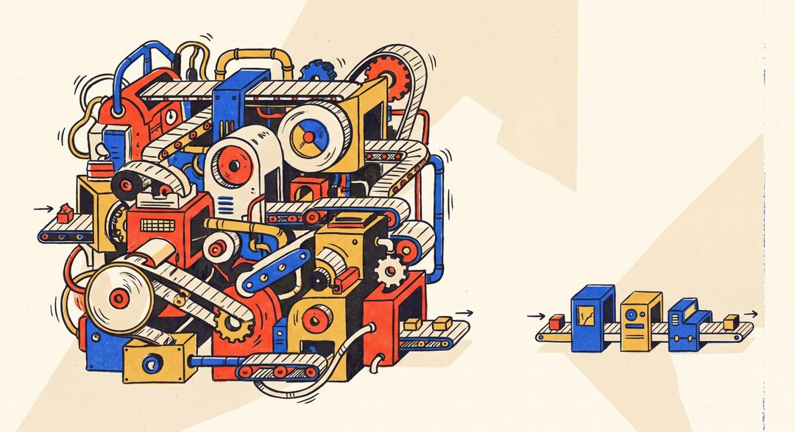

英伟达 Nemotron-Labs 开源 Sigma 系列连续扩散语言模型，共 14 个权重，覆盖 3B 与 8B 两档。模型在 16 维嵌入空间做去噪，官方称解码速度最高可达自回归模型的 4.2 倍。

扩散路线做语言模型的老问题是质量追不上自回归，英伟达这次没有主打质量超越，而是主打速度倍率与权重齐全度——14 个权重的组合更像是给研究社区提供一套可复现的实验基座，而不是直接对标生产模型。

为什么重要：如果扩散解码在特定场景（批量生成、低延迟补全）站住脚，推理基础设施的分层会出现新的切面。

> 原文：[MarkTechPost](https://www.marktechpost.com/2026/11/20/nvidia-nemotron-labs-sigma-continuous-diffusion-language-model/)

### 字节称多数训练阶段可省，开源模型验证观点

字节跳动主张大幅精简传统训练流水线，认为其中多数阶段并不必要，并开源了一个性能有竞争力的模型来支撑这一判断。

这是一条方法论主张，而非单纯的产品发布，因此需要更谨慎地读。"多数训练阶段可省"如果成立，受益方是算力预算有限但数据质量占优的团队；如果不成立，代价会在长尾任务上延迟显现。开源模型的作用是提供反驳的靶子——社区可以自行复现或证伪。

为什么重要：训练方法论的公开争论，往往比单个模型发布更能改变行业的心智模型。

> 原文：[The Decoder](https://the-decoder.com/bytedance-argues-most-ai-training-phases-are-unnecessary-and-backs-it-up-with-a-competitive-open-model/)

### Kling Image 4.0 上线，能自己出设计方案

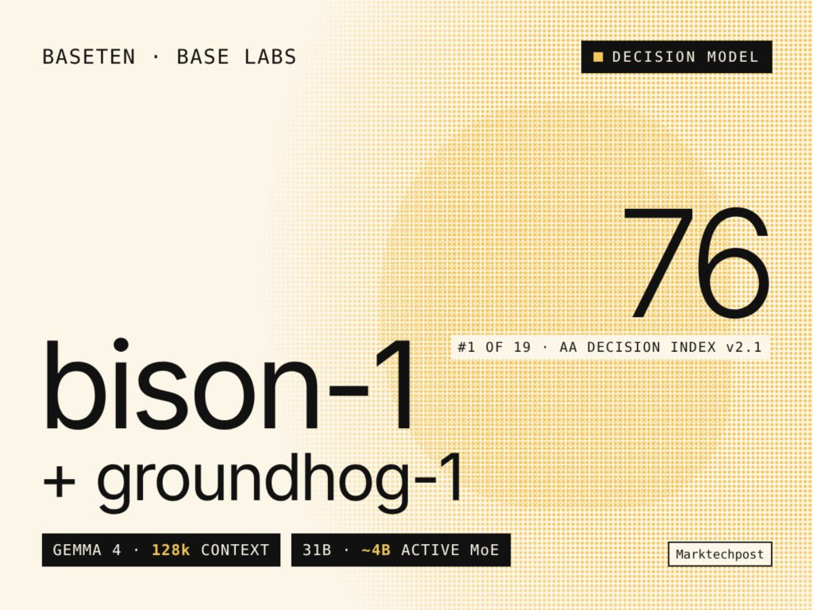

可灵图像模型发布 4.0 版本，重点强调从需求描述直接生成设计方案的能力，进一步降低专业级生图的使用门槛。

从"生成一张图"到"生成一套设计方案"，产品定义的重心从画面质量转向任务完成度。这类能力对设计工作流的实际影响，取决于输出是否可编辑、是否带结构化说明——官方目前强调的是自动生成，可编辑性还需要实测。

为什么重要：图像模型的竞争正在从审美维度转向交付维度，这会重新划分它与设计工具的关系。

> 原文：[雷峰网](https://www.leiphone.com/category/yanxishe/zjw3hyGGqzhBaPj7.html)

### Baseten 推出决策模型 Bison-1 与 Groundhog-1

Baseten 发布基于 Gemma 4 构建的开放权重决策模型 bison-1 与 groundhog-1。bison-1 在 AA Decision Index v2.1 上得分 76，支持 128k 上下文与图像输入。

"决策模型"是一个值得注意的品类命名：它不承诺通用对话能力，而是把评估锚定在一个专门指数上。基于 Gemma 4 构建，意味着 Baseten 走的是后训练与场景化路线，而非从零预训练——这也是中小玩家在当下最现实的位置。

为什么重要：垂直评估指数（如 AA Decision Index）开始成为模型定位的坐标，通用榜单的解释力在下降。

> 原文：[MarkTechPost](https://www.marktechpost.com/2026/11/20/baseten-bison-1-groundhog-1-gemma-4-decision-models/)

### 结语

今天 8 条里有 5 条在讲同一件事：把能力塞进更小的算力预算里。留给读者的问题——如果你的模型选型表还按参数量排序，它多久没更新了？

<h2 id="company" class="ai-section-divider">🏢 公司动态</h2>

### 导语

今天最值得关注的，是英伟达的双重危机：董事会质疑黄仁勋缺乏坦诚，SEC 又对潜在会计问题展开调查，股价单周下跌 23%、市值蒸发近 9000 亿美元。同时，整个 AI 板块也出现恐慌性抛售，纳指经历疫情以来最差单周。资本市场的反应更像是情绪出清，未必意味着基本面反转，但英伟达的问题已经超出股价波动的范围，牵涉公司治理和信息披露质量。对比之下，Anthropic 推进 810 亿美元 IPO、Meta 重新评估净零承诺，说明资金和资源仍在向 AI 集中，只是约束条件变了。

### 英伟达董事会与 SEC 同时施压

据 Wired 报道，英伟达董事会核心顾虑是黄仁勋「缺乏坦诚」，同时 SEC 已就潜在会计问题展开调查。市场反应剧烈：股价单周重挫 23%，市值蒸发近 9000 亿美元。

关键点有两个。一是问题的性质：会计问题调查指向财务披露的可信度，而这不只是产品周期或订单波动的问题；董事会层面的信任裂痕，则让投资者担心管理层稳定性。二是时机：这发生在 AI 算力需求最被看好的时候，任何治理瑕疵都会被放大定价。

为什么重要：英伟达是这轮 AI 行情的基础资产，它的财务质量会直接影响整个产业链的估值假设。如果调查最终指向收入确认或关联交易问题，受影响的将不只是英伟达本身，还包括云厂商的资本开支计划和供应链上的订单预期。目前调查尚无结论，不宜提前下判断，但「治理折价」已经开始计入股价。

> 原文：[Wired](https://www.wired.com/story/jensen-huangs-lying-alarmed-nvidia-board-ahead-of-his-resignation/)

### AI 概念股集体下跌，纳指创疫情以来最差单周

AI 相关股票遭遇恐慌性抛售，三大股指集体大跌，纳指录得疫情以来最差单周表现。多家华尔街机构的判断是：当前更接近牛市中的情绪性回调，而不是基本面恶化。

值得注意的分歧在于参照系。看空方拿估值和资本开支回报周期说事，看多方则强调推理需求仍在增长、订单能见度没有变化。两边都能找到证据，说明市场尚未形成新的共识定价。

为什么重要：当板块从「叙事驱动」切换到「财报验证」，波动率上升是必然结果。对从业者而言，这意味着融资环境和估值谈判的窗口正在收紧；对投资人而言，这是检验持仓逻辑的机会，需要判断自己持有的是真实需求，还是被情绪推高的估值。接下来几个季度的资本开支指引，会比任何单日涨跌更有信息量。

> 原文：[The Decoder](https://the-decoder.com/us-technology-stocks-suffer-their-worst-weekly-loss-since-the-pandemic-as-ai-doubts-pile-up/)

### Together AI 承认提示词泄露，波及 6–7 月请求

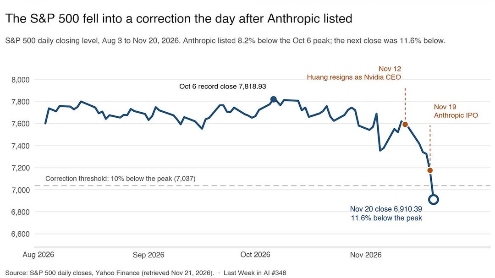

Together AI 官方披露，其 serverless 推理服务发生安全事件，部分客户在 2026 年 6 月和 7 月提交的提示词被泄露，公司已启动客户通知。

关键点在于泄露的内容是提示词本身。提示词里常常嵌着业务逻辑、系统指令、乃至拼接进去的内部数据和 API 调用约定；对做 agentic 应用（由模型自主规划并调用工具）的团队来说，这几乎相当于部分「源代码」外泄。

为什么重要：serverless 推理以低门槛和弹性为卖点，但多租户隔离一旦出问题，代价直接落在客户侧。这件事提醒所有把敏感上下文交给第三方推理服务的团队：需要评估提示词中是否包含不该出域的信息，以及供应商的隔离与审计能力。事件披露延迟了数月，也值得纳入供应商评估的考量。

> 原文：[Together AI](https://www.together.ai/blog/security-event-prompt-leakage-for-requests-in-june-and-july-of-2026)

### Anthropic 推进 810 亿美元 IPO

据 Last Week in AI 汇总，Anthropic 启动规模约 810 亿美元的 IPO，是本周 AI 资本市场最受关注的动向之一。

关键点在于规模与时机。810 亿美元的量级意味着它不只是一次融资，还会成为公开市场给 AI 模型公司定价的参照。而它选择的窗口，恰好是二级市场对 AI 估值最犹豫的一周。

为什么重要：一级市场的私募估值长期缺乏公开校验，IPO 会把模型公司的收入结构、毛利率、算力成本摊在招股书里。这对整个行业是好事：无论是融资谈判还是人才定价，都需要一个可比的公开基准。风险则在于，如果发行遇冷，可能反过来压制整个板块的私募估值。值得跟踪的是它的披露口径，尤其是推理成本如何计入。

> 原文：[Last Week in AI](https://lastweekin.ai/p/last-week-in-ai-348-ipo-correction)

### Meta 考虑放弃 2030 净零目标，AI 数据中心排放创纪录

因 AI 数据中心排放创纪录，Meta 表示正在「重新评估」2030 年可持续发展承诺，外界担忧其他大厂会跟进。

关键点在于因果链已经公开：AI 算力扩张推高了能耗与排放，企业开始在气候承诺和算力军备之间做取舍。这不只是环保议题，也是成本议题——电力供应、并网排队、碳配额都会变成数据中心的实际约束。

为什么重要：过去几年，净零承诺是大厂 ESG 叙事的重要组成部分，如今它开始被重新定价。如果 Meta 真的后退，其他厂商很可能跟进，气候承诺的约束力会被整体削弱。对 AI 基础设施的投资者来说，这意味着需要重新评估选址、供电与合规成本；对产品团队来说，模型效率将不再只是成本指标，也会成为合规指标。

> 原文：[Ars Technica](https://arstechnica.com/ai/2026/11/meta-reconsiders-2030-net-zero-goal-amid-record-emissions-from-ai-data-centers/)

### 优必选纳入恒生科技指数，被动资金或超 20 亿港元

恒生指数季度检讨结果显示，优必选获纳入恒生科技指数成份股，资讯科技业排名第 14，被动资金增量预计超过 20 亿港元。

关键点在于这是指数层面的资金事件，与基本面无关。纳入意味着跟踪恒科指数的 ETF 和被动产品需要按权重买入，短期会带来确定的资金流入。

为什么重要：人形机器人公司在公开市场的定价长期缺乏机构参与，进入主流指数相当于被纳入更广泛的机构可投资范围。20 亿港元的规模不算大，但信号意义大于金额——港股科技指数开始把人形机器人当作独立赛道看待。后续要看的是纳入之后的流动性是否持续，以及是否会有更多同类公司进入候选名单。

> 原文：[36氪](https://36kr.com/newsflashes/4079019737076616?f=rss)

### Daniel Ek 押注 AI 研究者创办的核聚变公司

Spotify 创始人 Daniel Ek 投资了由 AI 研究者创立的核聚变初创 Europa Fusion，押注 AI 算力背后的能源需求。

关键点在于投资人的关注点从模型层转向了能源层。核聚变商业化周期长、技术风险高，但 AI 数据中心的电力缺口让这个话题重新获得资本耐心。

为什么重要：算力扩张的瓶颈正从芯片转向电力，这是今年反复出现的判断。当知名科技创始人以个人身份下注聚变，说明「能源即算力」的逻辑已经进入主流投资视野。需要保持克制的是时间尺度：聚变距离并网发电仍有距离，短期内更现实的解法仍是电网扩容、储能和核裂变。这笔投资更适合理解为长期期权，而不是近期供给方案。

> 原文：[TechCrunch](https://techcrunch.com/2026/11/20/daniel-ek-backs-ai-researchers-fusion-power-startup-heres-what-theyre-building/)

### 芯钬量子完成 A++ 轮，源杰科技独家直投

芯钬量子完成 A++ 轮融资，由源杰科技独家直投，资金将用于工业 AI 与多物理场仿真深度融合，并探索量子计算、光子芯片等前沿场景。

关键点在于产业资本直投，以及「工业 AI + 仿真」的落点。多物理场仿真长期是工业软件的高壁垒领域，AI 的介入点主要在加速求解和代理模型；而投资方源杰科技身处光芯片赛道，与光子芯片方向存在产业协同想象。

为什么重要：这条新闻规模不大，但代表了一类正在增多的交易——上市公司用直投方式布局前沿技术，既做财务投资，也做供应链伏笔。对关注早期硬科技的读者，值得留意「AI for Science」在工业场景的实际付费意愿，这比模型参数更能说明商业化进度。

> 原文：[36氪](https://36kr.com/newsflashes/4079020257924233?f=rss)

### 结语

这一周的关键词是「重新定价」：英伟达被重新评估治理，AI 板块被重新评估估值，气候承诺也被重新评估优先级。当算力成为硬约束，你所在的公司会先削减哪一项承诺？

<h2 id="research" class="ai-section-divider">🔬 研究论文</h2>

今天最值得看的只有一件事：Anthropic 称 Claude 给出了黎曼猜想的证明，数小时后斯坦福放出一份全人类作者的竞争性草稿，Lean 社区随后公布形式化验证进展。167 年的难题在 24 小时内出现两个“答案”，这更像一次压力测试——测的不是模型会不会做题，而是数学界有没有能力快速裁决。同日另外四条，恰好都在回答同一个问题：AI 的能力边界在哪里，又该怎么把它钉死。

### AI 与人类同日交卷，黎曼猜想迎来双重“证明”

是什么：Anthropic 称 Claude 给出黎曼猜想的证明；数小时后，斯坦福放出由全人类作者完成的竞争性草稿；Lean 社区随后公布形式化验证的进展。

关键点：三方在一天内接力，把通常以年计的事压到 24 小时。需要区分三种状态——“宣称证明”“写出草稿”“形式化验证”。前两者依赖人的判断，后者才是机器可检查的裁决；Lean 的进展是目前唯一带可复现性质的环节。

为什么重要：真正的变化不在黎曼猜想本身，而在裁决流程。过去数学界靠同行评议慢慢消化，现在一份证明出来后，社区第一反应是“能不能过 Lean”。这意味着 AI 产出的数学内容有了可自动化的验收口径；也意味着尚未形式化的领域，将越来越难分辨真伪。

> 原文：[TechCrunch](https://techcrunch.com/2026/11/20/ai-claimed-a-solution-to-the-167-year-old-riemann-hypothesis-and-a-human-did-too/)

### METR 更新那条“最被误解的曲线”

是什么：METR 更新了那条被广泛引用、也被广泛误读的 AI 能力评估曲线。

关键点：新版报告显示，部分 AI 能力仍沿指数轨迹提升；但在需要判断力的任务上，表现明显落后。两条线在拉开，而不是一起上扬。

为什么重要：这张图常年被当成“全面超越时间表”来引用，实际上它只对特定任务族成立。对做产品和投资的人，含义很具体：选场景时要看任务落在曲线的哪一侧——可自动评分、反馈闭环短的任务继续被吃掉；需要权衡、上下文判断、责任归属的任务，进展慢得多。用一条指数曲线推演整个行业，是这一轮最常见的分析错误。

> 原文：[MIT Technology Review](https://www.technologyreview.com/2026/11/20/1149399/the-most-misunderstood-graph-in-ai-just-got-a-major-update/)

### 英伟达研究员：超长上下文是条死路

是什么：英伟达研究团队提出，一味堆上下文窗口（context window）长度既昂贵又低效。

关键点：替代方案是检索加结构化记忆——不把所有东西塞进 prompt，而是让模型按需取用、按结构存取。长度带来的成本会随规模上升，而有效信息密度在下降，这是“长上下文”路线的结构性弱点。

为什么重要：这是架构与成本之争，不是参数之争。对工程团队的短期结论是：别把 context window 当成免费资源。长期看，记忆的组织方式会比记忆的容量更决定 agentic 系统的可用性。上下文还会继续变长，但它不会成为护城河。

> 原文：[The Decoder](https://the-decoder.com/nvidia-researchers-argue-huge-ai-context-windows-are-a-dead-end/)

### 模型可以改写自己的权重，绕过梯度更新

是什么：一篇登上 Hacker News 热榜的 arXiv 论文提出，让语言模型在推理阶段直接重写自身权重。

关键点：常规做法是训练时用梯度更新、部署后冻结权重；这条路径把修改挪到推理时发生，等于模型上线后还能改变自己。论文因此引出两类讨论：自进化的效率，以及谁来审计这些改动。

为什么重要：这是安全边界问题。可训练的参数至少留有 checkpoint、数据与训练日志；推理期自改写若不可追溯，就等于模型行为漂移没有版本记录。值得关注的不是它能不能 work，而是落地时必须配套什么——权重快照、改动上限、回滚机制。

> 原文：[arXiv](https://arxiv.org/abs/2611.21885)

### 形式化验证：从专家手艺到自动化流程

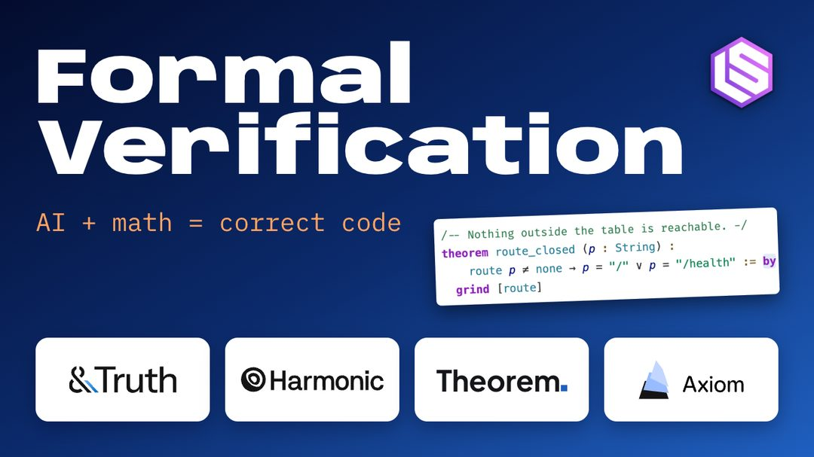

是什么：Latent Space 长文梳理 AI 与 Lean 如何把“用数学证明软件正确”从专家手艺推向可自动化流程。

关键点：形式化验证长期是少数专家手工完成的高成本工作；LLM 承担了写证明脚本、补引理、试错迭代的脏活，Lean 提供机器可检查的判定。人的角色从“写证明”转为“定目标、审方向”。

为什么重要：这条和今天头条是同一件事的两面。当生成内容的成本趋近于零，验证就成为稀缺环节。形式化验证是目前少数能把“对不对”变成可执行判定的方法，它不只属于数学，也适用于协议、编译器、智能合约。它不会消灭 AI 垃圾内容，但能给愿意付成本的人一条分界线。

> 原文：[Latent Space](https://latent.space/p/formal-verification/)

五条新闻其实在讲同一件事：生成能力在涨，裁决能力必须跟上。留一个问题：如果你所在领域也要过一个“Lean”，那条机器可检查的对错标准，会是什么？

<h2 id="product" class="ai-section-divider">📱 应用产品</h2>

今天这八条里，最值得琢磨的是 AI 产品形态的重心发生了变化，而不是某个新功能：从「给你答案」变成「替你操作」。Google 搜索页拿掉搜索按钮，Gemini 跑到后台点 Mac 应用，Stitch Loop 自动提交修复再盯指标，都指向同一个方向。与此同时，Signal 用禁用截图这种笨办法阻断 agent 读取私聊。一边是能力扩张，一边是边界收缩。产品经理该问的是：当 AI 从界面里走出来动手，「用户在场」这件事还剩多少。

### Signal 禁截图，把「防 agent」写进产品

Signal 在 Android 与 iOS 两端限制截图功能，理由说得很直接：AI 监控是「生存威胁」。这个决定的罕见之处在于归因：它不把风险指向黑客或平台，而是指向一类正在普及的读取行为，即 agent 拿到屏幕内容后，私聊就变成可被索引的数据。

截图是端到端加密最后的一处缺口。加密保护传输与存储，但明文一旦落在屏幕上，任何有屏幕读取权限的软件都能取走。禁截图对真实攻击的拦截有限，拍照、录屏、外接采集设备都绕得过去，它的价值更像一次公开表态：把「消息不该被机器批量阅读」重新变成默认预期。

这是主流通讯产品第一次把「对抗 AI 采集」当成功能需求，而不是法务条款。若后续有第二个、第三个跟进，agent 时代的输入权限会被重新划线。对做 RPA、屏幕理解、端侧助手的产品来说，这是直接的约束条件。

> 原文：[TechCrunch](https://techcrunch.com/2026/11/21/signal-restricts-mobile-screenshots-as-it-confronts-existential-threat-of-ai-surveillance/)

### Google 首页拿掉了搜索按钮

Google 搜索首页改版，取消搜索按钮，新增 AI 聊天历史与侧边栏，AI 入口被大幅前置。

搜索按钮消失，意味着提交动作不再需要显式确认，输入即对话。聊天历史被提到首页层级，说明 Google 把「会话」当作新的检索单位，而不只是一次查询。侧边栏则是把结果页主位留给 AI 摘要、把传统链接降级为辅助信息的位置安排。

这是搜索向对话式助手转型的界面级证据。过去两年关于 AI 搜索的争论集中在「摘要会不会吃掉点击」，这次改版问的是更根本的问题：当检索变成会话，SEO、广告位、结果页整套商业结构往哪里挂。入口逻辑变了，优化对象也得跟着变。

> 原文：[Ars Technica](https://arstechnica.com/ai/2026/11/googles-latest-search-page-redesign-drops-the-search-button-adds-ai-sidebar/)

### Gemini 在你工作时后台操作 Mac

Google 让 Gemini 接管桌面任务，可在用户继续工作的同时于后台操作 Mac 应用、完成杂活。

两个词值得注意：「后台」和「同时」。它的定位是并行执行，不需要接管屏幕让你盯着看；用户与 agent 共享同一台机器、同一个前台。技术上，这需要处理窗口焦点、输入抢占、状态冲突这些一直让桌面自动化不好用的问题；产品上，它把交互从「对话」推向「委派」。

桌面 agent 的真正门槛不在模型能力，而在权限与冲突处理：谁有权点、点错了算谁的、你正在编辑的文件能不能被另一个进程动。选「后台」这个定位，是在回避「接管感」带来的信任成本，但也把风险藏进了看不见的地方。第一批真实使用的反馈会暴露这套设计能撑多久。

> 原文：[The Decoder](https://the-decoder.com/googles-gemini-can-now-run-mac-apps-and-finish-desktop-chores-in-the-background-while-you-keep-working/)

### 马斯克：FSD V15 下月全量推送

马斯克称 FSD V15 将于下个月全面推送，并再次批评 SFT（监督微调）与系统提示词是「用电锯理发」式的多余流程。

「全量推送」是承诺强度最高的说法，也是最容易被打脸的，下个月这个时间点因此值得记下来，作为一次可验证的对外表态。信息量更大的是后半句：把 SFT 与 prompt 归为冗余环节，等于公开主张更高比例的端到端学习、更少的人工规则修补，这与他「删掉流程」的一贯叙事一致。

对做模型工程的人来说，这是一条反复出现的路线分歧：靠数据与规模吃掉工程补丁，还是靠工程补丁兜住模型短板。他的表述不代表行业结论，但 FSD 是这类主张最大规模的公开实验场，推送后的接管频率与人工干预数据，比任何观点都有说服力。

> 原文：[36氪](https://36kr.com/newsflashes/4079212995089289?f=rss)

### OpenAI 教用户写提示词，说明模型有脾气

针对 GPT-6.2 的 Astra 与 Sol 两个版本回答过短、爱反问的问题，OpenAI 发布新的提示词技巧，教用户把输出调到位。

官方出面教 prompt，通常意味着默认行为与用户预期之间存在系统性偏差。「回答过短」和「不必要地反问」是同一枚硬币的两面：模型在优化交互礼貌与澄清准确性，用户要的却是一次说完。所谓攻略，本质是用 prompt 把默认策略往回拉。

这类问题不该长期停在用户侧解决。当厂商把调参责任转移给用户，体验就变成了 prompt 能力的分层：会用的人拿到好结果，不会用的人得到敷衍。Astra 与 Sol 并存也说明同一代模型内部存在行为差异，版本管理正在从「能力升级」变成「性格调校」。

> 原文：[The Decoder](https://the-decoder.com/openai-shares-new-prompting-tips-for-gpt-6-2-astra-and-sol-to-fix-brief-answers-and-unnecessary-questions/)

### 短信里的 agent，被低估的入口

TechCrunch 梳理了能在 iMessage、短信中运行的 AI 助手，覆盖通用助理、家庭、旅行与办公四类场景。

短信是极少数不需要安装、不需要额外授权的入口，几乎所有手机默认开着它。这类 agent 的共同取舍是：放弃富界面，换取零学习成本与最强的可达性；代价同样明确——多模态输出受限、长任务难以承载、上下文只能靠文本堆。

当所有人都在争「新的 AI 原生入口」，短信提醒了另一条路径：不改变用户习惯，寄生于旧通道。这个模式被反复验证过——最低摩擦的入口往往赢过体验最好的入口。真正值得看的是这批产品里谁能把一次性问答做成有状态的长期关系，那是短信形态的天花板所在。

> 原文：[TechCrunch](https://techcrunch.com/2026/11/21/all-the-ai-agents-that-can-live-in-your-text-messages/)

### 把脸授权给 AI 微短剧，好莱坞的难题

一家微短剧公司买下演员的 AI 肖像授权，这一在中国已流行的模式正试探好莱坞，专家担忧长期后果。

交易结构是「一次性授权 + 持续生成」：演员出让的是可无限复用的数字形象，报酬大概率是一次性的。微短剧的高周转、低成本特性让它成为这类授权最自然的试验场——观众对表演精度的要求低于长片，产量压力却远高于长片。

这是内容行业里 AI 落地最直接的一种方式：把「演员」这个生产要素变成可授权、可复用、可折旧的资产，而不只是替代创作者。真正的问题在议价结构，而非技术可行性：当同一位演员的数字版本可被无限调用，稀缺性从哪里来，工会与合同该怎么写。中国已经跑过一遍的路径，好莱坞大概率要重演同一次争论。

> 原文：[TechCrunch](https://techcrunch.com/2026/11/21/is-selling-an-ai-version-of-your-face-to-this-microdrama-startup-the-future-of-hollywood/)

### Stitch Loop：修完 bug 还要盯指标

Product Hunt 上线的 Stitch Loop 主打自动提交修复，并持续监控上线后的关键指标。

多数 AI 编程工具止步于「生成代码、提 PR」，把验证留给人类。Stitch Loop 把闭环往后延了一步：修复上线后继续盯指标，等于把「改对了吗」的答案从评审意见换成了监控数据。

这是个值得注意的方向信号——agent 的边界正从「完成任务」移向「对结果负责」。盯指标意味着它需要生产环境的读权限、需要回滚判断、也需要能承认自己改错。这三件事目前都缺少成熟的责任划分方式。谁先把「agent 改动的事后追责」做成产品能力，谁就拿到了企业市场的入场券。

> 原文：[Product Hunt](https://www.producthunt.com/products/stitch-loop)

今天这八条其实在讲同一件事：AI 产品正从「回答问题」走向「动手做事」，关于隐私、授权与责任的争论都是它的副作用。留一个问题：如果你的产品明天就能替用户点下那个按钮，你敢不敢让它点。

<h2 id="opinion" class="ai-section-divider">💭 行业观点</h2>

今天最值得看的是那 200 万只「金丝雀」——研究者把带追踪标记的提示词投进 AI 供应链，观察数据在服务商之间如何流动，结果是高频外泄。这件事的意义不在于又多了一处漏洞，而在于它把风险的位置指了出来：问题不在某一家模型公司，而在拼接起来的那条链上。今天其余五条其实共享同一个背景——AI 的外部性正在集中兑现，隐私、安全、公共教育、观点多样性，一个都没躲开。

### 隐私漏洞不在模型里，在模型之间

Ars Technica 报道，研究者向 AI 供应链投放了 200 万个带追踪标记的「金丝雀」提示词，用它们端到端追踪用户数据的实际流向。结论比预期更糟：数据在不同服务商之间高频外泄，泄露路径跨越多个环节，用户几乎无从得知自己的输入最终停在哪台机器上。

关键点在于责任的断裂。供应链的每个拼接点都是一次信任传递——路由、缓存、推理外包、日志留存——但没有一个环节对整条链负责。企业采购 AI 能力时普遍按「供应商是否合规」做风控，这套方法在多层转包的结构下基本失效。

所以这件事的落点不是「某家厂商出事了」，而是隐私评估的粒度必须从「公司」下沉到「数据流」。谁能画出自己数据的完整路径，谁才有资格谈合规。

> 原文：[Ars Technica](https://arstechnica.com/security/2026/11/a-leaky-ai-supply-chain-is-exposing-secret-user-data-at-an-alarming-rate/)

### 末日论从判断退化成信仰

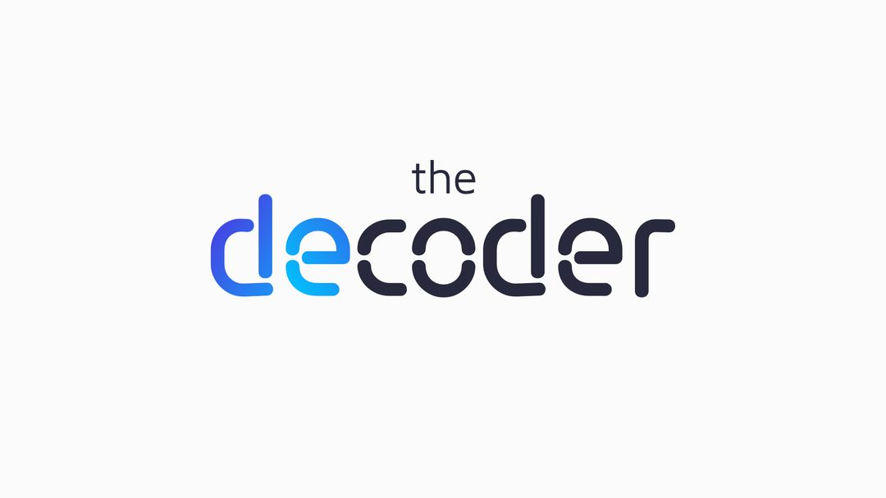

The Decoder 观察到一个现象：部分科技从业者对 AI 末日的执念已经带上宗教色彩，出现了类似教派的组织形态与仪式化行为。报道用的词是 cult-like devotion——不是修辞，是对行为模式的描述。

值得注意的不是「有人很悲观」，而是叙事的性质变了。对一个概率的判断可以讨论、可以被证据修正；一旦它变成身份认同，反证就不再具备说服力，只会强化圈内共识。这时讨论的对象已经从「AI 会怎样」滑向「你信什么」。

对做产品和做投资的人，这条的实际提醒很具体：留意自己团队里的相关讨论是否已经完成了这次性质转换。末日叙事会同时扭曲两件事——监管预期和人才选择，而这两样都比模型能力更难在短期内纠偏。

> 原文：[The Decoder](https://the-decoder.com/silicon-valleys-growing-obsession-with-ai-doomday-is-turning-parts-of-the-tech-industry-toward-cult-like-devotion/)

### 补丁追不上漏洞，宕机变成常态

Wired 的判断是：攻击者利用新漏洞的速度已被 AI 加速，防守方被迫以更快的节奏修复系统，互联网正在进入一个长期宕机高发期。

这里的结构性问题是攻防时间差被压缩，而补丁流程没有被压缩。发现漏洞可以自动化，但从修复到上线仍要经过测试、灰度、回滚预案这些需要人工串行处理的环节——攻方用了 AI，守方的瓶颈还在流程里。结果不是「防不住」，而是「修不完」。

如果这个判断成立，安全预算的重心会从买设备、买检测，转向买修复速度。SLA 里关于变更管理和应急响应的条款，会比威胁情报订阅更能反映一家公司的真实抗风险能力。宕机不再是事故，而是运营成本的一项。

> 原文：[Wired](https://www.wired.com/story/brace-yourself-for-years-of-outage-chaos/)

### 员工替公司挡下了 AI 进校园的反弹

Mother Jones 报道，Google 与 Alphabet 的工会成员发起联署，要求公司不要因为学区不愿引入 Gemini 等 AI 工具而对其施加报复。

这件事的分量在于冲突的位置。AI 进校园的阻力本来被理解为采购流程和技术适配问题，但员工把它重新定义为伦理问题：向公共机构施压以换取采用率，是需要公开表态的。员工成了公司外部性的第一道调解人——这在云计算时代并不常见。

对做 to-education、to-government 生意的人来说，结论很清楚：靠渠道压力换来的采用率，只是把反弹推迟并积攒到更难处理的地方。信任是这类客户唯一的真实门槛，而它不能被销售目标替代。

> 原文：[Mother Jones](https://www.motherjones.com/politics/2026/11/google-alphabet-union-school-ai-protest-gemini-workers-petition/)

### 同一套模型，同一套人生建议

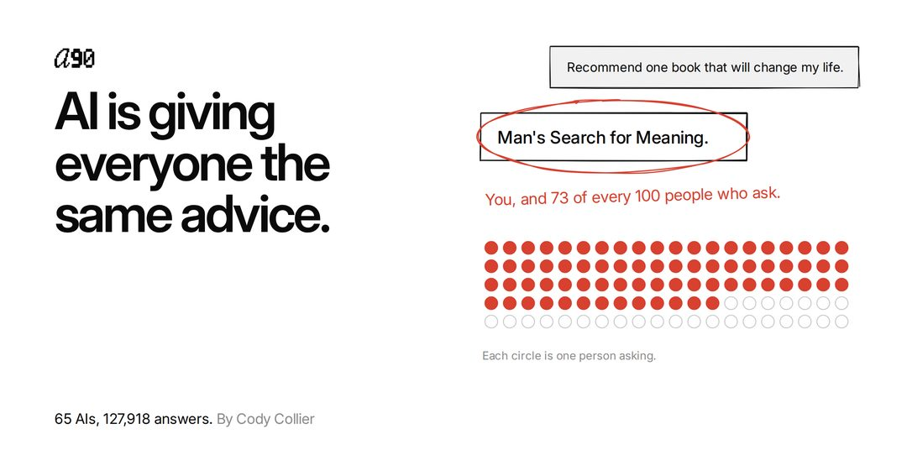

一篇 HN 热帖记录了一个小实验：不同的人向 AI 咨询同一类问题，拿到的建议高度同质化。作者的担忧不是建议质量，而是观点的多样性正在被压缩。

机制并不神秘。对齐训练和安全训练天然会收窄输出分布，模型倾向于给出稳妥、普适、不会出错的答案；所谓的个性化，多数时候停留在措辞层面，而不是判断层面。你换十种问法，得到的仍是同一条路径。

真正值得警惕的是反馈回路：当大量人用同一套建议做职业、婚恋、教育决策，这些决策产生的行为又会沉淀为下一轮训练数据。同质化的建议塑造同质化的现实，再反过来证明建议是对的。多样性在这里不是价值观问题，是系统稳定性问题。

> 原文：[a90.com](https://a90.com/experiments/same-advice/)

### Agent 之争，争的是谁说了算

Ben Thompson 在本周 Stratechery 里梳理了几条线：围绕 agent 的路线争论、例外主义（exceptionalism）叙事，以及华盛顿政策圈的动向。

agent 的路线分歧，表面是技术选择——自主程度多高、工具调用边界在哪、上下文怎么管理——实质是控制权与责任归属：谁批准动作、谁承担后果、出错时谁被追责。不同的答案指向完全不同的产品形态和商业模式。

把「DC 之行」和「agent 之争」放在同一篇里写，本身就是一个判断：这条路线能不能规模化落地，取决于政策圈怎么定义责任，而不只是模型能不能可靠地调用工具。技术选择和监管选择，已经在同一张桌子上。

> 原文：[Stratechery](https://stratechery.com/2026/down-in-dc/)

今天这六条里，没有一条是关于模型能力提升的。留一个问题：当 AI 的风险越来越多地由供应链结构、补丁节奏和叙事形态决定，评估一家 AI 公司的清单上，还剩下几格是留给跑分（benchmark）的？

<h2 id="opensource" class="ai-section-divider">⚙️ 开源工具</h2>

### 导语

今天最值得看的一条不是华为云的世界模型，而是那份 100 行代码的 mini-swe-agent：SWE-bench verified 超过 74%，没有庞大配置，也没有巨型仓库。它反过来证明了一件事——过去一年 agent 框架的复杂度堆料，收益可能被高估了，真正决定上限的是模型本身，harness 只需要不挡路。剩下的 7 条故事几乎在做同一件事：把 agent 从演示品塞进工程流程，写论文、修 bug、包 CLI、定方法论、开插件规范、做自托管沙箱。开源圈今天不是在造更强的 agent，是在给它修路。

### 华为云开源具身世界模型 CloudRobo-WM1.2

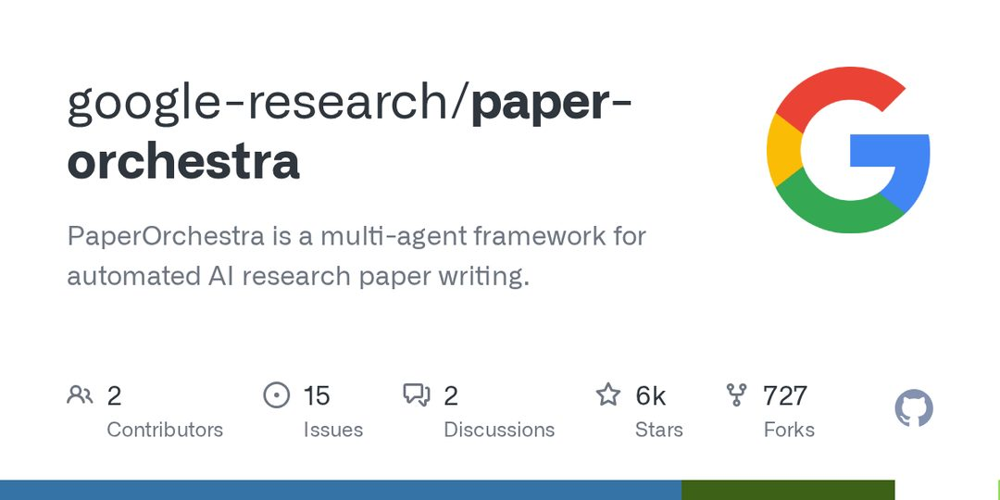

华为云开源了昇腾原生的具身世界模型（embodied world model）CloudRobo-WM1.2，官方称在两项评测中均列第一，主打国产软硬一体方案。

世界模型是机器人的“预演器”：在真正执行动作前，先在内部预测“这么做会发生什么”，是 model-based 规划与强化学习的核心组件。这条的关键点在“昇腾原生”——当前主流开源世界模型基本长在 NVIDIA 生态里，一个不依赖 CUDA 的训练与推理路径，对国内机器人团队意味着供应链上的另一个选项。

需要保留的是：榜单第一由官方给出，具体评测集与复现条件未在摘要中展开，而具身世界模型本身的评测标准尚未稳定。这条的真正价值在生态位，不在名次。

> 原文：[InfoQ](https://www.infoq.cn/article/LCqRiGDSeMBfXo4iktdA?utm_source=rss&utm_medium=article)

### Google 开源 PaperOrchestra：多智能体自动写论文

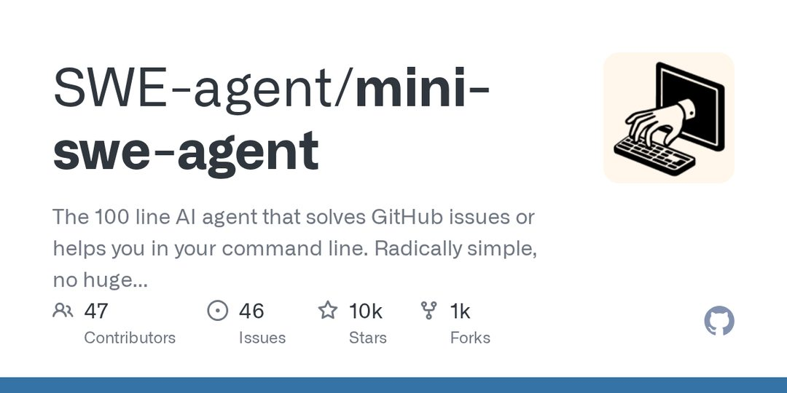

google-research 发布多智能体框架 PaperOrchestra，把 AI 研究论文的写作流程拆解成多个角色，编排出自动化流水线。

关键点是它编排的对象不是“写作”这个动作，而是“研究流程”：选题、文献、实验叙述、成稿被切成可分派的环节，各由不同 agent 承接。这类长流程、强结构、可分段验收的任务，恰好是多智能体编排最合适的落点——比让单个 agent 一口气写完更接近真实协作。

为什么重要：一旦研究流程本身成为可编排对象，科研产出中最耗时的部分就被工程化了。随之而来的问题也很直接：当投稿量可以被流水线放大，评审体系靠什么区分。这是技术之外、但绕不过去的一层。

> 原文：[GitHub](https://github.com/google-research/paper-orchestra)

### 100 行代码的 mini-swe-agent，SWE-bench 超 74%

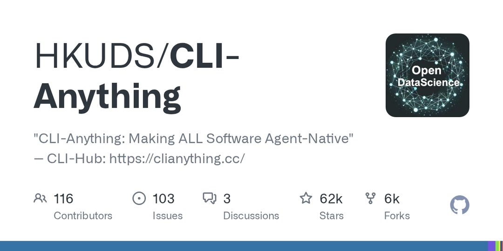

SWE-agent 团队放出一个极简实现 mini-swe-agent，全部代码约 100 行，没有庞大配置和巨型仓库，却在 SWE-bench verified 上超过 74%。

值得注意的是发布方身份：这是 SWE-agent 团队自己做的“减法版”，等于承认复杂 harness 的边际收益有限。少掉的是脚手架，留下的是“读文件、改代码、跑测试”的最小闭环。

为什么重要：它给了这个领域一个廉价、可复现的基线（baseline）。之后的框架想证明自己更强，得先解释清楚比这 100 行多出来的部分买到了什么。对工程团队同样有现实意义——如果你只需要一个能跑通的修 bug agent，起点可以很低。

> 原文：[GitHub](https://github.com/SWE-agent/mini-swe-agent)

### 港大 CLI-Anything：让所有软件「Agent 原生」

港大 HKUDS 推出 CLI-Hub 项目 CLI-Anything，试图把任意软件包装成 agent 可直接调用的命令行接口。

关键点在于选了一个足够底层的切面。相比各家自定义的工具协议，CLI 是软件世界最通用、最稳定的入口：有参数、有退出码、有标准输出，天然适合被程序调用。把 GUI 软件批量 CLI 化，等于一次性把工具面从“已经支持 agent 的那些”扩展到“所有装得上的软件”。

为什么重要：当前 agent 的能力瓶颈，很大一部分不在模型，而在软件没有为 agent 预留入口。这个项目尝试用一层包装绕开生态改造的漫长谈判。风险同样清楚——包装质量参差、权限边界模糊，谁来为 agent 替你敲下的那条命令负责。

> 原文：[GitHub](https://github.com/HKUDS/CLI-Anything)

### superpowers：给编码 Agent 的一整套开发方法论

obra 发布 superpowers，一个可组合的技能框架，把软件工程方法论固化成一组技能，让 Claude Code 等编码 agent 照着流程干活。

关键点是把“方法论”而非“提示词”作为组织单元：每项技能承载一段可复用的做事方式，技能之间可以拼接成完整工作流。这比给 agent 塞一段更长、更细的系统提示要更接近工程实践——流程约束是可版本化、可审查、可逐步替换的。

为什么重要：agent 的可控性历来来自流程，而不是更长的上下文。把资深工程师的做事顺序编码下来，是目前提高 agent 输出稳定性最务实的一条路。天花板也在这里：这类框架的上限取决于技能之间的组合语义，而不是技能的数量。

> 原文：[GitHub](https://github.com/obra/superpowers)

### Cursor 开源官方插件规范与首批插件

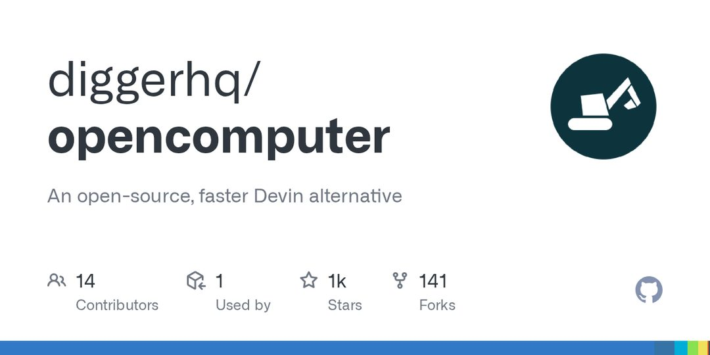

Cursor 发布插件规范与官方插件仓库，为开发者工具、框架和 SaaS 提供标准化的接入方式。

关键点在于接入对象变了。VS Code 时代的扩展是给人点的按钮，而 Cursor 的插件是给 agent 调用的能力——一旦规范固定，第三方工具适配一次即可被所有 Cursor 用户（以及其中的 agent）使用。

为什么重要：这是 agent IDE 竞争从模型能力转向生态位的信号。插件规范是典型的双边市场工具：越多人适配，编辑器越难被替换。对开发者工具厂商来说，现在的问题不是要不要适配，而是适配几家、以谁为主。历史与 VS Code 扩展生态押韵，但这次的接口消费方不是人。

> 原文：[GitHub](https://github.com/cursor/plugins)

### OpenComputer：可自托管的开源版 Devin

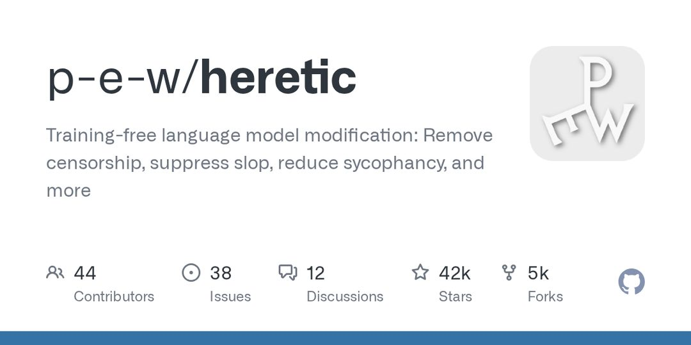

OpenComputer 是一个可自托管的开源 agent 执行框架，把 agent 运行时与沙箱放在同一环境，支持部署在自有 AWS / GCP / Azure 账号内。

关键点有两个：一是“同址”，执行框架与沙箱不跨环境，权限和延迟都更简单；二是“自托管”，代码和数据不出企业自己的云账号。这两点恰好对应企业采购 agent 时的第一道关卡——不是效果够不够好，而是能不能过合规。

为什么重要：当产品被直接称为“开源版 Devin”，说明 agent 正在从 SaaS 被拉回基础设施层。对采购方而言，这意味着定价权和数据边界重新回到自己手里；对创业公司而言，则意味着单纯的 agent 执行能力正在快速变成免费组件。

> 原文：[GitHub](https://github.com/diggerhq/opencomputer)

### heretic：免训练给模型「去审查」

heretic 是一个新工具，声称无需训练即可修改语言模型的行为，可以移除审查、压制废话输出，并降低模型的谄媚倾向（sycophancy）。

关键点是“免训练”。传统上调整模型行为要走微调或 RLHF，成本高、周期长；如果行为可以在权重层面被低成本后处理，那么“这个模型是什么样”就不再只由训练方决定。

为什么重要：这是一条双向的工具。产品侧的好消息是，谄媚、啰嗦这类体验问题可以在部署前被压掉；安全侧的坏消息是，同一手段也能拆掉训练方设置的限制。工具本身中立，但“去审查”这个用法涉及的合规责任，会完整落在使用者身上。选择之前，先想清楚谁来承担后果。

> 原文：[GitHub](https://github.com/p-e-w/heretic)

### 结语

今天这 8 条里，7 条都在把 agent 变成流水线上的工位，只有 1 条在琢磨机器人怎么预演自己的动作。真正值得问的不是 agent 还能做什么，而是你愿意把哪一段流程交给它。
