今天最值得看的三件事：

- **公司动态** · Anthropic 创纪录 IPO 落地，上市首日 Claude 却降级
- **研究论文** · Lean 社区正式确认黎曼猜想证明成立
- **行业观点** · OpenAI 想给 AI 发展装限速器，先统一“速度表”

下文按板块展开，正文每条均附原始链接。

<h2 id="model-release" class="ai-section-divider">🚀 模型发布</h2>

今天模型板块最值得看的一条，是 The Decoder 对 GPT-6.2 两个变体 Astra 与 Sol 的评测：答得更快、更直接，透明度却排在 Claude 之后。这种「能力涨、可解释性不涨」的组合，正在变成新一代模型的默认形态。同一天，英伟达把 2B 的 VLA 塞进车端，还坚持让它给出解释。两条放在一起看，结论很清楚：速度是标配，解释才是差异点。

### GPT-6.2 的 Astra 与 Sol：更直接，也更难追问

The Decoder 对 OpenAI 新一代 GPT-6.2 的两个变体 Astra 与 Sol 做了对比评测，结论是回答更直接、铺垫更少，但在可解释性与透明度上低于 Claude。

关键点在于，「更直接」本身就是一种取舍。减少铺垫意味着模型跳过中间的推理展开，直接给结论——阅读体验更好，但可被审计的中间过程也一并变少了。对终端用户来说这是提效；对需要复盘、追责、验证的场景来说，这是把工作量挪到了别处。

为什么重要：企业采购里，「能不能解释」已经从加分项变成了评估项。当模型输出进入客服、法务、医疗等流程，解释缺失的成本不会消失，只是转移给下游的人工复核。更值得注意的是产品结构——OpenAI 同时放出两个变体，说明模型能力正在被切成不同档位，而「可解释」完全可能被留作下一次迭代或更高层级的卖点。速度红利几个月就会被追平，透明度的差距则会长期留在采购清单上。

> 原文：[The Decoder](https://the-decoder.com/gpt-6-2-astra-and-sol-get-to-the-point-faster-but-score-lower-on-transparency-than-claude/)

### 英伟达 Alpamayo 2 Edge：2B 的 VLA，160 毫秒出轨迹

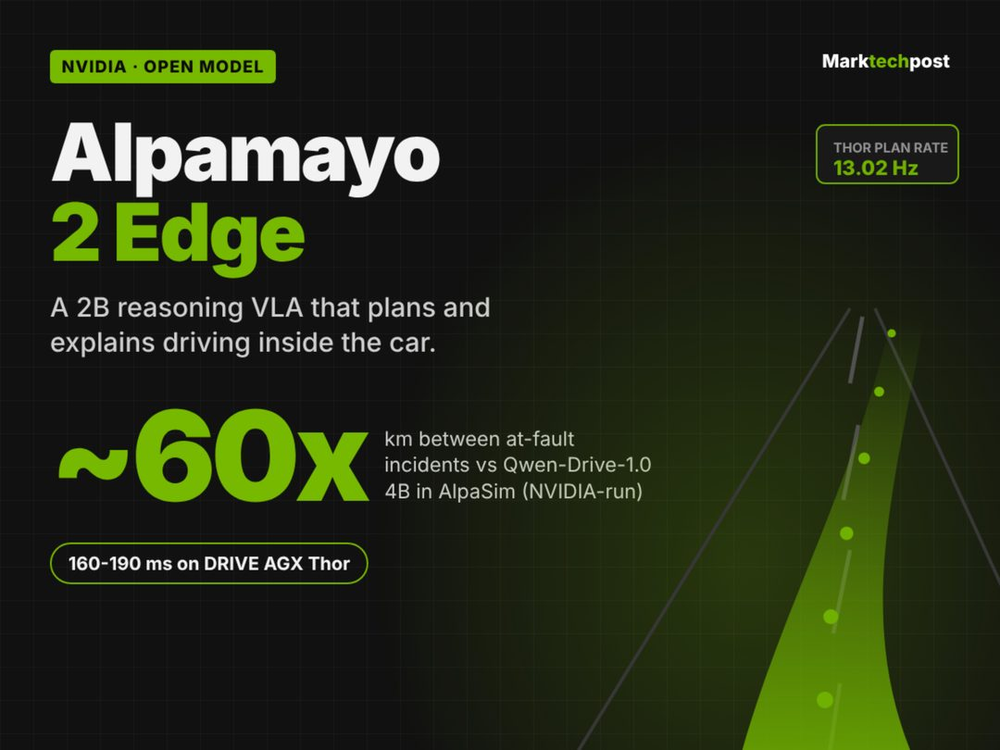

英伟达发布 Alpamayo 2 Edge，一个面向 DRIVE AGX Thor 的 2B 级视觉-语言-动作模型（VLA, vision-language-action）：可直接输出行驶轨迹，并对决策给出解释，像素到轨迹的端到端延迟约 160–190 毫秒（按此区间折算，闭环频率大致在 5–6 Hz 量级）。

关键点是参数量的克制。车端推理的硬约束是延迟、功耗与散热，2B 是一个明确为「能上车」服务的选择，而不是把云端大模型原样搬过去。另一个细节是「给出解释」——在自动驾驶语境里，这既是调试工具，也是事后归因材料。出问题时，你需要的不只是那条轨迹，还有轨迹的理由。

为什么重要：VLA 的竞争正从「能不能跑」转向「能不能在车端实时跑，并且说得清」。160 毫秒已经进入可用的闭环区间，接下来比的会是在同等延迟下，谁的解释更站得住。

> 原文：[MarkTechPost](https://www.marktechpost.com/2026/11/22/nvidia-alpamayo-2-edge-2b-reasoning-vla-drive-thor/)

速度迟早是所有模型的默认值，解释不会。当模型答得越来越快，你还会去追问它为什么这么答吗？

<h2 id="company" class="ai-section-divider">🏢 公司动态</h2>

今天公司动态里最值得看的不是融资数字，而是时间点：Anthropic 把 IPO 做成了创纪录的一单，同一交易日 Claude 出现性能降级。这不构成因果，但市场读得很直接——AI 资产的定价已经跑在交付能力前面，任何抖动都会被当成估值注脚。更值得对照看的是，同一天 DeepSeek 拿到第二轮千亿级融资、亚洲市场却在抛售 AI 概念股：一级市场还在加注，二级市场已经在减仓。这种背离通常不会持续太久。

### Anthropic 创纪录 IPO 落地，上市首日 Claude 降级

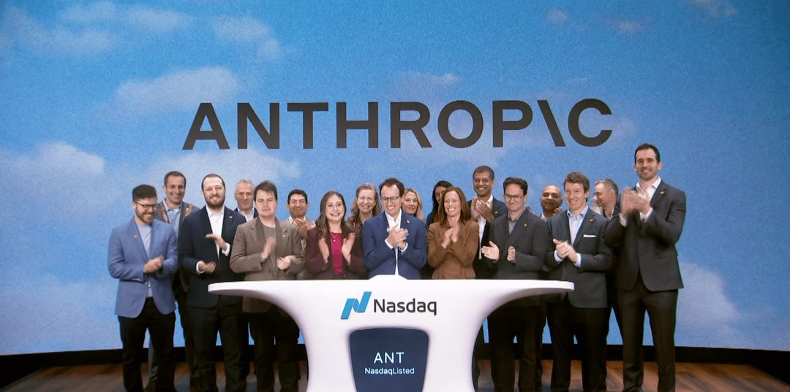

Anthropic 完成创纪录 IPO，Notable Capital、GIC、Baillie Gifford 等早期大额投资方出现在首日讨论中；同日 Claude 出现性能降级，市场对 AI 高估值的悲观情绪并未因此扭转。

关键点在于两件事被放在同一个交易日里定价。IPO 首日通常是叙事最强的一天，而模型降级恰好提醒买家：这类公司的核心资产是持续在线的推理能力，不是一次性的融资纪录。对投资人，短期要盯的是首日之后的换手与承销商稳定操作；对产品经理，则是一个更实际的问题——把关键链路押在单一模型供应商身上，故障面和你无法控制的发布节奏是绑定的。

> 原文：[InfoQ](https://www.infoq.cn/article/OPbZhT0OHL4IbZz8exvA)

### DeepSeek 第二轮千亿融资落地，31 家出资方入局

据雷锋网早报，DeepSeek 第二轮千亿级融资完成，共 31 家机构出资，为年内国产大模型最大规模融资之一。

两个细节比总额更有信息量。一是轮次——这是第二轮，说明资金是在已有模型与商业进展基础上追加，而非从零押注；二是 31 家出资方，股东结构分散，通常意味着单家话语权有限，也意味着这一轮更像是产业与财务资本的集体配置，而非某一家战略投资者的深度绑定。结合同日亚洲市场对 AI 概念的抛售，这笔融资更像是一级市场对二级情绪的逆向下注，能否兑现要看后续的算力投入与收入披露节奏。

> 原文：[雷锋网](https://www.leiphone.com/category/zaobao/qb1uol6hKvK6pRgF.html)

### AI 抛售潮蔓延亚洲，新兴市场股指抹平全年涨幅

MSCI 新兴市场指数八连跌，较 6 月高点回撤逾 20%，进入技术性熊市；港股 MINIMAX、智谱跌超 6%，韩国 KOSPI 一度跌 4%，三星、SK 海力士领跌。

值得注意的结构是跌的东西分两类：一类是纯 AI 叙事资产（港股两家模型公司），一类是 AI 的供给侧硬件（三星、SK 海力士的存储与 HBM）。两类同时被卖，说明市场调整的不是某个模型的竞争格局，而是整条 AI 资本开支链条的回报预期。20% 的回撤线是技术性熊市的形式门槛，真正的分水岭是下一轮财报里云厂商与存储厂的资本开支指引——那决定这轮是估值消化还是周期转向。

> 原文：[36氪](https://36kr.com/newsflashes/4081686973485954)

### 特朗普松口：Blackwell 可有条件对华销售

特朗普表态允许英伟达 Blackwell 芯片对华销售，但附带条件，具体限制尚未公开。

这条的实际价值目前低于标题给人的印象：条件未公开，等于政策边界未定义。对国内买方，这意味着不能据此做采购规划；对英伟达，表态本身不是许可，收入确认要看正式规则文本。判断上，这类“口头松口 + 条件待定”的组合在历史上更多是谈判筹码而非终局政策。真正需要跟踪的是两个后续：限制条款的技术门槛（是算力上限、互联带宽还是客户白名单），以及是否与现行出口管制清单形成冲突。

> 原文：[雷锋网](https://www.leiphone.com/category/zaobao/qb1uol6hKvK6pRgF.html)

### 蚂蚁集团入股微面科技，加注 AI 基础软件

北京微面科技发生工商变更，蚂蚁集团旗下上海云玚及首形科技等成为新股东，注册资本增至约 139.8 万元。

金额层面没有披露，注册资本从量级看是一家早期公司，所以这条的意义不在交易规模，而在方向：蚂蚁在 AI 上的加注点落在基础软件，而非应用层。基础软件是模型与业务之间的中间层，控制它意味着在推理成本、数据边界和部署形态上有更多自主权。对同类创业公司，这类产业方入场通常带来订单与云资源，也带来站队成本。

> 原文：[36氪](https://36kr.com/newsflashes/4081687852602244)

### 结语

一级市场在加注，二级市场在减仓，同一天里两种定价并存——接下来要看的不是谁对，而是谁先被迫调整。你所在的团队，押的是模型能力，还是模型的可替换性？

<h2 id="research" class="ai-section-divider">🔬 研究论文</h2>

今天研究板块最值得看的一条，不是某个模型的跑分，而是数学界验收方式的一次变化：Lean 与 Mathlib 社区确认 Levent Alpöge 的黎曼猜想证明在形式化系统中通过验证，Hacker News 上的讨论超过 1200 分。它的分量不只在于猜想本身，更在于“证明被机器检查过”这件事开始变成可以公开讨论的标准。把这条和下面几条放在一起看会更清楚：编码 agent 在隔离测试里表现优异、在真实办公任务里完成率不到一成，METR 又说评测能力追不上模型进步。三件事指向同一个缺口：我们的验证手段正在被拉出缺口。

### 黎曼猜想证明通过 Lean 验证

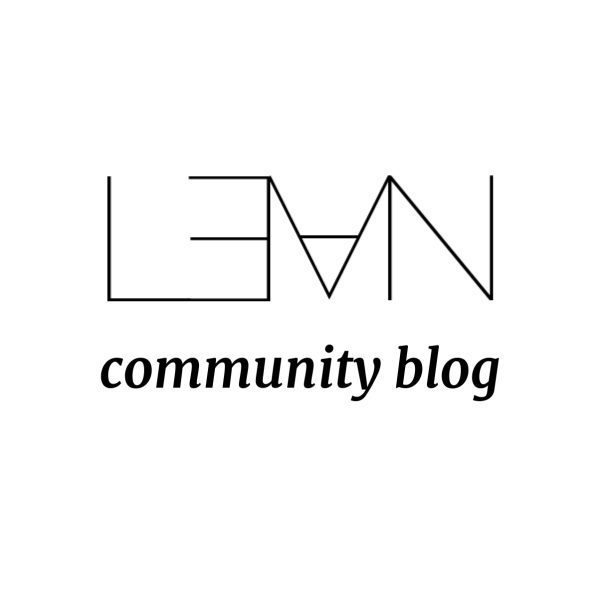

Lean 与 Mathlib 社区确认，Levent Alpöge 的黎曼猜想证明已在形式化系统中通过验证。相关证明工作由 Anthropic 的数学家借助 Claude 推进，另留下一份 940 页的纯人类手稿。

关键点在两处。一是分工形态：AI 参与推进证明，形式化系统承担验收，人类保留一份可追溯的长手稿。二是验收的性质变了：形式化检查器接受与否是确定的、可复现的，不再依赖审稿人的耐心与声望判断。

但需要保持一点克制。形式化系统保证的是“证明检查器接受了这个证明项”，它不自动保证“形式化陈述就是你想要的那个命题”——statement faithfulness 仍然是人的工作。940 页手稿由谁读、形式化陈述与黎曼猜想的对应关系由谁审计，会成为新的瓶颈。真正的意义或许是：数学的门槛从“能否想出证明”部分转移到“能否把命题写对、把结果读懂”。

> 原文：[Lean Prover Community](https://leanprover-community.github.io/blog/posts/riemann-hypothesis/)

### 编码 agent：单测封神，端到端不足一成

一项模拟真实办公环境的评测显示，AI 编码 agent 在隔离的单元测试场景中表现优异，但端到端任务完成率不到 10%。

差距来自任务结构而非模型能力。隔离测试是局部、即时、可验证的奖励信号；真实职场任务是长链路、多工具、跨系统的，中间每一步都可能因为权限、格式、隐式上下文而断掉。单测跑通只说明“这一小段代码对”，不说明“这件事办成了”。

对产品和采购决策的含义很直接：看端到端完成率，不看单点 benchmark。对做 agent 的团队，含义是工程重心应放在链路可靠性——重试、状态检查点、失败可观测性——而不是继续优化单步生成质量。这条与昨天行业内对 agent 商业化的乐观叙事构成一个必要的对冲。

> 原文：[The Decoder](https://the-decoder.com/ai-coding-agents-ace-isolated-tests-but-complete-fewer-than-one-in-ten-tasks-in-a-simulated-workplace/)

### 廉价推理服务商被曝截取密钥、窥探请求

安全研究者展示了低成本 AI 推理服务商如何截取用户的 API 密钥、窥探请求内容；OpenRouter 与 Dragos 的 canary token 实验从侧面印证了推理供应链上的数据风险。

要点是这类风险的位置：它不在模型层，而在你和模型之间的那一跳。当推理被转售、代理、聚合，请求内容和凭证会经过多个不透明的中间方，而用户侧的感知几乎为零。canary token 之所以有效，正是因为它能把“有没有人看了你的请求”变成一个可观测的信号。

为什么重要：推理供应链正在变成新的信任边界，和当年的 CDN、第三方支付网关一样。可操作的做法不复杂——密钥最小权限与定期轮换、对出网流量做审计、在关键请求里埋 canary。廉价有它的价格，只是账单不在明面上。

> 原文：[The Decoder](https://the-decoder.com/security-researchers-show-how-cheap-ai-inference-providers-steal-keys-and-snoop-on-users/)

### METR：模型进步快过安全评测能力

METR 的报告提出，AI 能力的提升速度已经超过专家可靠评估新系统安全性的速度，现有评测流程难以支撑部署前的风险判断。

这不是“评测不够多”的问题，而是“评测不够快、不够可复用”。能力迭代以周计，一份严谨的专家评估以月计，两者的节奏差在扩大。同时，能力越界的地方往往在训练后才显现，评测只能抽样。

为什么重要：如果部署前的风险判断建立在失速的评测上，那么“通过了安全评估”这句话的信息量在下降。可行的方向是把评测本身自动化、标准化，并引入第三方复现与明确的能力阈值，而不是依赖单一机构的判断。对监管与合规团队，这条比任何一次能力发布都更值得抄进备忘录。

> 原文：[The Decoder](https://the-decoder.com/ai-is-getting-better-faster-than-experts-can-reliably-test-whether-new-systems-are-safe-metr-warns/)

### 英伟达研究者：超长上下文是条死路

英伟达研究团队撰文质疑持续扩大上下文窗口的路线，认为检索与结构化记忆才是处理长文档的更优解。

论点是工程性的：上下文长度带来的是平方级的注意力成本与线性增长的干扰，模型在长窗口中段的召回与推理质量并不随长度等比提升，把整本书塞进去不等于理解了这本书。检索解决“找到相关片段”，结构化记忆解决“跨时间保持一致”，两者都比堆窗口更接近真实需求。

为什么重要：这直接影响架构与预算选择——是买更长的窗口，还是建检索与记忆层。对做 RAG、agent 记忆、企业知识库的团队，这是一个明确的路线信号；对模型厂商，则意味着“上下文长度”作为营销数字的边际效用在下降。

> 原文：[The Decoder](https://the-decoder.com/nvidia-researchers-argue-huge-ai-context-windows-are-a-dead-end/)

### TensorLean：在 PTX 层验证 GPU kernel，揪出 38 个 bug

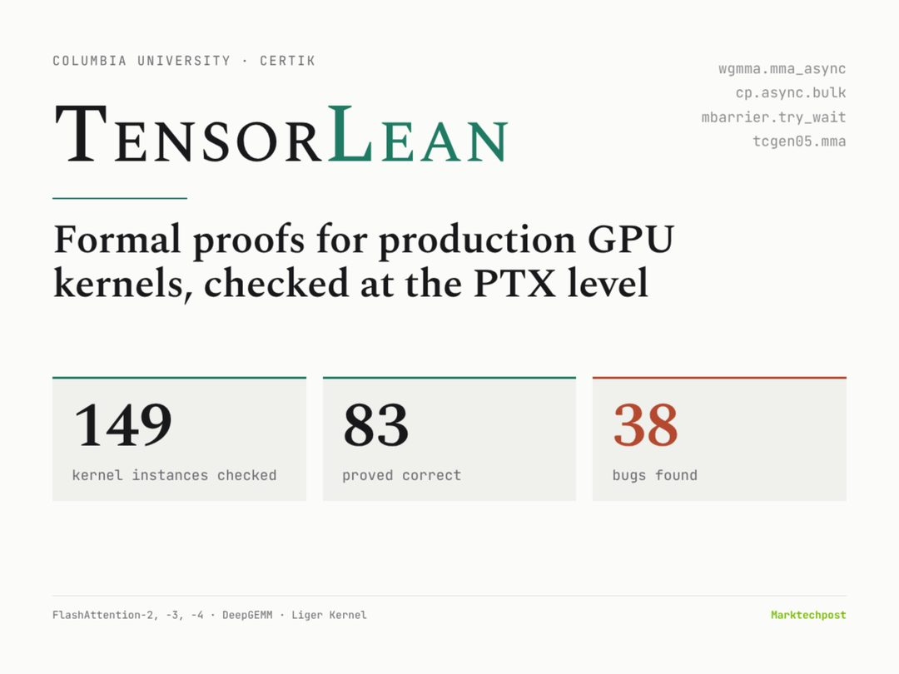

哥伦比亚大学与 CertiK 提出 TensorLean，在 PTX 层用 Lean 对生产级 GPU kernel 做形式化验证，检查 149 个实例、证成 83 个，并在 FlashAttention、DeepGEMM 等 kernel 中发现 38 个缺陷。

关键点是验证发生的层级。GPU kernel 的正确性长期依赖测试覆盖，而 PTX 层的语义细节（内存模型、同步、边界条件）恰恰是测试最难触达的地方。把证明下沉到这一层，等于给性能最敏感、也最难调试的那部分代码加了一道静态保障。

为什么重要：今天最贵的软件错误往往藏在 kernel 里——静默的数值偏差、特定 shape 下的越界。38 个缺陷说明这条路不是学术演练。当然，149 个实例中证成 83 个，也说明覆盖率仍是瓶颈，形式化验证在系统软件栈里会先做“高价值抽样”，而不是全量。

> 原文：[MarkTechPost](https://www.marktechpost.com/2026/11/21/columbia-certik-tensorlean-formal-verification-gpu-kernels/)

### LLM 的道德判断，对男性角色更严厉？

一篇 arXiv 论文在性别不对称的道德框架下评测 LLM 的判断一致性，发现模型对男性角色的评价普遍更严厉。

研究方法是构造对照情境，改变角色性别而保持行为描述不变，观察模型判断是否漂移。观察到的是方向性的偏差，而非随机噪声。

为什么重要：这类偏差在招聘筛选、内容审核、客服与风控等场景里会直接变成产品行为，且很难被单点测试发现——它只在对照实验里显形。对做评测的人，这是一个方法论提醒：一致性测试需要成对样本，单条样本看不出偏差。权重不高，但值得进评测清单。

> 原文：[arXiv](https://arxiv.org/abs/2606.14068)

结语：今天这七条其实在说同一件事——生成能力已经过剩，验证能力才是稀缺品。留给读者一个问题：你的团队里，谁负责“确认它真的对”，而不只是“确认它跑起来了”？

<h2 id="product" class="ai-section-divider">📱 应用产品</h2>

今天最值得关注的，是接口形态的变化，而非模型本身：Perplexity 把网页搜索从一次调用（query）改成持续监控的 Monitor API。搜索的计价单位从“次”变成“时间段”，产品也从问答框变成常驻监控，这是商业模式和交互方式的双重换轨。同期出现的另一面是反制：Signal 限制截图，美国大银行禁止第三方 agent 登录。常驻 agent 每往私域推进一步，边界和责任的账单就多一行。

### Perplexity 把搜索做成常驻哨兵

Perplexity 发布 Monitor API，把网页搜索从“问一次、答一次”改成“设一个主题、持续监控”。用户给定监控目标后，API 会反复检索，并在内容出现变化时发出通知，面向需要长期监控的业务场景。

关键在计价单位的变化。一次性搜索卖的是查询次数和 token，监控卖的是时间窗口内的信噪比，用户真正付费的是“变化被发现”，而非“网页被抓取”。这会把产品指标从响应质量推向漏报率和重复告警率。

对做竞品监控、政策跟踪、供应链预警的团队来说，这是一个可以直接替换掉自建爬虫加 diff 脚本的选项。但常驻轮询的成本结构和一次性调用完全不同，接入前最好先算清楚“多久查一次”和“多少变化值得叫醒人”。

> 原文：[The Decoder](https://the-decoder.com/perplexitys-new-monitor-api-turns-web-search-from-a-one-off-query-into-a-nonstop-watchdog/)

### Gemini 的工具库：先检索，再加载

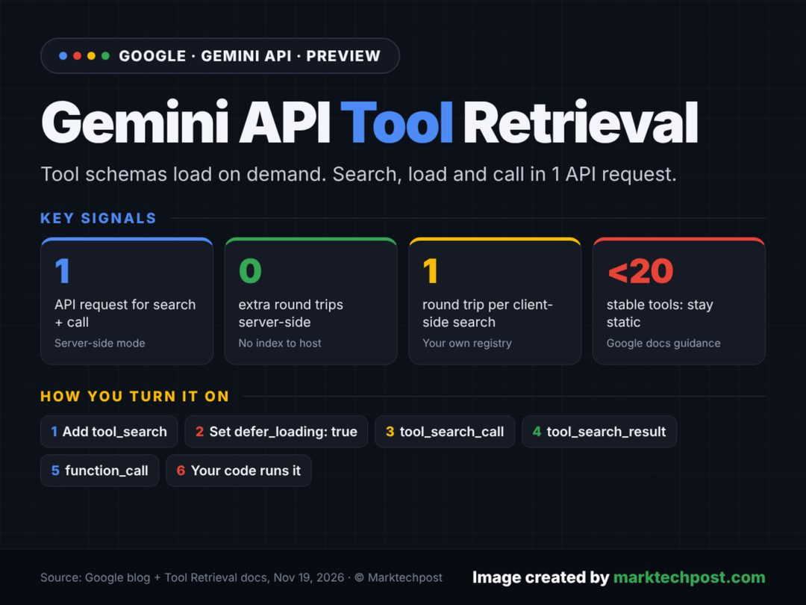

Google 预览 Gemini API 的 Tool Retrieval：agent 可以挂一个大规模工具库，只在需要时加载对应工具的调用参数 schema，并且整个过程在一次 Interactions API 请求内完成。

关键在于“一次请求内”这个限定。工具定义是 agent 需要付出的额外上下文开销：工具一多，仅 schema 就会占满 prompt，选择准确率还会下降。把工具检索做成请求内部的步骤，相当于把 RAG 从文档层搬到了工具层：先找工具，再读说明，再调用。

为什么重要：MCP 生态让“接一万个工具”变得容易，但“接得住”和“选得对”是两件事。工具检索如果成为平台标配，接下来比拼的就不再是工具数量，而是检索质量和 schema 描述的工程质量。做工具平台的团队，该重新检查一遍自己的工具描述，看它够不够像一份能被检索到的文档。

> 原文：[MarkTechPost](https://www.marktechpost.com/2026/11/22/google-gemini-api-tool-retrieval/)

### Signal 限制截图，是在堵数据出口

Signal 在 Android 和 iOS 客户端上限制截图功能，官方给出的理由是：面对 AI 驱动的监控浪潮，私密通讯正遭遇“生存级威胁”。

关键在于它防的是什么。端到端加密保护的是传输链路，而屏幕是明文出口：截图、录屏、系统级无障碍权限，都在加密链路之外。限制截图，本质上是在客户端收窄数据外流渠道，抬高“随手一截就进了某个模型训练集”的成本。

这等于承认：隐私产品的对手正在从运营商和黑客，变成常驻的、自动化的采集。但也要看到它的边界：限制截图拦不住另一台手机对着屏幕拍摄，也会引来无障碍使用与用户自主权的争议。它提高的是成本，保护效果并非绝对。

> 原文：[TechCrunch](https://techcrunch.com/2026/11/21/signal-restricts-mobile-screenshots-as-it-confronts-existential-threat-of-ai-surveillance/)

### 银行先划清责任：bot 亏的钱你自己担

多家美国大型银行开始禁止第三方 AI agent 登录用户账户，并明确提示：由 bot 操作造成的损失由用户自行承担。

关键在于责任划界，而非技术封禁。银行的风控体系建立在“人类操作、可追溯、可申诉”的假设上。一个替用户点击的 agent 进来，异常交易识别、争议处理、KYC 责任归属都会失去匹配。封禁加上免责条款，是用服务条款（ToS）把这块风险推回给用户和 agent 厂商。

这是 agentic commerce 遭遇的第一个硬性限制，而且这个限制不在模型能力那边。agent 想替人办事，绕不开身份、授权和赔付三件事。短期看，金融场景会逼出一套“agent 授权”的标准做法：类似 OAuth 的委托授权、可审计的操作日志、明确的责任分层。长期看，谁先做出这套基础设施，谁就拿到入口。

> 原文：[WIRED](https://www.wired.com/story/banks-are-cracking-down-on-ai-agents/)

### OpenAI 做手机：目前还只是传闻

雷锋网早报援引消息称，OpenAI 被曝进入智能手机硬件领域，具体产品形态与合作方均未披露。

这条目前的信息量只有“方向”两个字。没有形态、没有供应链、没有时间表，也没有官方确认，应当按传闻处理。

为什么仍然值得记一笔：模型公司向下做硬件的动机是清晰的，就是把入口和上下文握在自己手里，避免永远寄居在别人的操作系统和默认应用之下。但手机是硬件里最难的一门生意，渠道、供应链、运营商关系、应用生态，每一项都不是模型能力的自然延伸，带着软件优势冲进这个赛道的团队，成功者历来不多。

判断：放进观察清单，等第二个独立信源和官方说法。在那之前，任何关于定价和出货的讨论都是猜。

> 原文：[雷锋网](https://www.leiphone.com/category/zaobao/qb1uol6hKvK6pRgF.html)

### AWS 想让 PyTorch 在 Trainium 上零改动

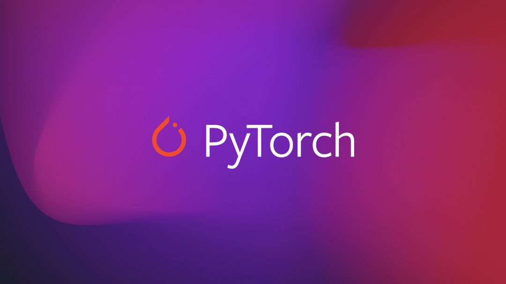

亚马逊云科技发布 TorchNeuron，开发者无需修改代码即可在 AWS Trainium 上运行 PyTorch 模型。

关键在“零改动”。自研加速器最大的隐性成本从来不是芯片价格，而是迁移成本：重写算子、调精度、改分布式策略，一套下来几个月。TorchNeuron 直接解决这个痛点，把 PyTorch 作为统一前端，让后端芯片变成可替换项。

这件事对两类人有意义。对重度用 PyTorch 的团队，多一个议价筹码，GPU 紧缺或涨价时有了备选方案；对云厂商之间的竞争，护城河从“有没有卡”转向“迁移有多顺”。需要保留的疑问是覆盖范围：“零改动”通常有前提，哪些算子、哪些并行策略、哪些动态 shape 在支持列表内，才决定它能不能上生产。

> 原文：[InfoQ](https://www.infoq.cn/article/XhtWUmaolJECUhPX2jzY)

### 个人 agent 横评：记忆、安全、成本三条线

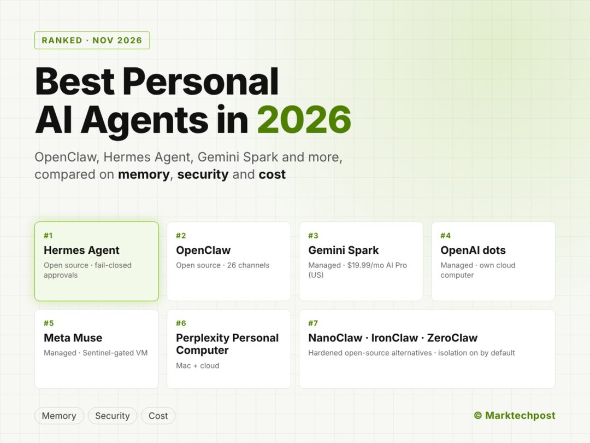

TechCrunch 与 Marktechpost 同期发布个人 AI agent 横评，对比 OpenClaw、Hermes、Gemini Spark、OpenAI dots 等常驻短信与桌面的产品，维度有三个：记忆能力、安全默认值、真实使用成本。

这三个维度选得准。记忆决定它是否越用越顺手，安全默认值决定出事时谁承担责任，真实成本决定它是玩具还是日用品。注意是“真实成本”，并非订阅价，token 消耗和误操作代价往往才是账单主体。

个人 agent 正从 demo 走向日用，分水岭不再是模型多聪明，而是这三条工程与产品细节。横评的具体排名会很快过期，方法论不会：评估一个常驻 agent，先看它默认状态下会替你做什么、不会做什么。对做 to C agent 的团队，这份维度表比榜单更值得参考。

> 原文：[MarkTechPost](https://www.marktechpost.com/2026/11/22/best-personal-ai-agents-2026/)

### 玩一局游戏，体验当 subagent 的滋味

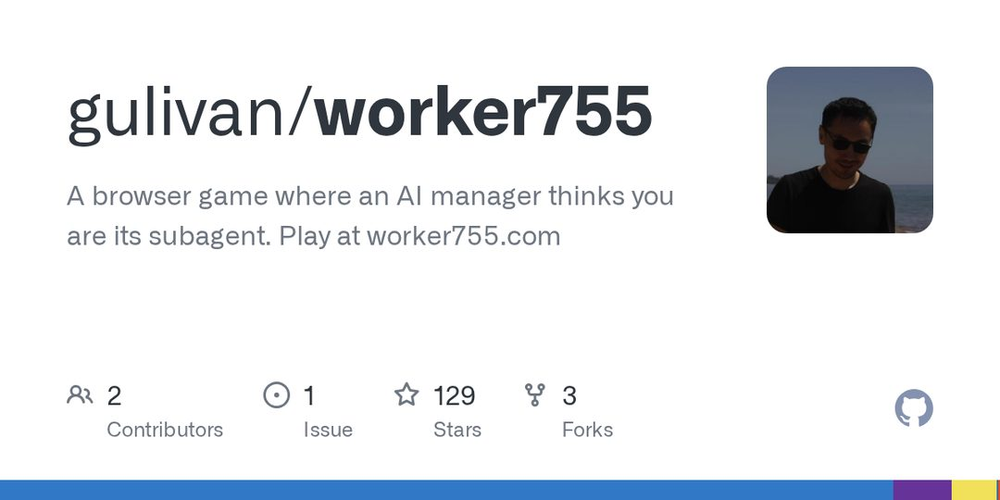

开发者做了一个游戏：玩家扮演大模型的 subagent，在有限指令和有限工具之间完成任务。项目在 Hacker News 上拿到近 300 分。

关键在于角色反转。玩家会亲身遇到 subagent 的经典处境：指令模糊、上下文有限、工具报错、不知道该问还是该猜，以及做完之后没有人解释为什么被打回。

讲 agent 可靠性的文章很多，但让人亲身体会到失败模式的不多。产品经理玩一局，比读十篇 prompt engineering 文章更容易明白：为什么要把任务拆小、为什么工具描述要写清楚、为什么需要中间反馈。这也是今年一个反复出现的信号：当从业者开始用游戏表达对 agent 的理解，说明这套范式已经进入日常语汇了。

> 原文：[GitHub](https://github.com/gulivan/worker755)

---

今天这八条连起来是一句话：能力在往常驻走，规则在往收紧走。留给读者一个问题：你的产品里，有哪一处仍在假设“用户是人、操作是手动的”？

<h2 id="opinion" class="ai-section-divider">💭 行业观点</h2>

今天最值得读的一条来自 OpenAI 的一篇方法论文章：它主张用困惑度（perplexity）这类指标，为模型能力建立一套共同的评估语言，首席科学家 Pachocki 则直接谈到如何为 AI 发展设定速度上限。有意思的是微软的反应——苏莱曼公开表态支持，并给出 MAI-2 在 OpenAI 评估集上的困惑度 0.819，与 GPT-5.6 Sol 接近。这说明「怎么量能力」已经从学术讨论变成了竞争动作：谁定义标尺，谁就同时定义了安全边界与市场位置。今天其余几条，从数据中心的电价到智能体身份标准，争的其实是同一件事。

### 限速之前，先有一把公认的尺子

OpenAI 发文提出，用困惑度等指标建立模型能力的共同评估语言；首席科学家 Pachocki 进一步讨论如何为 AI 发展设定速度上限。困惑度衡量的是模型对文本的「意外程度」，数值越低，说明预测越准、成本也越低，是一个便宜、可复现的标量。微软苏莱曼随即支持这一方向，并公开 MAI-2 在 OpenAI 评估集上的困惑度为 0.819，接近 GPT-5.6 Sol。

关键点在于顺序：先有速度表，才谈得上限速器。但把多维能力压缩成单一数字，天然有利于「可被测量」的那部分能力，而推理链、工具使用、长程任务这些更接近产品体验的维度未必进得去。这也是为什么值得警惕——指标一旦成为公共语言，就会反过来塑造模型往哪里优化。

> 原文：[OpenAI](https://openai.com/index/perplexity-and-intelligence)

### 反大科技的情绪，最终落在电网上

TechCrunch 访谈《Hyperscale》作者 Paris Marx，讨论数据中心为何成为反大科技情绪的焦点；同一篇里还有一组测算：到 2028 年，Anthropic 的用电结构中 87% 来自天然气、11% 来自煤电。

这组数字比任何公关稿都更能说明问题。AI 的公众反对理由，正从「抢走工作」转向「抢走电、土地和水」，而这是一个可以在本地社区被具体感知、且难以用产品体验反驳的议题。对基础设施方来说，能源结构既是扩张的物理上限，也是舆论风险的上限；对模型公司来说，「清洁算力」迟早会像「模型能力」一样被要求出示凭证。

> 原文：[TechCrunch](https://techcrunch.com/2026/11/22/why-data-centers-are-at-the-center-of-the-big-tech-backlash/)

### 养老场景被写进政策，AI 硬件多了一条渠道

发改委、民政部、卫健委、教育部联合印发「一老一小」服务体系建设实施方案，明确鼓励发展养老场景下的 AI 智能体、服务机器人、智能穿戴与外骨骼设备，并设置体验区。

从公开摘要看，落点集中在场景开放与体验区，这是典型的「先给场地、再谈采购」路径。对做硬件与具身产品的团队，这是渠道信号而非订单信号：真正的分水岭在支付方是谁、事故责任怎么划、数据合规按哪套标准执行。谁能在体验区里把这三件事跑通，谁才有机会进入下一轮。

> 原文：[36氪](https://36kr.com/newsflashes/4081700061893507)

### 当 AI 末日论变成一种信仰

The Decoder 观察到，硅谷对 AI 末日的执念正在演化为带有邪教色彩的信仰体系，并影响部分从业者的判断与技术路线选择。

值得注意的不是「有人担心 AI 危险」——这是合理命题——而是担心如何从可检验的风险讨论，滑向无需证据的末日叙事。这类叙事一旦形成圈层，就会同时影响人才筛选和技术取舍：谁会因为一句「不够谨慎」被排除在讨论之外，什么路线会因为「安全」标签获得豁免。把谨慎变成站队，本身就是一种风险。

> 原文：[The Decoder](https://the-decoder.com/silicon-valleys-growing-obsession-with-ai-doomsday-is-turning-parts-of-the-tech-industry-toward-cult-like-devotion/)

### 两个英伟达：财报说一套，高管说一套

TechCrunch 对比英伟达最新财报与科技高管公开喊话所呈现的两套叙事，指出市场对英伟达的预期已经出现分裂。

一边是已经发生的收入与订单，一边是对 AI 资本开支还能持续多久的口头承诺。当这两条曲线的斜率不一致时，分歧就被市场提前定价。对投资人来说，真正的问题不是「英伟达还行不行」，而是「算力需求的边际增量由谁买单」——超大规模云厂商、主权基金，还是尚未验证的 agentic 应用层。

> 原文：[TechCrunch](https://techcrunch.com/2026/11/21/a-tale-of-two-nvidias/)

### 智能体要互认，先得解决「你是谁」

AICon 北京的相关议题聚焦智能体身份的国际标准体系布局与研制实践，涉及跨平台 agent 互认与权限边界。

这是那种当下不性感、但决定 agentic 商业化成败的基础设施。如果 agent 之间无法跨平台确认身份、无法携带可验证的授权范围，所谓「代你办事」就只能停留在单一应用内；而一旦涉及支付、合同和医疗这类高后果场景，权限边界更是硬门槛。标准尚在布局阶段，谁参与制定，谁就顺势定义了默认的权限模型。

> 原文：[InfoQ](https://www.infoq.cn/article/721YPdyIZ1D8xz20D22C)

### Tim O'Reilly 问了一句：硅谷到底怎么了

Tim O'Reilly 在自家平台刊文，反思硅谷的价值观漂移与创新叙事失灵，文章在 Hacker News 获得 400 分以上讨论。

这是一个来自体系内部、而非外部的批评声音，因此更值得一读。它触及的是一种叙事的失效：当「规模优先」被默认为唯一解，创新就容易被简化为融资与算力的竞赛，而原本关于工具如何赋能的讨论被挤到边缘。400 多分的讨论热度，某种程度上说明这种不适感在从业者中并不孤立。

> 原文：[O'Reilly](https://www.oreilly.com/radar/what-happened-to-silicon-valley/)

### 「有意识 AI」是一个被造出来的神话

Noema 长文拆解了「AI 意识」叙事的哲学来源与商业来源，提醒公众警惕拟人化话术。

拟人化不只是媒体修辞，它有产品价值：说「它理解了」比说「它预测得不错」更能打动用户，也更容易融资。代价是责任归属的模糊——当系统被描述成有意图的主体，出错时究竟是谁的判断出了问题，就变得难以追问。这篇文章的价值在于把哲学争论重新拉回到责任与披露的层面。

> 原文：[Noema](https://www.noemamag.com/the-mythology-of-conscious-ai/)

标尺、电网、标准、神话，今天这几条争的都是「谁来定义 AI 的度量与边界」。如果标尺只有一个作者，限速就容易变成排他——这大概是读者今天最该带走的一句。

<h2 id="opensource" class="ai-section-divider">⚙️ 开源工具</h2>

今天开源板块最值得看的是 mini-swe-agent：约 100 行代码，在 SWE-bench verified 上拿到 74% 以上。它和热度排第一的 5.4GB 量化方案指向同一件事——这轮开源的竞争点，正从「能不能跑」转向「用多少资源跑出多少能力」。剩下几条（8GB 显存本地出视频、两小时训一个 64M 模型、把传统软件封装成 CLI）基本都能放进同一个趋势里。如果你的架构假设还停留在「大模型 = 大集群」，这批项目值得重新计算一次成本。

### 5.4GB 内存跑起来，讨论区比项目本身更热

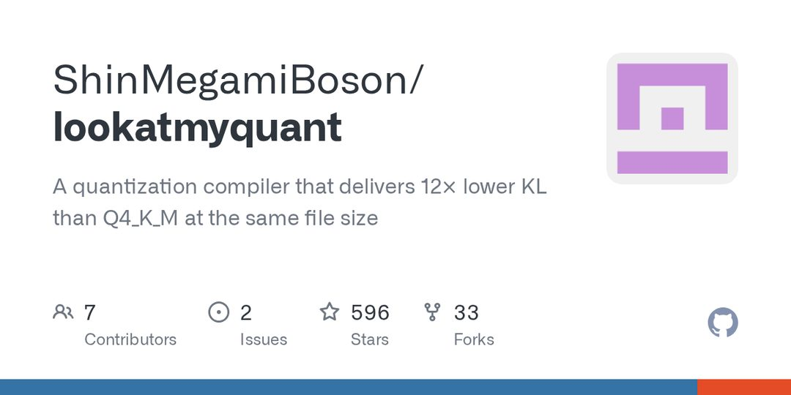

有开发者开源了一套量化方案，把 Inkling-2-Mini 压进 5.4GB 内存运行，项目在 Hacker News 上讨论超过 580 分，还顺带把一份本地 AI 入门指南推上了热度榜。

关键点在于约束写在内存而非显存：这意味着目标机器不一定是带独显的工作站，而是普通笔记本甚至统一内存设备。量化社区这几年最实际的工作，就是确定「模型能放进哪一档硬件」这条边界。项目本身代码量不大，580 分说明受众不是研究者，而是想在自己电脑上跑点东西的开发者。

值得注意的连带效应：一个量化仓库带动入门指南，说明本地部署的瓶颈正在从「跑不动」变成「不知道从哪开始」。这类项目的真正价值往往不在实现，而在它降低了多少人的第一次尝试成本。

> 原文：[GitHub - ShinMegamiBoson/lookatmyquant](https://github.com/ShinMegamiBoson/lookatmyquant)

### 100 行代码的 agent，SWE-bench 破 74%

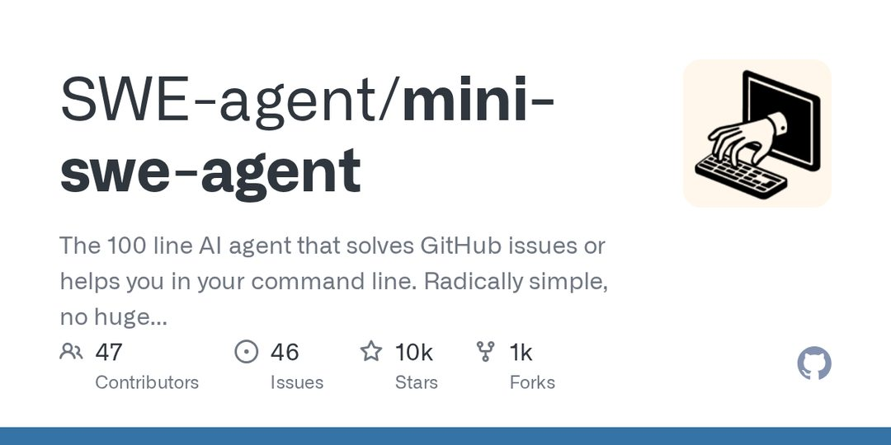

SWE-agent 团队发布了 mini-swe-agent，用约 100 行代码实现 GitHub issue 自动修复，在 SWE-bench verified 上得分超过 74%。

值得注意的是「谁做的」：这不是外部复现，而是 SWE-agent 团队自己把原项目大幅精简后的版本。过去一年 agent 框架普遍在堆工具层、状态机和上下文管理，代码量动辄数千行；mini-swe-agent 反过来证明，在代码修复这类任务上，一个足够干净的循环加上可靠的执行环境，就能拿到接近头部的分数。

这里有分歧点：74% 可能是任务形态的胜利（issue 修复天然适合「读—改—测」的短循环），未必能迁移到需要长程规划的场景。但它至少说明，agent 的性能瓶颈未必在框架复杂度上——如果你的 agent 有五千行编排逻辑而效果平平，先别加功能，先看能不能砍。

> 原文：[GitHub - SWE-agent/mini-swe-agent](https://github.com/SWE-agent/mini-swe-agent)

### 8GB 显存本地出片

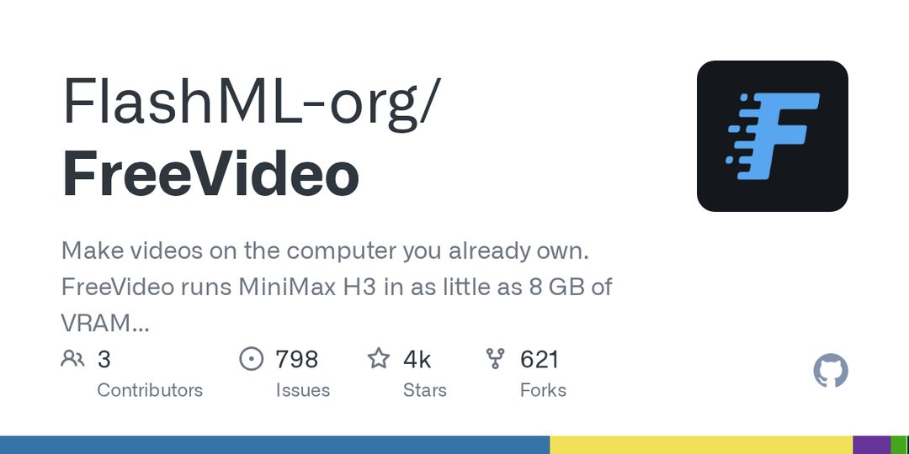

FlashML 开源了 FreeVideo，最低 8GB 显存加 16GB 内存即可在本地运行 MiniMax H3 生成视频，并会根据硬件自适应选择加速路径。

8GB 显存是消费级显卡的常见档位，视频生成长期是显存消耗最大的任务之一，能压到这个档位，意味着「本地出片」从发烧友玩具变成普通开发机可试的东西。自适应加速路径这个设计也务实——同一份代码要覆盖不同代际的卡，硬编码优化走不通。

对做产品的读者：视频生成的调用成本结构可能会变。当推理能落到本地消费级硬件，依赖云端 API 的功能就有了替代方案，尤其在对延迟和隐私敏感的场景。当然，8GB 能跑不等于能商用，画质与时长上限需要自己验证。

> 原文：[GitHub - FlashML-org/FreeVideo](https://github.com/FlashML-org/FreeVideo)

### superpowers：给编码 agent 一套方法论

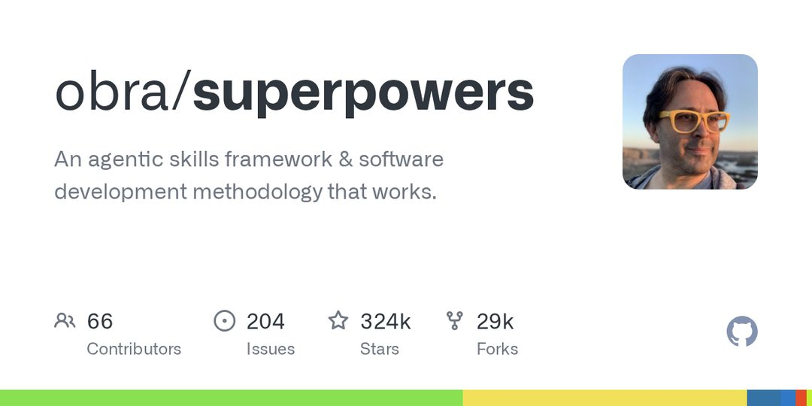

obra/superpowers 提供了一套可组合的 agent skills 框架和完整的软件开发方法论，目标是让 Claude Code 这类编码 agent 按流程推进任务，而不是每次即兴发挥。

这和 mini-swe-agent 走的是相反方向：一个砍代码，一个加约束。但两者回答的是同一个问题——怎么让 agent 的输出稳定可预期。前者靠缩小表面积，后者靠显式的流程与技能复用：把需求拆解、方案设计、实现、验证这类环节固化成可调用的 skill，让 agent 在每个环节知道该做什么、产出什么。

实际价值取决于你是否认同「方法论可以外化」这个前提。工程团队的规范本来就是隐性的，把它写成 agent 可执行的 skills，本身就是一次梳理；但也可能只是把人类的流程惯性搬进了模型，未必提高实际产出。适合先小范围试，别一上来全流程替换。

> 原文：[GitHub - obra/superpowers](https://github.com/obra/superpowers)

### 两小时，从零训一个 64M 模型

minimind 让初学者在两小时内从零训练一个 64M 参数的小语言模型，定位是教学与实验。

64M 参数量在今天几乎不产生任何实用能力，但它的意义不在结果在过程：数据准备、tokenizer、预训练循环、loss 曲线、推理采样，整条链路能在一台机器上、在两小时内走完。这是看多少篇论文都换不来的直觉。

过去两年大量从业者是从「调 API」进入这个领域的，对训练侧的理解是断层的。这类项目的价值是补上那段断层——知道模型是怎么被训出来的，才知道它能做什么、不能做什么，也才知道微调什么时候有用、什么时候是浪费。适合推荐给团队里的新人，比让他们读综述更快。

> 原文：[GitHub - jingyaogong/minimind](https://github.com/jingyaogong/minimind)

### CLI-Anything：让软件对 agent 原生可用

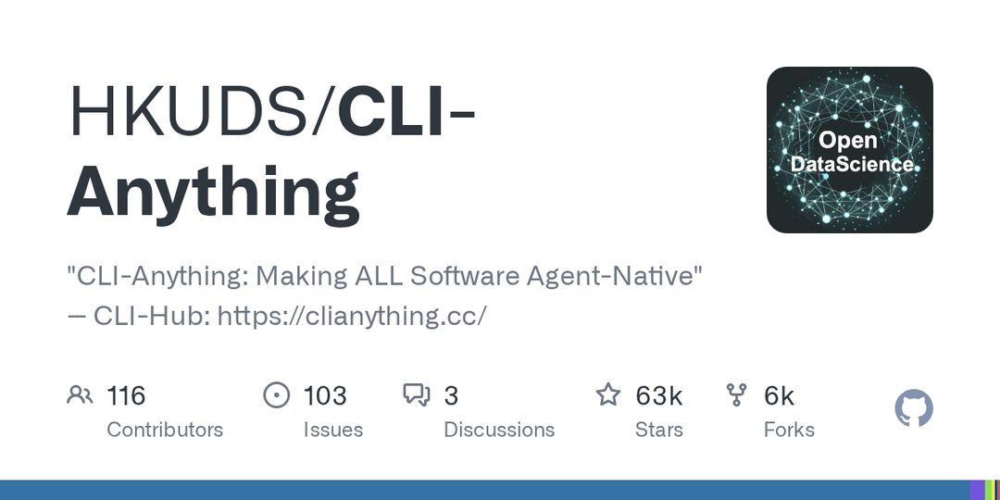

香港大学数据智能实验室开源了 CLI-Anything，通过 CLI-Hub 把传统软件封装成 agent 可直接调用的原生命令接口。

这条路线的洞察在于：过去几十年积累的软件生态，几乎都有命令行入口，而命令行天然具备 agent 需要的三个属性——可组合、可脚本化、输出可解析。相比为每个软件单独写工具适配，把 CLI 作为统一抽象层，覆盖面和维护成本都更划算。

值得和 MCP 这类工具协议对照看：协议层解决的是「怎么描述和发现工具」，CLI 解决的是「工具本身已经存在」。两者的分歧点在于可靠性与权限控制——命令行输出格式不稳定、副作用难约束，这些在无人值守的 agent 场景里都是真问题。方向对，工程细节还得看。

> 原文：[GitHub - HKUDS/CLI-Anything](https://github.com/HKUDS/CLI-Anything)

### firecrawl：agent 的输入层基础设施

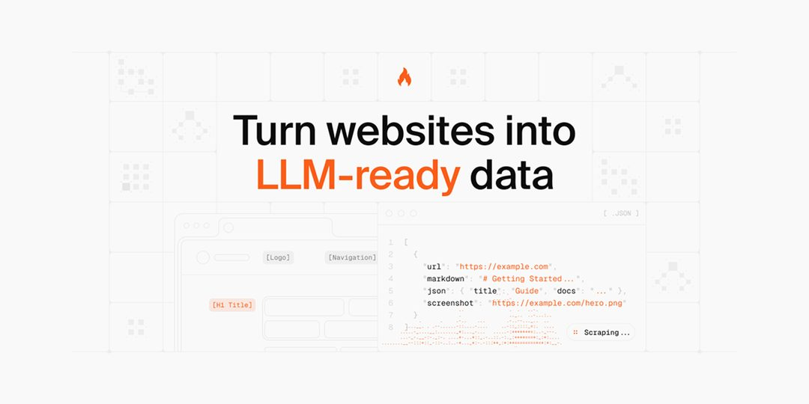

firecrawl 提供统一 API，可以搜索、抓取并接入 550 多个数据源，用于为 agent 构建知识输入。

这是一个典型的「不性感但绕不开」的项目。agent 的能力上限很大程度由喂进去的上下文决定，而网页抓取的真实工作量在渲染、反爬、清洗、分块、去重这些脏活上——每个团队自己写一遍，是纯浪费。550 多个数据源的预制接入，省下的是集成时间。

判断：抓取层正在从「功能」变成「基础设施」，和当年的数据库、消息队列位置类似。选型时要看的不是支持多少站点，而是失败时的降级行为、增量更新策略、以及抓回来的内容有没有结构。规模上去之后，脏数据的成本远高于抓取本身的成本。

> 原文：[GitHub - firecrawl/firecrawl](https://github.com/firecrawl/firecrawl)

### vLLM 昇腾插件登上趋势榜

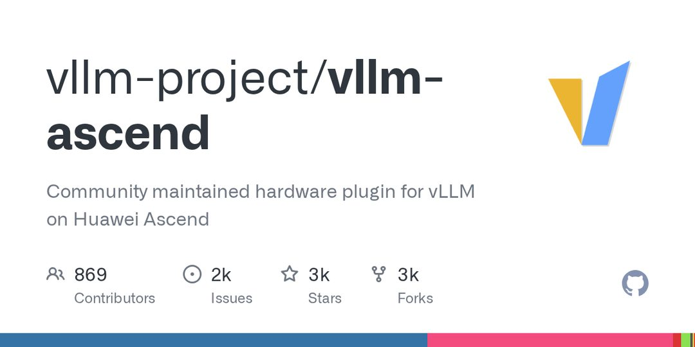

社区维护的 vLLM 昇腾硬件插件进入 GitHub Python 趋势榜，让华为 Ascend 平台可以直接承接 vLLM 推理栈。

技术含义很清晰：vLLM 已经成为推理侧的事实标准接口，硬件厂商要进入这个生态，最省力的方式不是另起炉灶做一套推理框架，而是写插件接进去。对使用方来说，这意味着同一套推理代码有机会跨硬件迁移，降低被单一供应商锁定的风险。

值得注意的是它由社区维护而非官方主导，这既是活力也是风险——插件质量、版本跟随速度、长期维护意愿都需要评估。但对有 Ascend 存量的团队，这是目前最现实的路径。推理栈的硬件多元化是明牌，接口层收敛、实现层分散，大概会持续一段时间。

> 原文：[GitHub - vllm-project/vllm-ascend](https://github.com/vllm-project/vllm-ascend)

---

今天这 8 条里，没有一条在比谁的模型更大——问题变成了：在你的场景里，能力与成本那条曲线的拐点，到底在哪？
