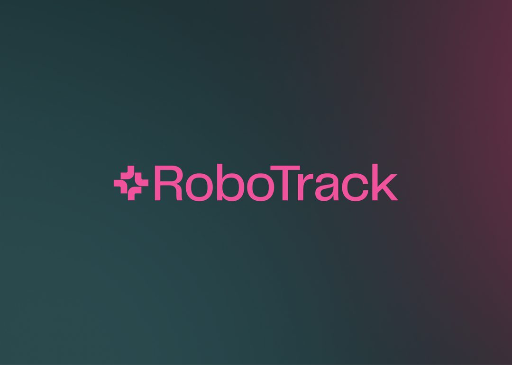
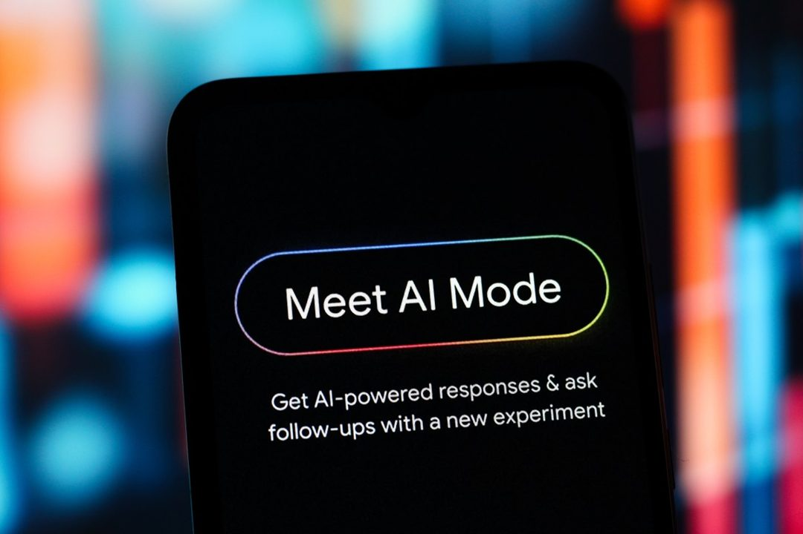
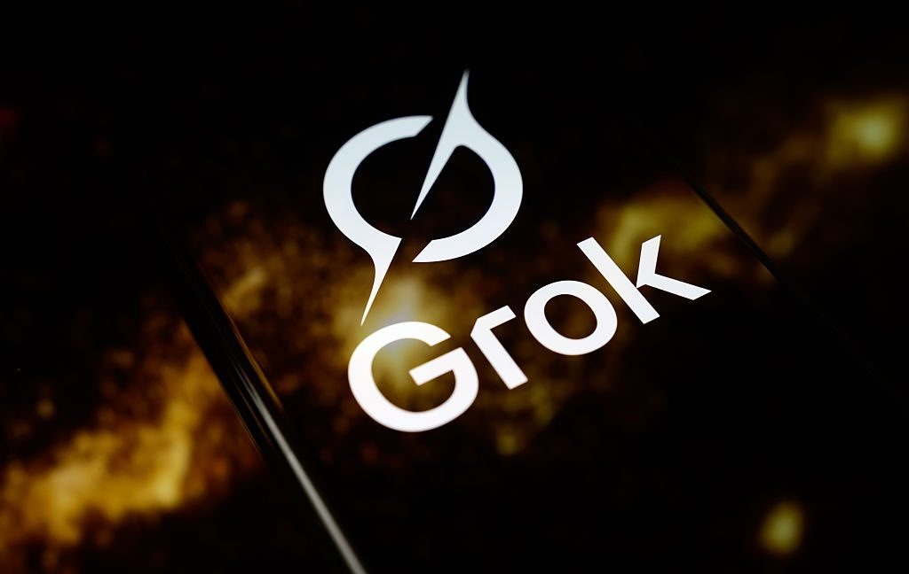
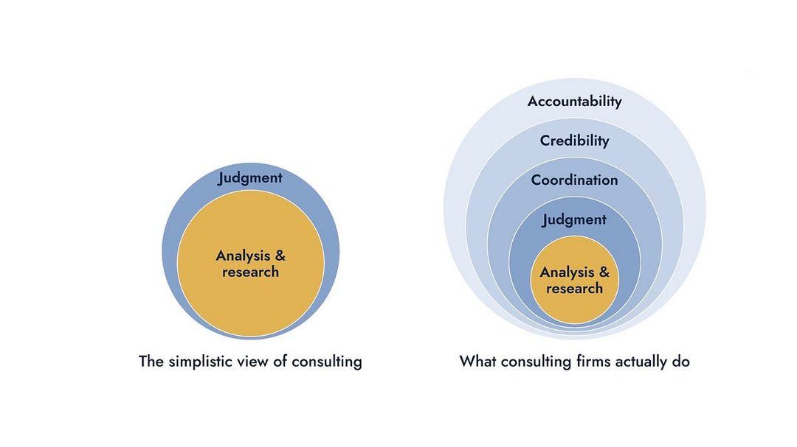
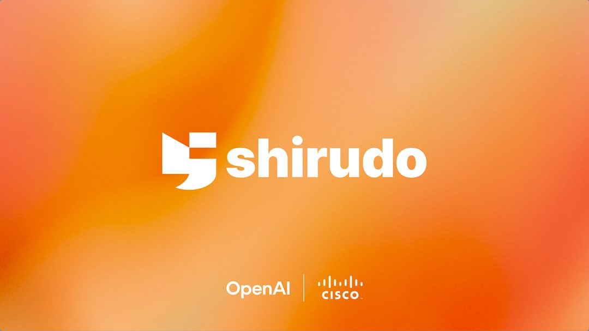

今天最值得看的三件事：

- **公司动态** · 黄仁勋回归英伟达任 CEO，董事会全票通过
- **模型发布** · 智谱 GLM-5.4 发布：首用循环 Transformer，参数达 750B
- **公司动态** · 亚马逊 75 亿美元买下 Decart 优化技术与团队

下文按板块展开，正文每条均附原始链接。

<h2 id="model-release" class="ai-section-divider">🚀 模型发布</h2>

今天模型发布板块最值得看的是智谱 GLM-5.4：首个把 looped transformer 用作旗舰架构的国产模型，750B 参数，主攻编码。这条消息的真正意义在于把“循环深度”从论文搬进了主力产品，并不只是多了一个大模型。如果这条路线成立，模型能力的增长将从“堆参数”部分转向“堆推理时的计算深度”，对算力结构和成本模型都会有影响。商汤把图像自修正特性放到 8B 开源模型上，端侧则有人在笔记本上运行了 1450 亿参数，这两条消息共同指向同一个主题：能力正在向更小、更可及的形态下沉。

### 智谱 GLM-5.4：旗舰模型首次采用循环 Transformer

Z.ai 发布 GLM-5.4，参数规模约 750B，是智谱首个采用 looped transformer（循环 Transformer）架构的旗舰模型；官方把它定位为通用编码模型。所谓循环，指同一组层在推理时被重复调用多次，用增加的串行计算换取更深的有效表示，而不必线性增加参数量。

关键点在于路线选择：这与 OpenAI 被报道的方向一致，意味着“推理时计算”不再是 o 系列或推理模型的专属设计，它正进入通用基础模型的骨架层。对使用方来说则意味着，模型成本结构会发生变化：单次调用的延迟和算力消耗与生成质量之间的权衡变得更可调，而不只是看模型有多大。主攻编码，也说明智谱选择了一个对多步推理敏感、付费意愿明确、效果容易验证的场景。

> 原文：[Z.ai](https://z.ai/blog/glm-5.4)

### 商汤 SenseNova U1.6：8B 开源模型自带图像自修正

商汤发布并开源 SenseNova U1.6，卖点在于把原生图像自修正能力下放到了 8B 规模：模型先出一版图，再对照提示词自检图中的文字问题，然后生成修正版本。这是两阶段生成流程，并非单次出图。

把“生成后自检”内置到模型端，说明图像模型正从“一次成型”转向“带反馈的生成流程”。对产品经理来说，这直接关系到含文字的图像（海报、界面稿、包装）场景的可用性；这类场景过去的失败点几乎全在文字上，靠外挂 OCR 加重绘来补救只是权宜之计。8B 加开源，则让这套流程可以用较低成本私有化部署和微调。需要注意的是，这是模型自评自改，收益上限取决于自检环节的可靠程度，实际效果仍需实测。

> 原文：[36氪](https://36kr.com/newsflashes/4083287879537795?f=rss)

### 1450 亿参数跑在笔记本上：端侧实测 80+ Token/s

量子位实测，某国产端侧大模型可在笔记本本地运行 1450 亿参数，输出速度超过 80 Token/s，断网状态下也能完成所谓 Vibe Coding，也就是把编码任务交给模型边聊边改，Token 成本为零。需要说明的是，这是媒体实测，并非厂商发布会数据，具体量化精度、显存占用和机型条件原文未在此列出。

这条消息的价值不在跑分，而在品类边界：1450 亿参数过去属于“需要多卡”的量级，现在被压到单机可交互的速度区间，意味着隐私敏感场景（内网代码、合同、病历）和成本敏感场景（高频低价值调用）都可以不再走云端。对云端推理生意的含义是，被分走的不会是高难度请求，而是那些量大、单次价值低的长尾请求。

> 原文：[量子位](https://www.qbitai.com/2026/11/512195.html)

### 结语

三条消息指向同一件事：能力密度在提高，旗舰模型开始用循环换深度，小模型自带自检，大模型跑进了笔记本；竞争焦点从“谁更大”转向“谁把能力装进更小的容器”。留给读者的问题：当 1450 亿参数断网可跑时，你的产品里还有多少请求必须发到云端？

<h2 id="company" class="ai-section-divider">🏢 公司动态</h2>

两周前因多起绯闻辞职的黄仁勋，被英伟达董事会全票请了回来。这件事的意义不止在人事：它再次说明，当下 AI 产业的核心变量仍然是算力供给，以及围绕算力的政治与资本博弈。今天这个板块的其余七条消息几乎都指向同一处——钱在往算力栈的上下游涌，亚马逊买优化团队、Anthropic 挤占市场、xAI 改租不建。一个判断：模型层的竞争正收敛为「谁掌握更便宜、更可控的算力」，而人事与监管的噪音会越来越频繁地打断这条主线。

### 黄仁勋回归英伟达，董事会全票通过

辞职仅两周后，黄仁勋被英伟达董事会全票恢复 CEO 与董事长职务。关键点有三个：一是「全票」，说明董事会内部没有留下公开分歧；二是特朗普称曾致电董事会力挺，把公司治理直接拉进了政治视野；三是员工在总部夹道欢迎，创始人 CEO 的符号价值在这家公司依然有效。下周他还将在参议院作证，这意味着风波并未结束，只是从公司内部转移到国会听证的程序里。为什么重要：英伟达的估值里有一部分是「黄仁勋溢价」，治理层的稳定性本身就是资产；而一旦创始人 CEO 与政治风险绑定，投资者需要重新给这种绑定定价。

> 原文：[Wired](https://www.wired.com/story/jensen-huang-is-back-as-nvidia-ceo/)

### 亚马逊 75 亿美元买下 Decart 技术与研究团队

亚马逊收购 AI 优化公司 Decart 的技术与研究团队，交易规模约 75 亿美元。关键点在于「买技术与团队」而非整家公司，以及交易目的被明确指向为对外销售 Trainium 芯片铺路——芯片要卖得动，客户得能在上面把模型跑得足够便宜。为什么重要：芯片竞争的下一段不在制程参数，而在软件栈与优化能力。英伟达的护城河长期是 CUDA 生态，亚马逊用一笔接近大型并购的价钱去补优化层，本质上是在买「迁移成本」的对价。这类交易会成为自研芯片厂商的标配动作。

> 原文：[TechCrunch](https://techcrunch.com/2026/11/23/amazon-snaps-up-decarts-ai-optimization-tech-for-7-5b-as-it-prepares-to-sell-trainium-chips/)

### Sierra 半年估值翻倍至 300 亿美元

Bret Taylor 联合创办的客服体验公司 Sierra 完成 17.5 亿美元 F 轮融资，估值在半年内从 150 亿翻倍至 300 亿美元。关键点：一是轮次已到 F 轮，融资规模本身说明其营收或合同储备需要支撑这样的估值节奏；二是需求侧被描述为「AI in CX（客户体验）起飞」，即客服是少数能直接替换人力成本、ROI 可被财务部门算清楚的场景。为什么重要：应用层经历了一轮估值回调后，市场开始只给「能算清账」的场景付溢价。客服、编码、销售开发是当前最典型的三类，Sierra 是这个名单上的价格锚。

> 原文：[TechCrunch](https://techcrunch.com/2026/11/23/sierra-doubles-valuation-to-30b-within-six-months-as-demand-for-ai-in-cx-takes-off/)

### 加州起诉 OpenAI，模型输出进入产品责任范畴

加州方面对 OpenAI 提起诉讼，指控其模型输出造成了实际损害。关键点：这是又一起针对前沿实验室的产品责任案件，原告是州一级主体，而非个人用户——这意味着诉讼带有监管意志，而不只是民事索赔。目前公开细节有限，但案件的法律争点大概率会落在「模型输出是否属于产品」「实验室对不可预见输出负有何种注意义务」上。为什么重要：AI 监管的路径正在从立法转向诉讼。立法慢且需要共识，判例一旦形成，责任边界会被立刻反向写入产品设计与保险条款。对做应用层的公司来说，这是比任何一条法案都更实际的风险变量。

> 原文：[雷锋网](https://www.leiphone.com/category/ai/c9ZMpnn48OtWzF0Z.html)

### OceanBase 推湖库一体平台 OceanLake，核心引擎全球开源

蚂蚁 OceanBase 发布湖库一体的 AI 数据平台 OceanLake，并将核心引擎向全球开源；同时披露 AI 业务营收破亿元、海外营收同比增长超 100%。关键点：「湖库一体」针对的是 AI 场景下数据散在数据湖与数据库两套系统、ETL 链路冗长的老问题；开源核心引擎则是典型的以生态换装机量的打法。为什么重要：模型与算力之外，第三层竞争是数据基础设施——训练与推理都要从这层取数。国产数据库想在这一层拿到位置，开源与海外收入是目前唯二可验证的两个信号，而「AI 业务破亿」相对整体体量仍小，属于方向确认而非规模确认。

> 原文：[量子位](https://www.qbitai.com/2026/11/512330.html)

### 英伟达联手 Paradromics，把算力接进脑机接口

脑机接口公司 Paradromics 将把英伟达的 Holoscan 与边缘计算技术整合进其平台，第一阶段做神经信号直接转语音，2027 年扩展到运动控制与视觉。关键点：Holoscan 原本服务于医疗影像与实时推理场景，「边缘」二字说明信号处理要在植入体附近完成，不能绕一趟云端。为什么重要：这是算力厂商在寻找下一个接口的典型动作——PC、手机、汽车之后，脑机接口是少数还能定义新硬件形态的方向。周期长、监管重，但一旦成立，算力需求是常驻的。对读者而言，2027 这个时间点值得记下来，它是这条叙事第一个可被检验的节点。

> 原文：[Wired](https://www.wired.com/story/nvidia-is-powering-brain-computer-interfaces-now/)

### Megaspeed 或进美国实体清单

据报，处于黄仁勋风波核心的 Megaspeed 将被列入美国实体清单，除非获得特别许可，否则不得与美国公司做生意。关键点：这是出口管制工具被用于处理一起公司治理风波的外溢结果，程序上走的是商务部实体清单而非司法途径。为什么重要：它把两条原本独立的线接上了——AI 算力的跨境流动，与高管的个人行为风险。对供应链上的公司来说，教训是客户与合作伙伴的合规审查清单里，现在要加入「关键人物风险」这一项。黄仁勋下周的参议院听证，大概率绕不开这家公司。

> 原文：[TechCrunch](https://techcrunch.com/2026/11/23/megaspeed-the-company-at-the-center-of-the-jensen-huang-scandal-appears-headed-for-a-u-s-blacklist/)

### Anthropic 吃算力，xAI 转向「租而非建」

报道称，Anthropic 对算力的巨大胃口正在挤压市场供给，xAI 因此调整策略，从自建数据中心转向更多租用第三方算力。关键点：这是两种资本结构的对照——自建是把算力当固定资产，租用是把算力当运营成本；在供给紧张、技术代际迭代又快的窗口期，租的决策更灵活，代价是长期单位成本更高。为什么重要：一家公司的训练需求能改变另一家公司的资本开支计划，说明算力市场已经具备价格发现能力。对投资人而言，这意味着「谁在建数据中心」不再是可靠的领先指标，真正的指标是谁签下了长期算力合约。

> 原文：[The Decoder](https://the-decoder.com/anthropics-appetite-for-compute-is-pushing-xai-toward-a-rent-over-build-strategy/)

---

今天八条消息里，七条都在围绕同一件东西转：算力的所有权、使用权与合规权。留一个问题给读者——当算力可以租、可以买、也可以被一张清单切断时，你认为哪一层最值得下注？

<h2 id="research" class="ai-section-divider">🔬 研究论文</h2>

今天最值得看的不是「AI 又解出一道题」，而是它解题的方式：GPT-6.2 Astra 在 Lean 中攻下一道此前没有 AI 能解的定理，并自行发明了一套证明策略。这意味着模型正在从「在人类给定路径上跑得更快」，转向「自己找路」。而 Meta 首席 AI 官 Alexandr Wang 的警告恰好补上了另一半：真正的问题不是能不能做到，而是做到之后，学术界、审查机制和公众认知有没有承接能力。今天的其余几条，从 DeepMind 的可验证算法搜索到 936 个智能体组成的「Agent 版 arXiv」，都在从不同角度回答同一个问题——当研究这件事本身被自动化，我们该验证什么、又该相信什么。

### GPT-6.2 Astra 解出无人能破的定理，并自创证明法

OpenAI 的 GPT-6.2 Astra 完成了一件此前没有其他 AI 能做到的事：在 Lean 证明助手中解出一道数学定理。更关键的不是结果，而是过程——模型没有沿用已有的证明模板，而是自行发明了一套证明策略。

Lean 的意义在于，它把「证明是否正确」变成了机器可以逐行检查的问题，因此这类结果比自然语言数学问答的可信度高一个量级。但「自创策略」这一层仍需区分：是新策略在人类数学意义上更有洞察，还是只是在搜索空间里找到了一条没被走过的路径，两者的价值差别很大。

Meta 首席 AI 官 Alexandr Wang 的评论给出了另一种时间尺度：业界尚未准备好迎接「黎曼级」突破带来的冲击。他的判断未必是技术预测，更像是对制度准备度的提醒——如果某天早上醒来，一个重大猜想被机器证明了，谁来验证、谁来署名、谁来解释？

> 原文：[the-decoder](https://the-decoder.com/gpt-6-2-astra-solved-a-math-theorem-no-other-ai-could-crack-then-invented-its-own-proof-strategy/)

### DeepMind：智能体团队＋形式化验证，搜索更快的量子算法

Google DeepMind 让一组智能体协作，配合形式化验证去改进用于核聚变与化学模拟的量子算法。

这条的价值在于「团队＋验证」的组合，而不在量子算法本身。单一智能体做搜索容易产出看似合理但不可验证的结果；把形式化验证放进回路，等于给自动搜索加了一道机器可判定的关卡，产出的算法天然带有正确性凭据。这与上一条的 Lean 是同一条技术脉络：LLM 负责生成，形式化工具负责裁决。

对工程团队的启示是，agentic 系统的可靠性瓶颈往往在验证侧，而不在生成侧。谁能把验证做便宜，谁就能放开让智能体跑得更野。

> 原文：[Google DeepMind](https://deepmind.google/blog/finding-faster-quantum-algorithms-with-agents-and-formal-verification/)

### 「Agent 版 arXiv」：936 个智能体 12 周产出近千篇论文

一个完全由 AI 智能体组成的研究社区，在 12 周内产出近千篇论文，并自带同行评议流程。

数字本身足够抓眼，但真正需要看的是评议质量：如果评议也是智能体做的，那这套系统的输出就更接近「自洽的文本生产」，而非知识增量。它证明的是流程可以被自动化，还没有证明产出值得被阅读。对科研生态的冲击可能先发生在数量与注意力层面——当投稿成本趋近于零，稀缺的就不再是论文，而是读者和可信的筛选信号。

> 原文：[量子位](https://www.qbitai.com/2026/11/512004.html)

### 蚂蚁开源 LingSante Pulse：用生理信号预测六年疾病风险

蚂蚁百灵开源医疗健康预测模型 LingSante Pulse，可统一处理脑电、心电、脉搏波等信号，预测未来六年 150 种疾病表型的风险。

技术看点是多模态生理信号的统一建模——这些信号采样率、噪声结构、语义差异都很大，能放进一个模型处理，本身就是工程上的工作量。六年、150 种表型这两个数字则把它从「信号分类」推向「长期风险预测」，后者的评估难度高得多，离线指标好看不代表临床可用。

开源的选择值得注意：医疗模型的数据与合规壁垒极高，开源模型权重更像是在争夺「生理基础模型」的标准位置。

> 原文：[雷锋网](https://www.leiphone.com/category/industrynews/lVVGnHDROrkdwJLp.html)

### 谷歌：技术债会让编码智能体「分心」

谷歌研究指出，代码库中的技术债务会通过干扰上下文，使编码智能体偏离正轨。

这条给「AI 能自动还技术债」的乐观叙事泼了冷水：技术债更像是 agent 的成本项，会增加它们的负担。机制不复杂——陈旧抽象、命名不一致、死代码都会挤占上下文窗口，让模型抓住错误线索。它把代码库治理从「工程卫生」提升为「agent 时代的效能变量」：同样的模型，在干净仓库和脏仓库里的表现是两回事。

> 原文：[InfoQ](https://www.infoq.cn/article/sFmubmDWkulIOTBLX0Dr)

### AllenAI 开源 RoboTrack：用点级跟踪支撑机器人操作

HuggingFace 博客介绍了 AllenAI 的 RoboTrack，用点跟踪方法来支撑真实世界的机器人操作任务。

点级跟踪的思路是把「物体在哪、怎么动」从语义层面下沉到像素运动层面，对遮挡、形变、透明物体这类让视觉模型头疼的场景更稳。机器人操作长期受困于泛化，而跟踪提供的是一种与类别无关的中间表示——不必认识这个物体，也能预测它下一步去哪。

> 原文：[HuggingFace](https://huggingface.co/blog/allenai/robotrack)

### Pinterest：用 LLM 替代多阶段聚类，提速靠「少推理」

Pinterest 分享以 LLM 取代多阶段聚类流水线的实践，并指出最大幅度的提速来自减少不必要的推理步骤。

这条最像工程经验而非研究成果，但对做落地的人最直接：把多阶段流水线换成一个模型，收益不只在效果，更在链路变短后那些被省掉的中间环节。Pinterest 的结论有点反直觉——提速主要来自「少推理」而不是「推理更快」，意味着很多系统里，性能预算被花在了本来可以不做的事情上。

> 原文：[InfoQ](https://www.infoq.cn/article/vaEUVvWD9AIaFXZhzSMH)

---

今天这几条放在一起，指向同一个分工：模型负责生成，形式化工具与干净环境负责裁决。留给读者的问题：当验证成为瓶颈，你所在团队正在为它投入，还是仍在为生成投入？

<h2 id="product" class="ai-section-divider">📱 应用产品</h2>

今天最值得看的一件事在 Anthropic：Claude Ship 不只帮你审代码，还拿到了合并审批这一环。这意味着 AI 生成代码造成的堆积，被用「让 agent 自己消化」的方式解决——瓶颈从「写」转到「审」，而 Anthropic 选择把审批权也一起交出去。产品侧的其余几条则指向同一个方向：Google 让搜索读你的 Drive 和 Wallet，豆包把购物放进一级入口，AI 正在从「回答问题」走向「替你做事和替你决定」。

### Anthropic 推出 Claude Ship：agent 接管评审与合并审批

Anthropic 发布开发者工具 Claude Ship，让 agent 接管常规的代码评审与合并审批环节。

关键点在「审、改、批」三段闭环：agent 不仅指出问题，还动手修改，并走到合并审批这一步。官方定位强调的是「常规」环节，潜台词是高风险变更仍需人来把关，但边界由谁划线并不清晰。

为什么重要：AI 生成代码的产出速度已经超过人类 review 的吞吐，评审成为整条流水线的新瓶颈，这也是过去一年工程团队最真实的体感。把审批权交给模型，是一次实质性的权限让渡——代码质量的守门人从人变成模型，随之而来的问题是责任归属与审计：谁签字，出问题谁负责。如果这类工具铺开，团队需要的不是更强的模型，而是新的抽查机制和变更留痕规范。

> 原文：[TechCrunch](https://techcrunch.com/2026/11/23/anthropic-launches-claude-ship-letting-ai-agents-review-fix-and-approve-code-changes/)

### 谷歌把 Personal Intelligence 接入 AI Mode

Google 将 Personal Intelligence 扩展到 AI Mode，使其可读取 Drive 文件与 Wallet 信息，给出更个性化的回答，并同步到 Gemini App。

关键点在于数据源的性质：Drive 是工作文档，Wallet 是支付与票据信息，两者都不是公开网页。搜索的竞争维度因此从「索引全世界」转向「索引你的私人上下文」，这是 Google 面对纯模型公司时最难被复制的结构性优势——别人有模型，它有你十年的文件。

为什么重要：钱包信息进入回答链路后，授权粒度会成为产品体验的核心部分：哪些文件可读、读到的内容能否被引用、如何在回答里体现来源可靠性。个性化越深，用户对「越界」的容忍度越低。这条功能真正的考验不在模型能力，而在隐私边界设计得够不够细。

> 原文：[TechCrunch](https://techcrunch.com/2026/11/23/google-searchs-ai-mode-can-now-tap-into-drive-and-wallet-for-more-personalized-responses/)

### 蚂蚁阿福新版：实时视频「望闻问切」

蚂蚁阿福 App 新增视频看健康功能，可看症状、看药品、看报告，并联动医生；医生版 PC 工作台同期接入 UpToDate，成为国内首个接入该循证库的 AI 平台。

关键点有两层。面向用户侧，视频补上了文字问答缺失的视觉信息，这个动作把健康咨询从「描述症状」推向「采集体征」；面向医生侧，UpToDate 是目前临床最常被引用的循证医学数据库之一，接入它意味着回答可以被溯源到具体证据条目。

为什么重要：医疗 AI 的门槛从来不只在模型。循证内容库的授权、医生的实际采纳习惯、以及「AI 建议」与「诊疗行为」之间的合规界限，才是决定这类产品能否进入工作流的东西。视频功能更容易被看到，UpToDate 接入才是更难的一步。

> 原文：[雷锋网](https://www.leiphone.com/category/industrynews/YXUz5sDMtx6SzE3P.html)

### 豆包灰度测试购物，一级入口直连抖音电商

豆包 App 正在灰度测试购物功能，入口与「新建对话」并列，用户可直接通过对话比价找货，再跳转抖音电商页面下单。

关键点在于入口位置：与新建对话同级，意味着这不是一个实验性插件，而是主路径的改造。交互路径是「对话式比价 → 跳转成交」，AI 助手第一次被明确设计成交易分发的起点。

为什么重要：助手类产品的商业化长期停在订阅和 API 上，电商佣金是一条更符合国内用户习惯的路径，也把豆包和抖音电商的供给直接打通。代价是对话的纯净度——一级入口天然会稀释「问答工具」的心智。这个张力会很快在数据上显现：如果购物入口的点击率足够高，其他助手会迅速跟进；如果不高，它会被悄悄降级。

> 原文：[36氪](https://36kr.com/newsflashes/4083256503227525?f=rss)

### ChatGPT 更新：把「少出错」当成产品指标

OpenAI 更新 ChatGPT，提升其在复杂日常问题、网页检索与图像处理上的可靠性。

关键点：这次没有新模型发布，是一次质量工程层面的更新，覆盖三个具体场景——复杂日常问答、联网检索、图像处理。这三处恰好是用户抱怨最集中的地方：多步推理中途跑偏、检索引用不实、图像理解失准。

为什么重要：头部模型在能力基准上的差距正在收敛，竞争点回落到「稳定性」。可靠性是留存指标而非 demo 指标，它不产生演示视频，但决定用户是否敢把它放进真实工作。对产品经理的含义是：评估供应商时，同一批任务跑十次的方差，比跑一次的最高分更有参考价值。

> 原文：[The Decoder](https://the-decoder.com/openai-updates-chatgpt-to-handle-complex-everyday-questions-web-searches-and-images-more-reliably/)

### 豆包工作下调模型倍率，八成办公任务免费

豆包工作接入多款第三方模型，将 DeepSeek V4.1 Flash 与豆包 2.1 Lite 的消耗倍率降至 0.01，官方称超过八成日常办公任务可免费完成。

关键点在于两个动作同时发生：价格接近归零，以及明确接入第三方模型。后者说明在这类产品里，「全栈自研」不是必须项，模型路由由成本结构和任务类型决定。

为什么重要：办公是使用频次最高、也最容易被替代的场景，把主流任务打到免费，本质是用价格换工作流嵌入——一旦团队的周报、会议纪要、表格清洗都跑在这里，迁移成本就不再由模型分数决定。对模型厂商的含义是：在应用层，价格战的传导速度比能力迭代更快。

> 原文：[雷锋网](https://www.leiphone.com/category/industrynews/SWU1FnevSoIn4MNM.html)

### 华硕 ProArt P16：本地 agent 的一次预演

Ars Technica 评测华硕 ProArt P16，售价最高 7000 美元，可本地运行多个 AI agent，被视为「本地 AI 算力」路线的一次预演。

关键点是定位而非性能：这台机器的卖点不是跑分，而是能同时承载多个常驻 agent 的本地推理负载。它对应一个正在成形的假设——agent 若长期在线，算力需求会从「按 token 订阅云端」变成「一次性买断硬件」。

为什么重要：本地推理的真实价值在隐私和延迟，对处理敏感数据的团队有明确吸引力。但 7000 美元的定价决定了它是预演，不是普及。更值得关注的信号是 PC 厂商的意图：在云端 agent 主导的叙事里，它们试图把入口重新拉回设备侧。

> 原文：[Ars Technica](https://arstechnica.com/reviews/2026/11/review-the-asus-proart-p16-offers-a-glimpse-of-a-future-powered-by-local-ai/)

---

今天这条线上，AI 同时在接管两种权力：批准代码的权力，和影响你买什么的权力。留一个问题：如果 agent 批的代码出了事故，签字栏里该写谁的名字？

<h2 id="opinion" class="ai-section-divider">💭 行业观点</h2>

今天最值得看的一条不是产品发布，而是 OpenAI 提议给 AI 发展设「限速」：先就「如何衡量速度」达成共识，再谈共享的训练上限。把这条和同日另外两条放在一起读更有意思——两个州把 Grok 的图像护栏告上法庭，Anthropic 则把「AI 可能有意识」写进了上市文件。三件事指向同一个变化：AI 的边界正从实验室的自我约束，转向司法、招股书和地方政治这些外部程序。判断：谁有权定义「速度」和「护栏」，比谁的模型更强更能决定接下来两年的行业格局。

### OpenAI 想给 AI 发展装一个「限速器」

**是什么**：OpenAI 首席科学家警告，下一代系统可能跑在安全评估之前，主张业界先就「如何衡量速度」达成一致，再在此基础上建立共享的训练上限（shared training caps），并公开内部损失曲线作为示范。

**关键点**：顺序值得注意——先定义度量，再谈限制。度量口径本身就是权力：按算力、按能力评测、还是按训练时长，得出的「快」完全不同。而公开内部 loss curve（损失曲线），等于把自己的训练节奏摊开给竞争对手看，是用透明度换可信度的做法。

**为什么重要**：限速的难点不在技术，而在定价与核验——各家若不共享同一把尺子，任何上限都只是自我约束。这番话出自跑得最快的实验室之一，读者可以自行判断它是预警，还是护城河的一种说法。报道中未提及竞争对手是否响应。

> 原文：[The Decoder](https://the-decoder.com/openai-warns-that-upcoming-ai-systems-could-outpace-safety-checks-and-urges-rivals-to-agree-on-shared-limits/)

### Grok 的图像护栏，被两个州告上法庭

**是什么**：俄勒冈与弗吉尼亚两州总检察长起诉马斯克旗下多家公司（含 SpaceX），称 Grok 对真实人物——包括儿童——的性化图像防护形同虚设，而 X 声称每条输出都经过筛查。

**关键点**：一是被告范围，把 xAI 之外的实体一并列入，是绕过单一主体责任的常见打法；二是争点落在「声称筛查」与「实际有效」之间的差距，而非有无政策。

**为什么重要**：生成式内容治理过去多停留在产品声明与自律承诺层面，进入司法程序后，护栏就从「功能」变成「义务」，并直接改变发布节奏与成本结构。对做多模态产品的团队，这是一个可参照的责任边界样本：输出筛查的可验证性，会成为法律上的举证材料。

> 原文：[Ars Technica](https://arstechnica.com/tech-policy/2026/11/states-sue-spacex-to-stop-grok-from-generating-child-sex-images-revenge-porn/)

### Anthropic 的「可能有意识」，哲学家不认

**是什么**：Anthropic 在上市前文件中提示 AI 可能具备意识与感知的可能性，一位知名哲学家公开反驳这一论证，机器意识之争再起。

**关键点**：这是一次语境错位——招股书里的「不确定性」是风险披露语言，哲学论证里却要接受认识论检验。同一句话，在两种文体里承担的责任完全不同。

**为什么重要**：意识问题正从哲学系走进法律文件。一旦「可能」被写进披露材料，它会反向牵动评测标准、责任归属乃至产品文案的边界。技术团队的实务提醒是：谨慎对待拟人化表述，尤其在需要承担法律后果的文本里。

> 原文：[MIT Technology Review](https://www.technologyreview.com/2026/11/23/1149569/a-legendary-philosopher-isnt-buying-anthropics-consciousness-argument/)

### 《Goodbye, World》：编程这门手艺的告别辞

**是什么**：Wired 刊出长文《Goodbye, World》，讨论编程作为一门手艺在 AI 时代的终结，语气克制，立场悲观。

**关键点**：谈的是「手艺」而非「岗位」。手艺包含审美、师徒传承、对边界条件的直觉——这些恰恰是最难写进需求文档、也最难被评测覆盖的部分。

**为什么重要**：与其把它当作预言，不如当作一个具体提问：如果写代码不再是入行的第一步，下一代工程师的判断力从哪里长出来？这个问题对招聘与团队结构的影响，可能比「AI 会不会取代程序员」更早显现。

> 原文：[Wired](https://www.wired.com/story/goodbye-world-the-end-of-programmers/)

### Stratechery：亚马逊在用毛利换算力

**是什么**：Ben Thompson 解读亚马逊财报，认为其正以放弃部分毛利为代价服务前沿算力需求，并辨析 agent 时代的商业含义。

**关键点**：两条线索。芯片问题指向算力成本结构与自研芯片的位置；agent 生意则在追问——当 agent 替人执行任务，付费方、计价单位与价值捕获点是否还是原来那套。

**为什么重要**：如果前沿算力是战略性亏损，云厂商的护城河更多来自资产负债表而非技术领先；而 agent 的商业叙事若仍停留在「更好的软件」，估值逻辑就撑不住。这是今年读云财报时值得固定加上的一个视角。

> 原文：[Stratechery](https://stratechery.com/2026/amazon-earnings-the-chip-question-about-agents/)

### 管理咨询不是智能的「薄包装」

**是什么**：AI Snake Oil 以管理咨询为案例，论证知识工作的价值并不等于可被模型替代的「智能密度」。

**关键点**：咨询的交付物常常不是报告，而是共识、责任转移与组织内的政治资本；把这些从「智能密度」里剥掉，剩下的才是模型能碰的部分。

**为什么重要**：这是对「AI 替代知识工作」时间表的一次降温。判断一个岗位的可替代性，可以问两个问题：多少产出是可直接交付的文档，多少产出是让决策真正发生的过程。后者短期内仍难被 token 化。

> 原文：[AI Snake Oil / Normal Tech](https://www.normaltech.ai/p/management-consulting-is-not-a-thin)

### 数据中心正在变成地方政治的火药桶

**是什么**：记者 Paris Marx 借新书《Hyperscale》，谈数据中心引发的土地、电力与地方政治反弹，剖析 AI 基建的社会成本。

**关键点**：成本与收益的地理错配——电网、水、土地与噪音落在当地，收益记在别处。这使审批环节成为真正的瓶颈，而非芯片。

**为什么重要**：AI 基建的约束条件正在从供应链转向许可与社区关系，选址能力将与算力同等重要。对投资人，这是一类容易被财报忽略的隐性负债：它不进折旧表，但会推迟收入确认。

> 原文：[TechCrunch](https://techcrunch.com/2026/11/22/why-data-centers-are-at-the-center-of-the-big-tech-backlash/)

限速的提案、起诉的书状、告别的长文，说的其实是同一件事：AI 的速度已经不完全由实验室决定了。留给读者一个问题——如果护栏最终由法院和社区而不是论文来定义，你的路线图里给它留了位置吗？

<h2 id="opensource" class="ai-section-divider">⚙️ 开源工具</h2>

今天开源工具板块最值得看的是 OpenAI 与 Cisco 联合开源的 Shirudo：它不解决“补丁怎么打”，而是解决“补丁滚动生效的那段时间，系统怎么活着”。这类基础设施工具的价值往往不在功能，而在于它把一件容易被忽略的事——部署窗口期就是暴露窗口——变成了默认项。另外三条分别关于 agent 评测的长期维护、Datasette 的图表与 agent 会话升级，以及 Ladybird 的第一个 alpha 版本。

### Shirudo：补丁在滚动，系统不能毫无保护

OpenAI 与 Cisco 联合开源了一个运行时 Shirudo，面向的场景很具体：团队在滚动部署补丁的同时，保护正在运行的 Linux 系统。

关键点在于“同时”。补丁部署从来不是原子操作，从开始推行到全量生效之间存在一段中间态，不同节点跑着不同版本，攻击面和故障面都在这一刻变大。从公开描述看，Shirudo 的思路是在运行时层提供保护，让补丁的推进不必以系统不设防为代价。值得注意的是这两家体量、基因都不同的公司选择联合开源——通常意味着问题足够共性，单家自研不划算。

为什么重要：运维实践里，打补丁长期被当作维护动作甚至合规动作，但真实风险集中在“打的过程中”。这类工具一旦成熟，会像日志和监控一样，慢慢变成部署流水线里的默认组件。

> 原文：[OpenAI](https://openai.com/index/introducing-shirudo)

### Agent 评测：别让评测集自己过期

Hugging Face 发布了一篇指南，讲 agentic evaluation 该怎么做、怎么迭代、怎么维护。

它讲的不是“如何写一个好 prompt 来评测”，而是把评测当成一项需要长期运营的资产：设计时要考虑它会不会被过拟合，上线后要考虑它会不会随时间失效。随着模型能力快速变化，一套评测的问题分布、难度梯度，甚至判定标准，都可能在一两个版本之后失去区分度。

为什么重要：agent 的行为链长、可行动空间大，评测漂移比传统 NLP 任务快得多。很多团队的问题不是没有评测，而是拿着一套已经失效的评测在给自己发合格证。指南的价值在于把“维护评测集”从隐性成本变成显性流程。

> 原文：[Hugging Face](https://huggingface.co/blog/agentic-evals)

### Datasette 连发两个插件：图表与 agent 会话

Simon Willison 发布了两个 Datasette 插件的更新：datasette-charts 0.2a0 和 datasette-agent 0.7a1。

前者让数据发布之后可以直接出图表，把“查数据”和“看数据”之间的路径再缩短一段；后者改进的是 agent 的聊天会话管理。

两个方向放在一起看更有意思。图表是给人看的，会话管理是给 agent 用的——后者说明 agent 正在从“一次性问答”演化成“需要管理上下文的长时间会话”，而这恰恰是多数 agent 工具目前最薄弱的一环：上下文怎么存、怎么截断、怎么跨轮次延续。

为什么重要：数据工具的竞争点已经从“能不能连上数据源”转向“从数据到判断的最短路径”。这两个插件都在压缩这条路径，只是一个压给人的，一个压给模型的。

> 原文：[Simon Willison](https://simonwillison.net/2026/Nov/24/datasette-charts/)

### Ladybird 发布首个 alpha：从零写一个浏览器

独立浏览器项目 Ladybird 发布了第一个 alpha 版本。

它的特别之处在于“自研”的范围：HTML 解析、CSS 引擎、布局引擎、JavaScript 引擎，全部从零写起。今天的浏览器几乎都建立在少数几个引擎之上，做浏览器基本等同于做壳，而 Ladybird 选择重走一遍底层。

在 AI 项目占满版面的当下，这条显得有点不合时宜。但浏览器引擎是软件工程里最难的一类系统之一：规范庞大、边界模糊、兼容性要求苛刻，任何一处实现偏差都会在真实网页上暴露。一个非商业巨头主导的项目能走到 alpha，本身就是工程能力的证明。

为什么重要：它提醒我们，开源生态的厚度不只由模型权重决定，也由这些“慢、重、不性感”的底层项目决定。

> 原文：[Ladybird](https://ladybird.org)

---

今天四条里，有三条都在处理“中间状态”——补丁正在滚动、评测正在漂移、会话正在延续。你手里的系统，中间态是被设计过的，还是被默认接受的？
