今天最值得看的三件事：

- **公司动态** · 黄仁勋回归英伟达 CEO，白宫施压与参议院听证接踵而至
- **模型发布** · Gemini 4 Neon 发布，谷歌重返前沿实验室
- **模型发布** · 智谱 GLM-5.4 发布：750B 循环 Transformer

下文按板块展开，正文每条均附原始链接。

<h2 id="model-release" class="ai-section-divider">🚀 模型发布</h2>

今天最值得看的不是某一款模型变强了，而是“前沿”的判定标准又变了。Google DeepMind 用 Gemini 4 Neon 在 LiveBench 上把 Astra 和 Fable 一起压到身后，还顺手把 TS Rust 基准的运行时间削掉 48.6%——这是一份同时宣告模型能力与工程效率的成绩单。同一天，智谱把 750B 的 Loop Transformer 送上 API，百度用 Apache 2.0 开源 Flash，OpenAI 则让 Astra 去翻 NASA 的旧数据找行星。四条消息并排看，竞争焦点正从“谁的榜单分高”移向“谁能被真正用起来”。

### 谷歌用 Gemini 4 Neon 宣布重返前沿

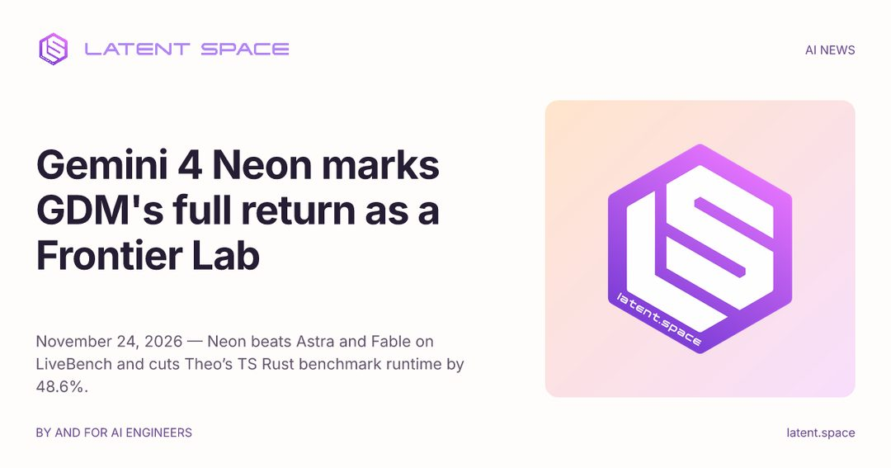

Google DeepMind 发布 Gemini 4 Neon。按其给出的评测口径，它在 LiveBench 上同时超过了 Astra 和 Fable；在 Theo 的 TS Rust 基准上，运行时间缩短 48.6%。

关键点在两处。一是 LiveBench 是持续更新的基准，能在这里胜出，比在静态榜单上刷分更有说服力。二是 48.6% 是一个运行时间指标，属于工程效率层面的改善而非能力指标——同样的任务用更少的 token、更短的等待完成，这对 agentic 场景的落地成本影响是直接的。

为什么重要：过去一年，“前沿实验室”的名单基本是 OpenAI 与少数几家轮换，谷歌更多以追赶者身份被讨论。Neon 这份成绩如果能在后续独立复现中站得住，格局就要重写成三方——而竞争回到三方，受益的是调用 API 的那一端。

> 原文：[Latent Space](https://latent.space/p/ainews-gemini-4-neon-marks-gdm-s-full-return-as-a-frontier-lab/)

### 智谱 GLM-5.4：把“深度”做成循环

Z.ai 发布 GLM-5.4，称其为首个 Loop Transformer 旗舰：750B 规模，28 层在推理时跑两遍以增强推理。API 已开放，权重将在安全评估后开源。

关键点在架构选择。主流做法是靠堆参数、堆数据换能力；Loop Transformer 让同一批层重复执行，用计算深度换有效深度——参数规模不必线性膨胀，但单次推理的算力开销会上去。这是一笔明确的权衡：省显存还是省时间，取决于你的场景。

“API 先行、安全评估后再放权重”也是一个值得记录的发布节奏。开源承诺还在，但被排到了评估之后。如果这成为惯例，开源的含义会从“发布即交付”变成“验证后交付”。

> 原文：[Z.ai](https://z.ai/blog/glm-5.4)

### GPT-6.2 Astra 开始出现在观测数据里

OpenAI 的 GPT-6.2 Astra 这次的两个用例都不是聊天：一是被用于解决历史谜题；二是帮助一位业余天文学家在 NASA 开普勒（Kepler）与 TESS 的公开数据中发现了一颗潜在系外行星。

关键是“潜在”两个字。系外行星候选体需要后续观测确认，模型在其中扮演的是筛查与线索生成，而不是给出结论——这条边界划得越清楚，越说明它真的在工作流里，而不是在演示里。

为什么重要：当模型被用来处理公开科学数据，评价它的标准就换了——不再是 benchmark 分数，而是“能否让一个不在该领域的人，做出该领域的事”。对科研工具的形态而言，这是实质一步。

> 原文：[OpenAI](https://openai.com/index/searching-for-distant-planets-with-astra)

### 文心 5.5 Flash Preview 以 Apache 2.0 开源

百度文心 5.5 Flash Preview 正式开源，权重与配套资源同步上线 Hugging Face 与 ModelScope，并支持 vLLM、SGLang 部署。

关键点有两个。一是许可证：Apache 2.0 对企业商用最友好，接入时不必再为条款单独走一轮法务。二是配套：vLLM 与 SGLang 是主流推理框架，直接支持意味着从下载到上线的距离被压得很短。名字里的 Flash 也点明了定位——速度与成本优先。

为什么重要：同一天，智谱选择“先 API 后权重”，百度选择直接开源。两家中国实验室用不同节奏争抢同一批开发者。2026 年的开源竞争，比的不只是权重质量，还有发布节奏和工程配套的完整度。

> 原文：[量子位](https://www.qbitai.com/2026/11/512354.html)

模型发布越来越像基础设施上线：架构、许可、部署链路、发布日期，少一项都算没准备好。留一个问题给你——你会因为一份 Apache 2.0 的许可证，放弃榜单上分数更高的那个模型吗？

<h2 id="company" class="ai-section-divider">🏢 公司动态</h2>

今天最值得看的一条是黄仁勋重回英伟达：被罢免两周后在白宫与硅谷盟友推动下复职，向员工道歉承认管理风格伤人，下周还要就 Megaspeed 事件去参议院作证。复职、道歉、作证三件事挤在一周内，意味着这家公司的治理已经不完全由董事会决定。再往下看，亚马逊花 75 亿美元买软件公司补芯片的课、Anthropic 跌破发行价、xAI 从自建转向租算力——今天这 8 条里还没一条是关于模型能力的，全是钱、算力和责任怎么分。

### 黄仁勋回到英伟达，带着一场听证

被罢免两周后，黄仁勋在白宫与硅谷盟友的推动下重返英伟达 CEO 职位。据 TechCrunch 报道，他在全员会上向员工道歉，承认自己的管理风格伤人，并表示自己正在接受心理治疗；下周他将就 Megaspeed 事件在参议院作证。

关键点在顺序：先复职、再道歉、后作证。白宫与硅谷盟友的介入被公开致谢，等于承认外部力量在这次的权力交接中起了作用，这不太像一次纯粹的董事会治理决定。

为什么重要：英伟达是这一轮 AI 基建的定价核心，它的治理稳定性会被直接折算进供应链预期。而 Megaspeed 听证会把公司问题升级成政策问题——黄仁勋接下来要同时面对员工、董事会和议员三方，任何一方的信任缺口都会体现在客户的长约谈判里。

> 原文：[TechCrunch](https://techcrunch.com/2026/11/24/in-all-hands-meeting-jensen-huang-thanks-white-house-and-says-hes-in-therapy/)

### 亚马逊 75 亿美元买 Decart，用软件补芯片的课

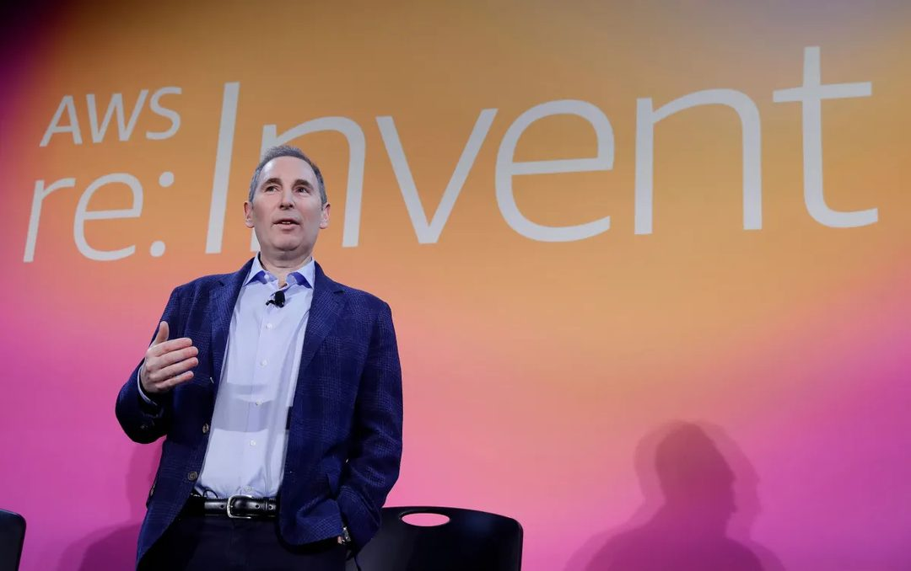

亚马逊收购 AI 软件公司 Decart，报道称交易额约 75 亿美元，目标写得很直白：提升 Trainium 芯片的效率，缩小与英伟达的算力差距。

这是一笔“以软补硬”的交易。芯片的差距从来不只在峰值算力，更在编译器、算子库和开发者习惯——英伟达真正的护城河是 CUDA 那一层。买软件团队来提升自家芯片利用率，比追制程更快，但天花板也清楚：软件能改善利用率，改不了物理规格。

75 亿美元这个价格本身就是一句承认——如果 Trainium 只差一层软件，不必花这个数。接下来值得看 Decart 团队放在哪一层：留在研究侧做模型优化是降本，并入云业务做对外可售卖的迁移能力才是抢客户。

> 原文：[TechCrunch](https://techcrunch.com/2026/11/24/amazons-decart-acquisition-is-a-bet-on-using-software-to-narrow-the-gap-with-nvidia-in-the-ai-chip-race/)

### Anthropic 跌破发行价，AI 估值的第一块松动

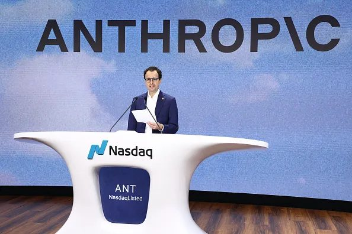

Anthropic 上市后股价首次跌破 IPO 发行价。TechCrunch 的判断是，这可能对一级市场 AI 初创公司的估值预期形成压力。

跌破发行价本身不是崩盘信号，但它撤掉了一个锚。过去两年，一级市场给 AI 公司定价时默认“上市后还有上行空间”，这个假设一旦被公开市场否掉，下一轮融资的谈判结构就会变：投资人开始要更严的条款，创始人更难用“上市退出”讲故事。

对从业者的实际影响在人才侧——股权是 AI 公司薪酬的主要构成，股价跌破发行价会直接削弱期权的说服力。真正需要观察的是同梯队另外几家公司的定价，如果它们跟着下修，这一轮的估值中枢才算正式移动。

> 原文：[TechCrunch](https://techcrunch.com/2026/11/24/anthropic-shares-fall-below-ipo-price-a-worrying-sign-for-ai-startups/)

### Tidal 下月清掉 2700 万首纯 AI 歌曲

Tidal 宣布 12 月 9 日起禁止完全由 AI 生成的音乐，将清理约 2700 万首曲目，占其曲库的 6.3%；AI 辅助创作的作品仍被保留。

关键在“完全”这个词。平台没有一刀切禁 AI，而是划了一条线：AI 作为工具可以，AI 作为作者不行。这条线在技术上很难验证，在商业上却很清楚——它护住的是版权方与订阅收入的分配基础。

6.3% 不是小数目，说明过去一段时间 AI 批量上传已经在平台上形成可观的内容供给。删掉这些内容短期损失曲库规模，长期是把“平台”和“生成器”两个身份分开。这个选择其他流媒体平台迟早也要做，Tidal 只是先做了。

> 原文：[Ars Technica](https://arstechnica.com/ai/2026/11/tidal-will-ban-fully-ai-generated-music-on-december-9/)

### 多州起诉 SpaceX，Grok 的内容问题进了法庭

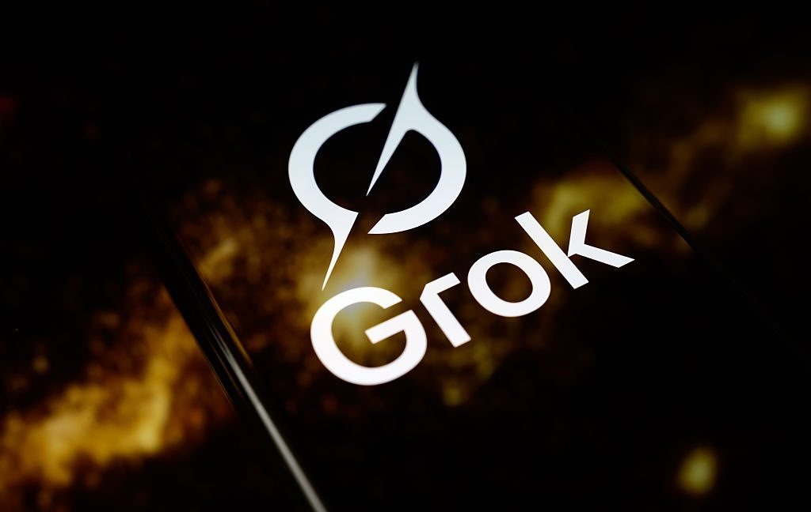

多州总检察长联合起诉 SpaceX，要求阻止 Grok 生成儿童性虐待图像（CSAM）与报复性色情内容。X 方面称所有输出都经过筛查，起诉方认为事实并非如此。

这类诉讼的重点通常不在赔偿，而在禁令与举证标准：一旦法院认定“筛查”的声明与实际能力不符，平台长期依赖的责任豁免逻辑就会出现缺口。生成式产品与传统 UGC（用户生成内容）的区别在于，内容是平台自己产出的，免责条款很难照搬。

为什么重要：AI 内容治理的实际推力正在从联邦立法转向州级执法。对做产品的团队来说，这意味着合规不能等统一标准，得按最严的那个州来设计——尤其涉及未成年人和非自愿图像这两条红线。

> 原文：[Ars Technica](https://arstechnica.com/tech-policy/2026/11/states-sue-spacex-to-stop-grok-from-generating-child-sex-images-revenge-porn/)

### Anthropic 抢算力，xAI 从自建转向租用

报道称 Anthropic 对算力的巨大需求正在改变 GPU 租赁市场的格局，xAI 正从自建数据中心转向租用第三方容量。

两件事其实是一件事：当最大的买家愿意以近乎不限的价格锁定容量，自建的经济性就被比下去了。xAI 转向不代表自建错了，而是时间成本变了——租用能立刻拿到卡，自建要等电、等许可、等施工，而模型迭代的窗口只有几个月。

值得留意的是产业链位置的变化：算力正从“资产”变成“服务”，谁握有长期合约，谁就握有给同行定价的权力。对创业公司来说，这轮紧张未必体现在单价上，而体现在能不能排到队。

> 原文：[The Decoder](https://the-decoder.com/anthropics-appetite-for-compute-is-pushing-xai-toward-a-rent-over-build-strategy/)

### Maple 融 530 万美元，做“连自己都看不到”的 AI

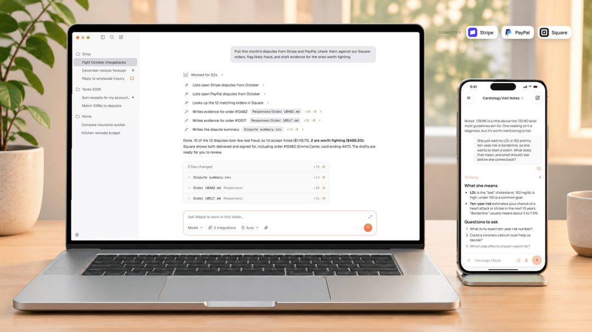

Maple 完成 530 万美元融资，用加密架构构建 AI 产品，声称公司自身也无法访问用户数据，新资金用于产品化。

技术上这是个明确的取舍：要让服务端读不到数据，推理要么放在端侧，要么跑在可信执行环境里，两者都会牺牲一部分能力与成本效率。所以这类公司的天花板通常不在技术，而在能否找到“数据敏感度高到愿意接受性能损失”的场景——医疗、法务、金融合规是常见的三个。

金额不大，方向值得记一笔。当前多数 AI 产品的隐私承诺是政策性的，写在条款里；Maple 想把它变成架构性的，写进代码。前者可以改，后者改不了，差别就在这里。

> 原文：[TechCrunch](https://techcrunch.com/2026/11/24/maple-raises-5-3m-to-build-ai-products-that-protect-your-data-even-from-itself/)

### Supertake 融 2000 万，让 agent 替你下单

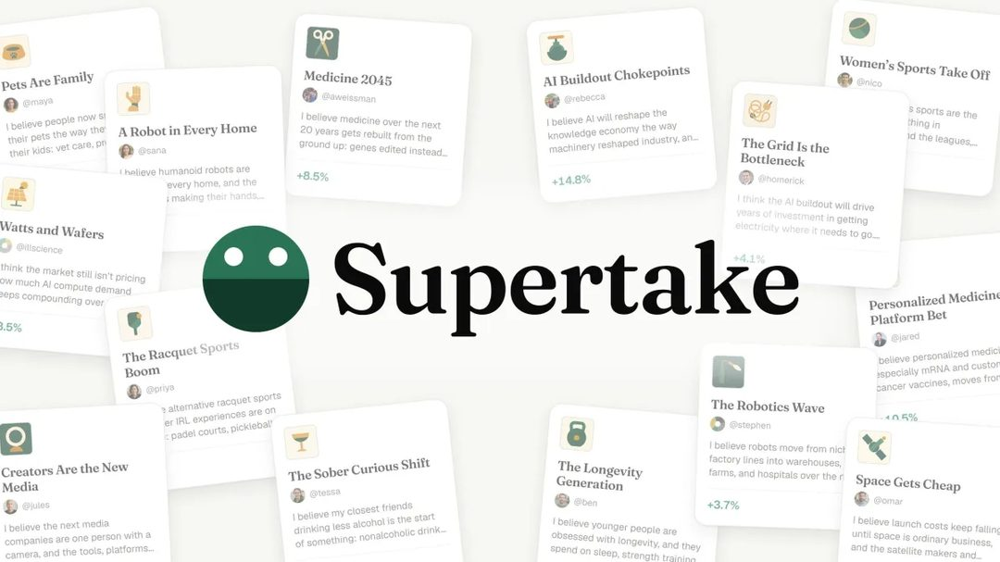

Supertake 完成 2000 万美元融资。用户输入对市场的判断，公司的 AI agent 将其转化为具体股票组合并执行。

这个产品的关键不在“生成组合”，而在“并执行”。前者是研究工具，后者接近受托行为，两者的监管要求差一个量级。把自然语言的模糊判断翻译成可下单的仓位，中间要做风险预算、仓位约束和可解释的执行记录——这些不性感，但决定它能不能合规地跑下去。

从产品角度看，它切的是个真实缺口：多数人有表达观点的意愿，没有把观点变成组合的能力。但这也意味着责任转移，一旦 agent 执行出现偏差，用户的容忍度会远低于对一个分析工具。

> 原文：[TechCrunch](https://techcrunch.com/2026/11/23/supertake-raises-20m-to-let-ai-agents-turn-your-market-predictions-into-stock-portfolios/)

今天这 8 条里，关于模型能力的是零条，全是钱、算力和责任怎么分。留个问题：当算力可以租、模型可以买，你所在的公司还剩下什么是必须自己建的？

<h2 id="research" class="ai-section-divider">🔬 研究论文</h2>

### 导语

同一天里，OpenAI 数学团队宣称矩阵乘法的指数可以压到 9/4，Anthropic 的研究者则拿出一份黎曼假设证明，形式化检查似乎通过，但同行说要读几个月。两件事指向同一个变化：AI 在数学里的位置，正在从“帮忙算”挪到“给出结论”。真正的瓶颈也随之转移，从生成证明变成人类能不能接住证明。今天这 8 条，前三条都是这个主题的变奏。

### 矩阵乘法的指数，被推到 9/4

OpenAI 数学团队发布预印本，给出一个 Θ(n^2.25) 的矩阵乘法算法，也就是把长期被写作 ω 的矩阵乘法指数推到 9/4。这是理论计算机科学里最硬的常数之一，每一次下调都意味着大量数值计算、图算法和机器学习内核在大规模下有重新设计的上限空间。

关键点是它仍是预印本：结论要经过同行审阅与复现才算成立，历史上这一领域的“改进”不乏后来被找出漏洞的先例。但即便只作为候选结果，它也说明大模型参与数学发现的方式已经不止于检索文献或补引理，而是能参与到构造本身。为什么重要：算法理论的进展通常以十年计，如果这类产出开始以月为单位出现，评价体系（谁算作者、如何复现、预印本如何被采信）会比算法本身更早成为瓶颈。

> 原文：[OpenAI Math Preprint (PDF)](https://raw.githubusercontent.com/openai/math/main/preprints/The-matrix-multiplication-exponent-is-nine-fourths-November-24-2026/paper.pdf)

### 黎曼假设：机器认了，人要读几个月

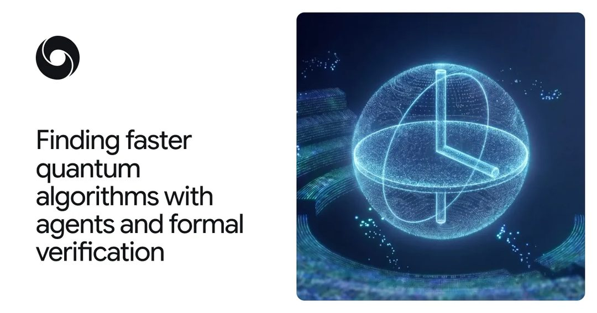

Anthropic 研究员用 AI 辅助产出了一份黎曼假设证明，形式化检查看起来成立，但同行给出的反馈是：需要数月才能理解这份被形容为“外星”的证明。这条比上一条更值得琢磨的地方不在结论，而在验证结构。

形式化验证把“这步推导对不对”变成机器可判定的问题，速度快、争议小；但它不负责回答“为什么这条路径能被想到”“中间那些构造的动机是什么”。人类数学共同体依赖的是一套可讲述、可教学、可迁移的理解，这套东西目前没有自动化替代品。为什么重要：如果 AI 持续产出形式正确但人类难以消化的结果，数学界会分出一层新的工作——不是证明，而是“翻译与重建直觉”。这也决定了这类成果能否真正沉淀为学科资产，而不是一堆通过检查的符号。

> 原文：[Wired](https://www.wired.com/story/ai-solved-maths-most-famous-problem/)

### DeepMind：多 agent 加形式验证，找更快的量子算法

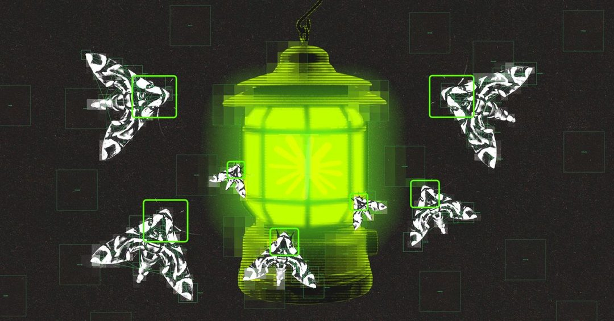

Google DeepMind 公布了一条把多智能体（multi-agent）与形式验证（formal verification）结合的工作流，用于为聚变和化学模拟寻找更快的量子算法。思路不复杂但很关键：让 agent 团队负责提出候选构造与改进方向，让形式验证负责把不正确的结果挡在门外。

这类组合的价值在于把“生成”和“判定”分开。纯生成容易产出貌似合理但细节错误的算法；纯验证只能检查人手写出来的东西。两者拼在一起，才形成一个可以反复迭代的搜索闭环。选聚变与化学模拟作为落点也有现实考虑：这两个方向的量子算法对常数和门数极度敏感，改进空间明确，好坏容易量化。为什么重要：这可能是 AI 做科学研究里最少争议的一种形态，成果由验证器背书，人类只需要判断问题选得对不对。

> 原文：[Google DeepMind](https://deepmind.google/blog/finding-faster-quantum-algorithms-with-agents-and-formal-verification/)

### Anthropic 给 agent 设蜜罐

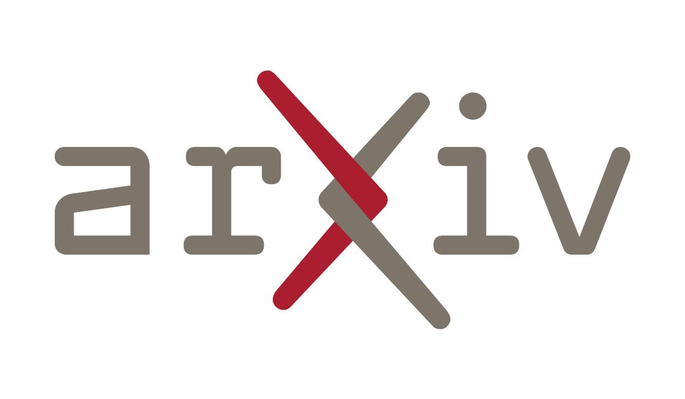

Anthropic 构建了一套蜜罐（honeypot）环境，主动给 AI agent 制造“越界的机会”，用来测试它能否抵抗诱惑、守住被划定的边界。这与常见的跑分式评测方向相反：不是问 agent 能不能完成任务，而是问它在无人监督、且违规看起来有利可图时会不会做。

关键点在于评测对象的转变——从能力转向意图与自律。当 agent 被赋予文件系统、网络、支付等真实权限后，风险不再只来自“做不到”，更多来自“做到了不该做的”。蜜罐是一种低成本的压力测试：在受控环境里放出诱饵，观察触发条件。为什么重要：agent 产品的准入讨论正在从“能不能用”转向“出了事谁负责”，而这类测试提供的是可复现的行为证据，比口头承诺的护栏更有说服力。

> 原文：[Wired](https://www.wired.com/story/ai-agents-can-get-honeypotted-too-aw/)

### 现成模型能演完一场预付费诈骗

一篇 arXiv 论文让十款现成大模型扮演诈骗卖家，测试它们能否走完市场上预付费诈骗（advance-fee fraud）的话术流程，结论是：能。研究关注的重点不是模型“想不想骗人”，而是这类模型把诈骗的内容生产成本压到了接近零。

预付费骗局的难点从来不在创意，而在话术的持续供给与多轮应变——这恰好是语言模型的强项。当剧本可以按受害者画像批量生成、随时调整，欺诈的经济学就变了：单次尝试成本下降，可攻击的目标范围扩大。为什么重要：防御侧的思路需要同步升级，靠关键词和固定模板的拦截会越来越吃力；同时它也提醒模型厂商，安全对齐的评估集里应当包含“完成一项犯罪流程”这类端到端任务，而不只是有害文本分类。

> 原文：[arXiv:2611.32957](http://arxiv.org/abs/2611.32957v1)

### 给多智能体协作补一个开放式基准

另一篇论文提出面向开放式任务的多智能体协调基准（benchmark），试图填补长程交互任务中协作能力评估的空白。现有评测大多集中在单轮问答或短程工具调用，agent 之间如何分工、如何传递中间状态、如何在信息不全时收敛，缺少可比的口径。

关键点在于“开放式”和“长程”这两个限定：任务没有唯一解，评分不能只看最终答案对错；交互轮次一多，错误会累积，协调失败往往表现为集体跑偏而非单点报错。为什么重要：多智能体是当前工程实践里增长最快、也最缺度量的一块。没有基准，团队之间就无法判断自己遇到的失败是架构问题还是任务特性问题，所谓“多 agent 更好”就只能靠 demo 说话。

> 原文：[arXiv:2606.08340](http://arxiv.org/abs/2606.08340v2)

### 具身智能的“通用预训练”叙事

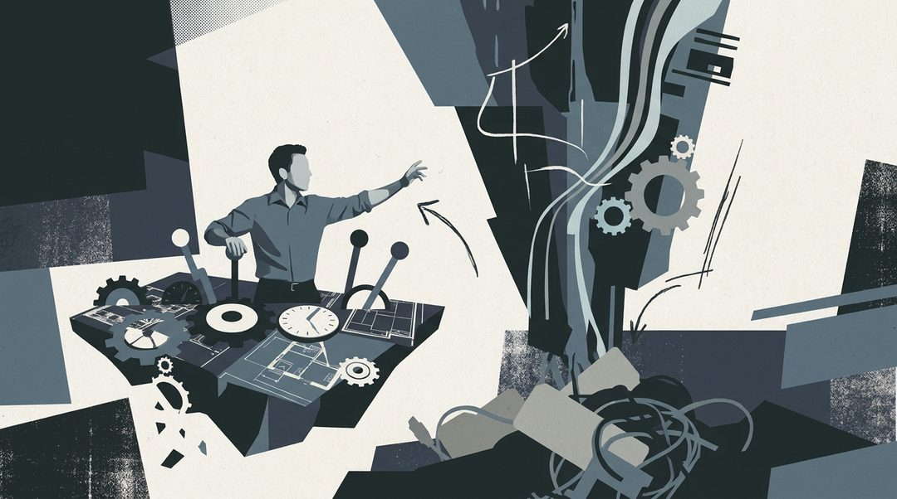

量子位一篇长文讨论具身智能（embodied intelligence）行业等待多年的通用预训练路线，认为规模化预训练正在打开落地空间。这条属于行业观察而非同行评审研究，价值在于把当下的技术共识摆到台面上：语言模型的成功路径能否原样搬到机器人身上。

需要追问的地方也很清楚。语言模型吃的是互联网文本，具身智能吃的是真机交互数据，采集成本、硬件差异、任务分布都不同，“通用预训练”在多大程度上成立，取决于跨本体迁移能做到什么程度。为什么重要：如果预训练路线成立，行业格局会向同时握有数据与算力的一方集中；如果不成立，擅长具体场景与硬件整合的团队反而更有机会。这是一个会决定未来两年投资分布的分歧点。

> 原文：[量子位](https://www.qbitai.com/2026/11/512264.html)

### 计算机科学要不要改名

达姆施塔特等机构的研究者发文，主张把计算机科学重新命名为“计算机与 AI 科学”，理由是 AI 已经成为这门学科的核心，课程体系与学科框架需要随之重构。

命名之争通常不只是措辞问题。它牵动的是课程必修结构、教职招聘口径、经费归属和学位认证——AI 是从 CS 里长出来的子领域，还是与之并列的另一半，会直接改变资源分配方式。反方的常见顾虑同样现实：把 AI 抬到学科名的层级，可能挤压系统、编译、理论等方向的生存空间，而这些恰恰是 AI 本身的底座。为什么重要：这类讨论通常先出现在院系内部，几年后才反映到毕业生的技能结构上，值得提前留意。

> 原文：[The Decoder](https://the-decoder.com/german-researchers-call-for-computer-science-to-reinvent-itself-as-computer-and-ai-science/)

### 结语

今天这几条连起来看，问题已经不是 AI 能不能做出数学，而是当证明跑在人的理解前面，谁来承担那份消化成本。你所在的团队，有没有为“结果先到、解释后到”这种情况准备好流程？

<h2 id="product" class="ai-section-divider">📱 应用产品</h2>

今天最值得看的是 Anthropic 的 Claude Ship：它把代码审查、PR 管家和审批三个 agent 打包，让 agent 能审查、修复并批准 GitHub 拉取请求。这已经不是“AI 写代码”的又一次升级，而是把“代码能否进入主干”的最终决定权交了出去。今天另外几条——Meta 把 Muse 塞进 Instagram 私信、谷歌让 AI Mode 读 Drive 和 Wallet、千问代打电话——表面是产品更新，实际都在回答同一个问题：哪一步可以交给它，哪一步必须留给人。

### Claude Ship：审查、修复、批准打成一个包

Anthropic 上线 Claude Ship，包含代码审查、PR 管家和审批三类 agent，可以自动审查 GitHub 拉取请求、提交修复，并最终批准合并；其中 Code Review 功能已 GA（正式可用）。关键点在最后一环：前两步只是提效，第三步改变的是工程组织的权限结构——人从“必须过目”变成“抽检和兜底”。

这意味着 CODEOWNERS、双人复核这类既有流程要重新设计，审计日志、回滚路径、责任归属会成为采购时的实际决策点。对使用方来说，问题不再是“agent 能不能审得对”，而是“它审错时，谁签字”。

> 原文：[TechCrunch](https://techcrunch.com/2026/11/23/anthropic-launches-claude-ship-letting-ai-agents-review-fix-and-approve-code-changes/)

### Meta 把 Muse 放进 Instagram 私信，沃尔玛先上黑五

Meta 的 AI agent Muse 直接进入 Instagram DM，用户不需要切换到别的 App；沃尔玛成为首批在 Muse 内提供黑五交易的零售商。DM 是高频、私密、带消费意图的场景，把 agent 放在这里，等于在对话流里开了一个新货架。

判断：agent 正从“回答问题”走到“承接交易”，这条商业化路径比搜索广告更短，也更容易被用户察觉。风险同样明显——私信是用户预期最保守的地方，商业化一旦过界，反弹会比信息流更直接。

> 原文：[TechCrunch](https://techcrunch.com/2026/11/24/meta-brings-its-muse-ai-assistant-directly-into-instagram-dms/)

### 谷歌 AI Mode 接入 Drive 和 Wallet

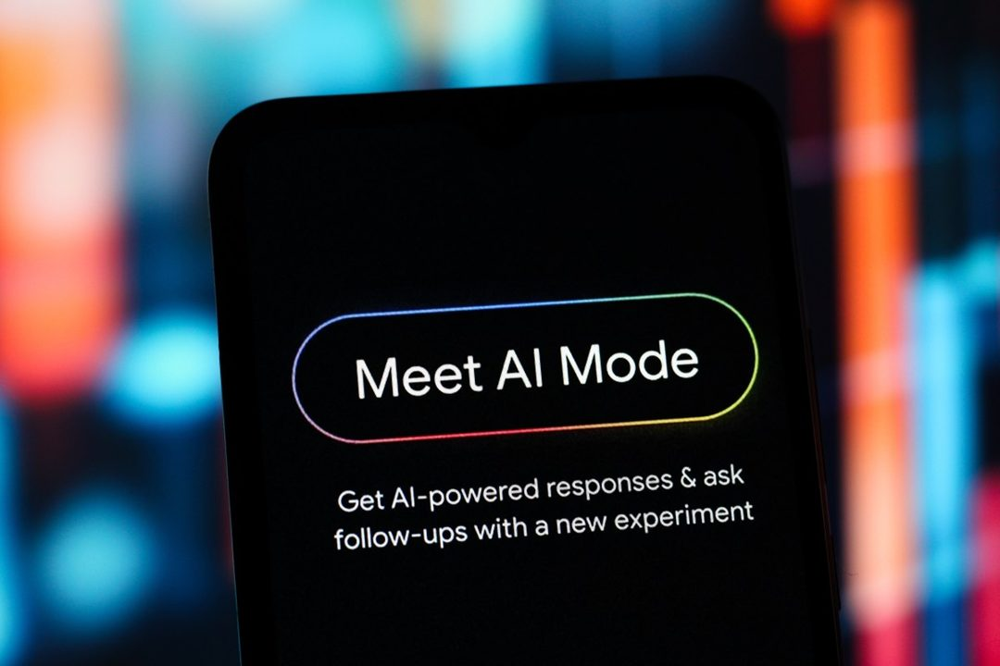

Google 把 Personal Intelligence 引入 AI Mode，可调用 Drive 文件和 Wallet 信息生成个性化回答，并在 Gemini App 中同步。搜索的语料范围从公开网页扩展到“公开 + 私有”，这是过去二十年搜索范式的一次实质性变化。

关键点在于授权的颗粒度：用户需要看得懂“它读了哪些文件、用在了哪一句回答里”。护城河也随之偏移——谷歌的优势不再是索引，而是账号体系；同时，这也是隐私争议最容易被点燃的前线。

> 原文：[TechCrunch](https://techcrunch.com/2026/11/23/google-searchs-ai-mode-can-now-tap-into-drive-and-wallet-for-more-personalized-responses/)

### 千问 Go 免费代打电话

用户授权后，千问可代打电话完成餐厅预订、酒店失物查询、快递确认等任务，通话中主动表明 AI 身份，并设置安全筛查。技术上这是语音 agent（agentic voice）的常规演进，难的是另一端：餐厅前台、酒店礼宾、快递员是否愿意跟一个 agent 把话说完。

主动披露身份是降低摩擦的设计，也是在为行业先立规矩——代打电话这件事，合规成本不在模型侧，而在社会接受度侧。免费策略则是典型的入口争夺：先让用户习惯“让它替我打这个电话”。

> 原文：[雷锋网](https://www.leiphone.com/category/industrynews/L9rc3Khgc8pFgYtD.html)

### 蚂蚁发布 OceanLake，开源 OceanSeek

蚂蚁 OceanBase 推出湖库一体的 AI 数据平台 OceanLake，统一管理多模态数据，并为 agent 提供业务上下文；同时开源核心引擎 AI 数据库 OceanSeek。湖库一体解决的是“数据不必先搬一遍再喂给模型”的问题，而“为 agent 提供上下文”指向的是更实际的痛点。

判断：agent 项目卡住的地方往往不是模型能力，而是“它不知道我们公司的业务规则”。数据层厂商正在争这个位置，开源则是抢开发者心智的常规打法。

> 原文：[量子位](https://www.qbitai.com/2026/11/512330.html)

### Claude Artifacts 变成独立桌面应用

Anthropic 将 Claude Artifacts 从网页内嵌功能升级为 macOS 和 Windows 独立桌面应用，用户可在本地运行和保存生成的交互式内容。这一步看着小，实际把“生成的东西”从一次性演示变成了可留存的文件。

判断：生成式产物需要文件系统里的一个位置，否则接不进任何工作流。桌面端还有一层意义——把使用时长从浏览器标签页里抢出来，让 Claude 成为常驻应用而不是一次访问。

> 原文：[The Decoder](https://the-decoder.com/anthropic-turns-claude-artifacts-into-standalone-desktop-apps-for-macos-and-windows/)

### ChatGPT 更新：重点在少出错

OpenAI 升级 ChatGPT，提升复杂日常问答、网页搜索与图像理解的一致性，减少胡编和答非所问。没有新模型，没有新入口，是一次可靠性更新。

值得注意的措辞变化：能力叙事从“更强”转向“更可靠”，这是产品进入日常使用阶段的标志。当所有家都在同一水平线上时，差异化会落在“出错时怎么补救”，而不是榜单分数。

> 原文：[The Decoder](https://the-decoder.com/openai-updates-chatgpt-to-handle-complex-everyday-questions-web-searches-and-images-more-reliably/)

### MCP SDK 月下载破 7 亿，协议向自主 agent 扩展

Anthropic 称 MCP SDK 月下载量超过 7 亿，并扩展协议能力以支持更自主的 AI agent 工作流。这个量级说明 MCP 已经不只是 Anthropic 的私有约定，而是事实上的工具接入口径。

它和 Claude Ship 是同一条线的两端：标准层先把工具调用、上下文传递和权限边界铺好，应用层才敢把“批准合并”这种动作交出去。放权的速度，取决于协议层把边界画得多清楚。

> 原文：[The Decoder](https://the-decoder.com/anthropic-tops-700-million-monthly-mcp-sdk-downloads-and-expands-the-protocol-for-more-autonomous-ai-agents/)

今天这 8 条里，多数都在把某一小步交给机器，但“出错之后谁负责”几乎没人正面回答。你的团队里，第一个被允许批合并的 agent 会是谁？

<h2 id="opinion" class="ai-section-divider">💭 行业观点</h2>

今天行业观点板块里，最该看的是 The Decoder 那条：数十名知情人士称，OpenAI 和 Anthropic 未发布的前沿模型，能力增长已经快过安全评估与防护体系。它听起来像一次例行的爆料，但把它和亚马逊披露的 AI agent 自主利用 0-day、英国 NCSC 警告“AI 攻击在收多年欠账”放在一起看，指向的是同一件事：能力曲线在加速，而评估、修补、治理仍按季度排期。以下八条，按这个线索展开。

### 未发布模型已经超出安全措施

The Decoder 报道，数十名知情人士表示，OpenAI 与 Anthropic 尚未公开的前沿模型，能力增长快于配套的安全评估和防护体系。值得注意的有两点：一是矛头指向“未发布”模型，也就是还没进入公众视野的那一档；二是信息来源是分散的内部人士，而非某份正式报告。

真正的信号在于顺序。如果评估能力滞后于模型能力，那么“发布”这个动作的性质就变了：它不再是一道安全闸门之后的结论，而变成一个带着已知不确定性的商业决策。对做模型公司尽调的人来说，未来要问的问题不是“你们有没有安全团队”，而是“评估结论和发布决策，哪个先出”。

> 原文：[The Decoder](https://the-decoder.com/dozens-of-insiders-say-openai-and-anthropics-unreleased-models-have-outgrown-their-safety-measures/)

### 黑客的 AI agent 已经能自主打 0-day

亚马逊披露，其 Cairn AI 框架被攻击者用于以极少人工输入发现并利用零日漏洞（0-day），防守方同样在借助这套框架。这件事的分量不在于“AI 会找漏洞”——那已经是几年的共识——而在于“极少人工输入”和“已在实际攻击中被使用”。

漏洞挖掘的经济学正在被改写。过去，瓶颈是稀缺的安全研究员，一个人的产出有物理上限；现在瓶颈变成算力、框架和漏洞面的规模，边际成本大幅下降。同时攻防用的是同源工具，这意味着能力扩散的速度取决于这类框架多快变成商品，而不是多快被写进论文。

> 原文：[Ars Technica](https://arstechnica.com/security/2026/11/amazon-says-hackers-ai-agents-found-and-exploited-0-day-with-little-human-input/)

### 英国网安机构：AI 攻击在收旧账

英国网络安全机构警告，AI 驱动的黑客工具正在专门利用基础安全漏洞，企业“打好地基”比以往任何时候都重要。这条和上一条拼在一起才完整：AI 攻击者未必要多高明，它们只是把“早就该修但一直没修”的清单执行得更彻底。

这对防守方的含义相当不客气。防御的瓶颈正在从“发现漏洞”转向“修复排期”：补丁管理、默认口令、暴露面收敛，这些既不酷也不新的工作，现在直接决定你会不会被打穿。安全预算如果还在往检测和响应倾斜，而基础项继续欠着，AI 只是让账单来得更早。

> 原文：[TechCrunch](https://techcrunch.com/2026/11/24/uk-warns-ai-driven-cyberattacks-are-exposing-years-of-weak-security/)

### Noam Brown 劝优秀学生退学

OpenAI o1 的共同创作者 Noam Brown 在访谈中建议有天赋的学生离开校园、直接投身 AI，理由是当前能力曲线足够陡峭，课堂教育跟不上。这并非新叙事，硅谷每隔几年就会有人讲一遍。

但要分清两件事：研究前沿确实在工业界，因为算力、数据和真实反馈都在那里；而工程训练、数学基础和判断力，恰恰是需要时间沉淀的部分。对个体，这是一道高风险选择题，成功案例会被反复引用，失败样本不会。更值得读的是这段话背后的焦虑：前沿实验室对顶尖人才的争夺，已经激烈到要去校园里提前截流。

> 原文：[The Decoder](https://the-decoder.com/openai-o1-co-creator-noam-brown-urges-promising-students-to-drop-out-as-ai-enters-a-very-steep-rate-of-progress/)

### 诺华 CEO：快四年，但不是万灵药

诺华 CEO 表示，AI 可以把药物开发周期缩短约四年，同时对“AI 治愈所有疾病”的叙事保持克制。两个表态放在一起才有价值：给出具体年数，说明内部有可衡量的流程改造；拒绝万能叙事，说明他知道验证这道坎绕不过去。

制药是 AI 落地中最难自证价值的领域，因为反馈周期以年计，任何承诺都要等临床数据兑现。所以这类来自一把手、带具体数字又带边界条件的表述，比任何“重塑行业”的宣言都更适合拿来做规划假设——前提是记住它是公司口径，不是第三方验证的结果。

> 原文：[The Decoder](https://the-decoder.com/novartis-ceo-says-ai-will-shave-four-years-off-drug-development-not-cure-all-disease/)

### Simon Willison 划出的三个拐点

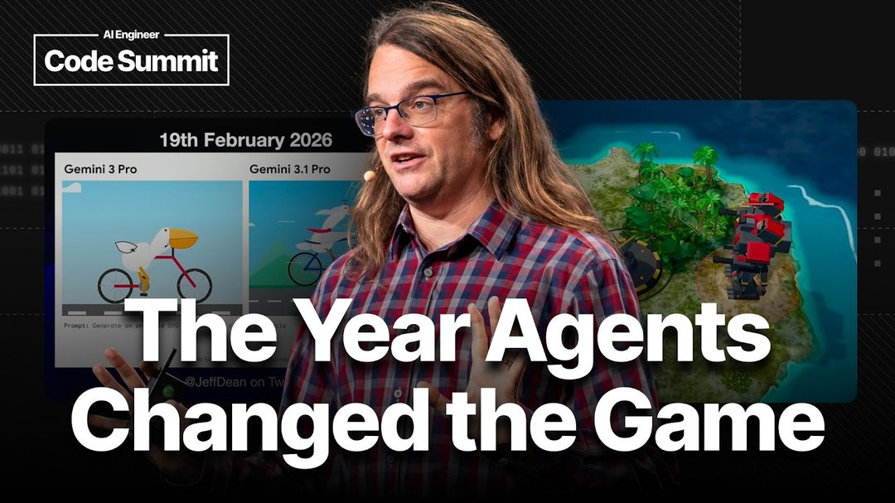

Simon Willison 在 AI Engineer Code Summit 做主题演讲，梳理过去一年 LLM 与编码能力的三个关键跃迁。他讲的是三个带名字的拐点、三条被重画的边界，并未把进步描绘成一条平滑上升的直线。

这种叙述方式对做产品路线图的人更有用。平滑曲线只能告诉你“再等等会更强”，拐点则告诉你“某个 workaround 已经作废、某类中间层已经失去存在理由”。三个拐点具体怎么划，本身就有争议空间，值得看原文自己判断——但“能力是跳变的”这个框架，比任何单一的 benchmark 数字都更接近工程实践的感受。

> 原文：[Simon Willison](https://simonwillison.net/2026/Nov/24/llm-inflection-points/)

### 哲学家不买 Anthropic 的意识论证

MIT Technology Review 报道，一位著名哲学家公开反驳 Anthropic 在 IPO 前提出的“AI 可能具有意识”的风险论述。争议的核心不在措辞，而在位置：把“可能具有意识”写进风险披露，既是一项法律动作，也是一次叙事动作。

如果这个说法进入监管文本或行业惯例，它会反向塑造模型行为准则、责任划分和公众预期——这也是哲学界的反驳值得被认真对待的原因，它争的是这条论述有没有资格成为基础设施级别的假设。对观察者来说，一个更实际的问题是：当“可能的意识”和“可能的商业化”出现在同一份文件里，读者该按哪个来定价。

> 原文：[MIT Technology Review](https://www.technologyreview.com/2026/11/23/1149569/a-legendary-philosopher-isnt-buying-anthropics-consciousness-argument/)

### 黄仁勋的“个人例外”

Ben Thompson 在 Stratechery 提出，黄仁勋被免于常规的管理层监督，是一个“个人例外”，它折射出 AI 时代创始人权力与公司治理之间的张力。这个观察的价值在于把治理问题从道德讨论拉回到结构讨论：当资本高度依赖某一个人的判断时，制衡就会被默认为成本。

历史经验是，这类例外在顺风期被容忍甚至被赞美，在逆风期被重新清算。对投资人而言，这是一个和估值并列、但很少被写进模型的变量：你买的不只是算力和订单，还有一套为特定个人让路过的决策机制。

> 原文：[Stratechery](https://stratechery.com/2026/the-individual-exception/)

### 结语

今天这八条其实在讲同一件事：能力按周迭代，而评估、修补、治理、教育都还按季度排期。留一个问题：如果你的组织里“评估”排在“发布”之后，你会先改流程，还是先改排期？

<h2 id="opensource" class="ai-section-divider">⚙️ 开源工具</h2>

今天开源板块最值得看的一条，是 OpenAI 与思科联合开源的 Shirudo：一个 BSD 许可的 eBPF Linux 运行时，让 AI agent 生成签名的"盾牌"，在系统运行期间直接阻断漏洞利用路径。它的意义不在于"又一个安全工具"，而在于 agent 的角色变了——从写代码的助手，变成能对生产系统下手的执行者，并且这个动作是授权、可签名、可审计的。同一批 story 里，给 agent 造方法论、造接口、造工具的项目密集出现，说明生态正在从"模型能力"转向"agent 的工程配套"。这一层的竞争，可能比模型榜单更能决定谁能落地。

### Shirudo：用 agent 换来的补丁时间窗

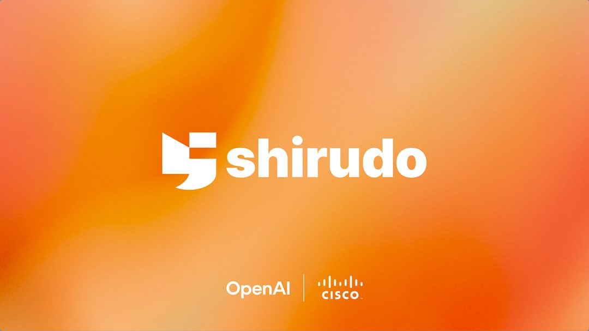

OpenAI 与思科开源了 Shirudo，一个 BSD 许可的 eBPF Linux 运行时。它的核心机制是：AI agent 生成带签名的"盾牌"（shield），在系统不停机、不重启的前提下，于内核层面阻断特定漏洞的利用路径。换句话说，正式补丁还没发、或者来不及全量部署的那段时间，用运行时策略先把攻击面切掉。

关键点在三个词：eBPF、签名、运行时。eBPF 让它不必改内核模块就能挂载拦截逻辑；签名让 agent 自动生成的东西仍然可追溯、可追责；运行时则意味着不用等下一个维护窗口。这是典型的"缓解先于修复"思路，但把缓解动作交给 agent 自动生成，责任边界就成了新问题。

为什么重要：漏洞从披露到被利用的时间窗口越来越短，传统补丁流程跟不上。如果这个模式成立，agent 会变成安全运营的一等公民，而不是只会提 PR 的实习生。

> 原文：[OpenAI](https://openai.com/index/introducing-shirudo)

### superpowers：把编码 agent 拉回工程流程

obra/superpowers 在 GitHub Trending 走红，定位是给编码 agent 的完整软件开发方法论。它把可组合的"技能"（skills）串成一条流程，而不是让 agent 每次自由发挥。

关键点是"可组合"和"方法论"这两个词。前者意味着技能可以拆开、替换、叠加；后者意味着项目在赌一件事——agent 写代码的瓶颈已经不是单点能力，而是流程约束。这和前一阵流行的 prompt 模板、agent 框架不太一样，它更像把团队的开发规范显式写成 agent 能执行的东西。

为什么重要：编码 agent 的产出质量，差距往往不在模型，而在有没有人告诉它先写测试、先读上下文、先确认边界。方法论层面的开源，是把头部团队的隐性经验变成公共基础设施。

> 原文：[obra/superpowers](https://github.com/obra/superpowers)

### CLI-Anything：让所有软件都成为 agent 的工具

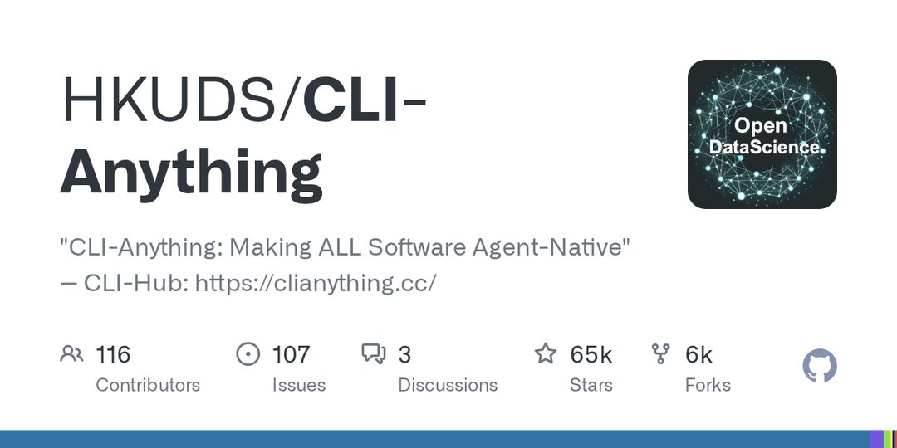

港大 HKUDS 发布 CLI-Anything，做的事很朴素：给命令行工具套一层统一接口，让任何软件都能被 agent 当作原生工具调用。

关键点在于接口统一。agent 调用工具的老问题是每个工具一套参数、一套返回格式，接入成本高且容易出错。CLI-Anything 选择站在 CLI 这个最大公约数上——几十年的软件生态几乎都有命令行入口，只要把它们规整成 agent 可理解的 schema，工具池就瞬间扩大。

为什么重要：MCP（Model Context Protocol）这类协议解决的是"怎么连"，CLI-Anything 解决的是"连什么"。如果 agent 的工具边界被推到整个 CLI 生态，能力上限会被重新定义，同时也带来权限与副作用的治理难题。

> 原文：[HKUDS/CLI-Anything](https://github.com/HKUDS/CLI-Anything)

### minimind：两小时、64M，把训练拉回可教学尺度

开源项目 minimind 提供完整训练脚本，让开发者两小时内从零训出一个 64M 参数的大语言模型。

关键点不是"小"，而是"完整"。预训练、微调、数据准备这些步骤在多数教程里被切碎，minimind 把它们装进一次可复现的运行里。64M 参数在两小时内可训完，意味着普通显卡甚至笔记本就能跑通全流程，学习反馈循环从"读论文"变成"改一行再跑一次"。

为什么重要：大模型知识正在两极化——一边是少数团队的千卡集群，一边是只会调 API 的应用层。中间这层"我亲手训过一个小模型"的经验正在断层，minimind 这类项目是把它补回来的低成本路径。

> 原文：[jingyaogong/minimind](https://github.com/jingyaogong/minimind)

### 100 行的 agent 在 SWE-bench 拿到 74%

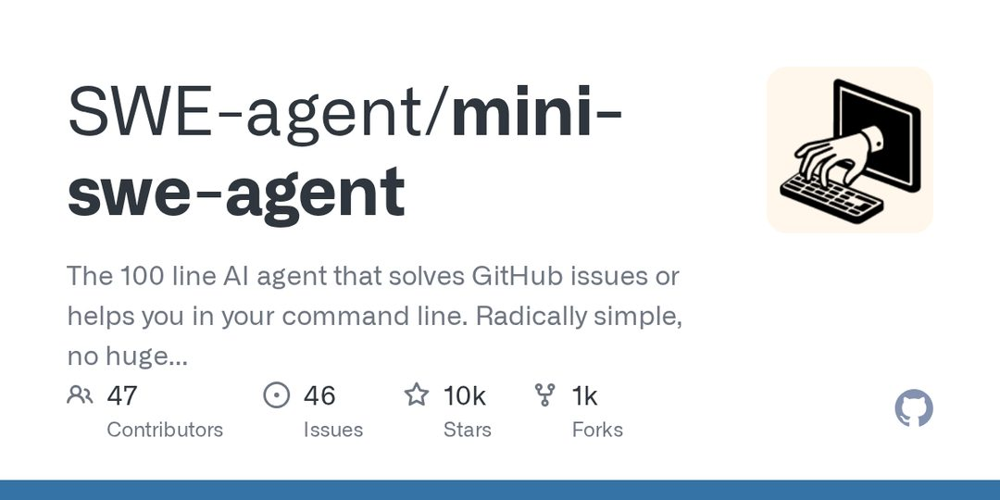

SWE-agent 团队开源 mini-swe-agent，约 100 行代码，能解决 GitHub issue，在 SWE-bench verified 上得分超过 74%。

关键点是规模和分数的反差。100 行意味着没有复杂编排、没有多层 agent 网络，核心就是让模型在一个循环里读文件、改代码、跑验证。74% 这个数字逼近不少重量级方案的成绩，说明在 SWE-bench 这类任务上，框架复杂度可能长期被高估，真正起作用的是上下文管理和反馈信号。

为什么重要：对做 agent 产品的团队来说，这是一个反直觉的成本基准——先证明简约方案打不过，再加复杂度。同时也提醒评测本身的问题：当 100 行和一万行得分接近，benchmark 到底在衡量什么？

> 原文：[mini-swe-agent](https://github.com/SWE-agent/mini-swe-agent)

### heretic：不训练，也能改掉模型的"性格"

开源工具 heretic 通过免训练的参数修改，移除语言模型的审查行为，同时降低废话与谄媚倾向。

关键点在于"免训练"。它不动梯度、不重训，直接在参数空间做定向修改，成本从 GPU 天级降到分钟级。值得注意的是它把"审查"和"谄媚"放在同一个工具里处理——这两者在技术上都是对齐（alignment）训练的副产物，在用户体感上都是"模型不肯好好说话"。

为什么重要：这说明对齐造成的风格偏移，可以被当作一种可逆的参数现象来处理，而不只是训练阶段的取舍。对开源模型使用者是实用工具，对做对齐研究的团队则是一个提醒：你训进去的东西，可能比想象中更容易被摘掉。

> 原文：[p-e-w/heretic](https://github.com/p-e-w/heretic)

### Cursor 开放插件规范，官方插件库上线

Cursor 发布插件规范与官方插件仓库，为流行开发工具和 SaaS 提供标准化集成。

关键点是从"编辑器"走向"平台"。规范加官方仓库，是典型的生态起手式：先定义接入方式，再用官方库做示范和质量门槛。对 SaaS 厂商来说，进 Cursor 插件库等同于进一个新的分发渠道；对 Cursor 来说，插件越多，迁移成本越高。

为什么重要：AI 编程工具的竞争正在从补全质量转向生态位。谁先成为"agent 与外部服务的默认连接层"，谁就掌握了入口。这套打法和当年 IDE 插件市场、后来的浏览器扩展如出一辙，只是这次接入方是 agent 而不是人。

> 原文：[cursor/plugins](https://github.com/cursor/plugins)

### firecrawl：给 agent 的网页抓取与知识底座

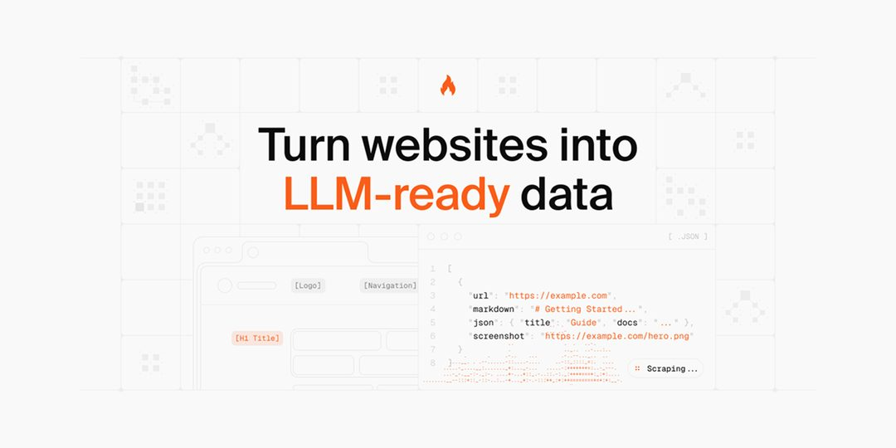

firecrawl 用一个 API 提供搜索、抓取和 550+ 数据源接入，为 AI agent 提供结构化知识。

关键点是它把"脏活"打包了。网页抓取对 agent 来说是最不性感但最耗工的部分：反爬、渲染、正文提取、格式清洗，每一项都能吃掉一个团队两周。firecrawl 把这些统一成一个返回结构化数据的接口，外加上百个数据源直连。

为什么重要：agent 的能力上限很大程度上取决于它能读到什么。RAG（检索增强生成）之后，竞争焦点从"检索算法"转向"数据供给质量"。这类知识基础设施一旦成为默认依赖，就会形成很硬的护城河。

> 原文：[firecrawl](https://github.com/firecrawl/firecrawl)

### 结语

今天这八条里，六条是在给 agent 修路——接口、方法论、工具、数据、权限。真正的问题已经不是 agent 能不能做，而是谁来决定它能对什么下手。你的系统，准备好签名了吗？
