今天最值得看的三件事：

- **模型发布** · Gemini 4 Neon 发布：谷歌重回前沿实验室牌桌
- **公司动态** · 黄仁勋回归震动英伟达：评级承压、治理受质疑
- **研究论文** · OpenAI 新证明：矩阵乘法指数降到 n^2.25

下文按板块展开，正文每条均附原始链接。

<h2 id="model-release" class="ai-section-divider">🚀 模型发布</h2>

今天模型发布板块最值得看的一条是 Gemini 4 Neon：谷歌在 LiveBench 上重新超过了 Astra 和 Fable。但比分数更值得记的是配套的一句说明——DeepMind 让 AI agent 接管了部分 Gemini 实验算力。榜单领先可以下一次被追回，把研发流程的一部分交给 agent 跑，影响的是迭代周期本身。同一天里，智谱拿架构换路线、PrismML 拿精度换体积，都在动“模型之外”的东西。

### Gemini 4 Neon：谷歌把牌桌搬回来了

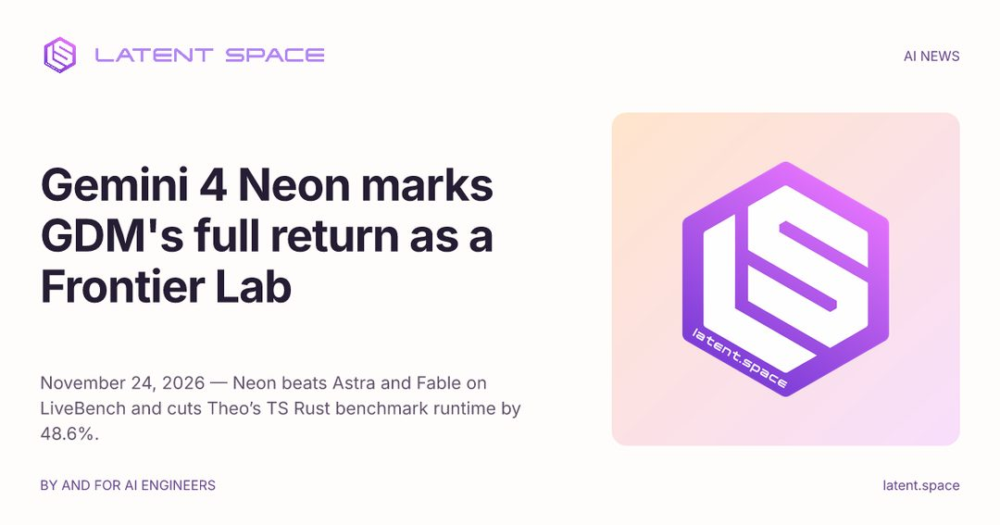

谷歌发布 Gemini 4 Neon，在 LiveBench 上超过 Astra 与 Fable，并把 Theo 的 TypeScript/Rust 基准运行时间缩短 48.6%。

关键点有两层。表面是分数与效率：48.6% 的运行时间压缩，对把模型嵌进 CI 或 IDE 的团队是可感知的差异。更深一层是流程——DeepMind 让 AI agent 接管部分 Gemini 实验算力，同时官方明确表态递归自我改进（recursive self-improvement）仍然很遥远。

为什么重要：LiveBench 的领先和 48.6% 都不是护城河，下一次发布就可能被抹平。真正难复制的是“agent 参与实验调度”这件事开始常态化，它改变的是迭代速度而非单版能力。官方那句“还很遥远”值得一并记住：既是对能力边界的克制描述，也是在为“agent 接管研发”设定预期。前沿实验室重新回到三家以上竞争，对下游是好事。

> 原文：[latent.space](https://latent.space/p/ainews-gemini-4-neon-marks-gdm-s-full-return-as-a-frontier-lab/)

### GLM-5.4：能力涨了，延迟也涨了

智谱发布 GLM-5.4，编程与 3D 生成能力显著提升，代价是推理耗时变长。公司同时押注 Loop 架构与继续 Scaling 两条路线，港股当日涨超 15%。

关键点在于“双路线”这个表述。在普遍继续堆参数的环境里，提出一个架构层面的新变量，是这次发布里信息量最大的部分；Loop 架构能否成立，要看它在多轮、长输出的真实任务里能否把单位成本压下来。

为什么重要：编程与 3D 恰好是长输出、多轮调用的场景，推理变慢会被工作流放大成实打实的成本。所以那 15% 更像是在给“国产基座还在出架构新词”定价，而非给一份延迟数据定价。榜单名次决定曝光，性价比决定下半场。

> 原文：[InfoQ](https://www.infoq.cn/article/gXU31yBa9HMEe19PxHVB?utm_source=rss&utm_medium=article)

### PrismML：把 27B 编码 agent 塞进 5.9GB

这家初创把一个 54GB 的 270 亿参数编码 agent 模型压到 5.9GB，体积约降到九分之一。做法很直接：把每个权重限制为三种可能取值，瞄准端侧与低成本部署。

关键点是取舍的位置。它换掉的不是层数或上下文，而是权重本身的表达精度——这已经接近三值量化的极限一侧。压缩比好看，但精度损失必须由训练侧补偿回来，否则模型会在长链条的 agentic coding 任务上先崩。

为什么重要：如果这条路走通，本地跑一个可用的编码 agent 的门槛会明显下降，部署成本与数据出域的问题一起被绕开。检验标准不是体积，是真实任务通过率——目前公开信息还停在体积这一侧。

> 原文：[The Decoder](https://the-decoder.com/prismml-squeezes-an-agent-based-coding-model-with-27-billion-parameters-into-5-9-gb/)

### GPT-6.2 Astra 做历史考据：流程比结论更值钱

Simon Willison 推荐了一篇案例研究，展示如何用 GPT-6.2 Astra 做历史考据：它给出了什么线索，以及哪些环节仍然必须由人来判断。

关键点在于文章的重心不在“AI 破了悬案”，而在流程本身——模型擅长生成可验证的候选假设、把散落的材料串成线索；判断哪条线索站得住、哪份材料可信，仍然落在人身上。

为什么重要：对做知识工作类产品的人来说，这比一张 benchmark 表更有用。它提示了一个产品设计上的硬约束：把“可验证”前置，让模型输出的是待核对的线索而不是结论，人的角色就从提问者变成审稿人。这个位置的变化，比模型又多了几分更能在工作流里落地。

> 原文：[Simon Willison's Weblog](https://simonwillison.net/2026/Nov/24/astra-historical-mystery/)

### Yandex 开源 80B-A3B 基座：稀疏比 1:26

Yandex 以 Apache 2.0 许可放出 AliceAI-Foundation-80B-A3B-Base，模型从零训练，总参数 800 亿、每 token 约激活 30 亿。

关键点在稀疏比：约 1:26 的激活比例意味着推理成本更接近一个 3B 级别的模型，而容量留在 80B 一侧。加上 Apache 2.0 这种对商用最友好的许可，工程团队可以直接把它当底座改。

为什么重要：基座模型的供给继续分散，闭源前沿与开源底座之间的差距被切成了不同档位。对做多语言、非英语市场的团队，这是一份实际增量——它不一定最强，但可改、可商用、推理便宜，这三件事凑齐的选项并不多。

> 原文：[arXiv](http://arxiv.org/abs/2611.34529v1)

### 结语

今天这五条里，有三条动的是模型之外的东西：算力怎么用、架构怎么绕、权重怎么省。真正的分水岭可能不在下一次榜单更新，而在谁的迭代周期先被 agent 缩短——你觉得会是谁？

<h2 id="company" class="ai-section-divider">🏢 公司动态</h2>

今天公司动态里最值得看的不是又一轮融资，而是标普考虑把英伟达评级下调至 AA-，理由写得很直白：治理与“关键人”风险。同一时间，黄仁勋在回归后的首次全员会上道歉，承认管理风格伤害员工。把这两件事放在一起看，市场正在给“创始人依赖”标价——过去它是溢价来源，现在开始被计成折价项。AI 公司的估值叙事，正从算力稀缺转向组织可持续性。

### 标普考虑下调英伟达评级，黄仁勋道歉

标普正在评估将英伟达信用评级下调至 AA-，核心依据不是订单或毛利，而是治理结构与“关键人”风险（key-man risk）。同期，黄仁勋在回归后的首次全员会上道歉，承认自己的管理风格伤害了员工，并感谢白宫方面的支持。围绕 Megaspeed 的芯片流向调查仍未了结。

值得注意的是，评级机构把“谁在决策”当成了财务变量。对一家现金流充沛的公司来说，这等于说：治理不确定性本身就是成本。黄仁勋的道歉是对内修复，但评级看的是制度，不是态度。

> 原文：[TechCrunch](https://techcrunch.com/2026/11/25/sp-considers-nvidia-credit-downgrade-over-governance-and-key-man-risks/)

### Anthropic 股价跌破发行价

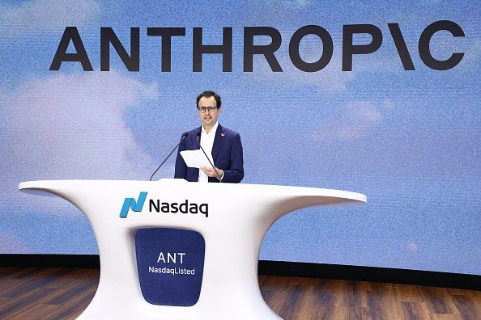

Anthropic 上市后股价首次跌穿 IPO 价格。TechCrunch 将其解读为 AI 初创整体估值可能回调的预警信号。

一家被视为第一梯队的模型公司跌破发行价，影响的不只是它自己的市值管理。它给尚未上市的同行的定价谈判提供了一个新的锚：公开市场愿意为模型公司付多少倍数，现在有了可查的证据，而不是上一轮私募的纸面估值。

> 原文：[TechCrunch](https://techcrunch.com/2026/11/24/anthropic-shares-fall-below-ipo-price-a-worrying-sign-for-ai-startups/)

### Character.AI 破产出售，用户私聊被列入拍卖标的

Character.AI 的破产出售方案中包含逾 2100 万美国账户的敏感聊天数据，其中 210 万注册者为未成年人。多州总检察长联合出手，试图阻止这批数据被拍卖。

这里的关键不是破产程序，而是数据的资产属性被推到了极限：当公司清算时，用户的私密对话是否算可处置资产？如果拍卖成行，等于为“对话数据可转让”立了一个判例。对做消费级 AI 陪伴产品的团队来说，这是必须提前在隐私条款和架构里回答的问题。

> 原文：[TechCrunch](https://techcrunch.com/2026/11/25/state-ags-fight-character-ais-plan-to-auction-off-users-private-chats/)

### 亚马逊与 Meta 谈解除 Muse 封锁

持续两个月的封锁可能出现转机：亚马逊与 Meta 正在讨论，让 Meta 的 AI 购物代理 Muse 重新接入亚马逊商城。

这是 agentic commerce 的一次边界测试。平台愿不愿意让外部 agent 代替用户完成浏览与下单，取决于它能否保住商品展示与定价的控制权。谈判本身说明双方都认定 agent 入口值得争，而不是绕开。

> 原文：[TechCrunch](https://techcrunch.com/2026/11/25/amazon-and-meta-reportedly-in-talks-to-lift-blockade-on-ai-agent-muse/)

### 数据中心越建越难，neocloud 先感到寒意

英伟达明确表示不会为尚未就绪的数据中心兜底；与此同时，neocloud 厂商报告工期延误与更贵的债务。土地、电力与融资三重约束同时收紧。

这条最容易被当作基建噪音跳过，但它决定了明年的算力供给曲线。当 GPU 供应商不再承担“建不完”的风险，杠杆就转到租赁方身上，中小云厂商的融资成本上升会先于大厂体现。算力过剩的叙事要往后排。

> 原文：[TechCrunch Podcast](https://techcrunch.com/podcast/ai-data-centers-are-becoming-harder-to-build-and-neoclouds-are-feeling-it/)

### OpenAI 用“不看数据”换企业信任

OpenAI 正试图说服企业把敏感工作交给它，核心承诺是限制自身对客户数据的访问权限。

在企业市场，模型能力已经不是唯一门槛，数据访问权才是采购流程里的否决项。把自己的权限写进产品约束，是一种可信度建设，但真正的检验在于审计与违约后果是否可验证。

> 原文：[The Decoder](https://the-decoder.com/openai-wants-companies-to-trust-it-with-sensitive-work-by-promising-not-to-look-at-their-data/)

### 前苹果空间智能首席科学家权龙创立 Envision AI

权龙成立 Envision AI，方向是空间物理基础模型，聚焦空间智能（spatial intelligence）的基础模型能力。

具身与空间方向正在从“做机器人”上移到“做底座”。物理规律是否值得单独建一个基础模型，目前没有共识，但前苹果空间计算团队的加入，会让这条路线多一个可对照的技术样本。

> 原文：[InfoQ](https://www.infoq.cn/article/3rQ4aRqts2zywSBmeJvb?utm_source=rss&utm_medium=article)

### Maple 融资 530 万美元，做“连自己都看不到”的 AI

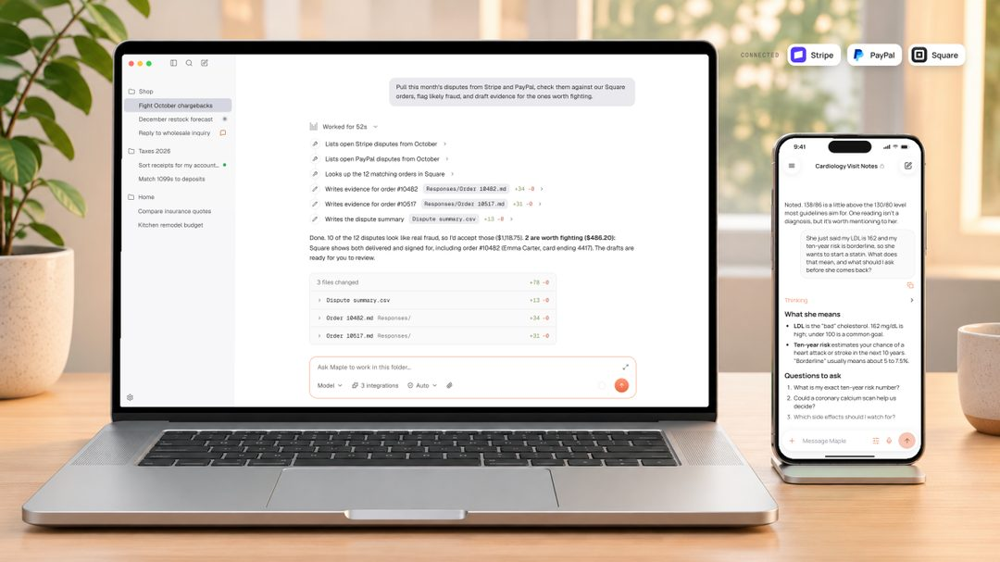

Maple 以加密 AI 架构完成 530 万美元融资，设计目标是让公司自身也无法访问用户私有数据。

这是把“零访问”从合规承诺变成架构约束的思路，和上一条 OpenAI 的自律式承诺形成对照：一个靠制度，一个靠密码学。谁能成为企业采购的标准答案，取决于审计成本，而不是宣传口径。

> 原文：[TechCrunch](https://techcrunch.com/2026/11/24/maple-raises-5-3m-to-build-ai-products-that-protect-your-data-even-from-itself/)

当一家公司的信用评级开始由“谁来做决定”决定，AI 行业的竞争就从算力转向了制度设计——你的组织，扛得住一次关键人缺席吗？

<h2 id="research" class="ai-section-divider">🔬 研究论文</h2>

### 导语

今天最值得看的一条不是模型发布，而是一份数学预印本：OpenAI 给出矩阵乘法指数的新上界 9/4，Scott Aaronson 用「一整块新的数学大陆」来形容它。同一批 story 里，AI 还在黎曼猜想、Erdős 问题和傅里叶变换界上留下了结果。把它们放在一起看，研究这件事的瓶颈正在从「能不能做出来」转向「能不能被验证、被归因、被理解」。而另外几条关于 agent 的论文和基准，恰好从反面提醒：产出速度和可靠性并不是同一件事。

### 矩阵乘法指数降到 9/4

OpenAI 放出的预印本给出了矩阵乘法指数的新上界 9/4，也就是 n^2.25——比此前长期沿用的界往前推了一步。这一指数衡量的是「两个矩阵相乘最少需要多少次标量乘法」，自 Strassen 以来一直是复杂度理论里推进最慢、也最受关注的常数之一，任何一次下压都会被视为结构性进展。Scott Aaronson 的评价是，我们将因此得到「一整块新的数学大陆」。同一时期，AI 还产出了 Erdős 问题与傅里叶变换界上的结果。为什么重要：矩阵乘法是数值计算的地基，指数每降一点，长期都会渗透到工程侧；但更值得留意的是产出方式的变化——结论开始由 AI 给出，那么署名、验证与「人类是否真的理解了这个证明」就会变成比证明本身更棘手的问题。

> 原文：[OpenAI preprint](https://raw.githubusercontent.com/openai/math/main/preprints/The-matrix-multiplication-exponent-is-nine-fourths-November-24-2026/paper.pdf)

### AI 辅助的黎曼猜想证明，暂时站得住

一篇由 AI 辅助完成的黎曼猜想证明，目前看没有明显漏洞。这大概是数学界能给出的最谨慎的正面评价：没有明显漏洞，不等于已被接受。Ars Technica 的报道提出了一个更根本的问题——我们还说不清它究竟意味着什么。也就是说，即便每一步推导都能被机器检查通过，证明的动机、结构与它在数学版图中的位置，仍然需要人来消化。为什么重要：AI 生成的数学结果，验证成本正在快速上升，而数学共同体的接受从来不是纯粹的形式化过程，而是一个社会过程。如果连顶级结果都要靠「先信后懂」的方式推进，那么审阅工具与形式化验证会成为下一个瓶颈，而不是模型能力。

> 原文：[Ars Technica](https://arstechnica.com/ai/2026/11/whats-going-on-with-the-riemann-hypothesis/)

### DeepMind 让 agent 接管部分算力做 Gemini 实验

谷歌内部已经有 AI agent 在控制一部分算力，用于 Gemini 的实验与调优。报道同时给了一个必要的刹车：这距离递归自我改进（recursive self-improvement）仍然很远。区分这两件事很重要。让 agent 参与实验循环——提出配置、跑实验、读结果、再调参——是把研究流程中重复性最高的部分交给自动化，本质上还是在人的框架内加速；而递归自我改进要求系统能实质性地改写自身的能力边界，目前没有任何证据支持这一点。为什么重要：一旦 agent 介入算力分配，研究的可复现性和资源治理就会变得复杂——谁批准了这次实验、为什么这么分配 GPU，这些问题会比「agent 会不会失控」更早到来。

> 原文：[The Decoder](https://the-decoder.com/ai-agents-now-control-part-of-deepminds-compute-for-gemini-experiments-but-recursive-self-improvement-remains-distant/)

### 最强的个人助理 agent，还搞不定日常生活

一个新基准测试显示，即便最先进的个人助理型 agent，在完成日常任务时依然不可靠，而且常常在解决问题的同时引入新问题。安全性（safe-to-act）与稳定性是主要短板。这一点值得单拎出来说，因为日常任务是 agent 叙事里最容易讲、也最容易翻车的场景：步骤长、状态多、失败代价由用户承担。为什么重要：agent 的评估标准正在从「能不能完成」转向「完成后系统是不是比之前更糟」——后者才是真实部署的门槛。对产品经理而言，这意味着短期内更现实的设计是缩小授权范围、把不可逆操作留给人，而不是追求端到端自动化。

> 原文：[TechCrunch](https://techcrunch.com/2026/11/24/even-the-best-ai-agents-struggle-with-everyday-life/)

### 编码 agent 为什么总爱多改代码

一篇实证研究试图解释编码 agent 普遍存在的过度编辑（over-editing）现象，提出了 Delta Residue Attribution 方法，用来区分 agent 补丁中「必要的额外改动」与真正多余的编辑，并定位这些多余改动来自哪里。这解决的是一个很实际的痛点：agent 提交的 diff 里，往往混着为让测试通过而必须做的连带修改，和纯粹的风格漂移、无关重构，人类 reviewer 只能一并接受或一并拒绝。为什么重要：把「必要」和「多余」拆开之后，评审成本才有可能下降，agent 补丁也才具备可审计性。这是 agentic coding 从演示走向工程流程时必须补上的一块。

> 原文：[arXiv](http://arxiv.org/abs/2611.34875v1)

### Mixture-of-Loops：用循环层换表达力

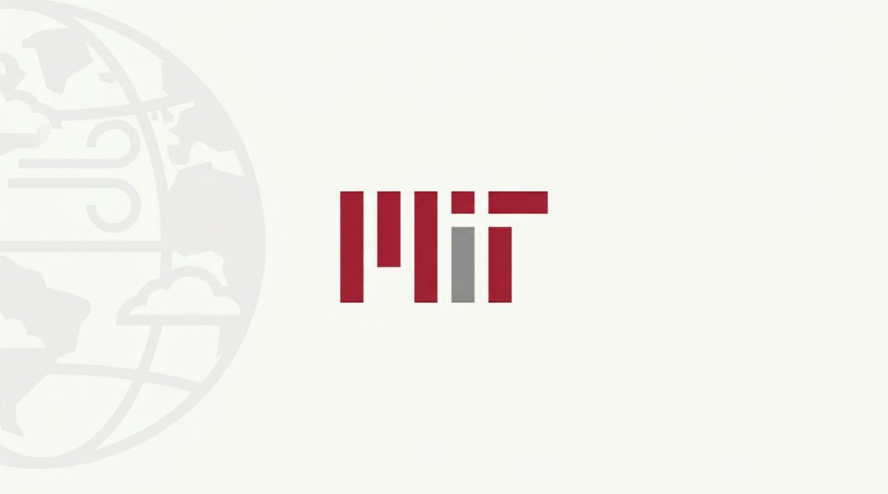

这篇论文重新设计了循环 Transformer 中相邻循环之间的信息传递机制，目标是同时推动「表达力」与「效率」这两条前沿。循环结构的吸引力在于用参数复用换取有效深度，代价是循环之间的信息通路容易退化成简单的重复计算。该工作选择在传递机制上动刀，而不是靠堆参数或堆数据。为什么重要：在算力扩张边际收益递减的当下，架构层面的表达力提升是少数不依赖更多 GPU 的路径之一。当然，这类工作的价值需要等复现和规模化验证，现在的结论只到「方向值得跟」。

> 原文：[arXiv](http://arxiv.org/abs/2611.34923v1)

### MIT：用「不真实」的训练数据，气候预测反而更准

MIT 团队发现，刻意使用不真实的训练数据，能提升 AI 气候预测的可靠性。这是一个反直觉的结论：通常的直觉是训练分布越接近真实越好，但在气候这类观测稀疏、边界条件复杂、长期外推需求强烈的领域，贴近真实反而可能让模型学到观测数据的偏差与缺口。为什么重要：这条结论的意义不限于气候，它指向科学机器学习（scientific ML）中一个更普遍的问题——数据构造本身是建模决策的一部分，而不是中立的准备工作。「把数据造得不真实一点」可能是一种正则化手段，这值得在其他物理系统上系统验证。

> 原文：[The Decoder](https://the-decoder.com/mit-team-discovers-that-unrealistic-training-data-makes-ai-climate-predictions-more-reliable/)

### 最优分词器不存在高效近似

论文证明：除非 P=NP，否则不存在多项式时间算法能把分词（tokenization）目标做到最优解的任意常数倍——即该问题不在 APX 复杂度类中。换句话说，「找到最优分词方案」不仅难，而且连「足够接近最优」都无法在多项式时间内保证。为什么重要：分词器的设计长期依赖启发式、经验和离线评测，这项结果为「为什么调不出更好的分词器」提供了一个复杂度层面的解释，也提示把最优分词当成工程目标本身就不成立。实践上更合理的方向是围绕下游任务定义代理指标，而不是追求分词目标本身的近似最优。

> 原文：[arXiv](http://arxiv.org/abs/2611.34938v1)

### 结语

今天这八条放在一起，画面很清楚：AI 已经能把数学推到 9/4，却还搞不定帮人订一张票。留给读者的问题——当产出不再是瓶颈，你手上的验证流程准备好了吗？

<h2 id="product" class="ai-section-divider">📱 应用产品</h2>

今天最值得看的一条，是 Anthropic 把 Claude Artifacts 从网页组件变成了 macOS/Windows 桌面应用——用户在对话里做出来的东西，可以直接以本地 app 的形式运行。同一时间，OpenAI 把 ChatGPT 的 Chat 与 Work 合并并统一用量计量，Meta 把 Muse 塞进 Instagram 私信。三件事方向一致：AI 产品正在离开那个对话框。当入口下沉到操作系统、私信流和购物链路，竞争维度就从“模型多聪明”变成“它住在哪里、按什么计价”。

### Claude Artifacts 变成桌面应用

Anthropic 将 Artifacts 从网页内嵌的预览组件升级为独立桌面应用，覆盖 macOS 与 Windows，用户生成的内容可以直接以本地 app 形式运行。

关键点在于“交付物”的定义变了：过去 Artifacts 是聊天窗口里的一个沙盒预览，产物停留在浏览器标签页里；现在它跨过了预览与真实软件之间的那道坎。对 Anthropic 而言，这是把 Claude 从“帮你写代码”推到“帮你把软件跑起来”，订阅的价值锚点也从 token 消耗转向实际产出。需要回答的问题同样明显——本地执行带来权限边界、代码签名、更新分发由谁负责。对企业 IT 来说，这也意味着多了一个难以纳管的软件来源。

> 原文：[The Decoder](https://the-decoder.com/anthropic-turns-claude-artifacts-into-standalone-desktop-apps-for-macos-and-windows/)

### OpenAI 合并 Chat 与 Work，重度用户会更早触顶

OpenAI 把 ChatGPT 的 Chat 与 Work 两种体验合并，并统一用量计量，重度用户可能比过去更早碰到限额。

合并的不只是界面，更是额度池。原本分开计算的两套用量被收进同一个标准，而 Work 场景本身消耗就大——长文档、代码、agentic 任务都是 token 密集型，一旦与日常闲聊共享额度，付费上限会被更快触达。这是典型的“体验做减法、计价做加法”：产品侧减少模式切换的认知负担，商业侧把高价值场景的成本显性化。对以席位制采购的团队，预算模型要重算；对个人重度用户，这是一次转向 API 或竞品的推力。真正的信号是，AI 产品的成本结构开始被摆上台面。

> 原文：[TechCrunch](https://techcrunch.com/2026/11/25/openai-says-heavy-chatgpt-users-may-hit-limits-sooner-as-it-merges-chat-and-work/)

### Meta Muse 进 Instagram 私信，沃尔玛黑五接入

Meta 将 AI 助手 Muse 直接嵌入 Instagram 私信，用户无需切换到独立 App；沃尔玛同期把黑五促销接入 Muse 的购物流程。

两个动作叠在一起看更清楚：入口上，助手寄生在已经高频的场景（DM）里，而不是要求用户新开一个 App；商业上，购物成了 Muse 第一个路径明确的变现出口。这背后是分发逻辑——Instagram 私信的打开频次远高于任何独立 AI 应用，Meta 用存量流量换使用习惯。沃尔玛选在黑五接入也非偶然，这是一年里对转化链路压力最大的节点。接下来值得盯的是：助手推荐商品时的标注方式与责任归属。

> 原文：[TechCrunch](https://techcrunch.com/2026/11/24/meta-brings-its-muse-ai-assistant-directly-into-instagram-dms/)

### Facebook 用一句话描述你想看什么

Meta 详解 “Your Algorithm”：用户以自然语言表达兴趣，系统经 LLM 校验、四路召回、分层过滤与微调重排，转成 Feed 与 Reels 的排序信号。

值得注意的是 LLM 在其中的位置——它不是推荐器，而是“意图解析层”。自然语言只是入口，落地仍是一套标准推荐流水线：模型负责把模糊表达翻译成可执行的偏好约束并校验合理性，四路召回覆盖不同来源，分层过滤控量，最后由微调模型重排。这给“可控推荐”提供了一个务实范式：不推翻原有排序架构，只在最前端加一层语义翻译。待解的问题是，这种偏好是会话级还是长期生效，以及它会不会让信息茧房更牢固。

> 原文：[MarkTechPost](https://www.marktechpost.com/2026/11/24/meta-facebook-your-algorithm-llm-recommendations/)

### 讯飞语音大模型：从基座到应用的全栈拆解

讯飞系统梳理了语音大模型的基座能力与上层应用路径，覆盖识别、合成到交互场景的工程化落地。

重点不在单点指标，而在“全栈”这个提法——基座能力如何支撑上层场景。语音的难点始终是链路长：远场、噪声、方言、打断、多轮对话，任何一环掉链子，体验就退回到“能用但不想用”。全栈叙事的潜台词是，模型能力已不再是主要瓶颈，工程化和场景适配才是。对做硬件和车载、教育、客服的团队来说，这意味着选型标准从“买一个 API”转向“买一套可交付的工程能力”。

> 原文：[InfoQ](https://www.infoq.cn/minibook/h1BlHGoTKyeLgs0KmAhe?utm_source=rss&utm_medium=article)

### 百灵大模型靠真实医疗需求重塑“望闻问切”

蚂蚁百灵以真实问诊需求驱动医疗能力迭代，从“阿福”这类应用反向定义模型的训练重点。

路径是应用先行、需求反推，而不是先训通用大模型再找场景。医疗的特殊性在于容错率极低，真实问诊语料里充满口语化、信息缺失、话题跳跃的表达，恰是通用模型最薄弱的区域。这是垂直模型的一个务实范式：用真实业务分布定义训练目标。边界也要看清——问诊不等于诊断，价值主张应落在分诊、健康教育和就医引导这些可担责的环节，合规与医疗责任比模型能力更决定这类产品能走多远。

> 原文：[InfoQ](https://www.infoq.cn/article/V7VOeFvEPLrHAN2EFmUa?utm_source=rss&utm_medium=article)

### Netflix 用运维知识图谱做 AI 可观测性

Netflix 基于运维数据构建知识图谱，让 AI 能够理解并解释系统异常，提升可观测性分析的自动化程度。

可观测性的老问题是数据多、上下文少：指标、日志、链路各自为政，告警成堆，根因难寻。知识图谱的作用是把服务、依赖、变更、事故之间的关系显式化，为 LLM 提供结构化上下文。这是“AI 做运维”里比较扎实的一条路——不指望模型从海量日志里自己悟出因果，而是先把领域知识整理成机器可读的图。对平台团队有普适启发：想让 agent 靠谱，先得给它一张地图。

> 原文：[InfoQ](https://www.infoq.cn/article/lVQK4fTxIJYZL2sZee2O?utm_source=rss&utm_medium=article)

---

当助手搬进你的桌面、私信和购物车，衡量它的标准就不再是回答得多好，而是它是否随时在场、按什么计价。你更在意哪一条？

<h2 id="opinion" class="ai-section-divider">💭 行业观点</h2>

Tidal 宣布下月起清除约 2700 万首完全由 AI 生成的曲目，占其曲库 6.3%，这是主流分发平台第一次用可执行规则把「生成」和「辅助」分开。同一天，纽约州用五年禁令把 AI 聊天玩具挡在儿童市场之外，英国网安部门则警告 AI 正在放大旧漏洞。三条新闻指向同一件事：讨论重心从「要不要管 AI」转向「怎么定义 AI 生成、谁来验」。定义权，才是接下来一年真正的战场。

### Tidal 清退 2700 万首纯 AI 曲目

Tidal 宣布自 12 月 9 日起封禁完全由 AI 生成的音乐，约 2700 万首、占曲库 6.3% 的曲目将被清除；AI 辅助创作仍被接受。

关键在两处。一是划线的位置：不在「是否用过 AI」，而在「是否完全由 AI 生成」，这给人类创作者留了工具空间，也把「AI 音乐人」这个身份在分发端直接否掉。二是 6.3% 这个比例，说明纯生成内容在流媒体曲库里已经不是边角料，而是必须处理的库存。

为什么重要：这是平台侧第一个具体、可公告、有生效日期的判定标准，很可能成为其他流媒体和内容平台的参考模板。留下的难题是审核——判定一首歌「完全由 AI 生成」在工程上远比写在公告里难，Tidal 接下来怎么执行，比这条规则本身更值得看。

> 原文：[Ars Technica](https://arstechnica.com/ai/2026/11/tidal-will-ban-fully-ai-generated-music-on-december-9/)

### 纽约州禁售儿童 AI 聊天玩具五年

纽约州通过五年禁令，禁止销售面向儿童的 AI 聊天玩具。Common Sense Media 的新研究记录了这类产品带来的不当内容暴露与情绪发展风险。

关键点有二：禁令针对的是产品品类而非技术路线，避开「反 AI」的定性争议；五年这个长度，等于立法者判断相关风险在短期内无法靠产品迭代解决。

为什么重要：儿童产品历来是监管最容易落地的切口，一旦某个州立了先例，外溢到其他品类和其他州只是时间问题。做硬件加 agent 的团队需要把「面向儿童」当成一个合规标签来评估，而不是营销定位——它决定的不只是文案，还有能不能上架。

> 原文：[TechCrunch](https://techcrunch.com/2026/11/25/want-to-buy-your-kid-an-ai-toy-this-christmas-not-in-new-york/)

### Amodei 回击「向 AI 交权」指控

Anthropic CEO Dario Amodei 反驳竞争对手称他主张把人类能动性交给 AI 的说法，称这一指控「荒谬」；同时他坚持原有立场：让 AI 治理社会是个坏主意。

值得注意的是这两句话的搭配。他同时否认定性（我没有要交权）和重申立场（AI 不该治理社会），逻辑上自洽，但对习惯了贴标签的舆论场并不好用——指控传播的速度总是快过澄清。

为什么重要：AI 实验室负责人的公共表态正在变成竞争工具，人身化的攻击会越来越常见。对读者来说，值得养成一个习惯：把「公司政策主张」「个人公开言论」和「对手转述的版本」分开看。三者经常不是一回事，而市场情绪往往只对第三个起反应。

> 原文：[TechCrunch](https://techcrunch.com/2026/11/25/anthropics-dario-amodei-calls-accusations-of-surrendering-human-control-to-ai-absurd/)

### Simon Willison 讲十二个月里的三个拐点

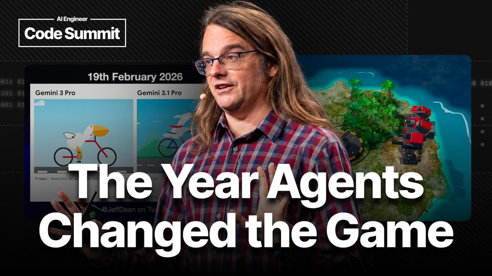

在 AI Engineer Code Summit 的主题演讲中，Simon Willison 用三个拐点来解释过去一年 LLM 与编码能力的跃迁路径。

这条的价值不在结论，而在方法。面对「模型越来越强」这种无法证伪的叙述，把一年的变化切成几个可定位的节点，是一种更可用的表达——它让「我们团队现在处在哪一段」变成一个能回答的问题。

为什么重要：做能力评估时，一线实践者的分期框架通常比 benchmark 曲线更贴近工程现场，因为前者包含「什么场景下会失效」这类benchmark 不测的信息。推荐直接读原文，尤其是他给每个拐点配的具体案例。

> 原文：[simonwillison.net](https://simonwillison.net/2026/Nov/24/llm-inflection-points/)

### Anthropic 用 Rust 重写 Claude API

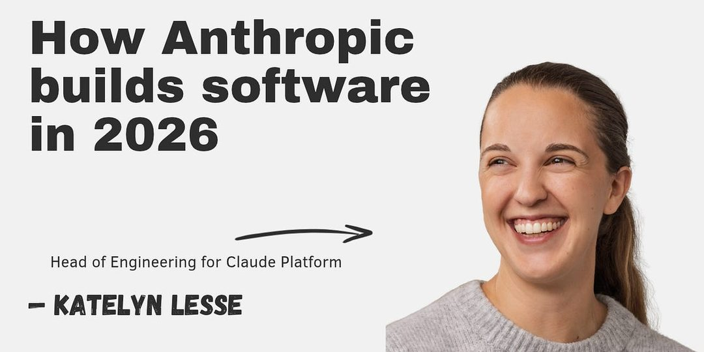

Anthropic 工程负责人談到把 Claude API 重写为 Rust 的取舍，以及 AI agent 如何改变公司内部的工程协作方式。

两个信息点：一是重写被表述为「取舍」而非纯收益，说明团队在性能、内存安全与开发速度之间做了明确交换；二是 agent 进入协作流程后，改变的不只是写代码的速度，还有评审、分工和知识传递的方式。

为什么重要：这是「AI 公司自己怎么用 AI」的一手材料。对外发布的产品叙事总是经过修饰，而工程负责人在播客里谈的重写动机、迁移成本和协作摩擦，更接近其他团队会真实遇到的问题。准备做类似重构的团队，值得把这段当参照而不是模板。

> 原文：[The Pragmatic Engineer](https://newsletter.pragmaticengineer.com/p/how-anthropic-builds-software-in)

### 英国网安机构：AI 在放大旧漏洞

英国网络安全部门警告，AI 驱动的攻击工具正在利用多年积累的基础安全欠账，并称「打好地基」比以往任何时候都重要。

关键判断是归因方式：AI 没有凭空创造新的漏洞类别，它提高的是已有漏洞的发现和利用效率。这意味着风险曲线不是从零开始上升，而是把过去十年没补的债一次性兑现。

为什么重要：如果攻击端的瓶颈被 AI 抹平，防御方的优先级就该回到补丁管理、资产清点、权限收敛这些「无聊」的事情上。反过来说，把安全预算全部投向 AI 特有风险（提示注入、模型越狱）而忽略基础面，可能是当下最常见的资源错配。

> 原文：[TechCrunch](https://techcrunch.com/2026/11/24/uk-warns-ai-driven-cyberattacks-are-exposing-years-of-weak-security/)

### 「AI 教父」回击黄仁勋：失业是盈利模式的副作用

针对黄仁勋的相关说法，一位被称为「AI 教父」级别的人物反击称，大规模失业是 AI 巨头盈利模式的副作用，并称自己更早看到了英伟达的未来。

真正有信息量的是前半句的框架转换：把失业从「技术必然」重新描述为「商业模式选择」。这两种说法导向的政策空间完全不同——前者几乎无解，后者意味着税率、再分配、用工激励都是可调参数。

后半句关于「更早看到英伟达」的表述，属于个人叙事争夺，参考价值有限。为什么重要：当失业被定义为副作用而不是宿命，监管讨论的入口就打开了；接下来值得关注的不是谁说得更狠，而是有没有人把「副作用」量化为可立法的指标。

> 原文：[InfoQ](https://www.infoq.cn/article/6i2DoIJiaTcKyR0UyurQ?utm_source=rss&utm_medium=article)

### AI 正在压垮美国的公开记录系统

MIT 科技评论报道：在人口 660 人的佛蒙特小镇，公开记录请求因 AI 批量生成而暴涨，基层行政系统难以招架。

机制很清晰：AI 把提交请求的边际成本压到接近零，请求量随之暴涨，而处理端仍然是人。一个 660 人的小镇政府没有对应的编制来消化这个量级，结果不是拒绝，而是延迟、积压和事实上的不可用。

为什么重要：这是「低成本生成」冲击公共服务的一个可观测样本，而且它冲击的是信息公开这类民主基础设施——被流量压垮的效果，等同于限制获取。可以预期下一步会出现请求配额、身份验证、费用机制这类反制设计，它们会同时提高滥用成本和正常使用成本，这个平衡值得持续跟踪。

> 原文：[MIT Technology Review](https://www.technologyreview.com/2026/11/25/1149702/ai-is-straining-americas-open-records-systems/)

---

当「完全生成」和「辅助创作」之间那条线被画出来，下一个问题就变成了：谁来验，验错谁负责。

<h2 id="opensource" class="ai-section-divider">⚙️ 开源工具</h2>

今天开源板块最值得看的一条，是 mini-swe-agent：约 100 行代码，在 SWE-bench Verified 上超过 74%，没有巨型 monorepo，也没有层层配置。它和同日的 Laminar 恰好构成一组对照——一个在应用侧证明「脚手架可以极简」，一个在训练侧把 rollout、训练与权重同步拆开，用工程解耦换来吞吐。这两件事共同指向一个判断：agent 的竞争正在从「谁封装的抽象更多」转向「谁砍掉的耦合更多」。对做基础设施的团队来说，这是一个值得重估自家技术栈复杂度的信号。

### 字节 Seed 与港大开源 Laminar：把异步 RL 拆成三段

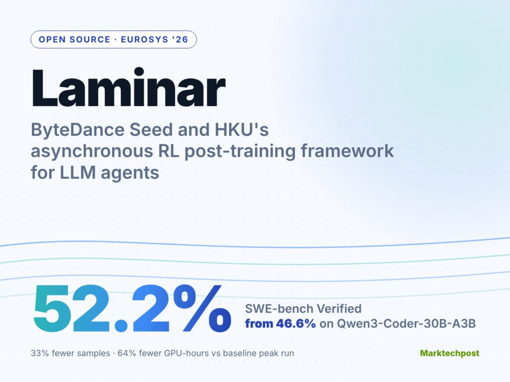

港大与字节 Seed 开源了 Laminar，一个面向 RL 后训练（post-training）的异步框架。它的核心动作是把三件事解耦：rollout（采样）、训练、以及权重同步。在同步式流水线里，三者互为等待，长尾样本会拖住整批更新；拆开之后，采样与训练可以并行推进，权重同步则成为一个独立的工程问题。

效果上，团队把 Qwen3-Coder-30B-A3B 在 SWE-bench Verified 上推到 52.2%。

为什么重要：代码类 agent 的 RL 后训练，瓶颈往往不在算法而在吞吐与稳定性。Laminar 的价值不在于提出新目标函数，而在于给出一个可复用的工程切分方式——尤其是「权重同步」被单独拎出来当作一等公民，说明这套框架是奔着大规模跑得动去的。

> 原文：[MarkTechPost](https://www.marktechpost.com/2026/11/24/bytedance-seed-laminar-async-rl-post-training-framework/)

### mini-swe-agent：约 100 行代码，SWE-bench 超 74%

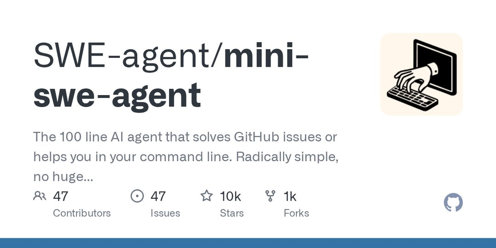

SWE-agent 团队放出的 mini-swe-agent，用大约 100 行代码完成「读 issue、改代码、跑测试」的闭环，在 SWE-bench Verified 上通过率超过 74%。它刻意去掉了两样东西：庞大的配置文件体系，以及巨型 monorepo 式的工程结构。

关键点在于取舍。它没有自建复杂的工具调用协议、没有多层抽象，而是把 agent 循环压到最小可运行形态，让基础模型自身的能力承担主要工作。

为什么重要：这是一次针对「agent 工程复杂度」的反证。过去一年大量项目靠堆脚手架提升分数，而 mini-swe-agent 说明，当基座模型足够强时，脚手架的正确方向可能是减重而非加层——它同时也是一份极好的教学样本，能让人看清 agent 循环里到底哪几行是必要的。

> 原文：[GitHub: SWE-agent/mini-swe-agent](https://github.com/SWE-agent/mini-swe-agent)

### CLI-Anything：把现有软件变成 agent 的原生接口

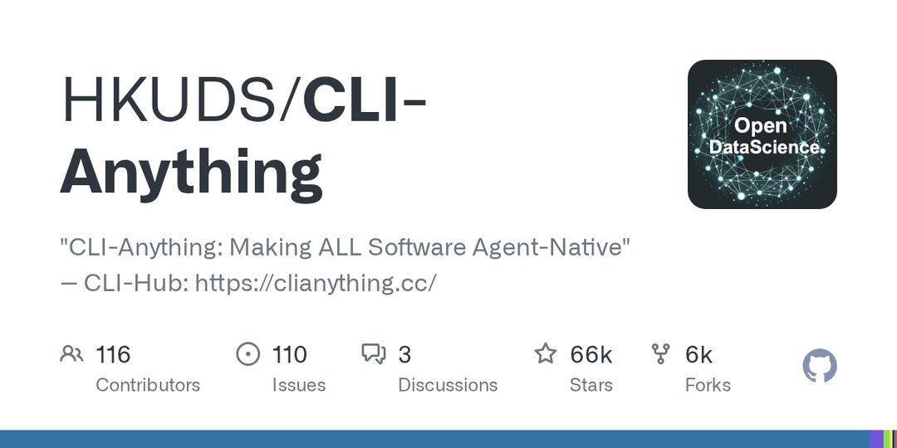

HKUDS 推出 CLI-Anything，目标不是再做一个 agent，而是给 agent 补上一层「手」：把现有软件统一封装成 agent 可直接调用的命令行接口，并配套 CLI-Hub 做分发。

关键点在于路径选择。CLI 是软件世界最稳定、最古老的接口形态，几乎每个工具都有；相比为每个应用单独写适配层，统一封装成 CLI 意味着 agent 可以复用几十年的工具生态。CLI-Hub 则承担「去哪儿找这些封装」的问题。

为什么重要：agent 落地的一大阻力不是推理能力，而是「操作不了真实软件」。这条路与 MCP（Model Context Protocol）式的协议接入形成互补——一个管能力发现与调用约定，一个管把存量软件批量接进来。真正的考验在于封装的覆盖面与稳定性，而不是概念本身。

> 原文：[GitHub: HKUDS/CLI-Anything](https://github.com/HKUDS/CLI-Anything)

### Together AI 开源 Hurdle：给自家 API 跑 agent 评测

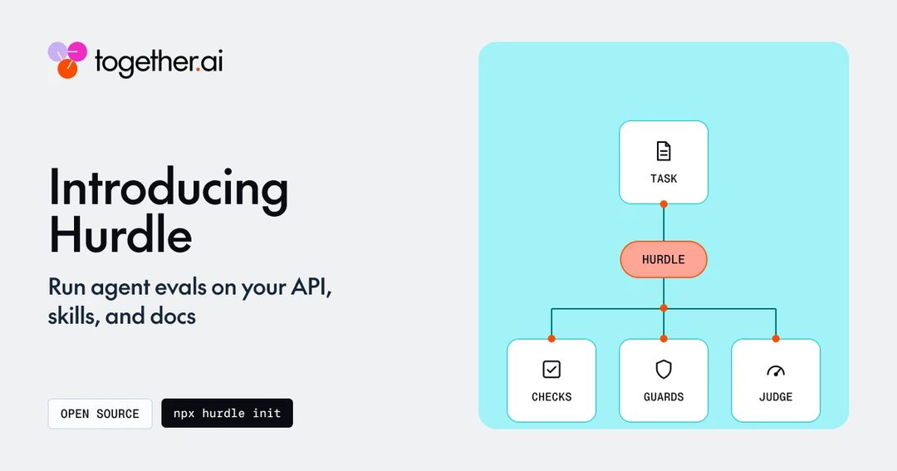

Hurdle 是 Together AI 开源的一个 npm 库，用来评测 agent 在「你的 API、技能与文档」上的表现。做法是让 Claude Code 与 Codex 去跑真实任务，再用三重手段打分：代码检查、guard（护栏校验）以及 LLM 评审。

关键点在于评测对象的转变——不是评模型在通用榜单上的分数，而是评模型在你自己的 API 和文档上能不能把事办成。对提供 API 的团队来说，这直接对应一个具体问题：文档写得够不够 agent 读懂。

为什么重要：随着编码 agent 成为 API 的主要「读者」之一，文档质量开始具备可测量的商业含义。Hurdle 把这件事变成了可重复的跑分，也让「换模型」这个决策第一次有了自家场景下的对照数据。

> 原文：[Together AI Blog](https://www.together.ai/blog/introducing-hurdle-run-agent-evals-on-your-api-skills-and-docs)

### superpowers：把编码 agent 的开发方法论做成可组合 skills

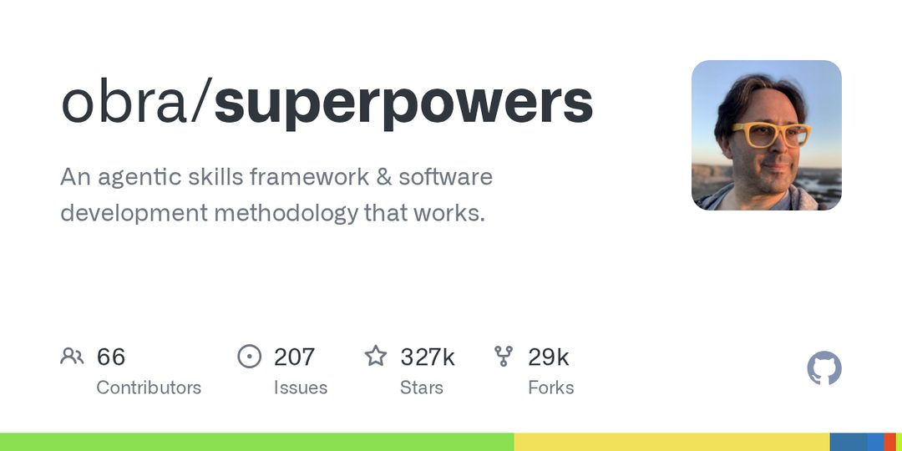

superpowers 这个仓库做的事，是把一组可组合的 skills 组织成完整的软件开发方法论，让编码 agent 的工作流程可复用、可约束。

关键点在于「方法论」被当作代码资产来管理。单个 skill 只是能力片段，真正的难点是流程编排：什么时候该调研、什么时候该写测试、什么时候该收敛。仓库试图用可组合的方式把这些阶段固化下来。

为什么重要：这代表了一类正在成型的实践——agent 的能力上限，越来越取决于流程约束而非提示词技巧。它也带来了新的问题：方法论一旦被固化成 skills，迁移成本和锁定风险由谁承担。对团队而言，值得先当作参考读物，再决定是否照搬。

> 原文：[GitHub: obra/superpowers](https://github.com/obra/superpowers)

### FreeVideo：8GB 显存本地跑 MiniMax H3 生成视频

FreeVideo 把视频生成拉到消费级硬件：最低 8GB 显存加 16GB 内存，就能在普通电脑上本地跑 MiniMax H3，并会按硬件情况自动选择加速路径。

关键点在于「自动选路」。不同显卡、不同内存条件下，可用的加速方案并不一样，这个项目把适配逻辑收进了工具里，降低了下限用户的门槛。

为什么重要：视频生成的讨论长期集中在大厂集群和云端 API，本地可跑意味着成本结构和隐私边界都变了——试错不再按次计费，素材也不必出本机。当然，8GB 显存能跑的是否等于能用于生产，是另一个问题；但门槛每降一档，创作者侧的实验密度就会上一个台阶。

> 原文：[GitHub: FlashML-org/FreeVideo](https://github.com/FlashML-org/FreeVideo)

### minimind：两小时从零训出一个 64M 小模型

minimind 是一个教学向项目，把「从零训练一个小语言模型」的完整流程压缩到两小时，产出一个 64M 规模的模型。

关键点在于完整性。它覆盖的是预训练全链路——数据准备、模型结构、训练循环、评估——而不是只给一段训练脚本。对没跑过预训练的人来说，这条链路本身就是知识。

为什么重要：在大模型语境里，「训过模型」和「调用过模型」是两种不同层次的直觉。两小时的上手成本，让后者向前者迁移变得现实。它不产出可用的产品，但能显著改善工程师对 loss 曲线、数据质量和规模律的体感，这类体感在评审技术方案时往往比文档更管用。

> 原文：[GitHub: jingyaogong/minimind](https://github.com/jingyaogong/minimind)

### Cursor 开放插件规范，并开源官方插件集

Cursor 发布插件规范，同时开源了官方插件集，覆盖主流开发工具、框架与 SaaS 产品。

关键点在于从产品走向平台。规范定义了「插件如何被 Cursor 调用」，官方插件集则给出参考实现——两者一起，等于把第三方接入的说明书和样例代码同时交出去。

为什么重要：编辑器正在成为 agent 的分发入口，谁定义插件规范，谁就在事实上定义 agent 与工具生态的握手方式。对 SaaS 厂商来说，这可能很快变成一份「要不要支持」的清单问题；而对 Cursor 自身，生态广度将是它与通用编码 agent 拉开差距的关键变量。

> 原文：[GitHub: cursor/plugins](https://github.com/cursor/plugins)

### 结语

今天这八条里，最反直觉的是：把 agent 做得更强的那批人，正在删代码、拆耦合、砍配置。留一个问题——如果你现在重写手里的 agent 项目，第一刀会砍在哪里？
