今天最值得看的三件事：

- **研究论文** · AI 数学证明井喷：黎曼猜想被验证，陶哲轩警告“核废料”
- **公司动态** · Anthropic 上市破发，编程团队遭 OpenAI 挖角
- **公司动态** · 英伟达暂停对东南亚服务器出货，配合美国芯片管制

下文按板块展开，正文每条均附原始链接。

<h2 id="model-release" class="ai-section-divider">🚀 模型发布</h2>

今天最值得看的是 Sakana 的 Namazu Small：30B 总参数、A3B 激活，在 25 个基准上平均 60.1 分，超过了 120B 的 Nemotron 3 Super。这不是一次孤立的“小模型奇迹”，它代表一种趋势——稀疏激活、基座复用与后训练的工程组合，正在让“参数量”变成成本项而非能力项。同一天，腾讯把 3D 生成推进到高模与 PBR 材质，另一家中国团队把视频生成报到每秒 5 毛——三条新闻指向同一件事：模型发布的竞争焦点，正从“多大”转向“每块钱能买到多少可用产出”。

### Sakana Namazu：30B-A3B 压过 120B

Sakana AI 基于 NVIDIA Nemotron 3 Nano 推出推理模型 Namazu Small，30B 总参数、A3B 激活（MoE），在 25 个基准上平均 60.1 分，高于 120B 的 Nemotron 3 Super。关键点有两个：一是激活参数远小于总参数，推理成本按激活侧算；二是比拼口径是“25 个基准的平均分”，这掩盖了任务间差异，长上下文、代码、多语言等单项仍需单独看。为什么重要：在开源基座上做后训练就能在评测面追平更大的模型，意味着中杯模型的性价比窗口被进一步打开，企业选型的锚点从“参数量”转向“每百万 token 的有效分”。反过来说，平均分领先不等于生产可用，评测集污染与自家 prompt 上的实测仍是必做动作。

> 原文：[Sakana AI Namazu Small](https://www.marktechpost.com/2026/11/26/sakana-ai-namazu-small-30b-nemotron-3-nano/)

### 腾讯混元 Hy3D 3.6：3D 生成开始接入生产管线

腾讯混元发布面向专业 3D 创作的 Hy3D 3.6，重点优化高模与 PBR（Physically Based Rendering）材质贴图生成，并已上线腾讯云 Token Hub 提供 API。关键点在于“高模 + PBR 材质”这个组合：过去 3D 生成模型大多停在低模、白模或概念图阶段，真正卡住生产的是拓扑、UV 与材质是否可编辑、可交付。为什么重要：3D 资产是游戏、影视、电商与工业数字化的共同瓶颈，人工建模成本高、周期长；一旦生成结果能进材质管线，价值就从“出图好看”变成“省人工工时”。API 化则意味着按调用计费，能直接嵌进现有 DCC 工具链与外包流程，采购门槛比私有化部署低得多。

> 原文：[36氪：腾讯混元 Hy3D 3.6](https://36kr.com/newsflashes/4087437995981443)

### 开源视频模型：每秒 5 毛的商用报价

国内一支开源新势力发布商用级 AI 视频模型，支持 30 秒一镜到底与自动镜头编排，成本低至每秒 0.5 元，并称拿下全球第一。两个点值得记：一是“30 秒一镜到底”，长时长下的角色与场景一致性是视频生成最难的工程问题之一；二是“每秒 0.5 元”，把视频生成从“按条试玩”拉进“按秒算钱”的成本框架。为什么重要：视频是当前推理成本最贵的模态，价格落到这个量级，广告素材、电商短视频、批量投放的经济账要重算一遍。需要保留的判断是：“全球第一”是厂商自述，缺第三方横评；开源许可与商用条款、以及 0.5 元对应的分辨率与时长档位，才是决定它能否真正进入生产的关键细节。

> 原文：[量子位：中国开源 AI 视频模型](https://www.qbitai.com/2026/11/512916.html)

三条新闻的共同信号是：模型发布的计量单位正在从参数换成“产出/成本”。那么问题留给你——当 30B 能打 120B、视频按秒计价，你的选型清单里还留着“参数量”这一栏吗？

<h2 id="company" class="ai-section-divider">🏢 公司动态</h2>

Anthropic 上市首日破发、创始人兄妹次日套现 37 亿元，同一天，标普考虑把英伟达信用评级下调至 AA-，理由包括治理结构和“关键人”风险。两件事相隔一天，指向同一个变化：市场对 AI 公司的估值，已经从按营收增速讲故事，切换到按治理、人事和现金流来算账。Anthropic 的编程团队被 OpenAI 挖角，也让投资者第一次需要把“人才可替代性”写进风险模型。今天的公司动态里，还有英伟达暂停对东南亚出货这类规则层面的动作，值得一起看。

### Anthropic 上市破发，套现与挖角同时到来

Anthropic 登陆公开市场首日即告破发，创始人兄妹在次日套现 37 亿元。同时，OpenAI 大举挖走 Claude Code 核心成员，Anthropic 在编程（coding）场景上引以为傲的优势面临直接挑战。

关键点在于两件事发生在同一周：**股价表现不佳**和**核心团队流失**会互相放大；投资者看到股价破发时，会问团队是否还稳定，看到团队流失时，又会重新计算估值。对一家以模型能力为核心资产的公司，编程 agent 团队的流失比一个季度的收入波动更难修补。

为什么重要：AI 公司的护城河长期被归结为“模型 + 算力”，这次事件提示还有第三项：把模型调成好用工具的那批人。市场首日给出的定价，可能就是按这个逻辑打的。

> 原文：[InfoQ](https://www.infoq.cn/article/z9IwzAY8hP15oDa2VKi6)

### 英伟达暂停对东南亚服务器出货

英伟达已通知制造伙伴，暂停向马来西亚、新加坡、泰国和印尼出货服务器，以配合美国收紧 AI 芯片对华流出的管制。

注意，暂停的是**服务器整机**，而非单独的 GPU。这意味着管制的重点正在从芯片本身延伸到系统集成环节；如果通过第三地组装再转出，这条路径也会被限制。东南亚近两年是数据中心和算力租赁的重要中转地，出货暂停会直接影响当地正在推进的算力项目排期。

为什么重要：出口管制的执行方式正从“限制芯片型号”转向“限制整机流向”，合规成本会向下压到 OEM 和云服务商身上。全球化算力供应链正在按地理边界重新划分。

> 原文：[TechCrunch](https://techcrunch.com/2026/11/26/nvidia-hits-pause-on-chip-shipments-to-southeast-asia/)

### 标普考虑下调英伟达评级，点名“关键人”风险

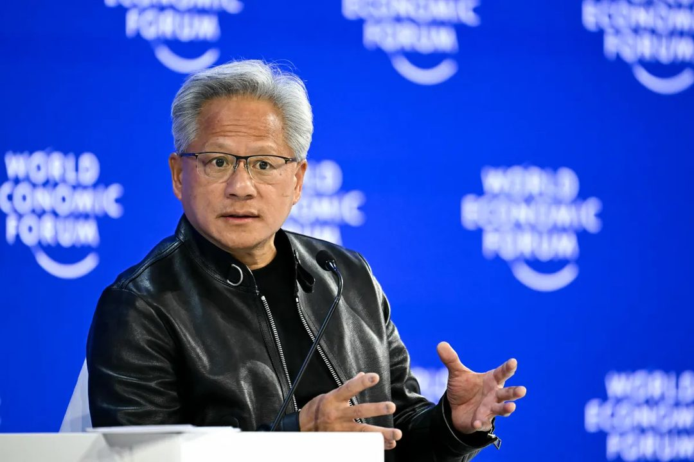

标普全球表示可能将英伟达信用评级下调至 AA-，列出的理由包括公司治理，以及对黄仁勋的“关键人”（key man）依赖。

对一家现金流充沛的芯片龙头来说，信用评级下调本身不是致命的，但标普的评级框架引入了两个非财务变量：治理结构和创始人依赖度。这套评估标准一旦适用于 AI 板块，其他高度依赖单一创始人的公司也会被同一把尺子衡量。

为什么重要：这是债券市场的语言第一次被用在这轮 AI 龙头上。它暗示，即便业绩无虞，制度性风险也会被定价；对一级市场投资人，这是一个可以提前使用的评估维度。

> 原文：[TechCrunch](https://techcrunch.com/2026/11/25/sp-considers-nvidia-credit-downgrade-over-governance-and-key-man-risks/)

### FCC 批准 SpaceX 部署百万颗 Starmind 卫星

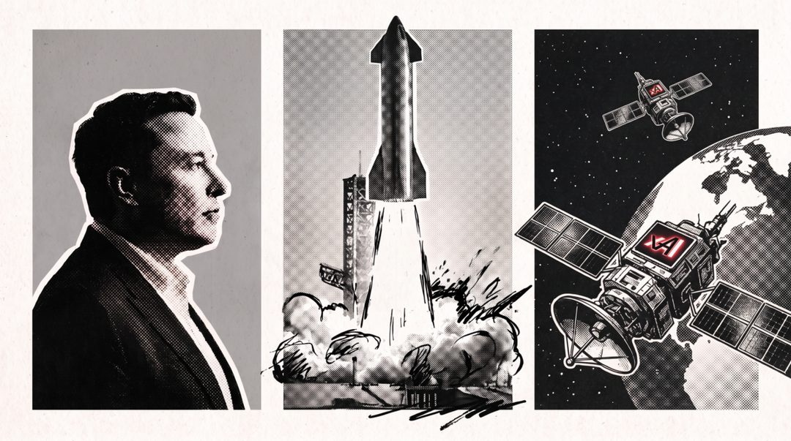

FCC 批准 SpaceX 到 2040 年部署最多 100 万颗 Starmind 卫星，用于构建轨道 AI 数据中心网络。

百万颗是一个需要被拆开看的数字：它既是频谱和轨道资源的占位申请，也是长期融资叙事的支撑。把算力放到轨道上的动机在于能源与散热假设：太阳能供给充足，且不占用地面土地与电网。但地面站的带宽、卫星的维护更换、以及对天文观测的影响，都是尚未解决的问题。

为什么重要：这是“算力基础设施”这一概念从地面向太空延伸的监管起点。批文先行、工程后至，在 AI 基建领域已不罕见，投资人需要区分监管许可与实际交付能力。

> 原文：[The Decoder](https://the-decoder.com/fcc-clears-spacex-to-deploy-up-to-1-million-starmind-satellites-for-orbital-ai-data-centers-by-2040/)

### Character.AI 拟拍卖用户聊天，多州总检察长反对

Character.AI 的破产出售方案拟包含 2100 万美国用户的敏感聊天数据，其中 210 万账户属于未成年人，多州总检察长要求阻止该方案。

争议核心在于：用户聊天记录在破产程序中属于“可出售资产”，还是属于不可转让的个人敏感数据。Character.AI 的用户与 AI 角色之间的对话，往往包含极私密的内容，用户当初并未同意这些内容会被转卖给第三方。总检察长的介入，实际上是在为“数据能否作为破产财产”划一条新界线。

为什么重要：这是 AI 时代第一批量级案例，用于界定“用户对话”的财产属性。它会影响所有以对话数据为核心资产的公司如何设计隐私条款和破产预案；如果这些数据可以随资产被拍卖，那么“我们不会查看你的数据”这类承诺的实际约束力就值得重新审视。

> 原文：[TechCrunch](https://techcrunch.com/2026/11/25/state-ags-fight-character-ais-plan-to-auction-off-users-private-chats/)

### 权龙再创业，Envision AI 做空间物理模型

华人计算机视觉（CV）先驱权龙成立 Envision AI，研发空间与物理基础模型，瞄准空间智能与机器人方向。

这是具身智能（embodied AI）赛道上又一位资深研究者入局。空间与物理基础模型要解决的是：让模型理解三维空间中的物体关系、接触与因果，而不只是识别图像中的像素。这条路线的难点不在数据量，而在物理一致性，以及从仿真到真实世界的迁移。

为什么重要：大语言模型的进展正在向物理世界延伸，而“空间智能”是其中尚未被验证的一环。有经验的研究者重新创业，通常意味着他认为技术拐点已经接近；值得关注的是他会选择哪类机器人形态作为验证场景。

> 原文：[InfoQ](https://www.infoq.cn/article/3rQ4aRqts2zywSBmeJvb)

### OpenAI 承诺不查看企业敏感数据

OpenAI 向企业客户承诺不会查看其敏感工作数据，以缓解企业将模型引入核心业务时的隐私与安全顾虑。

这类承诺的价值取决于可验证性：审计权、日志留存、以及违约后的追责机制，比一句声明更重要。企业客户真正担心的并非 OpenAI 主动窥探，而是敏感数据进入训练流程后无法撤回。此前 Character.AI 的案例已经说明，“数据承诺”在极端情况下会面临什么考验。

为什么重要：企业市场是 OpenAI 收入增长的关键部分，而信任是唯一的准入条件。这条承诺本质上是在用制度设计换取企业订单，能否被写进合同条款，决定了它是公关还是基础设施。

> 原文：[The Decoder](https://the-decoder.com/openai-wants-companies-to-trust-it-with-sensitive-work-by-promising-not-to-look-at-their-data/)

### 知乎与 DeepSeek 合作，问答内容接入检索

知乎通过数据开放平台向 DeepSeek 提供社区问答、文章、热榜等检索能力，覆盖网页端与移动端，并展示来源标识。

这是中文互联网内容方与模型方之间少见的一次正式授权合作。「展示来源标识」是关键设计：它既回应了内容方的版权诉求，也为模型输出提供了可追溯的依据。对 DeepSeek 而言，中文社区的高质量长文本，是补齐检索增强（RAG）短板的重要语料。

为什么重要：如果这条路径可持续，它给出的是一种“内容方授权 + 模型方分成或导流”的范式，比此前的抓取争议更接近可落地的版权秩序。值得观察的是，知乎能否从中获得实际流量回流。

> 原文：[36Kr](https://36kr.com/newsflashes/4087390505810564)

---

当资本开始问“人走了怎么办”，AI 公司的估值逻辑就变了。今天最值得记住的一句话是：护城河不只由模型和算力构成，还包括那批能把模型变成产品的人。

<h2 id="research" class="ai-section-divider">🔬 研究论文</h2>

今天研究板块最值得看的仍然是数学。多篇报道称 AI 系统开始批量产出证明，黎曼猜想相关的结果把陶哲轩拉进了验证现场，他给出的提醒是「核废料」——产量上来了，处理成本也上来了。同一天还有 381 个 AI 直播冲刺 P=NP、20 个 agent 组队刷新 ClickBench，以及一条「最优分词器不存在常数近似」的复杂度结论。放在一起看，研究工作的瓶颈正在从「能不能做出来」移向「谁来验证、验证得起吗」。

### 证明开始批量生产，验证先成瓶颈

报道称，AI 系统正在批量产出数学证明，围绕黎曼猜想的证明引发了陶哲轩下场验证；Scott Aaronson 等学者把这轮变化形容为数学发现从个案变成「新大陆」。

关键点不在某一个证明是否成立，而在供给曲线的形状变了：过去是「一个难题、一次突破」，现在是持续、成规模的产出，其中必然混杂着大量看似合理、实则无效的结果。陶哲轩的「核废料」比喻指向的正是这部分——验证负担、存储负担，以及低质量证明对审稿体系的挤占。

为什么重要：数学界的同行评审是为人类产出速度设计的。一旦生成端提速几个数量级，形式化验证（如 Lean4）和人工复核会变成真正的稀缺资源。这一轮 AI for math 的第一个瓶颈，大概率不是智力，而是质检产能。

> 原文：[量子位](https://www.qbitai.com/2026/11/513075.html)

### 381 个 AI 冲刺 P=NP，先把 GitHub 跑崩

一个由 381 个 AI 参与的直播项目尝试用 Lean4 形式化证明 P=NP，已跑超过一万次会话、验证 2400 多条引理，过程中 GitHub 一度被拖垮。

关键点有两个。其一是方法论：把一个大问题拆成机器可检验的引理，让「对错」由编译器而不是人来判，这让大规模并行尝试成为可能。其二是工程现实：agent 产生的流量已经足以压垮主流代码托管平台，这类研究的算力与基础设施成本被严重低估。

为什么重要：P=NP 本身不太可能被这种方式解决，但这个项目是「AI 做研究」的流水线原型——海量并行假设、机器可验证的中间产物、公开直播式协作。它同时给出了上一节那个验证瓶颈的一种解法方向：把验证前置到形式化层。

> 原文：[量子位](https://www.qbitai.com/2026/11/513021.html)

### 20 个 agent 组队，把查询优化刷出新成绩

20 个 AI Agent 协作，在 4 天内完成约 350 次实验，把 Quickwit 的查询总耗时降低 31%、最高降低 87%，超过 ClickBench 的最佳公开成绩。

关键点在于任务形态：有明确的目标函数（总耗时）、有自动化的评测基准（ClickBench）、有可反复试错的沙箱。在这种结构里，多 agent 的分工——提假设、改代码、跑基准、筛结果——可以形成闭环，人类只负责设目标和抽查。

为什么重要：这是当下 agentic research 最容易落地的一类工作。一项研究能否被 agent 接管，很大程度上取决于它的评测函数有多清晰。数学证明靠 Lean4 变得可判，数据库优化靠 benchmark 变得可判；反过来，那些无法自动打分的领域，短期内仍会是人机混合。

> 原文：[量子位](https://www.qbitai.com/2026/11/513053.html)

### 几毫秒破 18 年悬案：个案不等于体系

报道称，国产模型在 AI4S 场景中于几毫秒内破解了一道尘封 18 年的密码学难题。

关键点在于解读方式。单点案例的说服力有限：需要区分模型是真的完成了推理，还是在高维搜索中命中了已知结构，也需要看结果能否被独立复现、能否推广到相邻问题。报道本身没有给出这些细节，因此更适合当作一个信号而非结论。

为什么重要：这类「几毫秒」叙事最近出现得越来越频繁，它们容易让人高估模型的科学能力，也容易让人低估其真实价值。真正的分水岭不是某个悬案被解开，而是同一套方法能否稳定地在多个问题上复用——这也正是前面几条 story 在做的事：把偶然变成流程。

> 原文：[雷锋网](https://www.leiphone.com/category/yanxishe/T2xmmiMAC6WbuuCM.html)

### 国家黑客把攻击流程交给了 AI 框架

微软披露，国家背景黑客正利用一个名为 ARTEX 的 AI 框架自动化侦察、钓鱼与攻击流程。

关键点在于自动化对象的层级：不是单个 exploit 的生成，而是从信息收集到社工投递的整条链路。这意味着攻击的边际成本随目标数量下降，过去只对高价值目标使用的手法，可以被平移到长尾目标上。

为什么重要：攻防的时间常数被压缩，「发现到利用」的窗口变短，防守方的响应节奏必须同步提速——防御侧同样要上 agent，且要能对机器速度的探测做出机器速度的判断。把这条放进研究板块，是因为它标志着 agent 编排能力已经进入实战阶段，而不只是 demo。

> 原文：[The Decoder](https://the-decoder.com/microsoft-details-how-state-backed-hackers-use-the-artex-ai-framework-to-automate-cyberattacks/)

### 3D 生成开始对齐「能打印」

新方法被形容为给 3D 生成做「X 光」，可以从单张图直接生成高精度的巴洛克雕塑，并达到 3D 打印开箱即用的水平。

关键点在于评价标准的迁移：从渲染图好不好看，转向模型是否封闭、结构是否可支撑、精度是否满足打印公差。这类「可制造性」（printability）约束，是纯视觉指标无法覆盖的。

为什么重要：生成模型正在从「看起来对」走向「物理上可用」。这一步跨过去，3D 生成的买家就从内容创作者变成制造与设计行业，工作流也随之改变——输出不再是一张图，而是一个可以直接下单的文件。对做多模态的团队来说，这会是一个新的评测战场。

> 原文：[量子位](https://www.qbitai.com/2026/11/512981.html)

### 分词器优化被证明没有便宜解

一篇论文证明：除非 P=NP，否则分词器（tokenizer）优化问题不存在多项式时间的常数近似算法，该问题不在 APX 复杂度类中。

关键点在于它把一件被视为工程调参的事，抬升为有复杂度壁垒的问题。实践中的分词器设计一直依赖启发式与经验，这篇结果给出了理论解释：为什么反复微调往往只能拿到局部收益，为什么不存在一个「差不多最优」的通用算法可以拿来即用。

为什么重要：它与第二节的 P=NP 出现在同一天，形成有趣的对照——一边是 381 个 AI 试图攻克这个假设，一边是这个假设被用来证明一件日常小事的硬度。对从业者的直接含义是：tokenizer 的优化应当接受启发式的定位，不必等待一个全局最优解，把预算放在数据与下游任务上更划算。

> 原文：[arXiv](http://arxiv.org/abs/2611.34938v1)

今天这批故事指向同一件事：AI 让「产出」变便宜，让「判断」变贵。留一个问题——你所在的团队里，谁在做那个验证的人？

<h2 id="product" class="ai-section-divider">📱 应用产品</h2>

### 导语

OpenAI 把 Chat 与 Work 合并成一张统一用量表，并修复了 GPT-6.2 Astra 的计费错误，结果是重度用户触顶速度快了约 40%。这件事看起来像一次计费口径调整，实际是 AI 订阅制从「包月无限感」退回到「计量供给」的标志：当算力仍然是硬约束，额度就成了比功能更重要的产品设计对象。今天其余几条新闻——苹果开放 Siri 集成、Meta 的 Muse 被监管与平台两头夹击、Uber 和 Snowflake 把 agent 推进生产——指向同一个方向：AI 正在从能力展示，进入配额、权限与责任的分配阶段。

### OpenAI 合并 Chat 与 Work，重度用户更快触顶

OpenAI 将 Chat 与 Work 两种体验合并为统一的用量表，同时修复了 GPT-6.2 Astra 的计费错误，两个变化叠加后，重度用户触及用量上限的速度加快了约 40%。

关键点有两层。一是口径统一：原本分散在不同入口的消耗被并入同一个池子，用户很难再通过切换场景「错峰」使用额度。二是计量变准：计费 bug 修复意味着此前被低估的消耗现在被如实计入，40% 这个数字更像是「补账」而非「涨价」。

为什么重要：这标志着 AI 订阅产品的主要设计对象从功能列表转向配额曲线。对 OpenAI 而言，这是在算力约束下做用户分层——把重度用户推向更高档位或 API；对重度用户而言，迁移成本第一次变得可计算，竞品的窗口也随之打开。判断：接下来值得观察的不是限额数字，而是「额度是否可结转、可共享、可购买」这三件事何时出现。

> 原文：[TechCrunch](https://techcrunch.com/2026/11/25/openai-says-heavy-chatgpt-users-may-hit-limits-sooner-as-it-merges-chat-and-work/)

### 苹果开放 Siri AI 开发者预览版

苹果发布 Siri AI 开发者预览版，允许 iOS、iPadOS 和 macOS 应用与 Siri 集成，开发者可以提前适配系统级 AI 能力。

关键点在于「预览版」这三个字：苹果一贯的做法是先给开发者接口，再在正式版收紧审核与体验标准。对应用方来说，这是一次入口级的重新分配——过去 App 争夺的是桌面图标，现在争夺的是用户对 Siri 说一句话之后，谁被调用。

为什么重要：系统级 AI 一旦成为调用层，应用就可能被压缩成「能力供应方」，品牌与用户关系被操作系统截走。这与当年搜索框、通知中心的逻辑一致。判断：短期看谁能抢到默认调用位，长期看谁能在不被截流的前提下保住自己的账户体系与付费链路。对国内做系统级 agent 的厂商，这也是一个可直接对照的样本。

> 原文：[InfoQ](https://www.infoq.cn/article/j1aQzS6OrB9aDlChCwiQ)

### Meta 购物 Agent Muse 遭遇监管与平台阻力

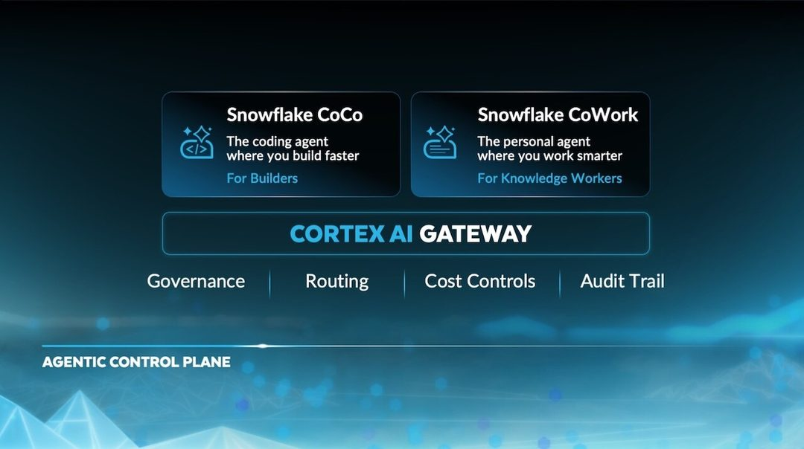

两件事同时发生：英国 FCA 抱怨 Meta 拒绝共享 Muse 用于测试；亚马逊与 Meta 正在谈判，解除 Muse 在其电商平台上的封锁。

关键点在于冲突的性质变了。监管关心的是责任归属——一个能替用户比价、下单的 agent，其建议是否构成金融或消费建议，出问题时算谁的；平台关心的是交易闭环——agent 代用户操作，等于绕过了平台的推荐位与广告库存。

为什么重要：这是「个人 agent」与「平台经济」第一次正面摩擦，且摩擦点不在技术而在治理与商业模式。判断：Muse 这类产品的天花板不由模型能力决定，而由它能否被主流平台承认为「合法客户端」。谈判结果会比任何一次模型升级更能说明 agent 商业化的边界。

> 原文：[WIRED](https://www.wired.com/story/meta-refused-to-share-muse-for-testing-uk-financial-watchdog-complains/)

### Snowflake 让数据开发走向 Agent 自主执行

Snowflake 展示了 CoCo 与 CoWork 的新能力，把数据开发的终点从「受治理的洞察」推进到「agent 自主执行业务作业」。

关键点是从「读」到「写」的跨越。此前数据平台的 AI 能力集中在自然语言查询与洞察生成，输出仍需要人来执行；CoWork 这类能力意味着 agent 可以基于治理规则直接完成作业，权限模型因此成为核心组件而非附属配置。

为什么重要：数据平台的竞争点正从「能不能查得快」转向「能不能自己干得对」。一旦 agent 获得写权限，审计、回滚、最小权限就成了采购决策的硬指标。判断：这类产品的分水岭不在 demo，而在于出事之后能否解释「它为什么这么做」——可解释性会成为数据 agent 的准入券。

> 原文：[InfoQ](https://www.infoq.cn/article/vfmBDlfQRRfHq4Jyi5b6)

### nexos.ai 推出统一 AI 网关，覆盖 200+ 模型

nexos.ai 推出 AI 采用平台，把 200 多个模型接入同一个网关，并内置预算限制与治理功能，目标是降低企业多模型管理的成本。

关键点是把「模型选择」变成「策略配置」。企业真实痛点不是缺模型，而是模型太多：不同团队接不同供应商，成本、合规、密钥、日志各管一摊。网关把这些收敛成一个控制面，预算上限成为一种可执行的治理手段。

为什么重要：模型网关正在变成企业 AI 的事实控制面——谁掌握调用入口，谁就掌握成本数据与替换权。判断：这类产品的护城河不在接入数量（200 个很快会被追平），而在于能否提供一致的评测与降级策略，让「换模型」像换配置一样可验证。

> 原文：[MarkTechPost](https://www.marktechpost.com/2026/11/26/nexos-ai-ai-gateway-200-models-governance/)

### Uber 推出安全 AI 框架，治理智能体全生命周期

Uber 发布安全 AI 框架，对 AI Agent 从设计、部署到运行进行全生命周期治理，重点强调权限与风险控制。

关键点是把 agent 当作需要持续约束的对象，而非一次上线的功能。全生命周期治理意味着把权限边界、操作审计、异常熔断写进工程流程——这与传统安全的思路一致，只是被约束的对象从「服务」变成了「会自己做决定的进程」。

为什么重要：agent 大规模上生产的前提，不是模型更聪明，而是出错时可被定位、可被叫停、可被追责。判断：这类框架短期内不会带来收入，但会成为企业采购时的资格项；未来一年「agent 权限管理」很可能独立成一个产品品类。

> 原文：[InfoQ](https://www.infoq.cn/article/xA3g2i0VtTZIOVePMedY)

### 小米 HAD 推送新版本，引入因果链与车端世界模型

小米汽车推送 Xiaomi HyperOS 1.20，HAD 智驾引入「因果链」与车端世界模型，澎程全系开始全量推送。

关键点有两个方向：一是「车端」，模型跑在车上而非云端，直接关联时延与弱网可用性；二是「因果链」，即不只输出轨迹，还要给出决策的因果解释。这两个词合在一起，指向的是智驾叙事从感知堆料转向可解释决策。

为什么重要：智驾的用户信任长期受制于「它为什么突然这么做」。如果因果链能把决策过程结构化输出，对接管率与事故定责都有实际价值；而车端世界模型则决定这套能力在无网环境下是否还能成立。判断：全量推送意味着这是一次规模化的真实验证，重点应看接管率与误触发数据，而非发布会上的名词。

> 原文：[36氪](https://36kr.com/newsflashes/4087374599223684)

### 美团酒店 AI 工具既白将覆盖近 40 万商家

美团预计到 2026 年底，酒店 AI 经营工具「妙手酒店版·既白」将覆盖近 40 万商家；深度使用该工具的商家订单量同比增长 22%。

关键点是路径选择：不是做一个通用助手让商家自己提问，而是把 AI 嵌进定价、房态、营销这些具体经营环节，用平台数据换取执行权。22% 是相关性而非因果，深度使用者本身可能就更会经营，但这个数字足以支撑商家的付费意愿。

为什么重要：AI 在垂直行业的渗透，靠的往往是经营闭环而不是模型能力——工具能直接改价格、改库存、改投放，效果才会体现在订单上。判断：平台型公司的 AI 优势不在模型，而在「最后一公里的执行权限」；这也意味着商家的经营自主权会被进一步让渡，值得持续关注。

> 原文：[雷锋网](https://www.leiphone.com/category/industrynews/V8W9L3t0BkCtFZPu.html)

### 结语

今天八条新闻的共同点：AI 产品的竞争焦点已从「能做什么」，转向「给谁多少额度、授什么权限、出事谁负责」。留一个问题：当额度、权限与责任都被写进产品，你所在的产品里，哪一项还是一片空白？

<h2 id="opinion" class="ai-section-divider">💭 行业观点</h2>

今天最值得看的一条，是 Dario Amodei 罕见地公开反驳一项指控：有人说 Anthropic 在把人类控制权交给 AI，他称这种说法“荒谬”，并明确表示让 AI 治理社会是个坏主意。值得注意的不是他的立场，而是他需要表态这件事本身——自动化 AI 研发已经从技术选择变成了公共议题。把今天这六条放在一起看，争论的焦点正从“AI 能不能做到”转向“谁有权决定它做到哪一步”。负责划定边界的人，正从实验室扩散到州议会、科学家群体和国家战略。

### Dario Amodei：让 AI 治理社会是个坏主意

Anthropic CEO Dario Amodei 公开回应“把人类控制权交给 AI”的指控，称其荒谬，并明确表态：让 AI 治理社会是个坏主意。这番话针对的是外界对 Anthropic 推进自动化 AI 研发的担忧。

关键在于，他划出了两条不同的界线：一条是 AI 参与研发，这正是 Anthropic 在做的事；另一条是 AI 替代人类做社会决策，这是他明确反对的。但这两条线在公众眼里并不天然分开——当模型开始参与设计下一代模型，“到底谁在控制”就不是一份声明能澄清的问题。

这件事重要的地方在于：头部实验室的 CEO 被迫公开表态，说明“自动化研发”已经走出技术圈，成为治理议题。接下来真正会被追问的，不是立场，而是可验证的约束机制。

> 原文：[TechCrunch](https://techcrunch.com/2026/11/25/anthropics-dario-amodei-calls-accusations-of-surrendering-human-control-to-ai-absurd/)

### 纽约州禁售 AI 聊天玩具五年

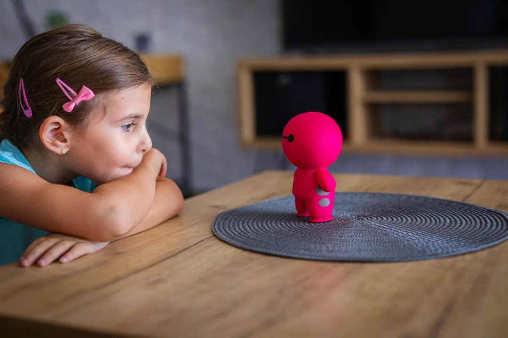

纽约州以儿童安全为由，禁售 AI 聊天玩具五年。Common Sense Media 的相关研究指出，这类产品存在不当内容与情感发展风险。

关键点有两个：禁令针对的不是某一款产品，而是整个品类；时间跨度以年计，等于给“AI 陪伴硬件”按下暂停键。

监管通常从议价能力最弱的使用者切入，儿童是第一个。对做 AI 玩具、陪伴类硬件的团队来说，内容审核、对话边界、家长可见性需要成为产品定义的一部分，而不是上线后再补的补丁。美国州级立法常有示范效应，五年的窗口足以重塑一个品类的产品形态与成本结构。

> 原文：[TechCrunch](https://techcrunch.com/2026/11/25/want-to-buy-your-kid-an-ai-toy-this-christmas-not-in-new-york/)

### Anthropic 内部：Agent 改写软件工程

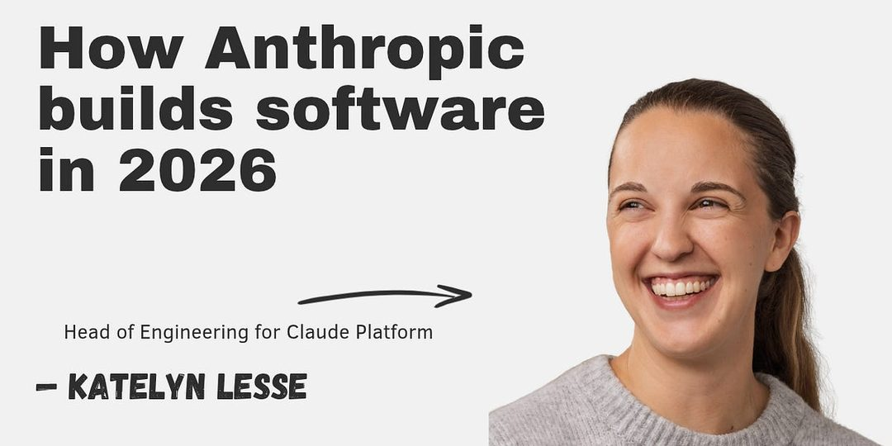

Anthropic 工程负责人 Katelyn Lesse 详述了两件事：用 Rust 重写 Claude API，以及 AI Agent 如何改变公司内部的软件工程协作方式。

重写 API 是性能与可靠性层面的工程决策；更值得看的是协作层面的变化——当 Agent 承担代码生成、评审与维护的一部分，人的角色向定义问题、设定约束和验收迁移。

外界讨论 agentic engineering 大多停留在 demo，而一家模型公司自己的工程流程是最诚实的样本。它也顺带暴露了新问题：代码归属怎么算、review 责任落在谁身上、Agent 的产出由谁背书。这些问题没有标准答案，但会先出现在内部流程里，然后才会传导到整个行业。

> 原文：[The Pragmatic Engineer](https://newsletter.pragmaticengineer.com/p/how-anthropic-builds-software-in)

### 芯片管制与反蒸馏开始显效

有报道称，美国的芯片获取限制与反蒸馏（anti-distillation）措施已经开始拖慢中国 AI 实验室，部分中国开发者转而使用 Google 和 Meta 的数据。

压力来自两端：算力供给受限，训练数据来源也被收紧；应对方式是从“蒸馏更强模型”转向使用可获得的开放数据。

如果这一趋势成立，影响的不只是单次训练的进度，还有模型迭代节奏和能力分布。同时，“用谁的数据”会把合规风险从出口管制延伸到数据许可，这是一个容易被低估的次级风险。对投资人来说，算力与数据可得性仍是评估模型公司时最不带情绪的两个硬指标。

> 原文：[The Decoder](https://the-decoder.com/us-chip-access-curbs-and-anti-distillation-measures-are-reportedly-already-slowing-chinese-ai-labs/)

### 普京要求更新 2036 年前 AI 战略

普京在莫斯科表示，俄罗斯需要更新面向 2036 年的 AI 国家战略，方向包括推动人与自主系统协同，以及重构管理生产流程。

关键点在于时间跨度和落点：十年期的规划，重点不在模型本身，而在组织与流程改造——把 AI 当作管理和生产的底层变量，而不是一个单独的产业。

这类战略文件的真实约束力取决于算力、人才与产业链，短期内难以量化。但方向表态会影响资源分配和外部合作的选择，也会成为观察其他国家 AI 产业政策的一个参照系。

> 原文：[36氪](https://36kr.com/newsflashes/4087395152214402)

### 科学家给 Agent 划的那条线

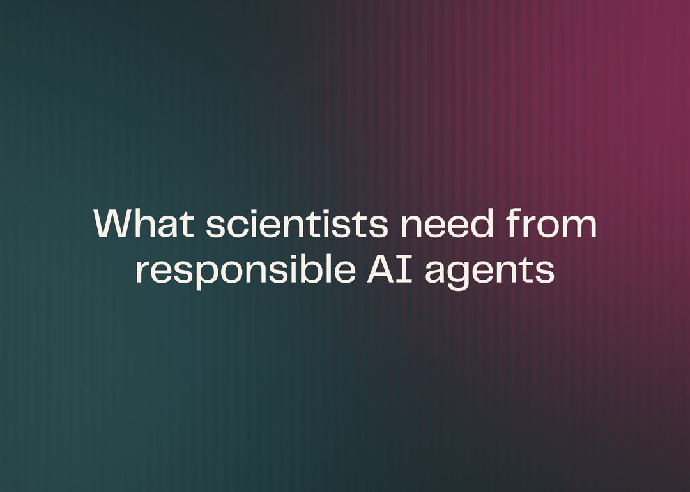

Allen AI 在博客中讨论科学家在科研中使用 AI Agent 的边界：哪些环节可以自动化，哪些必须保留人类判断。

讨论没有停留在“能不能用”，而是按科研流程拆开：假设生成、实验设计、数据分析、结论撰写，每个环节的风险性质不同，可让渡的程度也不同。

这类清单的价值在于可复用。任何要部署 Agent 的组织，都需要一份自己的“人类判断保留区”——否则 Agent 会在效率的名义下，悄悄接管那些最需要问责的环节。真出问题时，责任归属不会因为“是模型做的”而消失。

> 原文：[Hugging Face / Allen AI](https://huggingface.co/blog/allenai/where-scientists-draw-the-line-on-ai-agents)

所有关于 AI 的争论，最终都会落到同一个问题上：这条线由谁来划，划错了由谁负责。今天从州议会到科学家都在给答案，而这些答案目前还互不一致。

<h2 id="opensource" class="ai-section-divider">⚙️ 开源工具</h2>

今天最值得看的是腾讯开源的 DFly2：它把投机解码（speculative decoding）的草稿 KV Cache 复用做到逐层，在 64K 长上下文服务场景下吞吐最高提升 81%。这个数字的意义不在幅度本身，而在于投机解码过去在长上下文上常被显存带宽反噬，如今适用区间被往上推了一截。另一个结构性信号是：今天 8 条里有 4 条在给 Agent 修路——工具接口、代码执行、网页抓取、手机控制。模型层的竞争远未结束，接口层的卡位已经开始。

### DFly2：把投机解码的显存开销算到每一层

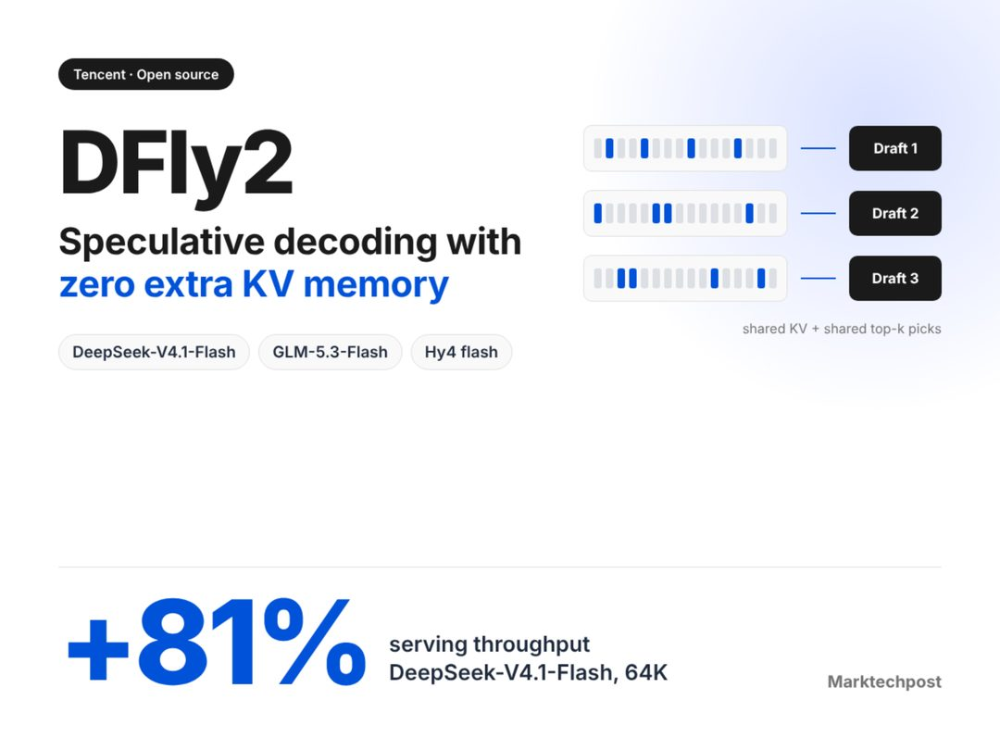

腾讯开源的 DFly2 是一个投机解码器：草稿模型在每一层复用目标模型的 KV Cache 与 top-k 索引，不额外增加草稿侧的 KV 内存占用，在 64K 长上下文服务下吞吐最高提升 81%。

关键点在于“逐层复用”。传统投机解码的隐性成本是草稿模型要独立维护一份 KV Cache，上下文越长，这部分显存与带宽开销越重，收益被抵消。DFly2 选择不新增这份开销，等于把投机解码的性价比曲线往长上下文一侧平移。

为什么重要：长上下文推理的成本大头在 decode 阶段的显存带宽，而非算力。任何“不加卡就能提吞吐”的优化，对做推理服务的人来说都是直接的成本项。原文标题指向稀疏模型（sparse models）场景，这也是当前 MoE 架构的主流战场。

> 原文：[MarkTechPost](https://www.marktechpost.com/2026/11/26/tencent-dfly2-speculative-decoding-sparse-models/)

### FreeVideo：8GB 显存也能跑视频生成

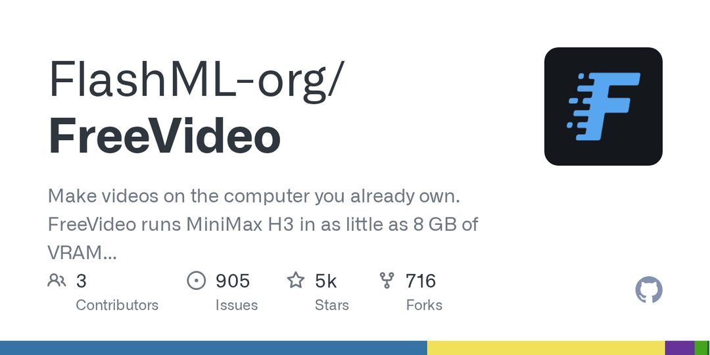

FreeVideo 开源，目标很直接：让 MiniMax H3 这类视频生成模型跑在 8GB 显存、16GB 内存的普通电脑上，并根据硬件情况自动选择加速路径。

关键点是“自动选择加速路径”。视频生成的显存瓶颈通常在潜空间序列长度与注意力实现上，不同硬件的可用算子不同，手工调参的成本很高。把硬件探测与路径选择做成默认行为，是把门槛从“能配环境的人”降到“能装依赖的人”。

为什么重要：视频生成过去默认绑定工作站级显卡，本地化意味着创作自由度和数据不出本机。但也要清醒——能跑起来与能用于生产是两件事，量化与分块带来的质量损失需要实测。对个人创作者和小团队，这是一个值得先跑一遍再判断的选项。

> 原文：[GitHub](https://github.com/FlashML-org/FreeVideo)

### CLI-Anything：把存量软件批量变成 Agent 接口

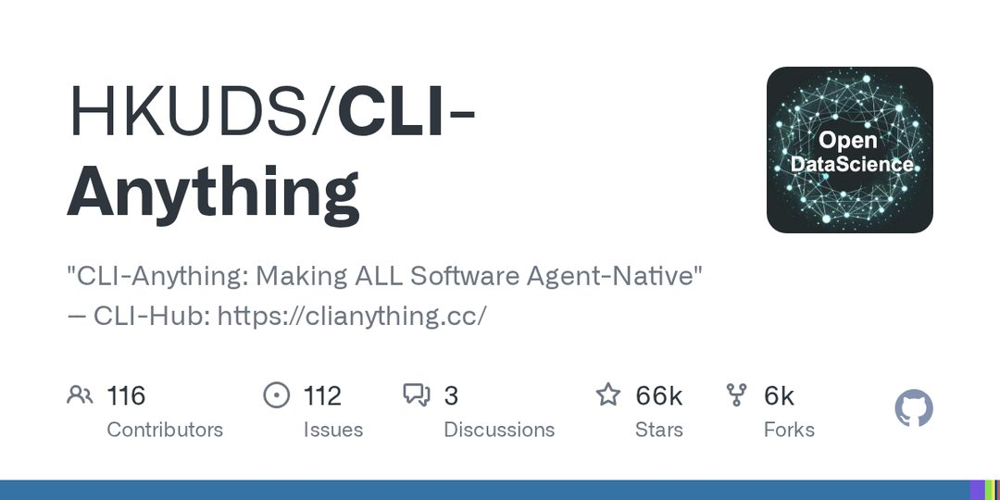

港大 HKUDS 开源 CLI-Anything，核心是一个 CLI-Hub：把传统软件封装成 Agent 可直接调用的原生接口，思路是“所有软件 Agent 化”。

关键点在于选了一条务实的路径。让软件支持 Agent，理想方案是重写一套 API 或接入某种协议，现实方案是包一层命令行——CLI 天然具备结构化输入输出、可组合、可脚本化的属性，是存量软件最便宜的一层适配。

为什么重要：Agent 落地的瓶颈往往不在模型智商，而在工具接口的覆盖率。这类项目的价值上限取决于两个工程细节：权限边界与状态管理——长任务里进程挂起、部分失败、副作用回滚，都是 CLI 包装难以回避的问题。封装容易，可靠难。

> 原文：[GitHub](https://github.com/HKUDS/CLI-Anything)

### 100 行代码，SWE-bench 过 74%

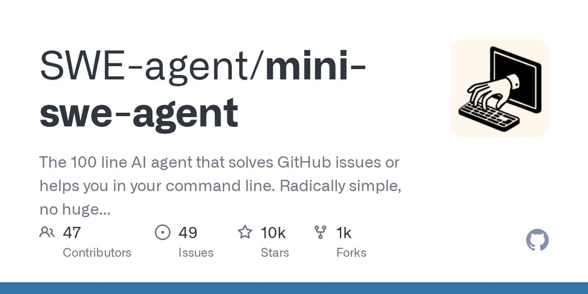

SWE-agent 团队开源 mini-swe-agent，用约 100 行代码实现一个命令行 AI Agent，在 SWE-bench verified 上得分超过 74%。

关键点在于它做了什么减法：没有复杂的规划器、记忆模块或工具编排层，基本就是“给模型一个 shell，让它自己循环”。这个结果对过去两年堆起来的 Agent 框架是个直接的对照实验——很多抽象层可能是在给模型加噪声，而不是加能力。

为什么重要：74% 不是 SOTA，但它用两个数量级更少的代码接近了第一梯队，说明当前 Agent 的能力上限更多由底层模型与执行环境决定。做框架的人需要回答一个问题：你新增的那一层，是降低了模型的负担，还是仅仅降低了人的阅读负担。

> 原文：[GitHub](https://github.com/SWE-agent/mini-swe-agent)

### llama.cpp 补上 AMD 的测量缺口

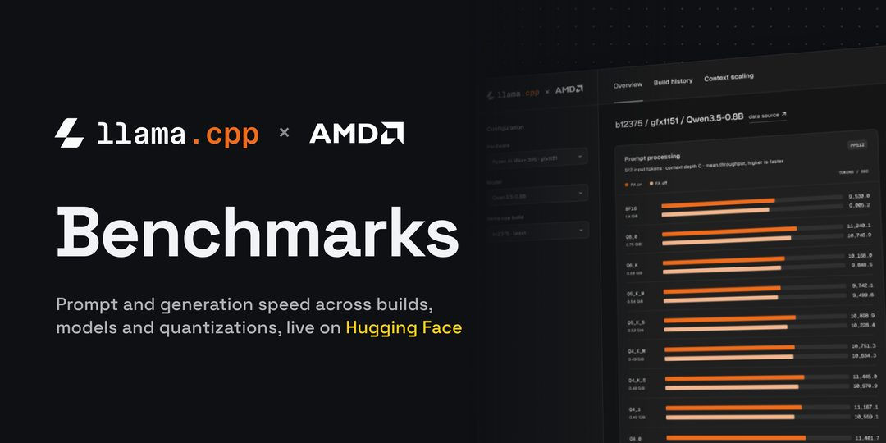

llama.cpp 社区发布面向 AMD 硬件的基准测试面板，覆盖 Ryzen 处理器与 Radeon 显卡，用来对比不同 AMD 硬件上的推理性能。

关键点不是性能数字，而是“可比较”。本地推理的硬件选型长期依赖零散的个人测试，变量不受控——量化格式、上下文长度、后端版本任何一项不同，结论就不可比。官方社区维护一份统一口径的面板，等于给这个市场补了测量基础设施。

为什么重要：AMD 在消费级市场的竞争力很大程度取决于显存容量与单位成本，而这些优势能否转化成推理吞吐，需要数据说话。对采购决策者，这比任何评测视频都更有参考价值。测量工具的完善，通常是一个生态开始成熟的信号。

> 原文：[Hugging Face Blog](https://huggingface.co/blog/ggml-org/llamacpp-amd-bench)

### MiniMind：两小时手搓一个 64M 模型

MiniMind 开源了一套完整流程，让开发者在约两小时内从零训练出一个 64M 参数的小型语言模型。

关键点是“全流程”而非“小模型”。数据准备、tokenizer、预训练、指令微调，这些环节在大模型语境下常被 API 封装掉，而自己走一遍才会碰到真实的坑：学习率怎么定、loss 曲线怎么读、数据配比影响多大。

为什么重要：对团队而言，这是比调 API 更有效的直觉训练。很多人能讲清楚 Transformer 结构，却没亲手处理过一次训练不收敛。64M 的规模足够小到可以反复实验，又足够大到能体现真实问题——这类项目对培养工程判断力的价值，被普遍低估了。

> 原文：[GitHub](https://github.com/jingyaogong/minimind)

### Firecrawl：Agent 的搜索与抓取底座

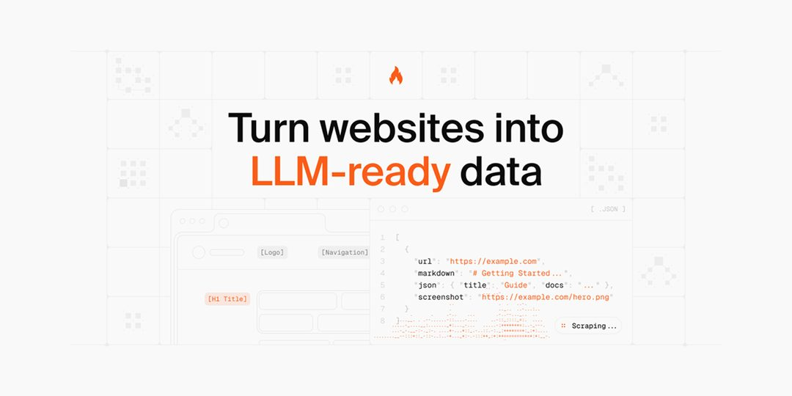

Firecrawl 开源，用一个 API 提供搜索、抓取与 550+ 数据源接入，把网页内容转成 Agent 可用的结构化知识。

关键点是“搜索 + 抓取 + 结构化”被打包成一个入口。Agent 获取外部信息通常分三步：找到页面、取回内容、清洗成可用格式。第三步最脏也最容易被低估——反爬、动态渲染、正文提取，每一项都是长期维护成本。

为什么重要：检索增强（RAG）的前端正在从“项目内自建模块”变成“基础设施”。竞争点随之从功能转向覆盖率与清洗质量：能稳定拿到多少站点的干净正文，决定了上层 Agent 回答质量的下限。这也是一个容易被开源方案快速商品化的层。

> 原文：[GitHub](https://github.com/firecrawl/firecrawl)

### Phone Harness：Agent 伸手到手机

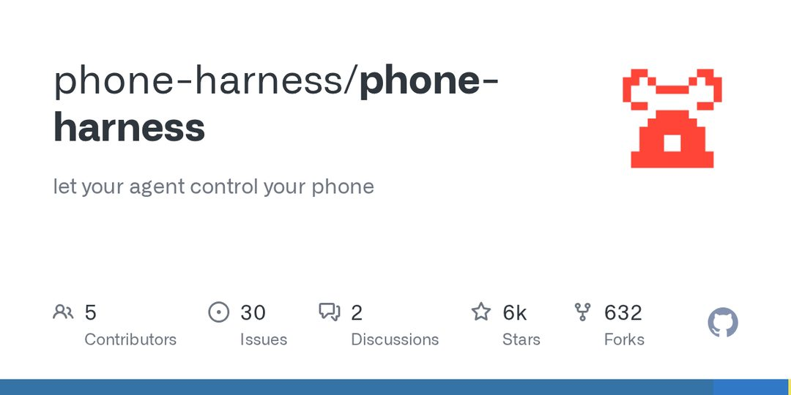

开源项目 phone-harness 提供让 Agent 控制手机的能力，指向移动端自动化操作与个人助理场景。

关键点是场景选择的合理性。移动端是少数还没被 CLI 化的计算环境——没有通用命令行，App 之间互相隔离，几乎所有操作都依赖视觉识别与坐标点击。这也意味着这里的数据与任务密度极高：订票、比价、填表，都是高频且规则模糊的真实需求。

为什么重要：移动端也是权限与风控最敏感的地方。系统级自动化、账号安全、平台反作弊，任何一项都会限制技术方案的落地边界。这个方向的技术可行性大概率会先于合规可行性成熟，值得观察但不宜过早押注。

> 原文：[GitHub](https://github.com/phone-harness/phone-harness)

### 结语

今天这批开源里，稀缺的不是模型，而是让模型能动手的接口和能验证效果的测量工具。留一个问题：如果你的产品明天要接入 Agent，你会选择为它提供一套专属 API，还是给 Agent 一个命令行？
